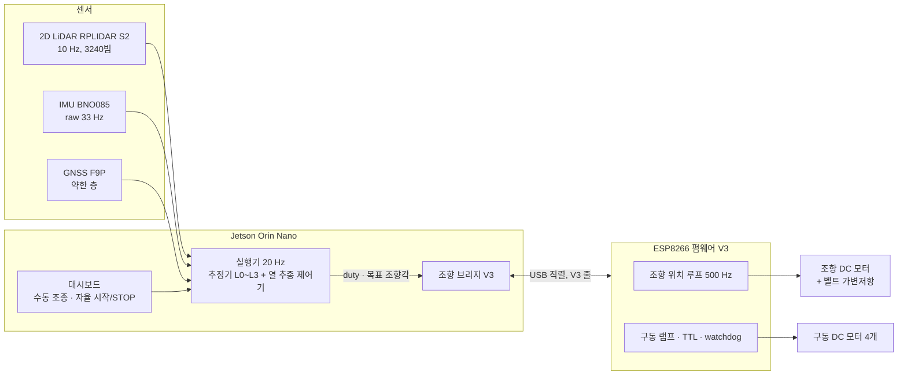
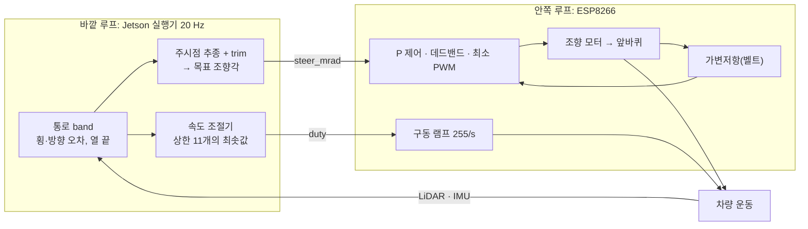
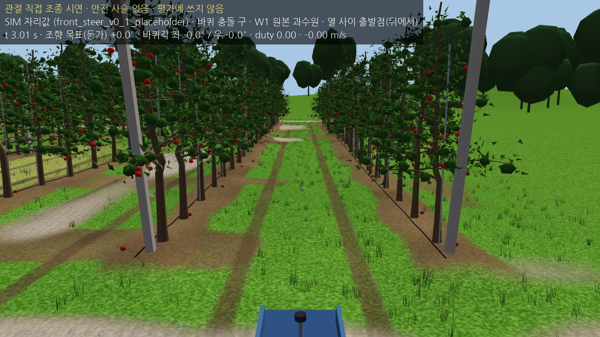
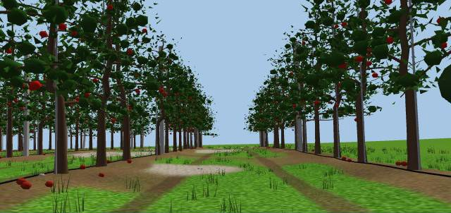
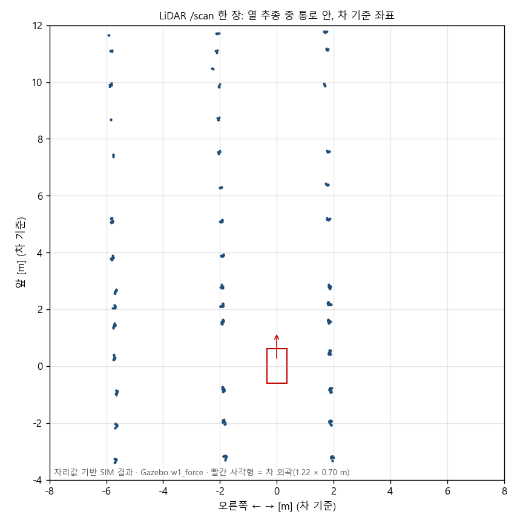

# unist_orchard_simulation

UNIST BTS 유니주행차 팀의 과수원 로버 시뮬레이션 저장소입니다. 앞바퀴 조향으로 바꾸는 로버가 과수원 열 하나를 행간 중심선을 따라
처음부터 끝까지 달리고 열 끝에서 서는 동작을, 실차에 올리기 전에 시뮬레이션에서 만들고 확인합니다.

> **English summary.** Simulation repository of a small orchard rover (a converted ride-on toy car, now being refitted
> with front-wheel steering: a plain DC motor turns the steering and a belt-coupled potentiometer closes a position loop
> on an ESP8266). Goal: drive one orchard row along the centre line between two tree rows and stop at the row end, no
> U-turn. Inputs: 2D LiDAR (RPLIDAR S2) and raw IMU as the main sensors, applied PWM and steering angle as bounded
> priors, GNSS as a weak optional layer; no wheel encoders, no vision. Two simulators share one code path: a fast
> deterministic simulator (F-SIM: executor, host bridge, ESP firmware V3 and steered plant on one clock) and a Gazebo
> Harmonic stack (G-SIM: ROS 2 Jazzy in Docker). Every number here is a placeholder-based SIM result: the steering
> hardware has not been measured yet, so nothing in this repository is a field result. The documents are in Korean.


[SIM · 자리값] 사용자 로컬 명령 그대로, 이미지 wf7, SIM 시계(`sim_stack.py start` 뒤 `sim_auto.py start`). Gazebo 과수원(W1)
통로 하나를 처음부터 열 끝까지 달리고 선 차량 카메라 화면(약 99 s를 10배속). 실행기는 `/scan`과 raw IMU만 보고 조향과 구동을
정한다. 최종 확인 4단계 F run 3([결과](docs/steering/STEER_FOLLOW_GSIM_FINAL_KO.md#135-f-사용자-명령-그대로-3-run)).

> **이 저장소의 모든 수치는 자리값 기반 SIM 결과입니다. 현장 성능이 아닙니다.** 조향 장치(모터, 가변저항, 벨트, 치수)의 값은 아직
> 자리값이고, 조향 장치를 단 실차로 잰 값은 없습니다. 검증되지 않은 것은 [현재 한계](#현재-한계와-다음-할-일)에 적었습니다.

## 목표

1. 운영자가 열 시작 지점에 차를 두고 대시보드의 자율 주행 버튼을 한 번 누른다.
2. 차는 구동 바퀴에 PWM을 줘서 앞으로 간다(목표 0.40 m/s, 범위 0.20~0.50 m/s).
3. 앞바퀴 조향은 외력에 밀려 틀어지지 않도록 직진 각을 붙잡는다(ESP 위치 루프).
4. 방향이나 위치가 틀어지면 조향을 움직여 행간 중심선으로 돌아온다(실행기 바깥 루프).
5. 열 끝에서 감속하고 선다(앞범퍼가 마지막 줄기 선의 ±1.0 m 안). 유턴과 다음 열은 하지 않는다.

## 핵심 특징

- **센서만으로 통로를 잡는다.** 2D LiDAR + raw IMU가 주 입력이다. 적용 PWM과 조향각은 짧은 예측·감시용 사전값, GNSS는 기록·지오펜스용
  약한 층이다(일반 GNSS 오차 5~10 m가 열 간격 3.6~4.1 m보다 크다). 휠 엔코더와 카메라 인식은 쓰지 않는다.
- **두 단계 SIM, 같은 코드.** 빠른 SIM(결정적, 큰 조건 행렬)과 Gazebo 스택(ROS·대시보드·기록 통합)이 같은 실행기, 같은 호스트 브리지,
  같은 ESP 펌웨어 소스(PC용 흉내 층으로 컴파일)를 쓴다. 참값은 평가에만 쓰고 실행기 입력에는 넣지 않는다(검사 A13).
- **조향 위치 루프는 ESP에, 바깥 루프는 Jetson에.** 실행기(20 Hz)는 주시점 추종 + trim으로 목표 조향각을 정하고, ESP(서보 500 Hz)는
  벨트로 이은 가변저항 값으로 조향 모터를 돌린다. 속도는 연산 지연·스캔 나이·정지 거리 등 상한 11개의 최솟값이다.
- **안전 규칙이 펌웨어부터 화면까지.** 한 번 눌러 시작, 운영자 신호가 1.0 s 끊기면 정지(결정 R60), 자동 재출발 없음, STOP은 누구나, 명령 TTL
  300 ms, 링크 watchdog 500 ms, 결함 코드 15종과 래치.
- **사전등록 판정.** 기준을 측정 전에 커밋하고 그대로 판정한다. 불합격도 남긴다([`docs/RESULTS_KO.md`](docs/RESULTS_KO.md)).

## 시스템 구성



[도식] 실차는 조향 장치를 만드는 중이고 설치·현장 확인은 계획이다. SIM에서는 센서·차체가 Gazebo로, ESP가 에뮬레이터로 바뀐다.
컨테이너 구성, 자료 흐름, 추정기 층, 실행기 상태 기계는 [`docs/ARCHITECTURE_KO.md`](docs/ARCHITECTURE_KO.md).



[도식] 제어 루프. 바깥 루프는 `sim/ubts/closed_loop/steer_control.py`, 안쪽 루프는 `firmware/ubts_steer_v3/`(SIM에서 구현됨, 실기에 쓰기 전).

## 로버 모델과 시뮬레이션 환경

| 비스듬히 | 옆 | 위(오른쪽이 앞) |
|---|---|---|
|  |  |  |
| [SIM · 자리값] 차체 상자, 앞바퀴 조향 링크, LiDAR(기둥 위), 카메라 | [SIM · 자리값] 휠베이스 0.76 m, 바퀴 반경 0.14 m | [SIM · 자리값] LiDAR·카메라가 앞쪽 중앙 |

| 앞, 조향 0° | 앞, 조향 +15°(왼쪽) |
|---|---|
|  |  |
| [SIM · 자리값] Gazebo 조향 모델(프로필 v0.1) | [SIM · 자리값] 바퀴각 좌 +15.6° / 우 +14.5°(Ackermann 비율 0.5) |

| 과수원 전경 | 위에서 본 과수원 | 통로 출발점 |
|---|---|---|
|  |  |  |
| [SIM · 자리값] W1 원본 과수원(원본 프로젝트의 생성기), 오른쪽 아래가 차 | [SIM · 자리값] 열 간격 3.8 m, 나무 간격 1.2 m, 열 길이 30 m | [SIM · 자리값] 두 나무 열과 기둥·철선 |

| 차량 카메라 | LiDAR `/scan`, 통로 안 | LiDAR `/scan`, 출발점 |
|---|---|---|
|  |  |  |
| [SIM · 자리값] 640×360 Gazebo 렌더. 표시·기록용, 위치 추정에 쓰지 않음 | [SIM · 자리값] S2 형식 3240빔, 차 기준 좌표, 빨간 사각형이 차 외곽 | [SIM · 자리값] 앞 3 m부터 두 줄의 줄기 |


[SIM · 자리값] SIM 대시보드의 주행 화면(127.0.0.1:18090): LiDAR, 차량 카메라, 조향 패널(목표·측정 조향각, 구동 duty, 입력 기한).
대시보드 저장소의 새 화면 사본에 SIM 확장을 꽂은 것이다([`SIM_DASHBOARD_KO.md`](docs/steering/SIM_DASHBOARD_KO.md)).


[SIM · 자리값] 빠른 SIM에서 열 추종을 위에서 본 애니메이션(평지 기둥 두 줄 W0, `nominal` seed 0, 약 10배속).

그림 목록과 출처(원본, 만든 명령, 해시, 눈으로 본 기록)는 [`docs/assets/ASSETS.json`](docs/assets/ASSETS.json)에 있다. 실물 차량·조향 장치
사진은 아직 없다. [계획 · 미구현] 사진이 오면 같은 규칙으로 `docs/assets/photos/`에 넣는다.

## 결과 요약

모두 자리값 기반 SIM 결과이며 현장 성능이 아니다. 전체 표(합격 검사 A1~A26, 불합격·미실행 포함)는 [`docs/RESULTS_KO.md`](docs/RESULTS_KO.md).

| 무엇 | 조건 | 결과 |
|---|---|---|
| 열 추종, 빠른 SIM(사전등록 `steer_follow_v1`) | 평지 기둥 두 줄, 조건 11종 15회(출발 어긋남, 조향 0점, 쏠림, LiDAR 끊김, 장애물) | 합격 15/15. 횡 RMSE 0.029~0.055 m, 열 끝 e +0.04~+0.09 m |
| 열 추종, Gazebo(사전등록 `steer_follow_gsim_v1`) | W1 과수원, 실행기 컨테이너, 4회 | 기록대로 불합격 3/4(평가 코드 결함), 먼저 커밋한 수정 1 뒤 같은 기록으로 합격 4/4. 횡 RMSE 0.021~0.039 m, e +0.45~+0.46 m |
| 안전 대본(빠른 SIM, 실행기 포함) | STOP, TTL, watchdog, 운영자 신호 끊김, 두 화면 등 | 합격 71/71 |
| 외란 아래 직진 유지(ESP 루프만, 프로필 v0.2) | 조향축 토크 외란 대본 × 5 seed | 불합격 39/40(크기 밖 외란 1회의 첫 결함 이름이 등록 밖) |
| 프로필 v0.3 자격 | 정상·고장·외란 대본 | 불합격(정지 중 전폭 쓸기의 열 예산 자리값). 기본 프로필은 v0.1 |
| 넓은 조건 평가(사전등록 `steer_follow_wide_v2`) | 빠른 SIM 큰 조건 행렬 275 run | 불합격. 2차 판정 262/275(1차 251/275). [`STEER_FOLLOW_WIDE_RESULT_KO.md`](docs/steering/STEER_FOLLOW_WIDE_RESULT_KO.md) |
| Gazebo 최종 확인(이미지 wf5 → wf6 → wf7 → wf8 → wf9, SIM 시계) | W1 과수원, 한 번 눌러 시작, 열 추종 4 run · 대시보드 화면 · A17(G) · PW-08(wf6) · 사용자 명령 3 run | 불합격. wf9(6단계): 열 추종 4/4 합격, 화면 불합격(첫 run 이 go 2.4 s 뒤 `steering_feedback_stale`), 사용자 명령 1/3 — 실패 셋은 Windows 전체 CPU 70 % 아래였지만 이 PC 의 E 코어가 약 80 % 로 찼던 때(실행기·브리지·에뮬레이터가 함께 느려짐). wf8: 화면 6/6 합격(운영자 세션 규약 개정 5), 열 추종 2/4, 사용자 명령 0/3 — 실패 다섯은 모두 호스트가 바쁜 때 실행기 스캔 처리 0.15~0.32 s(LiDAR·조향 상태 나이 한도). wf7 의 출발 직후 입력 끊김은 새 DDS 참가자 합류 뒤 SIM 쪽 정지로 가렸고 검사가 기다리게 고쳤다. wf7: 사용자 명령 3/3 열 끝(33.3~33.4 m), A17(G) `bridge_stall` 4/4. wf6: 열 추종 3/4, 화면 합격, A17(G) 24/25, PW-08 합격 |


[SIM · 자리값] Gazebo 과수원 한 통로의 열 추종(참값 경로, `nominal_1`). 아래 칸은 횡 위치를 세로로 확대한 것이다.

## 빠른 시작

저장소 맨 위에서 실행합니다. Gazebo 스택은 Windows Docker Desktop + WSL2(GPU 렌더) 기준입니다.

### 1. 확인 명령 (Docker 없음)

```bash
python -I tools/steer_sim/check_pins.py              # 다시 쓰는 기반 파일이 고정된 내용 그대로인지
python -I tools/steer_sim/check_vendor_sync.py       # 실행기의 vendor 사본, manifest, SHA256SUMS
python -I tools/steer_sim/check_import_manifest.py   # 출처표
python -I tools/steer_sim/check_assets.py            # 문서 그림·매니페스트·문서 링크
(cd sim/ubts && python -B -m field_world.coord_lint ../.. --all-text)   # 좌표 검사, 트리 전체
```

시험은 파일마다 따로 돌립니다. 예: `cd sim/ubts && python -B -m pytest -q -p no:cacheprovider test_steering_geometry.py`.

### 2. 빠른 SIM으로 열 추종 한 번 (Docker 없음)

Python 3.10 이상(numpy, PyYAML)과 C++ 컴파일러(`g++` 또는 MinGW)가 필요합니다. 펌웨어 네이티브 프로그램을 처음 한 번 빌드하므로
빌드 폴더를 저장소 밖으로 줍니다.

```bash
export UBTS_STEER_BUILD_DIR=<저장소 밖 빌드 폴더>
cd sim/ubts
python -B -m steering.safety_scripts.follow_matrix --out <저장소 밖 결과 폴더> --only nominal --seeds 0
```

### 3. Gazebo 스택을 켜고 자율 주행 시작

이미지 `ubts-steer-sim:wf4c`가 있어야 합니다. 그 이미지는 개발 PC의 로컬 기반 이미지 위에 `docker/Dockerfile.ubts-steer`로 만들었습니다
(빌드 명령은 그 파일 머리말). 스스로 서는 기반 정의 `docker/Dockerfile.base`는 아직 빌드·검증하지 않았습니다
([`BASE_IMAGE_KO.md`](docs/provenance/BASE_IMAGE_KO.md)). 메모리는 약 6 GiB가 필요하고, 다른 SIM 스택과 함께 올리지 않습니다.

```bash
# W1 원본 과수원 장면으로 전체 스택(sim, steer, recorder, dashboard, executor)
UBTS_STEER_SCENE=w1_force docker compose -p ubts-steer -f compose.ubts-steer.yaml --profile executor up -d
# 브라우저: http://127.0.0.1:18090  (대시보드)

# 자율 주행 한 run: Start → Arm → go 한 번, heartbeat를 보내며 상태를 1초마다 찍는다. Ctrl-C는 STOP
docker exec -it ubts-steer-executor-1 python3 -B -m steering.exec_run start
docker exec ubts-steer-executor-1 python3 -B -m steering.exec_run stop       # 즉시 정지
# 차를 장면의 출발 자세로 되돌리기(SIM 전용, 차가 서 있을 때)
docker exec ubts-steer-sim-1 /ros_entrypoint.sh python3 -B -m steering.exec_run reset

# 내리기(-v 없이: 이름 붙은 볼륨은 남긴다)
UBTS_STEER_SCENE=w1_force docker compose -p ubts-steer -f compose.ubts-steer.yaml --profile executor down -t 20
```

- 대시보드의 새 화면(조향 패널의 "준비" → "자율 주행 시작", STOP)은 wf4c 다음 이미지부터 들어갑니다. 그전에는 사본 폴더를 읽기 전용으로
  붙이는 compose 덮어쓰기로 봅니다([`SIM_DASHBOARD_KO.md`](docs/steering/SIM_DASHBOARD_KO.md) 5절). wf4c 그대로면 위 `exec_run`을 씁니다.
- 측정·검사 실행은 작업마다 프로젝트 이름을 `ubts-steer-<작업>`으로 하고 `tools/steer_sim/stack.py`로 올리고 내립니다(한 번에 스택 하나,
  호스트 부하 확인, 남은 컨테이너 영수증). 규칙: [`STACK_OPERATIONS_KO.md`](docs/steering/STACK_OPERATIONS_KO.md).
- 저장소 밖 자료(10/10 지도, 통로 목록)의 위치는 환경 변수 `UBTS_STEER_PATHS`가 가리키는 설정 파일로 줍니다
  ([`PATHS_KO.md`](docs/steering/PATHS_KO.md)). 결과와 측정 파일은 저장소 밖에 둡니다.

## 저장소 구조

| 폴더 | 내용 |
|---|---|
| `sim/ubts/steering/` | 조향 SIM: 차량 프로필, 조향 기하, 구동기·가변저항 모델, 빠른 SIM, T1 장치, Gazebo 모델과 장면, ESP 에뮬레이터, 적합성 대본, 안전 대본, 식별, 검사 |
| `sim/ubts/closed_loop/` | 추정기(통로 band, 사전값, 통로 품질), 열 추종 제어기 `steer_control.py`, 한 열 폐루프 하네스 |
| `sim/ubts/field_world/` | 현장 지도에서 만드는 월드와 좌표 검사(`coord_lint`) |
| `sim/ubts/orchard_perception/`, `sim/ubts/encoderless/` | 스캔 통로 검출, 센서만 쓰는 운동 추정 |
| `sim/ubts/` (바로 아래) | 다시 쓰는 기반 모듈(어댑터, CPU LiDAR, 월드 조립 등)과 시험 |
| `tools/row_executor/` | 한 열 실행기: Runner, 운영자 HTTP, 국소 격자, GNSS 층, 현장 조정 파일, vendor 사본 |
| `firmware/ubts_steer_v3/` | 조향 펌웨어 V3(ESP8266). 네이티브 lockstep 프로그램에 함께 컴파일된다 |
| `dashboard/`, `dashboard_sim/` | 대시보드 저장소 사본(서버, 정적 파일, 센서 브리지, 조향 브리지 V3)과 SIM 확장 |
| `ros2_ws/src/orchard_gazebo/`, `ros2_ws/src/orchard_navigation/` | 원본 프로젝트의 과수원 월드 생성기와 제어 참조 |
| `tools/field_calib/`, `tools/drive_response/` | 현장 보정 도구, 수동 주행 기록의 PWM duty·속도 분석 |
| `tools/steer_sim/` | 저장소 검사(고정 파일, vendor, 출처표, 문서 그림), 스택 운영, 그림 갈무리·만들기, 사양 적용 |
| `docker/`, `compose.ubts-steer.yaml` | 조향 SIM 이미지와 스택 정의 |
| `docs/` | 문서([색인](docs/README_KO.md)), 그림 `docs/assets/` |

## 하드웨어 요약

| 부분 | 알려진 것 | 아직 자리값·미정 |
|---|---|---|
| 차량 | 2인승 어린이용 4륜 전동차 개조(개조 전 표기 1.22 × 0.70 m, 12 V), 휠 엔코더 없음 | 휠베이스, 윤거, 질량, 바퀴 지름(SIM 0.76 m, 0.56 m, 24 kg, 0.28 m) |
| 조향 | 일반 DC 모터 + 모터 드라이버, 가변저항을 벨트로 연결, ESP 위치 루프, 리밋 스위치 없음 | 벨트 비, 가변저항 종류·범위, 조향각 한계(SIM 28°)·속도(SIM 30°/s), 모터 정격 |
| 구동 | 4륜, 좌우 모터 묶음, BTS7960 계열 드라이버 2개. 조향 장착 전 100 % duty 0.928 m/s | 조향 장착 뒤 duty→속도, 특히 25~60 % |
| 센서 | RPLIDAR S2(지면 약 0.6 m, 3240빔 10 Hz), BNO085 IMU, u-blox F9P GNSS, UVC 카메라 | LiDAR·IMU 장착 각(조향 장치를 단 뒤 다시 잼) |
| 계산 | Jetson Orin Nano, ESP8266(펌웨어 V3는 SIM에서만 돔, 실기에 쓰기 전) | 조향 드라이버의 ESP 핀(규격 A안) |

전체 표와 출처: [`docs/HARDWARE_KO.md`](docs/HARDWARE_KO.md).

## 조향 사양이 오면

고칠 파일은 `sim/ubts/steering/profiles/steer_spec_input.yaml` 하나, 돌릴 명령은 `tools/steer_sim/apply_spec.py` 하나입니다.
입력 검사 → 새 프로필 후보 → 펌웨어 CFG·호스트 프로필·Gazebo 관절 값 → 바뀐 값 요약과 다시 잴 목록 → 짧은 확인 순서로 갑니다.
절차: [`docs/steering/SPEC_UPDATE_KO.md`](docs/steering/SPEC_UPDATE_KO.md). 질문 목록(Q1~Q29): [`VEHICLE_SPEC_REQUEST_KO.md`](docs/steering/VEHICLE_SPEC_REQUEST_KO.md).

## 문서

| 문서 | 무엇 |
|---|---|
| [`docs/README_KO.md`](docs/README_KO.md) | 문서 색인(지금 기준 문서와 지난 단계 기록) |
| [`docs/ARCHITECTURE_KO.md`](docs/ARCHITECTURE_KO.md) | 시스템 구성, SIM 스택, 자료 흐름, 제어 루프, 추정기 층, 실행기 상태 도식 |
| [`docs/HARDWARE_KO.md`](docs/HARDWARE_KO.md) | 하드웨어·제품 사양, SIM 자리값 표, 모르는 것 |
| [`docs/RESULTS_KO.md`](docs/RESULTS_KO.md) | 검사 결과 한곳에 |
| [`docs/steering/DESIGN_v1_KO.md`](docs/steering/DESIGN_v1_KO.md), [`DESIGN_v2_KO.md`](docs/steering/DESIGN_v2_KO.md) | 설계(알고리즘, 차량 모델, 평가, 단계 계획) |
| [`docs/steering/DECISIONS_KO.md`](docs/steering/DECISIONS_KO.md) | 결정 기록 |
| [`docs/drive_response/README_KO.md`](docs/drive_response/README_KO.md) | 수동 주행 기록의 PWM duty·속도·정지 거리 측정 |
| [`docs/DOCS_POLICY_KO.md`](docs/DOCS_POLICY_KO.md) | 문서·그림 방침과 검사 |

## 현재 한계와 다음 할 일

검증되지 않은 것:

- **현장 검증 0.** 조향 장치를 단 실차로 달린 적이 없다. 실차 주행, Jetson 설치, 펌웨어 쓰기, 장착 보정은 사용자가 현장에서 한다.
- **실측 프로필 없음.** 조향 모터·가변저항·벨트·치수가 자리값이다. 기본 프로필은 v0.1이고, 다음 판 v0.3은 자격 불합격(열 예산 자리값)이다.
- **Gazebo 열 추종은 장면 하나(W1, 열 30 m), 최종 확인은 통과가 아니다.** 이미지 wf9(6단계)에서 등록 열 추종은 4/4 열 끝까지 갔지만, 대시보드가 붙는 화면 확인과 사용자 명령(1/3)은 불합격이다. 실패는 모두 안전 한도에 걸린 정지였고, 그때 이 PC 의 E 코어(효율 등급 0)가 약 80 % 로 찼고 P 코어는 반쯤 비어 있었다(Windows 전체 CPU 는 58.8~69.9 %, `STEER_FOLLOW_GSIM_FINAL_KO.md` 15절). 이미지 wf8(5단계)에서 대시보드 화면은 6/6 합격했지만 등록 열 추종은 2/4, 사용자 명령(sim_auto)은 0/3 이다(wf7 에서는 3/3). 실패 다섯 모두 이 PC 가 바쁜 때(호스트 CPU 평균 36~49 %) 실행기의 스캔 처리(통로 갱신)가 0.15~0.32 s 걸려 LiDAR 나이(`stale_lidar`, `fresh` 상한)나 조향 상태 나이(0.3 s) 한도에 걸린 것이다. 진단 스레드는 스캔 처리를 늦추지 않았다(따로 잼). wf7 의 출발 직후 입력 끊김은 실행기 탓이 아니라 새 ROS 참가자가 스택에 들어온 뒤 SIM 쪽 /clock·IMU 가 약 0.35 s 멈춘 것이었다(`STACK_OPERATIONS_KO.md` 9절, 검사가 기다리게 고침). 화면의 `session_conflict`는 운영자 세션 규약 개정 5 로 고쳤다.
- 열 끝 정지 위치가 Gazebo에서 +0.45 m로 빠른 SIM(+0.04~+0.09 m)보다 뒤다. 열 끝 기둥까지 열로 보는 추정기 규칙 때문이며, 끝 구조물이
  1.2 m 이상 뒤에 있으면 한도(±1.0 m)를 넘는다(설계 결정 필요).
- 호스트가 바쁠 때 실행기 틱 누락, 스택을 켠 직후 LiDAR 늦음(`stale_lidar`)이 있다(SIM 실시간성).
- 식별 복원(A18), 정지 중 전폭 쓸기의 열 예산, Gazebo 관절 추종 4단계(A25)는 불합격으로 남아 있다.
- 국소 격자(L2)는 10/10 재생에서 빠른 층과 41.3 %만 맞아 융합 이득 0(표시용)이다. 카메라 인식은 자리만 있다.

다음 할 일: 바쁜 호스트에서 실행기 스캔 처리(통로 갱신) 시간 줄이기(`EXECUTOR_PERF_KO.md` 5절, 출력이 바뀌어 결정 필요) 또는 조용한 호스트에서 등록 확인 다시, 새 ROS 참가자 뒤 SIM 출력 정지의 FastDDS 쪽 까닭(`STEER_FOLLOW_GSIM_FINAL_KO.md` 14.6) → 조향 장치 사양·사진 반영(`apply_spec.py`, `docs/assets/photos/`) → 프로필 자격
다시 → 현장 식별·보정 절차(사용자).

## 라이선스

Apache-2.0 ([`LICENSE`](LICENSE)). 원본 프로젝트(pathcmd95/orchard-rover)와 제3자 구성요소 고지는 [`NOTICE`](NOTICE),
[`third_party/README.md`](third_party/README.md)에 있습니다.
