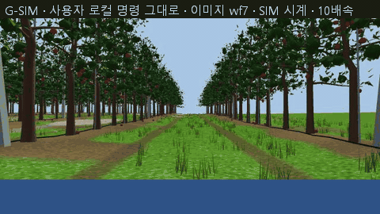
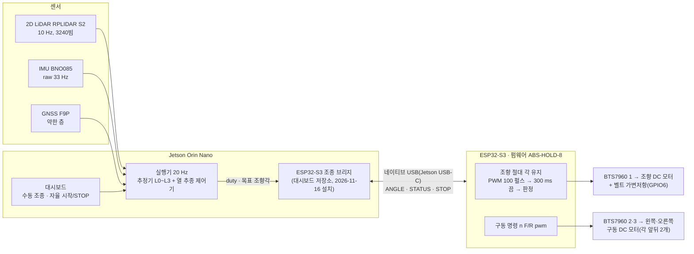
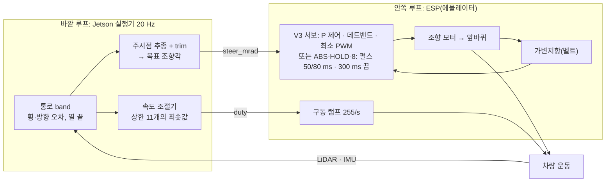
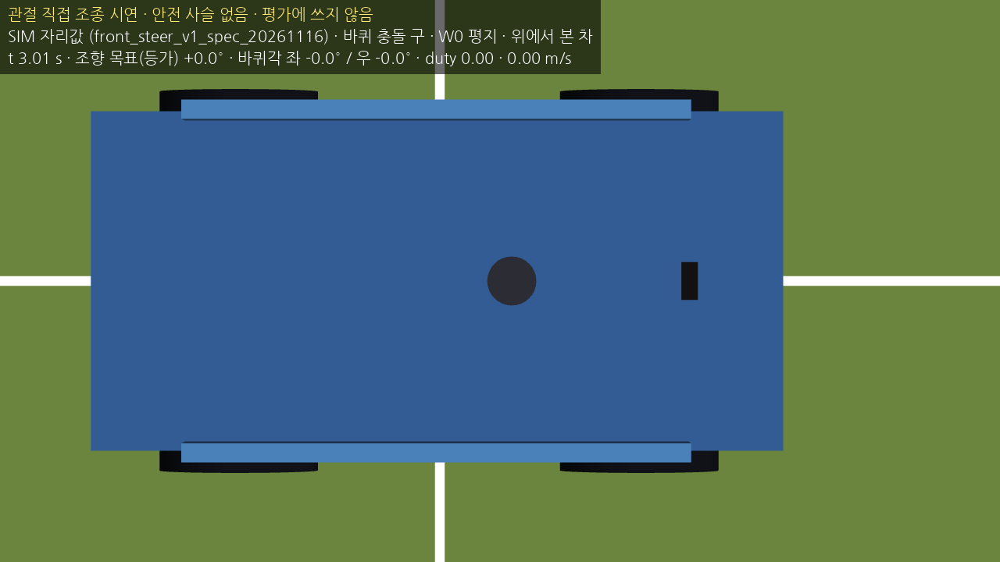
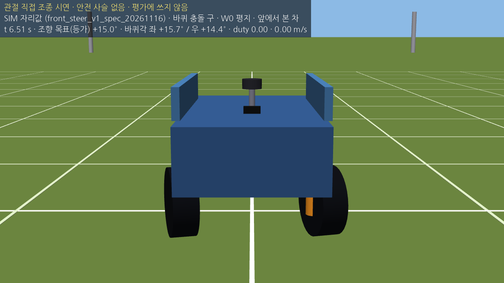
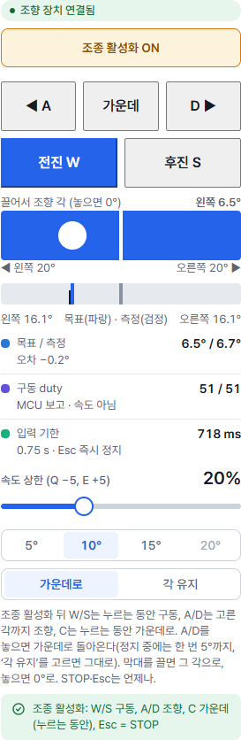

# unist_orchard_simulation

UNIST BTS 유니주행차 팀의 과수원 로버 시뮬레이션 저장소입니다. 앞바퀴 조향으로 바꾸는 로버가 과수원 열 하나를 행간 중심선을 따라
처음부터 끝까지 달리고 열 끝에서 서는 동작을, 실차에 올리기 전에 시뮬레이션에서 만들고 확인합니다.

> **English summary.** Simulation repository of a small orchard rover (a converted ride-on toy car, now being refitted
> with front-wheel steering: a plain DC motor turns the steering and a belt-coupled potentiometer closes a position loop
> on the board; since 2026-11-16 one ESP32-S3 with three BTS7960 drivers and the pulse-hold firmware
> ABS-HOLD-8-REBOUND-LIMITS, before that an ESP8266 design). Goal: drive one orchard row along the centre line between
> two tree rows and stop at the row end, no
> U-turn. Inputs: 2D LiDAR (RPLIDAR S2) and raw IMU as the main sensors, applied PWM and steering angle as bounded
> priors, GNSS as a weak optional layer; no wheel encoders, no vision. Two simulators share one code path: a fast
> deterministic simulator (F-SIM: executor, host bridge, ESP firmware V3 and steered plant on one clock) and a Gazebo
> Harmonic stack (G-SIM: ROS 2 Jazzy in Docker). Every number here is a placeholder-based SIM result: the main dimensions
> were measured on 2026-11-16 (profile front_steer_v1_spec_20261116), the rest of the steering hardware is still a
> placeholder, so nothing in this repository is a field result. Since 2026-11-16 the local Gazebo stack runs that
> measured profile with the board's pulse-hold steering law by default (decision R91); registered checks keep the
> placeholder profile v0.1. The documents are in Korean.



[SIM · 자리값] 사용자 로컬 명령 그대로, 이미지 wf7, SIM 시계(`sim_stack.py start` 뒤 `sim_auto.py start`). Gazebo 과수원(W1)
통로 하나를 처음부터 열 끝까지 달리고 선 차량 카메라 화면(약 99 s를 10배속). 실행기는 `/scan`과 raw IMU만 보고 조향과 구동을
정한다. 최종 확인 4단계 F run 3([결과](docs/steering/STEER_FOLLOW_GSIM_FINAL_KO.md#135-f-사용자-명령-그대로-3-run)). 이 영상은 옛 자리값 차
(프로필 v0.1)의 것이다. 2026-11-16부터 로컬 스택은 측정 치수 차로 뜬다(아래 [로버 모델](#로버-모델과-시뮬레이션-환경)).

> **이 저장소의 모든 수치는 자리값 기반 SIM 결과입니다. 현장 성능이 아닙니다.** 2026-11-16에 실제 치수(휠베이스, 윤거, 바퀴,
> 조향 한계 ±20°, LiDAR 위치)와 새 조향 보드 펌웨어를 받아 프로필 `front_steer_v1_spec_20261116`에 넣었지만, 조향 장치의 나머지
> 값(모터, 가변저항, 벨트 비, 유격, 질량 등)은 아직 자리값이고 조향 장치를 단 실차로 달린 기록은 없습니다. 사용자 화면용 Gazebo
> 스택은 이 프로필로 뜨고(결정 R91), 사전등록 판정과 회귀 시험은 기록대로 v0.1 을 씁니다. 검증되지 않은 것은
> [현재 한계](#현재-한계와-다음-할-일)에 적었습니다.

## 목표

1. 운영자가 열 시작 지점에 차를 두고 대시보드의 자율 주행 버튼을 한 번 누른다.
2. 차는 구동 바퀴에 PWM을 줘서 앞으로 간다(목표 0.40 m/s, 범위 0.20~0.50 m/s).
3. 앞바퀴 조향은 외력에 밀려 틀어지지 않도록 직진 각을 붙잡는다(ESP 위치 루프).
4. 방향이나 위치가 틀어지면 조향을 움직여 행간 중심선으로 돌아온다(실행기 바깥 루프).
5. 열 끝에서 감속하고 선다(앞범퍼가 마지막 줄기 선의 ±1.0 m 안). 유턴과 다음 열은 하지 않는다.

## 핵심 특징

- **센서만으로 통로를 잡는다.** 2D LiDAR + raw IMU가 주 입력이다. 적용 PWM과 조향각은 짧은 예측·감시용 사전값, GNSS는 기록·지오펜스용
  약한 층이다(일반 GNSS 오차 5~10 m가 열 간격 3.6~4.1 m보다 크다). 휠 엔코더와 카메라 인식은 쓰지 않는다.
- **두 단계 SIM, 같은 코드.** 빠른 SIM(결정적, 큰 조건 행렬)과 Gazebo 스택(ROS·대시보드·기록 통합)이 같은 실행기, 같은 호스트 브리지,
  같은 ESP 펌웨어 소스(PC용 흉내 층으로 컴파일)를 쓴다. 참값은 평가에만 쓰고 실행기 입력에는 넣지 않는다(검사 A13).
- **조향 위치 루프는 ESP에, 바깥 루프는 Jetson에.** 실행기(20 Hz)는 주시점 추종 + trim으로 목표 조향각을 정하고, ESP(서보 500 Hz)는
  벨트로 이은 가변저항 값으로 조향 모터를 돌린다. 속도는 연산 지연·스캔 나이·정지 거리 등 상한 11개의 최솟값이다.
- **안전 규칙이 펌웨어부터 화면까지.** 한 번 눌러 시작, 운영자 신호가 1.0 s 끊기면 정지(결정 R60), 자동 재출발 없음, STOP은 누구나, 명령 TTL
  300 ms, 링크 watchdog 500 ms, 결함 코드 15종과 래치.
- **사전등록 판정.** 기준을 측정 전에 커밋하고 그대로 판정한다. 불합격도 남긴다([`docs/RESULTS_KO.md`](docs/RESULTS_KO.md)).

## 시스템 구성



[도식] 2026-11-16의 실차 구성(사용자 알림·펌웨어 소스). 2026-11-15까지의 설계는 ESP8266 하나에 펌웨어 V3였고 실차에 쓰인 적이 없다
([`docs/ARCHITECTURE_KO.md`](docs/ARCHITECTURE_KO.md) 1.2절). SIM에서는 센서·차체가 Gazebo로, ESP가 에뮬레이터로 바뀐다. 에뮬레이터는 V3
직렬 규약을 그대로 쓰고, 프로필이 `abs_hold_8`이면 조향 법칙만 새 보드의 펄스 유지로 흉내 낸다([`ABS_HOLD8_SIM_KO.md`](docs/steering/ABS_HOLD8_SIM_KO.md)).
컨테이너 구성, 자료 흐름, 추정기 층, 실행기 상태 기계는 [`docs/ARCHITECTURE_KO.md`](docs/ARCHITECTURE_KO.md).



[도식] 제어 루프. 바깥 루프는 `sim/ubts/closed_loop/steer_control.py`, 안쪽 루프는 `firmware/ubts_steer_v3/`의 V3 서보(SIM 전용, 실기에 쓴 적 없음)
또는 실기 보드 펌웨어의 펄스 유지 흉내(`sim/ubts/steering/native/abs_hold8.cc`, 프로필 `steer_fw_mode`).

## 로버 모델과 시뮬레이션 환경

Gazebo 조향 모델은 2026-11-16 측정 치수 프로필 `front_steer_v1_spec_20261116`을 따른다(이미지 `ubts-steer-sim:wf12`, `steering.gz_views
--profile`). 바퀴 위치·크기, 조향 관절 한계, LiDAR 장착이 측정값이고, 차체 상자·카메라·질량은 아직 자리값이다(그래서 차체가 바퀴보다
앞뒤로 길게 보인다). 2026-11-13 판 그림(프로필 v0.1)은 같은 파일의 git 이력에 있다.

| 비스듬히 | 옆 | 위(오른쪽이 앞) |
|---|---|---|
|  |  |  |
| [SIM · 자리값] 측정 치수 프로필. 차체 상자(자리값), 앞바퀴 조향 링크, LiDAR(기둥 위), 카메라 | [SIM · 자리값] 측정: 휠베이스 0.657 m, 바퀴 지름 0.26 m | [SIM · 자리값] 측정: 윤거 0.527 m, LiDAR 앞차축 0.21 m 뒤 |

| 앞, 조향 0° | 앞, 조향 +15°(왼쪽) |
|---|---|
|  |  |
| [SIM · 자리값] 측정: 바퀴 두께 0.095 m | [SIM · 자리값] 바퀴각 좌 +15.7° / 우 +14.4°(Ackermann 비율은 자리값), 측정 한계 20° |

측정 치수(2026-11-16, 사용자가 차에서 잼)와 프로필 값. 출처와 나머지 칸은 [`ABS_HOLD8_SIM_KO.md`](docs/steering/ABS_HOLD8_SIM_KO.md) 2절.

| 칸 | 잰 값 | 프로필 값 | provenance |
|---|---|---|---|
| 휠베이스 | 0.657 m | `wheelbase_m` 0.657 | MEASURED_20261116 |
| 윤거 | 바퀴 바깥 0.622 m | `track_front_m`·`track_rear_m` 0.527(바깥 − 두께) | MEASURED_20261116 |
| 바퀴 | 지름 0.26 m, 두께 0.095 m | 반경 0.13, 폭 0.095 | MEASURED_20261116 |
| 조향 한계 | 좌우 약 20°(그 이상 안 감) | 바퀴마다 20°, 등가 기계 18.83°, SIM 소프트 한계 16.14° | MEASURED_20261116(소프트 여유 3°는 CONFIG) |
| LiDAR | 꼭대기 0.57 m, 앞차축 0.21 m 뒤, 좌우 가운데 | x 0.1185, y 0, 스캔 평면 0.55 m | x·y MEASURED_20261116, 높이 ESTIMATED(꼭대기 − 0.02 m 자리값) |
| 차축 위치 | — | 뒤차축 x −0.3285(두 차축이 발자국 가운데에 대칭) | DEFINITION(SIM 규약) |
| 조향 모터 | 보드 시험: 명령 0 → ±20 약 3.3~3.6 s, 되돌림 2.2~2.9 s | rate 100 °/s, 시작 PWM 10 %, τ 0.02 s(펄스 맞춤) | ESTIMATED·SIM_ASSUMED |
| 그대로 자리값 | — | 발자국 1.22 × 0.70 m, 질량 24 kg, 카메라 위치, 벨트·가변저항·유격 등 SPEC_PENDING 34칸 | PLACEHOLDER |

### 조향 보드와 펌웨어 흉내

실차 보드는 2026-11-16부터 ESP32-S3 한 장과 BTS7960 세 개다: 1번이 조향 DC 모터(일반 DC 모터, 벨트로 이은 가변저항을 GPIO6 으로 읽음),
2·3번이 왼쪽·오른쪽 구동 모터 묶음. 조향 펌웨어 `ABS-HOLD-8-REBOUND-LIMITS`는 절대 목표(`ANGLE a`, ±20 명령도)를 받아 PWM 100/255 로
50 ms 또는 80 ms 펄스를 주고, 드라이버를 끈 채 300 ms 기다려 조용한 가변저항 값으로 판정한다(허용 10 count, 다시 시작 16 count; 되튐·
무진척·구동 예산 1 s 로 유지 취소). SIM 의 ESP 에뮬레이터는 V3 직렬 규약·안전 껍데기를 그대로 두고 조향 법칙 자리에서 이 펄스 유지를
흉내 낸다(`sim/ubts/steering/native/abs_hold8.cc`, 프로필 `steer_fw_mode abs_hold_8`). 실기 펌웨어 소스는 바꾸지 않았다. 펄스 사이에
드라이버가 놓여 외력에 되밀리는 것은 빠른 SIM 에만 있다(Gazebo 조향 관절은 위치 제어). 자세히: [`ABS_HOLD8_SIM_KO.md`](docs/steering/ABS_HOLD8_SIM_KO.md),
하드웨어 표 [`docs/HARDWARE_KO.md`](docs/HARDWARE_KO.md).

| 과수원 전경 | 위에서 본 과수원 | 통로 출발점 |
|---|---|---|
|  |  |  |
| [SIM · 자리값] W1 원본 과수원(원본 프로젝트의 생성기), 오른쪽 아래가 차 | [SIM · 자리값] 열 간격 3.8 m, 나무 간격 1.2 m, 열 길이 30 m | [SIM · 자리값] 두 나무 열과 기둥·철선 |

| 차량 카메라 | LiDAR `/scan`, 통로 안 | LiDAR `/scan`, 출발점 |
|---|---|---|
|  |  |  |
| [SIM · 자리값] 640×360 Gazebo 렌더에서 아래 차체 윗면 띠(58줄)를 잘라 낸 것. 표시·기록용, 위치 추정에 쓰지 않음 | [SIM · 자리값] S2 형식 3240빔, 차 기준 좌표, 빨간 사각형이 차 외곽 | [SIM · 자리값] 앞 3 m부터 두 줄의 줄기 |


[SIM · 자리값] SIM 대시보드의 주행 화면(127.0.0.1:18090): LiDAR, 차량 카메라, 조향 패널(목표·측정 조향각, 구동 duty, 입력 기한).
대시보드 저장소의 새 화면 사본에 SIM 확장을 꽂은 것이다([`SIM_DASHBOARD_KO.md`](docs/steering/SIM_DASHBOARD_KO.md)). 이 그림은 2026-11-13 판이다.



**대시보드 사본 a435d44(2026-11-16, 화면은 feb4600 과 같음).** 조향 패널에 끌어서 조향 각을 정하는 막대가 생겼다. 막대를 끄는 동안 그 각으로 가고 놓으면 0°로
돌아온다. 새 보드용 브리지(ESP32-S3)에서는 A/D 가 누르는 동안 왼쪽·오른쪽 끝까지 간다. SIM 은 V3 브리지라서 막대도 A/D 와 같은 램프를
따르고, 서 있을 때는 한 번에 5°까지만 움직이며 놓아도 5°만 돌아온다(주행 중에는 0°까지, 아래 확인). Network 쪽에는 Jetson Wi-Fi 관리
(주변 검색, 비밀번호로 연결, 자동 연결·우선순위, 자동 되돌림)가 생겼다. SIM 에서는 네트워크 제어를 꺼 두어 버튼이 비활성이고 어떤
호스트 도우미도 부르지 않는다. 기능과 실제 화면 그림: [대시보드 저장소 README](https://github.com/2026-BTS-UNI-Car/unist_orachard_dashboard#readme).

[SIM · 자리값] 오른쪽 그림(측정 치수 차): SIM 대시보드(이미지 wf12)의 조향 패널. 전진 W 를 누른 채 막대를 왼쪽 6.5°로 끈 순간(목표 6.5° /
측정 6.7°, 좌우 한계 16.1°는 측정 치수 프로필의 소프트 한계). 놓은 뒤 2 s 안에 목표·측정 0.0°(2026-11-16 확인, 판정 아님).
<br clear="right">


[SIM · 자리값] 빠른 SIM에서 열 추종을 위에서 본 애니메이션(평지 기둥 두 줄 W0, `nominal` seed 0, 약 10배속).

그림 목록과 출처(원본, 만든 명령, 해시, 눈으로 본 기록)는 [`docs/assets/ASSETS.json`](docs/assets/ASSETS.json)에 있다. 실물 차량·조향 장치
사진은 아직 없다. [계획 · 미구현] 사진이 오면 같은 규칙으로 `docs/assets/photos/`에 넣는다.

## 결과 요약

모두 자리값 기반 SIM 결과이며 현장 성능이 아니다. 전체 표(합격 검사 A1~A26, 불합격·미실행 포함)는 [`docs/RESULTS_KO.md`](docs/RESULTS_KO.md).

| 무엇 | 조건 | 결과 |
|---|---|---|
| 열 추종, 빠른 SIM(사전등록 `steer_follow_v1`) | 평지 기둥 두 줄, 조건 11종 15회(출발 어긋남, 조향 0점, 쏠림, LiDAR 끊김, 장애물) | 합격 15/15. 횡 RMSE 0.029~0.055 m, 열 끝 e +0.04~+0.09 m |
| 열 추종, Gazebo(사전등록 `steer_follow_gsim_v1`) | W1 과수원, 실행기 컨테이너, 4회 | 기록대로 불합격 3/4(평가 코드 결함), 먼저 커밋한 수정 1 뒤 같은 기록으로 합격 4/4. 횡 RMSE 0.021~0.039 m, e +0.45~+0.46 m |
| 안전 대본(빠른 SIM, 실행기 포함) | STOP, TTL, watchdog, 운영자 신호 끊김, 두 화면 등 | 합격 71/71 |
| 외란 아래 직진 유지(ESP 루프만, 프로필 v0.2) | 조향축 토크 외란 대본 × 5 seed | 불합격 39/40(크기 밖 외란 1회의 첫 결함 이름이 등록 밖) |
| 프로필 v0.3 자격 | 정상·고장·외란 대본 | 불합격(정지 중 전폭 쓸기의 열 예산 자리값). 기본 프로필은 v0.1 |
| 실제 치수·실기 조향 펌웨어로 다시 재기(`steer_follow_realdims_v1`, 2026-11-16) | 빠른 SIM, 측정 치수 + ABS-HOLD-8 펄스 유지 흉내, 실행기 GO 문턱 4.0 °/s(문서화한 변경) | **열 추종 15/15 합격**(횡 RMSE 0.036~0.074 m, 열 끝 e +0.019~+0.082 m). **넓은 조건 51/60 불합격**: `dist_step_p2p5` 0/3(+2.5 N·m 계단 외란이 펄스 사이 놓인 조향을 밀어 V3 의 `POT_NOISE` 감시가 걸림), `dist_terrain` 0/3(지면 외란이 조향을 끝까지 밀고 PWM 100 펄스로 되돌리지 못해 `TRACK`), `operator_link_lost` 0/3(등록 기준 0.55 s 가 결정 R60 의 1.0 s 보다 옛것, 조향과 무관). 외란 크기·정지 토크는 자리값. 실행기 GO 규칙 자리값 8 °/s 는 보드 조향 속도 5.09 °/s 를 거부한다. [`STEER_FOLLOW_REALDIMS_RESULT_KO.md`](docs/steering/STEER_FOLLOW_REALDIMS_RESULT_KO.md) |
| 사용자 스택을 측정 치수로(이미지 wf12, 2026-11-16, 판정 아님) | Gazebo W1, `sim_stack.py start` 뒤 `sim_auto.py start`, SIM 시계 | 화면 확인: 메뉴 8개, Gazebo 카메라, 조향 한계 16.1°, 끌기 막대(주행 중 놓으면 2 s 안에 0°), Wi-Fi 관리 꺼짐. 한 열 자율 3 run 중 **2 run 열 끝(ROW_END, 32.9 m, 114~119 s)**, 실행기 추정 횡 최대 6·8 cm, 방향 최대 1.9·3.4°. **1 run 은 2.7 m 에서 정지**(`steering_feedback_stale`: 실행기 한 틱이 0.35 s 걸려(스캔 처리 0.195 s) 조향 상태 나이가 0.325 s 로 한도 0.3 s 를 넘음. wf8~wf10 의 호스트 부하 실패와 같은 꼴). 같은 스택에서 v0.1 차와 견주지 않았다. [`SIM_DASHBOARD_KO.md`](docs/steering/SIM_DASHBOARD_KO.md) 9절, 결정 R91 |
| 넓은 조건 평가(사전등록 `steer_follow_wide_v2`) | 빠른 SIM 큰 조건 행렬 275 run | 불합격. 2차 판정 262/275(1차 251/275). [`STEER_FOLLOW_WIDE_RESULT_KO.md`](docs/steering/STEER_FOLLOW_WIDE_RESULT_KO.md) |
| Gazebo 최종 확인(이미지 wf5 → wf6 → wf7 → wf8 → wf9 → wf10 → wf11, SIM 시계) | W1 과수원, 한 번 눌러 시작, 열 추종 4 run · 대시보드 화면 · A17(G) · PW-08(wf6) · 사용자 명령 3 run | **8b단계(wf11, 2026-11-15) 합격**: 열 추종 4/4(e +0.437~+0.456 m, 횡 RMSE 0.020~0.033 m), 화면 6/6, 사용자 명령 3/3 열 끝(33.5 m), 모두 첫 시도. 측정 동안 Windows 이기종 스레드 배치를 '성능 코어 선호'로 뒀지만 호스트 부하가 7단계의 절반쯤이어서 배치 덕분인지는 가르지 못했다(`STEER_FOLLOW_GSIM_FINAL_KO.md` 19절). 7단계까지는 불합격. wf10(7단계): 화면 합격(호스트 고장 무효 1 번 뒤 6/6), 열 추종 3/4(nominal_1 이 22.3 m 에서 `speed_cap_below_min`), 사용자 명령 0/3(`OPERATOR_LINK_LOST` 2, `speed_cap_below_min` 1, 무효 1) — 실패 사건마다 바로 앞 0~2 s 에 이 PC 의 E 코어가 79~80 % 로 차고 P 코어가 15~29 % 로 비었다. 6단계 화면 실패는 lease 만료가 아니라 모의 MCU 프로세스만 0.34 s 멈춘 뒤의 상태 줄 틈 래치였다. wf9(6단계): 열 추종 4/4 합격, 화면 불합격(첫 run 이 go 2.4 s 뒤 `steering_feedback_stale`), 사용자 명령 1/3 — 실패 셋은 Windows 전체 CPU 70 % 아래였지만 이 PC 의 E 코어가 약 80 % 로 찼던 때(실행기·브리지·에뮬레이터가 함께 느려짐). wf8: 화면 6/6 합격(운영자 세션 규약 개정 5), 열 추종 2/4, 사용자 명령 0/3 — 실패 다섯은 모두 호스트가 바쁜 때 실행기 스캔 처리 0.15~0.32 s(LiDAR·조향 상태 나이 한도). wf7 의 출발 직후 입력 끊김은 새 DDS 참가자 합류 뒤 SIM 쪽 정지로 가렸고 검사가 기다리게 고쳤다. wf7: 사용자 명령 3/3 열 끝(33.3~33.4 m), A17(G) `bridge_stall` 4/4. wf6: 열 추종 3/4, 화면 합격, A17(G) 24/25, PW-08 합격 |


[SIM · 자리값] Gazebo 과수원 한 통로의 열 추종(참값 경로, `nominal_1`). 아래 칸은 횡 위치를 세로로 확대한 것이다.

이미지 wf10 의 정상 주행·옆 0.40 m 에서 출발해 복귀·열 끝 정지(위에서 본 참값 경로), 빠른 SIM 의 GNSS 끊김 영상과 횡오차·조향각
그래프: [`docs/steering/GSIM_MEDIA_KO.md`](docs/steering/GSIM_MEDIA_KO.md)(판정 아님, 자리값 기반 SIM 결과).

## 빠른 시작

저장소 맨 위에서 실행합니다. Gazebo 스택은 Windows Docker Desktop + WSL2(GPU 렌더) 기준입니다.

### 1. 확인 명령 (Docker 없음)

```bash
python -I tools/steer_sim/check_pins.py              # 다시 쓰는 기반 파일이 고정된 내용 그대로인지
python -I tools/steer_sim/check_vendor_sync.py       # 실행기의 vendor 사본, manifest, SHA256SUMS
python -I tools/steer_sim/check_import_manifest.py   # 출처표
python -I tools/steer_sim/check_assets.py            # 문서 그림·매니페스트·문서 링크
(cd sim/ubts && python -B -m field_world.coord_lint ../.. --all-text)   # 좌표 검사, 트리 전체
```

시험은 파일마다 따로 돌립니다. 예: `cd sim/ubts && python -B -m pytest -q -p no:cacheprovider test_steering_geometry.py`.

### 2. 빠른 SIM으로 열 추종 한 번 (Docker 없음)

Python 3.10 이상(numpy, PyYAML)과 C++ 컴파일러(`g++` 또는 MinGW)가 필요합니다. 펌웨어 네이티브 프로그램을 처음 한 번 빌드하므로
빌드 폴더를 저장소 밖으로 줍니다.

```bash
export UBTS_STEER_BUILD_DIR=<저장소 밖 빌드 폴더>
cd sim/ubts
# 측정 치수 프로필(front_steer_v1_spec_20261116, ABS-HOLD-8 흉내)로 nominal 5 run (기본으로 쓰는 차)
python -B -m steering.safety_scripts.follow_realdims --out <저장소 밖 결과 폴더> --parts matrix --only nominal
# 옛 기준: 자리값 프로필 v0.1, 펌웨어 V3 서보 (steer_follow_v1 등록 그대로)
python -B -m steering.safety_scripts.follow_matrix --out <저장소 밖 결과 폴더> --only nominal --seeds 0
```

### 3. Gazebo 스택을 켜고 자율 주행 시작

이미지 `ubts-steer-sim:wf4c`가 있어야 합니다. 그 이미지는 개발 PC의 로컬 기반 이미지 위에 `docker/Dockerfile.ubts-steer`로 만들었습니다
(빌드 명령은 그 파일 머리말). 스스로 서는 기반 정의 `docker/Dockerfile.base`는 아직 빌드·검증하지 않았습니다
([`BASE_IMAGE_KO.md`](docs/provenance/BASE_IMAGE_KO.md)). 메모리는 약 6 GiB가 필요하고, 다른 SIM 스택과 함께 올리지 않습니다.

```bash
# W1 원본 과수원 장면으로 전체 스택(sim, steer, recorder, dashboard, executor), 측정 치수 차(결정 R91)
UBTS_STEER_SCENE=w1_force docker compose -p ubts-steer -f compose.ubts-steer.yaml -f compose.ubts-steer.measured.yaml \
  --profile executor up -d
# 옛 자리값 차(v0.1, 등록 판정과 같은 차)는 두 번째 -f 없이
# 브라우저: http://127.0.0.1:18090  (대시보드)

# 자율 주행 한 run: Start → Arm → go 한 번, heartbeat를 보내며 상태를 1초마다 찍는다. Ctrl-C는 STOP
docker exec -it ubts-steer-executor-1 python3 -B -m steering.exec_run start
docker exec ubts-steer-executor-1 python3 -B -m steering.exec_run stop       # 즉시 정지
# 차를 장면의 출발 자세로 되돌리기(SIM 전용, 차가 서 있을 때)
docker exec ubts-steer-sim-1 /ros_entrypoint.sh python3 -B -m steering.exec_run reset

# 내리기(-v 없이: 이름 붙은 볼륨은 남긴다)
UBTS_STEER_SCENE=w1_force docker compose -p ubts-steer -f compose.ubts-steer.yaml --profile executor down -t 20
```

- 측정 치수 차에는 그 프로필이 든 이미지(`ubts-steer-sim:wf12` 이후)가 필요합니다. 개발 PC 의 로컬 도구(저장소 밖 `sim_stack.py`)는
  이 덮어쓰기 파일을 기본으로 붙이고 `--vehicle placeholder`로 옛 차를 고릅니다.
- 대시보드의 새 화면(조향 패널의 "준비" → "자율 주행 시작", STOP)은 wf4c 다음 이미지부터 들어갑니다. 그전에는 사본 폴더를 읽기 전용으로
  붙이는 compose 덮어쓰기로 봅니다([`SIM_DASHBOARD_KO.md`](docs/steering/SIM_DASHBOARD_KO.md) 5절). wf4c 그대로면 위 `exec_run`을 씁니다.
- 측정·검사 실행은 작업마다 프로젝트 이름을 `ubts-steer-<작업>`으로 하고 `tools/steer_sim/stack.py`로 올리고 내립니다(한 번에 스택 하나,
  호스트 부하 확인, 남은 컨테이너 영수증). 규칙: [`STACK_OPERATIONS_KO.md`](docs/steering/STACK_OPERATIONS_KO.md).
- 저장소 밖 자료(10/10 지도, 통로 목록)의 위치는 환경 변수 `UBTS_STEER_PATHS`가 가리키는 설정 파일로 줍니다
  ([`PATHS_KO.md`](docs/steering/PATHS_KO.md)). 결과와 측정 파일은 저장소 밖에 둡니다.

## 저장소 구조

| 폴더 | 내용 |
|---|---|
| `sim/ubts/steering/` | 조향 SIM: 차량 프로필, 조향 기하, 구동기·가변저항 모델, 빠른 SIM, T1 장치, Gazebo 모델과 장면, ESP 에뮬레이터, 적합성 대본, 안전 대본, 식별, 검사 |
| `sim/ubts/closed_loop/` | 추정기(통로 band, 사전값, 통로 품질), 열 추종 제어기 `steer_control.py`, 한 열 폐루프 하네스 |
| `sim/ubts/field_world/` | 현장 지도에서 만드는 월드와 좌표 검사(`coord_lint`) |
| `sim/ubts/orchard_perception/`, `sim/ubts/encoderless/` | 스캔 통로 검출, 센서만 쓰는 운동 추정 |
| `sim/ubts/` (바로 아래) | 다시 쓰는 기반 모듈(어댑터, CPU LiDAR, 월드 조립 등)과 시험 |
| `tools/row_executor/` | 한 열 실행기: Runner, 운영자 HTTP, 국소 격자, GNSS 층, 현장 조정 파일, vendor 사본 |
| `firmware/ubts_steer_v3/` | 조향 펌웨어 V3(ESP8266 설계, 실기에 쓴 적 없음). SIM의 직렬 규약·안전 껍데기로 네이티브 lockstep 프로그램에 함께 컴파일된다. 실기 보드 펌웨어(ESP32-S3, ABS-HOLD-8)는 이 저장소에 없고 SIM은 그 조향 법칙을 `sim/ubts/steering/native/abs_hold8.cc`로 흉내 낸다 |
| `dashboard/`, `dashboard_sim/` | 대시보드 저장소 사본(서버, 정적 파일, 센서 브리지, 조향 브리지 V3)과 SIM 확장 |
| `ros2_ws/src/orchard_gazebo/`, `ros2_ws/src/orchard_navigation/` | 원본 프로젝트의 과수원 월드 생성기와 제어 참조 |
| `tools/field_calib/`, `tools/drive_response/` | 현장 보정 도구, 수동 주행 기록의 PWM duty·속도 분석 |
| `tools/steer_sim/` | 저장소 검사(고정 파일, vendor, 출처표, 문서 그림), 스택 운영, 그림 갈무리·만들기, 사양 적용 |
| `docker/`, `compose.ubts-steer.yaml`, `compose.ubts-steer.measured.yaml` | 조향 SIM 이미지, 스택 정의, 측정 치수 차를 고르는 덮어쓰기(R91) |
| `docs/` | 문서([색인](docs/README_KO.md)), 그림 `docs/assets/` |

## 하드웨어 요약

| 부분 | 알려진 것 | 아직 자리값·미정 |
|---|---|---|
| 차량 | 2인승 어린이용 4륜 전동차 개조(개조 전 표기 1.22 × 0.70 m, 12 V), 휠 엔코더 없음. 측정(2026-11-16): 휠베이스 0.657 m, 윤거 0.527 m(바퀴 바깥 0.622 m), 바퀴 지름 0.26 m·두께 0.095 m | 질량, 발자국(SIM 1.22 × 0.70 m), 무게중심 |
| 조향 | 일반 DC 모터 + BTS7960, 가변저항을 벨트로 연결(ESP32-S3 GPIO6), 보드 펄스 유지(ABS-HOLD-8), 좌우 약 20°까지(측정 2026-11-16), 리밋 스위치 없음. 보드 시험 명령 0 → ±20 약 3.5 s | 벨트 비, 가변저항 종류·범위, 명령 눈금의 물리 각, 0° 오차 크기, 유격, 모터 정격 |
| 구동 | 4륜, 좌우 모터 묶음, BTS7960 2개(보드의 2·3번). 조향 장착 전 100 % duty 0.928 m/s | 조향 장착 뒤 duty→속도, 특히 25~60 %. 새 보드 펌웨어에 구동 명령 끊김 정지 장치 없음 |
| 센서 | RPLIDAR S2(꼭대기 0.57 m, 앞차축 0.21 m 뒤, 좌우 가운데: 측정 2026-11-16; 3240빔 10 Hz), BNO085 IMU, u-blox F9P GNSS, UVC 카메라 | S2 스캔 평면 높이(SIM 0.55 m, 꼭대기 − 0.02 m 자리값), IMU 장착 |
| 계산 | Jetson Orin Nano, ESP32-S3 하나(네이티브 USB, 2026-11-16~; 옛 ESP8266은 뺐다) | 새 보드용 Jetson 브리지·실행기 어댑터는 2026-11-16 설치(실행기는 SHADOW, 차를 움직이지 않음) |

전체 표와 출처: [`docs/HARDWARE_KO.md`](docs/HARDWARE_KO.md).

## 조향 사양이 오면

고칠 파일은 `sim/ubts/steering/profiles/steer_spec_input.yaml` 하나, 돌릴 명령은 `tools/steer_sim/apply_spec.py` 하나입니다.
2026-11-16 실제 치수 입력은 `profiles/steer_spec_input_20261116.yaml`이고 결과가 `front_steer_v1_spec_20261116`입니다(코드의 기본 프로필은
그대로 v0.1, 사용자 스택은 `compose.ubts-steer.measured.yaml`로 이 프로필을 이름으로 고름. 새 프로필을 만들면 그 파일의 경로·실행기 값도 바꾸고
`test_steering_stack_vehicle.py`로 확인).
입력 검사 → 새 프로필 후보 → 펌웨어 CFG·호스트 프로필·Gazebo 관절 값 → 바뀐 값 요약과 다시 잴 목록 → 짧은 확인 순서로 갑니다.
절차: [`docs/steering/SPEC_UPDATE_KO.md`](docs/steering/SPEC_UPDATE_KO.md). 질문 목록(Q1~Q29): [`VEHICLE_SPEC_REQUEST_KO.md`](docs/steering/VEHICLE_SPEC_REQUEST_KO.md).

## 문서

| 문서 | 무엇 |
|---|---|
| [`docs/README_KO.md`](docs/README_KO.md) | 문서 색인(지금 기준 문서와 지난 단계 기록) |
| [`docs/ARCHITECTURE_KO.md`](docs/ARCHITECTURE_KO.md) | 시스템 구성, SIM 스택, 자료 흐름, 제어 루프, 추정기 층, 실행기 상태 도식 |
| [`docs/HARDWARE_KO.md`](docs/HARDWARE_KO.md) | 하드웨어·제품 사양, SIM 자리값 표, 모르는 것 |
| [`docs/RESULTS_KO.md`](docs/RESULTS_KO.md) | 검사 결과 한곳에 |
| [`docs/steering/DESIGN_v1_KO.md`](docs/steering/DESIGN_v1_KO.md), [`DESIGN_v2_KO.md`](docs/steering/DESIGN_v2_KO.md) | 설계(알고리즘, 차량 모델, 평가, 단계 계획) |
| [`docs/steering/DECISIONS_KO.md`](docs/steering/DECISIONS_KO.md) | 결정 기록 |
| [`docs/drive_response/README_KO.md`](docs/drive_response/README_KO.md) | 수동 주행 기록의 PWM duty·속도·정지 거리 측정 |
| [`docs/DOCS_POLICY_KO.md`](docs/DOCS_POLICY_KO.md) | 문서·그림 방침과 검사 |

## 현재 한계와 다음 할 일

검증되지 않은 것:

- **현장 검증 0.** 조향 장치를 단 실차로 달린 적이 없다. 실차 주행, Jetson 설치, 펌웨어 쓰기, 장착 보정은 사용자가 현장에서 한다.
- **실측은 일부뿐.** 2026-11-16 치수(휠베이스, 윤거, 바퀴, 조향 한계, LiDAR 위치)와 새 보드 펌웨어를 넣은 프로필 `front_steer_v1_spec_20261116`이 있지만 조향 모터·가변저항·벨트·유격·질량·차체 상자·발자국은 자리값이다. 사용자 스택은 이 프로필로 뜨지만(R91) 코드의 기본 프로필과 등록 판정은 v0.1이고, v0.3은 자격 불합격(열 예산 자리값)이다.
- **새 보드의 펄스 조향(ABS-HOLD-8)은 외력에 약하다(SIM, 자리값 외란).** 펄스 사이에 드라이버를 놓아 조향축 외란 6 run이 열 끝 전에 섰다. 실행기의 조향 GO 규칙(8 °/s 자리값)은 보드의 5.09 °/s를 거부해서, 측정 치수 차는 등록에 문서화한 4.0 °/s 로 돈다(문턱은 P8 에서 정할 일). 새 보드용 Jetson 브리지는 대시보드 저장소에 있고, 실행기가 그 브리지로 모는 어댑터(`steer_bridge_kind: esp32_abs_hold`, [`EXECUTOR_ESP32_KO.md`](docs/steering/EXECUTOR_ESP32_KO.md))는 가짜 보드로만 확인했다. Jetson 에는 2026-11-16 SHADOW 로 설치해 `/scan`·IMU 를 받는 것까지 봤고, MOTOR 는 현장 측정(조향 극성·눈금·속도, 구동 방향)과 결정(조향 GO 문턱, 펌웨어 구동 감시) 뒤에 쓴다 ([`STEER_FOLLOW_REALDIMS_RESULT_KO.md`](docs/steering/STEER_FOLLOW_REALDIMS_RESULT_KO.md) 5절).
- **측정 치수 차의 Gazebo 열 추종은 등록 판정을 하지 않았다.** 사용자 스택 확인(이미지 wf12, 판정 아님)에서 3 run 중 2 run 이 열 끝까지 갔고 1 run 은 실행기 틱 지연으로 2.7 m 에서 섰다. 측정 치수 차로 G-SIM 등록 확인을 하려면 기준을 먼저 등록하고 `tools/steer_sim/stack.py up --override compose.ubts-steer.measured.yaml`로 돌린다.
- **Gazebo 열 추종은 장면 하나(W1, 열 30 m)다. 최종 확인은 8b단계(wf11, 2026-11-15)에서 처음 합격했지만, 그때 이 PC 가 한가했고 스레드 배치를 켜고 끈 비교를 하지 않아 바쁜 PC 에서도 통과한다는 뜻은 아니다.** 이미지 wf10(7단계)에서 대시보드 화면은 합격했지만 등록 열 추종은 3/4, 사용자 명령은 0/3 이다. 실패는 모두 안전 한도(fresh 상한, 운영자 연결 기한 1.0 s, 정지 감시)에 걸린 정지였고, 실패 순간마다 1~2 s 동안 이 PC 의 E 코어(효율 등급 0)가 꽉 차고 P 코어가 비었다(VM 전체가 느려지는 꼴). steer 컨테이너의 CPU 를 줄였지만(브리지 몫 약 33~44 %) 이 포화를 막지 못했다. 전원 구성·VM 스레드 배치는 사용자 결정이다(`STEER_FOLLOW_GSIM_FINAL_KO.md` 16절). 이미지 wf9(6단계)에서 등록 열 추종은 4/4 열 끝까지 갔지만, 대시보드가 붙는 화면 확인과 사용자 명령(1/3)은 불합격이다. 실패는 모두 안전 한도에 걸린 정지였고, 그때 이 PC 의 E 코어(효율 등급 0)가 약 80 % 로 찼고 P 코어는 반쯤 비어 있었다(Windows 전체 CPU 는 58.8~69.9 %, `STEER_FOLLOW_GSIM_FINAL_KO.md` 15절). 이미지 wf8(5단계)에서 대시보드 화면은 6/6 합격했지만 등록 열 추종은 2/4, 사용자 명령(sim_auto)은 0/3 이다(wf7 에서는 3/3). 실패 다섯 모두 이 PC 가 바쁜 때(호스트 CPU 평균 36~49 %) 실행기의 스캔 처리(통로 갱신)가 0.15~0.32 s 걸려 LiDAR 나이(`stale_lidar`, `fresh` 상한)나 조향 상태 나이(0.3 s) 한도에 걸린 것이다. 진단 스레드는 스캔 처리를 늦추지 않았다(따로 잼). wf7 의 출발 직후 입력 끊김은 실행기 탓이 아니라 새 ROS 참가자가 스택에 들어온 뒤 SIM 쪽 /clock·IMU 가 약 0.35 s 멈춘 것이었다(`STACK_OPERATIONS_KO.md` 9절, 검사가 기다리게 고침). 화면의 `session_conflict`는 운영자 세션 규약 개정 5 로 고쳤다.
- 열 끝 정지 위치가 Gazebo에서 +0.45 m로 빠른 SIM(+0.04~+0.09 m)보다 뒤다. 열 끝 기둥까지 열로 보는 추정기 규칙 때문이며, 끝 구조물이
  1.2 m 이상 뒤에 있으면 한도(±1.0 m)를 넘는다(설계 결정 필요).
- 호스트가 바쁠 때 실행기 틱 누락, 스택을 켠 직후 LiDAR 늦음(`stale_lidar`)이 있다(SIM 실시간성).
- 식별 복원(A18), 정지 중 전폭 쓸기의 열 예산, Gazebo 관절 추종 4단계(A25)는 불합격으로 남아 있다.
- 국소 격자(L2)는 10/10 재생에서 빠른 층과 41.3 %만 맞아 융합 이득 0(표시용)이다. 카메라 인식은 자리만 있다.

다음 할 일: 바쁜 호스트에서 실행기 스캔 처리(통로 갱신) 시간 줄이기(`EXECUTOR_PERF_KO.md` 5절, 출력이 바뀌어 결정 필요) 또는 조용한 호스트에서 등록 확인 다시, 새 ROS 참가자 뒤 SIM 출력 정지의 FastDDS 쪽 까닭(`STEER_FOLLOW_GSIM_FINAL_KO.md` 14.6) → 조향 장치 사양·사진 반영(`apply_spec.py`, `docs/assets/photos/`) → 프로필 자격
다시 → 현장 식별·보정 절차(사용자).

## 라이선스

Apache-2.0 ([`LICENSE`](LICENSE)). 원본 프로젝트(pathcmd95/orchard-rover)와 제3자 구성요소 고지는 [`NOTICE`](NOTICE),
[`third_party/README.md`](third_party/README.md)에 있습니다.
