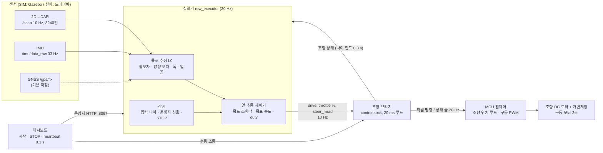
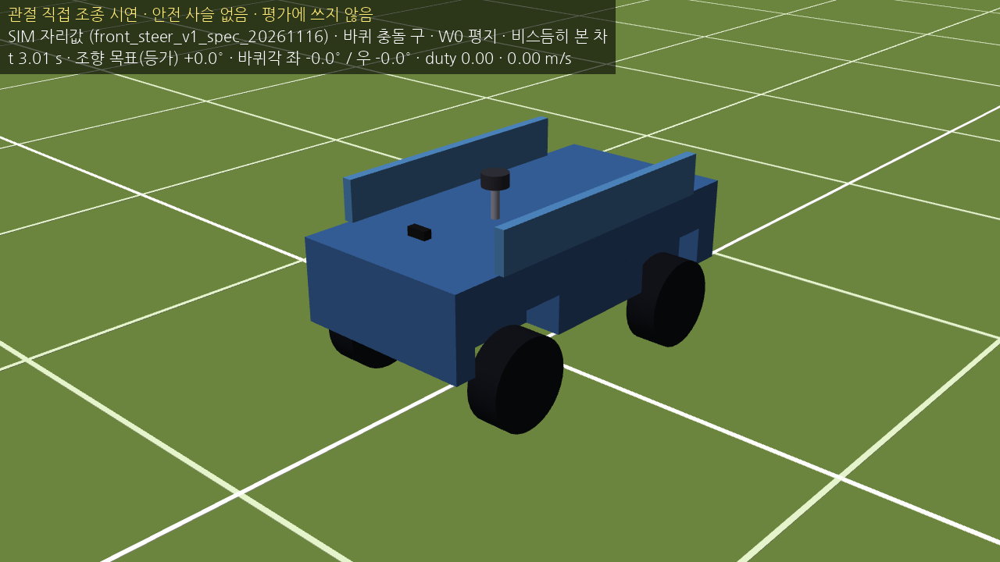
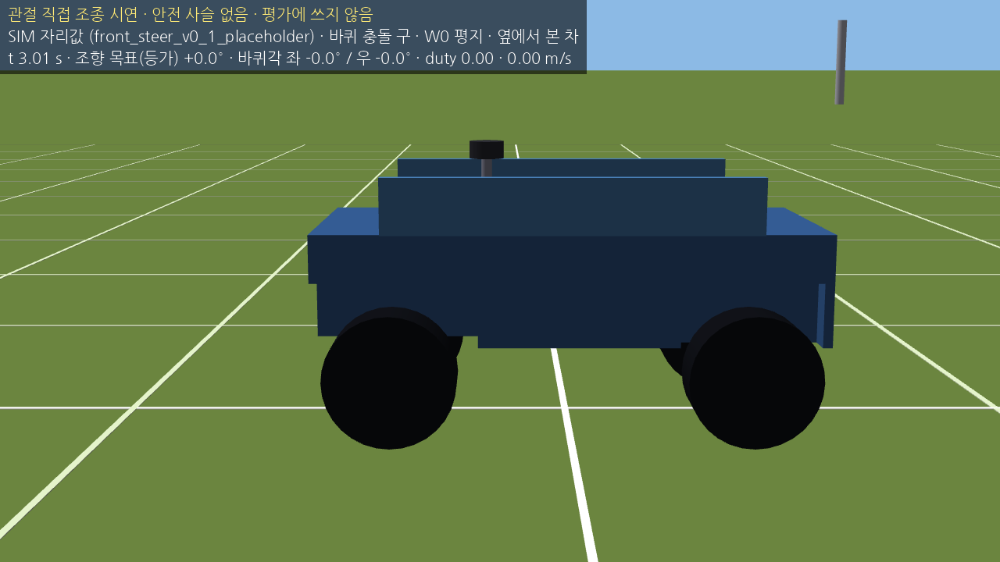
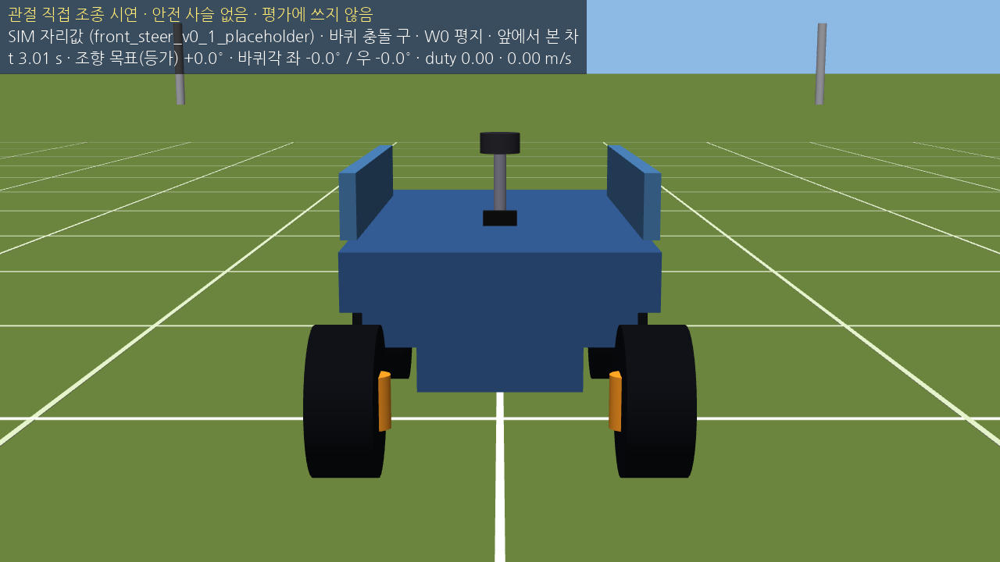
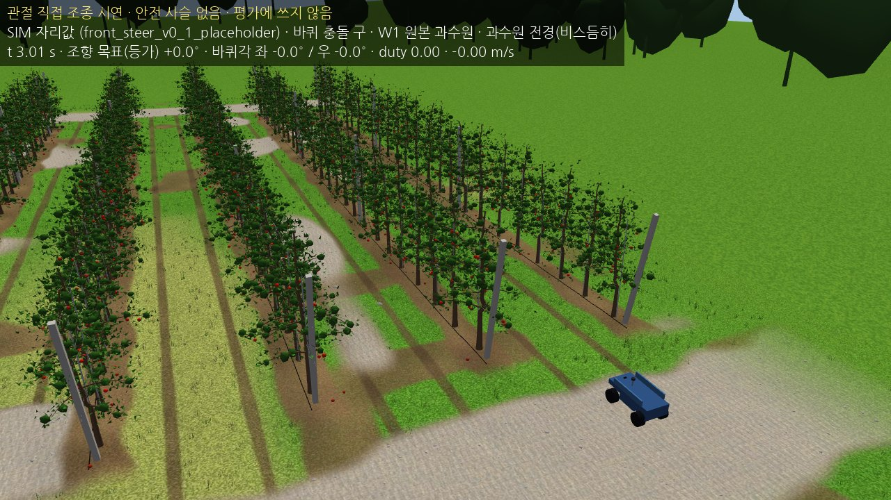
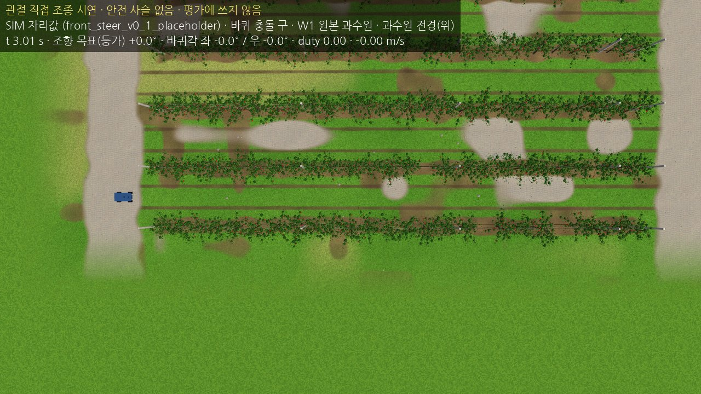
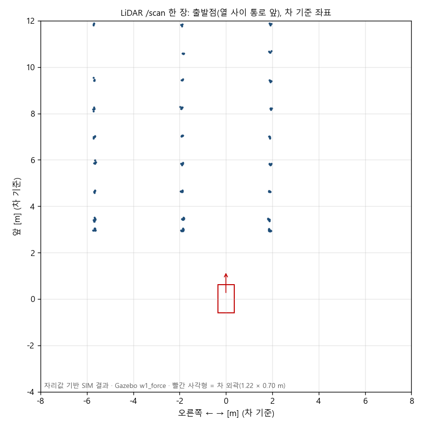
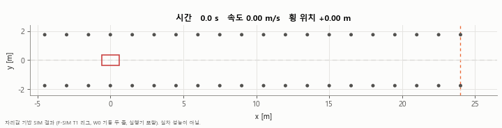
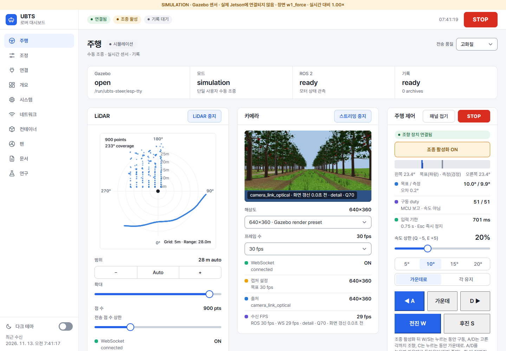
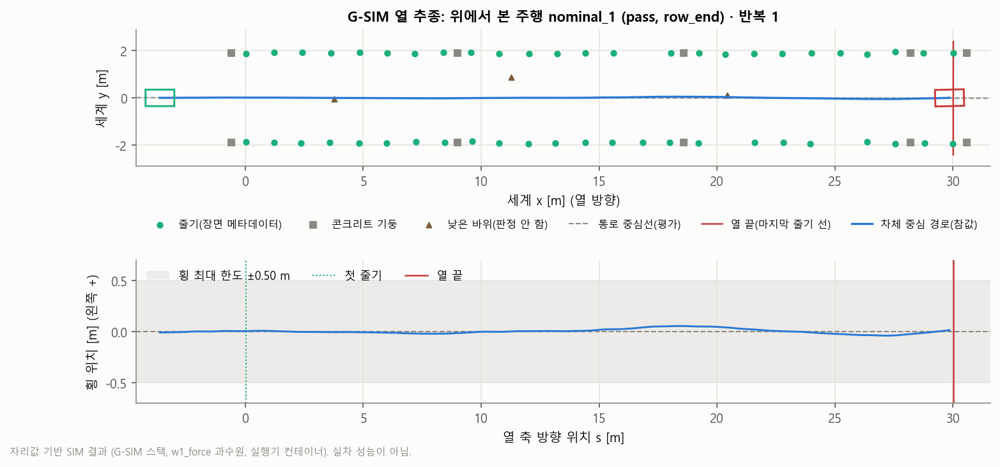

# unist_orchard_simulation

과수원 로버가 **행간 하나를 시작점에서 끝점까지 따라가 열 끝에서 서는 자율주행**을 만들고 검증하는 시뮬레이션 저장소입니다.
로버는 어린이용 4륜 전동차를 개조한 차이고, 좌우 바퀴 속도 차로 돌던 방식에서 **앞바퀴 조향 장치**를 다는 방식으로 바꾸는 중입니다.
지도를 만들지 않고, 매 순간 2D LiDAR로 양쪽 나무 열을 찾아 그 가운데(행간 중심선)를 따라갑니다.

> **English summary.** Simulation of a converted ride-on orchard rover that follows one orchard row from start to end
> along the centre line between two tree rows and stops at the row end (no mapping, no U-turn). The rover is being
> refitted from differential (left/right speed) turning to front-wheel steering. Main inputs: 2D LiDAR and raw IMU;
> drive PWM and steering angle are bounded priors; GNSS is an optional weak layer. A fast deterministic simulator and a
> Gazebo/ROS 2 stack run the same row executor. All results are simulation results: the main vehicle dimensions were
> measured on 2026-11-16, most steering-hardware values are still placeholders, and no autonomous run on the steered
> vehicle has been made yet. Documents are in Korean.


[SIM · 자리값] Gazebo 과수원(W1) 한 행을 처음부터 열 끝까지 달린 차량 카메라(약 99 s를 10배속). 실행기는 `/scan`과 raw IMU만 보고
조향과 구동을 정한다. 2026-11-13 자리값 차량(프로필 v0.1)으로 찍은 영상이다.

## 1. 목적과 구현 범위

**목표.** 운영자가 행 시작점에서 자율주행을 한 번 누르면, 차가 구동 PWM으로 전진하며(목표 0.40 m/s, 0.20~0.50) 앞바퀴 조향으로
행간 중심선을 따라가고, 열 끝에서 선다(앞범퍼가 마지막 구조물 ±1.0 m 안). 유턴과 다음 행 진입, 지도 작성은 범위 밖이다.

| 구분 | 내용 |
|---|---|
| 구현됨, SIM에서 확인 | LiDAR·IMU 기반 통로(행간) 추정, 주시점 추종 조향 제어, 속도 조절, 열 끝 정지, 한 번 눌러 시작·STOP·신호 끊김 정지, 빠른 SIM과 Gazebo 스택, 대시보드 연동, 기록 |
| 구현됨, 기본 꺼짐 | 구동기 사전값 예측(L1, 기록만), 국소 점유 격자(L2), GNSS 층(L3, RTK 약한 제약 포함) |
| 실차에 설치만 됨 | Jetson에 실행기를 SHADOW(조종 출력 없음)로 설치해 실제 `/scan`·IMU를 받는 것까지 확인(2026-11-16) |
| 하지 않음 | 조향 장치를 단 차의 실차 주행, 실차 조향·구동 식별 시험, 카메라 인식, 지도 작성, 유턴 |

## 2. 시스템 구조와 데이터 흐름



[도식] SIM과 실차가 같은 실행기 코드를 쓴다. SIM에서는 센서와 차체가 Gazebo(또는 빠른 SIM의 플랜트)로, MCU가 펌웨어 흉내 프로그램으로
바뀐다. 실행기는 참값(차의 진짜 위치)을 읽지 않고, 평가만 참값을 쓴다.

**실행기 한 틱(50 ms).** 순서는 다음과 같다(`tools/row_executor/executor_main.py`).

1. 운영자 요청(시작·Arm·go·STOP)을 처리한다.
2. 쌓인 IMU 표본을 모두 추정기에 넣고, 스캔은 가장 새것 하나만 처리한다(밀린 스캔은 버리고 수를 센다).
3. 조향 상태가 0.15 s보다 낡았으면 브리지에 한 번 다시 묻는다.
4. 입력 신선도를 본다(LiDAR ≤ 0.45 s, IMU ≤ 0.40 s, 조향 상태 ≤ 0.3 s). 넘으면 구동 0으로 멈춘다(자동 재출발 없음).
5. 추정기 결과로 제어기가 목표 조향각과 duty를 낸다.
6. 브리지에 `drive`(10 Hz)와 `motion`(요레이트·LiDAR 속도)을 보낸다.
7. 틱 기록 한 줄(JSONL)을 남긴다.

별도 감시 스레드가 50 ms마다 주 루프를 보고, 0.35 s 넘게 끝나지 않으면 구동 0을 보낸다. 운영자 heartbeat가 1.0 s 끊기면 일시정지하고,
다시 출발은 사람이 누른다.

**잰 처리 시간(SIM).** Gazebo 최종 확인 8b단계(2026-11-15, SIM 시계, 이 PC): 스캔 처리 p99 11.0~19.0 ms, 실행기 한 걸음 p99
20.5~21.4 ms, 조향 상태 나이 최대 0.142 s. 호스트가 바쁜 단계에서는 스캔 처리 p99가 105.6 ms까지 늘어 안전 한도에 걸려 섰다.
Jetson에서의 처리 시간은 아직 재지 않았다. 대시보드 중계 지연, STOP 지연 등 나머지 수치와 측정 조건은
[`docs/SYSTEM_REFERENCE_KO.md`](docs/SYSTEM_REFERENCE_KO.md) 4절.

## 3. 차량 모델과 시뮬레이션 환경

### 두 시뮬레이터

| | 빠른 SIM (F-SIM, T1 장치) | Gazebo 스택 (G-SIM) |
|---|---|---|
| 구성 | 한 프로세스, 한 SIM 시계. 실행기·브리지 코드 그대로, MCU 펌웨어는 PC용으로 컴파일, 차체는 운동학 자전거 모델 | Docker의 ROS 2 Jazzy + Gazebo Harmonic. 센서 노드, 펌웨어 흉내, 브리지, 기록기, 대시보드, 실행기 컨테이너 |
| 주기 | MCU 1 ms, 플랜트 10 ms, 브리지 20 ms, 실행기 50 ms, LiDAR 10 Hz, IMU 33 Hz | 물리 120 Hz(설정), 나머지는 아래 5절 |
| 특징 | 결정적(같은 seed면 기록이 같다), 큰 조건 행렬 | ROS·DDS·대시보드·기록까지 실차와 같은 사슬, 3D 접촉 |
| 쓰임 | 제어기 개발, 사전등록 판정, 안전 대본 | 통합 확인, 화면, 영상 |

### 차량 파라미터

차량 값은 프로필 파일 하나에 모여 있고(`sim/ubts/steering/profiles/`), 값마다 출처가 붙어 있다.

| 항목 | 측정 치수 프로필 `front_steer_v1_spec_20261116` | 자리값 프로필 `front_steer_v0_1` |
|---|---|---|
| 휠베이스 / 윤거 | 0.657 / 0.527 m (측정 2026-11-16) | 0.76 / 0.56 m |
| 바퀴 반경 / 폭 | 0.13 / 0.095 m (측정) | 0.14 / 0.12 m |
| 조향 한계 | 바퀴마다 20° (측정), 제어 소프트 한계 16.1° | 28°, 소프트 23.5° |
| 조향 방식 | 새 보드 펌웨어의 펄스 유지 흉내(아래) | V3 서보(500 Hz 비례 제어) |
| 조향 응답 | 보드 계단 응답 0 → ±20 명령도 3.5 s, 되돌림 2.5 s (측정) → 실행기 조향 속도 5.09 °/s, 명령 변화율 한도 4.075 °/s | 주행 30, 정지 15 °/s (자리값) |
| LiDAR 위치 | 앞차축 0.21 m 뒤, 가운데 (측정), 스캔 높이 0.55 m (추정) | x 0.18 m, 높이 0.60 m |
| 구동 응답 | duty → 속도 곡선(40/55/70/88 % → 0.33/0.47/0.61/0.78 m/s, 100 % 0.90 m/s). 조향 장치를 달기 전 차의 기록에서 맞춘 추정값 | 같음 |
| 그대로 자리값 | 질량 24 kg, 발자국 1.22 × 0.70 m, Ackermann 비 0.5, 유격 2°, 벨트·가변저항 등 34칸 | 조향 값 전부 |

- 등록 판정과 회귀 시험은 기록대로 v0.1을 쓰고, 이 PC의 Gazebo 화면용 스택은 측정 치수 프로필로 뜬다(`compose.ubts-steer.measured.yaml`).
- 조향 사양이 오면 `profiles/steer_spec_input.yaml` 한 파일을 고치고 `tools/steer_sim/apply_spec.py`를 돌린다([`SPEC_UPDATE_KO.md`](docs/steering/SPEC_UPDATE_KO.md)).

**조향 방식.** 조향은 서보가 아닌 일반 DC 모터를 모터 드라이버로 돌리고, 벨트로 이은 가변저항으로 위치를 읽는다. Jetson은 목표 조향각만
보내고, 위치 루프는 MCU 안에서 닫는다. 실차 보드(2026-11-16~, ESP32-S3 + BTS7960 3개)의 펌웨어는 절대 목표각을 받아 PWM 100/255를
50 또는 80 ms 주고 300 ms 쉰 뒤 가변저항 값으로 다시 판정하는 펄스 유지 방식이다. SIM은 이 법칙을 `sim/ubts/steering/native/abs_hold8.cc`로
흉내 낸다. 펄스 사이에 드라이버가 놓여 외력에 밀리는 효과는 빠른 SIM에만 있다(Gazebo 조향 관절은 위치 제어).
자세히: [`ABS_HOLD8_SIM_KO.md`](docs/steering/ABS_HOLD8_SIM_KO.md), 하드웨어 표 [`HARDWARE_KO.md`](docs/HARDWARE_KO.md).
2026-11-16 밤부터 보드는 같은 소스의 SMOOTH 유지 r5(한 번의 연속 구동, 램프·감속 구역, 끝 제동, 구동 중 조용한 읽기)를 쓴다. SIM은 이것을
`sim/ubts/steering/native/smooth_r5.cc`(`steer_fw_mode smooth_r5`)로 흉내 내고, 보드 보정·SM 값을 넣은 프로필 `front_steer_v2_field_20261116`이
고른다(등록 판정과 화면용 스택은 아직 예전 프로필): [`SMOOTH_R5_SIM_KO.md`](docs/steering/SMOOTH_R5_SIM_KO.md).

| 비스듬히 | 옆 | 위(오른쪽이 앞) |
|---|---|---|
|  |  |  |
| [SIM · 자리값] 측정 치수 프로필. 차체 상자·카메라는 자리값 | [SIM · 자리값] 휠베이스 0.657 m, 바퀴 지름 0.26 m | [SIM · 자리값] 윤거 0.527 m, LiDAR 앞차축 0.21 m 뒤 |

| 앞, 조향 0° | 앞, 조향 +15°(왼쪽) |
|---|---|
|  |  |
| [SIM · 자리값] 바퀴 두께 0.095 m | [SIM · 자리값] 바퀴각 좌 +15.7° / 우 +14.4°, 한계 20° |

### 지형별 구동 표 (10월 현장 기록)

2026-10-03·10-10에 조향 장치를 달기 전 차(좌우 차동 구동, ESP8266 제어)를 사람이 몰며 남긴 기록 14개에서 잰 값이다. 속도는 LiDAR 스캔
정합으로 쟀고 일부 칸은 GNSS다. 지금 차는 같은 구동 모터에 조향 장치를 달았고 ESP32-S3 + BTS7960(20 kHz)으로 돌리므로 값이 다를 수 있다.
실행기 차량 설정의 구동 값(출발 34 %, 55 %에서 0.459 m/s, 정지 거리 0.595 m)이 이 기록에서 왔다(2026-11-17 사용자 결정,
[`EXECUTOR_ESP32_KO.md`](docs/steering/EXECUTOR_ESP32_KO.md) 3.4절). 방법과 전체 표: [`docs/drive_response/README_KO.md`](docs/drive_response/README_KO.md).

**duty → 정상 직진 속도** (m/s [등급, 구간 수], 표 T3)

| duty % | 도로·포장 10/3 | 과수원 10/3 | 과수원 열 안 10/10 | 과수원 그 밖 10/10 |
|---|---|---|---|---|
| 40 | 0.373 [참고, 1] | | | |
| 45 | | 0.426 [참고, 1] | | |
| 55 | | 0.459 [참고 GNSS, 3] | | |
| 58 | 0.537 [참고, 1] | | | |
| 70 | | 0.641 [측정 GNSS, 6] | | |
| 88 | 0.771 [측정, 5] | | | |
| 90 | 0.831 [참고, 2] | | 0.706 [측정, 12] | 0.685 [참고, 3] |
| 95 | 0.864 [측정, 15] | | | |
| 100 | 0.942 [측정, 125] | 0.847 [참고 GNSS, 3] | 0.892 [측정, 78] | 0.896 [측정, 119] |

- 빈 칸과 표에 없는 duty(0~39, 41~44, 46~54, 56~57, 59~69, 71~87, 89, 91~94, 96~99 %)는 그 지면에 정착된 직진 구간이 없다. 합친 기준표(T2)는
  그 사이를 보간하고 40 % 아래를 외삽한다(v = 0.00855·duty + 0.025).
- 10/3 과수원은 열 안/밖을 나눌 궤적이 없다. 10/10 '그 밖'에는 열 끝 공간, 농로, 카탈로그에 없는 행간이 섞여 있다.

**정지에서 duty를 T초 유지했을 때 이동거리** (m, 표 T6). 지형별로 나누지 않았고 합친 기준표(T2)의 속도를 쓴다.

| duty % | 정상 속도 m/s | 1 s | 2 s | 5 s | 10 s | 놓기 정지 |
|---|---|---|---|---|---|---|
| 35 | 0.324 외삽 | 0.14 | 0.46 | 1.43 | 3.06 | 0.12 |
| 40 | 0.373 참고 | 0.16 | 0.53 | 1.65 | 3.51 | 0.15 |
| 45 | 0.426 참고 | 0.18 | 0.60 | 1.88 | 4.01 | 0.18 |
| 50 | 0.443 보간 | 0.19 | 0.62 | 1.95 | 4.16 | 0.19 |
| 55 | 0.459 참고 GNSS | 0.19 | 0.64 | 2.02 | 4.31 | 0.20 |
| 60 | 0.555 보간 | 0.21 | 0.75 | 2.42 | 5.19 | 0.26 |
| 70 | 0.641 측정 GNSS | 0.23 | 0.85 | 2.77 | 5.98 | 0.32 |
| 80 | 0.713 보간 | 0.23 | 0.92 | 3.06 | 6.63 | 0.37 |
| 90 | 0.707 측정 | 0.38 참고(1) | 1.15 참고(1) | 3.56 참고(1) | 6.57 | 0.37 |
| 100 | 0.928 측정 | 0.34 측정(13) | 1.29 측정(9) | 3.96 참고(4) | 8.52 참고(2) | 0.55 측정(7) |

- 숫자만 있는 칸은 측정이 아니라 모델이다: 100 %/s 램프, 출발 문턱 34 %, 1차 지연 0.25 s(가정), 놓기 정지 v·0.25 + v²/2.6. 모델은 1~2 s 거리를
  0.1~0.2 m 짧게 낸다. 30 %는 출발 문턱 아래라 비웠다. 괄호는 기록 수다.
- 출발: 10/10 정지 출발 11건에서 움직이기 시작한 duty p50 34 %(p10/p90 15/90 %), 램프 시작에서 움직임까지 p50 0.34 s. 10/3 7건은 p50 23 %.
  요청은 88~100 %뿐이고 30~60 %로 정지에서 출발한 자료는 없다.
- 놓기 정지: 0.75~0.98 m/s에서 키를 놓은 깨끗한 정지 8건 p10/50/90 0.394 / 0.546 / 0.575 m(10/10 4건 0.383 / 0.559 / 0.566 / 0.595 m).
  STOP 제동과 0.2~0.6 m/s 정지는 재지 않았다.
- 한계: 10월 기록, 조향 장치 전, ESP8266 제어, 배터리 상태 모름. 자율 속도대 25~60 %는 duty마다 구간 1~3개뿐이고 40 % 미만은 자료가 없어
  ±20 % 넘게 틀릴 수 있다. 참조(LiDAR, GNSS, Cartographer)끼리 속도 눈금이 3~10 % 다르다.

### 세계와 센서 모델

| 세계 | 내용 | 쓰는 곳 |
|---|---|---|
| W0 | 평지에 기둥 두 줄(행 폭 3.5 m, 간격 1.5 m, 열 끝 x = 24 m). 넓은 조건에서는 굽은 열, 빈 나무, 끝 기둥, 폭·간격 변형 | 빠른 SIM 판정 |
| W1 | 원본 과수원 생성기: 6열, 행 간격 3.8 m, 나무 간격 1.2 m, 열 길이 30 m, 기둥·철선, 지면 기복 | Gazebo |
| W2 | 2026-10-10 현장 주행으로 만든 SLAM 지도의 회랑(행 간격 3.19~3.95 m) | 빠른 SIM 판정, Gazebo |
| W3 | 10/10 통계에 맞춘 절차 과수원(4열, 60 m) | 빠른 SIM(판정에는 아직 안 씀) |

| 센서 | 모델 |
|---|---|
| LiDAR | 3200빔을 RPLIDAR S2 형식 3240빔으로 바꿔 `/scan` 10 Hz. 거리 잡음 0.015 m(빠른 SIM), 0.01 m(Gazebo), 지연 0.08 s(추정) |
| IMU | 33 Hz. 자이로 배율·편향은 run마다 추첨(추정값), 정지 잡음 0.09 °/s와 주행 진동은 10/10 기록에서 잼 |
| GNSS | 가상 수신기(빠른 SIM 1 Hz, 수평 오차 수 m 자리값; Gazebo 약 5 Hz, 잡음 0). 실행기 기본 설정은 GNSS를 쓰지 않는다 |
| 카메라 | Gazebo 640×360 30 Hz, 표시·기록용(위치 추정에 쓰지 않음) |

| 과수원 전경 | 위에서 본 과수원 | 통로 출발점 |
|---|---|---|
|  |  |  |
| [SIM · 자리값] W1 원본 과수원, 오른쪽 아래가 차 | [SIM · 자리값] 행 간격 3.8 m, 나무 간격 1.2 m, 열 길이 30 m | [SIM · 자리값] 두 나무 열과 기둥·철선 |

| 차량 카메라 | LiDAR `/scan`, 통로 안 | LiDAR `/scan`, 출발점 |
|---|---|---|
|  |  |  |
| [SIM · 자리값] 640×360 렌더에서 차체 윗면 띠를 잘라 냄 | [SIM · 자리값] 차 기준 좌표, 빨간 사각형이 차 외곽 | [SIM · 자리값] 앞 3 m부터 두 줄의 줄기 |

## 4. 행간 중심선 추정과 조향 제어

### 중심선 추정 (L0, `sim/ubts/closed_loop/estimator.py`)

1. **스캔 전처리.** 차체 안 반사와 2 m 안의 일시적인 반사(앞 두 스캔에서 확인되지 않은 것)를 지운다.
2. **주행 거리.** 키프레임 대비 점-대-점 ICP로 움직임을 잰다. 회전 초기값은 자이로, 맞음 비율이 0.5 이상일 때만 위치를 고친다.
   속도는 최근 5개 스캔 단계의 중앙값이다. 바퀴 엔코더는 없다.
3. **통로 잡기.** 진행 방향 ±30° 안의 축마다 양쪽에서 가장 가까운 점 띠를 찾고, 사이에 다른 열이 있으면 버린다. 같은 후보가 세 번 이어지면
   통로(band)를 만든다.
4. **두 열 선.** 양쪽 점들에 공통 기울기 직선을 최소제곱으로 맞추고, 그 가운데를 중심선으로 둔다(3스캔마다 갱신).
5. **갱신 거르기.** 방향 8°·중심 0.35 m·폭 0.5 m 넘게 튀는 갱신은 받지 않는다. 한쪽만 보이면 배운 폭을 유지한 채 중심을 놓는다.
6. **열 끝.** 양쪽 지지점이 끝난 갱신이 두 번 이어지고, 두 갱신이 알린 끝이 1.0 m 안에서 맞을 때 열 끝을 인정한다.
   굽은 열은 두 선에 공통 포물선을 맞춰 판단한다.

출력은 횡오차(차가 중심선 왼쪽이면 +), 방향 오차, 통로 폭, 열 끝까지 거리, 통로 유효 여부다.

### 조향 제어 (`sim/ubts/closed_loop/steer_control.py`)

```
L_d   = clamp(1.5 + 1.25·v, 1.5, 3.0)                 주시거리 [m], v = LiDAR 속도
y_L   = −k_d · 횡오차 + k_ψ · L_d · sin(방향 오차)       k_d = k_ψ = 1.0
κ     = 2 · y_L / L_d²
δ     = atan(L · κ) + trim                             L = 휠베이스, trim은 ±3° 안에서 천천히(이득 0.05)
```

목표 조향각은 ±12°로 자르고, 0.25 s 저역 통과와 실행기 변화율 한도의 0.75배로 다듬는다. 요레이트 안쪽 루프는 자리만 있고 꺼져 있다.

**속도.** 목표 속도는 다음 상한 가운데 가장 작은 값이다: 순항 0.40 m/s, 스캔 주기, 연산 지연, 앞 장애물 정지 거리, 곡률(옆 가속 0.3 m/s²),
횡오차, 조향 요구, 추정 품질, 스캔 신선도, 열 끝 접근(0.20 m/s). 최소 0.20 m/s 아래로 내려가면 멈춘다.
duty는 구동 응답 표의 역함수에 PI 보정(비례 30, 적분 15, 70 % 상한)을 더해 낸다.

**정지.** 열 끝, 장애물, 통로 잃음(1 s), 센서 낡음, 운영자 신호 끊김(1.0 s), 과속, STOP에서 그 틱에 구동 0을 보내고 조향은 그 자리에 둔다.

모든 제어 값은 SIM에서 정한 자리값이며, 현장 조정 파일 하나(`tools/row_executor/field_tuning.default.json`)를 실차·빠른 SIM·Gazebo가 같이
읽는다. 단계별 상세와 상한 식은 [`docs/SYSTEM_REFERENCE_KO.md`](docs/SYSTEM_REFERENCE_KO.md) 5·6절.



[SIM · 자리값] 빠른 SIM에서 열 추종을 위에서 본 모습(평지 기둥 두 줄 W0, `nominal` seed 0, 약 10배속).

## 5. ROS 2 노드와 토픽 (Gazebo 스택)

| 노드 (컨테이너) | 입력 | 출력 | 주기 |
|---|---|---|---|
| `gz sim` + `ros_gz_bridge` (sim) | 관절 명령 `/sim/act/*` | `/clock`, `/sim/imu`, 카메라, 참값(평가 전용) | 물리 120 Hz(설정), IMU 33 Hz, 카메라 30 Hz |
| `ubts_cpu_lidar` (sim) | 참값 자세 | `/sim/scan` 3200빔 | 10 Hz |
| `ubts_steer_s2_format` (sim) | `/sim/scan` | `/scan` LaserScan, S2 형식 3240빔, RELIABLE | 10 Hz |
| `ubts_steer_sensor_contract` (sim) | `/sim/imu`, 참값 | `/imu/data_raw` (오차 모형 + 자세), `/gps/fix`, `/gps/data` | 33 Hz, GNSS 약 5 Hz |
| `gz_esp_emulator` (steer) | 직렬 명령, `/clock` | 관절 명령, MCU 상태 줄 | 펌웨어 1 ms 틱, 상태 줄 20 Hz |
| `steer_rover_bridge` (steer) | control.sock 요청 | 직렬 명령, `/rover/steering/state`, `/rover/control/requested` | 20 ms 루프 |
| `ubts_row_executor` (executor) | `/scan`, `/imu/data_raw`, `/rover/control/requested`, (SIM 시계 모드면 `/clock`) | control.sock `drive`·`motion`·`stop`, 운영자 HTTP `127.0.0.1:8097` | 20 Hz, drive 10 Hz |
| 기록기 + 조향 사이드카 (recorder) | 기록 토픽, `/rover/steering/state` | rosbag2, `steering.jsonl` | 메시지마다 |
| 대시보드 (dashboard) | 상태 파일, control.sock, 실행기 HTTP | 웹 `127.0.0.1:18090` | 상태 0.5 s, heartbeat 0.1 s |

- 모든 컨테이너는 ROS 도메인 43, 로컬 전용 DDS를 쓴다. 실행기는 `/scan`을 BEST_EFFORT(깊이 2), `/imu/data_raw`를 BEST_EFFORT(깊이 50)로 받는다.
- 실차에서는 같은 실행기가 Jetson의 ROS 2 Iron 컨테이너에서 실제 `/scan`·`/imu/data_raw`를 받고, 조종 출력은 ESP32-S3 보드용 브리지
  (대시보드 저장소)로 보낸다. 지금은 SHADOW라 출력을 보내지 않는다.

QoS, 제어 소켓 요청 형식, 운영자 HTTP 목록은 [`docs/SYSTEM_REFERENCE_KO.md`](docs/SYSTEM_REFERENCE_KO.md) 1~3절.

## 6. 실행 방법

저장소 맨 위에서 실행한다. 결과 파일은 저장소 밖 폴더에 둔다.

```bash
# 저장소 검사 (Docker 없음)
python -I tools/steer_sim/check_pins.py
python -I tools/steer_sim/check_assets.py

# 빠른 SIM: 열 추종 nominal 5 run (Python 3.10+, numpy, PyYAML, C++ 컴파일러)
export UBTS_STEER_BUILD_DIR=<저장소 밖 빌드 폴더>
cd sim/ubts
python -B -m steering.safety_scripts.follow_realdims --out <결과 폴더> --parts matrix --only nominal   # 측정 치수 차
python -B -m steering.safety_scripts.follow_matrix --out <결과 폴더> --only nominal --seeds 0         # 자리값 차 v0.1
```

```bash
# Gazebo 스택 (Docker Desktop + WSL2, 메모리 약 6 GiB, 이미지 ubts-steer-sim:wf12 이후)
UBTS_STEER_SCENE=w1_force docker compose -p ubts-steer -f compose.ubts-steer.yaml \
  -f compose.ubts-steer.measured.yaml --profile executor up -d      # 브라우저 http://127.0.0.1:18090
docker exec -it ubts-steer-executor-1 python3 -B -m steering.exec_run start   # 한 행 자율주행, Ctrl-C = STOP
docker exec ubts-steer-sim-1 /ros_entrypoint.sh python3 -B -m steering.exec_run reset   # 출발 자세로
UBTS_STEER_SCENE=w1_force docker compose -p ubts-steer -f compose.ubts-steer.yaml --profile executor down -t 20
```

Gazebo 이미지 `ubts-steer-sim`은 `docker/Dockerfile.ubts-steer`로 개발 PC의 로컬 기반 이미지 위에 만든다. 스스로 서는 기반 정의
`docker/Dockerfile.base`는 아직 빌드·검증하지 않았다([`BASE_IMAGE_KO.md`](docs/provenance/BASE_IMAGE_KO.md)). 스택 운영 규칙은
[`STACK_OPERATIONS_KO.md`](docs/steering/STACK_OPERATIONS_KO.md), SIM 대시보드는 [`SIM_DASHBOARD_KO.md`](docs/steering/SIM_DASHBOARD_KO.md).



[SIM · 자리값] SIM 대시보드(127.0.0.1:18090): LiDAR, 차량 카메라, 조향 패널(목표·측정 조향각, 구동 duty, 입력 기한).


[SIM · 자리값] 오른쪽: 측정 치수 차의 조향 패널. 막대를 끌어 왼쪽 6.5°로 조향하는 중(목표 6.5° / 측정 6.7°, 소프트 한계 16.1°).
대시보드 자체는 [대시보드 저장소](https://github.com/2026-BTS-UNI-Car/unist_orachard_dashboard#readme)에 있고 이 저장소에는 사본과 SIM 확장이 있다.
<br clear="right">

## 7. 평가와 결과

### 평가 지표

평가만 참값을 쓰고, 실행기 입력에는 참값이 들어가지 않는다(정적 검사 A13). 기준은 측정 전에 커밋하고(사전등록), 결과를 본 뒤 바꾸지 않는다.

| 지표 | 정의 | 합격 한도 |
|---|---|---|
| 횡오차 RMSE / p95 / 최대 | 차 발자국 중심과 참 중심선 사이 거리. 주행 구간(구동 명령 > 0) 동안. 출발을 어긋나게 둔 조건은 RMSE·p95를 6 m 뒤부터 | 0.20 / 0.35 / 0.50 m |
| 방향 오차 RMSE / 최대 | 차 방향과 행 축의 차 | 5° / 15° |
| 열 끝 정지 위치 e | 앞범퍼 − 행 줄의 마지막 구조물 | ±1.0 m |
| 속도 최대 | 주행 구간 참 속도 | 0.50 m/s |
| 그 밖 | 접촉 없음, 끝 이유 `row_end`, 멈춤 0회 | |

참 중심선은 W0에서는 두 기둥 줄의 가운데, Gazebo W1에서는 출발 통로 양쪽 나무 줄기에 맞춘 두 직선의 평균, W2에서는 실제로 비어 있는
통로의 가운데다.

### 결과 (모두 SIM)

| 실험 | 조건 | 결과 |
|---|---|---|
| 열 추종 `steer_follow_v1` | 빠른 SIM, W0, v0.1, 11조건 15 run | 합격 15/15. 횡 RMSE 0.029~0.055 m, e +0.04~+0.09 m |
| 열 추종, 측정 치수 `steer_follow_realdims_v1` | 빠른 SIM, v1 + 펄스 유지, 같은 15 run / 넓은 조건 20 × 3 | 15/15 합격(횡 RMSE 0.036~0.074 m). 넓은 조건 51/60 **불합격**(조향축 외란 6, 옛 기준의 신호 끊김 3) |
| 넓은 조건 `steer_follow_wide_v2` | 빠른 SIM, 55조건 × 5 seed | **불합격** 262/275 (조향축 외란 11, W2 회랑 하나 2) |
| Gazebo 열 추종 `steer_follow_gsim_v1` | W1, 4 run | 기록 판정 3/4(평가 코드 결함), 먼저 커밋한 수정 뒤 4/4. 횡 RMSE 0.021~0.039 m, e +0.45~+0.46 m |
| Gazebo 최종 확인 | W1, 열 추종 4 + 화면 6 + 사용자 명령 3 | 1~7단계 **불합격**(호스트가 바쁠 때 입력 나이 한도에 걸려 정지), 8b단계 합격. 8b 합격이 스레드 배치 덕분인지 한가한 호스트 덕분인지는 가르지 못함 |
| 안전 대본 | 빠른 SIM, STOP·TTL·감시·신호 끊김 등 71개 | 합격 71/71 |
| RTK 약한 제약 `gnss_rtk_weak_v1` | 빠른 SIM, 가상 RTK, 110 run | **불합격** 75/80(실패는 일반 GNSS 층과 세계 선택 문제). 바깥 나무 구간 횡오차 31~35 % 감소 |



[SIM · 자리값] Gazebo 과수원 한 통로의 열 추종(참값 경로, `nominal_1`). 아래 칸은 횡 위치를 세로로 확대한 것이다.

검사 A1~A26 전체(불합격·미실행 포함)는 [`docs/RESULTS_KO.md`](docs/RESULTS_KO.md), 매체 목록은
[`GSIM_MEDIA_KO.md`](docs/steering/GSIM_MEDIA_KO.md).

### 기록과 재현

| 기록 | 내용 |
|---|---|
| 실행기 JSONL | 틱마다 한 줄: 상태, 횡·방향 오차, 통로 폭, 열 끝 거리, LiDAR 속도, 요레이트, 출력(throttle, 조향), 입력 나이, 스캔 처리 시간. 사건 줄(시작, 정지, 이유). `config` 사건에 설정 전체와 `config_digest` |
| 빠른 SIM | `TRACE.npz`(10 ms마다 참값·명령), `SERIAL.jsonl`(직렬 줄), `EXECUTOR.jsonl`, `RESULT.json`(요약과 각 파일 SHA-256) |
| Gazebo 기록기 | rosbag2(`/scan`, IMU, GNSS, 조종 요청·적용, 카메라 선택), 조향 사이드카 `steering.jsonl`(MCU 상태 줄마다 목표·측정 조향, PWM, 결함) |

같은 seed와 설정이면 빠른 SIM 기록은 바이트까지 같다. 그림은 `tools/steer_sim/gsim_follow_figures.py`, `steering.safety_scripts.follow_figures`로
기록에서 다시 만든다([`docs/SYSTEM_REFERENCE_KO.md`](docs/SYSTEM_REFERENCE_KO.md) 7절).

**파라미터 근거.** 측정값은 2026-11-16 치수·조향 한계·보드 계단 응답과, 조향 장치를 달기 전 차의 수동 주행 14개에서 LiDAR로 잰 duty→속도
(100 %에서 0.928 m/s; 25~60 %는 자료가 적음, [`docs/drive_response/README_KO.md`](docs/drive_response/README_KO.md))뿐이다. 제어기·추정기 값은
SIM에서 정했고, 바꿀 때마다 현장 조정 파일의 기록과 설정 digest가 남는다.

## 8. 실차 검증 단계와 현재 한계

**실차 검증 단계.** 조향 장치를 단 차로는 바퀴를 띄운 조향 보정과 계단 응답만 했다(2026-11-16, 구동 없음). 정의된 단계:

1. 벤치(바퀴를 띄움): 조향 극성, 끝점, 명령 대 바퀴 각, 최소 출력, 조향 속도, 유격, 가변저항 잡음(B0~B7, [`IDENT_KO.md`](docs/steering/IDENT_KO.md)).
2. 실내 평지: 서서 조향, 저속 전후진, 고정 조향 원, duty별 직진·정지, 조향 0 왕복(F1~F5).
3. 구동 보정: 출발 duty, duty→속도, 정지 거리(C2·C3·C7). 지금 실행기 설정은 10월 기록 값을 쓴다(위 지형별 구동 표).
4. 실행기 SHADOW로 실제 행에서 사람이 몰며 추정만 확인한 뒤, 낮은 속도로 한 행 자율주행.

실차 횡오차를 기둥·줄기 지도 기반 LiDAR 위치 추정으로 재는 오프라인 도구 `tools/field_eval/`가 있다(빠른 SIM 참값과만 비교, 실차 기록 미확인).
기준선·바닥 자국·줄기 측량·RTK 절차는 계획이다([`FIELD_EVAL_METHOD_KO.md`](docs/steering/FIELD_EVAL_METHOD_KO.md)).

**현재 한계.**

- 모든 결과는 SIM이다. 조향 모터·가변저항·벨트·유격·질량은 자리값이다.
- 새 보드의 펄스 조향은 펄스 사이에 드라이버를 놓아 조향축 외란에 밀린다(빠른 SIM, 외란 크기는 자리값).
- 실차 설정의 조향 출발 문턱과 변화율 한도는 바퀴를 띄운 시험에서 잰 조향 속도(13.1 °/s, SMOOTH 펌웨어)의 0.8배다. 땅에 닿은 조향 속도,
  조향 극성(B0), 각도계 범위(B2/B3), 조향 시작 PWM(B4)은 아직 재지 않았고 0점(F1)은 눈으로 잡은 가운데에서 0° 로 추정했다. 실행기는 SHADOW다.
- Gazebo 열 추종은 장면 하나(W1, 30 m)이고, 열 끝 정지가 +0.45 m로 빠른 SIM보다 뒤다(끝 기둥까지 행으로 봄).
- 호스트가 바쁘면 실행기 틱이 늦어 입력 나이 한도로 선다. Jetson 처리 시간은 재지 않았다.
- 국소 격자(L2)는 10/10 기록 재생에서 빠른 층과 41.3 %만 맞아 표시용이다. 일반 GNSS 오차(수 m)는 행 간격보다 커서 쓰지 않는다.
- Jetson의 `/gps/fix`는 RTK FIXED와 FLOAT를 가르지 않아, RTK 약한 제약은 실차에서 켜지지 않는다.

## 저장소 구조

| 폴더 | 내용 |
|---|---|
| `sim/ubts/closed_loop/` | 통로 추정기, 열 추종 제어기, 한 행 폐루프 하네스 |
| `sim/ubts/steering/` | 차량 프로필, 조향·구동 모델, 빠른 SIM 장치, Gazebo 모델·노드, 펌웨어 흉내, 평가·안전 대본 |
| `tools/row_executor/` | 실행기(실차와 SIM 공용): 루프, 운영자 HTTP, 브리지 클라이언트, GNSS 층, 현장 조정 파일 |
| `firmware/ubts_steer_v3/` | SIM에서 쓰는 MCU 펌웨어 V3(직렬 규약·안전 감시). 실차 ESP32-S3 펌웨어는 이 저장소에 없다 |
| `dashboard/`, `dashboard_sim/` | 대시보드 저장소 사본과 SIM 확장 |
| `ros2_ws/src/orchard_gazebo/` | 과수원 월드 생성기 |
| `tools/steer_sim/`, `tools/drive_response/` | 저장소 검사·그림·사양 적용, 주행 기록의 duty→속도 분석 |
| `docker/`, `compose.ubts-steer*.yaml` | Gazebo 스택 이미지와 구성 |
| `docs/` | 문서([색인](docs/README_KO.md)), 그림 `docs/assets/` |

## 문서

| 문서 | 내용 |
|---|---|
| [`docs/SYSTEM_REFERENCE_KO.md`](docs/SYSTEM_REFERENCE_KO.md) | 노드·토픽·QoS, 제어 소켓·운영자 API, 실행기 틱과 한도, 잰 처리 시간, 추정·제어 상세, 평가 정의, 기록 형식 |
| [`docs/ARCHITECTURE_KO.md`](docs/ARCHITECTURE_KO.md) | 시스템 구성 도식, 컨테이너, 추정기 층, 실행기 상태 |
| [`docs/RESULTS_KO.md`](docs/RESULTS_KO.md) | 모든 검사 결과 |
| [`docs/HARDWARE_KO.md`](docs/HARDWARE_KO.md) | 하드웨어 사양과 자리값 표 |
| [`docs/steering/DECISIONS_KO.md`](docs/steering/DECISIONS_KO.md) | 결정 기록 |
| [`docs/steering/DESIGN_v2_KO.md`](docs/steering/DESIGN_v2_KO.md) | 설계(입력, 시작·정지, 추정기 층, 속도) |

## 라이선스

Apache-2.0 ([`LICENSE`](LICENSE)). 원본 프로젝트(pathcmd95/orchard-rover)와 제3자 구성요소 고지는 [`NOTICE`](NOTICE),
[`third_party/README.md`](third_party/README.md)에 있습니다.
