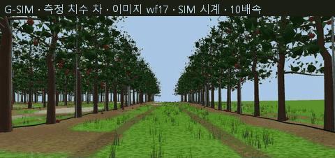
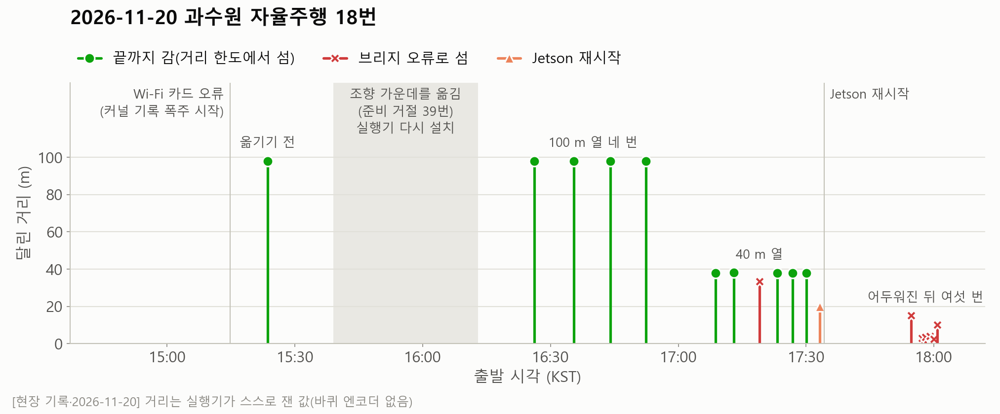
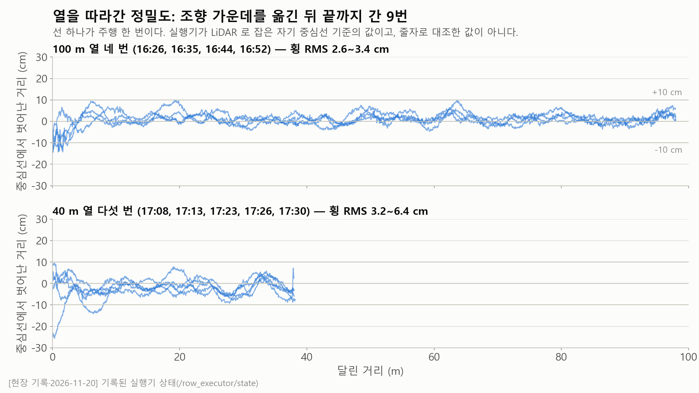
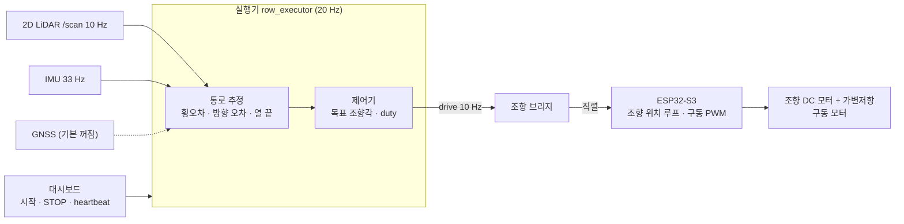

# unist_orchard_simulation

과수원 로버가 **행간 하나를 따라가 열 끝에서 서는 자율주행** 소프트웨어와 그 검증 환경입니다.
차(Jetson)에서 도는 자율 실행기와, 같은 실행기 코드를 그대로 돌리는 두 시뮬레이터(빠른 SIM, Gazebo 스택)가 들어 있습니다.
실행기는 지도 없이 매 순간 2D LiDAR와 IMU로 양쪽 나무 줄을 찾아 그 가운데를 따라갑니다.
차는 어린이용 4륜 전동차를 앞바퀴 조향(일반 DC 모터 + 벨트로 이은 가변저항)으로 개조한 것이고, Jetson Orin Nano, ESP32-S3, RPLIDAR S2, BNO085 IMU, u-blox F9P GNSS를 답니다. 휠 엔코더는 없습니다.

| SIM: Gazebo 과수원 한 행 (10배속) | 실차: 2026-11-20 과수원 100 m 열 (20배속) |
|---|---|
|  |  |
| [SIM · 자리값] Gazebo 과수원 한 행을 열 끝(33.2 m)까지 달린 차량 카메라 | [현장 기록 · 2026-11-20] 사과 2행 자율주행(98 m, 337 s)의 차량 카메라 |

## 결과

값의 표지: **[현장 기록]** 실행기가 LiDAR로 스스로 잰 값(참값 없음), **[실측·줄자 2026-11-20]** 현장에서 줄자로 잰 행 폭, **[SIM · 자리값]** 조향 장치 사양 대부분이 자리값인 시뮬레이션 결과(현장 성능이 아님).

| 무엇 | 결과 | 표지 |
|---|---|---|
| 과수원 자율주행 (2026-11-20) | 18번 출발, 약 772 m. 10번이 열 끝까지 갔다(사과 2행 100 m 다섯 번, 배 1행 40 m 다섯 번). 조향 가운데를 옮긴 뒤 끝까지 간 9번의 횡 오차 RMS 2.6~6.4 cm(모은 값 3.59 cm), ±10 cm 안 98.4 % | 현장 기록 |
| 실내 복도 (2026-11-19) | 15번, 약 186 m. 18~22° 비스듬히 놓고 출발해도 12.5~12.9 m 안에 중심선으로 돌아왔다 | 현장 기록 |
| 줄자와 대조 | 실행기가 잰 통로 폭 − 줄자 폭: 사과 2행 −3.3 cm, 배 1행 −7.5 cm. 줄자 지도 위 Ē(횡 오차 적분 ÷ 행 길이): 사과 평균 2.02 cm, 배 3.10 cm | 실측·줄자 + 현장 기록 |
| 속도 | 목표 0.45 m/s(오후)·0.40 m/s(저녁), 실제 0.28 m/s(사과 2행)·0.34 m/s(배 1행). 제어 지연 상한이 속도를 정했다 | 현장 기록 |
| GPS 켬·끔 | 차이 없음(수신기가 단독 측위라 보정이 걸리지 않았다). SIM에서 RTK FIXED는 한쪽 나무가 비켜 선 구간의 오차만 30 % 줄였다 | 현장 기록, SIM · 자리값 |
| SIM 열 추종 | 빠른 SIM 15/15 합격(횡 RMSE 0.029~0.055 m), Gazebo 4/4(평가 코드 수정 뒤, 0.021~0.039 m). 넓은 조건 행렬은 불합격(조향축 외란 등) | SIM · 자리값 |

| 2026-11-20 주행 18번 | 끝까지 간 9번의 횡 위치 |
|---|---|
|  |  |
| [현장 기록 · 2026-11-20] 출발 시각별 달린 거리와 끝난 이유 | [현장 기록 · 2026-11-20] 선 하나가 주행 한 번, 실행기가 잡은 중심선 기준 |

## 동작 방식



[도식] SIM에서는 센서와 차체가 Gazebo(또는 빠른 SIM의 플랜트)로, 보드가 펌웨어 흉내로 바뀐다. 실행기는 참값을 읽지 않는다.

- **추정**: LiDAR 키프레임 ICP와 자이로로 움직임을 재고, 양쪽 나무 줄에 공통 기울기 직선 두 개를 맞춰 그 가운데를 중심선으로 둔다.
- **조향**: 속도에 비례하는 주시거리의 순수 추종(pure pursuit)과 ±3° 안의 영점 보정. 보드가 DC 모터와 벨트로 이은 가변저항으로 조향 위치 루프를 닫는다.
- **속도**: 여러 상한(제어 지연, 장애물, 곡률, 횡오차, 열 끝 접근 등)의 최솟값. duty는 구동 표의 역함수 + PI.
- **정지**: 열 끝, 거리 한도(입력한 열 길이 − 2 m), 장애물, 센서 낡음, 운영자 신호 끊김, STOP이면 그 틱에 구동 0.

## 실행

```bash
# 저장소 검사 (Docker 없음)
python -I tools/steer_sim/check_pins.py
python -I tools/steer_sim/check_assets.py

# 빠른 SIM 열 추종 (Python 3.10+, numpy, PyYAML, C++ 컴파일러)
export UBTS_STEER_BUILD_DIR=<빌드 폴더>
cd sim/ubts && python -B -m steering.safety_scripts.follow_realdims --out <결과 폴더> --parts matrix --only nominal
```

```bash
# Gazebo 스택 (Docker Desktop + WSL2, 메모리 약 6 GiB) — 브라우저 http://127.0.0.1:18090
UBTS_STEER_SCENE=w1_force docker compose -p ubts-steer -f compose.ubts-steer.yaml \
  -f compose.ubts-steer.measured.yaml --profile executor up -d
docker exec -it ubts-steer-executor-1 python3 -B -m steering.exec_run start   # 한 행 자율주행, Ctrl-C = STOP
UBTS_STEER_SCENE=w1_force docker compose -p ubts-steer -f compose.ubts-steer.yaml --profile executor down -t 20
```

Gazebo 이미지(`docker/Dockerfile.ubts-steer`)는 로컬 기반 이미지 위에 만든다. 스스로 서는 기반 정의 `docker/Dockerfile.base`는 아직 빌드·검증하지 않았다([`BASE_IMAGE_KO.md`](docs/provenance/BASE_IMAGE_KO.md)).

## 저장소 구조

| 폴더 | 내용 |
|---|---|
| `tools/row_executor/` | 자율 실행기(실차와 SIM 공용) |
| `sim/ubts/closed_loop/` | 통로 추정기, 열 추종 제어기 |
| `sim/ubts/steering/` | 차량 프로필, 조향·구동 모델, 빠른 SIM, Gazebo 노드, 펌웨어 흉내, 평가 |
| `firmware/ubts_steer_v3/` | SIM에서 쓰는 MCU 펌웨어(실차 ESP32-S3 펌웨어는 이 저장소에 없다) |
| `dashboard/`, `dashboard_sim/` | 대시보드 저장소 사본과 SIM 확장 |
| `tools/field_records/` | 현장 녹화를 읽어 실행기 값을 GNSS·스캔과 맞춰 보는 도구 |
| `docker/`, `compose.ubts-steer*.yaml` | Gazebo 스택 |
| `docs/` | 문서([색인](docs/README_KO.md)) |

## 문서

- [자율주행 알고리즘](docs/AUTONOMY_ALGORITHM_KO.md): 수식, 기법 이름, 매개변수, 코드 위치
- [시뮬레이션 환경과 평가 방법](docs/SIMULATION_KO.md): 두 SIM, 차량·세계·센서 모델, 지표, SIM 판정 요약
- [시스템 참고](docs/SYSTEM_REFERENCE_KO.md): 노드·토픽, 제어 소켓, 운영자 API, 잰 처리 시간
- 현장 결과: [과수원 2026-11-20](docs/steering/ORCHARD_1120_RESULT_KO.md), [줄자 대조](docs/steering/ORCHARD_MEASURED_KO.md), [자율주행 33번 통합 분석](docs/steering/AUTONOMY_RUNS_ANALYSIS_KO.md), [GPS 유무 비교](docs/steering/GPS_COMPARE_KO.md), [실내 복도](docs/steering/FIELD_CORRIDOR_20261119_KO.md)
- [SIM 검사 결과 전체](docs/RESULTS_KO.md), [하드웨어](docs/HARDWARE_KO.md)

## 한계

- 현장에서 LiDAR로 열 끝을 보고 선 적이 없다. 끝까지 간 주행은 모두 입력한 열 길이의 거리 한도에서 섰다.
- 현장의 횡 오차·거리·속도는 실행기의 자체 추정이다. 줄자로 잰 것은 행 폭뿐이고, 횡 위치를 측량 기준과 직접 견준 적은 없다.
- 현장 기록은 실내 복도 하룻밤과 과수원 하루(두 행)뿐이다. 차량 주행 시험은 2026-11-20이 마지막이다.
- 2026-11-20의 브리지 오류 7번(보드로 가는 명령이 잠깐 끊김)과 Jetson 재시작 1번은 원인을 확정하지 못했다. 저녁 6번은 현장 시험 담당자가 보드 보조배터리 방전을 말했다(측정한 것은 아님).
- 속도 상한의 제어 지연 안에 Jetson에서 재지 않은 고정값 0.24 s가 있다. 구동 표는 조향 장치를 달기 전 차의 기록이다.
- 조향 장치 사양(벨트, 유격, 가변저항 범위 등)과 SIM 차량 값 대부분은 자리값이다. 조향 영점 보정 한도(±3°)를 넘게 어긋나면 횡 오차가 남는다.
- 차의 GNSS 경로는 RTK FIXED를 가르지 못해 RTK 보정은 실차에서 쓸 수 없다.

## 라이선스

Apache-2.0 ([`LICENSE`](LICENSE)). 원본 프로젝트(pathcmd95/orchard-rover)와 제3자 구성요소 고지는 [`NOTICE`](NOTICE), [`third_party/README.md`](third_party/README.md)에 있습니다.
