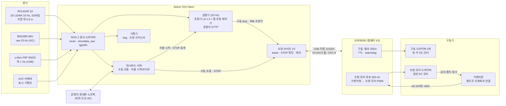
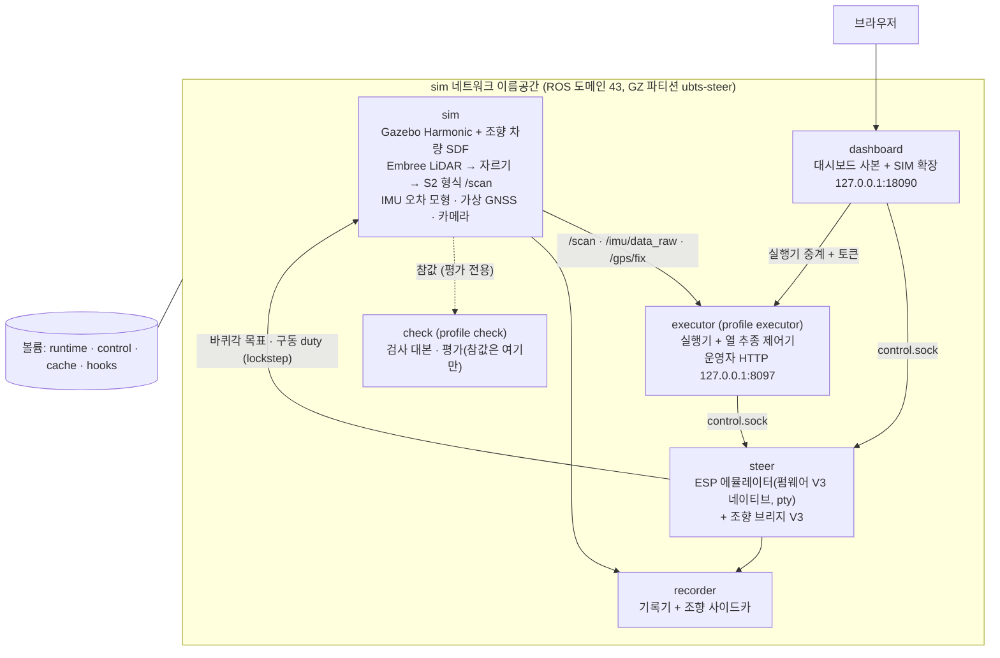
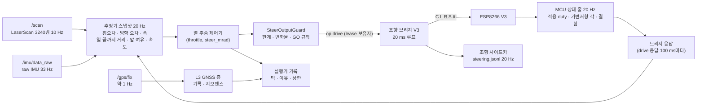
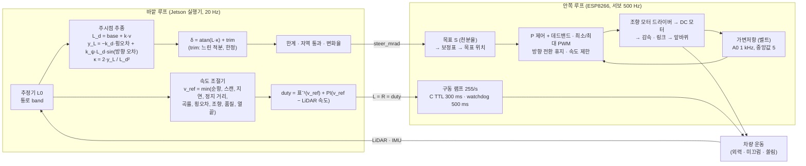
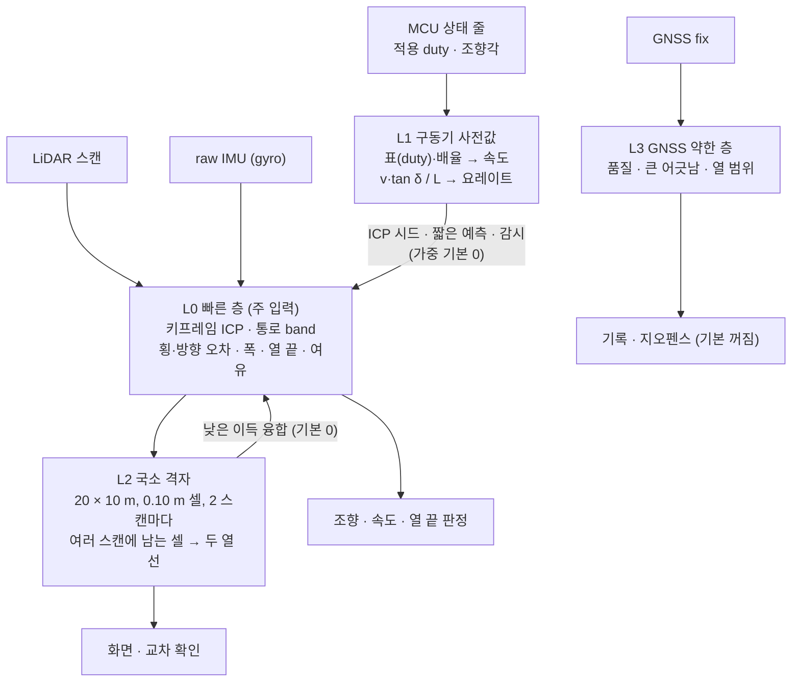
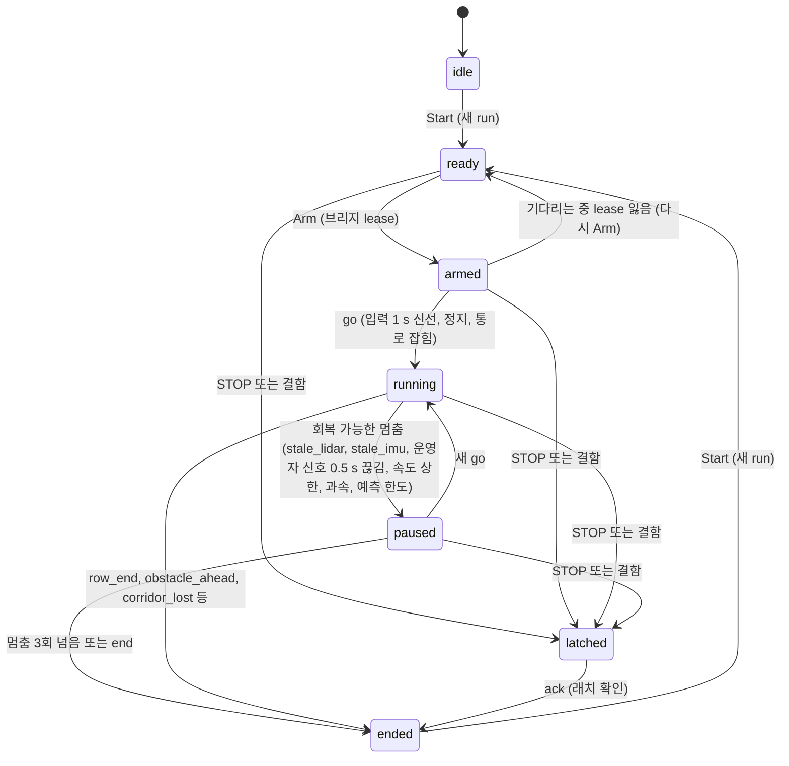

# 시스템 구조와 제어 흐름

- 작성: 2026-11-13 (작업 DOC-05). 도식 6개를 한곳에 모았다. 각 도식 아래에 출처 표시와 구현 상태(구현됨 / 설계만 / 계획)를 적었다.
- 바탕 문서: 설계 [`DESIGN_v1_KO.md`](steering/DESIGN_v1_KO.md)(2절 두 단계 SIM, 3절 차량 모델, 6절 제어기),
  개정 [`DESIGN_v2_KO.md`](steering/DESIGN_v2_KO.md)(V2-1 입력, V2-2 시작·정지, V2-3 네 층, V2-4 속도, V2-6 조향 하드웨어),
  운영자 규약 [`OPERATOR_API_KO.md`](steering/OPERATOR_API_KO.md), ESP 규약 [`ESP_PROTOCOL_V3_DRAFT_KO.md`](steering/ESP_PROTOCOL_V3_DRAFT_KO.md).
- 모든 수치는 자리값이다. 조향 장치의 실제 사양이 오면 바뀐다([`HARDWARE_KO.md`](HARDWARE_KO.md)).

## 1. 시스템 구성 (실차)

[도식] 구현 상태: Jetson 쪽 소프트웨어(드라이버, 실행기, 브리지 V3, 기록기)와 ESP 펌웨어 V3는 **SIM에서 구현됨**(펌웨어는 PC용
흉내 층과 ESP8266 컴파일·링크까지, 실기 쓰기 없음). 실차 조향 장치는 사용자가 만드는 중이고, 실차 설치·현장 확인은 **계획**이다.
조향 모터 드라이버 종류, 벨트 비, 가변저항 사양은 미정이다([`HARDWARE_KO.md`](HARDWARE_KO.md)). 휠 엔코더는 없다.

## 2. SIM 스택 컨테이너 (G-SIM, `compose.ubts-steer.yaml`)

[도식] 구현 상태: **구현됨**. 이미지 `ubts-steer-sim:wf4c` 기준(대시보드 새 화면은 그다음 이미지부터, [`SIM_DASHBOARD_KO.md`](steering/SIM_DASHBOARD_KO.md)).
메모리 예산 6 GiB(sim 3.5, dashboard 1, steer 0.5, recorder 0.5, executor 0.5). 빠른 SIM(F-SIM, Docker 없음)은 같은 실행기·브리지
코어·펌웨어 로직을 한 프로세스의 SIM 시계로 묶는다(T1 장치, [`T1_RIG_KO.md`](steering/T1_RIG_KO.md)). 실행기와 추정기에는 참값,
`/odom`, `/joint_states`, `/sim/truth/*`가 들어가지 않는다(검사 A13).

## 3. 자료 흐름

[도식] 구현 상태: **구현됨**(SIM). GNSS 층은 기본 꺼짐(`gnss_mode` `off`), 켜도 통로 추정과 명령에 들어가는 길이 없다
([`GNSS_LAYER_KO.md`](steering/GNSS_LAYER_KO.md)). `C` 줄의 L·R은 좌·우 구동 duty(−255..255), S는 보정 반범위의 천분율(−1000..1000)이다.

## 4. 제어 루프: 실행기 바깥 루프 + ESP 조향 위치 루프

[도식] 구현 상태: 바깥 루프 **구현됨**(`sim/ubts/closed_loop/steer_control.py`, 기본 제어기 `row_follow`). 요레이트 안쪽 루프 이득
`k_r`은 걸이만 있고 0이다. ESP 위치 루프는 펌웨어 V3로 **구현됨**(SIM에서 네이티브 빌드로 돔). 서보 이득·데드밴드·최소 PWM 등은
프로필 v0.1~v0.3의 자리값이다. 외란 아래 직진 유지(ST-11)에서 ESP 위치 루프만으로는 이어지는 힘을 다 되돌리지 못해, 직진 유지는
바깥 루프가 맡는다([`STEER_HOLD_RESULT_KO.md`](steering/STEER_HOLD_RESULT_KO.md)).

## 5. 추정기 층 (L0~L3)

[도식] 구현 상태: L0 **구현됨**(주 입력). L1·L2·L3 **구현됨, 기본 꺼짐**: L1 `prior_enabled` false·가중 0
([`ACTUATOR_PRIOR_KO.md`](steering/ACTUATOR_PRIOR_KO.md)), L2 `local_grid_enabled` false·융합 이득 0
([`LOCAL_GRID_KO.md`](steering/LOCAL_GRID_KO.md)), L3 `gnss_mode` off([`GNSS_LAYER_KO.md`](steering/GNSS_LAYER_KO.md)).
조향 명령과 열 끝 판정은 L0에서만 나온다. 일반 GNSS 오차(10/10 기록 수평 정확도 p50 5.3~10.0 m)가 열 간격(3.6~4.1 m)보다 커서
GNSS는 횡 위치에 쓰지 않는다. PWM은 엔코더가 아니다.

## 6. 실행기 run 상태 (`run_state`, 한 번 눌러 시작)

[도식] 구현 상태: **구현됨**(`tools/row_executor/executor_main.py` `_run_state`). 상태 이름과 조건은
[`OPERATOR_API_KO.md`](steering/OPERATOR_API_KO.md) 2~4절이다. 멈춤(paused)에서는 구동 0을 그 틱에 보내고 조향은 그 자리에 둔다.
자동 재출발은 없다. STOP은 세션과 상관없이 누구나 누를 수 있고 run을 `operator_stop`으로 끝낸다.

## 7. 도식의 이름과 원본 대조

| 도식의 이름 | 원본(코드·규격) |
|---|---|
| `/scan`, `/imu/data_raw`, `/gps/fix` | 실행기 구독 허용 목록(검사 A13, 개정 30): `sim/ubts/steering/truth_isolation.py`, `tools/row_executor/executor_main.py` |
| `C L R S ttl`, 상태 줄 20 Hz, CRC-8, 115200 | [`ESP_PROTOCOL_V3_DRAFT_KO.md`](steering/ESP_PROTOCOL_V3_DRAFT_KO.md), 펌웨어 `firmware/ubts_steer_v3/` |
| 조향 브리지 V3, lease, 래치, `control.sock` | `dashboard/scripts/steer_bridge_core.py`, `steer_rover_bridge.py`, [`HOST_BRIDGE_V3_KO.md`](steering/HOST_BRIDGE_V3_KO.md) |
| 열 추종 제어기, 주시점, trim, 속도 상한 이름 | `sim/ubts/closed_loop/steer_control.py` 머리말 |
| L0~L3, 설정 키(`prior_enabled`, `local_grid_enabled`, `gnss_mode`) | `sim/ubts/closed_loop/estimator.py`, `tools/row_executor/config.py`, 설계 v2 V2-3 |
| `run_state` 값, `/api/start`·`/api/arm`·`/api/go`·`/api/stop`·`/api/ack` | `tools/row_executor/operator_http.py`, `executor_main.py`, [`OPERATOR_API_KO.md`](steering/OPERATOR_API_KO.md) |
| 컨테이너 이름, 포트 18090·8097, 도메인 43 | `compose.ubts-steer.yaml` 머리말 |
| 핀(D8·D5·D3·D0 구동, D6·D7 조향 PWM, D2 조향 EN, A0 가변저항) | ESP 규격 8.3절(배치 A안, 실기 배선 확인 전) |
