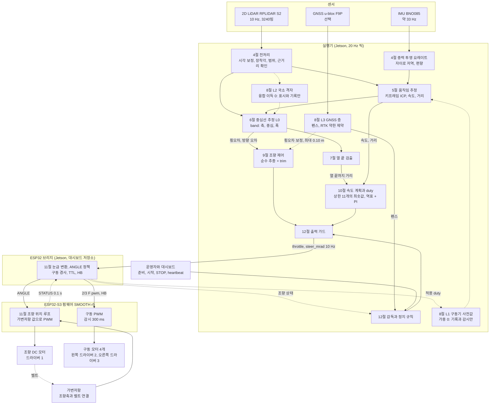
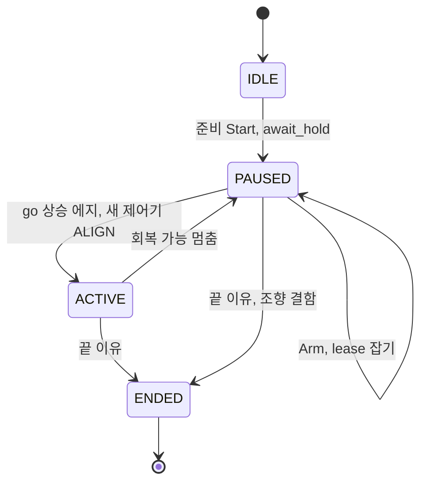

# 자율주행 알고리즘 기술 문서

과수원 로버의 한 열 자율주행(열 시작에서 한 번 눌러 출발, 행간 중심선을 따라 달리고 열 끝에서 섬)이 무엇을 어떤 식으로 계산하는지 모은 참고 문서다.
기술 지도, 단계별 식, 기법 이름(한국어와 영어), 매개변수 값, 코드 위치를 한곳에 둔다. 흐름만 보려면 [`../README.md`](../README.md)의 '동작 방식'을, SIM 모델과 평가 지표는 [`SIMULATION_KO.md`](SIMULATION_KO.md)를 본다.

## 0. 머리말

### 0.1 목적과 읽는 사람

보고서를 쓰는 팀원이 식과 값을 정확히 옮겨 쓸 수 있게 만든 문서다. 프로젝트는 안다고 보고, 각 블록마다 입력, 식, 기호의 뜻과 단위, 값, 코드 위치를 적는다.
코드가 실제로 구현한 기법에만 표준 이름을 붙인다. 표준 기법과 모양만 닮은 직접 만든 방식은 "직접 만든 방식, 가장 가까운 표준 기법은 …"이라고 적는다.

### 0.2 근거로 삼은 것

| 대상 | 기준 | 비고 |
|---|---|---|
| 실행기, 추정기, 제어기 | 시뮬레이션 저장소 main `487b151` | 2026-11-20 현장 실행기 키트 `ee5804e`와 `tools/row_executor/`, `sim/ubts/closed_loop/estimator.py`, `steer_control.py`, `actuator_prior.py`, `sim/ubts/orchard_perception/scan_corridor.py`가 같다(`git diff` 차이 없음). 실차 실행기는 `tools/row_executor/vendor/`의 바이트 사본(출처 커밋 `d58f39c`)을 쓰며 원본과 SHA-256까지 같다. 그래서 아래 식은 현장에서 돈 코드의 식이다 |
| ESP32 브리지 | 대시보드 저장소 main `e87e33e` | 11/20 주행 때 Jetson 브리지는 `4fcaaec`였다. 그 사이 `scripts/esp32_abs_hold.py`는 진단 기록 상수 세 개만 바뀌었다 |
| 조향 보드 펌웨어 | ESP32-S3 SMOOTH r5(`BTS7960_Serial_Control.ino`, 앱 sha256 `f448b2db…`, 2026-11-16 보드에 씀) | 소스는 두 저장소 밖(팀 보관)이라 함수 이름으로 적고, SIM이 옮긴 사본 `sim/ubts/steering/native/smooth_r5.cc`의 줄을 함께 적는다 |
| 격자 지도 | 대시보드 저장소 main `e87e33e` | 13절. 실행기는 이 지도를 쓰지 않는다 |
| 2026-11-20 현장 설정 | 설정 파일 `config_motor_orchard_gnss_20261120_caltol300.json` | 파일은 Jetson에만 있다. 이 문서의 현장 값은 그날 실행기 틱 기록의 첫 `config` 사건(설정 전체, `config_digest` 146d2168…, 현장 조정 프리셋 `orchard_1120`)에서 다시 읽은 것이고, 파일 자체를 열어 본 것은 아니다 |

### 0.3 값 표지

| 표지 | 뜻 |
|---|---|
| [코드 기본값] | 코드에 적힌 기본값 |
| [현장 설정 2026-11-20] | 11/20 과수원 주행의 설정값(위 `config` 사건에서 읽음) |
| [현장 기록 2026-11-20] | 11/20 기록에서 잰 값. 거리, 횡 위치, 속도는 실행기가 LiDAR로 스스로 잰 값이고 참값이 아니다 |
| [실측·줄자 2026-11-20] | 2026-11-20 현장에서 줄자로 잰 행 폭([`steering/ORCHARD_MEASURED_KO.md`](steering/ORCHARD_MEASURED_KO.md)). 나무 줄의 위치는 재지 않았다 |
| [측정 날짜·조건] | 그 밖의 측정(예: [측정 2026-11-16, 바퀴 든 정지]) |
| [자리값] | 사양이나 측정이 없어 정해 둔 값 |
| [SIM · 자리값] | 자리값 기반 SIM 결과. 현장 성능이 아니다 |
| [유도] | 이 문서에서 계산한 것. 코드에는 없다 |

조향 장치의 사양(벨트 비, 유격, 가변저항 범위, 조향 속도 등)은 거의 모두 자리값이다. 사양이 오면 [`steering/SPEC_UPDATE_KO.md`](steering/SPEC_UPDATE_KO.md)의 절차로 바꾼다.

### 0.4 코드 위치 표기와 인용하는 법

- 시뮬레이션 저장소 파일은 저장소 맨 위 기준 `경로:줄`로 적는다(예: `sim/ubts/closed_loop/steer_control.py:365`). 줄 번호는 main `487b151` 기준이다.
- 대시보드 저장소 파일은 "대시보드 저장소 `scripts/esp32_abs_hold.py:391`"처럼 적는다.
- 보고서에 옮길 때는 "자율주행 알고리즘 기술 문서(시뮬레이션 저장소 `docs/AUTONOMY_ALGORITHM_KO.md`, main 487b151 기준) 9.2절"처럼 절 번호와 기준 커밋을 함께 적고, 값 옆의 표지도 같이 옮긴다.

### 0.5 용어 하나

조향 모터는 위치 제어가 들어 있는 모터가 아니라 **일반 DC 모터**다. 이 모터를 BTS7960 드라이버로 돌리고, 조향 장치와 **벨트로 이은 가변저항** 값을 ESP32-S3가 읽어 목표 각에 오도록 **위치 루프**를 닫는다.
코드와 설정 이름의 `servo`(`servo_state`, `steer_servo_deadband_deg`, `servo_hz`, `l0_servo.py`, 시험 모드 `test_servo`, V3 펌웨어의 "서보 법칙")는 모두 이 "DC 모터 + 가변저항 위치 루프"를 가리킨다. 이 문서는 "조향 위치 루프"라고 쓴다.

## 1. 한눈에

차에는 휠 엔코더가 없다. 2D LiDAR 스캔을 키프레임에 ICP로 맞춰 움직임과 속도를 재고, 회전 초기값은 중력 방향으로 투영한 자이로에서 얻는다.
같은 스캔에서 양쪽 나무 줄을 공통 기울기 두 직선으로 맞추고, 그 가운데를 odometry 좌표에 고정한 직선 한 쌍(band)으로 추적해 차의 횡오차와 방향 오차를 낸다.
양쪽 줄이 끝난 것이 두 번 이어지면 열 끝까지의 거리를 낸다. 조향은 속도에 비례하는 주시거리의 순수 추종(pure pursuit)과 천천히 배우는 영점 보정(trim)이고, 저역 필터와 변화율 제한을 거친다.
속도는 상한 11개 가운데 가장 작은 값이며, 구동 duty는 duty→속도 표의 역함수에 PI 보정을 더한다. Jetson의 브리지가 조향 목표를 펌웨어 명령 눈금으로 바꾸고, ESP32-S3가 가변저항으로 조향 위치 루프를 닫는다.
감독 규칙(신선도, 거리·시간 한도, 기하 가드, 출력 가드, 운영자 heartbeat, 조향 감시)이 어느 하나라도 걸리면 그 틱에 구동을 0으로 보낸다. GNSS는 넓은 열 범위 점검(지오펜스)만 하고, 구동기 사전값과 국소 격자는 현장에서 기록과 감시에만 쓰였다.

### 보고서용 기술 키워드

| 블록 | 기법 이름 (한국어 / English) | 한 줄 역할 |
|---|---|---|
| 스캔 시각 | 이동 중앙값 시계 오프셋 보정 / running-median clock-offset estimation. 직접 만든 방식 | 몰려 도착한 스캔에도 고른 시각을 준다 |
| 스캔 전처리 | 외부 보정 회전, 범위 게이트, 빔별 자기 가림 마스크 / extrinsic yaw rotation, range gating, per-beam self-filter mask | 장착각을 돌리고 무효·차체 반사를 지운다 |
| 근거리 확인 | 시간 지속성 필터 / temporal persistence (k-of-n) filter. 직접 만든 방식 | 2 m 안의 한 스캔짜리 반사를 지운다 |
| 점 솎기 | 격자 다운샘플링 / voxel-grid downsampling (칸의 첫 점) | 계산량을 줄인다 |
| 요레이트 | 중력 방향 투영 요레이트 / gravity-projected (tilt-compensated) yaw rate | IMU 기울기에 덜 민감한 요레이트 |
| 자이로 편향 | 정지 구간 평균 편향 추정 / zero angular rate update (ZARU)에 가까움 | 정지 0.5 s 이상일 때 편향을 배운다 |
| 움직임 추정 | 키프레임 점-대-점 ICP LiDAR 주행거리계 / keyframe point-to-point ICP (Besl–McKay), 2D 닫힌 해 (Arun/Umeyama와 같음), 자이로 회전 초기값 | 엔코더 없이 자세, 속도, 거리를 잰다 |
| 진행 거리 | 직접 만든 꺾은선 거리. 가장 가까운 표준 기법은 공간 재표본화 경로 길이 / spatially resampled path length | 정지 중 정합 떨림이 거리를 늘리지 않게 한다 |
| 지연 보상 | 등속 전방 예측(중간점 방향) / constant-velocity forward prediction | 스캔 시각에서 틱 시각으로 자세를 옮긴다 |
| 통로 잡기 | 직접 만든 각도 전수 탐색 + 투영 점유 히스토그램. 가장 가까운 표준 기법은 Hough 변환 / Hough transform | 양쪽 나무 줄의 축과 위치를 처음 찾는다 |
| 트랙 시작 | M-of-N 트랙 시작(3-of-3) / M-of-N track initiation | 같은 후보가 세 번 이어질 때 band를 만든다 |
| 두 열 선 | 평행선 공동 최소제곱 + 반복 절사 / joint least squares with a shared slope, iterative trimming | 두 줄 선을 정밀하게 맞춘다 |
| 중심선 추적 | 관측 게이트가 있는 고정 이득 α 필터 / gated constant-gain (α) filter, exponential smoothing. 칼만 필터가 아니다 | 튀는 관측을 거르고 band를 천천히 고친다 |
| 한쪽 갱신 | 알려진 폭 제약 / known-width constraint. 직접 만든 방식 | 한쪽 줄만 보일 때 배운 폭으로 중심을 놓는다 |
| 열 끝 | 직접 만든 규칙: 분위수 끝점 + 자유 공간 틈 + 연속 확인 / percentile endpoint, free-gap test, M-of-N confirmation | 양쪽 줄이 끝난 곳까지의 거리 |
| 굽은 열 | 공유 계수 2차 다항식 최소제곱 + 단계적 영역 넓히기 / quadratic least squares with region growing | 굽은 열에서 거짓 열 끝을 막는다 |
| 조향 제어 | 속도 비례 주시거리 순수 추종 / pure pursuit with speed-scheduled look-ahead, kinematic bicycle model | 횡오차·방향 오차에서 조향 목표 |
| 조향 영점 | 유계 적분, 조건부 적분 와인드업 방지 / bounded integral action with conditional-integration anti-windup | 조향 영점 치우침을 ±3° 안에서 지운다 |
| 명령 다듬기 | 1차 저역 필터, 포화, 변화율 제한 / first-order low-pass, saturation, slew-rate limiter | 조향 명령을 부드럽고 안전하게 |
| 속도 계획 | 상한들의 최솟값 속도 조절기 / min-of-caps speed governor, 정지 거리 모형 / stopping-distance model, 옆 가속 제한 / lateral-acceleration limit | 지연, 장애물, 곡률, 오차, 열 끝을 함께 본다 |
| 구동 duty | 정적 역표 앞먹임 + PI / inverse static-map feedforward + PI with anti-windup and rate limiting | 목표 속도에서 PWM 비율 |
| 구동 배율 | 거리 합의 비 / ratio-of-sums online scale estimation | 땅에 따른 구동 표 배율 제안(자동 적용 없음) |
| 조향 위치 루프 | 포화 비례 위치 제어 + 데드존·재시작 히스테리시스 + 최소 PWM 바닥(정지 마찰 보상) + 단락 제동 / saturated proportional position control with dead zone, restart hysteresis, stiction floor and dynamic braking | ESP32-S3가 가변저항으로 조향각을 붙잡는다. PID가 아니다 |
| 가변저항 읽기 | 중앙값 필터(5개) + 짝 확인 + 변화율 제한 / median filter, pairwise consistency check, slew-rate limit | 모터 잡음 속에서 위치를 읽는다 |
| 안전 | 하트비트 데드맨, 감시견 타이머, 임대 기반 배타 제어권, 래치 결함, 유한 상태 기계 / heartbeat dead-man's switch, watchdog timer, lease-based exclusive control, latched faults (fail-closed), finite-state machine | 끊기거나 늦으면 선다 |
| GNSS 층 | 등장방형 근사, 혁신 게이트, 2D Kabsch(직교 Procrustes), 지오펜스, 유계·변화율 제한 약한 제약 / equirectangular projection, innovation gating, 2D Kabsch, geofence, bounded rate-limited weak constraint | 열 범위 점검과 (RTK일 때) 횡오차 보정 |
| 국소 격자 | 굴러가는 점유 격자(맞음 횟수) / rolling local occupancy grid (hit count). 확률 격자가 아니다 | 표시와 기록 |
| 격자 지도(대시보드) | 점-대-선 ICP + IMU 방향 사전값, 정수 log-odds 점유 격자 / point-to-line ICP with an IMU heading prior, integer log-odds occupancy grid | 화면의 지도. 실행기는 쓰지 않는다 |
| SIM 차체 | 기구학 자전거 모형 / kinematic bicycle model | 빠른 SIM의 차 |
| 가상 GNSS | 편향 + 1차 Gauss–Markov + 흰 잡음 / bias + first-order Gauss–Markov + white noise | SIM의 수신기 |

코드에 **없는** 것: 칼만 필터와 그 변형, 입자 필터, RANSAC, 실행기 쪽 확률 점유 격자, SLAM과 루프 닫기, MPC, LQR, Stanley 제어기(설계 v1의 비교 후보로만 적힘), 요레이트 안쪽 루프(코드에 걸이만 있고 이득 0), 굽은 열의 곡률 앞먹임.

## 2. 기술 지도

[도식] 실선은 2026-11-20 현장에서 실제로 효과가 있던 길, 점선은 되먹임(STATUS, 조향 상태)이거나 코드에는 있지만 현장 설정에서 효과가 없던 길(사전값 가중 0, 격자 융합 이득 0, RTK 보정 0, 8절)이다.

| 블록 | 입력 | 출력 | 주기 | 코드 |
|---|---|---|---|---|
| 센서 받기 | `/scan`, `/imu/data_raw`, (`/gps/fix`) | 받은 시각을 붙인 큐 | 받을 때 | `tools/row_executor/executor_main.py:2489` |
| 스캔 시각 | 받은 시각, 헤더 시각 | 추정기 시각 | 받은 스캔마다 | `tools/row_executor/core.py:613` |
| 스캔 변환 | raw ranges | 회전·걸러진 ranges | 처리하는 스캔마다(최대 10 Hz) | `tools/row_executor/core.py:487` |
| 근거리 확인 | ranges | 2 m 안 일회성 반사 제거 | 같음 | `tools/row_executor/core.py:566` |
| 요레이트 | 자이로, 가속도 | 위쪽 성분 요레이트 | IMU 표본마다(약 33 Hz) | `tools/row_executor/core.py:674` |
| 자이로 처리 | 요레이트 | 저역, 편향, 구간 적분 | IMU 표본마다 | `sim/ubts/closed_loop/estimator.py:748` |
| 움직임 추정 | 점, 자이로 적분 | 레이저 자세, 속도, 거리 | 처리하는 스캔마다 | `sim/ubts/closed_loop/estimator.py:813`, `:790` |
| 중심선 추정 L0 | 점, 자세 | band(축, 중심, 폭) | band 없으면 스캔마다, 있으면 3 스캔마다(약 3.3 Hz) | `sim/ubts/closed_loop/estimator.py:886`, `:942`, `:1433` |
| 열 끝 | 점, band | 열 끝까지 거리 | 두 쪽 갱신마다 | `sim/ubts/closed_loop/estimator.py:1088`, `:1497` |
| 스냅숏 | 추정기 상태 | 제어기 입력 | 20 Hz 틱 | `sim/ubts/closed_loop/estimator.py:1792` |
| 조향 제어, 속도 계획 | 스냅숏 | throttle %, steer_mrad | 20 Hz | `sim/ubts/closed_loop/steer_control.py:450` |
| 감독, 출력 가드 | 스냅숏, 조향 상태, 운영자 | 정지·일시정지, 검사한 출력 | 20 Hz | `tools/row_executor/core.py:1408`, `tools/row_executor/guard.py:171` |
| 브리지로 보내기 | 출력 | `drive` 요청(Unix 소켓 JSON 한 줄) | 10 Hz, 0으로 바뀌는 틱은 바로 | `tools/row_executor/executor_main.py:1983` |
| ESP32 어댑터 | 등가 바퀴각 | 펌웨어 명령 눈금, 조향 감시 | 요청마다, ANGLE 평가 0.2 s | `tools/row_executor/bridge_client.py:747` |
| ESP32 브리지 | throttle, steer_mrad | `ANGLE`, `2 F pwm`, `3 F pwm`, `HB` | 루프 0.02 s, STATUS 0.1 s | 대시보드 저장소 `scripts/esp32_abs_hold.py`, `scripts/esp32_steer_bridge.py:61` |
| 펌웨어 위치 루프 | 목표 count, 가변저항 | 조향 PWM | 가변저항 표본 5 ms, 유지 틱 10 ms, PWM 20 kHz | 보드 `updateSmoothHold`, `sim/ubts/steering/native/smooth_r5.cc:258` |
| L1 사전값 | 적용 duty, 조향각 | 사전값 속도, 온라인 배율 | 조향 상태 줄마다 | `sim/ubts/closed_loop/actuator_prior.py:154` |
| L2 국소 격자 | 처리한 스캔, 자세, band | 점유 격자, 두 선 맞춤 | 4 스캔마다(현장, 약 2.5 Hz) | `tools/row_executor/local_grid.py`, `tools/row_executor/perception_layers.py:84` |
| L3 GNSS 층 | NavSatFix | 지오펜스, RTK 보정 | fix마다 | `tools/row_executor/gnss_layer.py`, `tools/row_executor/gnss_rtk.py:184` |

## 3. 좌표계·부호·기호

| 기호 | 뜻 | 단위 |
|---|---|---|
| 레이저 좌표 $\mathcal L$ | 장착 보정 뒤의 스캔 좌표. $+x$ 진행 방향, $+y$ 왼쪽, 원점 LiDAR | m |
| 차 기준점 $\mathcal B$ | 발자국(footprint) 사각형 가운데. LiDAR는 그 앞 $x_L$에 있다 | m |
| odometry 좌표 $\mathcal O$ | run의 첫 스캔 때 레이저 자세를 원점·0 rad로 둔 좌표. 전역 지도가 아니다 | m, rad |
| $x_L$ | 기준점에서 LiDAR까지 앞쪽 거리. [코드 기본값] 0.18, [현장 설정 2026-11-20] 0.1185 | m |
| $T_k=(x_k,y_k,\theta_k)$ | 스캔 $k$의 레이저 자세($\mathcal O$). $\oplus$는 자세 합성, $T^{-1}$은 역자세 | m, rad |
| $\theta$ | 차(레이저)의 방향. + 반시계 | rad |
| $\omega$ | 중력 방향 투영 요레이트. + 반시계(왼쪽으로 돎) | rad/s |
| $v$ | 전진 속도 | m/s |
| $(\psi_B,c_B,w_B)$ | band 상태: 행 축 방향($\mathcal O$), 중심선의 법선 거리(왼쪽 법선 $\mathbf n_B=(-\sin\psi_B,\cos\psi_B)$ 방향, $\mathcal O$ 원점 기준), 폭 | rad, m, m |
| $a,\ c$ | 어떤 축에 대한 점의 앞(along) 좌표와 옆(cross) 좌표 | m |
| $d$ | 횡오차 `lateral_offset`. **+ = 차 기준점이 중심선 왼쪽** | m |
| $e_\psi$ | 방향 오차 `heading_error` = 행 축 − 차 방향. **+ = 행 축이 차보다 왼쪽**. SIM 평가 코드의 방향 오차(차 − 행 축)와 부호가 반대다 | rad |
| $\delta$ | 조향각. 등가 자전거 바퀴각(뒤차축 곡률 $\kappa=\tan\delta/L$를 주는 한 각), **+ = 왼쪽**, 실행기 단위 mrad 정수 | rad, mrad |
| $L$ | 휠베이스. [측정 2026-11-16] 0.657, 제어기 [코드 기본값] 0.76 [자리값] | m |
| $L_d$ | 주시거리 | m |
| $\kappa$ | 곡률 | 1/m |
| $u$ | 구동 duty(PWM 비율). 좌우 같은 값 | % |
| $a_{cmd}$ | 펌웨어 명령 눈금(명령도). **+ = 오른쪽**, ±20 = 보정 표시 | 명령도 |
| $p$ | 가변저항 값(12비트 ADC count). 오른쪽으로 갈수록 작다 | count |
| $\operatorname{wrap}(\cdot)$ | $(-\pi,\pi]$로 감기, $\operatorname{atan2}(\sin,\cos)$ | rad |
| $\operatorname{clamp}(x,a,b)$ | $\min(b,\max(a,x))$ | |
| $P_q(\cdot)$ | $q$ 백분위수(numpy 선형 보간) | |

부호가 두 번 뒤집힌다. 실행기와 브리지 API의 조향은 왼쪽 +, 펌웨어 `ANGLE`과 명령 눈금은 오른쪽 +다(11.1절).

## 4. 센서와 전처리

### 4.1 차와 센서

| 항목 | 값 | 출처 |
|---|---|---|
| 차 | 2인승 어린이용 4륜 전동차 개조. 앞바퀴 조향(2026-11-08부터) | [`HARDWARE_KO.md`](HARDWARE_KO.md) 1절 |
| 구동 | 4륜. 한쪽의 앞뒤 모터가 드라이버 하나를 나눠 쓴다(왼쪽 = 드라이버 2, 오른쪽 = 드라이버 3). 좌우에 같은 duty를 준다 | 사용자·펌웨어 소스 2026-11-16 |
| 조향 | 일반 DC 모터(드라이버 1), 가변저항을 조향축과 벨트로 연결, ESP32-S3 GPIO6 12비트 ADC | 같음 |
| 휠베이스, 윤거, 바퀴 반경 | 0.657 m, 0.527 m, 0.13 m | [측정 2026-11-16, 사용자 줄자] |
| 조향 기계 한계 | 좌우 약 20°(각도계로 잰 값 없음) | [측정 2026-11-16, 사용자] |
| 휠 엔코더 | 없음 | |
| 2D LiDAR | RPLIDAR S2, 10 Hz, 한 스캔 3240빔. 꼭대기가 지면에서 0.57 m, 앞차축에서 0.21 m 뒤 → $x_L$ = 0.1185 m | 빔·주기 [측정 2026-10-10], 위치 [측정 2026-11-16] |
| IMU | BNO085 raw `/imu/data_raw`, 약 33 Hz. 실행기는 자이로와 가속도만 쓰고 자세(orientation)는 쓰지 않는다 | 설정 |
| GNSS | u-blox ZED-F9P, USB. RTK 보정 입력 없음(단독 측위) | 설정 |
| 카메라 | USB UVC. 표시와 기록만, 위치 추정에 쓰지 않는다 | |
| 상위 / 하위 컴퓨터 | Jetson Orin Nano / ESP32-S3 하나(BTS7960 세 개) | |

[현장 기록 2026-11-20] 실행기 틱 기록 하나(틱 43,078개, 2,576 s)에서 IMU 받은 율 32.98 Hz, 스캔 받은 율 10.0 Hz.

### 4.2 받기와 최신 스캔만 처리

- 구독: `/scan`(BEST_EFFORT, KEEP_LAST 2, VOLATILE), `/imu/data_raw`(같은 QoS, 깊이 50). `/gps/fix`(깊이 5)는 고를 수 있는 GNSS 모드에 `off`가 아닌 것이 있으면 구독한다(`tools/row_executor/executor_main.py:2512`).
- 콜백은 `(time.monotonic(), 메시지)`를 큐에 넣기만 한다(스캔 16개, IMU 400개 한도).
- 20 Hz 틱마다(`tools/row_executor/executor_main.py:1281`) IMU는 쌓인 것을 순서대로 모두 넣고, 스캔은 모두 시각만 붙인 뒤 **가장 새것 하나만** 추정기에 넣는다. 나머지는 `scans_dropped`로 센다.
- 기법: 유한 생산자–소비자 큐와 최신 표본만 처리하는 드롭 정책(latest-only).

### 4.3 스캔 시각

`tools/row_executor/core.py:613`. 받은 시각 $t^{rx}_k$, 드라이버 헤더 시각 $t^{hdr}_k$ [s], 오프셋 $o_k=t^{rx}_k-t^{hdr}_k$, 최근 50개의 창 $\mathcal W$:

$$
\text{if } \lvert o_k-\operatorname{median}(\mathcal W)\rvert > 0.5\ \text{s}:\ \mathcal W\leftarrow\varnothing,\qquad
\mathcal W\leftarrow\mathcal W\cup\lbrace o_k\rbrace
$$

$$
t_k=\min\left(t^{hdr}_k+\operatorname{median}(\mathcal W)-\tau_{lat},\ t^{rx}_k\right),\qquad \tau_{lat}=0.08\ \text{s}
$$

- 헤더가 없으면 $t_k=t^{rx}_k-\tau_{lat}$. 앞 스캔보다 늦지 않은 시각의 스캔은 버린다.
- 뜻: 헤더의 고른 0.1 s 간격을 살리면서 받은 시각의 시계로 옮긴다. 몰려 도착한 스캔이 $\Delta t\approx0$을 만들어 속도가 튀는 것을 막는다. $\tau_{lat}$ = 0.08 s는 10월 기록 재생에서 고른 값이다 [자리값].
- IMU 시각은 받은 시각 그대로다(헤더를 쓰지 않는다).
- 기법: 직접 만든 방식. 가장 가까운 표준 기법은 이동 중앙값 시계 오프셋 추정(running-median clock-offset estimation).

### 4.4 스캔 변환

`tools/row_executor/core.py:487`. 순서:

1. 빔 수 ≤ 4096. 각도 범위가 $2\pi+1.01 \Delta\alpha$를 넘으면 꼬리 빔을 자르고, 4빔 넘게 잘라야 하면 스캔을 거부한다.
2. 유효 범위 $\max(r_{min},0.05)\le r<\min(r_{max},30)$ m가 아니면 $r\leftarrow\infty$(반사 없음). S2 드라이버의 0도 여기서 지워진다.
3. 차체 마스크: 빔의 raw 각을 3240칸 격자 번호로 바꾸고, 그 칸의 마스크 거리 이하인 반사를 지운다. **현장 2026-11-20 설정의 `body_mask`는 비어 있었다**(차체 마스크 없이 달렸다).
4. 장착 방향: $\alpha_i=\operatorname{wrap}(\alpha_{min}+\Delta_{yaw})+i \Delta\alpha$, $\Delta_{yaw}$ = 179.08° [자리값: 10월 기록에서 추정, 코드 주석 "estimate"]. 179.08°에서 10° 넘게 벗어난 설정은 모터 출력을 거부한다.

기법: 외부 보정 회전(extrinsic yaw), 범위 게이트(range gating), 빔별 자기 가림 마스크(self-filter mask). 마스크를 만드는 오프라인 도구는 `tools/row_executor/body_mask_static.py`, `body_mask_fit.py`다.

### 4.5 근거리 확인 필터

`tools/row_executor/core.py:566`. 스캔 $k$의 2 m 안 반사 $Q_k=\lbrace p_i: r_i<2.0\rbrace$(레이저 좌표)를 기억한다. 지금 스캔의 근거리 점 $p$는

$$
\forall j\in\lbrace 0,\dots,N-1\rbrace:\ \min_{q\in Q_{k-1-j}}\lVert p-q\rVert < 0.35+0.10 j\ \text{m},\qquad N=2
$$

일 때만 남고 아니면 $r\leftarrow\infty$다. 이동 보정은 하지 않는다(같은 레이저 좌표에서 비교).

- 까닭: 2026-10-10 기록의 거짓 앞 막힘 정지가 한 스캔에만 나온 근거리 반사 덩어리였다. 대가는 새 물체를 2 스캔(0.2 s) 늦게 받는 것이다(0.45 m/s에서 9 cm).
- 걸러진 ranges가 추정기, 통로 검출기, 국소 격자에 똑같이 들어간다.
- 기법: 직접 만든 방식. 가장 가까운 표준 기법은 시간 지속성 필터(temporal persistence, k-of-n consistency filter).

### 4.6 점 만들기와 솎기

점 $p_i=r_i(\cos\alpha_i,\sin\alpha_i)$, 유한하고 $0<r_i<r_{max}$인 빔만 쓴다. 칸 솎기(`sim/ubts/closed_loop/estimator.py:95`)는 점을 $\lfloor p/h\rfloor$ 칸에 넣고 칸마다 빔 순서로 **첫 점** 하나만 남긴다(평균이 아니다).

| 쓰임 | 거리 한도 | 칸 $h$ |
|---|---|---|
| ICP | 12 m 미만 | 0.12 m |
| 통로 처음 잡기 | 10 m 미만 | 0.10 m |
| 통로 검출기 | 10 m 이하 | 0.10 m |
| 두 선 맞춤, 열 끝, 앞·옆 여유 | 솎지 않은 모든 점 | - |
| 국소 격자 | 12 m 이하 | 격자 칸 0.10 m |

### 4.7 IMU: 중력 방향 투영 요레이트와 자이로 처리

요레이트(`tools/row_executor/core.py:674`). 자이로 $\boldsymbol\omega_k$ [rad/s], 가속도(비력) $\mathbf a_k$ [m/s²]:

$$
\Delta t_k=\operatorname{clamp}(t_k-t_{k-1}, 10^{-3}, 0.2),\qquad
\mathbf u_k=\mathbf u_{k-1}+(\mathbf a_k-\mathbf u_{k-1})\left(1-e^{-\Delta t_k/\tau_u}\right),\qquad
\omega_k=s \frac{\boldsymbol\omega_k\cdot\mathbf u_k}{\lVert\mathbf u_k\rVert}
$$

$\tau_u$ = 1.0 s, 부호 $s$ = +1(모터 출력 설정은 +1만 받는다). 정지·저가속에서 비력의 저역은 위쪽이므로, 자이로를 그 축에 투영하면 IMU 장착 기울기와 지면 경사에 덜 민감한 요레이트가 된다.
기법: 중력 방향 투영(기울기 보상) 요레이트. 중력 방향은 가속도 1차 저역으로만 얻고, 자이로와 섞는 상보 필터는 아니다.

추정기의 자이로 처리(`sim/ubts/closed_loop/estimator.py:748`), $\Delta t_k=\min(0.2, t_k-t_{k-1})$:

| 양 | 식 | 값 |
|---|---|---|
| 자이로 저역 | $\omega^{lp}_k=\omega^{lp}_{k-1}+(\omega_k-\omega^{lp}_{k-1})(1-e^{-\Delta t_k/\tau_g})$ | $\tau_g$ = 0.25 s |
| 편향 | 정지 0.5 s 이상일 때만 $n\leftarrow\min(n+1,200)$, $b\leftarrow b+(\omega_k-b)/n$ | 처음 200개는 누적 평균, 그 뒤 이득 1/200 지수 평균(33 Hz에서 시간상수 약 6 s) |
| 출력 요레이트 | $\hat\omega=\omega^{lp}-b$ | |
| 구간 적분 | $\Delta\theta_g(t_0,t_1)=\sum_{t_0<t_k\le t_1}(\omega_k-b)\min(0.1, t_k-t_{k-1})$ | 버퍼 3 s, 지금의 $b$를 소급 적용 |
| 진동 RMS | 최근 0.5 s의 $\sqrt{\tfrac1N\sum\lVert\mathbf a_k-\bar{\mathbf a}\rVert^2}$ | |

자이로는 ICP 회전 초기값, ICP 실패 때 회전, 스냅숏 지연 보상, 정지 판정, 브리지의 `steering_ineffective` 감시에 쓰인다. 차의 방향 $\theta$ 자체는 ICP가 정한다. 자이로와 LiDAR 방향을 확률적으로 섞는 필터는 없다.
기법: 1차 IIR 저역, 정지 구간 평균 편향(ZARU에 가까움), 직사각형 적분 추측항법(dead reckoning).

### 4.8 정지 판정

`sim/ubts/closed_loop/estimator.py:897`. 최근 1.0 s의 스캔 자세 창(창 폭 0.8 s 이상, 4개 이상, 모두 ICP 성공)에서 모든 자세가 최신 자세에서 2.5 cm, 0.6° 안이면 정지가 시작된 것으로 본다. 최신 스캔이 0.5 s 넘게 낡았거나 $\lvert\omega^{lp}-b\rvert>1.5°/\text{s}$면 정지 시간은 0이다. `still`은 정지 시간 ≥ 0.4 s(편향 학습은 0.5 s)다.
기법: 직접 만든 정지 검출(stationary detection).

## 5. 엔코더 없는 움직임 추정

### 5.1 키프레임 ICP (LiDAR 주행거리계)

`sim/ubts/closed_loop/estimator.py:790`(`_icp`), `:813`(`on_scan`). 지금 스캔의 솎은 점 $S$, 키프레임 점 $K$(그 키프레임 레이저 좌표), 키프레임 자세 $T_K$:

1. 예측 자세. 직전 속도 $v$, 스캔 간격 $\Delta t=t_k-t_{k-1}$:

$$
\hat T=\left(x+v \Delta t\cos\theta,\ \ y+v \Delta t\sin\theta,\ \ \operatorname{wrap}(\theta+\Delta\theta_g)\right)
$$

2. 초기 추정 $g=T_K^{-1}\oplus\hat T$. $\lvert S\rvert\ge25$이고 $\Delta t<0.5$ s일 때만 맞춘다.
3. 반복 $j=1,\dots,12$: $q_i=R(\phi)s_i+\mathbf t$, kd-트리 최근접 $k_i\in K$, 거리 $<\lambda_j$인 짝만 쓴다(25쌍 미만이면 실패).

$$
\bar a=\tfrac1M\textstyle\sum s_i,\quad \bar b=\tfrac1M\textstyle\sum k_i,\quad H=\textstyle\sum (s_i-\bar a)(k_i-\bar b)^{\top},\quad
\phi=\operatorname{atan2}(H_{xy}-H_{yx},\ H_{xx}+H_{yy}),\quad \mathbf t=\bar b-R(\phi) \bar a
$$

$$
\lambda_1=0.5\ \text{m},\qquad \lambda_{j+1}=\max(0.15,\ 0.8 \lambda_j)
$$

4. 맞음 비율 $f=\tfrac{1}{\lvert S\rvert}\left\lvert\lbrace i\mid\min_k\lVert R(\phi)s_i+\mathbf t-k\rVert<0.15\rbrace\right\rvert$.
5. $f\ge0.5$면 $T_k=T_K\oplus(\mathbf t,\phi)$, `odom_valid` 참. 아니면 **회전만 자이로로** $T_k=(x_{k-1},y_{k-1},\operatorname{wrap}(\theta_{k-1}+\Delta\theta_g))$이고 이동은 만들지 않는다.
6. 키프레임 교체: 실패했거나 $T_K^{-1}T_k$의 이동 > 0.4 m 또는 회전 > 8°이면 $K\leftarrow S$, $T_K\leftarrow T_k$.

기법: 키프레임 기반 점-대-점 ICP(point-to-point ICP, Besl–McKay), 2D 닫힌 해(Arun·Horn·Umeyama의 SVD 해와 같은 식), 줄어드는 대응 거리 문턱, kd-트리 최근접, 자이로 회전 초기값(gyro-aided ICP).
모듈 머리말은 이 ICP를 "하네스 단순화"라고 적지만, 실차 실행기도 이 코드를 그대로 쓴다(부록 A).

**방향 흐름** [현장 기록 2026-11-20, 유도]. 이 odometry 좌표계에서 본 행 축(자세 방향 + 실행기 방향 오차)은 사과 2행 98 m 동안 −8.2~−9.6°, 배 1행 38 m 동안 −1.5~−2.8° 돌았다(모든 run 에서 같은 쪽, 1 m 마다 약 −0.09°·−0.05°). 같은 때 IMU 자세로 본 행 축은 사과 −1.1~−0.6°, 배 +0.2~+0.5°만 바뀌었으므로 이것은 행의 휨이 아니라 키프레임 ICP의 방향 흐름이다. band(6절)는 이 좌표계에 고정되지만 관측으로 계속 고쳐지므로 횡오차 $d$와 방향 오차 $e_\psi$에는 이 흐름이 들어가지 않는다. odometry 경로를 고정된 지도에 그대로 놓는 일(경로 그림, 줄자 지도 위 위치 평가)에는 쓸 수 없다([`steering/ORCHARD_MEASURED_KO.md`](steering/ORCHARD_MEASURED_KO.md) 5.4절).

### 5.2 속도

`sim/ubts/closed_loop/estimator.py:855`. 성공한 스캔마다 앞 자세 기준 상대 이동 $\delta=T_{k-1}^{-1}\oplus T_k$의 전진 성분으로

$$
v_k=\operatorname{median}\left\lbrace \delta_{x,j}/\Delta t_j\right\rbrace_{j=k-4,\dots,k}
$$

(최근 성공한 스캔 5개)다. 실패한 스캔은 표본을 넣지 않아 $v$가 마지막 값을 유지한다. 레이저 점의 전진 속도이지만 전진 성분은 기준점과 같다.
기법: 유한 차분 속도의 이동 중앙값(moving-median filter).

[측정 2026-11-18~19, 실내 타일 복도] 이 속도가 참 속도의 약 0.5배였다(묶음 0.173 대 0.337 m/s). 앞뒤 방향 정합이 예측 근처에 붙어 있다가 60~150 mm씩 따라잡았다. 같은 때 경로 거리는 0.97배였다. 그래서 제어기 쪽에 경로 속도 입력이 생겼다(5.5절).

### 5.3 진행 거리 (resolved polyline)

`sim/ubts/closed_loop/estimator.py:529`, `:869`. 기준점 경로 $\mathbf b_k=(x_k-x_L\cos\theta_k,\ y_k-x_L\sin\theta_k)$에 대해:

- 닻 $A$, 닻에서 가장 먼 점 $E$와 그 거리 $\epsilon$을 둔다. 새 점마다 $\rho=\lVert\mathbf b-A\rVert$가 $\epsilon$보다 크면 $\epsilon\leftarrow\rho$, $E\leftarrow\mathbf b$.
- $\rho\ge0.4$ m면 $\epsilon$을 확정 거리에 더하고 닻을 지금 점으로 옮긴다.
- 되돌아감: $\epsilon\ge0.12$이고 $(\mathbf b-E)\cdot\widehat{(E-A)}\le-0.12$ m면 $\epsilon$을 확정하고 닻을 $E$로 옮긴다.
- 거리 $D$ = 확정 거리 + $\epsilon$. ICP가 실패한 스캔에서는 꺾은선을 끊고, 실패 동안 움직인 거리는 더하지 않는다.

뜻: 정지 중 정합 흔들림이 거리를 늘리지 않고, 제자리 회전 때 레이저의 호를 기준점 이동으로 세지 않는다.
기법: 직접 만든 방식. 가장 가까운 표준 기법은 공간 재표본화 경로 길이(spatially resampled path length, 히스테리시스 거리계).

### 5.4 스냅숏의 지연 보상

`sim/ubts/closed_loop/estimator.py:1792`. 틱 시각 $t$, 최신 스캔 시각 $t_s$, $h=\max(0,t-t_s)$ [s]:

$$
\theta_t=\operatorname{wrap}\left(\theta_s+\Delta\theta_g(t_s,t)\right),\qquad
\theta_m=\operatorname{wrap}\left(\theta_s+\tfrac12\operatorname{wrap}(\theta_t-\theta_s)\right)
$$

$$
\mathbf p_t=(x_s,y_s)+v h (\cos\theta_m,\sin\theta_m),\qquad
\mathbf b_t=\mathbf p_t-x_L(\cos\theta_t,\sin\theta_t)
$$

앞 여유도 $\max(0,v) h$만큼 줄인다. 기법: 중간점 방향의 등속 전방 예측(constant-velocity forward prediction).

### 5.5 제어기가 쓰는 속도

`sim/ubts/closed_loop/steer_control.py:434`. 현장 조정 `speed_window_s` $W$ > 0이면

$$
v_{ctl}=\max\left(v,\ \max\left(0,\ \frac{D(t_1)-D(t_0)}{t_1-t_0}\right)\right)\quad(t_1-t_0\ge0.8 W\text{일 때만 둘째 항})
$$

이고, $D$는 5.3절의 진행 거리, $(t_0,t_1)$은 최근 $W$ 창의 첫·끝 표본 시각이다. [코드 기본값] $W$ = 0(LiDAR 속도만), [현장 설정 2026-11-20] $W$ = 1.5 s.
이 값은 주시거리, 속도 PI, 과속 규칙, 열 끝 정지 거리에 쓰인다. 최댓값이라 LiDAR 속도보다 낮게 읽지 않는다(duty는 같거나 낮아진다). 추정기 상태는 바뀌지 않는다.
선택 키 `speed_prior_floor` $f$ > 0이면 $v_{ctl}\leftarrow\max(v_{ctl},f v_p)$(사전값이 신선할 때)이고, 현장에서는 0이었다.

## 6. 행간 중심선 추정 L0

### 6.1 상태

band(`sim/ubts/closed_loop/estimator.py:517`)는 **odometry 좌표에 고정된 평행 직선 한 쌍**이다: 행 축 $\psi_B$(진행 방향), 중심선의 법선 거리 $c_B$, 폭 $w_B$, 마지막 갱신 시각, 두 쪽 갱신 수, 쪽별 끝.
따로 예측 단계가 없다. 차가 움직이면 ICP 자세가 바뀌어 차에서 본 band가 저절로 바뀐다. 즉 예측은 움직임 추정이 맡고, 관측 갱신만 6.6절의 고정 이득으로 한다.

### 6.2 처음 잡기 (acquisition)

`sim/ubts/closed_loop/estimator.py:942`(`_acquire`), `:985`(`_axis_pair`). band가 없으면 스캔마다 돈다.

1. 사전 축: 처음이면 지금 진행 방향(0 rad), 창 ±30°(단일 열 실행기 값, 추정기 기본은 ±50°). band를 잃은 뒤면 마지막 band 축, 창 ±20°.
2. 점: 10 m 미만, 0.10 m 칸 솎기. 8점 미만이면 `insufficient_returns`.
3. 후보 축 $\phi$를 2° 간격으로 훑는다. 각 축에서 $a=p\cdot(\cos\phi,\sin\phi)$, $c=p\cdot(-\sin\phi,\cos\phi)$, $\lvert a\rvert\le8$ m. 단일 열의 첫 잡기는 $a\ge-2.5$ m도 요구한다(차 뒤 열 머리의 담·통·덤불 배제).
4. 옆 칸 $j=\lfloor c/0.2\rfloor$, 앞 칸 $k=\lfloor a/0.75\rfloor$, 점유 $O_{jk}$. 0.4 m 띠의 덮임과 띠 중심:

$$
\mathrm{cov2}_j=\sum_k\left(O_{j-1,k}\lor O_{j,k}\right),\qquad \gamma_j=0.2 j
$$

5. 쪽마다 가장 가까운 띠: 왼쪽은 $\gamma_j\ge0.5$이고 $\mathrm{cov2}_j\ge4$인 가장 작은 $j_0$(오른쪽은 대칭). 그 바깥 0.6 m 안에서 가장 센 띠 $j^\ast$로 옮기고(잎 가장자리 대신 줄기 선), 선 위치는 $\operatorname{median}\lbrace c_i:\lvert c_i-\gamma_{j^\ast}\rvert\le0.25\rbrace$다.
6. 폭 $w=l-r\in[1.2, 8]$ m.
7. 사이 줄 거부: $\mu=\max(0.7, 0.3 w)$, $r+\mu<c<l-\mu$인 점이 서로 다른 앞 칸 2개 이상에 있으면 이 짝을 버린다(틈 있는 줄 너머의 통로를 고르지 않게).
8. 축 세기 $S(\phi)=\max_{\gamma_j\ge0.5}\mathrm{cov2}_j+\max_{\gamma_j\le-0.5}\mathrm{cov2}_j$, 지배 축 $\phi^\ast=\arg\max S$. $S(\phi)\ge0.95 S(\phi^\ast)$인 다른 축이 8° 넘게 떨어져 있으면 `ambiguous_corridor_axis`로 거부한다. 지배 축 ±8° 안의 짝 가운데 $\mathrm{cov2}_l+\mathrm{cov2}_r$가 가장 큰 것을 고른다.
9. 고른 짝은 6.5절 두 선 맞춤으로 다듬는다.

기법: 직접 만든 방식. 가장 가까운 표준 기법은 평행선 쌍을 찾는 이산 Hough 변환(각도 전수 탐색 + 투영 점유 히스토그램). RANSAC은 아니다.

### 6.3 band 만들기 (트랙 시작)

`sim/ubts/closed_loop/estimator.py:1633`. 후보 $(h,c,w)$, $c=\mathbf n(h)\cdot(x,y)+(l+r)/2$. 바로 앞 후보와 방향 8°, 중심 0.4 m, 폭 0.5 m 안에서 맞지 않으면 후보 목록을 비운다.
연속 3개가 쌓이면 band를 만든다. 방향은 원형 평균 $\operatorname{atan2}(\sum\sin h,\sum\cos h)$, 중심과 폭은 산술 평균이다. 배운 폭이 있으면 그와 0.5 m 넘게 다른 첫 폭은 거부한다(배운 폭은 band를 잃고 10 m 움직이면 잊는다).
기법: M-of-N 트랙 시작(3-of-3).

### 6.4 추적 중 관측

band가 있으면 3번째 스캔마다(`corridor_every_n_scans` 실행기 3, 추정기 기본 2) 통로 검출기 `observe_scan_corridor`(`sim/ubts/orchard_perception/scan_corridor.py:140`)를 부른다.

1. 점: $0.05\le r\le10$ m, 0.10 m 칸 솎기, 12점 미만이면 거부.
2. 방향 $\theta\in\lbrace-90°,-88°,\dots,88°\rbrace$(90개). 옆 칸 $j=\operatorname{rint}(c/0.22)$, 앞 칸 $k=\lfloor a/0.75\rfloor$. 투표 $V_{jk}$, 덮임 $C_{jk}=V_{j-1,k}\lor V_{jk}\lor V_{j+1,k}$, $\mathrm{occ}_j=\sum_kC_{jk}$.
3. 띠: $\mathrm{occ}_j\ge6$인 씨앗을 센 순서로 보고, $\lvert\hat c\rvert\ge0.5$ m, 기존 띠와 0.44 m 넘게 떨어진 것만. 창 $\lvert c-\hat c\rvert\le0.22$에 6점 이상 → 위치 = 중앙값 → 다시 잡은 창에서 서로 다른 앞 칸 6개 이상, $P_{95}(a)-P_5(a)\ge3$ m.
4. 짝: 폭 1~10 m, 앞 겹침 ≥ 3 m, 사이에 겹침 3 m 이상인 다른 띠가 없을 것. 점수 $=\min(\text{count}_l,\text{count}_r)+\text{겹침}/0.75$.
5. 최고 점수의 95 % 이상인 다른 후보가 축 8° 또는 선 위치 0.6 m 넘게 다르면 `ambiguous_parallel_surface_bands`로 거부한다.

검출 결과는 6.5절로 다듬어 6.6절 갱신을 시도한다. 검출기가 거부하거나 갱신이 게이트에서 떨어지면 **예측 선 둘레 맞춤**(`sim/ubts/closed_loop/estimator.py:1405`)을 한다. band를 레이저 좌표로 옮긴 예측 선은

$$
\ell=\mathbf n_B\cdot(x,y),\qquad \hat l=c_B+\tfrac{w_B}{2}-\ell,\qquad \hat r=c_B-\tfrac{w_B}{2}-\ell,\qquad \text{축}=\operatorname{wrap}(\psi_B-\theta)
$$

이고, 그 둘레에서 6.5절 맞춤을 한 뒤 갱신을 시도한다.
기법: 검출기는 직접 만든 방향×옆 위치 투표(가장 가까운 표준 기법: Hough 변환). 실패 때는 예측 둘레 관측 게이트(validation gate)로 다시 찾는 추적(gated tracking).

### 6.5 두 선 공통 기울기 최소제곱

`sim/ubts/closed_loop/estimator.py:1051`. 축 $\phi$, 예상 선 위치 $o_L,o_R$:

- 점: $\lvert a\rvert<8$ m, $\lvert c-o_k\rvert<0.3$ m. 쪽마다 8점 이상이어야 그쪽을 쓴다.
- 모형(쪽 $k(i)$마다 절편, 기울기는 하나):

$$
c_i=m a_i+q_{k(i)}
$$

- 보통 최소제곱을 풀고, 잔차 0.18 m 미만인 점만 남겨 다시 푼다. 그 해로 한 번 더 잘라 개수만 검사한다(남은 점 8개 이상, 쪽마다 4개 이상). 최종 해는 두 번째 풀이다.
- $\lvert m\rvert\le\tan4°$가 아니면 실패.
- 결과: 축 $\phi'=\phi+\arctan m$, 선 위치 $o'_k=q_k\cos(\arctan m)$.

기법: 평행선 공동 최소제곱(joint least squares of parallel lines, 공유 기울기)과 고정 문턱 반복 절사(iterative trimmed least squares, 0/1 가중). M-추정기나 RANSAC은 아니다.

### 6.6 band 갱신 (게이트와 고정 이득)

`sim/ubts/closed_loop/estimator.py:1433`. 관측은 $\mathcal O$의 방향 $h$(band와 90° 넘게 다르면 축을 뒤집고 좌우를 바꾼다)와 레이저 좌표 선 위치 $l,r$다. 레이저 위치 $\mathbf p=(x,y)$, $\ell=\mathbf n_B\cdot\mathbf p$, 예측 $\hat l,\hat r$은 6.4절 식이다.
공통 게이트는 $\lvert\operatorname{wrap}(h-\psi_B)\rvert<8°$다.

**두 쪽 갱신.** 레이저가 중심선에서 떨어진 거리의 관측과 예측, 폭:

$$
o=-\tfrac12(l+r),\qquad \hat o=-\tfrac12(\hat l+\hat r)=\ell-c_B,\qquad w=l-r
$$

게이트 $\lvert o-\hat o\rvert<0.35$ m, $\lvert w-w_B\rvert<0.5$ m, $1.2\le w\le8$ m를 넘으면($g$ = 0.4, $g_c$ = 0.25):

$$
\psi_B\leftarrow\psi_B+g \operatorname{wrap}(h-\psi_B),\qquad w_B\leftarrow w_B+g (w-w_B)
$$

$$
\ell'=\mathbf n_B'\cdot\mathbf p,\qquad c_B\leftarrow\ell'-\left[(1-g_c) \hat o+g_c o\right]
$$

차에서 본 중심선 거리를 예측 $(1-g_c)$, 관측 $g_c$로 섞고, 새 방향에서 차를 기준으로 다시 닻을 내린다. 이 갱신만 배운 폭, 열 끝 근거(7절), 다음 통로 표를 고친다.

**한쪽 갱신.** 두 쪽 게이트를 못 넘었거나 한쪽만 보일 때, 왼쪽($s=-1$), 오른쪽($s=+1$) 순서로 관측 $y_{obs}$가 예측과 0.3 m 안인 첫 쪽:

$$
\rho=c_B-\ell,\qquad \psi_B\leftarrow\psi_B+\tfrac{g}{2} \operatorname{wrap}(h-\psi_B),\qquad \ell'=\mathbf n_B'\cdot\mathbf p,\qquad c_B\leftarrow\ell'+\rho
$$

$$
c^{obs}=\ell'+y_{obs}+s \tfrac{w_B}{2},\qquad c_B\leftarrow c_B+g_c (c^{obs}-c_B)
$$

폭은 그대로 둔다(배운 폭 유지). $c_B\leftarrow\ell'+\rho$(차 둘레 회전)는 단일 열 실행기에서 켜진다. 끄면 방향 한 걸음이 odometry 원점 둘레로 band를 돌려, 출발점에서 36 m 떨어진 곳에서 0.7° 한 걸음이 차 위치의 통로를 0.45 m 옮겼다 [SIM · 자리값].

기법: 관측 게이트가 있는 고정 이득 갱신(gated constant-gain α 필터, 지수 평활). 정상상태 칼만 갱신과 모양이 같지만 공분산과 시간에 따라 바뀌는 이득이 없으므로 칼만 필터라고 부르지 않는다. 한쪽 갱신은 알려진 폭 제약을 쓰는 직접 만든 방식이다.

### 6.7 잃음과 다시 잡기

받아들인 갱신 없이 2 s가 지나면 band를 지운다(`corridor_lost`, `sim/ubts/closed_loop/estimator.py:888`). 마지막 축은 다시 잡기의 사전 축(±20°)으로 남고, 배운 폭은 10 m 움직일 때까지 남는다. 다시 잡기는 6.2~6.3절과 같다(3회 연속).
제어기는 주행 중 통로 무효가 1.0 s 넘으면 run을 끝낸다(12.8절).

### 6.8 출력

`sim/ubts/closed_loop/estimator.py:1792`. 5.4절의 기준점 $\mathbf b_t$, 방향 $\theta_t$로

$$
d=\mathbf n_B\cdot\mathbf b_t-c_B,\qquad e_\psi=\operatorname{wrap}(\psi_B-\theta_t),\qquad \text{폭}=w_B,\qquad \text{나이}=t-t_{band}
$$

를 낸다. 제어기가 읽는 키는 `lidar_age_s`, `imu_age_s`, `scan_count`, `speed`, `distance_m`, `still`, `still_s`, `corridor_valid`, `corridor_reason`, `corridor_age_s`, `heading_error`, `lateral_offset`, `row_end_ahead_m`, `front_clearance_m`, `odom_valid`, 사전값의 `predicting`이다.

### 6.9 틈, 빠진 나무, 가림, 굽은 열

| 상황 | 처리 |
|---|---|
| 한쪽 줄에 나무가 빠짐·가림 | 한쪽 갱신(배운 폭 유지, 방향 이득 0.2, 중심 이득 0.25). 열 끝 근거는 바뀌지 않는다 |
| 두 쪽 다 선 근처 지지 부족 | 갱신 없음. 2 s 뒤 band를 잃는다 |
| 줄 사이 틈 너머의 바깥 통로 | 처음 잡기와 검출기의 사이 줄 거부 |
| 비스듬한 격자 배열 | 처음 잡기 창을 ±30°로 좁힘, 모호 거부 |
| 줄 안의 빈 자리와 열 끝의 구분 | 열 끝은 빈 거리 ≥ max(1.5 m, 줄 안 틈 $P_{75}$ + 0.5 m)일 때만(7.2절). 단일 열 규칙은 6 m 이상 틈에서 지지를 자른다(7.3절) |
| 굽은 열 | band는 직선 그대로다(곡률 앞먹임 없음). 열 끝 판정만 포물선으로 잰다(7.4절) |
| 지나가는 사람·가지 끝 | 근거리 2 스캔 확인(4.5절), 선 맞춤의 0.18 m 절사 |

### 6.10 앞·옆 여유

`sim/ubts/closed_loop/estimator.py:919`. 기준점 좌표 $x_b=x+x_L$, 발자국 $L_f\times W_f$ = 1.22 × 0.70 m [자리값: 개조 전 제품 표기]:

$$
F=\min\lbrace x_b: x_b>\tfrac{L_f}{2}-0.05,\ \lvert y_b\rvert\le\tfrac{W_f}{2}+0.10\rbrace-\tfrac{L_f}{2}
$$

$$
\text{옆 여유}=\min\lbrace\lvert y_b\rvert: \lvert x_b\rvert\le\tfrac{L_f}{2},\ \lvert y_b\rvert>\tfrac{W_f}{2}-0.05\rbrace-\tfrac{W_f}{2}
$$

솎지 않은 최신 스캔의 모든 반사로 잰다. 앞 여유 $F$는 속도 상한과 장애물 정지에 쓰인다(10.2절). 옆 여유는 기록만 되고, 앞바퀴 조향 제어기는 읽지 않는다(부록 A).

## 7. 열 끝 검출

두 쪽 갱신마다 `_side_extents`(`sim/ubts/closed_loop/estimator.py:1088`) → `_update_ends`(`:1497`) → 스냅숏. 레이저 좌표, 관측 축 기준의 $a,c$를 쓴다. 아래 값은 앞바퀴 조향 + 단일 열 모드(현장 2026-11-20)의 값이다.
기법 전체는 직접 만든 규칙이고, 가장 가까운 표준 기법은 분위수 끝점(robust percentile endpoint), 자유 공간 틈 검사(free-gap test), 연속 확인(M-of-N confirmation)이다.

### 7.1 가로 구조물

두 선이 다 있을 때 $\bar c=(l+r)/2$, $h_w=(l-r)/2$, $h_c=\max(0.3, h_w-0.6)$. 핵심 영역(거리 20 m 미만, $\lvert c-\bar c\rvert<h_c$, $a>0.3$)에 점이 6개 이상이면 앞으로 0.6 m 폭의 띠를 미끄러뜨려, 점 6개 이상이고 옆 퍼짐이 $0.5\times2h_c$ 이상인 첫 띠의 시작 $a$를 가로 구조물 $f$로 둔다.
담이나 울타리처럼 통로를 가로지르는 것은 줄의 지지로 치지 않는다($a<f-0.3$만 지지).

### 7.2 쪽별 끝과 빈 거리

쪽 $k$, 선 위치 $o_k$(굽은 열 보정 뒤 $c\leftarrow c-\kappa_c a^2$, 7.4절):

$$
A_k=\operatorname{sort}\lbrace a_i:\lvert c_i-o_k\rvert<0.35,\ \lVert p_i\rVert<10,\ a_i<f-0.3\rbrace\quad(\lvert A_k\rvert\ge4),\qquad E_k=P_{97}(A_k)
$$

다시 나오는 지지 $R_k=\min\lbrace a_i:\lvert c_i-o_k\rvert<0.35,\ \lVert p_i\rVert<20,\ a_i>E_k+0.3\rbrace$와 시야 한도로

$$
S_k=\min\left(\sqrt{20^2-o_k^2},\ R_k,\ f\right),\qquad G_k=S_k-E_k
$$

를 둔다. 줄 안 틈 $\lbrace g_j\rbrace$는 $A_k\cap[-8,E_k]$의 이웃 간격 가운데 0.3 m 넘는 것이다.

$$
g_{in}=\begin{cases}\max_j g_j & S_k=f\ (\text{구조물이 시야를 막음})\\ P_{75}(g_j) & \text{그 밖}\\ 0 & \text{틈 없음}\end{cases},\qquad N_k=\max(1.5,\ g_{in}+0.5)
$$

쪽 $k$는 $G_k\ge N_k$일 때 끝났다(ended). 한쪽 갱신은 끝을 만들지도 늘리지도 않는다.

### 7.3 단일 열 규칙

| 규칙 | 실행기 값 | 내용 |
|---|---|---|
| 지지 자르기 | 2.0 m(최소 틈 6 m, 칸 0.5 m, 칸 4개) | 정렬된 $A_k$에서 LiDAR 앞으로 닿는 첫 틈 ≥ max(6, 1.5, 앞 틈들 $P_{75}$ + 0.5)에서 그 앞의 $P_{97}$을 끝으로. 두 쪽 모두 그 너머가 '줄 같음'(8점 이상, 2점 이상 든 0.5 m 칸 4개 이상, 첫–끝 칸 폭 2 m 이상)이면 자르지 않는다(`sim/ubts/closed_loop/estimator.py:1273`) |
| 마지막 줄기 | 켬 | $A_k\le E_k+2$의 마지막 덩어리(0.3 m 연결, 2점 이상) 중앙값 $\mu$로 $E_k\leftarrow\max(E_k,\mu)$ (`:427`) |
| 엇갈린 끝 | 4.0 m, 창 2 m | 두 쪽이 끝났고 먼 끝 − 가까운 끝 > 2 m이면, 먼 쪽 지지에서 가까운 끝 ±2 m 안에서 시작하는 4 m 이상 틈을 찾아 그 너머가 줄 같지 않으면 먼 끝을 그 틈 앞으로 (`:1244`) |
| 첫 잡기 뒤 한도, 창, 차 둘레 회전 | 2.5 m, ±30°, 켬 | 6.2절, 6.6절 |

### 7.4 굽은 열 포물선

`sim/ubts/closed_loop/estimator.py:1195`. 두 선이 있을 때만, 공유 계수 $\kappa_c$ [1/m]로

$$
c_i=q_k+\kappa_c a_i^2,\qquad \lvert2\kappa_c\rvert\le\tfrac{1}{15}\ \text{m}^{-1}\ (\text{반지름 15 m 이상})
$$

를 맞춘다. $\kappa_c=0$, $q_k=o_k$에서 시작해 도달 거리 $R\in(4,6,8,10)$ m를 차례로 넓힌다. 영역은 거리 10 m 미만, $-2<a<R$, 지금 곡선에서 0.35 m 안의 점이다. 쪽마다 6점 이상, 각 쪽 마지막 점 ≥ $R-1.5$, 앞 간격 최대 ≤ 3 m일 때만 최소제곱으로 $(\kappa_c,q_L,q_R)$를 고친다.
열 끝 규칙만 이 곡선으로 재고 band(횡오차·방향)는 바꾸지 않는다. 까닭: 반지름 30 m 열은 8 m 앞에서 곧은 선과 1.07 m 어긋나 곧은 규칙이 거짓 끝을 냈다 [SIM · 자리값].
기법: 공유 계수 2차 다항식 최소제곱 + 단계적 영역 넓히기(region growing). 직접 만든 조합이다.

### 7.5 확인과 보고

`sim/ubts/closed_loop/estimator.py:1497`. 두 쪽 갱신마다 쪽별 끝을 odometry 앞 좌표 $E^{\mathcal O}_k=a_0+E_k$, $a_0=\mathbf p\cdot(\cos h,\sin h)$로 저장한다.

- 연속 수: 두 쪽 모두 끝났으면 앞 두 쪽 갱신이 2.5 s 안일 때 `end_streak` + 1, 아니면 1. 그 밖에는 0.
- 일치 확인: 연속 중에 $\lvert\max(E^{\mathcal O}_L,E^{\mathcal O}_R)_{new}-\max(\cdot)_{old}\rvert>1.0$ m이면 연속을 1부터 다시 센다. 축이 튄 한 갱신이 끝을 레이저 근처로 옮겨 거짓 열 끝을 낸 SIM 사례 때문이다.
- 보고: 기준점 앞 좌표 $a_b=\mathbf b_t\cdot(\cos\psi_B,\sin\psi_B)$, 쪽별 남은 거리 $e_k=E^{\mathcal O}_k-a_b$로

$$
E_{row}=\max(e_L,e_R)\quad\text{(조건: } t-t_{end}\le2.5\ \text{s},\ \text{연속}\ \ge2,\ e_k<10-1.5-x_L,\ \text{두 쪽 끝남)}
$$

를 `row_end_ahead_m`으로 낸다. 현장 $x_L$ = 0.1185 m이면 한도는 8.38 m다. 늦게 끝나는 쪽을 열 끝으로 둔다(엇갈린 열).
- 통로 관측이 3 스캔마다(약 3.3 Hz)이므로 두 번 확인에는 적어도 약 0.3~0.6 s가 걸린다 [유도].

### 7.6 다음 통로 표

`sim/ubts/closed_loop/estimator.py:1326`. 쪽마다 그 쪽 선 바깥 $0.5w$~$1.5w$ 영역에 평행선이 보이면 PRESENT 표, 그 영역을 지나 끝까지 닿는 빔이 40개 이상인데 영역 반사가 4개 미만이면 ABSENT 표를 준다. 표시용이고 열 끝 판정에 들어가지 않는다.
기법: 직접 만든 광선 통과 자유 공간 투표(ray-casting free-space voting).

### 7.7 열 끝에서 서기 (제어기)

`sim/ubts/closed_loop/steer_control.py:493`. 통로가 유효할 때

$$
s_{rem}=E_{row}-e_{off},\qquad s_{rem}\le d_{stop}(v_{ctl},0)=v_{ctl} t_{on}+\frac{v_{ctl}^2}{2a_s}
$$

이면 `row_end`로 판정한다. $e_{off}$ = 0.61 m(기준점에서 앞범퍼, 발자국 길이의 절반), $t_{on}$ = 0.25 s, $a_s$ = 1.07 m/s² [자리값]. 0.40 m/s에서 0.175 m, 0.28 m/s에서 0.107 m다 [유도].
이 판정에는 제어 지연 $\tau_{loop}$가 들어가지 않는다(10.2절의 접근 감속 상한에는 들어간다). 판정이 나면 구동 0, 조향 유지(`stopping_row_end`)이고, 추정기가 정지를 0.4 s 확인하면 run이 끝난다.
[현장 기록 2026-11-20] LiDAR 열 끝으로 선 주행은 0번이다. 끝까지 간 10번 모두 거리 한도(12.9절)에서 섰다. 검출(7.5절)은 동작했다: 실제 열 끝을 보고 한도 8.38 m 안에 들어오자마자(8.27~8.38 m 앞) 보고했고 정지까지 같은 자리(run 안에서 0.1~0.35 m)를 유지했다. 판정 조건($s_{rem}\le d_{stop}$)은 한 틱도 참이 되지 않았다(정지까지의 최소 $s_{rem}$ 사과 3.0~3.9 m, 배 1.3~2.0 m). 행 중간의 성긴 자리에서 확인된 열 끝이 되풀이 보고된 일도 있었다([`steering/FIELD_EXTRA_KO.md`](steering/FIELD_EXTRA_KO.md) 5절).

## 8. 보조 층 L1, L2, L3

### 8.1 L1 구동기 사전값과 온라인 배율

`sim/ubts/closed_loop/actuator_prior.py`, 연결 `tools/row_executor/core.py:1232`. 입력은 조향 브리지 응답의 MCU 상태 줄에 있는 **적용 duty**(요청값이 아님) $u^{raw}_{L,R}\in[-255,255]$를 $u=100 u^{raw}/255$로 바꾼 값이다. 시각은 받은 시각 − `age_ms`/1000이다.

$$
\bar u=\tfrac12(u_L+u_R),\qquad v_p=k T(\lvert\bar u\rvert)\operatorname{sgn}(\bar u),\qquad r_p=v_p\tan\delta/L_p
$$

- $T$: (duty %, m/s) = (0, 0), (25, 0.239), (80, 0.709), (90, 0.715), (100, 0.899)의 꺾은선(`sim/ubts/closed_loop/actuator_prior.py:43`). 조향 장치를 달기 전 차의 값이다(25·80 %는 맞춘 직선 $v=0.00855 u+0.025$의 점, 90·100 %는 2026-10-10 표본 중앙값). **40 % 아래는 잰 적이 없다** [자리값].
- $k$ = `speed_scale` × `surface_scale` × `battery_scale`. [현장 설정 2026-11-20] 0.93(11/19 타일 복도의 실제/표 비 0.91~0.94에서).
- 이동량은 표본을 다음 표본까지, 길어야 상태 유지 시간(현장 0.6 s) 동안 유지하는 영차 유지 적분 $D(t_0,t_1)$이다.
- 가중 $w$ = `prior_weight`로 (가) ICP 이동 초기값 $(1-w) v \Delta t+w D$, (나) ICP 실패·스캔 틈 동안 $w D$ 예측(1 s 또는 0.5 m까지)을 한다. **$w$ = 0([코드 기본값], [현장 설정 2026-11-20])이면 (가)(나)가 꺼지고 추정값은 바뀌지 않는다.**
- 요레이트 사전값 $r_p$는 `prior_wheelbase_m` $L_p$가 있어야 하는데 현장 설정에 없었다. 현장에서 $r_p$는 없었다.

온라인 배율(`sim/ubts/closed_loop/actuator_prior.py:271`). 성공한 스캔 구간마다 LiDAR 전진량 $\Delta s_{LiDAR}$와 사전값 이동량 $\Delta s_p$를 주행 중($\Delta s_p\ge0.1 \Delta t$)에만 창에 넣는다(주행 시간 20 s 창):

$$
\hat k_{online}=\frac{\sum_{\text{창}}\Delta s_{LiDAR}}{\sum_{\text{창}}\Delta s_p}\quad(\textstyle\sum\Delta t\ge10\ \text{s}),\qquad
\text{표 어긋남}\iff \hat k_{online}\le0\ \lor\ \lvert1/\hat k_{online}-1\rvert>0.2
$$

표시와 기록만 한다. run이 끝나면 $k_{field}^{new}=\operatorname{round}_3\left(k \hat k_{online}/(s_{surf}s_{batt})\right)$(0.5~1.3)를 제안하고(`tools/row_executor/online_scale.py:41`), 운영자가 정지 중에 받아들일 때만 바뀐다.
기법: 조회표 운동 사전값(LUT feed-forward motion prior), 영차 유지 추측항법, 거리 합의 비 배율 추정(ratio-of-sums). 설계 문서의 "비율의 평균"과 정의가 다르다(부록 A).
[현장 기록 2026-11-20] 과수원 땅에서 구동 표 속도의 76~85 %만 나왔고, 배율 제안은 한 번도 저장되지 않았다.

### 8.2 L2 국소 격자

`tools/row_executor/local_grid.py`, 연결 `tools/row_executor/perception_layers.py:84`, 문서 [`steering/LOCAL_GRID_KO.md`](steering/LOCAL_GRID_KO.md).

| 항목 | 값 |
|---|---|
| 좌표 | 추정기 odometry 좌표. 격자 축은 첫 삽입 때 차 방향이고 돌리지 않는다 |
| 창 | 길이 20 m × 폭 10 m(뒤 6 m), 칸 0.10 m(200 × 100칸). 기준점이 1 m 움직이면 정수 칸만큼 옮기고 밖으로 나간 칸은 버린다 |
| 갱신 | 처리한 스캔 N개마다. [코드 기본값] 2, [현장 설정 2026-11-20] 4(약 2.5 Hz). ICP 실패 스캔은 넣지 않는다 |
| 점유 | 한 갱신에서 칸마다 맞음 +1(255 포화). 맞음 ≥ 3이면 점유. 시간 감쇠나 log-odds 감소는 **없고**, 칸은 창 밖으로 나갈 때만 사라진다 |
| 두 선 맞춤 | band 축 ±4°(없으면 차 방향 ±15°)를 0.5°로 훑는 띠 덮임 축 탐색, 6.5절과 같은 공유 기울기 최소제곱(0.18 m 절사) |
| 관측 | 기준점 $(x,y,\theta)$에서 $d^G=-x\sin\phi+y\cos\phi-\tfrac12(n_L+n_R)$, $e^G_\psi=\operatorname{wrap}(\phi-\theta)$, 품질 $Q=\min(1,\min(\mathrm{cov2}_L,\mathrm{cov2}_R)/8)$ |

융합: 이득 $g_G$ > 0이면 $Q\ge0.5$, 0.5 s 안, band 게이트(8°, 0.35 m)를 넘는 관측으로 $\psi_B\leftarrow\psi_B+g_G\delta$, $c_B\leftarrow c_B+g_G\left((\ell_b'-d^G)-c_B\right)$를 한다(`sim/ubts/closed_loop/estimator.py:1692`). band를 새로 하지 않고 열 끝 근거도 바꾸지 않는다.
**[코드 기본값]과 [현장 설정 2026-11-20] 모두 $g_G$ = 0이다.** 현장에서 격자는 화면, 틱 기록, run 지표의 격자 기준 값에만 쓰였다. 빠른 SIM 비교에서 이득 0.2는 횡 오차 p50을 0.0027 m에서 0.0167 m로 나쁘게 했다 [SIM · 자리값, 2026-11-13].
기법: 굴러가는 국소 점유 격자(rolling occupancy grid, hit-count persistence)와 고정 이득 볼록 결합. 확률(Bayes log-odds) 격자도 칼만 융합도 아니다.

### 8.3 L3 GNSS 층

`tools/row_executor/gnss_layer.py`, `tools/row_executor/gnss_rtk.py`, 문서 [`steering/GNSS_LAYER_KO.md`](steering/GNSS_LAYER_KO.md), [`steering/GNSS_RTK_KO.md`](steering/GNSS_RTK_KO.md). GNSS는 추정기 입력이 아니다.

**모드.** run마다 고른다. 고를 수 있는 값은 설정 `gnss_run_modes`이고, [현장 설정 2026-11-20]은 `off,log_only,geofence,weak_constraint`였다.

| 모드 | 하는 일 | 명령에 닿나 |
|---|---|---|
| `off` | 층 없음 | 아니요 |
| `log_only` | 판정, 기록, 상태만 | 아니요 |
| `geofence` | + 펜스 밖이면 run 끝(`gnss_geofence`) | 끝내기만 |
| `weak_constraint` | `geofence` + RTK 약한 제약(앞바퀴 조향만) | 제어기 입력 횡오차만, ±0.10 m 안 |

대시보드 자율주행 탭의 선택은 둘뿐이다: 'GPS 사용 안 함' → `off`, **'GPS 사용함' → `weak_constraint`**. GNSS가 끊기거나 품질이 낮거나 튀면 'GNSS 없음'일 뿐 서지 않는다.

**좌표와 품질 게이트.** 원점은 프로세스의 첫 fix(메모리에만)이고 등장방형 근사를 쓴다($\varphi$ 위도, $\lambda$ 경도 [rad], $R$ = 6371008.8 m):

$$
e=\operatorname{wrap}(\lambda-\lambda_0) R\cos\varphi_0,\qquad n=(\varphi-\varphi_0) R,\qquad \sigma_h=\sqrt{\max(C_{00},C_{11})}
$$

fix이고 $\sigma_h\le10$ m, 앞 fix보다 늦게 받은 것만 받는다. 'GNSS 있음'은 마지막으로 받은 fix의 나이 ≤ 2.5 s다.

**튐 게이트(혁신 게이트).** 앵커 = 마지막으로 받은 fix $(g_a,o_a)$(GNSS 위치, 그때의 odometry 기준점):

$$
\nu=\begin{cases}\left\lvert \lVert g-g_a\rVert-\lVert o-o_a\rVert \right\rvert & \text{정렬 전}\\ \left\lVert(g-g_a)-R(\alpha)(o-o_a)\right\rVert & \text{정렬 뒤}\end{cases},\qquad \nu>3\ \text{m}\Rightarrow\texttt{jump}
$$

서로 3 m 안인 기각 fix가 3개 이어지면 다시 잡는다(수신기 해의 계단). 앵커 뒤 5 s 넘는 틈은 검사 없이 다시 시작한다.

**2D Kabsch 정렬.** 쌍 $(o_i,g_i)$, $\mathbf a_i=o_i-\bar o$, $\mathbf b_i=g_i-\bar g$(`tools/row_executor/gnss_layer.py:99`):

$$
\alpha=\operatorname{atan2}\Big(\sum_i a_{x,i}b_{y,i}-a_{y,i}b_{x,i},\ \sum_i a_{x,i}b_{x,i}+a_{y,i}b_{y,i}\Big),\qquad \textstyle\sum_i\lVert\mathbf a_i\rVert^2\ge1\ \text{m}^2
$$

경로가 15 m 이상이고 쌍이 3개 이상이면 맞추고, 30 m까지는 fix마다 다시 맞춘 뒤 고정한다. 마지막 15 m만으로 맞춘 $\alpha_w$와의 차가 45°를 넘으면 `course_disagree`를 표시만 한다.

**위치 불일치와 지오펜스.** GNSS를 odometry로 옮긴 $p=\bar o+R(-\alpha)(g-\bar g)$, 여유 $M=\max(10\ \text{m}, 3\sigma_h)$, 펜스 열 길이 $L_f$ = 120 m(단일 열 상한. **운영자가 넣은 열 길이는 쓰지 않는다**):

$$
\text{정렬 전: }\lVert g-g_{first}\rVert\le L_f+M,\qquad
\text{정렬 뒤: } -M\le r\cdot\mathbf u\le L_f+M\ \land\ \lvert r\cdot\mathbf u^{\perp}\rvert\le M,\quad r=p-x_0
$$

$\mathbf u$는 처음 정렬할 때의 band 방향이다. 받은 fix 3개가 이어서 밖이면 펜스가 걸리고, `geofence`와 `weak_constraint`에서는 run이 끝난다.

**RTK 약한 제약**(`tools/row_executor/gnss_rtk.py:184`). 게이트(순서대로): 해 종류가 허용 목록(기본 `fixed`)에 있음 → $\sigma_h\le0.05$ m → 일반 층이 그 fix를 받음 → odometry 자세 있음 → RTK 혁신 ≤ 0.25 m → LiDAR 통로 유효. 안테나 레버암 $\boldsymbol\ell$(기본 0)로 기준점 $\mathbf b=\mathbf g-R(\psi_{odo}+\alpha)\boldsymbol\ell$을 구하고, 배운 열 선(점 $\mathbf c$, 법선 $\mathbf n$)에 대해

$$
\delta_G=\mathbf n\cdot(\mathbf b-\mathbf c)-d,\qquad \delta_f\leftarrow\delta_f+\beta(\delta_G-\delta_f),\quad \beta=0.3
$$

$$
u^\ast=\begin{cases}\operatorname{clamp}(k_G \delta_f, -c_G, c_G) & \text{좌표계 확인됨, 선 있음, 마지막 사용 1.5 s 안}\\ 0 & \text{그 밖}\end{cases},\qquad k_G=0.5,\ c_G=0.10\ \text{m}
$$

$$
u_k=u_{k-1}+\operatorname{clamp}(u^\ast-u_{k-1}, -r_G\Delta t, r_G\Delta t),\quad r_G=0.05\ \text{m/s},\qquad d_{ctrl}=d+u_k
$$

- 열 선은 두 쪽 통로일 때의 fix에서 중심점 $\mathbf c_i=\mathbf b_i-d_i\mathbf n_0$을 모아(최근 경로 20 m, 6점 이상, 폭 8 m 이상, 잔차 RMS 0.05 m 이하), 전최소제곱 방향과 앞 1/3·뒤 1/3 중앙값 점으로 맞춘다.
- 좌표계 확인(`tools/row_executor/gnss_rtk.py:407`): 회전 Procrustes 잔차 ≤ 0.05 m이고 반사 잔차 > 2 × 회전 잔차면 확인, 반사가 더 잘 맞는 판정이 3번이면 그 run에서 제약을 거부한다.
- 손대지 않는 것: 추정기, 방향 오차, 구동, 속도 상한, 열 끝, 기하 가드, 기록 스냅숏, 정지 규칙. $u=0$이면 제어기는 같은 스냅숏 객체를 받아 명령이 비트까지 같다.

기법: 등장방형 근사, 혁신 게이트, 2D Kabsch(직교 Procrustes), 지오펜스, 지수 평활 + 포화 + 변화율 제한의 유계 약한 제약, 전최소제곱 주방향과 1/3 중앙값 강건 직선, 회전 대 반사 Procrustes 잔차 비교.

**차에서 실제로 일어난 일.** 차의 GNSS 드라이버는 RTK FIXED와 FLOAT를 모두 `status.status` = 2로 보낸다. 실행기는 2를 `'rtk'`로 읽고(`tools/row_executor/gnss_rtk.py:60`), `'rtk'`는 허용 목록에 `float`가 있을 때만 쓴다(`:251`). 현장 설정의 허용 목록은 기본 `fixed`였다.
그래서 **'GPS 사용함'(`weak_constraint`)을 골라도 수신기 경로가 RTK FIXED를 가를 수 없어 RTK 보정은 한 번도 걸릴 수 없었고, 그날 GNSS는 지오펜스 점검으로만 동작했다.** 대시보드 안내의 "RTK 고정해일 때 최대 10 cm 보정"은 지금 드라이버와 설정으로는 일어나지 않는다.
[현장 기록 2026-11-20] GPS를 켠 주행(18번 가운데 11번)도 단독 측위(수평 정확도 4~8 m)였고 펜스가 걸린 적은 없다.

## 9. 조향 제어

`sim/ubts/closed_loop/steer_control.py`(실행기는 vendor 사본). 제어기는 운영자가 누를 때마다 새로 만든다(`:219`). 그래서 trim, duty, 적분은 출발과 다시 출발마다 0에서 시작한다.

### 9.1 입력과 부호

입력은 추정기 스냅숏뿐이다(참값, GNSS 위치, duty 적분 거리는 결정에 쓰지 않는다. RTK 보정 $u$는 8.3절). 횡오차 $d$, 방향 오차 $e_\psi$, 속도 $v_{ctl}$(5.5절)를 쓰고 조향 목표는 등가 자전거 바퀴각 mrad(왼쪽 +)다.
코드의 기준점은 발자국 가운데다(설계 v1은 뒤차축 횡오차를 쓰라고 했다, 부록 A).

### 9.2 순수 추종 식

`sim/ubts/closed_loop/steer_control.py:365`(`_steer_target`):

$$
v_\ell=\max(v_{min}, v_{ctl}),\qquad L_d=\operatorname{clamp}\left(L_0+T_L v_\ell,\ L_0,\ L_{max}\right)
$$

$$
y_L=-k_d d+k_\psi L_d\sin e_\psi,\qquad \kappa=\frac{2 y_L}{L_d^{2}},\qquad \delta_{raw}=\arctan(L \kappa)
$$

$$
\delta_{tgt}=1000\cdot\operatorname{clamp}\left(\delta_{raw}+\delta_{trim},\ -\delta_{fol},\ \delta_{fol}\right)\ [\text{mrad}]
$$

| 기호 | 뜻 | 단위 | 설정 키 | [코드 기본값] | [현장 설정 2026-11-20] |
|---|---|---|---|---|---|
| $v_{min}$ | 최저 속도(주시거리 바닥) | m/s | `min_speed_m_s` | 0.20 | 0.20 |
| $L_0$ | 주시거리 바닥 | m | `lookahead_base_m` | 1.5 | **2.5** |
| $T_L$ | 속도당 주시거리 | s | `lookahead_per_speed_s` | 1.25 | 1.25 |
| $L_{max}$ | 주시거리 상한 | m | `lookahead_max_m` | 3.0 | **4.0** |
| $k_d$, $k_\psi$ | 횡·방향 이득 | - | `k_d`, `k_psi` | 1.0, 1.0 | 1.0, 1.0 |
| $L$ | 휠베이스 | m | 실행기 `steer_wheelbase_m` → 제어기 `wheelbase_m` | 0.76 [자리값] | **0.657** [측정] |
| $\delta_{fol}$ | 주행 중 조향 한도 | ° | `steer_follow_limit_deg` | 12.0 | 12.0(209.4 mrad) |

- 현장 값에서 $v_{ctl}$ = 0.20~0.50 m/s면 $L_d$ = 2.75~3.13 m이고 $L_{max}$ 4.0 m에는 닿지 않는다(코드 기본값이면 1.75~2.13 m) [유도].
- 요레이트 안쪽 루프 걸이 $\delta_{raw}\mathrel{+}=k_r(v\kappa-\hat\omega)L/v$가 있지만 $k_r$ = 0([코드 기본값], 현장)이다.

### 9.3 표준 이름과의 관계, 선형화 [유도]

- **순수 추종(pure pursuit, Coulter 1992):** 차 좌표 주시점의 옆 위치 $y_g$, 거리 $L_d$일 때 $\kappa=2y_g/L_d^2$, 자전거 모형 조향 $\delta=\arctan(L\kappa)$다. 코드의 $\kappa$, $\delta$ 식이 이것과 같다.
- 곧은 중심선 위 앞쪽 $s$ 지점의 차 좌표 옆 위치는 $-d\cos e_\psi+s\sin e_\psi$다. $s\approx L_d$, $\cos e_\psi\approx1$로 두면 $y_L=-d+L_d\sin e_\psi$이다($k_d=k_\psi=1$). 코드는 이 근사에 두 몫의 이득 $k_d$, $k_\psi$를 따로 곱한 일반화다(설계 v2 V2-5). 굽은 열의 곡률 앞먹임은 없다.
- **선형화.** 작은 각, 곧은 열, 구동기 지연·필터·변화율 제한을 무시하면 $\delta\approx L\kappa$, $\dot d\approx-v e_\psi$, $\dot e_\psi\approx-v \delta/L$이므로

$$
\delta\approx-\frac{2Lk_d}{L_d^2} d+\frac{2Lk_\psi}{L_d} e_\psi,\qquad
\ddot d+\frac{2vk_\psi}{L_d} \dot d+\frac{2v^2k_d}{L_d^2} d=0
$$

$$
\omega_n=\frac{\sqrt{2k_d} v}{L_d},\qquad \zeta=\frac{k_\psi}{\sqrt{2k_d}}
$$

이다. 횡오차·방향 오차의 PD꼴 상태 되먹임과 같고 이득이 속도에 따라 바뀐다(코드가 PD 제어기를 쓰는 것은 아니다). 휠베이스 $L$은 닫힌 루프에서 지워진다. $k_d=k_\psi=1$이면 $\zeta\approx0.707$로 속도와 무관하고, 거리로 본 고유 길이는 $L_d/\sqrt{2k_d}$다.
- 현장 예: $v$ = 0.28 m/s(100 m 열의 실제 속도)면 $L_d$ = 2.85 m, $d$→$\delta$ 이득 $2L/L_d^2$ = 0.162 rad/m(9.3 °/m), $e_\psi$→$\delta$ 이득 $2L/L_d$ = 0.461, $\omega_n$ = 0.139 rad/s, 고유 길이 2.0 m. 코드 기본값($L$ 0.76, $v$ 0.40, $L_d$ 2.0 m)이면 0.38 rad/m(21.8 °/m), 0.76이다.
- **영점 오차의 정상 횡오차.** 실제 바퀴각이 명령보다 $b$만큼 치우치면, 곧은 열의 정상 상태에서 $\delta_{raw}+\delta_{trim}=-b$이다. trim이 한도 $\delta_{trim,max}$ = 3°에서 포화하면

$$
d_{ss}=\frac{L_d^{2}}{2Lk_d} \operatorname{sgn}(b) \max\left(0,\ \lvert b\rvert-\delta_{trim,max}\right)
$$

  이고, $\lvert b\rvert\le3°$면 trim이 흡수해 $d_{ss}\to0$이다. 2026-11-20 15:23 주행은 조향 명령 +136 mrad(7.8°)에 걸린 채 횡 평균 −44 cm였다 [현장 기록 2026-11-20]. 남은 4.8°, $L_d$ = 2.75 m($v_\ell$ = 0.20), $L$ = 0.657 m를 넣으면 0.48 m로 크기가 맞는다. trim 값 자체는 틱 기록에 없지만, 틱마다의 조향 명령에서 그 틱의 횡·방향 오차로 계산한 조향을 빼서 다시 만든 trim은 출발 3 m 뒤부터 끝까지 +3° 한도(52.4 mrad)에 붙어 있었다(10~90 % 범위 50.8~54.0 mrad) [유도: 제어 법칙과 필터 지연 0.25 s를 가정한 재구성, [`steering/AUTONOMY_RUNS_ANALYSIS_KO.md`](steering/AUTONOMY_RUNS_ANALYSIS_KO.md) 7.3절]. 조향 가운데를 옮긴 뒤 끝까지 간 9번의 재구성 trim 중앙은 −32.3~+15.8 mrad로 모두 한도 안이었다.

### 9.4 trim (조향 영점)

`sim/ubts/closed_loop/steer_control.py:381`:

$$
\delta_{trim}\leftarrow\operatorname{clamp}\left(\delta_{trim}+k_{trim} y_L \Delta t,\ -\delta_{trim,max},\ \delta_{trim,max}\right)
$$

$k_{trim}$ = 0.05 rad/(m·s), $\delta_{trim,max}$ = 3°. 주행 중(FOLLOW, APPROACH_END)이고 $\lvert\delta_{raw}+\delta_{trim}\rvert<\delta_{fol}$일 때만 적분한다(정렬 중과 한도에 닿은 동안은 멈춤).
$y_L$ = 0.1 m면 0.29 °/s로 3°까지 약 10 s다 [유도]. 기법: 유계 적분(bounded integral action), 조건부 적분 와인드업 방지.
그날 현장 팀은 15:23 주행 뒤 보드의 CENTER를 1885 → 2005 count로 옮겼고, 그 뒤 곧게 달릴 때의 조향 각 중앙값은 대부분 0~+0.6°였다 [현장 기록 2026-11-20].

### 9.5 명령 다듬기

`sim/ubts/closed_loop/steer_control.py:391`(`_shape`), 틱 간격 $\Delta t$:

$$
\delta_f\leftarrow\delta_f+(\delta_{tgt}-\delta_f)\left(1-e^{-\Delta t/\tau_f}\right),\qquad
\delta_w=\operatorname{clamp}\left(\delta_f,\ -m_{lim} \delta^{R}_{soft},\ m_{lim} \delta^{L}_{soft}\right)
$$

$$
\delta_{cmd}\leftarrow\delta_{cmd}+\operatorname{clamp}\left(\delta_w-\delta_{cmd},\ -m_{rate} \dot\delta_{max}\Delta t,\ m_{rate} \dot\delta_{max}\Delta t\right)
$$

출력 `steer_mrad`는 $\operatorname{round}(\delta_{cmd})$ [mrad]다.

| 기호 | 뜻 | [코드 기본값] | [현장 설정 2026-11-20] |
|---|---|---|---|
| $\tau_f$ | 목표 저역 필터 시정수 | 0.25 s | 0.25 s |
| $m_{lim}$ | 소프트 한계 여유 | 0.90 | 0.90 |
| $\delta_{soft}$ | 등가 소프트 한계(좌·우) | 409 mrad | **281 mrad**(16.1°) |
| $m_{rate}$ | 변화율 비율 `steer_rate_fraction` | 0.75 | 0.75 |
| $\dot\delta_{max}$ 주행 | `steer_rate_limit_deg_s` | 24 °/s | **10.507 °/s** |
| $\dot\delta_{max}$ 정지 | `steer_rate_limit_standstill_deg_s` | 12 °/s | **3.76 °/s** |

- $\dot\delta_{max}$는 이번이나 직전 throttle이 0이 아니면 주행 값, 둘 다 0이면 정지 값이다.
- 실제 다듬기 변화율은 $m_{rate}\dot\delta_{max}$: 현장 주행 7.88 °/s(137.5 mrad/s), 정지 2.82 °/s(49.2 mrad/s) [유도].
- 소프트 한계 집게 0.9 × 281 = 252.9 mrad는 주행 한도 ±12°(209 mrad)보다 넓어 사실상 닿지 않는다 [유도].
- 기법: 1차 저역 필터, 포화, 변화율 제한(slew-rate limiter).

### 9.6 정지 정렬 (ALIGN)

`sim/ubts/closed_loop/steer_control.py:529`. 출발 버튼 뒤 throttle 0으로 통로를 기다리고(6 s 안에 못 잡으면 `corridor_not_acquired`), 같은 조향 법칙을 $v=v_{min}$, **trim 갱신 없이** 계산해 정지 변화율로 첫 목표까지 돌린다.
출발 조건은 $\lvert\delta_{cmd}-\delta_{tgt}\rvert\le1°$이고 (측정각이 있으면) $\lvert\delta_{meas}-\delta_{cmd}\rvert\le2°$, 또는 ALIGN 시작 뒤 `align_timeout_s`([코드 기본값] 4 s, [현장 설정 2026-11-20] 10 s)가 지난 것이다.
측정 조향각을 쓰는 것은 이 정렬과 첫 조향 값뿐이다. 주행 중 조향 법칙은 측정각을 쓰지 않는다(지령은 개방 루프, 위치 루프는 보드 안).

### 9.7 단계

ALIGN → FOLLOW → APPROACH_END(묶인 속도 상한이 `end`) → STOP(throttle 0, 조향 유지) → 정지 0.4 s 확인 뒤 HOLD(`sim/ubts/closed_loop/steer_control.py:270`). 회복 가능한 멈춤(새 누름으로 다시 출발)은 `speed_cap_below_min`, `overspeed`, `stale_lidar`, `stale_imu`이고 나머지는 run 끝이다(`:84`).

### 9.8 조향 감시

| 이유 | 판단하는 곳 | 식 | 값 |
|---|---|---|---|
| `steering_not_following` | ESP32 어댑터(`tools/row_executor/bridge_client.py:925`) | $e_{track}=\lvert a^{req}_{cmd}-a^{meas}_{cmd}\rvert/s_m$ [등가 °] > 3°가 2.0 s 이어짐, $s_m=20/\text{mark}$ | 래치, 즉시 정지. 정지·주행 구분 없음 |
| `steering_ineffective` | 같음(`:890`) | $r_{pred}=v\tan\delta_{meas}/L$, $\lvert\hat\omega-r_{pred}\rvert>\max(3°/\text{s}, 0.5\lvert r_{pred}\rvert)$가 1.5 s | $v$ > 0.2 m/s, $\lvert\delta_{meas}\rvert$ > 3°, 조향 상태 0.3 s 안일 때만 |
| `steering_feedback_stale` | `SteerMonitor`(`tools/row_executor/core.py:797`) | 상태 나이 = (지금 − 받은 시각) + `age_ms`/1000 > 한도 | [코드 기본값] 0.3 s, [현장 설정 2026-11-20] 0.6 s |
| `steering_feedback_invalid` | 같음 | 측정각이 유한하지 않거나 $\lvert\delta_{meas}\rvert>1.5\max(\delta_{soft})$ | 현장 421.5 mrad |
| `steering_uncalibrated` | 같음 | 보정 표시 없음 | |
| `steering_authority_insufficient` | 같음(`:843`) | 주행 중 $\lvert\delta_{cmd}\rvert\ge0.95 \delta_{soft}$가 1.5 s 넘고 $\lvert d\rvert$가 줄지 않음 | 제어기가 $0.9 \delta_{soft}$와 ±12°로 자르므로 이 제어기와 함께라면 사실상 걸리지 않는다 [유도] |

r5 보드에는 V3 펌웨어의 추종 감시가 없어서 어댑터가 대신 판단한다. [현장 기록 2026-11-20] 출발하지 않은 준비 가운데 4번이 `steering_not_following`이었고, 모두 서서 기다리는 동안 잰 각이 3~5° 갑자기 바뀌고 돌아오지 않은 경우다.

### 9.9 출발 전 조향 규칙 (GO)

MOTOR 설정에서 출발 전에 보는 정적 규칙이다(`tools/row_executor/config.py:2093` 부근, 모두 [자리값] 문턱):

- $\dot\delta^{lim}\le0.8 \dot\delta^{meas}$(주행·정지 각각). GO 문턱 $\dot\delta^{meas}_{drive}\ge$ `steer_rate_min_deg_s`: [코드 기본값] 8 °/s, [현장 설정 2026-11-20] 10.507 °/s(= 0.8 × 13.134).
- 측정 조향 속도 13.134 °/s는 바퀴 든 정지 r5 계단(0 → +20 명령도 1.439 s)을 mark 18.9°로 환산한 값이다 [측정 2026-11-16, 바퀴 든 정지]. 현장 설정은 mark를 26°로 바꾸면서 이 값을 그대로 두었다(부록 A).
- 바퀴별 소프트 한계 여유 ≥ 2°(현장 7.0°), 영점 오차 $\lvert F1\rvert\le1.5°$(현장 0.0°, 눈으로 잡은 가운데), 위치 루프 데드밴드 ≤ 1.0°(현장 0.229°), 극성 확인, 범위 측정, 보정 줄 설정.

## 10. 속도 계획과 구동

### 10.1 지연 측정

`sim/ubts/closed_loop/steer_control.py:295`. 최근 2 s 창에서

$$
T_{scan}=P_{90}\lbrace\text{스캔 간격}\rbrace\ (\text{표본 없으면 }0.10\ \text{s}),\qquad
\tau_{loop}=P_{90}\lbrace\text{처음 본 틱의 스캔 나이}\rbrace+t_{fixed}+\max\left(0,\ P_{90}\lbrace\text{틱 간격}\rbrace-0.05\right)
$$

$t_{fixed}$ = 0.24 s(틱 대기 0.05 + 계산 0.06 + 송신 대기 0.10 + 링크 0.03) [자리값: Jetson에서 잰 값이 아니다]. 스캔 나이 표본이 없으면 0.10 s다.

### 10.2 목표 속도 = 상한 11개의 최솟값

`sim/ubts/closed_loop/steer_control.py:323`:

$$
v_{ref}=\min\lbrace v_{cruise},v_{scan},v_{blind},v_{map},v_{stop},v_{\kappa},v_{lat},v_{steer},v_{qual},v_{fresh},v_{end}\rbrace
$$

같은 값이면 앞 순서의 이름이 "묶인 상한"(텔레메트리 `cap`)이 된다. 정지 거리 함수는 $d_{stop}(v,\tau)=v(\tau+t_{on})+v^2/(2a_s)$다.

| 상한 | 식 | 값 [코드 기본값] |
|---|---|---|
| cruise | $\operatorname{clamp}(v_{target},v_{min},v_{max})$ | 0.40, 0.20, 0.50(최대 잠금) |
| scan | $d_{scan}/T_{scan}$ | $d_{scan}$ = 0.05 m(10 Hz면 0.50 m/s) |
| blind | $d_{blind}/\tau_{loop}$ ("제어 지연 동안 15 cm 넘게 가지 않기") | $d_{blind}$ = 0.15 m |
| map | $d_{map}/A_{map}$, 스냅숏에 격자 나이가 있을 때만 | 0.20 m. 그 키를 넣는 코드가 없어 늘 꺼짐 |
| stop | $v\lambda+v^2/(2a_s)=F-m_f$의 양근: $v=-a_s\lambda+\sqrt{a_s^2\lambda^2+2a_s(F-m_f)}$, $\lambda=\tau_{loop}+t_{on}$. $F-m_f\le0$이면 0 | $m_f$ = 0.35 m(잠금), $t_{on}$ = 0.25 s, $a_s$ = 1.07 m/s² [자리값] |
| curvature | $\sqrt{a_{lat}/\kappa_\delta}$, $\kappa_\delta=\tan(\min(\delta_{fol},\lvert\delta_{raw}+\delta_{trim}\rvert))/L$ | $a_{lat}$ = 0.3 m/s² |
| lateral | $v_{cruise}+(v_{min}-v_{cruise})\operatorname{clamp}\left(\frac{\lvert d\rvert-0.15}{0.25},0,1\right)$ | 0.15 m에서 줄기 시작, 0.40 m에서 최저 |
| steer | 요구 $q=\lvert\delta_{raw}+\delta_{trim}\rvert/\delta_{fol}$ > 0.8이면 $v_{cruise}+(v_{min}-v_{cruise})\operatorname{clamp}\left(\frac{q-0.8}{0.2},0,1\right)$ | |
| quality | 통로 무효, 한쪽만, 갱신 나이 > 0.6 s, 사전값 예측 중이면 $v_{min}$ | |
| fresh | 최신 스캔 나이 > 0.30 s면 $v_{min}$ | |
| end | 남은 거리 $s_{rem}\le1.5+d_{stop}(v_{cruise},\tau_{loop})$면 0.20 m/s | |

결정(`:486`~`:512`):

- 묶인 상한이 stop이고 $v_{ref}<v_{min}$ → `obstacle_ahead`(run 끝). 그 밖에 $v_{ref}<v_{min}$ → `speed_cap_below_min`(회복 가능 멈춤). 데드밴드 근처를 기어가지 않게 하는 규칙이다.
- 열 끝 정지는 7.7절, 통로 잃음은 6.7절.

기법: 상한들의 최솟값 속도 조절기(min-of-caps speed governor), 반응 시간 + 등감속 정지 거리 모형(stopping distance), 옆 가속 제한 속도 $v=\sqrt{a_{lat}/\kappa}$.

### 10.3 2026-11-20에 속도를 정한 것: blind 상한

[현장 기록 2026-11-20] 실행기 틱 기록의 `sr.cap`, `sr.tau`, `sr.vt`(15:23을 뺀 과수원 17번의 주행 틱 38,178개):

| 묶음 | $\tau_{loop}$ p10 / p50 / p90 [s] | $v_{ref}$ 중앙 [m/s] | LiDAR 속도 중앙 [m/s] | 묶인 상한 |
|---|---|---|---|---|
| 100 m 열 4번(16:26~16:52) | 0.45 / 0.48 / 0.51 | 0.315 | 0.284 | blind 99.4~100 % |
| 40 m 열 7번(17:08~17:33) | 0.38 / 0.40 / 0.42 | 0.371~0.376 | 0.34 | blind, 일부 quality·end·lateral |
| 전체 | 0.389 / 0.451 / 0.501(최대 0.574) | | | cruise 0틱 |

- 목표(cruise: 오후 12번 0.45 m/s, 저녁 6번 0.40 m/s, 틱 기록의 `tuning_change`)는 한 번도 묶이지 않았다. 속도를 정한 것은 blind 상한($0.15/0.48\approx0.31$, $0.15/0.40\approx0.37$ m/s)이고, $\tau_{loop}$의 큰 몫은 자리값 $t_{fixed}$ 0.24 s다 [유도].
- 실제 속도 0.28 m/s(100 m 열), 0.34 m/s(40 m 열)는 GNSS 속도와 중앙값 0.05 m/s 안에서 맞았다. 100 m 열의 $\tau_{loop}$가 40 m 열보다 큰 것은 그 열에서 스캔 처리가 길어(스캔 처리 p90 67 ms 대 28 ms) 스캔 나이와 틱 지연이 함께 커진 탓이다 ([`steering/AUTONOMY_RUNS_ANALYSIS_KO.md`](steering/AUTONOMY_RUNS_ANALYSIS_KO.md) 7.5절).

### 10.4 구동 duty: 역표 앞먹임 + PI

`sim/ubts/closed_loop/steer_control.py:407`(`_throttle`). 앞먹임과 PI, 틱 간격 $\Delta t$:

$$
u_{ff}=T^{-1}\left(\min\left(v_{ref}/k,\ v_{T,max}\right)\right),\qquad e_v=v_{ref}-v_{ctl},\qquad u_{want}=u_{ff}+K_p e_v+I
$$

$$
\Delta=u_{want}-u_{k-1};\quad e_v<0\ \land\ \Delta>0\Rightarrow\Delta=0\quad(\text{기준보다 빠르면 올리지 않음})
$$

$$
\Delta_{lim}=\operatorname{clamp}\left(\Delta,\ -r_\downarrow\Delta t,\ r_\uparrow\Delta t\right),\qquad
(\Delta_{lim}=\Delta\ \lor\ e_v<0)\ \land\ 0<u_{k-1}+\Delta_{lim}<u_{max}\Rightarrow I\leftarrow\operatorname{clamp}(I+K_i e_v \Delta t,\ -I_{max},\ I_{max})
$$

$$
u_k=\operatorname{clamp}\left(u_{k-1}+\Delta_{lim},\ 1,\ u_{max}\right),\qquad \text{throttle}=\operatorname{round}(u_k)\ [\%]
$$

첫 걸음(직전 duty ≤ 0)은 출발 duty $u=\min(u_{max},T^{-1}(v_{min}/k))$이고 PI가 없다. STOP 때 duty와 적분은 0이다.

| 기호 | 키 | [코드 기본값] | [현장 설정 2026-11-20] |
|---|---|---|---|
| $k$ | `speed_scale`(× surface × battery, 0.5~1.3) | 1.0 | **0.93** |
| $K_p$ | `speed_kp_pct_s_per_m` | 30 %/(m/s) | 30 |
| $K_i$ | `speed_ki_pct_per_m` | 15 %/m | 15 |
| $I_{max}$ | `speed_integral_limit_pct` | 15 % | 15 |
| $r_\uparrow$, $r_\downarrow$ | `duty_rise_pct_s`, `duty_fall_pct_s` | 5, 15 %/s | 5, 15 |
| $u_{max}$ | `duty_max_pct`(≤ 잠금 `duty_cap_pct` 75) | 70 % | 70 |

- 표 $T$는 8.1절의 꺾은선(0, 0을 지나는 단조 증가, 데드밴드 없음)이다.
- 예 [유도, $k$ = 0.93]: 출발 duty 22.5 %(정수 22 %, PWM 56), $v_{ref}$ 0.315 m/s의 앞먹임 36.7 %, 0.372 m/s 43.8 %. 현장 duty 중앙값은 46~51 %였으므로 PI 적분이 약 +10 %를 더했다(땅에서 표보다 느렸다).
- 기법: 정적 역표 앞먹임(inverse static-map feedforward) + PI(조건부 적분 와인드업 방지) + 경사 제한. "빠르면 올리지 않음" 규칙은 직접 더한 것이다.

### 10.5 과속

`sim/ubts/closed_loop/steer_control.py:503`. $v_{ctl}>v_{max}+0.05=0.55$ m/s가 처음 된 틱부터 1 s 넘게 이어지면 `overspeed`로 멈춘다(회복 가능). duty 자르기($u=T^{-1}(v_{min}/k)$, 경사 없이, 적분 0)는 `overspeed_confirm_s`가 0이면 첫 틱에, 그보다 크면 그 시간이 이어진 뒤에 한다.
[현장 설정 2026-11-20] 0.3 s(잠금, 2026-11-19 사용자 승인). 까닭: 복도 13 run 가운데 5번에서 한 스캔의 속도 튐(0.396 → 0.650 → 0.422 m/s)이 duty를 36 → 16 %로 잘라 0.5~2 s 섰다 [측정 2026-11-18~19, 실내 복도]. 근거는 [`steering/OVERSPEED_CONFIRM_20261120_KO.md`](steering/OVERSPEED_CONFIRM_20261120_KO.md)다.

## 11. 조향 구동기: 브리지 변환과 펌웨어 위치 루프

### 11.1 세 눈금과 변환

1. 실행기의 등가 바퀴각 $\delta_{eq}$ [mrad], 왼쪽 +.
2. 브리지 API의 `steer_mrad` = 펌웨어 명령 눈금을 mrad로 쓴 값, 왼쪽 +, ±20 명령도 = ±349 mrad.
3. 펌웨어 명령도 $a_{cmd}$, **오른쪽 +**, ±20 = 보정 표시.

ESP32 어댑터(`tools/row_executor/bridge_client.py:793`), 명령 배율 $s_m=20/\text{mark}$ [명령도/°]:

$$
a_{cmd}=-\frac{180}{\pi}\cdot\frac{\delta_{eq}}{1000}\cdot s_m,\qquad
\delta^{meas}_{eq}=-\frac{\pi}{180}\cdot\frac{a^{meas}_{cmd}}{s_m}\cdot1000,\qquad
m_{bridge}=\operatorname{round}_{away}\left(-\frac{\pi}{180} a_{cmd}\cdot1000\right)\in[-349, 349]
$$

브리지(대시보드 저장소 `scripts/esp32_abs_hold.py:375`)는 $a_{cmd}=-m_{bridge}\cdot180/(\pi\cdot1000)$을 0.25 명령도로 반올림(0에서 먼 쪽)하고 ±20으로 잘라 `ANGLE %+.2f`로 보낸다. 펌웨어는 `ANGLE`의 음수를 왼쪽으로 읽는다.

- mark = 명령 20의 등가 바퀴각. [현장 설정 2026-11-20] 26.0°($s_m$ = 0.769). 11/19 복도의 일정 조향 원호에서 IMU 요레이트와 LiDAR 속도로 추정했고 ±30 %다 [측정 2026-11-19, 실내 복도]. 사용자가 본 기계 한계 약 20°와 맞지 않는다(부록 A).
- 예 [유도, 보정 1330/2005/2440]: 실행기 +100 mrad(왼쪽 5.73°) → −4.41 → −4.50 명령도 → 브리지 +79 mrad → `ANGLE -4.50` → 목표 가변저항 2005 + round(435 × 4.5/20) = 2103 count.

### 11.2 ANGLE을 언제 보내나

| 층 | SMOOTH 펌웨어(2026-11-20) |
|---|---|
| 어댑터 정책(`tools/row_executor/bridge_client.py:714`, `:824`) | 0.2 s마다 평가, 0.25 명령도 단위, 직전 목표와 0.25 명령도 이상 다르고 (0.2 s 지남 또는 보드가 닿음·유지 없음)일 때 |
| 브리지 | 0.25 명령도 단위, `ANGLE` 최소 간격 0.1 s, 한 목표를 나누지 않음 |
| 공통 | 정지·Arm 뒤 첫 목표가 측정각과 0.5° 안이면 보내지 않음, 펌웨어가 취소한 목표는 요청이 바뀔 때까지 다시 보내지 않음, 가변저항 무효 동안 보내지 않음 |

결과적으로 실차 조향 목표는 최대 약 5 Hz, 0.25 명령도(mark 26°에서 등가 0.325°) 계단이다 [유도].

### 11.3 구동 PWM, 경사, 시간 한도

대시보드 저장소 `scripts/esp32_abs_hold.py`:

- throttle(정수 %, 실행기는 0~75) → PWM: $\text{PWM}=\min\left(\text{cap},\ \lfloor(\lvert u\rvert\cdot255+50)/100\rfloor\right)$(`:391`). 좌우 같은 PWM이다. 22 % → 56, 47 % → 120, 70 % → 179. 2026-11-20 구동 상한 cap은 255였다.
- 부드러운 출발·놓기(`:1166`, 0.05 s 단계, $p^\ast$ 목표 PWM, $\Delta t\le0.1$ s):

$$
\text{올림: } p\leftarrow\min\left(p^\ast,\ p+\operatorname{round}(150 \Delta t)\right)\ (\text{0에서 출발하면 먼저 }\min(p^\ast,\max(\cdot,60))),\qquad
\text{내림: } p\leftarrow\max\left(p^\ast,\ p-\operatorname{round}(320 \Delta t)\right)
$$

  출발 바닥 60 PWM(23.5 %), 올림 150 PWM/s, 내림 320 PWM/s다. 방향이 바뀌면 먼저 0까지 내린다. 안전 정지(hard stop, 링크 미확인, 결함)는 경사 없이 즉시 0이다. 실행기의 duty 경사(올림 5 %/s = 12.75 PWM/s)가 더 느려 주행 중에는 브리지 경사가 거의 묶이지 않는다. run 끝의 구동 0은 47 %에서 약 0.38 s에 내려간다 [유도].
- 구동 TTL: `drive` 요청이 올 때마다 지금 + 0.75 s(`:88`). 지나면 구동 목표 0(경사 적용). 입력 기한 `INPUT_TTL` 0.75 s(대시보드 저장소 `scripts/rover_control_core.py:11`)가 지나면 즉시 정지(`input_expired`). 실행기는 10 Hz로 보낸다.
- `HB`: 펌웨어가 구동 감시를 알리면 구동 중 $\min(0.1,\ \text{wd}/3000)$ s마다 보낸다(현장 0.1 s).
- 보드 쓰기 기한 0.1 s. 못 쓰면 링크 결함(래치, 링크를 닫았다 다시 연다). 정지 확인이 0.6 s 넘게 없으면 `stop_unconfirmed`. 브리지 루프는 0.02 s다.
- 기법: 경사 제한(소프트 시작·정지)과 출발 바닥, 데드맨·명령 시간 한도(TTL, 감시견).

### 11.4 가변저항 읽기

보드 `readPotValue`(SIM 사본 `sim/ubts/steering/native/smooth_r5.cc:76`):

- 5 ms마다 12비트 표본(11 dB 감쇠). 그럴듯한 값(100~4000이고 하드 한계 ± 100 안)만 쓴다.
- 5개 창 중앙값 $m_k$가 직전 중앙값과 20 count 안이면 확정값 $\hat p=(m_k+m_{k-1})/2$, 변화율 제한 $\lvert\hat p_k-\hat p_{k-1}\rvert\le\max(10,\ 2 \Delta t_{ms})$ count.
- 100 ms 넘게 확정이 없으면 무효(유지 취소). r5는 구동 중 15 ms마다 드라이버 EN을 1.5 ms 끄고 5번 읽은 중앙값을 위치로 쓴다(모터 전류 때문에 생기는 50~190 count 묶음 어긋남을 피하려고).
- 브리지는 STATUS를 0.1 s마다 요청하고, 0.6 s 넘게 없으면 `steering_status_stale`로 선다. armed 상태에서 `STATUS: INVALID`가 0.6 s보다 짧으면 조향 목표 송신만 멈추고, 넘으면 정지한다.
- 기법: 중앙값 필터(5개), 짝 일치 확인, 변화율 제한, 신선도 시간 한도.

### 11.5 명령도와 count의 보정

좌우 따로 조각 선형이다. 보정 표시 RIGHT $R_c$, CENTER $C$, LEFT $L_c$ [count]. 목표($a_{cmd}$, + 오른쪽, $\lvert a_{cmd}\rvert\le20$):

$$
p^\ast=\begin{cases}C+\operatorname{lround}\left((L_c-C) \lvert a_{cmd}\rvert/20\right) & a_{cmd}<0\ (\text{왼쪽})\\ C+\operatorname{lround}\left((R_c-C) a_{cmd}/20\right) & a_{cmd}\ge0\ (\text{오른쪽})\end{cases},\qquad
a_{cmd}(p)=\begin{cases}+20 \dfrac{C-p}{C-R_c} & p\le C\\[4pt] -20 \dfrac{p-C}{L_c-C} & p>C\end{cases}
$$

- [현장 설정 2026-11-20] 1330 / 2005 / 2440: 오른쪽 33.75 count/명령도, 왼쪽 21.75 count/명령도. CENTER를 옮기기 전(1885)에는 좌우 모두 27.75였다. 명령 배율 mark는 한 값이므로 CENTER를 옮긴 뒤 명령 1°당 바퀴각이 오른쪽 약 +22 %, 왼쪽 약 −22 % 달라졌다(가변저항 count와 바퀴각이 선형이라는 가정, 확인하지 않음) [유도].
- 실행기 Arm 점검은 보드의 보정 줄이 설정과 각 표시 ±300 count 안, 같은 MAX_COMMAND, 각 쪽 폭이 설정 폭의 절반 이상이면 받는다([현장 설정 2026-11-20] 허용 폭 300, `tools/row_executor/bridge_client.py:1003`).

### 11.6 SMOOTH r5 위치 루프

보드 `updateSmoothHold`(SIM 사본 `sim/ubts/steering/native/smooth_r5.cc:258`). 상태는 쉼, 구동 run, 끝·정착 셋이다. 위치 오차 $e=p^\ast-p$ [count](> 0이면 목표가 왼쪽).
보드 상수(SM 값)를 기호로 쓴다: `STOP_TOL` $\epsilon_s$, `RESTART_TOL` $\epsilon_r$ [count], `PWM_MIN` $P_{min}$, `PWM_MAX` $P_{max}$, `RAMP` $P_{ramp}$(틱당), `BOOST` $P_{boost}$ [PWM, 0~255], `SLOW` $g_{slow}$ [count]. 지금 PWM은 $P$, PWM 바닥은 $f$다.

- **run 시작**: 쉼에서 $\lvert e\rvert>\epsilon_s$(새 목표) 또는 정착 뒤 $\lvert e\rvert>\epsilon_r$(흐름)이면 그 방향으로 run을 시작한다. $f=P=P_{min}$으로 시작한다. 방향이 바뀌면 드라이버를 끄고 60 ms 쉰다. run이 4번 넘게 목표에 못 닿으면 `NO CONVERGENCE`.
- **run 중**(10 ms 틱, 진행 방향으로 잰 남은 거리 $g$ [count]):

$$
P_{want}=f+\operatorname{lround}\left((P_{max}-f)\cdot\operatorname{clamp}\left(\frac{g-\epsilon_s}{g_{slow}},0,1\right)\right),\qquad
P\leftarrow\begin{cases}\min(P_{want},\ P+P_{ramp}) & P_{want}>P\\ P_{want} & \text{그 밖}\end{cases}
$$

  먼 곳에서는 $P_{max}$(포화), 목표 $g_{slow}$ 안에서는 남은 거리에 비례해 바닥 쪽으로 줄인다. 올릴 때만 틱당 $P_{ramp}$로 제한한다.
- **정지 마찰 보상**: `STALL_MS` 동안 4 count 진척이 없으면 $f\leftarrow\min(P_{max},\ f+P_{boost})$. 이미 $P_{max}$에서도 진척이 없으면 `STALL` 취소, run 시간이 `MAX_RUN_MS`를 넘으면 `RUN TIME LIMIT` 취소(다시 밀지 않는다).
- **run 끝**: $g\le\epsilon_s$(닿음 또는 지나침) 또는 보정 표시 ± 15 count 밖이면 `BRAKE_MS` 동안 단락 제동(EN 켬, 두 PWM 0)한 뒤 EN을 끈다. `SETTLE_MS` 뒤 $\lvert e\rvert>\epsilon_r$이고 되튐 ≥ 20 count면 `REBOUND` 취소.
- **쉼**: 목표 안이면 출력이 없다(유지 중 예압 전력 없음). 한 run 안에서는 한 방향으로만 밀고, 지나치면 끝내고 반대 방향은 다음 run(60 ms 쉼 뒤)이다. 같은 방향의 새 목표는 멈추지 않고 이어받는다.

기법: 데드존과 재시작 히스테리시스가 있는 포화 비례 위치 제어(saturated proportional position control), 최소 PWM 바닥과 정지 마찰 보상(stall boost), 단락 제동(dynamic braking), 한 방향 이동 run. PID 제어도 순수 bang-bang도 아니다.

| SM 값 | 소스 기본 | 2026-11-16 NVS | 2026-11-19 세션 끝 | 2026-11-20 |
|---|---|---|---|---|
| PWM_MIN | 60 | 60 | 70 | 기록 없음 |
| PWM_MAX | 100 | 80 | 160 | 기록 없음 |
| SLOW | 120 count | 200 | 기록 없음 | 기록 없음 |
| STOP_TOL | 6 count | 6 | 6 | 기록 없음 |
| RESTART_TOL | 16 count | 16 | 10 | 기록 없음 |
| RAMP, SETTLE_MS, STALL_MS, BOOST | 12/10 ms, 120 ms, 200 ms, 15 | 같음 | STALL_MS 200, BOOST 15 | 기록 없음 |
| MAX_RUN_MS, BRAKE_MS, QUIET_MS/US | 5000, 40, 15/1500 | 같음 | 기록 없음 | 기록 없음 |

2026-11-20 보드의 SM 값은 틱 기록, 녹화, 조종 사건 기록 어디에도 없다(브리지 상태의 `steering.smooth`에만 있다). 단위 환산 [유도, 보정 1330/2005/2440, mark 26°]: STOP_TOL 6 count = 왼쪽 0.36°, 오른쪽 0.23°(등가), RESTART_TOL 10 = 0.60°, 0.39°.

### 11.7 구동 모터와 보드 감시

- `2 F pwm`, `3 F pwm`은 PWM을 바로 쓴다(펌웨어 경사 없음). 방향이 바뀌면 멈추고 20 ms 쉰다.
- **구동 감시 300 ms**: 모터 2 또는 3이 도는 중에 마지막 구동 명령이나 `HB` 뒤 300 ms가 지나면 2·3을 멈춘다(`DRIVE STOP: WATCHDOG 300ms`). 2026-11-16 사용자 승인으로 넣은 패치이고, 원본 펌웨어에는 구동 시간 제한이 없었다.
- [현장 기록 2026-11-20] 브리지 오류 7번 가운데 2번은 이 감시가 구동을 세운 것이고 5번은 브리지의 보드 쓰기 0.1 s 기한 초과였다. 일곱 번 모두 차는 섰고, 원인은 확정하지 못했다.

### 11.8 잰 조향 응답

- [측정 2026-11-16, 바퀴 든 정지, PWM_MAX 80] 0 → ±20 명령도 1.09~1.44 s, 끝에서 끝 2.13·2.43 s, ±10 계단 0.54~0.70 s, 최종 오차 ±8 count, 취소 0.
- [측정 2026-11-19, 땅, 정지] 0→10 0.52 s, 10→−10 0.75 s, −10→20 1.62 s, 20→−20 1.82 s(약 20~25 명령도/s). 오른쪽 이동 두 번은 1~2° 모자라게 섰다. 정렬 중 정지 조향 실효 4.7~6.8 °/s, 시작 지연 0.56~0.89 s.
- 주행 중 조향 속도와 조향 각의 물리 각(각도계)은 잰 적이 없다.

## 12. 실행 흐름과 안전

### 12.1 프로세스와 스레드

실행기는 Python 한 프로세스, ROS 2 노드 `ubts_row_executor`다(Jetson의 docker 컨테이너 안, `--motor-output`).

| 스레드 | 하는 일 |
|---|---|
| ROS | rclpy `SingleThreadedExecutor`. 콜백은 큐에 넣기만 한다 |
| 주 루프 | `ExecutorLoop.step()` 20 Hz. Runner는 이 스레드만 만진다 |
| 감시견 | 50 ms마다 `watchdog_check()` |
| 운영자 HTTP | STOP은 이 스레드에서 바로 브리지로, 나머지 요청은 큐를 거쳐 주 루프가 실행(5 s 안에 안 집으면 취소) |
| JSONL 기록기 | 유한 큐(4000줄), 디스크 때문에 막히지 않음 |

- 주기 20 Hz 고정, 절대 일정(`next_t += 0.05`). 늦으면 $m=\lfloor(t_{now}-t_{next})/T\rfloor+1$ 틱을 건너뛰고 `missed_ticks`에 더한다(`tools/row_executor/executor_main.py:2472`). 기법: 놓친 틱을 따라잡지 않는 고정 주기 루프.
- 시작 직전 `gc.collect(); gc.freeze()`로 전체 GC 멈춤을 20~30 ms에서 0.01 ms 아래로 줄였다 [측정, 개발 PC].
- [현장 기록 2026-11-20] 16:13에 시작한 실행기의 첫 틱 기록 파일(사과 2행 16:26~16:52 네 번): 모든 틱의 간격 p50 51.4 ms, p99 137 ms, 최대 192 ms. 주행 틱의 스캔 처리(근거리 확인 + 추정기) p50 13.2 / p90 68.1 / p99 89.3 / 최대 124.8 ms(스캔 처리 시간이 남은 12,179틱). LiDAR 나이 p50 0.14 s, p99 0.18~0.21 s.
- 두 날의 run 묶음별 주행 틱 값([`steering/AUTONOMY_RUNS_ANALYSIS_KO.md`](steering/AUTONOMY_RUNS_ANALYSIS_KO.md) 7.5절): 틱 간격 p50 54.6~60.0 ms, p99 90.6 ms(배 1행 구역)~141.8 ms(사과 2행), 스캔 처리 p99 40.4~88.9 ms. 사과 2행은 틱의 19.2 %가 100 ms를 넘었다. 감시(0.35 s)와 신선도 일시정지는 0번이었다.

### 12.2 ROS 입력과 출력

| 방향 | 토픽 | 쓰임 |
|---|---|---|
| 입력 | `/scan`, `/imu/data_raw` | 추정기 |
| 입력 | `/gps/fix` | GNSS 층만 |
| 입력 | `/rover/control/requested` | 기록과 표시만 |
| 출력 | `/row_executor/state`(JSON, run 중 0.1 s, 그 밖 1.0 s) | 표시와 녹화. odometry 자세, 추정 중심선, 격자 중심선, 주시점, 조향, 지표 |
| 출력 | 제어 소켓(Unix 소켓 JSON 한 줄) | 브리지 조종 요청, 10 Hz |
| 출력 | 운영자 HTTP(현장 127.0.0.1:8097) | 화면이 0.5 s마다 읽음 |

### 12.3 한 틱의 순서

`tools/row_executor/executor_main.py:1186`(`step`): 운영자 요청 → STOP 사건 → 입력(IMU 전부, GNSS 전부, 최신 스캔 하나) → 감시견이 건 일시정지 → 조향 상태 새로 읽기 → 운영자 신호 → `Runner.tick` → 출력, 틱 기록, 상태.
`Runner._tick` 안(`tools/row_executor/core.py:1408`): 시계 역행 검사 → 틱 틈 > 0.35 s 검사 → 추정기 스냅숏 → 신선도 → 백스톱 → GNSS 층과 지오펜스 → 조향 결함 → 누름 처리 → 신호 끊김 → 신선도 일시정지 → 사전값 예측 한도 → 조향 상태 검사 → (RTK 보정) 제어기 → HOLD 처리 → 비주행 상태 출력 검사 → 기하 가드 → 조향 권한 → 무응답 누계 → 출력 가드 → 출력.

### 12.4 SHADOW / MOTOR와 제어권

| 모드 | 조건 | 하는 일 |
|---|---|---|
| SHADOW(기본) | 아래 셋 가운데 하나라도 없음 | 브리지에 연결하지 않고 제안만 기록·표시 |
| MOTOR | 설정 `motor_output_enabled` 참(현장 프로필이면 설정 검사 통과) **그리고** `--motor-output` 인자 **그리고** 그 run의 운영자 Arm | Arm이 브리지 lease를 잡고 출력 |

- 제어권(`tools/row_executor/bridge_client.py:449`): `arm` → `{lease, ticket, seq=0}`. `drive {lease, ticket, seq=앞+1, deadman, throttle, steer_mrad}` → 새 ticket(한 번 쓰는 ticket과 순번으로 재전송을 막는다). 브리지 기한은 입력 0.75 s, ticket 1.5 s, owner 30 s다. `stop`은 누구나 보낼 수 있고 lease를 지운다.
- 거절이나 전송 오류는 클라이언트를 LATCHED로 둔다. 자동 재Arm은 없고 운영자 확인 뒤에만 다시 Arm한다.
- Arm 전 점검(`tools/row_executor/bridge_client.py:1026`): 연결, 펌웨어 이름, 조향 한계 ±349 mrad, 구동 방향 확인, 펌웨어 구동 감시 있음, 보정 줄 일치(11.5절), 결함 없음, 조향 상태 신선, STOP 확인, 다른 lease 없음, 정지.
- 기법: 임대(lease) 기반 배타 제어권, 일회용 ticket과 순번(재전송 방지), 래치 결함과 운영자 확인(fail-closed).

### 12.5 run 상태 기계

[도식] Runner 상태(`tools/row_executor/core.py:200`). ENDED는 다시 시작하지 않는다. 다음 run은 (래치면 확인 →) Start → Arm → go다. PAUSED에서 ACTIVE로는 새 go만 간다(자동 재출발 없음). 끝난 run 뒤에도 추정기는 다음 Start까지 돈다.

### 12.6 한 번 눌러 시작과 운영자 heartbeat

- 앞바퀴 조향의 시작 방식은 `one_press`다. 대시보드 자율주행 탭의 **준비**(열린 run 끝내기 → Start `{row_len_m, gnss_mode}` → `ready`까지 기다림 → Arm), **자율 주행 시작**(모든 센서 녹화 시작 → 2.5 s 기다림 → heartbeat → go), **멈추기**(화면 STOP + 실행기 STOP)를 쓴다.
- 화면은 자율 화면이 보이는 동안 100 ms마다 heartbeat를 보낸다. 실행기 기한 $T_{op}$ = `operator_timeout_s` 1.0 s(잠금, 범위 0.5~3.0)이고 신선 조건은 $t-t_{beat}\le T_{op}$다.
- 끊기면 go가 취소되고 다음 틱에 `operator_link_lost`로 일시정지하며 그 틱에 throttle 0을 바로 보낸다. 따라서 **연결 끊김에서 구동 0 송신까지 ≤ $T_{op}$ + 1틱**이다. heartbeat가 다시 와도 다시 출발하지 않는다.
- 세션 규칙: 묶인 세션이 없을 때 heartbeat나 go를 보낸 세션이 묶이고, 살아 있는 다른 세션의 heartbeat와 go는 거절된다(409).
- 기법: 하트비트 기반 데드맨 스위치(heartbeat dead-man's switch), 상승 에지 검출(go 일련번호).

### 12.7 go 막힘

`tools/row_executor/executor_main.py:1398`:

| 막힘 | 조건 |
|---|---|
| `session_conflict` | 다른 화면이 묶여 살아 있음 |
| `no_run`, `already_running` | run 없음·끝남 / 이미 달림 |
| `latched`, `arm_first`, `lease_lost` | MOTOR에서 래치 / Arm 전 / 기다리는 중 lease 잃음 |
| `inputs_not_fresh` | 스캔·IMU가 1.0 s 동안 이어서 신선하지 않음 |
| `steering_feedback` | 조향 상태가 확인·보정·신선·결함 없음 가운데 하나라도 아님 |
| `vehicle_moving` | 추정기 `still`이 아니고 $\lvert v\rvert\ge0.08$ m/s |
| `corridor_not_acquired` | 통로가 유효하지 않음 |

단일 열 모드의 첫 누름은 입력 준비를 1.0 s 기다린다.

### 12.8 정지 이유

결과의 "끝(정상)"은 구동 0과 조향 유지를 추정기 정지 또는 1.5 s까지 보낸 뒤 브리지 stop(래치 없음)이고, "즉시"는 바로 브리지 stop과 래치다. 일시정지는 구동 0, 조향 유지, lease 유지다.

| 이유 | 조건 | 결과 |
|---|---|---|
| `row_end` | $s_{rem}\le d_{stop}(v_{ctl},0)$ (7.7절) | 끝(정상) |
| `obstacle_ahead` | 묶인 상한이 stop이고 $v_{ref}<0.20$ m/s | 끝(정상) |
| `corridor_not_acquired` | ALIGN에서 6 s 안에 통로 없음 | 끝(정상) |
| `corridor_lost` | 주행 중 통로 무효 > 1.0 s | 끝(정상) |
| `speed_cap_below_min` | $v_{ref}<0.20$ m/s(stop 상한이 아님) | 일시정지(셈) |
| `overspeed` | $v_{ctl}>0.55$ m/s가 1.0 s 넘게 | 일시정지(셈) |
| `stale_lidar`, `stale_imu` | 나이 > 0.45 s, 0.40 s | 일시정지(셈) |
| `operator_link_lost` | heartbeat 없이 1.0 s | 일시정지(셈) |
| `prediction_limit` | 사전값 예측 한도(가중 0이면 생기지 않음) | 일시정지(셈) |
| `stall_guard` | 틱 틈 > 0.35 s | 일시정지(따로 셈) |
| `stale_repeat_limit` | 셈 일시정지 합 > 3(넷째) | 끝(정상) |
| `row_distance_backstop`, `row_time_backstop` | 12.9절 | 끝(정상) |
| `gnss_geofence` | 펜스 밖 fix 3개 연속(8.3절) | 끝(정상) |
| `guard_heading`, `guard_lateral` | $\lvert e_\psi\rvert>25°$, $\lvert d\rvert>W/2-W_f/2$(12.10절) | 끝(정상) |
| `guard_violation:<이름>` | 출력 가드 위반 | 즉시 |
| `steering_*`(9.8절) | 조향 결함, 따라가지 못함, 먹지 않음, 상태 낡음·무효 | 즉시(`steering_authority_insufficient`만 정상 끝) |
| `drive_no_response_repeat` | 무응답 누계 > 6 s(12.10절) | 끝(정상) |
| `clock_regression` | 시각이 뒤로 감 | 즉시 |
| `operator_stop` | STOP(누구나, 세션 무관) | 즉시(HTTP 스레드에서) |
| `bridge_*`, `link_*`, `stop_unconfirmed` | 브리지 거절·래치, 링크 결함, STOP 확인 1 s 없음 | 즉시 |

알려진 한계: 제어기의 STOP 요청 상태에는 시간 한도가 없다. 열 끝 판정 뒤 정지가 확인되지 않으면 구동 0인 채로 머물고 시간 백스톱만이 끝낸다 [SIM · 자리값, 4 m 간격 열 10 run 가운데 4]. 현장 절차는 5 s 넘으면 STOP이다.

### 12.9 거리 한도와 시간 한도 (백스톱)

`tools/row_executor/guard.py:257`. 운영자가 넣은 열 길이 $L$ [m]:

$$
L_{lim}=\begin{cases}\min(L_{cap},\ L-m) & L\text{ 있음}\\ L_{cap} & L\text{ 없음}\end{cases},\qquad m=2.0\ \text{m},\ L_{cap}=120\ \text{m}
$$

세는 거리는 추정기 경로 거리 $d$의 증가에서 정지 중 증가를 뺀 것이다(`:75`):

$$
D=(d_{max}-d_0)-\sum_k\Delta d_k \mathbb 1[\neg\text{motion}_k],\qquad \text{motion}_k=\neg\left(\text{still}_k\land\lvert v_k\rvert\le0.05\right)
$$

$D\ge L_{lim}$이면 `row_distance_backstop`이다. 시간 한도는

$$
T_{motion}=\sum_k\Delta t_k \mathbb 1[\text{moving}_k\lor\text{moving}_{k-1}],\qquad T_{lim}=1.15 L_{lim}/0.20
$$

($L_{lim}$ 98 m → 563.5 s)이고 넘으면 `row_time_backstop`이다. 현장 절차는 열 길이 칸에 실제 길이를 넣어 "열 길이 − 2 m"에서 서게 하는 것이었다.
[현장 기록 2026-11-20] 100 m 입력은 모두 98.0 m, 40 m 입력은 38.0 m에서 이 규칙으로 섰다.
사과 2행에서 섰을 때 실행기는 열 끝을 앞 3.65~4.54 m(정지 직전, 조향 가운데 옮긴 뒤 4번. 15:23 은 5.27 m), 서 있는 동안 3.59~4.88 m로 보고하고 있었다(열 끝은 출발에서 101.7~102.6 m, 실행기 거리). 이 열 끝은 늦게 끝나는 왼쪽 나무 줄의 끝이고, 오른쪽 줄은 약 2.1 m 먼저 끝나 줄자 100 m와 0.5 m 안에서 맞는다(7.5절: 엇갈린 열에서는 늦게 끝나는 쪽을 열 끝으로 둔다). 배 1행은 두 줄이 함께 끝났고 열 끝은 정지 직전 앞 1.96~2.61 m였다. 그래서 열 끝 판정(7절)에 이르기 전에 늘 거리 한도가 먼저 걸렸고, 현장에서 열 끝 판정으로 선 run은 없다([`steering/FIELD_EXTRA_KO.md`](steering/FIELD_EXTRA_KO.md) 4·5절, [`steering/ORCHARD_MEASURED_KO.md`](steering/ORCHARD_MEASURED_KO.md) 5.1절).

### 12.10 기하 가드, 출력 가드, 무응답 누계

- 기하 가드(`tools/row_executor/core.py:1650`, 주행 중이고 통로가 유효할 때): $\lvert e_\psi\rvert>25°$ → `guard_heading`, $\lvert d\rvert>W/2-W_f/2+m_g$ → `guard_lateral`($W$ 추정 폭, $W_f$ = 0.70 m, $m_g$ = 0). 폭 3.8 m면 1.55 m다. 앞바퀴 조향에서 옆 방향 보호는 이 가드뿐이다.
- 출력 가드(`tools/row_executor/guard.py:171`): 정수 throttle $0\le T\le75$, 정수 $-\delta^R_{soft}\le\delta\le\delta^L_{soft}$, 변화율

$$
\lvert\delta_k-\delta_{k-1}\rvert\le\dot\delta_{max} \Delta t+1\ \text{mrad}
$$

  ($\dot\delta_{max}$는 9.5절의 주행·정지 값). 비주행 상태에서 throttle > 0이나 조향 변경도 위반이다. 새 run은 앞 run의 조향을 잊는다.
- 무응답 누계(`tools/row_executor/core.py:1697`): 앞 틱 출력이 0이 아닌데 정지(0.4 s) 또는 (정합 유효이고 $v$ < 0.03 m/s)이면 $N\mathrel{+}=\Delta t$, 아니면 $N=0$. $N>2(1+1+1)=6$ s면 `drive_no_response_repeat`(일시정지와 새 제어기를 넘어 run 전체로 센다).

### 12.11 신선도와 감시견

| 대상 | 정의 | 한도 [코드 기본값] / [현장 설정 2026-11-20] | 넘으면 |
|---|---|---|---|
| LiDAR | $t-t_{scan}$ | 0.45 / 0.45 s | 일시정지 `stale_lidar` |
| IMU | $t-t_{imu}$ | 0.40 / 0.40 s | 일시정지 `stale_imu` |
| 조향 상태 | (지금 − 받은 시각) + `age_ms`/1000 | 0.3 / **0.6 s** | 끝 `steering_feedback_stale` |
| 주 루프 | 한 바퀴 시간(감시견 스레드가 봄) | 0.35 / 0.35 s | 한 번 `drive(0, 마지막 조향)`, 일시정지 `stall_guard` |
| 출발 신선 | 신선 연속 시간 | ≥ 1.0 s | go 막힘 |
| 운영자 | $t-t_{beat}$ | 1.0 / 1.0 s | 일시정지 `operator_link_lost` |
| 브리지 입력 | 마지막 `drive` 뒤 | 0.75 s | 브리지 정지(`input_expired`) |
| 보드 구동 | 마지막 구동 명령·`HB` 뒤 | 300 ms | 보드가 구동 정지 |

조향 상태 한도는 $\ge 1/f_{send}+1/f_{ctl}=0.15$ s여야 한다. 현장 0.6 s는 2026-11-19 사용자 승인 값이다. 감시견의 정지는 조향을 가운데로 돌리지 않는다.

### 12.12 출력 규칙

| run 상태 | 보내는 것 |
|---|---|
| ACTIVE | `drive(throttle, steer_mrad)` 10 Hz, throttle이 0이 되는 틱은 바로. 보낼 때마다 `motion {yaw_rate, speed}`(어댑터 감시용) |
| PAUSED | `drive(0, 잡은 조향)` 10 Hz, lease 유지 |
| ENDED(정상) | `drive(0, 잡은 조향)`을 추정기 `still` 또는 1.5 s까지, 그 뒤 브리지 stop(래치 없음, lease 풀림) |
| ENDED(즉시) | 바로 브리지 stop + 래치 |

stop마다 1 s 동안 STOP 확인을 보고, 없으면 `stop_unconfirmed` 래치다(`tools/row_executor/executor_main.py:1925`).

## 13. 격자 지도 (대시보드)

대시보드 Rover Control의 실시간 점유 격자 지도와 기록 재생의 지도다. **대시보드가 그리는 것이고, 실행기는 이 지도를 쓰지 않고 매 순간의 스캔으로 열을 따라간다.** 원문은 대시보드 저장소 [`docs/GRID_MAP_KO.md`](https://github.com/2026-BTS-UNI-Car/unist_orachard_dashboard/blob/main/docs/GRID_MAP_KO.md)다.

- 입력: LiDAR 스캔, IMU 방향(orientation)과 자이로, IMU 가속도(충격 스캔 거르기), GNSS(보조). 휠 엔코더는 없고 조향 각, 구동 PWM, 카메라, IMU의 절대 방위는 쓰지 않는다.
- 스캔 맞추기(대시보드 저장소 `dashboard_server/raw_mapping/raw_localization.py:78`): 이웃 8점의 주성분으로 면 법선을 잡고, 점-대-선 거리 $r_i=\mathbf n_i\cdot(\mathbf q_i-(R\mathbf s_i+\mathbf t))$를 최소화한다. 가중 $w_i=\min(1, 0.04/\lvert r_i\rvert)$(4 cm Huber형), 가우스–뉴턴 15회, 대응 0.30 m·잔차 0.15 m·법선 일치 문턱을 쓴다. 방향 사전값은 가중 $0.03/\sigma$의 한 줄로 더한다.
- 기준 스캔: 1.25 m 또는 15° 움직일 때마다 새로 잡는다. 기준에 잘 맞으면(겹침 80 % 이상, 잔차 3.5 cm 이하) 쓰고, 아니면 앞 스캔, 사전값 없는 맞추기, 점 밀도 맞추기, 부분 맞추기, 다시 찾기, GNSS 속도와 IMU 회전으로 1.5 s까지 이어 가기 순으로 시도한다. 모두 실패하면 그 스캔을 버리고 위치와 지도를 그대로 둔다.
- **IMU 방향 사전값(2026-11-21 변경)**(대시보드 저장소 `dashboard_server/raw_mapping/continuous_localization.py:118`): 두 스캔 각각을 읽는 시각(스캔 시각 + 한 바퀴의 절반 + 0.017 s)의 IMU 방향 사이에서 수직축으로 돈 각 $\Delta\psi_{IMU}$를 사전값으로 쓴다. 표준편차는

$$
\sigma_\psi=0.005°+0.01°/\text{s}\cdot\Delta t+0.02 \lvert\Delta\psi_{IMU}\rvert\quad\left(\le 0.35°+0.3°/\text{s}\cdot\min(\Delta t,10)\right)
$$

  다(스캔 한 장 사이 약 0.01°). 전에는 자이로 적분에 $0.35°+0.3°/\text{s}\cdot\Delta t$를 주어 방향을 스캔 맞추기가 사실상 혼자 정했다.
- 자이로 교차 확인: 같은 구간에서 IMU 방향의 회전과 중력 투영 자이로 적분의 차가 $1°+0.05°/\text{s}\cdot\Delta t+0.25\lvert\Delta\psi_{gyro}\rvert$를 넘으면(자력계 교란에 의한 방향 뜀 의심) 그 쌍은 예전처럼 자이로와 느슨한 표준편차로 맞춘다. IMU 표본이 1 s 넘게 끊기면 그 사이 회전은 쓰지 않는다.
- GNSS: 맞추기가 잠깐(1.5 s 안) 안 될 때 속도로 이어 가기, 추정 위치가 GNSS에서 5 m 또는 정확도의 4배 넘게 벗어나면 그 스캔을 받지 않기. 지도 모양을 고치지는 않는다.
- 점유: 0.1 m 칸, 정수 log-odds, 맞은 칸 +9, 빔이 지나간 칸(Bresenham) −4, $[-40,60]$로 자름(대시보드 저장소 `dashboard_server/occupancy_map.py:355`). 한 스캔에서는 맞음이 지나감보다 앞선다.
- 결과 [현장 기록 2026-11-20, 지도는 2026-11-21 PC에서 다시 계산]: 100 m 열 다섯 번의 열 방향 변화가 고치기 전 +7.1~+18.4°, 고친 뒤 −0.8~+0.2°. 같은 구간에서 IMU 방향은 열 방향과 1.5° 안이었다.
- 한계: 측량 기준이 없다. 루프 닫기가 없어 방향은 IMU가 흐르는 만큼 흐른다(2026-11-20: 5~8분에 1.5° 안). 스캔 한 바퀴 동안의 움직임 왜곡을 펴지 않는다.
- 조향 각을 넣지 않은 까닭: 조향 각과 속도로 계산한 방향(자전거 모형, $L$ = 0.657 m)은 끝까지 간 주행에서 IMU 방향과 9~807° 차이가 났다. 조향 영점이 주행마다 달라서다.

기법: 점-대-선 ICP(point-to-line ICP, 2D의 point-to-plane), Huber형 가중 반복 재가중 최소제곱, IMU 방향 사전값, 정수 log-odds 점유 격자와 Bresenham 광선 투사.

## 14. 시뮬레이션 모델

### 14.1 두 SIM

| | 빠른 SIM (F-SIM, T1 장치) | Gazebo 스택 (G-SIM) |
|---|---|---|
| 구성 | 한 프로세스, 한 SIM 시계. 실행기·브리지 코드 그대로, MCU 펌웨어는 PC용 컴파일, 차체는 기구학 자전거 모형 | Docker의 ROS 2 Jazzy + Gazebo Harmonic. 센서 노드, 펌웨어 흉내, 브리지, 대시보드, 실행기 컨테이너 |
| 주기 | MCU 1 ms, 플랜트 10 ms, 브리지 20 ms, 실행기 50 ms, LiDAR 10 Hz, IMU 33 Hz | 물리 120 Hz(설정) |
| 쓰임 | 제어기 개발, 사전등록 판정, 안전 대본 | 통합 확인, 화면, 영상 |

SIM 경로는 V3 펌웨어 틀(링크, ARM, TTL, 감시)에 r5 조향 법칙을 끼운 것이고, 실차의 ESP32 어댑터와 ESP32 브리지를 지나지 않는다.

### 14.2 차체: 기구학 자전거 모형

`sim/ubts/steering/steered_plant.py:716`. 상태는 기준점(발자국 가운데) 자세 $(x,y,\psi)$, 뒤차축은 $x_r=-L/2$ = −0.3285 m [자리값: 두 차축이 발자국 가운데에 대칭이라는 규약]:

$$
\kappa=\frac{\eta \tan\delta_{eq}}{L+K_{us}v^2}+\kappa_w,\qquad \omega=v\kappa+\omega_{ext},\qquad v_y=v_{slip}-\omega x_r
$$

$$
\psi_m=\psi+\tfrac12\omega\Delta t,\quad x\mathrel{+}=(v\cos\psi_m-v_y\sin\psi_m)\Delta t,\quad y\mathrel{+}=(v\sin\psi_m+v_y\cos\psi_m)\Delta t,\quad \psi\leftarrow\operatorname{wrap}(\psi+\omega\Delta t)
$$

| 기호 | 뜻 | 값(프로필 `front_steer_v2_1_field_20261117`) |
|---|---|---|
| $L$ | 휠베이스 | 0.657 m [측정 2026-11-16] |
| $\eta$ | 조향 효율 | run마다 U(0.85, 1.0) [SIM · 자리값] |
| $K_{us}$ | 언더스티어 기울기 | run마다 U(0, 0.03) s²/m [SIM · 자리값] |
| $\kappa_w$ | 곡률 떠돎 | 거리 영역 Ornstein–Uhlenbeck, 평균 −0.15 °/m, sd 0.95 °/m, 상관 8 m [자리값: 2026-10-10 차동 차 기록에서 추정] |
| $v_{slip}$ | 옆 미끄럼 | OU, sd 0.032 m/s × $\min(1,\lvert v\rvert/v_{100})$, 상관 0.5 s |
| $\omega_{ext}$ | 바깥 요레이트 외란 | 시험 조건마다 |
| 등가각 | 뒤차축 곡률을 $\tan\delta/L$로 주는 한 각. linkage형 바퀴각 $\delta_i=\delta+a(\delta_{i,ideal}-\delta)$, Ackermann 비 0.5 [자리값] | `sim/ubts/steering/geometry.py` |

조향 끌림 속도 손실은 U(0, 0.006)/°, 조향 기계 한계는 바퀴각 20° [측정 2026-11-16, 사용자], 소프트 여유 3°다.

### 14.3 조향 구동기 모형

[`steering/NATIVE_ACTUATOR_MODEL_KO.md`](steering/NATIVE_ACTUATOR_MODEL_KO.md) 4절. 조향 PWM 비율 $u_s$, 시작 PWM $u_{min}$, 모터 시정수 $\tau_m$:

$$
w=\begin{cases}\operatorname{sgn}(u_s)\cdot\text{rate}\cdot\dfrac{\lvert u_s\rvert-u_{min}}{1-u_{min}} & \lvert u_s\rvert>u_{min}\\ 0 & \text{그 밖}\end{cases},\qquad
\omega_m\leftarrow w+(\omega_m-w)e^{-\Delta t/\tau_m},\qquad
\theta_m\mathrel{+}=w\Delta t+(\omega_m^{-}-w)\tau_m\left(1-e^{-\Delta t/\tau_m}\right)
$$

($\omega_m^-$는 갱신 전 값.) 모터 쪽 각 $\theta_m$과 바퀴 쪽 각 $\theta_l$ 사이에 놀이 $\lvert\theta_m-\theta_l\rvert\le b/2$(백래시, play operator), 끝 멈춤, 출력 0일 때 비자기잠금 풀림, 가변저항 ADC 모형(이득, 직선성, 잡음, 고장 주입)이 있다.

| 값 | 프로필 v2.1 | 출처 |
|---|---|---|
| rate | 80 °/s | 바퀴 든 r5 계단 8개에 맞춤(평균 −4 %, rms 12 %) |
| $u_{min}$ | 10 % | [자리값] |
| $\tau_m$ | 0.02 s | PWM 100 펄스를 끄면 10 ms 안에 멈춘 관찰에서 |
| 백래시 $b$ | 2° | [자리값] |
| 영점 오차 | run마다 N(0, 0.7°), ±2°로 자름 | [자리값] |
| 위치 루프 | r5 소스를 옮긴 `sim/ubts/steering/native/smooth_r5.cc`, 1000 Hz | 펌웨어 |
| SM 값, 보정 | 2026-11-16 NVS(PWM_MAX 80, RESTART_TOL 16, 보정 1475/2017/2513) | 2026-11-19 뒤 보드 값과 다르다 |

기법: 데드존(최소 PWM)이 있는 1차 속도 모형, 백래시(play operator), 끝 멈춤.

### 14.4 구동 응답 모형

`sim/ubts/steering/steered_plant.py`(머리말과 `step`). throttle(좌우 같은 duty %) → MCU 경사 255 PWM/s(100 %/s), duty가 0에 닿은 뒤 120 ms 대기 → 정상 속도 곡선 → × run 배율 × (1 + 속도 요동, sd 0.05, τ 2 s) × (1 − 끌림 손실 × $\lvert\delta\rvert$).

- 주 곡선 `P_fit1003`: 데드밴드 5 %, 40/55/70/88 % → 0.33/0.47/0.61/0.78 m/s, 100 % 0.90 m/s [자리값: 조향 장치 전 2026-10-03 기록에 맞춤].
- 가속은 1차 지연 0.25 s. 놓기 감속은 시작 지연 0.25 s 뒤 중앙 1.3 m/s²(로그 sd 0.15), 정지 거리 $v t_{on}+v^2/(2a)$.
- 선택 `drive_table`: 실행기 조정 파일의 표 × 배수로 "차 = 표 × 배수"를 만든다.
- 실차와 다른 점: 실차 r5 펌웨어에는 구동 경사가 없고 브리지 경사(출발 60, +150/−320 PWM/s)가 있다. 실차의 300 ms 구동 감시는 SIM에 짝이 없다.

### 14.5 센서 잡음

| 센서 | 모형 | 값 |
|---|---|---|
| LiDAR | 광선 투사(W0는 원기둥 줄기와 광선의 정확한 교차) + 거리 흰 잡음 | $\sigma_r$ = 0.015 m(범위 0.01~0.03) [자리값]. SIM 광선 3200개(`sim/ubts/closed_loop/world.py:20`), 실행기에 들어가는 스캔은 S2 형식(3240빔, 10 Hz, A5(F) 합격) |
| IMU 자이로 | run마다 배율과 편향, 정지 잡음, 진동 결합 | 배율 N(1.013, 0.02), 편향 sd 0.03 °/s [자리값: 10월 기록에서 추정], 정지 잡음 sd 0.09 °/s [측정 2026-10-10], 진동 결합 1.5 (°/s)/(m/s²)(`sim/ubts/field_response.py:153`) |
| IMU 가속도 | $dv/dt$, $v\omega$, 중력 + 진동 | 레버암 무시 |

### 14.6 가상 GNSS

`sim/ubts/steering/gnss_sim.py:116`. 실행기는 fix만 받고 참 자세는 받지 않는다. 안테나 $\mathbf a=\mathbf x_{true}+R(\psi)\boldsymbol\ell_{ant}$, 국소 좌표계를 SIM 세계에 대해 30° 돌린다(실제 열은 동쪽과 나란하지 않다):

$$
\mathbf p_k=S R(30°) \mathbf a_k+\mathbf o_{frame}+\mathbf e_k,\qquad
\mathbf e_k=\mathbf b+s_k(\mathbf w_k+\boldsymbol\eta_k),\qquad \mathbf b\sim\mathcal N(0,3^2I)\ (\text{run마다 고정}),\quad \boldsymbol\eta_k\sim\mathcal N(0,0.4^2I)
$$

$$
\mathbf w_k=\rho \mathbf w_{k-1}+\sigma_w\sqrt{1-\rho^2} \boldsymbol\xi_k,\qquad \rho=e^{-\Delta t/\tau_w},\quad \sigma_w=1.5\ \text{m},\quad \tau_w=60\ \text{s},\quad \boldsymbol\xi_k\sim\mathcal N(0,I)
$$

- 일반 수신기: 1 Hz(10 ms 격자의 230 ms 위상), 지연 0.30 s, 보고 정확도 $\sigma_h=\max(0.1,\ s_k(7.0+j))$, $j\sim\mathcal N(0,0.3^2)$. $s_k$는 정확도 창 배율(기본 1), $S$는 선택적인 동·북 뒤집기다. 떠돎과 흰 잡음은 fix가 나가지 않는 동안에도 돈다.
- RTK: FIXED와 FLOAT는 편향 없이 $\mathbf e=s(\mathbf w+\boldsymbol\eta)$. FIXED 보고 0.014 m, 흰 잡음 0.008 m, 떠돎 0.006 m / 30 s. FLOAT 보고 0.25 m, 흰 잡음 0.06 m, 떠돎 0.20 m / 20 s.
- 끊김, 한 fix 튐, 정확도 창, 거울·배율·오프셋 좌표계 조건을 넣을 수 있다. 모든 값은 [자리값]이다(나무 아래 수신기의 짧은 시간 흔들림은 잰 적이 없다).
- 기법: 편향 + 1차 Gauss–Markov 과정 + 흰 가우스 잡음.

## 15. 평가 지표 정의

### 15.1 실행기 지표 (표시·기록만)

`tools/row_executor/run_metrics.py`. 표본은 Runner ACTIVE이고 이 틱의 구동 명령 > 0인 틱이다(정지 정렬과 멈춤은 빠진다). 그중 통로가 유효하고 $d$, $e_\psi$가 유한한 틱 $N$개로

$$
R_d=\sqrt{\tfrac1N\textstyle\sum d_k^2},\qquad \bar d=\tfrac1N\textstyle\sum d_k,\qquad d_{max}=\max_k\lvert d_k\rvert
$$

$$
W_x=\frac{100}{N}\left\lvert\lbrace k\mid\lvert d_k\rvert\le x\rbrace\right\rvert\ (x=0.05,\ 0.10\ \text{m}),\qquad R_\psi=\sqrt{\tfrac1N\textstyle\sum e_{\psi,k}^2}
$$

를 낸다. 키 이름은 차례로 `lat_rms_m`($R_d$), `lat_mean_m`($\bar d$), `lat_max_abs_m`($d_{max}$), `within_0_05_pct`·`within_0_10_pct`($W_x$ [%]), `head_rms_deg`($R_\psi$, 도 단위), `head_max_abs_deg`다. 시간은 이어진 주행 틱 사이 $\sum\min(\Delta t,0.5\ \text{s})$, 거리는 추정기 경로 거리의 증가분 합이다. 격자 기준 값(`grid_*`)과 두 기준의 차 RMS도 낸다.
**두 기준 모두 차의 LiDAR에서 나오므로 참값이 아니다.** 실행기 지표는 제어기가 조향에 쓰는 값 그 자체의 자기 일관성 지표다. 부호는 추정기 부호다.

### 15.2 SIM 참값 지표

- 빠른 SIM `steer_follow_v1`(`sim/ubts/steering/evaluate_steer.py:23`): 주행 구간은 구동 명령 > 0인 첫 행부터 끝 정지까지, 열 안 $s\in[0,s_E]$. 참 발자국 가운데 횡오차로 $\text{RMSE}=\sqrt{\operatorname{mean}(d_{true}^2)}$, $P_{95}\lvert d\rvert$, 최대 $\lvert d\rvert$. 방향 오차는 차 − 열 축(실행기와 부호 반대). 정지 위치 $e=s_{front,rest}-s_E$(OK 띠 −1~+1 m).
- Gazebo W1: 중심선은 출발 통로 양쪽 줄기에 맞춘 두 최소제곱 직선의 평균, $e$는 앞범퍼 $s$ − 두 줄 줄기의 최대 $s$. 실시간 비율 < 0.9 또는 `/clock` 틈 > 100 ms인 run은 무효다.
- 정의는 [`steering/PREREG_STEER_FOLLOW_KO.md`](steering/PREREG_STEER_FOLLOW_KO.md), [`steering/PREREG_STEER_FOLLOW_GSIM_KO.md`](steering/PREREG_STEER_FOLLOW_GSIM_KO.md)에 있다.

### 15.3 두 지표를 같이 쓸 때

현장 지표(실행기 자체 추정)와 SIM 지표(참값 기준)는 같은 뜻의 수가 아니다. 보고서에서는 "크기가 비슷하다"까지만 말할 수 있다. 현장 값을 다른 센서와 맞춰 본 것은 17절과 [`steering/ORCHARD_1120_RESULT_KO.md`](steering/ORCHARD_1120_RESULT_KO.md) 5절에 있다. 줄자로 잰 행 폭과의 대조와 줄자 지도 위의 지표 $\bar E=\int\lvert d\rvert\,ds/L_{row}$는 [`steering/ORCHARD_MEASURED_KO.md`](steering/ORCHARD_MEASURED_KO.md) 4·5절에 있다. 그 $d$도 실행기 자체 추정이다.

## 16. 매개변수 표

현장 값은 2026-11-20 실행기 틱 기록의 `config` 사건에서 읽었다. "같음"은 코드 기본값 그대로다. 표지가 없는 값은 모두 SIM에서 정한 [자리값]이다.

### 16.1 전처리와 움직임 추정

| 키 | 뜻 | [코드 기본값] | [현장 설정 2026-11-20] | 근거 |
|---|---|---|---|---|
| `lidar_yaw_offset_deg` | LiDAR 장착 방향 | 179.08° | 같음 | 10월 기록 추정(±10°) |
| `lidar_x_in_base_m` | 기준점→LiDAR $x_L$ | 0.18 m | **0.1185 m** | [측정 2026-11-16] |
| `scan_stamp_mode`, `scan_latency_s`, 창, 다시 시작 | 스캔 시각 | `header_offset`, 0.08 s, 50, 0.5 s | 같음 | 재생 맞춤 |
| `near_confirm_*` | 근거리 확인 | 2 스캔, 2.0 m, 0.35 m, +0.10 m | 같음 | 10/10 거짓 정지 |
| `body_mask` | 차체 마스크 | 빈 값 | 빈 값 | |
| `imu_yaw_sign`, `imu_up_tau_s` | IMU 부호, 위 방향 시정수 | +1, 1.0 s | 같음 | 재생 상관 0.74~0.95 |
| `gyro_lowpass_s` | 자이로 저역 | 0.25 s | 같음 | |
| `icp_max_range_m`, `icp_cell_m`, `icp_iterations`, `icp_min_pairs` | ICP | 12 m, 0.12 m, 12, 25 | 같음 | |
| `keyframe_translation_m`, `keyframe_rotation_deg` | 키프레임 교체 | 0.4 m, 8° | 같음 | |
| `distance_mode` | 진행 거리 | 추정기 `scan_norm_legacy`, 실행기 `resolved_polyline` | `resolved_polyline` | |
| `still_translation_m`, `still_rotation_deg`, `still_yaw_deg_s` | 정지 판정 | 0.025 m, 0.6°, 1.5 °/s | 같음 | |
| `speed_window_s` | 제어기 경로 속도 창 | 0 | **1.5 s** | [측정 2026-11-19 복도] LiDAR 속도 0.51배 |

### 16.2 중심선 추정과 열 끝

| 키 | 뜻 | [코드 기본값] | [현장 설정 2026-11-20] |
|---|---|---|---|
| `corridor_every_n_scans` | 통로 관측 주기 | 추정기 2, 실행기 3 | 3 |
| `acquire_axis_window_deg` / `reacquire_axis_window_deg` / `acquire_axis_step_deg` | 처음 잡기 창, 다시 잡기 창, 간격 | 50°(단일 열 30°) / 20° / 2° | 30° / 20° / 2° |
| `acquire_behind_m` | 첫 잡기 뒤 한도 | 없음(단일 열 2.5 m) | 2.5 m |
| `band_init_count`, `band_timeout_s` | 트랙 시작, 잃음 | 3, 2.0 s | 같음 |
| `band_heading_gate_deg`, `band_offset_gate_m`, `band_width_gate_m`, `band_side_gate_m` | 갱신 게이트 | 8°, 0.35 m, 0.5 m, 0.3 m | 같음 |
| `band_gain`, `band_center_gain` | 고정 이득 $g$, $g_c$ | 0.4, 0.25 | 같음 |
| `band_min_width_m`, `band_max_width_m` | 폭 범위 | 1.2 m, 8.0 m | 같음 |
| `line_gate_m`, `line_min_points` | 선 맞춤 | 0.3 m, 8 | 같음 |
| `band_rotate_about_vehicle` | 차 둘레 회전 | 꺼짐(단일 열 켬) | 켬 |
| `side_extent_tolerance_m`, `support_range_m`, `free_check_range_m` | 열 끝 지지 | 0.35 m, 10 m, 20 m | 같음 |
| `end_free_m`, `end_gap_margin_m` | 빈 거리 | 1.5 m, 0.5 m | 같음 |
| `row_end_confirm_updates`, `row_end_valid_s` | 확인 | 2, 2.5 s | 같음 |
| `row_end_agree_m` | 일치 확인 | 없음(앞바퀴 조향 1.0 m) | 1.0 m |
| `row_end_curve_fit` | 굽은 열 포물선 | 꺼짐(앞바퀴 조향 켬) | 켬 |
| `row_end_segment_span_m`, `row_end_stagger_gap_m`, `row_end_last_trunk` | 단일 열 규칙 | 없음(단일 열 2.0 m, 4.0 m, 켬) | 2.0 m, 4.0 m, 켬 |
| `footprint_length_m`, `footprint_width_m` | 발자국 | 1.22 m, 0.70 m | 같음 [자리값: 개조 전 제품 표기] |

### 16.3 보조 층

| 키 | 뜻 | [코드 기본값] | [현장 설정 2026-11-20] |
|---|---|---|---|
| `prior_enabled`, `prior_weight` | L1 사전값 | 앞바퀴 조향 켬, 가중 0 | 켬, 0 |
| `prior_speed_scale` | 사전값 배율 $k$ | 1.0 | **0.93** |
| `prior_wheelbase_m` | 요레이트 사전값 휠베이스 | 없음 | 없음 |
| `local_grid_enabled`, `local_grid_every_n_scans` | L2 | 꺼짐, 2 | **켬, 4** |
| `local_grid_fusion_gain` | L2 융합 이득 | 0 | 0 |
| `gnss_run_modes` | 고를 수 있는 GNSS 모드 | `off,log_only,geofence` | **`off,log_only,geofence,weak_constraint`** |
| `gnss_max_hacc_m`, `gnss_max_age_s`, `gnss_jump_gate_m` | 품질, 나이, 튐 | 10 m, 2.5 s, 3 m | 같음 |
| `gnss_course_baseline_m`, `gnss_fence_confirm` | 정렬 경로, 펜스 확인 | 15 m, 3 | 같음 |
| `gnss_rtk_fix_types` | RTK 허용 해 | `fixed` | `fixed` |
| RTK 상한, 이득, 변화율 | $c_G$, $k_G$, $r_G$ | 0.10 m, 0.5, 0.05 m/s | 같음 |

### 16.4 조향 제어

| 키 | 뜻 | [코드 기본값] | [현장 설정 2026-11-20] | 근거 |
|---|---|---|---|---|
| `lookahead_base_m`, `lookahead_per_speed_s`, `lookahead_max_m` | 주시거리 | 1.5 m, 1.25 s, 3.0 m | **2.5 m**, 1.25 s, **4.0 m** | 현장 조정 프리셋 `orchard_1120` |
| `k_d`, `k_psi`, `k_r` | 이득 | 1.0, 1.0, 0 | 같음 | |
| `steer_wheelbase_m` → `wheelbase_m` | 휠베이스 | 0.76 m | **0.657 m** | [측정 2026-11-16] |
| `trim_gain_rad_per_m_s`, `trim_limit_deg` | trim | 0.05, 3° | 같음 | |
| `steer_follow_limit_deg`, `steer_filter_s` | 주행 한도, 필터 | 12°, 0.25 s | 같음 | |
| `steer_limit_left_mrad`, `steer_limit_right_mrad` | 소프트 한계 | 409 mrad | **281 mrad** | 바퀴 한계 20° − 여유 |
| `steer_rate_limit_deg_s`, `steer_rate_limit_standstill_deg_s` | 변화율 한도 | 24, 12 °/s | **10.507, 3.76 °/s** | GO 규칙, 11/19 정렬 실패 |
| `steer_rate_fraction` | 변화율 비율 | 0.75 | 같음 | |
| `align_tol_deg`, `align_timeout_s` | 정렬 | 1°, 4 s | 1°, **10 s** | 11/19 정렬 실패 |
| `steer_rate_min_deg_s` | GO 문턱 | 8 °/s | **10.507 °/s** | 0.8 × 측정 13.134 |
| `steer_status_max_age_s` | 조향 상태 한도 | 0.3 s | **0.6 s** | 2026-11-19 사용자 승인 |
| `steer_esp32_mark_deg` | 명령 20의 등가각 | 없음 | **26.0°** | [측정 2026-11-19 복도] ±30 % |
| `steer_esp32_cal`, `steer_esp32_cal_tolerance_counts` | 보정 줄, 허용 폭 | 없음, 0 | **[1330, 2005, 2440, 20], 300** | 15:23 뒤 CENTER 이동 |

### 16.5 속도와 구동

| 키 | 뜻 | [코드 기본값] | [현장 설정 2026-11-20] |
|---|---|---|---|
| `target_speed_m_s`(제어기 `cruise_speed_m_s`), `min_speed_m_s`, `max_speed_m_s` | 순항, 최저, 최대 | 0.40, 0.20, 0.50 m/s | 프리셋 0.40, 0.20, 0.50. 순항 목표는 오후 12번(15:23~17:33)이 대시보드 조정으로 0.45, Jetson 재시작 뒤 저녁 6번이 0.40이었다(10.3절). cruise 상한은 한 번도 묶이지 않았다 |
| `d_scan_m`, `d_blind_m`, `loop_fixed_s` | 지연 상한 | 0.05 m, 0.15 m, 0.24 s | 같음 |
| `front_margin_m`, `stop_onset_s`, `stop_decel_m_s2` | 정지 거리 | 0.35 m, 0.25 s, 1.07 m/s² | 같음(설정의 `controller_overrides.stop_decel_m_s2` 0.25는 이 제어기에 닿지 않는다) |
| `lateral_accel_max_m_s2`, `lateral_slow_start_m`, `lateral_slow_full_m`, `steer_slow_start` | 곡률·횡오차·조향 상한 | 0.3 m/s², 0.15 m, 0.40 m, 0.8 | 같음 |
| `corridor_weak_age_s`, `fresh_slow_age_s` | 품질·신선 상한 | 0.6 s, 0.30 s | 같음 |
| `approach_window_m`, `approach_speed_m_s`, `end_stop_offset_m` | 열 끝 접근 | 1.5 m, 0.20 m/s, 0.61 m | 같음 |
| `overspeed_margin_m_s`, `overspeed_s`, `overspeed_confirm_s` | 과속 | 0.05 m/s, 1.0 s, 0 | 같음, 같음, **0.3 s** |
| `speed_scale` | 구동 표 배율 $k$ | 1.0 | **0.93** |
| `speed_kp_pct_s_per_m`, `speed_ki_pct_per_m`, `speed_integral_limit_pct` | PI | 30, 15, 15 | 같음 |
| `duty_rise_pct_s`, `duty_fall_pct_s`, `duty_max_pct`, `duty_cap_pct` | duty 경사와 한도 | 5, 15 %/s, 70 %, 75 % | 같음 |
| 구동 표 | duty→속도 | 25/80/90/100 % → 0.239/0.709/0.715/0.899 m/s | 같음 [자리값: 조향 장치 전 차] |

### 16.6 브리지, 펌웨어, 안전

| 값 | [코드 기본값] | [현장 설정 2026-11-20] |
|---|---|---|
| `control_hz`, `send_hz` | 20, 10 Hz | 같음 |
| `operator_timeout_s` | 1.0 s(잠금) | 같음 |
| `lidar_max_age_s`, `imu_max_age_s`, `stall_guard_s`, `fresh_recover_s` | 0.45, 0.40, 0.35, 1.0 s | 같음 |
| `max_stale_events`, 감시견 일시정지 최대 | 3, 3 | 같음 |
| `backstop_margin_m`, 단일 열 상한, `backstop_time_factor` | 2.0 m, 120 m, 1.15 | 같음 |
| `guard_heading_deg`, `guard_lateral_margin_m` | 25°, 0 m | 같음 |
| `steer_authority_fraction`, 시간 | 0.95, 1.5 s | 같음 |
| `terminal_stop_wait_s` | 1.5 s | 같음 |
| 브리지 구동 상한, 경사(출발, 올림, 내림), TTL, 입력 기한, HB | 255, 60 PWM, 150, 320 PWM/s, 0.75 s, 0.75 s, 0.1 s | 255(그날 설치 옵션) |
| 브리지 STATUS 주기, 낡음, 가변저항 무효 유예, 쓰기 기한 | 0.1, 0.6, 0.6, 0.1 s | 같음 |
| 어댑터 ANGLE 정책(SMOOTH), 따라가지 못함, 먹지 않음 | 0.25 명령도·0.2 s, 3°·2.0 s, 3 °/s·50 %·1.5 s | 같음 |
| 보드 구동 감시 | 300 ms | 300 ms |

## 17. 근거가 된 결과 요약

### SIM 결과

모두 [SIM · 자리값]이고 현장 성능이 아니다. 전체 표는 [`RESULTS_KO.md`](RESULTS_KO.md)다.

| 무엇 | 결과 | 문서 |
|---|---|---|
| 빠른 SIM 열 추종 `steer_follow_v1`(평지 기둥 두 줄 W0, 조건 11종 15회) | 합격 15/15. 참 횡 RMSE 0.029~0.055 m, 열 끝 $e$ +0.04~+0.09 m, LiDAR 1.0 s 끊김은 같은 틱에 구동 0 | [`steering/STEER_FOLLOW_RESULT_KO.md`](steering/STEER_FOLLOW_RESULT_KO.md) |
| Gazebo W1 과수원 4회 | 평가 수정 뒤 합격 4/4. 참 횡 RMSE 0.021~0.039 m | [`steering/STEER_FOLLOW_GSIM_RESULT_KO.md`](steering/STEER_FOLLOW_GSIM_RESULT_KO.md) |
| 측정 치수 + 펄스 유지 펌웨어 흉내 | 15회 합격(횡 RMSE 0.036~0.074 m), 넓은 조건 51/60 불합격 | [`steering/STEER_FOLLOW_REALDIMS_RESULT_KO.md`](steering/STEER_FOLLOW_REALDIMS_RESULT_KO.md) |
| SMOOTH r5 펌웨어 흉내 | 15회 합격(횡 RMSE 0.030~0.050 m). 차 모형 넓은 조건 54/60 불합격(조향축 외란 조건), SIM 제안 펌웨어는 60/60 | [`steering/STEER_FOLLOW_SMOOTH_RESULT_KO.md`](steering/STEER_FOLLOW_SMOOTH_RESULT_KO.md) |
| L1 사전값 층 | 55/55. 가중 0은 기본과 바이트까지 같음 | [`steering/ACTUATOR_PRIOR_KO.md`](steering/ACTUATOR_PRIOR_KO.md) |
| L2 국소 격자 | 10/10 재생에서 격자 선과 band가 0.10 m·1.5° 안에서 맞은 틱 41.3 %. 융합 이득 0.2는 횡 오차를 나쁘게 함 | [`steering/LOCAL_GRID_KO.md`](steering/LOCAL_GRID_KO.md) |
| GNSS RTK 약한 제약 | 불합격(rtk run 75/80). 바깥 나무 구간의 참 횡오차 31~35 % 줄어듦, 보정 최대 0.099 m. FLOAT만·거울 좌표계는 명령이 off와 같음 | [`steering/GNSS_RTK_RESULT_KO.md`](steering/GNSS_RTK_RESULT_KO.md) |

### 현장 결과 (2026-11-20 과수원, 2026-11-19 실내 복도)

[현장 기록 2026-11-20] 횡 오차·거리·속도는 실행기 자체 추정이다. 줄자로 잰 것은 행 폭과 행 길이뿐이다([실측·줄자 2026-11-20]). 원문은 [`steering/ORCHARD_1120_RESULT_KO.md`](steering/ORCHARD_1120_RESULT_KO.md), 복도와 함께 모은 run 33번의 분석은 [`steering/AUTONOMY_RUNS_ANALYSIS_KO.md`](steering/AUTONOMY_RUNS_ANALYSIS_KO.md), 줄자 대조는 [`steering/ORCHARD_MEASURED_KO.md`](steering/ORCHARD_MEASURED_KO.md)다.

- 자율주행 18번, 합계 약 772 m. 열 끝까지 간 것 10번(사과 2행 98 m 다섯 번, 배 1행 38 m 다섯 번), 모두 "열 길이 − 2 m" 거리 한도에서 섰다. LiDAR 열 끝으로 선 것은 0번이다. 100 m 주행은 사과 2행, 40 m 주행은 배 1행이다(줄자 폭의 크기와 변화로 확인).
- 횡 오차: 조향 가운데를 옮긴 뒤 끝까지 간 9번 RMS 2.6~6.4 cm(모은 주행 틱 3.59 cm), ±10 cm 안 92~100 %(모은 값 98.4 %). 옮기기 전 15:23 주행은 RMS 45 cm(평균 −44 cm). Jetson 재시작으로 끊긴 17:33 주행은 그때까지(19.8 m) RMS 6.9 cm.
- 줄자 대조 [실측·줄자 2026-11-20 + 현장 기록]: 실행기 통로 폭 − 줄자 폭은 사과 2행 −3.3 cm(RMS 4.8 cm), 배 1행 −7.5 cm(RMS 10.4 cm). 줄자 지도 위 $\bar E$는 끝까지 간 사과 4번 평균 2.02 cm, 배 5번 평균 3.10 cm다. 실행기 odometry의 방향은 사과 98 m 동안 8~10° 흘러, 경로를 고정된 지도에 그대로 놓는 평가는 cm 수준이 되지 않는다.
- 실내 복도(2026-11-19 KST): 구동 명령이 나간 run 15번, 185.8 m. 끝까지 간 9번의 출발 6 m 뒤 모은 횡 RMS 7.18 cm. 18~22°로 놓은 출발에서 12.5~12.9 m 안에 수렴했다.
- 다른 센서와의 대조: 100 m 열 거리는 GNSS 직선 거리와 4 m 안, 속도 중앙값은 GNSS와 0.05 m/s 안, 횡 위치는 스캔 좌우 거리 차의 절반과 3.7 cm 안, IMU 방향 + 열 대비 방향은 주행마다 1.5° 안에서 일정.
- 속도: 목표 0.45 m/s(오후)·0.40 m/s(저녁), 실제 0.28 m/s(100 m 열)와 0.34 m/s(40 m 열). 속도는 blind 상한(10.3절)이 정했고, 그보다 7~9 % 낮은 것은 속도 입력의 치우침(3~5 %)과 속도 고리의 정상 오차(약 4 %)다 [유도].
- 중간에 선 것: 브리지 오류 7번(원인 미확정), 주행 중 Jetson 재시작 1번. 출발하지 않은 준비 60번 가운데 `steering_not_following` 4번.

### GPS 유무 비교

2026-11-20의 "GPS 사용함"은 `weak_constraint`였지만 수신기가 단독 측위라 RTK 보정이 한 번도 걸리지 않아, 명령은 켬·끔 모두 GNSS 없이 만들어졌다. 같은 행을 끔·켬으로 번갈아 달린 주행의 횡 RMS(사과 2행 끔 3.0 / 켬 2.8 cm, 배 1행 끔 4.8 / 켬 4.1 cm)도, 줄자 지도 위 $\bar E$(사과 끔 2.25 / 켬 1.78 cm, 배 낮 끔 3.22 / 켬 2.93 cm, 순열 p 0.67·0.80)도 갈리지 않았다 [현장 기록 2026-11-20, 유도]. SIM에서 RTK FIXED는 한쪽 나무가 비켜 선 구간의 오차만 30 % 줄였다 [SIM · 자리값]. 자세히: [`steering/GPS_COMPARE_KO.md`](steering/GPS_COMPARE_KO.md), [`steering/ORCHARD_MEASURED_KO.md`](steering/ORCHARD_MEASURED_KO.md) 5.5절.

## 18. 한계와 열린 문제

- **열 끝에서 서는 것은 현장에서 시험하지 않았다.** 검출은 동작했다: 2026-11-20 끝까지 간 run 모두에서 실제 열 끝을 보고 한도 8.38 m 안에 들어오자마자 보고하고 정지까지 유지했다. 그러나 모두 거리 한도에서 먼저 섰다(정지 직전 열 끝은 사과 2행 앞 3.65~4.54 m, 15:23 은 5.27 m. 배 1행 1.96~2.61 m, 12.9절). 0.20 m/s 접근, 판정, 0.4 s 정지 확인, 실제로 선 자리와 반복성은 잰 적이 없다. 또 확인된 열 끝이 행 중간(사과 22~26 m·50~52 m, 배 32~34 m)에서도 모든 run에 되풀이 보고됐다. 이날은 4.2 m 안으로 다가오기 전에 사라졌지만 다른 날·속도·잎 상태에서 거짓 정지를 낼 수 있는지는 모른다([`steering/FIELD_EXTRA_KO.md`](steering/FIELD_EXTRA_KO.md) 5절). 엇갈려 끝나는 열(사과 2행 2.1 m)에서는 늦게 끝나는 줄을 열 끝으로 쓴다. 열 끝 판정에는 $\tau_{loop}$가 들어가지 않고, 정지가 확인되지 않으면 STOP 요청 상태에 머문다(12.8절).
- **trim 한도 ±3°.** 조향 영점이 3° 넘게 치우치면 정상 횡오차가 남는다(9.3절, 15:23 주행). 곧게 달릴 때 가변저항 값이 주행마다 1953~2053 count로 달랐다.
- **조향 눈금의 물리 각을 모른다.** mark 26°(±30 %)와 기계 한계 약 20°가 맞지 않고, 측정 조향 속도와 GO 문턱은 mark 18.9° 기준이다. 각도계 측정이 없다.
- **속도.** blind 상한의 큰 몫이 Jetson에서 재지 않은 고정 지연 0.24 s다. 구동 표는 조향 장치 전 차의 값이고 40 % 아래는 잰 적이 없다. 실내 타일에서 LiDAR 속도가 실제의 약 0.5배였다.
- **추정은 결정적 규칙과 고정 이득이다.** 불확도(공분산)를 내지 않고, 굽은 열을 직선 band로 따라간다(곡률 앞먹임 없음).
- **odometry 방향 흐름.** 키프레임 ICP의 방향이 사과 2행 98 m 동안 8~10° 흘렀다(5.1절). 횡오차·방향 오차에는 들어가지 않지만, odometry 경로를 지도처럼 쓰는 일에는 쓸 수 없다.
- **옆 방향 보호.** 앞바퀴 조향 제어기는 옆 여유를 보지 않는다. 기하 가드만 있다.
- **GNSS.** 차의 수신기 경로가 RTK FIXED를 가르지 못해 RTK 약한 제약은 차에서 쓸 수 없다. 단독 측위 4~8 m라 펜스는 넓은 점검일 뿐이다.
- **보조 층.** L1은 가중 0, L2는 융합 이득 0이라 현장에서 추정값을 바꾸지 않았다. 격자 나이 상한과 `grid_stale`은 설계에만 있다.
- **링크.** 브리지 오류 7번과 Jetson 재시작의 원인을 확정하지 못했다. 서서 기다리는 동안의 `steering_not_following` 4번도 원인(밀림, 벨트, 읽기 튐)을 가르지 못했다.
- **차체 마스크.** 현장에서 비어 있었다.
- **참값.** 현장 지표는 모두 실행기 자체 추정이다. 줄자로 잰 것은 2026-11-20의 행 폭과 행 길이뿐이고(실행기 폭과 −3.3·−7.5 cm), 출발점·선 자리·나무 줄 위치는 재지 않았다. 차량 주행 시험은 2026-11-20이 마지막이라(2026-11-22 결정) 이것은 남은 과제다.
- 2026-11-20 보드의 SM 값은 기록에 없다.

## 부록 A. 문서와 코드가 다른 곳

중요한 것부터 적었다. "문서·설계"는 이 저장소의 다른 문서나 코드 머리말, "코드"는 main `487b151`이다.

| # | 어디 | 문서·설계 | 코드와 현장 | 영향 |
|---|---|---|---|---|
| 1 | 대시보드 안내, 현장 절차 | 'GPS 사용함'이면 RTK FIXED 때 최대 10 cm 보정 | 차의 드라이버는 FIXED·FLOAT를 모두 상태 2로 보내고, 실행기는 그것을 `'rtk'`로 읽어 허용 목록에 `float`가 있을 때만 쓴다. 현장 허용 목록은 `fixed` → 보정은 걸릴 수 없고 지오펜스만 동작 | 현장의 GPS 켬 주행은 펜스 점검일 뿐이었다 |
| 2 | 현장 설정 `controller_overrides` | `stop_decel_m_s2` 0.25(정지 거리 측정에 맞춤) | 앞바퀴 조향 제어기는 이 키를 읽지 않고 1.07 m/s²를 쓴다. 0.25는 차동 제어기의 정지 모형과 설정 검사에만 들어간다 | 열 끝·장애물 정지 거리가 측정보다 짧게 계산된다(0.40 m/s에서 0.175 m) |
| 3 | `docs/SYSTEM_REFERENCE_KO.md` 6절 | 정지 거리 $v(\tau_{loop}+0.25)+v^2/2a$ | 열 끝 판정은 $\tau=0$으로 부른다. 장애물 상한과 접근 상한만 $\tau_{loop}$를 넣는다 | 열 끝에서 반응 지연만큼 늦게 선다 |
| 4 | 설계 v1 6.4·6.6, 단일 열 설정 | 옆 여유 정지 규칙 켬 | 앞바퀴 조향 제어기는 옆 여유를 읽지 않는다. 옆 보호는 기하 가드뿐 | 문서에서 이 점을 적은 곳을 찾지 못했다 |
| 5 | `sim/ubts/closed_loop/estimator.py` 머리말 | ICP는 "하네스 단순화, 배포 정합기가 아님" | 실차 실행기가 이 ICP를 그대로 쓴다 | 머리말이 낡았다 |
| 6 | `docs/steering/EXECUTOR_ESP32_KO.md` 3.6절, 현장 설정 | mark 18.9°, 측정 조향 속도 13.134 °/s | 현장 설정은 mark 26°인데 13.134를 그대로 둠(mark 26°면 같은 계단이 약 18.1 °/s). mark 26°와 기계 한계 약 20°도 맞지 않는다 | 한도가 낮은 쪽(안전 쪽)이다. 각도계로 가려야 한다 |
| 7 | 제어기 기본값 | 휠베이스 0.76 m | 측정 0.657 m. 실차와 측정 치수 SIM은 설정으로 0.657을 넣는다 | 기본값만 보면 틀린 값을 옮긴다 |
| 8 | `steering_authority_insufficient` | 조향 권한 부족 정지 | 문턱 0.95 × 소프트 한계가 제어기 집게(0.9 × 소프트 한계, ±12°)보다 바깥이라 이 제어기와 함께라면 걸리지 않는다 [유도] | 사실상 꺼진 감시 |
| 9 | 설계 v2 V2-3·V2-4 | 격자 나이 속도 상한 $v_{map}=d_{map}/A_{map}$, `grid_stale` 일시정지 | 제어기에 자리만 있고 스냅숏에 격자 나이를 넣는 코드가 없다. `grid_stale` 없음 | 설계에만 있음 |
| 10 | 설계 v1 6.2, 설계 v2 V2-6 | 요레이트 안쪽 루프 $k_r$ 0.3(atan 안), 반전 히스테리시스, 오차 데드밴드, `steering_zero_shift` 정지 | $k_r$ = 0이고 걸이는 atan 바깥의 선형 항. 나머지는 코드에 없다 | 설계에만 있음 |
| 11 | 설계 v1 6.2 | trim은 포화·속도 제한이 아닐 때, 통로 추적이 좋을 때만 | 코드는 "주행 중이고 12° 포화가 아닐 때"만 본다 | |
| 12 | 설계 v1 6.2 | 뒤차축 횡오차 | 코드는 발자국 가운데 횡오차 | |
| 13 | 설계 v2 V2-4 | 조향 포화 감속: 소프트 한계 95 % 이상 또는 변화율 제한 중 | 코드: 조향 요구 0.8 → 1.0에서 순항 → 최저(변화율 제한은 보지 않음) | |
| 14 | 설계 v2 V2-4 | $\tau_{loop}$ = 송신 시각 − 스캔 시각 + 0.03, 시작값 0.35 s | 코드: 스캔 나이 p90 + 0.24 + 틱 늦음, 시작값 0.34 s | |
| 15 | 설계 v2 V2-2·V2-5, `docs/steering/FIELD_TUNING_KO.md` | 운영자 기한 0.5 s, 정지 속도 0.03 m/s | 코드 1.0 s(결정 R60), 0.08 m/s(R62) | |
| 16 | 설계 v2 V2-1 | GNSS 튐 문턱 3 × 수평 정확도, 펜스 열 길이 = 운영자 입력, 기본 모드 `log_only` | 코드: 고정 3 m, 늘 120 m, 기본 `off` | |
| 17 | `docs/SYSTEM_REFERENCE_KO.md` 1절, `docs/steering/GNSS_LAYER_KO.md` | `/gps/fix`는 `gnss_mode`가 off가 아닐 때만 구독, 실행기는 ROS 발행 없음 | 코드는 고를 수 있는 모드에 off가 아닌 것이 있으면 구독(기본값도 그렇다), `/row_executor/state`를 발행 | |
| 18 | `docs/SYSTEM_REFERENCE_KO.md`, `docs/steering/ESTIMATOR_INPUTS_KO.md` | 조향 상태 한도 0.3 s, L2 꺼짐·2 스캔마다 | 기본값은 맞다. 현장은 0.6 s, L2 켬·4 스캔마다(융합 이득 0) | 현장 설정과 다름 |
| 19 | `tools/row_executor/core.py` 머리말 | 통로 잃음 → 일시정지 + 새 누름 | 앞바퀴 조향 제어기는 `corridor_lost`로 run을 끝낸다 | 차동 제어기 기준 서술 |
| 20 | 정지 분류표 | `loop_exception`(SYSTEM_FAULT) | MOTOR에서 루프 예외는 비상 정지를 불러 끝 이유가 `operator_stop`이 된다(코드 읽기, 시험하지 않음) | |
| 21 | `docs/steering/ORCHARD_1120_RESULT_KO.md` 7절 | `steering_not_following`이 2.5 s 뒤 멈춤 | 코드 문턱은 2.0 s | 차이의 원인은 확인하지 않음 |
| 22 | 설계 v2 V2-5 7항 | 온라인 배율 = LiDAR 속도 ÷ 표 속도의 약 20 s 평균 | 20 s 주행 창의 거리 합의 비(최소 10 s) | 정의 차이 |
| 23 | 설계 v2 V2-1 2항 | 요레이트 사전값 $v_p\tan\delta/L$, ICP 이동 시드에 사전값 | `prior_wheelbase_m`이 있어야 하고 현장에 없었다. 시드는 가중 > 0일 때만 | 현장에서 둘 다 없었다 |
| 24 | `sim/ubts/closed_loop/estimator.py` 머리말 | 통로 추적은 두 번째 스캔마다(5 Hz) | 실행기 3 스캔마다(약 3.3 Hz), band가 없으면 스캔마다 | |
| 25 | `tools/row_executor/core.py` 머리말 15~17행 | 스캔 시각 = 받은 시각 − 지연, 헤더는 진단용 | 기본 `header_offset`(헤더 + 오프셋 중앙값 − 0.08 s). 같은 머리말의 뒤쪽은 이것을 적는다 | 한 파일 안의 모순 |
| 26 | `docs/SYSTEM_REFERENCE_KO.md` 5절 | 근거리 확인 0.35 m, 처음 잡기 ±30°, 절사 두 번, 한쪽 갱신은 배운 폭 유지 | 허용 0.35 + 0.10 m × 나이, 창 50/30/20°, 풀이 두 번(두 번째 절사는 개수 검사), 한쪽 갱신 방향 이득 0.2·중심 0.25·차 둘레 회전 | 생략 |
| 27 | `docs/SYSTEM_REFERENCE_KO.md` 4절, 6절 | Jetson 스캔 처리 "재지 않음", $v=\max(v_{min},v_{LiDAR})$ | 2026-11-20 기록에 `proc_ms`가 있다(12.1절). 현장 제어기 속도는 max(LiDAR, 경로 속도) | 문서 날짜 뒤의 기록. 2026-11-22에 그 문서 4절에 Jetson 값을, 6절 끝에 현장 설정을 더했다 |
| 28 | `docs/SYSTEM_REFERENCE_KO.md` | 측정 차 변화율 4.075 × 0.75 ≈ 3.06 °/s, 구동 표 100 % 0.928·90 % 0.707 m/s | 옛 SIM 프로필 값이다. 현장은 7.88 °/s. 표 점은 90 % 0.715, 100 % 0.899 | |
| 29 | `tools/row_executor/guard.py` 머리말 | 정지 창 0.45 s | `resolved_polyline`은 1.0 s 창(0.45 s는 옛 거리 방식) | |
| 30 | 입력 시각(문서에 없음) | - | IMU 시각은 받은 시각 그대로, 스캔은 헤더 기반이라 두 센서의 시각 기준이 다르다. 열 끝은 저장할 때 관측 축, 보고할 때 band 축으로 잰다(차이는 8° 게이트 안) | 세부 |
| 31 | SIM 프로필 v2.1 | SM 값 PWM_MAX 80, RESTART_TOL 16, 보정 1475/2017/2513 | 2026-11-19 뒤 보드는 160, 10, 1330/…(2026-11-20 값은 기록 없음) | SIM 펌웨어 흉내가 차보다 느슨하다 |

## 부록 B. 용어집

| 한국어 | English | 이 문서에서의 뜻 |
|---|---|---|
| 행간 중심선 | row centreline | 양쪽 나무 줄 사이의 가운데 선 |
| 통로, band | corridor, band | odometry 좌표에 고정한 평행 직선 한 쌍(축, 중심, 폭) |
| 횡오차 | lateral offset / cross-track error | 기준점이 중심선에서 떨어진 거리, 왼쪽 + |
| 방향 오차 | heading error | 행 축 − 차 방향(추정기 부호) |
| 기준점 | base point | 발자국 사각형 가운데 |
| 발자국 | footprint | 차체가 덮는 사각형 |
| 주시거리, 주시점 | look-ahead distance, look-ahead point | 순수 추종이 겨냥하는 앞 거리와 점 |
| 순수 추종 | pure pursuit | 주시점을 지나는 원호의 곡률로 조향하는 법칙 |
| 등가 바퀴각 | equivalent (bicycle) steering angle | 뒤차축 곡률 $\tan\delta/L$을 주는 한 각 |
| 기구학 자전거 모형 | kinematic bicycle model | 앞뒤 바퀴를 하나씩으로 본 미끄럼 없는 차 모형 |
| 조향 영점 보정 | trim, steering bias estimator | 유계 적분으로 지우는 조향 치우침 |
| 와인드업 방지 | anti-windup | 포화 중 적분을 멈추는 규칙 |
| 변화율 제한 | slew-rate limit | 한 틱에 바뀔 수 있는 크기의 한도 |
| 저역 필터 | low-pass filter | 1차 지수 평활 |
| 속도 조절기 | speed governor | 여러 상한의 최솟값으로 목표 속도를 정하는 것 |
| 정지 거리 | stopping distance | 반응 시간 동안 간 거리 + 등감속 거리 |
| 앞먹임 | feedforward | 표의 역함수로 미리 정한 duty |
| 역표 | inverse lookup table | duty→속도 표를 거꾸로 읽은 것 |
| 키프레임 | keyframe | 정합 기준 스캔. 0.4 m 또는 8°마다 바뀜 |
| 반복 최근접점 | iterative closest point (ICP) | 최근접 짝과 닫힌 해를 되풀이하는 정합 |
| 점-대-선 ICP | point-to-line ICP | 법선 방향 거리를 줄이는 정합(대시보드 지도) |
| 주행거리계 | odometry | 움직임을 쌓아 얻는 자세 |
| 추측항법 | dead reckoning | 속도·회전을 적분해 위치를 잇는 것 |
| 관측 게이트, 혁신 | validation gate, innovation | 예측과 관측의 차와 그 허용 범위 |
| 고정 이득 필터 | constant-gain (α) filter | 공분산 없이 정한 이득으로 섞는 갱신 |
| 트랙 시작 | track initiation (M-of-N) | 같은 후보가 N번 이어질 때 추적을 시작 |
| 절사 최소제곱 | trimmed least squares | 잔차가 큰 점을 빼고 다시 푸는 최소제곱 |
| 백분위수 | percentile | $P_q$ |
| 점유 격자 | occupancy grid | 칸마다 점유 정도를 둔 지도 |
| 로그 오즈 | log-odds | 점유 확률의 로그 비(대시보드 지도는 정수) |
| 지오펜스 | geofence | GNSS로 본 허용 범위 |
| 등장방형 근사 | equirectangular projection | 위경도를 국소 평면 m로 바꾸는 근사 |
| Kabsch 정렬 | Kabsch (orthogonal Procrustes) alignment | 두 점 집합을 맞추는 최적 회전 |
| Gauss–Markov 과정 | first-order Gauss–Markov process | 시간 상관이 지수로 줄어드는 잡음 |
| 데드맨 스위치 | dead-man's switch | 사람 신호가 끊기면 서는 장치 |
| 감시견 타이머 | watchdog timer | 정해진 시간 안에 신호가 없으면 멈추는 감시 |
| 임대 | lease | 브리지 조종권. 하나만 쥘 수 있다 |
| 래치 | latch | 사람이 확인할 때까지 유지되는 결함 상태 |
| 백스톱 | backstop | 거리·시간 한도 |
| 조향 위치 루프 | steering position loop | DC 모터 + 가변저항으로 조향각을 붙잡는 보드 안의 되먹임 |
| 가변저항 | potentiometer | 조향축과 벨트로 이은 위치 센서 |
| 단락 제동 | dynamic (short-circuit) braking | 모터 단자를 묶어 세우는 제동 |
| 정지 마찰 보상 | stiction compensation (minimum-drive floor, stall boost) | 움직이지 않으면 PWM 바닥을 올리는 것 |
| 백래시 | backlash, play | 모터 쪽과 바퀴 쪽 사이의 놀이 |
| 명령도 | command degree | 펌웨어 명령 눈금, ±20 = 보정 표시 |
| 자리값 | placeholder value | 사양·측정이 없어 정해 둔 값 |
| 사전등록 | pre-registration | 측정 전에 판정 기준을 커밋하는 절차 |
