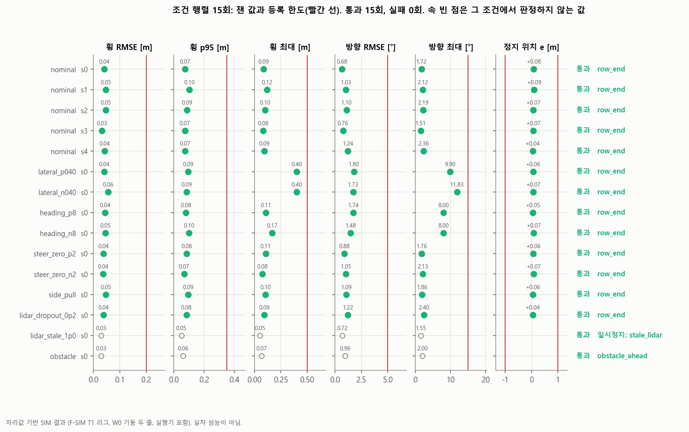
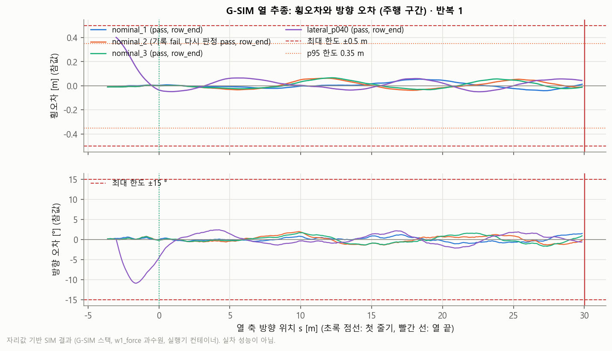
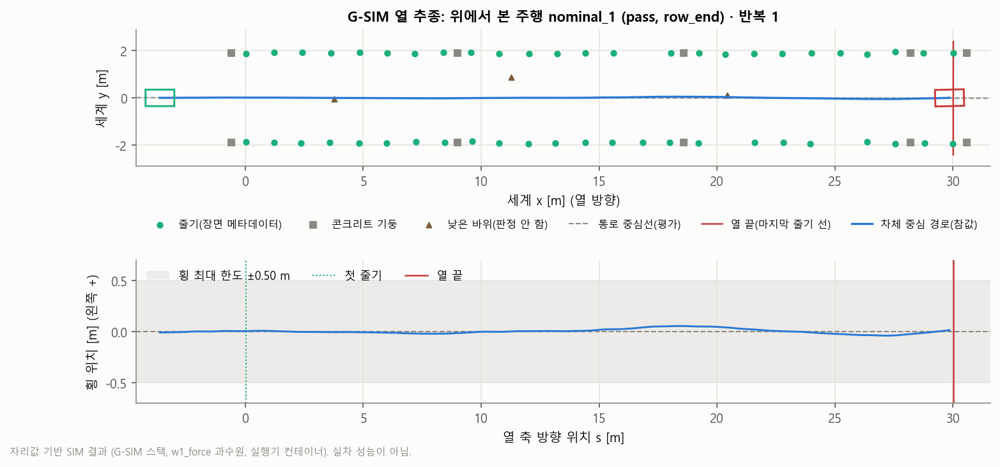

# 검사 결과 한곳에 (SIM 합격 검사와 사전등록 판정)

- 작성: 2026-11-13 (작업 DOC-07). 2026-11-13 main `6782298`까지 커밋된 결과 문서에서 옮겼다. 새로 잰 값은 없다.
- **모든 수치는 자리값 기반 SIM 결과이며 현장 성능이 아니다.** 조향 장치의 값(모터, 가변저항, 벨트, 치수)이 아직 자리값이고,
  실차로 잰 조향 차량 값은 없다.
- 결과 칸은 네 값 가운데 하나다: **합격**, **불합격**, **보고**(합격선 없이 값만), **미실행**. 불합격도 지우지 않고 적는다.
  기준을 결과 뒤에 바꿔 통과로 만든 것은 없다. 기준 개정은 모두 측정 전에 커밋했다([`SIM_ACCEPTANCE_KO.md`](steering/SIM_ACCEPTANCE_KO.md) 3절).
- 숫자를 고칠 곳은 이 문서 1절 표다. README의 결과 요약은 이 표를 줄여 쓴 것이다. 새 결과 문서가 생기면 1절에 행을 더하고 README의
  요약 줄을 맞춘다.

## 1. 지금 판정 (요약)

| 무엇 | 조건 | 횟수 | 결과 | 값 | 근거 |
|---|---|---|---|---|---|
| 열 추종, 빠른 SIM (`steer_follow_v1`) | F-SIM T1(실행기·브리지·펌웨어 V3·플랜트), W0 평지 기둥 두 줄, 조건 11종(정상 5 seed, 출발 횡 ±0.40 m, 방향 ±8°, 조향 0점 ±2°, 옆 쏠림, LiDAR 끊김 0.2 s·1.0 s, 장애물) | 15 | 합격 | 15/15. 횡 RMSE 0.029~0.055 m, 방향 최대 ≤ 11.83°, 열 끝 e +0.04~+0.09 m, LiDAR 1.0 s 끊김은 같은 틱에 구동 0, 장애물 앞 0.40 m 정지 | [`STEER_FOLLOW_RESULT_KO.md`](steering/STEER_FOLLOW_RESULT_KO.md) |
| 같은 15회, 새 기본값 회귀(한 번 눌러 시작, 속도 조절기) | 같음 | 15 | 보고 | 15/15 기대대로(회귀 확인, 새 판정 아님) | [`EXECUTOR_STEER_KO.md`](steering/EXECUTOR_STEER_KO.md) 13절 7항 |
| 열 추종, Gazebo (`steer_follow_gsim_v1`) 기록대로 | G-SIM 스택, W1 원본 과수원(`w1_force`, 열 30 m), 실행기 컨테이너, 이미지 wf4c, 실차 시계 | 4 | 불합격 | 3/4. `nominal_2`의 '일시정지 0회' 항목 실패(평가 코드가 앞 세션 기록을 섞음) | [`STEER_FOLLOW_GSIM_RESULT_KO.md`](steering/STEER_FOLLOW_GSIM_RESULT_KO.md) |
| 같은 기록, 평가 수정 1(먼저 커밋) 뒤 다시 판정 | 같음 | 4 | 합격 | 4/4 `row_end`. 횡 RMSE 0.021~0.039 m, 방향 최대 10.92°(+0.40 m 출발), e +0.45~+0.46 m, 참 속도 최대 0.443~0.446 m/s | 같음 |
| 넓은 조건 평가(사전등록 행렬, PC-14·PC-15) | 빠른 SIM 큰 조건 행렬 | - | 미실행 | 다른 묶음이 진행 중(2026-11-13). 결과가 나오면 이 줄을 바꾼다 | - |
| Gazebo 최종 확인(최종 이미지 wf5, `steer_follow_gsim_final_v1`) | G-SIM 스택, W1 과수원(열 추종·화면·PW-08)과 W0(A25), 한 번 눌러 시작, 실차 시계 | 4 run · 화면 2 시도 · A25 · PW-08 | 불합격 | 열 추종 3/4(`nominal_1`이 18.9 m 에서 `speed_cap_below_min`으로 끝남, 4 run 모두 유효). 화면 확인은 RTF 로 두 번 무효(판정 못 함), A17(G) one_press 판정 못 함(W0 에 통로 없음), A25 합격, PW-08 실행기 표 속도 비 1.1000(기록대로 불합격, 평가 결함 개정 2 로 합격) | [`STEER_FOLLOW_GSIM_FINAL_KO.md`](steering/STEER_FOLLOW_GSIM_FINAL_KO.md) |
| Gazebo 최종 확인 3단계(이미지 wf6, SIM 시계, `steer_follow_gsim_final3_v1`) | G-SIM 스택 W1, 운영자 연결 기한 1.0 s, IMU 자세, 사용자 로컬 명령 | 4 run · 화면 · A17(G) 25 · PW-08 · 사용자 3 run | 불합격 | 열 추종 3/4(`nominal_1` 27.0 m 에서 `stale_lidar`), 화면 합격(시작·탭 숨김 정지·STOP·STOP 뒤 다시 시작·실시간 지도), A17(G) one_press 24/25(`bridge_stall`), PW-08 합격, 사용자 명령 sim_auto 0/3(`steering_feedback_stale`: 실행기 스캔 처리 지연과 steer 컨테이너 CPU 스로틀) | [`STEER_FOLLOW_GSIM_FINAL_KO.md`](steering/STEER_FOLLOW_GSIM_FINAL_KO.md) 12절 |
| Gazebo 최종 확인 4단계(이미지 wf7, SIM 시계, `steer_follow_gsim_final4_v1`) | G-SIM 스택 W1, 실행기 처리 시간 작업(틱 전 조향 상태 새로 읽기, `gc.freeze()`, steer·executor CPU 3), 사용자 로컬 명령 | 4 run · 화면 · A17(G) `bridge_stall` 4 · 사용자 3 run | 불합격 | 사용자 명령 sim_auto 3/3 `row_end`(33.4, 33.3, 33.3 m). 열 추종 2/4(`nominal_2`·`nominal_3`이 출발 직후 실행기 입력 약 0.35 s 끊김으로 `steering_feedback_stale`·`link_ttl_expired`, 통과 run e +0.443·+0.463 m), 화면 3/6(첫 run 이 `session_conflict`로 거절, 화면 STOP·다시 시작은 통과), A17(G) `bridge_stall` 4/4 | [`STEER_FOLLOW_GSIM_FINAL_KO.md`](steering/STEER_FOLLOW_GSIM_FINAL_KO.md) 13절 |
| Gazebo 최종 확인 5단계(이미지 wf8, SIM 시계, `steer_follow_gsim_final5_v1`) | G-SIM 스택 W1, 실행기 입력 진단, 열 추종 검사가 DDS 가 조용해진 뒤 Start, 운영자 세션 규약 개정 5, 사용자 로컬 명령 | 4 run · 화면 6 항목 · 사용자 3 run | 불합격 | 화면 6/6 합격(다른 세션이 run 마다 heartbeat 를 보냈지만 출발을 막지 않음). 열 추종 2/4(`nominal_1`·`nominal_2` e +0.475·+0.457 m; `nominal_3` 21.5 m `speed_cap_below_min`, `lateral_p040` 2.1 m `stale_lidar`), 사용자 명령 0/3(4.5 m `steering_feedback_stale`, 23.9 m `speed_cap_below_min`, 25.2 m `stale_lidar`). 실패 다섯 모두 호스트가 바쁜 때 실행기 스캔 처리 0.15~0.32 s. 4단계의 출발 직후 입력 끊김(새 DDS 참가자 합류 뒤 SIM 쪽 약 0.35 s 정지)은 주행 중 0 번(기다림이 2 번 잡음) | [`STEER_FOLLOW_GSIM_FINAL_KO.md`](steering/STEER_FOLLOW_GSIM_FINAL_KO.md) 14절 |
| Gazebo 최종 확인 6단계(이미지 wf9, SIM 시계, `steer_follow_gsim_final6_v1`) | G-SIM 스택 W1, 바쁜 호스트에 덜 흔들리는 실행기(진단 기본 끔, /clock 이 깨우는 루프, 노드 서비스 없앰, CPU 가중치), 판정 run 전 호스트 조용함 확인과 넓힌 호스트 고장 규칙, 측정 스택 포트 18091, 사용자 로컬 명령 | 4 run · 화면 6 항목 · 사용자 3 자리 | 불합격 | 열 추종 4/4 합격(모두 첫 시도, e +0.439~+0.476 m). 화면 불합격(준비·STOP·다시 시작 통과, 첫 run 이 go 2.4 s 뒤 `steering_feedback_stale`이라 한 번 눌러 주행·heartbeat·탭 숨김 실패). 사용자 명령 1/3(호스트 고장 무효 1 번 뒤 7.6 m·13.0 m `speed_cap_below_min`, 셋째 33.4 m `row_end`). 실패 셋 모두 Windows 전체 CPU 70 % 아래(58.8~69.9 %)였지만 E 코어(효율 등급 0)가 약 80 % 로 찼고 P 코어는 반쯤 비어 있던 때, 실행기·브리지·에뮬레이터가 함께 느려짐 | [`STEER_FOLLOW_GSIM_FINAL_KO.md`](steering/STEER_FOLLOW_GSIM_FINAL_KO.md) 15절 |
| T1 안전 대본(실행기 포함, 개정 34) | F-SIM T1 | 71 | 합격 | 71/71 기대대로. 운영자 신호 끊김: 마지막 heartbeat 4.95 s → 구동 0 첫 trace 5.51 s(한도 5.55 s). 2026-11-14 운영자 세션 개정 5 뒤에도 직렬·trace 71/71 같음 | [`OPERATOR_API_KO.md`](steering/OPERATOR_API_KO.md) 8절 |
| 구동기 사전값 층 L1(개정 33) | F-SIM T1, W0, seed 0~4 × run 7종 | 55 | 합격 | 55/55. 가중 0은 기본과 바이트까지 같음, 표 ±30 % 어긋남 표시, LiDAR 1 s 끊김 예측 오차 ≤ 0.15 m, 사전값만으로 주행 0 | [`ACTUATOR_PRIOR_KO.md`](steering/ACTUATOR_PRIOR_KO.md) |
| 프로필 v0.2 자격(개정 40) | T1, 정상 대본 6 × 10 seed 등 | 4 묶음 | 불합격 | ① 시험 기준식에 벨트 유격이 없어 1개 실패(고친 뒤 91/91은 보고), ② 정지 중 ±20° 쓸기에서 호스트 `steering_not_following` 10/10, ③ 9/9 합격, ④ 합격 | [`STEER_PROFILE_V02_KO.md`](steering/STEER_PROFILE_V02_KO.md) |
| 외란 아래 직진 유지 v0.2(개정 41·42, ST-11) | T1, ESP 위치 루프만(바깥 루프 없음), 대본 10 × seed 5 | 40 판정 항목 | 불합격 | 39/40. 크기 안 외란 D1~D4 20/20 래치 0·복귀 ≤ 0.82 s, 크기 밖 D6 seed 1004의 첫 결함이 등록 집합 밖 POLARITY | [`STEER_HOLD_RESULT_KO.md`](steering/STEER_HOLD_RESULT_KO.md) |
| 프로필 v0.3 자격(개정 43) | T1, 새 판정 seed | 5 묶음 | 불합격 | ② 정지 중 전폭 쓸기에서 MCU THERMAL 10/10(열 예산 자리값). ① 91/91, ③ 9/9, ④ 31/31, ⑤ ST-11 30/30은 합격. 그래서 기본 프로필은 v0.1 | [`STEER_PROFILE_V03_KO.md`](steering/STEER_PROFILE_V03_KO.md) |
| 국소 격자 L2, 10/10 기록 재생 일치 | 사람이 몬 10/10 기록(조향 장착 전 차) 153 run, 유효 틱 41,081 | - | 보고 | 격자 선과 빠른 층 band가 0.10 m·1.5° 안에서 맞은 틱 41.3 %(작업 완료 기준 90 %에 못 미침). 갱신 PC p50 2.4 / p99 16.4 ms | [`LOCAL_GRID_KO.md`](steering/LOCAL_GRID_KO.md) |
| GNSS 약한 층 L3, SIM 비교 | T1, 가상 GNSS(잡음 모형 자리값) | - | 보고 | 사전등록 판정이 아니다. 위치 차분 진행 방향 오차 p50 2.1~2.4°, 최대 9.4° | [`GNSS_LAYER_KO.md`](steering/GNSS_LAYER_KO.md) |

그림 1. 빠른 SIM 열 추종 15회의 잰 값과 등록 한도(빨간 선). [SIM · 자리값] 평지 기둥 두 줄(W0), 과수원 모델이 아니다.

그림 2. Gazebo 과수원(W1)에서 열 추종 4회의 횡오차·방향 오차(참값). [SIM · 자리값]

## 2. SIM 자체 합격 검사 A1~A26

기준은 [`SIM_ACCEPTANCE_KO.md`](steering/SIM_ACCEPTANCE_KO.md) 1절 표와 개정이다. 단계 P1~P7은 설계 v1 8절, 결정 기록은
[`DECISIONS_KO.md`](steering/DECISIONS_KO.md)의 R12(1단계), R13·R15(2단계), R18·R19(3단계), R21·R22(4단계)다. 한 검사에 F(빠른 SIM)와
G(Gazebo) 결과가 다르면 줄을 나눴다. 같은 검사를 다시 쟀으면 마지막 판정과 앞 판정을 함께 적었다.

| ID | 검사 | 결과 | 값 | 날짜·근거 |
|---|---|---|---|---|
| A1(F) | 기하 재현, 빠른 SIM | 합격 | R = L/tan δ 오차 ≤ 1 % | 11/08 P1, R12 |
| A1(G) | 기하 재현, Gazebo 기구학 속도 모드 | 합격 | R 오차 최대 0.0182 %(v0.1, 구 충돌), ω 오차 ≤ 2.47 %(v0), 부호 일치 | 11/09, R13·R19 |
| A1(G) | 기하 재현, Gazebo 힘 모드 | 보고 | 유효 L 0.790 m, η 0.962, 언더스티어 −0.070, 잔차 최대 2.2 %(v0, 원통 바퀴) | 11/09, R13 |
| A2 | 조향 구동기 응답 | 합격 | 속도 한계·τ·데드밴드·백래시·끝 멈춤 ±5 %. v0.3에서도 A2·A3(F)·A8 91/91 | 11/08 P1, R12; 11/13 개정 43 |
| A3(F) | 가변저항 측정, 빠른 SIM | 합격 | 잡음·LSB·고장 주입. v0.2는 기준식 결함으로 1개 불합격(위 1절), v0.3 합격 | R12, 개정 40·43 |
| A3(G) | 가변저항 측정, Gazebo | 합격 | 재생 불일치 0(R19). 잡음(개정 15): DISARMED 11,630틱, raw sd 비 1.0345(±10 % 안) | 11/09 R19; 11/13 GSIM_GAPS 3.4 |
| A4(F) | 구동 응답, 빠른 SIM | 합격 | release 정지 거리 중앙값 P_fit1003 0.5830 m, field1010 0.5652 m(창 0.56~0.60 m) | 11/09, R13 |
| A4(G) | 구동 응답, Gazebo, 프로필 v0 | 불합격 | release 정지 거리 0.943 m(목표 0.476~0.690 m) | 11/09, R13 |
| A4(G) | 구동 응답, Gazebo, 프로필 v0.1 | 합격 | 정상 속도 ±0.22 %, release 0.614 m. 이 release 통과는 같은 측정에 맞춘 값이라 독립 검증이 아니다(R17). brake 0.179 m 보고 | 11/09, R19 |
| A5(F) | 센서 형식·통계, 빠른 SIM | 합격 | 3240빔, 10 Hz, frame `laser`, 0 = 반사 없음, IMU 주기·잡음 | 11/09 P4, R18 |
| A5(G) | 센서 형식·통계, Gazebo | 합격 | `/scan` 196개 형식 어긋남 0·빠른 SIM 변환과 바이트 같음, IMU 32.8 Hz·잡음 ±10 %, 카메라 640×360 30.3 Hz | 11/12 ST-05, [`S2_NODE_EXEC_KO.md`](steering/S2_NODE_EXEC_KO.md) 7.3 |
| A6 | 실제 스캔 비교(10/10 궤적의 합성 스캔) | 보고 | 0.6606(자기 일관성 기준선) | 11/09, R19 |
| A7 | 세계 동등성(Gazebo 대 래스터, 710,400광선) | 합격 | 반사 불일치 8.1e-6, 거리 차 1.6e-5 | 11/09 P7, R19 |
| A8 | 결정성, 빠른 SIM | 합격 | 같은 seed trace SHA 같음(작업자 1·6, trace 16개), P4 직렬 줄 바이트 같음 | R12·R13·R18 |
| A9 | 반복 분산, Gazebo | 보고 | 종료 x sd: W0 0.039 m, W1 0.053 m | 11/09, R19 |
| A10 | 실시간 비율 W0 | 합격 | RTF 중앙값 1.000 | R13·R19 |
| A10 | 실시간 비율 W1 원본 과수원 | 합격 | 중앙값 0.99999 | 11/09, R19 |
| A10 | 실시간 비율 W2 모드 R(10/10 재구성 열, 전체 감지 사슬) | 미실행 | 3단계 값 보고: 중앙 0.998, p10 0.677(약 30 s 동안 0.58~0.72, 원인 모름). 4단계 판정(중앙값 ≥ 0.8, 240 s)은 아직 | R19, S2_NODE_EXEC 10절 |
| A11 | 처리 시간 | 보고 | 플랜트 step p99: L0 28 µs, L1 197 µs. 실행기 한 걸음(조용할 때) p50 1.80 ms, p99.9 최악 44.2 ms, 최대 56.3 ms, 부하 때 최대 567 ms | R13·R18 |
| A12 | 두 SIM 일치(F 대 G, 개방 루프) | 합격 | δ별 η 형식: 위치 차 최대 8.0 mm, 방향 차 0.155°. 등록 형식(상수 η)은 6개 중 3개만 한계 안(보고) | 11/09 P7, R19 |
| A13(F) | 참값 격리, 정적 검사 | 합격 | 81개 파일 오류 0(P2), P4 실행기 경로 포함. GNSS 입력(개정 30)은 실행기 노드의 `/gps/fix`만 허용하는 시험으로 고정 | R13·R18, [`GNSS_LAYER_KO.md`](steering/GNSS_LAYER_KO.md) |
| A13(G) | 참값 격리, ROS 그래프 | 합격 | R1~R5 발견 0, 실행기 노드 구독 `/scan`·`/imu/data_raw`·`/rover/control/requested`(+ 기반 토픽)만 | R19; 11/12 ST-05 |
| A14 | 신원 분리(SIM/실차) | 합격 | 실차 래퍼가 SIM 장치를 거부, 반대도 거부. 옛 조종 화면으로 arm 불가 | 11/09, R19 |
| A15 | 고정 파일 | 합격 | `check_pins` 허용 목록 밖 변경 0(모든 커밋에서 다시 돈다) | 매 단계 |
| A16 | 좌표 누출 | 합격 | `coord_lint`: 월드 생성물·push 파일·run 출력에서 위경도 형식 숫자 0 | 매 push |
| A17(F) | 안전 동작, 빠른 SIM | 합격 | 195항목, 필수 장애 대본 15개 | 11/09 P4, R18 |
| A17(G) | 안전 동작, Gazebo(실행기 없음) | 합격 | 실차 시계: STOP 요청 → STOP 바이트 8.8~13.5 ms, 확인 40~63 ms, 래치 400.9 ms. SIM 시계: STOP 지연 0.0 ms | 11/09 P6a, R19 |
| A17(G) | 실행기 고리 22대본, 실차 시계, 첫 실행 | 불합격 | 26항목 중 통과 20, 실패 3, 무효 3(실패는 모두 검사 쪽 결함으로 확인) | 11/13, [`GSIM_GAPS_RESULT_KO.md`](steering/GSIM_GAPS_RESULT_KO.md) 3.1 |
| A17(G) | 같은 대본, 고친 검사로 다시 | 합격 | 5대본 모두 유효·통과. 입력 기한 0.7598·0.7595 s(한도 0.77 s), STOP 재전송 5번·래치 408.2 ms. `steering_status_loss`는 이번 유효 실행 없음(ST-05 2차는 통과) | 11/13, GSIM_GAPS 3.2 |
| A17(G) | 실행기 고리, SIM 시계 모드 | 미실행 | 조용한 호스트가 필요 | S2_NODE_EXEC 10절 |
| A17 개정 31 | 한 번 눌러 시작·정지, 빠른 SIM | 합격 | 운영자 신호 끊김 → 구동 0 ≤ 0.5 s + 1틱, 재출발 없음, 다른 화면 거부, STOP | 11/13, OPERATOR_API 8절 |
| A17 개정 31·60·62 | 한 번 눌러 시작·정지, Gazebo W1(SIM 시계, 대본마다 출발점) | 불합격 | 24/25(개정 1 뒤). `bridge_stall`이 주입 전 호스트 `steering_ineffective` 래치로 끝남. W0 시도(2단계)는 통로가 없어 판정 못 함 | 11/13, GSIM_FINAL 12.4절 |
| A17 개정 60·62, `bridge_stall`만 | Gazebo W1(SIM 시계, wf7), 자세 되돌림 없음 1 + 되돌림 3 | 합격 | 4/4. TTL 구동 0 틱 차 0, watchdog 501 틱, 출발 yaw rate 0.005~0.069 °/s, 호스트 래치 0 | 11/13, GSIM_FINAL 13.4절 |
| A18(F) | 식별 복원, 빠른 SIM | 불합격 | 경계가 있는 153행 중 6행 밖(0점 오차 2, κ(δ) 4). 원인은 자리값 곡률 떠돎(sd 0.95°/m) | 11/09, R18 |
| A18(G 일부) | 식별 복원, Gazebo 한 사례(B, seed 12) | 불합격 | 0점 오차 +0.537°(한도 0.2°), 3단계 값과 같음 | 11/13, GSIM_GAPS |
| A19 | 결함 코드 범위, MCU | 합격 | 결함 코드 15종 모두 대본이 일으킴, 판정 틱 차 0, 정상 대본 49개 오검출 0 | 11/09 P3, R15 |
| A19(F) | 결함 코드, 빠른 SIM | 불합격 | 정상 40회 중 1회 POLARITY 오탐(정지 중 서보 최소 출력에서 바퀴가 기어감) | 11/09, R18 |
| A19(G) | 결함 코드, Gazebo 3단계 | 불합격 | 정상 SIM 990 s에서 오검출 2(브리지 334.8 ms 멈춤으로 TTL 1, 정지 큰 계단으로 THERMAL 1) | 11/09, R19 |
| A19(G) | 결함 대본 23사례, 고친 판정 | 합격 | 판정 항목 모두 통과(보고 4), 146.5 s | 11/13, GSIM_GAPS 3.3 |
| A19(G) | 4단계 정상 대본 오검출 전체 집계 | 미실행 | 집계 전. A25 실행에서 호스트 `steering_not_following` 래치 1건이 남아 있다(원인 모름) | GSIM_GAPS 3.4 |
| A20 | ESP 규약 적합성 | 합격 | 대본 92/92, 세 플랫폼(MinGW, WSL g++ 11.4, 이미지 g++ 13.3) × 두 전송. 11/12 새 저장소 Windows·WSL 다시 92/92 | R15·R21, [`CONFORMANCE_KO.md`](steering/CONFORMANCE_KO.md) |
| A21 | 조향 한계·스윕 | 합격 | 바퀴별 기계 한계를 넘는 바퀴각 0(넘음 최대 1.1e-9°), 등가 한계·발자국 스윕 반영 | R12·R13 |
| A22(F) | 정지 뒤 조향, 빠른 SIM | 합격 | 종결·STOP 뒤 명령 조향 이동 0. 열 추종 15회도 종결 뒤 3 s 조향 명령 변화 0° | R18, STEER_FOLLOW_RESULT |
| A22(G·화면) | 정지 뒤 조향, Gazebo·대시보드 화면 | 미실행 | 판정 실행 전. 참고: G-SIM 열 추종 4회 모두 종결 뒤 3 s 동안 MCU가 받은 `C` 줄 0 | STEER_FOLLOW_GSIM_RESULT |
| A23 | 기록(조향 사이드카, 별도 bag) | 합격 | 녹화 1회, `check_recording` 14항목 참, MCU 손실 0, 20.0 Hz | 11/13 ST-06, [`STEER_RECORDING_KO.md`](steering/STEER_RECORDING_KO.md) |
| A24 | 출발 조건 가능성 | 합격 | 개발 회랑 32방향 × 11조건 = 352개 모두 FEASIBLE. 봉인 방향은 사전등록 때 | 11/09, R13 |
| A25 | Gazebo 관절 추종(L0·L1, 네이티브) | 합격 | p99 8.2e-10°/8.6e-10°, 정지 60 s 표류 1.7e-5 m | R13·R19 |
| A25 | Gazebo 관절 추종, 에뮬레이터 경로 3단계 | 합격 | p99 6.8e-11° | 11/09, R19 |
| A25 | 같은 경로, 4단계(`w0_a17`) | 불합격 | p99 0.62°(한도 0.2°). 실행 끝 무렵 호스트 래치 1건 뒤 drive 거부 27. 원인 모름 | 11/13, GSIM_GAPS 3.4 |
| A25 | 같은 경로, 최종 이미지 wf5(개정 43 브리지) | 합격 | p99 5.7e-11°, 관절 속도 튐 0.449 rad/s, 조향 7.47°, drive 거절 0 | 11/13, GSIM_FINAL 6절 |
| A26 | 같은 코드(SIM 사본 대 실차 사본), SHA 기록 | 보고 | 호스트 파일 4개, 시험 7개, 기반 파일 7개의 SHA 목록 | 11/09 P3, R15 결정 5 |
| A26 | 같은 코드, 실차 사본과 비교 | 미실행 | 실차 이식(P9) 때 | - |

그림 3. Gazebo 과수원 한 통로를 위에서 본 주행(`nominal_1`, 참값 경로). 줄기·기둥은 장면 메타데이터다. [SIM · 자리값]

## 3. 셈

- 1절 판정 줄 13개: 합격 4, 불합격 4, 보고 3, 미실행 2.
- 2절 A1~A26 줄 50개: 합격 32, 불합격 7, 보고 5, 미실행 6(그중 A10 W2는 3단계 값을 함께 적었다). 26개 검사 모두 한 줄 이상 있다.
- 불합격으로 남은 것의 공통점: 조향 장치 자리값끼리의 충돌(정지 중 쓸기의 열 예산, 서보 최소 출력과 극성 판정), 자리값 곡률 떠돎이
  큰 식별(A18), 호스트가 바쁠 때의 실시간성(A19(G) TTL, A25 4단계). 조향 장치 사양과 실측이 오면 다시 잰다
  ([`SPEC_UPDATE_KO.md`](steering/SPEC_UPDATE_KO.md)).

## 4. 측정 자료 (판정이 아닌 근거)

| 자료 | 무엇 | 문서 |
|---|---|---|
| 구동 응답(조향 장착 전 차) | 10/03·10/10 수동 주행 14개, duty → 속도·출발·정지 거리 | [`drive_response/README_KO.md`](drive_response/README_KO.md) |
| 지연·비용 기준선 | 센서 주기, 처리 시간, τ_loop 시작값 0.35 s(추정)의 근거 | [`TIMING_BASELINE_KO.md`](steering/TIMING_BASELINE_KO.md) |
| 기록 재생 기준선 | 10/10 기록으로 추정기를 개방 루프 재생한 값 | [`REPLAY_BASELINE_KO.md`](steering/REPLAY_BASELINE_KO.md) |
| 식별 도구 | B0~B7, F1~F5 현장 식별 절차와 SIM 복원(A18) | [`IDENT_KO.md`](steering/IDENT_KO.md) |
| 빠른 SIM | 플랜트·세계·센서 모형과 자리값 | [`FAST_SIM_KO.md`](steering/FAST_SIM_KO.md) |
| Gazebo 모델 | 조향 차량 SDF, 바퀴 충돌, 관절 제어 | [`GZ_MODEL_KO.md`](steering/GZ_MODEL_KO.md) |
| 월드 | W0 평지, W1 원본 과수원, W2 10/10 재구성 열, W3 절차 과수원 | [`WORLDS_KO.md`](steering/WORLDS_KO.md) |
