# 시뮬레이션 환경, 차량 모델, 평가 방법

두 시뮬레이터(빠른 SIM, Gazebo 스택)와 그 안의 차량·세계·센서 모델, 실행기 한 틱의 순서, 평가 지표와 기록 형식, SIM 판정 요약을 모은 문서다.
2026-11-22에 README를 줄이면서 README에 있던 자세한 절을 이리로 옮겼다. 이 문서의 SIM 수치는 조향 장치 사양 대부분이 자리값인 시뮬레이션 결과이고 현장 성능이 아니다.
현장 기록은 [`steering/ORCHARD_1120_RESULT_KO.md`](steering/ORCHARD_1120_RESULT_KO.md), [`steering/AUTONOMY_RUNS_ANALYSIS_KO.md`](steering/AUTONOMY_RUNS_ANALYSIS_KO.md)에 있다.

## 1. 두 시뮬레이터

| | 빠른 SIM (F-SIM, T1 장치) | Gazebo 스택 (G-SIM) |
|---|---|---|
| 구성 | 한 프로세스, 한 SIM 시계. 실행기·브리지 코드 그대로, MCU 펌웨어는 PC용으로 컴파일, 차체는 운동학 자전거 모델 | Docker의 ROS 2 Jazzy + Gazebo Harmonic. 센서 노드, 펌웨어 흉내, 브리지, 기록기, 대시보드, 실행기 컨테이너 |
| 주기 | MCU 1 ms, 플랜트 10 ms, 브리지 20 ms, 실행기 50 ms, LiDAR 10 Hz, IMU 33 Hz | 물리 120 Hz(설정), 나머지는 5절 |
| 특징 | 결정적(같은 seed면 기록이 같다), 큰 조건 행렬 | ROS·DDS·대시보드·기록까지 실차와 같은 사슬, 3D 접촉 |
| 쓰임 | 제어기 개발, 판정, 안전 대본 | 통합 확인, 화면, 영상 |

## 2. 차량 파라미터

차량 값은 프로필 파일에 모여 있고(`sim/ubts/steering/profiles/`), 값마다 출처가 붙어 있다.

| 항목 | 측정 치수 프로필 `front_steer_v1_spec_20261116` | 자리값 프로필 `front_steer_v0_1` |
|---|---|---|
| 휠베이스 / 윤거 | 0.657 / 0.527 m (측정 2026-11-16) | 0.76 / 0.56 m |
| 바퀴 반경 / 폭 | 0.13 / 0.095 m (측정) | 0.14 / 0.12 m |
| 조향 한계 | 바퀴마다 20° (측정), 제어 소프트 한계 16.1° | 28°, 소프트 23.5° |
| 조향 응답 | 보드 계단 응답 0 → ±20 명령도 3.5 s, 되돌림 2.5 s (측정) | 주행 30, 정지 15 °/s (자리값) |
| LiDAR 위치 | 앞차축 0.21 m 뒤, 가운데 (측정), 스캔 높이 0.55 m (추정) | x 0.18 m, 높이 0.60 m |
| 구동 응답 | duty → 속도 곡선(40/55/70/88 % → 0.33/0.47/0.61/0.78 m/s, 100 % 0.90 m/s). 조향 장치를 달기 전 차의 기록에서 맞춘 추정값 | 같음 |
| 그대로 자리값 | 질량 24 kg, 발자국 1.22 × 0.70 m, Ackermann 비 0.5, 유격 2°, 벨트·가변저항 등 34칸 | 조향 값 전부 |

- 판정과 회귀 시험은 기록대로 v0.1을 쓰고, Gazebo 화면용 스택은 측정 치수 프로필로 뜬다(`compose.ubts-steer.measured.yaml`).
- 조향 사양이 오면 `profiles/steer_spec_input.yaml` 한 파일을 고치고 `tools/steer_sim/apply_spec.py`를 돌린다([`steering/SPEC_UPDATE_KO.md`](steering/SPEC_UPDATE_KO.md)).

**조향 방식.** 조향은 일반 DC 모터를 모터 드라이버로 돌리고, 벨트로 이은 가변저항으로 위치를 읽는다. Jetson은 목표 조향각만 보내고 위치 루프는 MCU 안에서 닫는다.

| 보드 펌웨어 | 방식 | SIM 흉내 |
|---|---|---|
| 처음 펌웨어 (2026-11-16) | 절대 목표각을 받아 PWM 100/255를 50 또는 80 ms 주고 300 ms 쉰 뒤 가변저항 값으로 다시 판정하는 펄스 유지 | `sim/ubts/steering/native/abs_hold8.cc`([`steering/ABS_HOLD8_SIM_KO.md`](steering/ABS_HOLD8_SIM_KO.md)) |
| SMOOTH 유지 r5 (2026-11-16 밤~, 지금 차) | 한 번의 연속 구동, 램프·감속 구역, 끝 제동, 구동 중 조용한 읽기 | `sim/ubts/steering/native/smooth_r5.cc`, 프로필 `front_steer_v2_field_20261116`([`steering/SMOOTH_R5_SIM_KO.md`](steering/SMOOTH_R5_SIM_KO.md)) |

펄스 사이에 드라이버가 놓여 외력에 밀리는 효과는 빠른 SIM에만 있다(Gazebo 조향 관절은 위치 제어). 하드웨어 표: [`HARDWARE_KO.md`](HARDWARE_KO.md).

| 비스듬히 | 옆 | 위(오른쪽이 앞) |
|---|---|---|
| 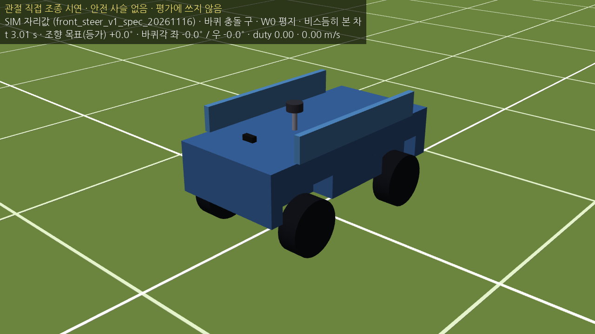 | 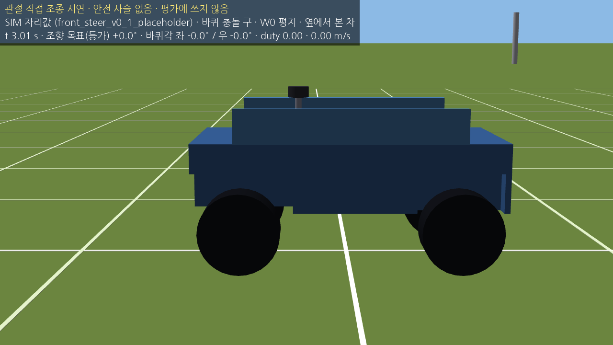 | 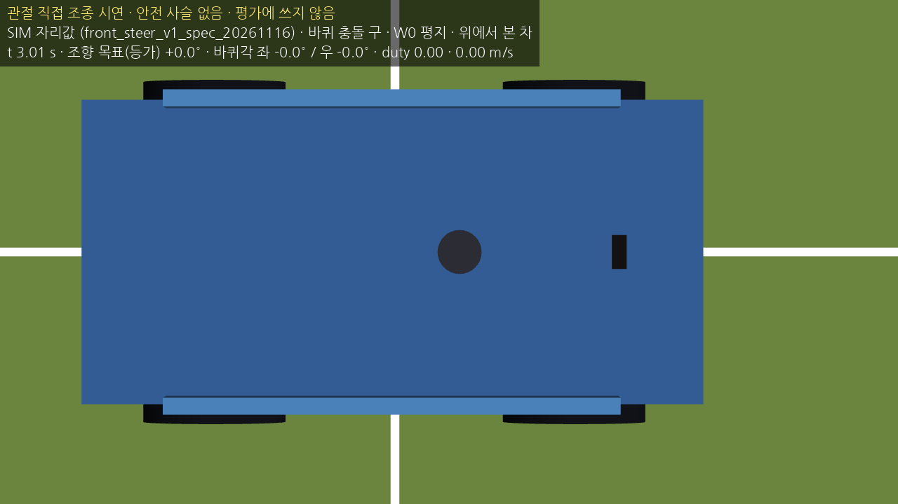 |
| [SIM · 자리값] 측정 치수 프로필. 차체 상자·카메라는 자리값 | [SIM · 자리값] 휠베이스 0.657 m, 바퀴 지름 0.26 m | [SIM · 자리값] 윤거 0.527 m, LiDAR 앞차축 0.21 m 뒤 |

| 앞, 조향 0° | 앞, 조향 +15°(왼쪽) |
|---|---|
| 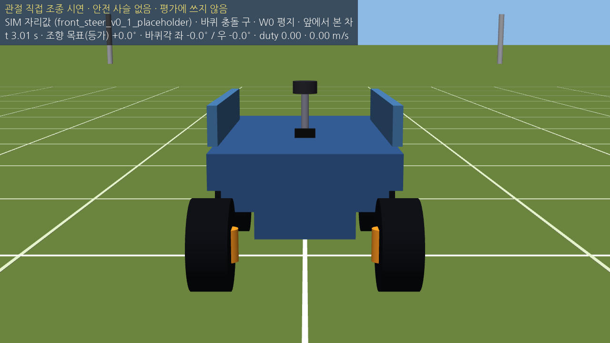 | 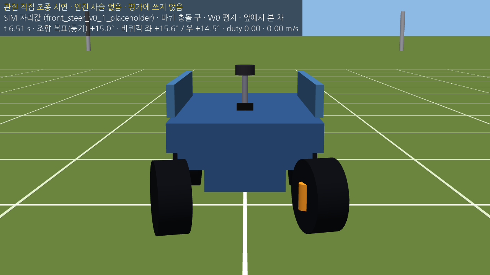 |
| [SIM · 자리값] 바퀴 두께 0.095 m | [SIM · 자리값] 바퀴각 좌 +15.7° / 우 +14.4°, 한계 20° |

## 3. 지형별 구동 표 (2026-10 현장 기록)

2026-10-03·10-10에 조향 장치를 달기 전 차(좌우 차동 구동, ESP8266 제어)를 사람이 몰며 남긴 기록 14개에서 잰 값이다. 속도는 LiDAR 스캔 정합으로 쟀고 일부 칸은 GNSS다.
실행기 차량 설정의 구동 값(출발 34 %, 55 %에서 0.459 m/s, 정지 거리 0.595 m)이 이 기록에서 왔다([`steering/EXECUTOR_ESP32_KO.md`](steering/EXECUTOR_ESP32_KO.md) 3.4절).

duty → 정상 직진 속도 (m/s [등급, 구간 수], 표 T3):

| duty % | 도로·포장 10/3 | 과수원 10/3 | 과수원 열 안 10/10 | 과수원 그 밖 10/10 |
|---|---|---|---|---|
| 40 | 0.373 [참고, 1] | | | |
| 45 | | 0.426 [참고, 1] | | |
| 55 | | 0.459 [참고 GNSS, 3] | | |
| 58 | 0.537 [참고, 1] | | | |
| 70 | | 0.641 [측정 GNSS, 6] | | |
| 88 | 0.771 [측정, 5] | | | |
| 90 | 0.831 [참고, 2] | | 0.706 [측정, 12] | 0.685 [참고, 3] |
| 95 | 0.864 [측정, 15] | | | |
| 100 | 0.942 [측정, 125] | 0.847 [참고 GNSS, 3] | 0.892 [측정, 78] | 0.896 [측정, 119] |

- 빈 칸은 그 지면에 정착된 직진 구간이 없다는 뜻이다. 합친 기준표(T2)는 그 사이를 보간하고 40 % 아래를 외삽한다($v = 0.00855\,\mathrm{duty} + 0.025$).
- 출발: 10/10 정지 출발 11건에서 움직이기 시작한 duty p50 34 %. 놓기 정지: 0.75~0.98 m/s에서 8건 p50 0.546 m.
- 한계: 10월 기록, 조향 장치 전, ESP8266 제어, 배터리 상태 모름. 자율 속도대 25~60 %는 duty마다 구간 1~3개뿐이라 ±20 % 넘게 틀릴 수 있다. 2026-11-20 과수원에서 조향 차는 이 표 속도의 76~85 %만 냈다(duty 중앙 46~51 %, [`steering/ORCHARD_1120_RESULT_KO.md`](steering/ORCHARD_1120_RESULT_KO.md) 6절).
- duty를 T초 유지했을 때의 이동거리(T6), 출발·정지 표, 방법: [`drive_response/README_KO.md`](drive_response/README_KO.md).

## 4. 세계와 센서 모델

| 세계 | 내용 | 쓰는 곳 |
|---|---|---|
| W0 | 평지에 기둥 두 줄(행 폭 3.5 m, 간격 1.5 m, 열 끝 x = 24 m). 넓은 조건에서는 굽은 열, 빈 나무, 끝 기둥, 폭·간격 변형 | 빠른 SIM 판정 |
| W1 | 원본 과수원 생성기: 6열, 행 간격 3.8 m, 나무 간격 1.2 m, 열 길이 30 m, 기둥·철선, 지면 기복 | Gazebo |
| W2 | 2026-10-10 현장 주행으로 만든 SLAM 지도의 회랑(행 간격 3.19~3.95 m) | 빠른 SIM 판정, Gazebo |
| W3 | 10/10 통계에 맞춘 절차 과수원(4열, 60 m) | 빠른 SIM(판정에는 쓰지 않음) |

| 센서 | 모델 |
|---|---|
| LiDAR | 3200빔을 RPLIDAR S2 형식 3240빔으로 바꿔 `/scan` 10 Hz. 거리 잡음 0.015 m(빠른 SIM), 0.01 m(Gazebo), 지연 0.08 s(추정) |
| IMU | 33 Hz. 자이로 배율·편향은 run마다 추첨(추정값), 정지 잡음 0.09 °/s와 주행 진동은 10/10 기록에서 잼 |
| GNSS | 가상 수신기(빠른 SIM 1 Hz, 수평 오차 수 m 자리값; Gazebo 약 5 Hz, 잡음 0). 실행기 기본 설정은 GNSS를 쓰지 않는다 |
| 카메라 | Gazebo 640×360 30 Hz, 표시·기록용(위치 추정에 쓰지 않음) |

| 과수원 전경 | 위에서 본 과수원 | 통로 출발점 |
|---|---|---|
| 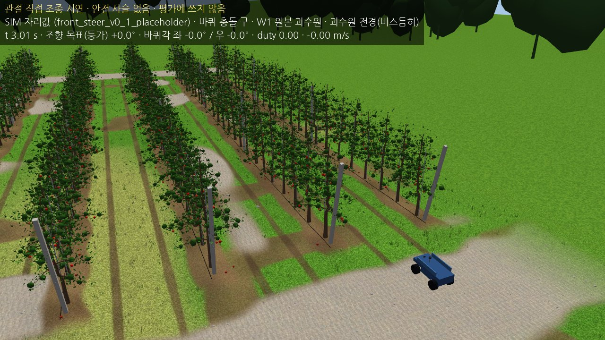 | 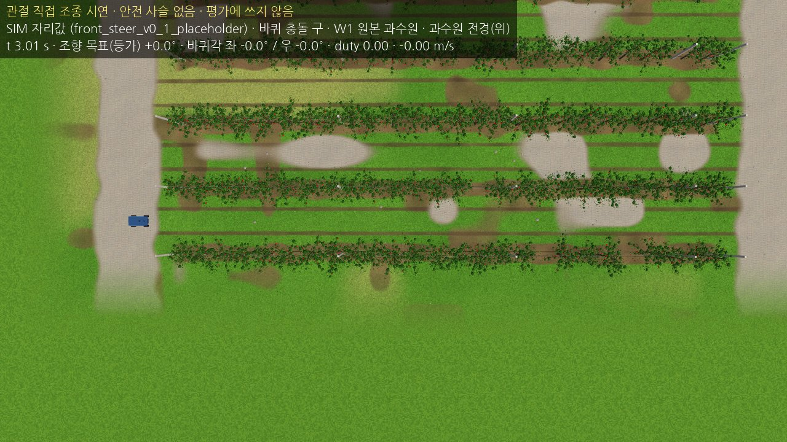 | 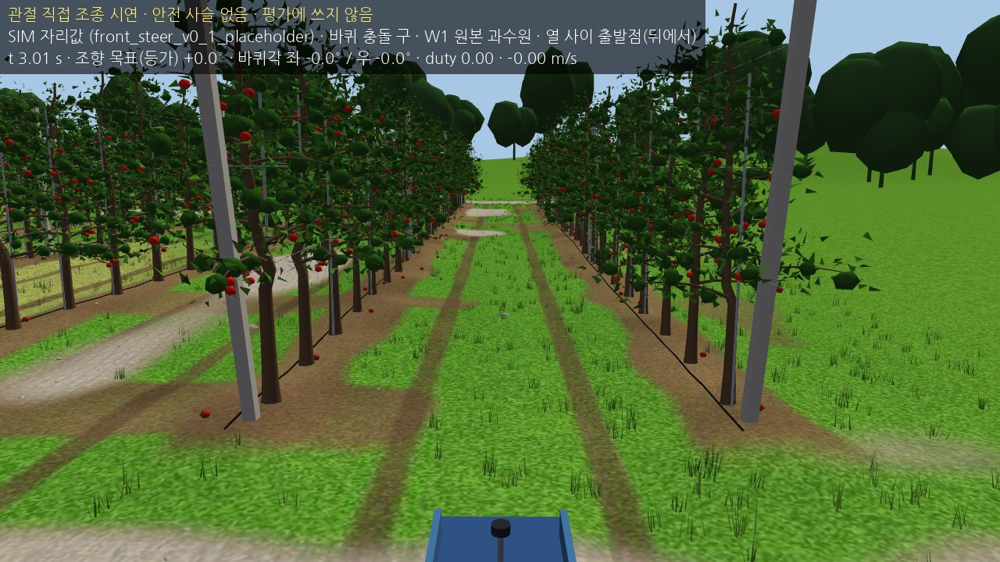 |
| [SIM · 자리값] W1 원본 과수원, 오른쪽 아래가 차 | [SIM · 자리값] 행 간격 3.8 m, 나무 간격 1.2 m, 열 길이 30 m | [SIM · 자리값] 두 나무 열과 기둥·철선 |

| 차량 카메라 | LiDAR `/scan`, 통로 안 | LiDAR `/scan`, 출발점 |
|---|---|---|
| 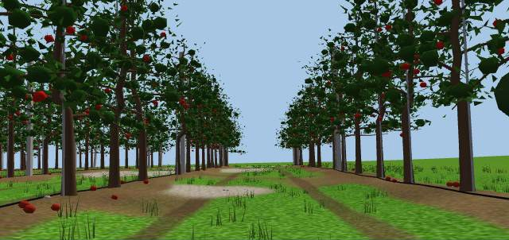 | 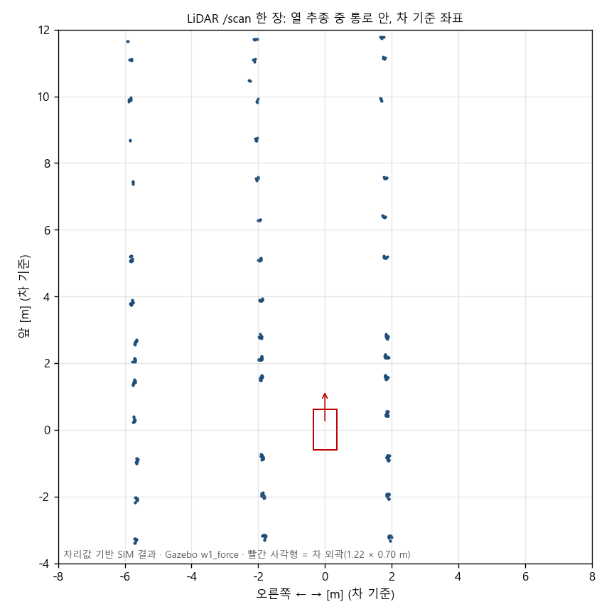 | 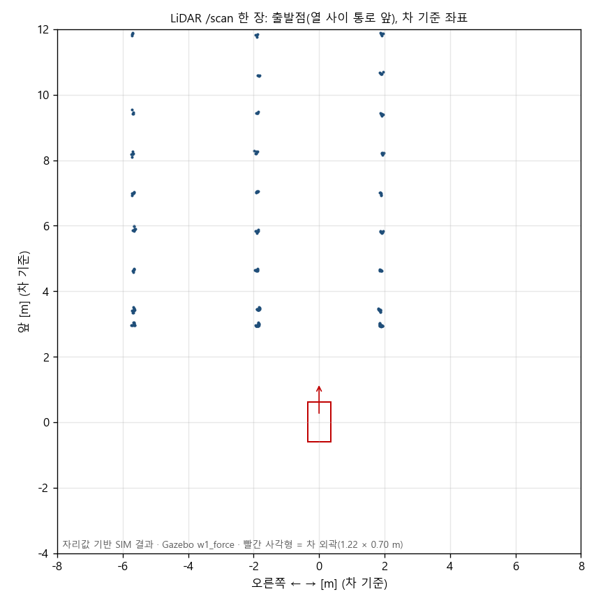 |
| [SIM · 자리값] 640×360 렌더에서 차체 윗면 띠를 잘라 냄 | [SIM · 자리값] 차 기준 좌표, 빨간 사각형이 차 외곽 | [SIM · 자리값] 앞 3 m부터 두 줄의 줄기 |

## 5. ROS 2 노드와 토픽 (Gazebo 스택)

| 노드 (컨테이너) | 입력 | 출력 | 주기 |
|---|---|---|---|
| `gz sim` + `ros_gz_bridge` (sim) | 관절 명령 `/sim/act/*` | `/clock`, `/sim/imu`, 카메라, 참값(평가 전용) | 물리 120 Hz(설정), IMU 33 Hz, 카메라 30 Hz |
| `ubts_cpu_lidar` (sim) | 참값 자세 | `/sim/scan` 3200빔 | 10 Hz |
| `ubts_steer_s2_format` (sim) | `/sim/scan` | `/scan` LaserScan, S2 형식 3240빔, RELIABLE | 10 Hz |
| `ubts_steer_sensor_contract` (sim) | `/sim/imu`, 참값 | `/imu/data_raw` (오차 모형 + 자세), `/gps/fix`, `/gps/data` | 33 Hz, GNSS 약 5 Hz |
| `gz_esp_emulator` (steer) | 직렬 명령, `/clock` | 관절 명령, MCU 상태 줄 | 펌웨어 1 ms 틱, 상태 줄 20 Hz |
| `steer_rover_bridge` (steer) | control.sock 요청 | 직렬 명령, `/rover/steering/state`, `/rover/control/requested` | 20 ms 루프 |
| `ubts_row_executor` (executor) | `/scan`, `/imu/data_raw`, `/rover/control/requested`, (SIM 시계 모드면 `/clock`) | control.sock `drive`·`motion`·`stop`, 운영자 HTTP `127.0.0.1:8097` | 20 Hz, drive 10 Hz |
| 기록기 + 조향 사이드카 (recorder) | 기록 토픽, `/rover/steering/state` | rosbag2, `steering.jsonl` | 메시지마다 |
| 대시보드 (dashboard) | 상태 파일, control.sock, 실행기 HTTP | 웹 `127.0.0.1:18090` | 상태 0.5 s, heartbeat 0.1 s |

- 모든 컨테이너는 ROS 도메인 43, 로컬 전용 DDS를 쓴다. 실행기는 `/scan`을 BEST_EFFORT(깊이 2), `/imu/data_raw`를 BEST_EFFORT(깊이 50)로 받는다.
- 실차에서는 같은 실행기가 Jetson의 ROS 2 Iron 컨테이너에서 실제 `/scan`·`/imu/data_raw`를 받고, 조종 출력은 ESP32-S3 보드용 브리지(대시보드 저장소)로 보낸다. MOTOR(실제 구동)와 SHADOW(출력을 보내지 않음)로 설치할 수 있다.
- QoS, 제어 소켓 요청 형식, 운영자 HTTP 목록: [`SYSTEM_REFERENCE_KO.md`](SYSTEM_REFERENCE_KO.md) 1~3절.

## 6. 실행기 한 틱 (50 ms, `tools/row_executor/executor_main.py`)

| 순서 | 하는 일 |
|---|---|
| 1 | 운영자 요청(시작·Arm·출발·STOP)을 처리한다 |
| 2 | 쌓인 IMU 표본을 모두 추정기에 넣고, 스캔은 가장 새것 하나만 처리한다(밀린 스캔은 버리고 수를 센다) |
| 3 | 조향 상태가 0.15 s보다 낡았으면 브리지에 다시 묻는다 |
| 4 | 입력 신선도를 본다(LiDAR ≤ 0.45 s, IMU ≤ 0.40 s, 조향 상태 ≤ 0.3 s, 실차 설정 0.6 s). 넘으면 구동 0으로 멈춘다(자동 재출발 없음) |
| 5 | 추정기 결과로 제어기가 목표 조향각과 duty를 낸다 |
| 6 | 브리지에 `drive`(10 Hz)와 `motion`(요레이트·LiDAR 속도)을 보낸다 |
| 7 | 틱 기록 한 줄(JSONL)을 남긴다 |

- 별도 감시 스레드가 50 ms마다 주 루프를 보고, 0.35 s 넘게 끝나지 않으면 구동 0을 보낸다.
- 운영자 heartbeat가 1.0 s 끊기면 일시정지하고, 다시 출발은 사람이 누른다.
- 잰 처리 시간(개발 PC의 Gazebo, Jetson 현장 기록): [`SYSTEM_REFERENCE_KO.md`](SYSTEM_REFERENCE_KO.md) 4절.

## 7. 평가 방법과 기록

평가만 참값을 쓰고, 실행기 입력에는 참값이 들어가지 않는다(정적 검사 A13). 판정 기준은 측정 전에 커밋하고, 결과를 본 뒤 바꾸지 않는다.

| 지표 | 정의 | 합격 한도 |
|---|---|---|
| 횡오차 RMSE / p95 / 최대 | 차 발자국 중심과 참 중심선 사이 거리. 주행 구간(구동 명령 > 0) 동안. 출발을 어긋나게 둔 조건은 RMSE·p95를 6 m 뒤부터 | 0.20 / 0.35 / 0.50 m |
| 방향 오차 RMSE / 최대 | 차 방향과 행 축의 차 | 5° / 15° |
| 열 끝 정지 위치 e | 앞범퍼 − 행 줄의 마지막 구조물 | ±1.0 m |
| 속도 최대 | 주행 구간 참 속도 | 0.50 m/s |
| 그 밖 | 접촉 없음, 끝 이유 `row_end`, 멈춤 0회 | |

- 참 중심선은 W0에서는 두 기둥 줄의 가운데, Gazebo W1에서는 출발 통로 양쪽 나무 줄기에 맞춘 두 직선의 평균, W2에서는 실제로 비어 있는 통로의 가운데다.
- 현장에는 참값이 없다. 현장 값은 실행기가 스스로 잰 것(주행 틱의 횡 RMS, 방향 RMS, ±5·±10 cm 안 비율)이고, GNSS 거리와 스캔에서 바로 잰 좌우 거리로 따로 맞춰 본다(`tools/field_records/`).
- 2026-11-20 과수원은 줄자로 잰 행 폭과도 견줬다. 실행기 통로 폭을 줄자 폭과 비교하고, 줄자 폭으로 그린 지도 위에서 $\bar E = \int\lvert d\rvert\,ds / L_{row}$(횡 오차 절댓값의 적분 ÷ 행 길이)를 낸다. $d$는 여전히 실행기 자체 추정이다([`steering/ORCHARD_MEASURED_KO.md`](steering/ORCHARD_MEASURED_KO.md) 4절).

| 기록 | 내용 |
|---|---|
| 실행기 JSONL | 틱마다 한 줄: 상태, 횡·방향 오차, 통로 폭, 열 끝 거리, LiDAR 속도, 요레이트, 출력(throttle, 조향), 입력 나이, 스캔 처리 시간. 사건 줄(시작, 정지, 이유). `config` 사건에 설정 전체와 `config_digest` |
| 빠른 SIM | `TRACE.npz`(10 ms마다 참값·명령), `SERIAL.jsonl`(직렬 줄), `EXECUTOR.jsonl`, `RESULT.json`(요약과 각 파일 SHA-256) |
| Gazebo 기록기 | rosbag2(`/scan`, IMU, GNSS, 조종 요청·적용, 카메라 선택), 조향 사이드카 `steering.jsonl`(MCU 상태 줄마다 목표·측정 조향, PWM, 결함) |

같은 seed와 설정이면 빠른 SIM 기록은 바이트까지 같다. 그림은 기록에서 다시 만든다([`SYSTEM_REFERENCE_KO.md`](SYSTEM_REFERENCE_KO.md) 7절).

## 8. SIM 판정 요약

전체 표(불합격·미실행 포함)는 [`RESULTS_KO.md`](RESULTS_KO.md)다.

| 실험 | 조건 | 결과 |
|---|---|---|
| 열 추종 `steer_follow_v1` | 빠른 SIM, W0, v0.1, 11조건 15 run | 합격 15/15. 횡 RMSE 0.029~0.055 m, e +0.04~+0.09 m |
| 측정 치수 `steer_follow_realdims_v1` | 빠른 SIM, v1 + 펄스 유지, 같은 15 run / 넓은 조건 20 × 3 | 15/15 합격(횡 RMSE 0.036~0.074 m). 넓은 조건 51/60 **불합격**(조향축 외란 6, 옛 기준의 신호 끊김 3) |
| SMOOTH r5 `steer_follow_smooth_r5_v1` | 빠른 SIM, v2(측정 치수 + 보드 보정·SMOOTH r5) | 15/15 합격. 넓은 조건 52/60 **불합격**(조향축 외란 5, 신호 끊김 정지 시간 기준 3) |
| SMOOTH r5 재판정 `steer_follow_smooth_r5_v2` | v2.1(차의 감시 묶음) / v2.2(SIM 제안 r6p, 차의 펌웨어 아님) | v2.1: 15/15, 넓은 조건 54/60 **불합격**(조향축 외란 두 조건 0/6). 제안 v2.2: 15/15, 60/60 |
| 넓은 조건 `steer_follow_wide_v2` | 빠른 SIM, 55조건 × 5 seed | **불합격** 262/275 (조향축 외란 11, W2 회랑 하나 2) |
| Gazebo 열 추종 `steer_follow_gsim_v1` | W1, 4 run | 기록 판정 3/4(평가 코드 결함), 먼저 커밋한 수정 뒤 4/4. 횡 RMSE 0.021~0.039 m, e +0.45~+0.46 m |
| Gazebo 최종 확인 | W1, 열 추종 4 + 화면 6 + 사용자 명령 3 | 여러 차례 **불합격**(호스트가 바쁠 때 입력 나이 한도에 걸려 정지), 마지막 차례 합격 |
| 안전 대본 | 빠른 SIM, STOP·TTL·감시·신호 끊김 등 71개 | 합격 71/71 |
| RTK 약한 제약 `gnss_rtk_weak_v1` | 빠른 SIM, 가상 RTK, 110 run | **불합격** 75/80(실패는 일반 GNSS 층과 세계 선택 문제). 바깥 나무 구간 횡오차 31~35 % 감소 |

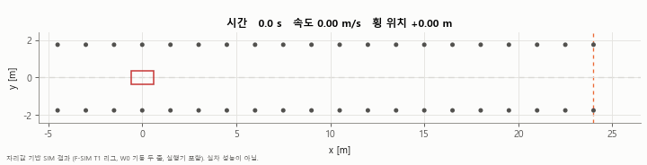

[SIM · 자리값] 빠른 SIM에서 열 추종을 위에서 본 모습(평지 기둥 두 줄 W0, `nominal` seed 0, 약 10배속).

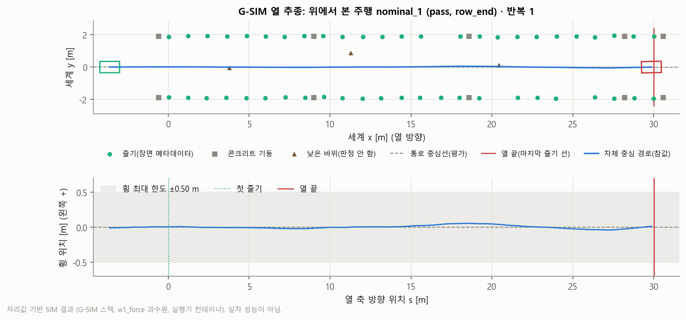

[SIM · 자리값] Gazebo 과수원 한 통로의 열 추종(참값 경로, `nominal_1`). 아래 칸은 횡 위치를 세로로 확대한 것이다. 영상 목록: [`steering/GSIM_MEDIA_KO.md`](steering/GSIM_MEDIA_KO.md).

## 9. SIM 대시보드

| 수동 조종 탭 | 자율주행 탭(달리는 중) | 조향 패널 |
|---|---|---|
| 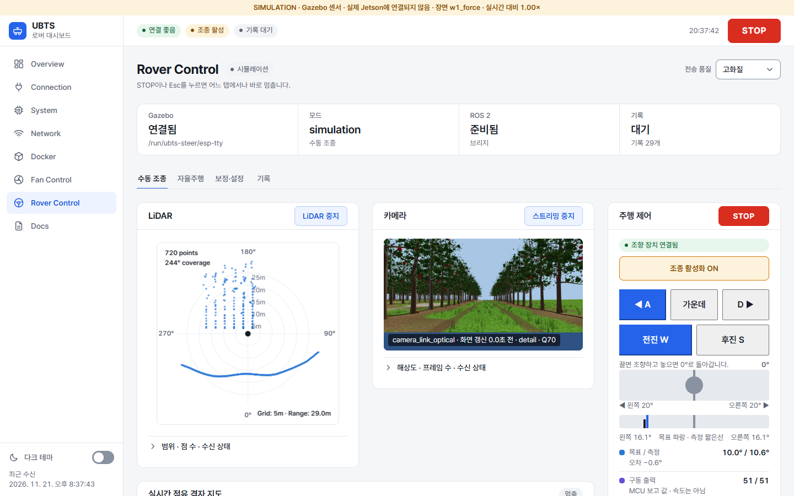 | 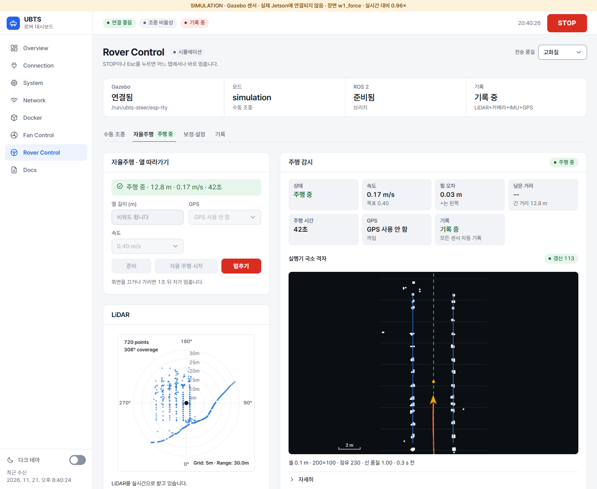 | 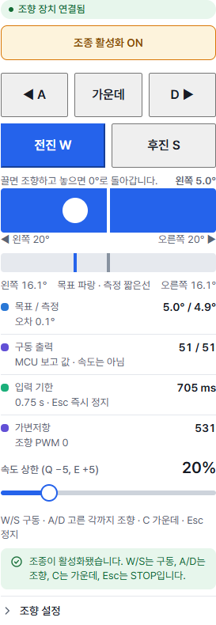 |
| [SIM · 자리값] Gazebo LiDAR, 차량 카메라, 조향 패널. W+A로 왼쪽 10° | [SIM · 자리값] 준비 → 자율 주행 시작으로 출발한 run(1분 47초 동안 33.3 m를 달려 열 끝에서 섬) | [SIM · 자리값] 막대를 끌어 왼쪽 5°(목표 5.0° / 측정 4.9°, 소프트 한계 16.1°) |

2026-11-21 SIM 대시보드(127.0.0.1:18090)를 측정 치수 차로 찍었다. 대시보드 자체는 [대시보드 저장소](https://github.com/2026-BTS-UNI-Car/unist_orachard_dashboard#readme)에 있고, 이 저장소에는 사본과 SIM 확장이 있다. 스택 운영: [`steering/STACK_OPERATIONS_KO.md`](steering/STACK_OPERATIONS_KO.md), [`steering/SIM_DASHBOARD_KO.md`](steering/SIM_DASHBOARD_KO.md).
