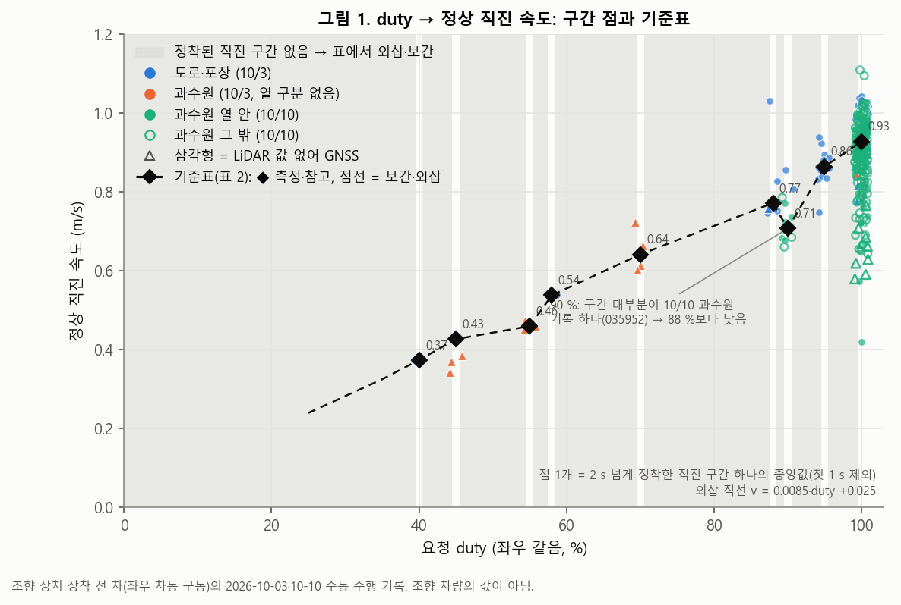
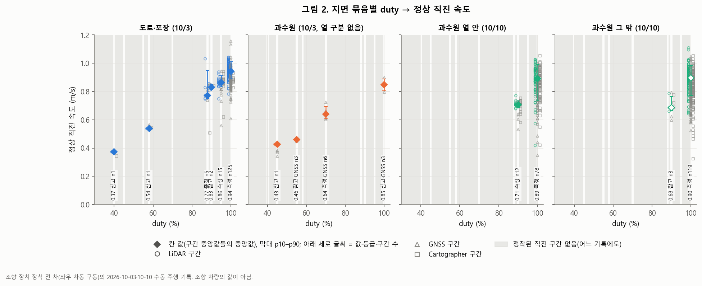
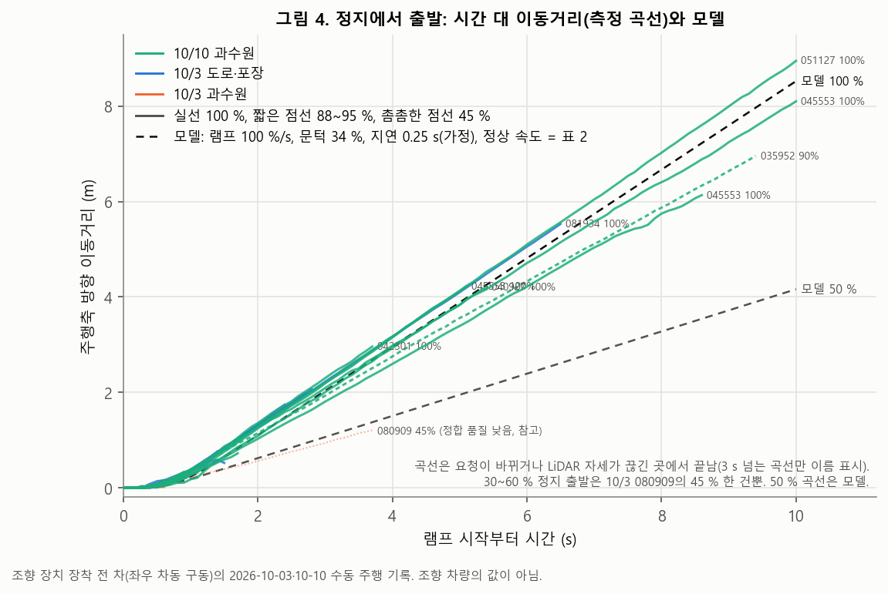
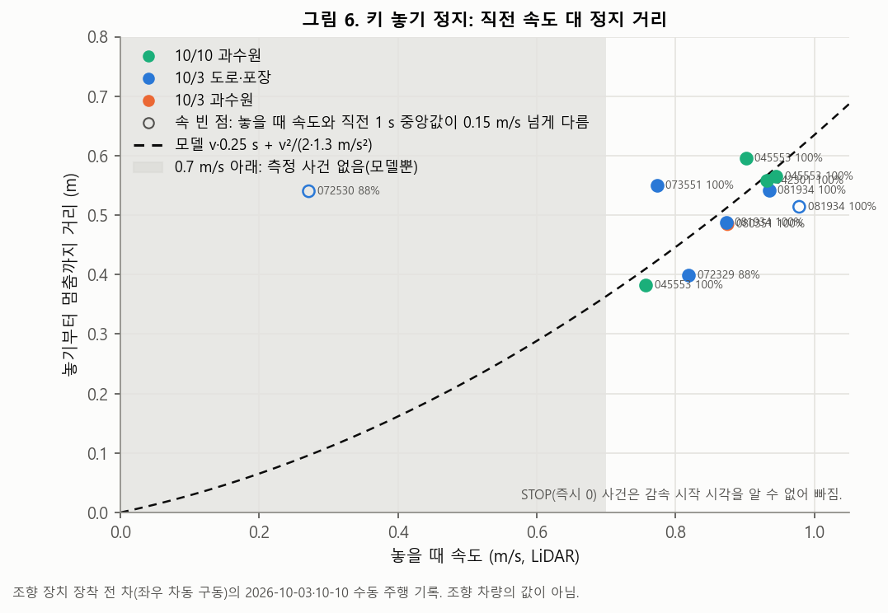
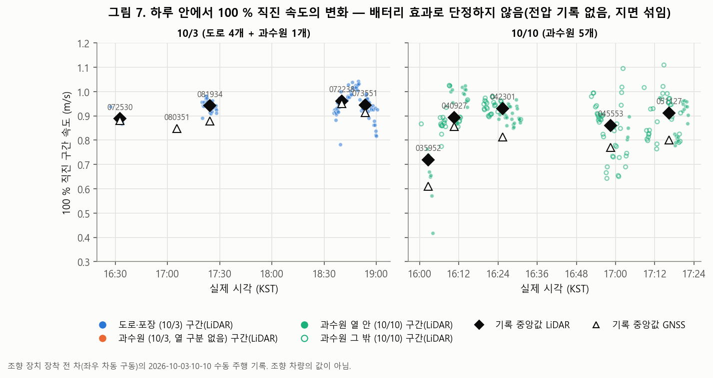

# PWM duty와 속도·출발·정지·이동거리 (PW-01 ~ PW-05)

> **이 문서의 모든 수치는 조향 장치를 달기 전 차의 값이다.** 2026-10-03·10-10에 좌우 차동 구동이던 차를 사람이 손으로 몰며 남긴 기록에서 쟀다. 앞바퀴 조향 장치(조향 모터, 링크, 무게)를 단 차의 같은 duty 속도는 다를 수 있고, 아직 잰 적이 없다. 조향 차량의 값은 현장 재보정(PW-11, PW-13) 뒤에 이 표를 바꿔 쓴다.

작성 2026-11-12. 분석 코드 `tools/drive_response/`, 표 `tables/`, 그림 `figures/`.

휠 엔코더는 없다. 아래 "속도"는 LiDAR 스캔 정합(오프라인 ICP)으로 잰 차체 이동 속도다. GNSS 속도(수신기 도플러, 안테나 지면 속도)와 Cartographer 경로 속도로 교차 확인했다. 어느 것도 줄자로 대조한 적이 없어 정답이 아니다. GNSS 좌표는 읽지도 쓰지도 않았다.

## 1. 다시 만드는 방법

저장소 맨 위에서 다음을 실행한다.

```
python -B tools/drive_response/run_all.py --config <설정 파일> --out <출력 폴더>
```

- 설정 파일은 `tools/drive_response/config.example.json`을 저장소 밖에 복사하고 `data_root`를 현장 자료가 있는 폴더로 바꿔 만든다. 환경 변수 `UBTS_DRIVE_RESPONSE_CONFIG`로 줘도 된다. 자료 위치는 이 파일 한 곳에만 있다. 현장 기록은 저장소에 넣지 않는다.
- 걸리는 시간은 약 10~20초다. 표(CSV, MD), 그림(PNG, SVG), `results.json`, `INPUTS.json`(입력 55개의 SHA-256, data_root 기준 상대 경로)을 출력 폴더에 쓴다.
- 필요한 것: Python 3.10 이상, numpy, matplotlib, 한글 글꼴(Malgun Gothic 또는 NanumBarunpen). `tools/field_calib/`가 옆에 있어야 한다.
- 이 폴더의 그림(PNG)과 표(MD)는 2026-11-12에 위 명령으로 만든 것이다. 입력 파일은 자료 폴더 이름 대신 설정 키 이름으로 적는다(예: `day1010_drive_extract/<파일>`). 첫 분석과 비교하면 표 1의 파일 칸과 입력 목록의 이름만 다르고, 나머지 표와 수치, 입력 해시는 같다.
- 자료 위치 바꾸기 확인: `python -B tools/drive_response/check_relocation.py --config <설정 파일> --out <출력 폴더> --work <임시 폴더>`. 입력을 다른 폴더로 복사하고 `data_root`만 바꿔 다시 만든 표와 결과 41개가 바이트까지 같았다.

## 2. 방법

**읽기(PW-02, load.py)**
- 모터 시간열은 `field_calib.records`로 읽는다.
  - 10/3: 전체 추출본의 원래 motor.jsonl(`motor_from_jsonl`).
  - 10/10: 압축 추출본 drive.json.gz(`motor_from_compact`).
- 10/3은 압축 추출본의 모터 줄도 읽어 원래 motor.jsonl과 대조했다. 7개 모두 줄 수·수신 시각·요청·보고값이 같다.
- LiDAR는 이미 있는 ICP 결과 lidar_motion.npz를 쓴다. 기존 기준값이 나온 바로 그 입력이며, 스캔을 다시 정합하지 않았다.
- GNSS에서는 수신 시각, 수신기 시각, 유효 표시, 속도, 속도 정확도, 기원 번호만 읽는다.
- 14개 기록 모두 열렸고 모터 줄 수와 시간 폭이 11/11 목록과 같다(표 0).

**지면(PW-01, ground.py)**
- 10/3은 기록 단위로 카메라 표본을 보고 판정했다.
- 10/10은 구간 단위로 나눴다.
  - Cartographer 노드를 시간으로 보간해 위치를 얻는다.
  - 회랑 카탈로그 회랑 안이면 "열 안"이다. 조건은 중심선에서 |d| < 행 간격/2 − 0.35 m이고 두 줄이 다 있는 구간 안일 것이다(카탈로그를 만든 코드의 규칙 그대로).
  - 이 코드가 센 회랑별 노드 수가 카탈로그의 nodes_inside와 30개 회랑 모두 같다.
  - 행 하나를 건너뛴 쌍(X_width) 3개와 중심선이 없는 쌍 1개는 쓰지 않았다.

**정상 속도 구간(PW-03, speed.py)**

결과를 보기 전에 정한 구간 규칙:
- 같은 요청(좌 = 우)이고 MCU 보고 duty가 요청과 2 %p 안인 2 Hz 상태가 끊김 없이 이어질 것(간격 ≤ 1.5 s, 무장 상태).
- 정착 시간 폭이 2 s 이상일 것. 재는 창은 [첫 상태 + 1 s, 마지막 상태]다.
- 창의 LiDAR yaw 중앙값이 2 °/s 이상이면 직진이 아니라고 보고 뺐다(100 % 72개, 95 % 2개, 88 % 1개).

구간마다 세 참조의 중앙값을 낸다.
- LiDAR: ±2 스캔 중심 차분 속도(품질 기준 inlier ≥ 0.5, rms ≤ 0.08, cond ≤ 60)를 주행축(10/10 −179.08°, 10/3 −179.21°)에 투영한다. 유효 표본 5개 이상, 창 안 스캔의 25 % 이상일 때만 값을 낸다.
- GNSS: 기원마다 하나, 2개 이상.
- Cartographer: 노드 3개 이상의 경로 길이 / 시간.

칸 값은 구간 중앙값들의 중앙값이다. 기준 참조는 LiDAR다. 그 duty에 LiDAR 값이 하나도 없으면 GNSS를 쓰고 표에 적었다.

등급은 넷이다.
- 측정: 구간 5개 이상.
- 참고: 1~4개.
- 보간: 측정된 duty 사이 직선.
- 외삽: 측정 범위 밖, 측정 duty의 직선 맞춤.

**출발·정지(PW-04, startstop.py)**
- 옛 근거 스크립트 start_onset_1010.py와 from_release.py의 규칙을 그대로 옮겨 두 날 모두에 돌렸다.
- 출발 조건: 1 s 넘게 요청 0, 보고 0, LiDAR 정지 뒤의 요청.
- 램프 시작과 감속 시작은 MCU 보고 duty로 역산했다(100 %/s).
- 움직임 = LiDAR 속도 > 0.05 m/s가 스캔 3개 연속.
- 멈춤 = 0.5 s 동안 0.03 m/s 미만.
- 이동거리는 램프 시작부터 주행축 방향 LiDAR 이동이다.

**세션 시간(PW-05, session.py)**
- 100 % 직진 구간을 실제 시각(KST) 순으로 놓는다.
- 기울기는 같은 날, 같은 지면 묶음 안에서만 낸다(구간 단위와 기록 중앙값 단위).

## 3. 기록 14개와 지면

실제 시각은 GNSS 수신기 UTC를 KST로 바꾼 값이다(072238·073551은 호스트 시계가 약 7,880 s, 10/10은 약 10,595 s 늦어 파일 이름과 다르다). 마지막 칸은 MCU 보고 duty가 요청과 2 %p 안으로 같은 상태가 이어진 직진 시간(duty: 초)이다.

| 날 | 기록 | 실제 시각 | 길이 s | 지면 | 정착 직진 (duty: 초) |
| --- | --- | --- | --- | --- | --- |
| 10/3 | 072329 | 16:23~16:25 | 92 | 도로·포장 | 88: 47.2 |
| 10/3 | 072530 | 16:25~16:34 | 525 | 도로·포장 | 100: 135.6, 95: 71.9, 88: 22.1, 58: 8.7, 90: 8.2, 40: 3.6, 45: 2.6 |
| 10/3 | 080351 | 17:03~17:07 | 247 | 과수원 | 100: 68.8, −100: 3.6 |
| 10/3 | 080909 | 17:09~17:12 | 210 | 과수원 | 70: 43.2, 55: 27.3, 45: 26.7, 95: 3.6 |
| 10/3 | 081934 | 17:19~17:28 | 545 | 도로·포장 | 100: 349.6, 90: 1.6 |
| 10/3 | 072238 | 18:33~18:46 | 782 | 도로·포장 | 100: 552.4, 95: 31.8, 90: 8.2 |
| 10/3 | 073551 | 18:47~19:00 | 814 | 도로·포장 | 100: 568.3 |
| 10/10 | 035952 | 15:56~16:04 | 476 | 과수원(열 안 76 %) | 100: 152.9, 90: 95.7 |
| 10/10 | 040927 | 16:06~16:14 | 528 | 과수원(48 %) | 100: 382.2 |
| 10/10 | 042151 | 16:18 | 3 | 과수원 | 없음(무장 해제, LiDAR 추출본 없음) |
| 10/10 | 042200 | 16:18~16:19 | 57 | 과수원(궤적 없음) | 100: 6.2 |
| 10/10 | 042301 | 16:19~16:31 | 689 | 과수원(43 %) | 100: 469.1 |
| 10/10 | 045553 | 16:52~17:04 | 748 | 과수원(9 %) | 100: 492.0 |
| 10/10 | 051127 | 17:08~17:23 | 906 | 과수원(24 %) | 100: 535.7 |

상세(지면 근거, 모터 줄 수, 파일 위치)는 [`tables/T1_recordings.md`](tables/T1_recordings.md), 열 안 비율의 상세는 [`tables/T1b_inrow.md`](tables/T1b_inrow.md)에 있다. 열 안 비율은 움직인 시간 기준이다.

판정 근거:
- **081934 → 도로·포장.** 카메라 표본(contact-00~02) 55장을 직접 봤다. 붉은 아스팔트 자전거길과 벽돌 보도에 가로수, 생울타리, 가로등, 표지판이 있다. 380~460 s는 도로변, 480~542 s는 상가 앞 보도와 주차장이다. 과수원 열은 없다. 가로수 길을 과수원으로 적은 문서가 있었던 것으로 보인다.
- **072530 → 도로·포장.** 52장. 2~360 s는 벽돌 보도(다리 위 보도 포함), 364~515 s는 아스팔트 차도다.
- 다른 10/3 기록도 contact-00을 확인했고 기존 라벨과 같다.
- 10/10 카메라 표본은 로컬에 없다.
- 10/10 "그 밖"에는 열 끝과 농로 외에 카탈로그에 없는 행간(짧은 행, 다른 방향 행)도 들어간다.

## 4. 기존 값 재현 (T8_reference_check)

| 항목 | 기대값 | 이번 값 | 판정 |
| --- | --- | --- | --- |
| 10/10 100 % (0.4 s 표본 중앙값) | 0.899 | 0.899 | 재현 |
| 10/10 90 % (0.4 s 표본 중앙값) | 0.715 | 0.715 | 재현 |
| 10/10 100 %, 구간 규칙 | 0.899 | 0.895 | ±0.01 안 |
| 10/10 90 %, 구간 규칙 | 0.715 | 0.705 | ±0.01 경계 |
| 출발 사건(움직임 잡힘) | 11건 | 11건 | 재현 |
| 출발 duty p50 / 시간 p50 | 34 % / 0.34 s | 34 % / 0.336 s | 재현 |
| 깨끗한 놓기 정지 거리 | 0.383, 0.559, 0.566, 0.595 m | 같음 | 재현 |

## 5. duty → 속도

**지면별 주 표**(`T3_speed_by_ground`): 칸 = 속도 m/s [등급, 구간 수]. 빈 칸과 "자료 없는 duty"는 그 지면에 정착된 직진 구간이 없다는 뜻이다.

| duty | 도로·포장 10/3 | 과수원 10/3 | 과수원 열 안 10/10 | 과수원 그 밖 10/10 |
| --- | --- | --- | --- | --- |
| 40 | 0.373 [참고 1] | | | |
| 45 | | 0.426 [참고 1] | | |
| 55 | | 0.459 [참고·GNSS 3] | | |
| 58 | 0.537 [참고 1] | | | |
| 70 | | 0.641 [측정·GNSS 6] | | |
| 88 | 0.771 [측정 5] | | | |
| 90 | 0.831 [참고 2] | | 0.706 [측정 12] | 0.685 [참고 3] |
| 95 | 0.864 [측정 15] | | | |
| 100 | 0.942 [측정 125] | 0.847 [참고·GNSS 3] | 0.892 [측정 78] | 0.896 [측정 119] |

자료 없는 duty(그림의 회색 띠, 표에서는 외삽): 0~39, 41~44, 46~54, 56~57, 59~69, 71~87, 89, 91~94, 96~99 %.

**합친 기준표**(`T2_speed_all`):

| duty | 등급 | 속도 m/s |
| --- | --- | --- |
| 25 / 30 / 35 | 외삽 | 0.239 / 0.282 / 0.324 |
| 40 | 참고 | 0.373 |
| 45 | 참고 | 0.426 |
| 50 | 보간 | 0.443 |
| 55 | 참고, GNSS | 0.459 |
| 58 | 참고 | 0.537 |
| 60 / 65 | 보간 | 0.555 / 0.598 |
| 70 | 측정, GNSS | 0.641 |
| 75 / 80 / 85 | 보간 | 0.677 / 0.713 / 0.750 |
| 88 | 측정 | 0.771 |
| 90 | 측정 | 0.707 |
| 95 | 측정 | 0.864 |
| 100 | 측정 | 0.928 (322구간; GNSS 0.857, Cartographer 0.864) |

- 외삽 직선: v = 0.00855·duty + 0.025.
- 합친 표라 90 %가 88 %보다 낮다. 90 % 구간 17개 중 15개가 10/10 035952이기 때문이다. 표를 매끈하게 고치지 않았다.
- 080909의 55·70 %는 LiDAR 정합 품질이 낮아 LiDAR 값이 없다. LiDAR 기준을 낮추지 않고 GNSS를 썼다. 참고로 0.4 s 표본 중앙값은 45 % 0.402, 55 % 0.517, 70 % 0.682다.
- 같은 구간에서 GNSS/LiDAR 0.933, Cartographer/LiDAR 0.974. 과수원에서는 GNSS/LiDAR가 0.90~0.91로 차이가 더 크다. 절대 눈금은 ±5~10 % 불확실하다.






## 6. 출발·정지·이동거리

**출발** (사건 / 움직임 잡힘 / 시간 p10·50·90 / duty p10·50·90 / 정상 속도 90 %까지 p10·50·90):

| 날 | 사건 | 잡힘 | 시간 s | duty % | 90 %까지 s |
| --- | --- | --- | --- | --- | --- |
| 10/3 | 14 | 7 | 0.19 / 0.23 / 1.39 | 19 / 23 / 100 | 1.05 / 1.23 / 1.83 |
| 10/10 | 12 | 11 | 0.15 / 0.34 / 1.46 | 15 / 34 / 90 | 1.18 / 1.33 / 2.75 |

- 요청은 88~100 %다. 예외는 080909 45 % 1건이며, 정합 품질 38 %라 참고로만 남겼다(2 s에 0.56 m).
- ±2 스캔 창 때문에 움직임 시각이 최대 약 0.2 s 이르게 잡힐 수 있다.

**놓기 정지** (속도가 일관된 깨끗한 사건 8건):
- 시작 속도 0.77~0.94 m/s.
- 거리 p10/50/90 0.394 / 0.546 / 0.575 m, 시간 0.81 / 0.89 / 0.90 s.
- 모델 v·0.25 + v²/2.6 대비 0.91 / 0.97 / 1.16.
- 제외: 072530 88 %(자세 흔들림), 080351(확인 표본 없음), 081934 1건. 사건 표에는 모두 남아 있다.
- 저속 정지와 STOP 제동은 미측정이다.

**이동거리** (T6_distance, 정지에서 출발해 T초 유지):
- 100 % 측정: 1 s 0.34 m(13건, 0.18~0.39), 2 s 1.29 m(9건, 1.03~1.36).
- 100 % 참고: 5 s 3.96 m(4건), 10 s 8.52 m(2건).
- 100 % 놓기 정지: 0.55 m(측정 7건). 모델은 0.56 m.
- 90 % 참고 1건: 1 s 0.38, 2 s 1.15, 5 s 3.56 m.
- 나머지 duty는 모델이다. 모델 조건: 램프 100 %/s, 출발 문턱 34 %, 1차 지연 0.25 s(가정), 정상 속도는 기준표. 모델은 1~2 s 거리를 0.1~0.2 m 짧게 낸다.
  - 모델 값 예(2 s / 10 s): 35 % 0.46 / 3.06 m, 45 % 0.60 / 4.01 m, 55 % 0.64 / 4.31 m, 70 % 0.85 / 5.98 m.
  - 30 %는 출발 문턱 아래라 비웠다.






## 7. 세션 시간

**배터리 효과로 단정하지 않는다.** 전압·전류 기록이 없고, 지면이 섞여 있고, duty가 거의 100 %뿐이고, 충전 상태를 모른다.

100 % 직진 구간의 기록 중앙값(LiDAR / GNSS, m/s):

| 날 | 기록(시각) | LiDAR | GNSS |
| --- | --- | --- | --- |
| 10/3 | 072530(16:27) | 0.888 | 0.880 |
| 10/3 | 081934(17:19) | 0.941 | 0.879 |
| 10/3 | 072238(18:35) | 0.961 | 0.951 |
| 10/3 | 073551(18:47) | 0.943 | 0.913 |
| 10/10 | 035952(16:00) | 0.719 | 0.611 |
| 10/10 | 040927(16:06) | 0.892 | 0.857 |
| 10/10 | 042301(16:19) | 0.930 | 0.814 |
| 10/10 | 045553(16:52) | 0.861 | 0.770 |
| 10/10 | 051127(17:08) | 0.912 | 0.800 |

마지막/첫 기록 비:
- 10/3: LiDAR 1.063, GNSS 1.037. 2시간 20분 동안 100 % 속도가 줄지 않았다.
- 10/10: LiDAR 1.268, GNSS 1.310. 열 안만 보면 1.323, 그 밖만 보면 1.042. 첫 기록 035952가 가장 느리다(배터리가 닳는 방향과 반대).

기울기(m/s/h, 구간 단위 / 기록 단위):

| 날, 묶음 | LiDAR | GNSS |
| --- | --- | --- |
| 10/3 도로 | +0.014 ± 0.005 / +0.024 ± 0.011 | +0.027 / +0.025 |
| 10/10 열 안 | +0.035 ± 0.025 / +0.061 ± 0.101 | `T7b_session_slopes.md` |
| 10/10 그 밖 | −0.035 ± 0.019 / +0.009 ± 0.033 | 기록 단위 −0.083 ± 0.051 |

- 구간 단위 표준오차는 같은 기록 안 구간들이 독립이 아니라 실제보다 작다.
- 결론: 10/3에는 감소가 없다. 10/10은 첫 기록이 가장 느리다. 배터리 영향의 크기와 035952가 느린 원인은 이 자료로 알 수 없다.




## 8. 그림·표 목록

그림(`figures/`, PNG. SVG는 다시 만들 때 같이 나온다): fig01_duty_speed, fig02_duty_speed_by_ground, fig03_duty_seconds_by_record, fig04_start_distance_time, fig05_start_onset, fig06_stop_distance, fig07_session_time, fig08_reference_compare, fig10_duty_hold_distance. 모든 그림 아래에 "조향 장치 장착 전 차(좌우 차동 구동)의 2026-10-03·10-10 수동 주행 기록. 조향 차량의 값이 아님."이 찍혀 있다. 그림 9(옛 직진 흔들림)는 범위 밖이라 만들지 않았다.

표(`tables/`, MD. CSV는 다시 만들 때 같이 나온다): T0 읽기 확인, T1 기록, T1b 열 안 비율, T2 기준표, T3 지면별(+full.csv), T3b 기록별, T3c 날짜별, T4/T4s 출발, T5/T5s 정지, T6 이동거리, T7/T7b/T7c 세션, T8 재현, T8b 참조 비교, T9 구간 목록, T10 자료 없는 duty. 다시 만들 때 함께 나오는 이어 붙인 사본 `ALL_TABLES.md`는 위 표와 같은 내용이라 저장소에 두지 않는다(2026-11-22).

## 9. 한계

- 조향 장착 전 차의 값이다.
- 자율주행 속도대(25~60 %)는 duty마다 구간 1~3개뿐이고, 모두 달리던 중 duty를 낮춘 것이다. 40 % 미만은 자료가 없다. 이 칸은 ±20 %를 넘게 틀릴 수 있다.
- 10/3 과수원의 낮은 duty는 GNSS에 기댔다. 이 날은 속도 정확도 칸이 없다.
- 속도 눈금이 참조끼리 3~10 % 다르다.
- 출발은 88~100 %뿐이고, 정지는 0.75~0.98 m/s 키 놓기뿐이다. STOP 제동과 저속 정지는 미측정이다.
- MCU 상태가 약 2 Hz라 명령 시각은 ±0.5 s다(램프 역산으로 약 0.1 s까지 좁힘).
- 스캔을 다시 정합하지 않았다.

## 10. 열린 질문 (막는 것 아님)

1. 구동 표 기본값(PW-07)을 어느 곡선으로 할지. 행간 주행이면 과수원 값이 맞아 보인다. 합친 기준표는 90 % 칸이 한 기록에 치우쳐 있다.
2. LiDAR와 GNSS가 3~10 % 다르다. 줄자 확인(PW-11)이 필요하다.
3. 035952가 왜 느렸는지는 10/10 카메라 표본(PW-14)이 있어야 알 수 있다.
4. 회랑 카탈로그에는 25 m 넘는 주 방향 행만 있어 10/10 '그 밖'에 미등록 행간이 섞인다. 045553의 9 %가 그 영향일 수 있다.
5. 080909를 field_calib ICP로 다시 정합하면 45~70 %의 LiDAR 값이 나올 수 있다. 하게 되면 옛 결과를 덮지 않고 별도 결과로 남긴다.
