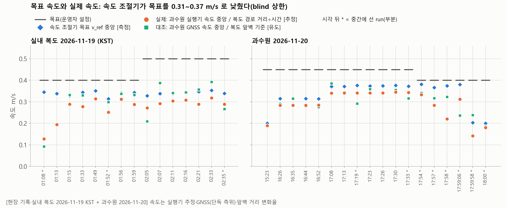
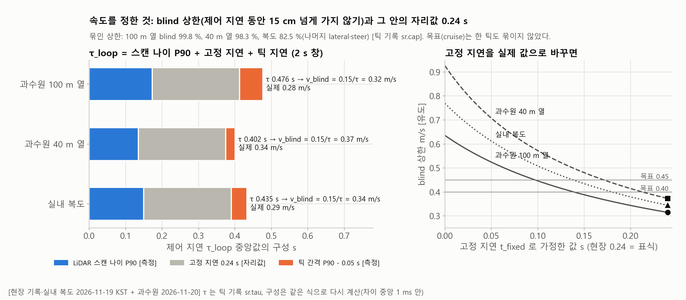
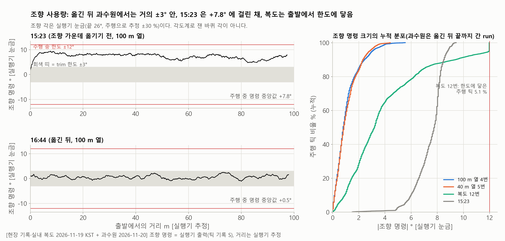
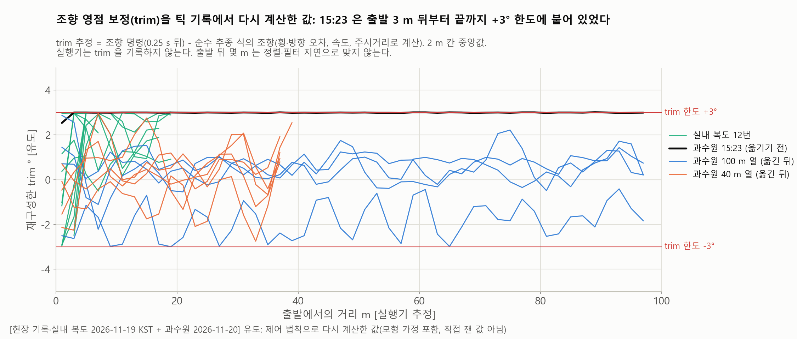
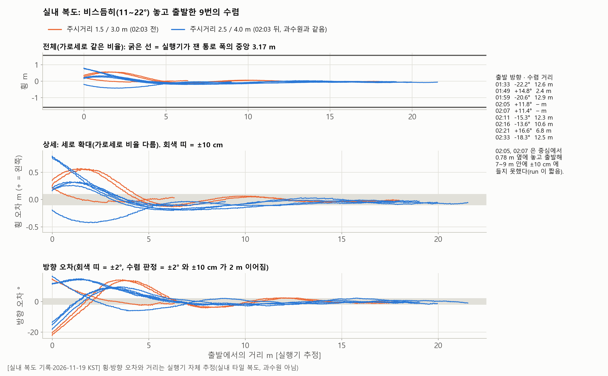
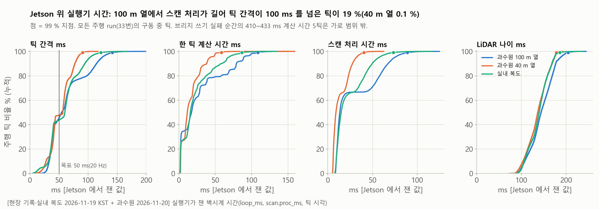
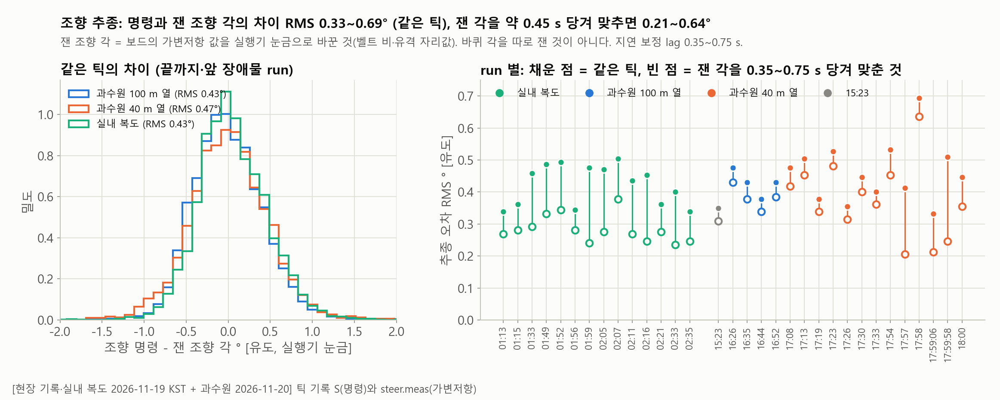
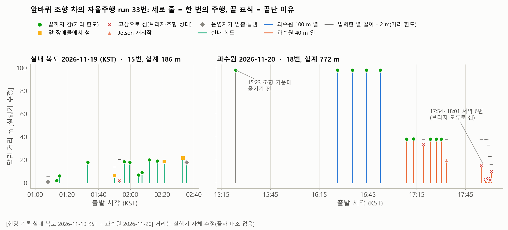
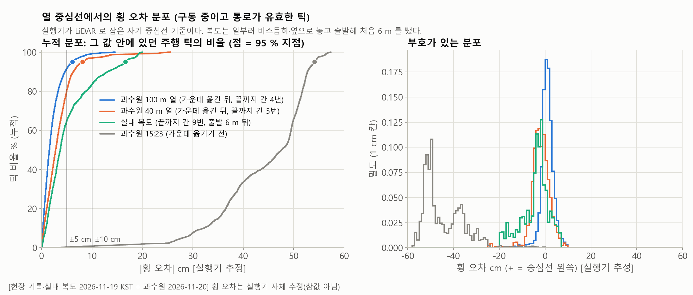
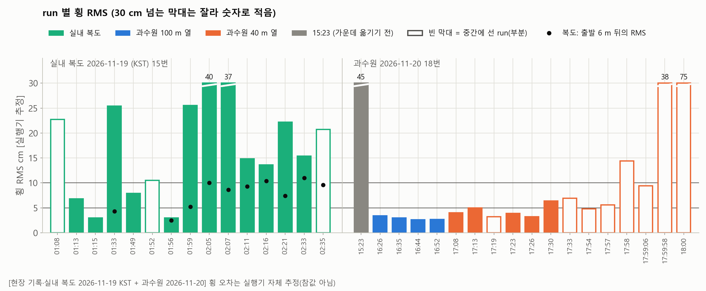

# 앞바퀴 조향 차의 자율주행 run 통합 분석 (실내 복도 2026-11-19 KST, 과수원 2026-11-20)

- 작성: 2026-11-22. 실차 주행 시험은 더 하지 않는다(사용자 결정 2026-11-22). 보고서의 토대가 되는 분석이다.
- 값 표지: **[설정]** 운영자 입력·설정 값, **[측정]** 시스템이 직접 잰 값(시각, 처리 시간, 끝 이유, 묶인 속도 상한, 가변저항 읽기), **[추정]** 실행기가 LiDAR 로 스스로 추정한 값, **[유도]** 이 분석에서 계산한 값.
- **참값이 아니다.** 횡 오차, 방향 오차, 거리, 속도, 통로 폭은 모두 실행기의 자체 추정이다. 이 분석을 쓸 때 줄자·측량으로 잰 기준은 두 날 모두 없었고, 다른 센서(GNSS 단독 측위, 스캔 원본, 앞벽 거리)와 맞춰 본 것만 "대조"로 적었다. 그 뒤(2026-11-22) 과수원의 줄자 행 폭(2026-11-20에 잼)과 맞춰 본 평가는 [`ORCHARD_MEASURED_KO.md`](ORCHARD_MEASURED_KO.md)에 있다(100 m 열 = 사과 2행, 40 m 열 = 배 1행, 실행기 통로 폭 − 줄자 −3.3·−7.5 cm) [실측·줄자 2026-11-20].
- GNSS 좌표는 읽어 내거나 적지 않았다. 틱 기록의 국소 위치(`rel_m`)는 읽는 순간 버렸고, GNSS 는 정확도·상태와 상대 거리·속도만 썼다.
- 조향 각은 실행기 눈금(끝 26°, 주행으로 추정한 값, ±30 %)이다. 각도계로 잰 바퀴 각이 아니고, 조향 사양 값은 모두 자리값이다.

## 1. 목적

앞바퀴 조향 차로 한 모든 자율주행 run(실내 복도 2026-11-19 01:08~02:36 KST, 과수원 2026-11-20 15:23~18:01)을 같은 정의로 한 표에 모으고, 보고서에 쓸 묶음 통계, 짧은 분석, 그림을 만든다. 앞선 문서들(과수원 결과, 복도 문서, GPS 비교, 알고리즘 문서)의 수치를 같은 원본에서 다시 내어 맞는지 확인하고, 다른 곳은 9절에 적었다.

## 2. 쓴 자료

| 자료 | 위치 | 쓴 것 |
|---|---|---|
| 복도 실행기 틱 기록 7개(01:06~02:36 KST) | 작업 폴더 `<runs>/sim_field_20261119/data/exec_logs/` | 틱(20 Hz)과 사건 줄 전부 |
| 과수원 실행기 틱 기록 10개(12:10~20:06) | 작업 폴더 `data/recordings/field-20261120/executor_logs/` | 주행이 있는 6개 파일(세 실행기 프로세스). 나머지 4개는 주행 틱이 0 임을 확인 |
| 과수원 교차 확인(bag 원본 20개에서 뽑은 값) | `<runs>/field_1120_notion/out/CHECKS.json`(도구 [`tools/field_records/`](../../tools/field_records/README_KO.md)) | GNSS 직선 거리·속도 중앙, 스캔 좌우 거리 차의 절반, 브리지 조향 오차 |
| 복도 앞벽 기준 속도 | `<runs>/sim_field_20261119/analysis/analysis_stdout.txt`(Q1) | run 별 앞벽 거리 변화율(사람이 앞에 있던 구간 뺌) |
| 정의와 설정 | [`docs/AUTONOMY_ALGORITHM_KO.md`](../AUTONOMY_ALGORITHM_KO.md) 9·10·12·15절, `tools/row_executor/run_metrics.py`, 틱 기록의 `config`·`tuning_change` 사건 | 지표 정의, 속도 상한, τ, trim |

- 실행기 프로세스(세션) 별 줄 수: C1606 6583줄, C1612 2717줄, C1615 19907줄, C1632 10429줄, C1642 4562줄, C1646 10696줄, C1655 49456줄, O1247 131074줄, O1613 87081줄, O1750 13960줄.
- 녹화(rosbag) 원본은 다시 읽지 않았다. bag 에서 나온 수치는 2026-11-21 의 추출 결과(CHECKS.json)를 그대로 썼다.

## 3. 방법

- **run**: 실행기의 `start` 사건 하나. 그중 구동 명령(throttle > 0)이 있는 ACTIVE 틱이 하나라도 있으면 "주행한 run"이다. 복도 15번, 과수원 18번, 합계 33번. 출발하지 않고 끝난 준비는 따로 셌다(복도 5, 과수원 60).
- **지표**: `run_metrics.py`와 같은 정의다. 주행 틱 = ACTIVE 이고 throttle > 0. 횡·방향 통계는 그중 통로가 유효한 틱. 시간 = 이어진 주행 틱 사이 간격의 합(0.5 s 넘는 틈은 0.5 s), 거리 = 추정기 경로 거리 증가분의 합. 과수원 run 은 실행기가 `run_end`에 남긴 값과 다시 낸 값이 횡 RMS 0.01 cm, 시간 0.1 s 안에서 같았다. 복도 run 은 그 기능 전이라 다시 낸 값만 있다.
- **6 m 뒤 횡 RMS**: 복도는 일부러 비스듬히·옆으로 놓고 출발했으므로 출발 6 m 뒤의 틱만으로도 냈다(SIM 판정의 6 m 규칙과 같은 자리).
- **구분**: 끝까지 = 거리 한도(입력한 열 길이 − 2 m)에서 섬. 앞 장애물 = 복도에서 앞 여유로 섬. 부분 = 고장(브리지 오류, 조향 상태 늦음), Jetson 재시작, 운영자 멈춤으로 중간에 섬.
- **조향 명령 RMS·한도 시간**: 주행 틱의 틱 기록 `S`(실행기 조향 출력, mrad). 한도는 주행 중 조향 한도 ±12°(209 mrad). **추종 오차**: `S` − 같은 틱의 `steer.meas`(보드 가변저항 → 실행기 눈금). 지연 보정은 잰 각을 0~1 s 당겨 RMS 가 가장 작은 값.
- **τ 구성**: 틱 기록 `sr.tau`를 2 s 창에서 "새 스캔을 처음 쓴 틱의 LiDAR 나이 P90 + 0.24 s + max(0, 틱 간격 P90 − 0.05 s)"로 다시 계산해 나눴다. 다시 낸 τ 와 기록된 τ 의 차이 중앙값은 0.9 ms 이하다.
- **trim 재구성**: 실행기는 trim 을 기록하지 않는다. 조향 명령(필터 지연 0.25 s 만큼 뒤 값)에서 순수 추종 식(`k_d = k_psi = 1`, 휠베이스 0.657 m, run 의 주시거리 설정, 속도 = max(LiDAR 속도, 1.5 s 경로 변화율))으로 계산한 조향을 빼서 추정했다. 모형 가정이 들어간 [유도] 값이다.

## 4. 한눈에

| 항목 | 값 |
|---|---|
| 주행한 run | 33번(복도 15, 과수원 18) [측정] |
| 달린 거리 합 | 957.5 m(복도 185.8, 과수원 771.8) [추정] |
| 주행 시간 합 | 55.5 분(복도 10.5, 과수원 45.0) [측정] |
| 끝까지 간 run | 과수원 10번(98 m 다섯 번, 38 m 다섯 번), 복도 9번(+ 앞 장애물에서 선 것 3번) [측정] |
| 과수원, 조향 가운데를 옮긴 뒤 끝까지 간 9번 | 횡 RMS 2.6~6.4 cm(run 별), 모은 RMS 3.59 cm, 횡 절댓값 95 % 지점 6.9 cm, ±5 cm 안 88.1 %, ±10 cm 안 98.4 %, 최대 25.6 cm [추정] |
| 그 가운데 100 m 열 4번 / 40 m 열 5번 | 모은 횡 RMS 2.93 / 4.63 cm, 방향 RMS 0.99 / 1.38° [추정] |
| 과수원 15:23(가운데 옮기기 전) | 횡 RMS 45.0 cm, 평균 -44.1 cm, 조향 명령 중앙 +7.8° [추정] |
| 복도, 끝까지 간 9번의 출발 6 m 뒤 | 모은 횡 RMS 7.18 cm, 평균 -4.2 cm, ±10 cm 안 83.6 % [추정] |
| 속도 | 목표 0.45 m/s(과수원 오후 12번)·0.40(저녁 6번), 실제 100 m 열 0.284, 40 m 열 0.341 m/s [추정]. 묶인 상한은 blind(99.8 % / 98.3 %) [측정] |
| 조향 사용량(과수원 옮긴 뒤) | 명령 RMS 1.42°(100 m)·1.38°(40 m), 명령 절댓값 95 % 지점 3.0°·2.8°, ±12° 한도에 닿은 틱 0 [유도] |
| 조향 추종 오차(명령 − 잰 각) | run 별 RMS 0.33~0.69°, 잰 각을 0.35~0.75 s 당겨 맞추면 0.21~0.64° [유도] |
| Jetson 틱 간격 | p50 54.6~60.0 ms, p99 90.6(40 m 열)~141.8 ms(100 m 열), 100 ms 넘은 틱 19.2 %(100 m 열) [측정] |
| 주행 중 멈춤 | 끝까지 간 run 모두 일시정지 0, 신선도 사건 0 [측정]. 고장으로 선 run: 과수원 브리지 오류 7, 복도 조향 상태 늦음 1, 과수원 Jetson 재시작 1 |

## 5. run 표

전체 칸은 `runs_table.csv`(같은 내용 + 대조·보조 칸)와 `runs_table.md`에 있다. 아래는 같은 표다.

### 5.1 주행과 끝

| 날짜 [설정] | 출발 KST [측정] | 곳 [설정] | 열 길이 입력 m [설정] | GPS [설정] | 목표 m/s [설정] | 주시거리 바닥/상한 m [설정] | 거리 m [추정] | 주행 시간 s [측정] | 속도 중앙 m/s [추정] | 평균 속도 m/s(거리/시간) [유도] | 대조 속도 m/s(과수원 GNSS·복도 앞벽) [유도] | 끝난 이유 [측정] | 구분 [유도] |
|---|---|---|---|---|---|---|---|---|---|---|---|---|---|
| 2026-11-19 | 01:08:01 | 실내 복도 | 8.0 | 층 없음 | 0.4 | 1.5/3.0 | 1.03 | 8.0 | 0.017 | 0.128 | 0.0926 | 운영자 끝내기 | 부분(운영자) |
| 2026-11-19 | 01:13:33 | 실내 복도 | 4.0 | 층 없음 | 0.4 | 1.5/3.0 | 2.03 | 9.9 | 0.06 | 0.194 | – | 거리 한도(열 길이 − 2 m) | 끝까지 |
| 2026-11-19 | 01:15:19 | 실내 복도 | 8.0 | 층 없음 | 0.4 | 1.5/3.0 | 6.07 | 20.7 | 0.124 | 0.289 | 0.3318 | 거리 한도(열 길이 − 2 m) | 끝까지 |
| 2026-11-19 | 01:33:09 | 실내 복도 | 20.0 | 층 없음 | 0.4 | 1.5/3.0 | 18.05 | 64.5 | 0.148 | 0.278 | 0.3303 | 거리 한도(열 길이 − 2 m) | 끝까지 |
| 2026-11-19 | 01:49:50 | 실내 복도 | 16.0 | 층 없음 | 0.4 | 1.5/3.0 | 6.49 | 20.2 | 0.214 | 0.314 | 0.3145 | 앞 장애물 | 앞 장애물에서 섬 |
| 2026-11-19 | 01:52:57 | 실내 복도 | 22.5 | 층 없음 | 0.4 | 1.5/3.0 | 1.95 | 7.7 | 0.195 | 0.251 | 0.2984 | 조향 상태 늦음 | 부분(고장) |
| 2026-11-19 | 01:56:05 | 실내 복도 | 20.5 | 층 없음 | 0.4 | 1.5/3.0 | 18.56 | 59.2 | 0.147 | 0.312 | 0.337 | 거리 한도(열 길이 − 2 m) | 끝까지 |
| 2026-11-19 | 01:59:39 | 실내 복도 | 20.0 | 층 없음 | 0.4 | 1.5/3.0 | 18.07 | 62.5 | 0.16 | 0.288 | 0.3314 | 거리 한도(열 길이 − 2 m) | 끝까지 |
| 2026-11-19 | 02:05:05 | 실내 복도 | 9.0 | 층 없음 | 0.5 | 2.5/4.0 | 7.01 | 25.6 | 0.161 | 0.272 | 0.2096 | 거리 한도(열 길이 − 2 m) | 끝까지 |
| 2026-11-19 | 02:07:16 | 실내 복도 | 11.0 | 층 없음 | 0.5 | 2.5/4.0 | 9.05 | 30.7 | 0.152 | 0.292 | 0.3868 | 거리 한도(열 길이 − 2 m) | 끝까지 |
| 2026-11-19 | 02:11:50 | 실내 복도 | 22.0 | 층 없음 | 0.5 | 2.5/4.0 | 20.05 | 65.6 | 0.155 | 0.304 | 0.3413 | 거리 한도(열 길이 − 2 m) | 끝까지 |
| 2026-11-19 | 02:16:51 | 실내 복도 | 21.0 | 층 없음 | 0.5 | 2.5/4.0 | 19.06 | 61.8 | 0.162 | 0.308 | 0.3438 | 거리 한도(열 길이 − 2 m) | 끝까지 |
| 2026-11-19 | 02:21:10 | 실내 복도 | 21.0 | 층 없음 | 0.5 | 2.5/4.0 | 18.77 | 64.4 | 0.134 | 0.289 | 0.3574 | 앞 장애물 | 앞 장애물에서 섬 |
| 2026-11-19 | 02:33:00 | 실내 복도 | – | 층 없음 | 0.5 | 2.5/4.0 | 21.75 | 67.8 | 0.185 | 0.318 | 0.3924 | 앞 장애물 | 앞 장애물에서 섬 |
| 2026-11-19 | 02:35:22 | 실내 복도 | – | 층 없음 | 0.5 | 2.5/4.0 | 17.81 | 61.6 | 0.139 | 0.289 | 0.267 | 운영자 멈춤 | 부분(운영자) |
| 2026-11-20 | 15:23:35 | 과수원 100 m 열 | 100.0 | 끔 | 0.45 | 2.5/4.0 | 98.02 | 479.1 | 0.189 | 0.203 | – | 거리 한도(열 길이 − 2 m) | 끝까지; 가운데 옮기기 전 |
| 2026-11-20 | 16:26:14 | 과수원 100 m 열 | 100.0 | 끔 | 0.45 | 2.5/4.0 | 98.03 | 336.6 | 0.284 | 0.291 | 0.291 | 거리 한도(열 길이 − 2 m) | 끝까지 |
| 2026-11-20 | 16:35:26 | 과수원 100 m 열 | 100.0 | 켬(단독 측위) | 0.45 | 2.5/4.0 | 98.03 | 335.2 | 0.284 | 0.292 | 0.315 | 거리 한도(열 길이 − 2 m) | 끝까지 |
| 2026-11-20 | 16:44:05 | 과수원 100 m 열 | 100.0 | 끔 | 0.45 | 2.5/4.0 | 98.02 | 334.7 | 0.284 | 0.293 | 0.279 | 거리 한도(열 길이 − 2 m) | 끝까지 |
| 2026-11-20 | 16:52:26 | 과수원 100 m 열 | 100.0 | 켬(단독 측위) | 0.45 | 2.5/4.0 | 98.04 | 336.7 | 0.285 | 0.291 | 0.276 | 거리 한도(열 길이 − 2 m) | 끝까지 |
| 2026-11-20 | 17:08:46 | 과수원 40 m 열 | 40.0 | 끔 | 0.45 | 2.5/4.0 | 38.04 | 112.8 | 0.34 | 0.337 | 0.385 | 거리 한도(열 길이 − 2 m) | 끝까지 |
| 2026-11-20 | 17:13:03 | 과수원 40 m 열 | 40.2 | 켬(단독 측위) | 0.45 | 2.5/4.0 | 38.23 | 114.6 | 0.341 | 0.333 | 0.338 | 거리 한도(열 길이 − 2 m) | 끝까지 |
| 2026-11-20 | 17:19:07 | 과수원 40 m 열 | 40.0 | 끔 | 0.45 | 2.5/4.0 | 33.33 | 99.8 | 0.341 | 0.333 | 0.292 | 브리지 오류 | 부분(고장) |
| 2026-11-20 | 17:23:17 | 과수원 40 m 열 | 40.0 | 끔 | 0.45 | 2.5/4.0 | 38.02 | 113.6 | 0.341 | 0.334 | 0.359 | 거리 한도(열 길이 − 2 m) | 끝까지 |
| 2026-11-20 | 17:26:53 | 과수원 40 m 열 | 40.0 | 켬(단독 측위) | 0.45 | 2.5/4.0 | 38.03 | 111.9 | 0.341 | 0.339 | 0.343 | 거리 한도(열 길이 − 2 m) | 끝까지 |
| 2026-11-20 | 17:30:02 | 과수원 40 m 열 | 40.0 | 끔 | 0.45 | 2.5/4.0 | 38.02 | 111.6 | 0.345 | 0.34 | 0.355 | 거리 한도(열 길이 − 2 m) | 끝까지 |
| 2026-11-20 | 17:33:15 | 과수원 40 m 열 | 40.0 | 켬(단독 측위) | 0.45 | 2.5/4.0 | 19.76 | 59.2 | 0.343 | 0.334 | 0.316 | Jetson 재시작(기록 끊김) | 부분(재시작); 기록 잘림 |
| 2026-11-20 | 17:54:36 | 과수원 40 m 열 | 40.0 | 켬(단독 측위) | 0.4 | 2.5/4.0 | 15.17 | 47.3 | 0.333 | 0.315 | 0.341 | 브리지 오류 | 부분(고장); 저녁 |
| 2026-11-20 | 17:57:09 | 과수원 40 m 열 | 40.0 | 켬(단독 측위) | 0.4 | 2.5/4.0 | 3.02 | 11.9 | 0.284 | 0.25 | 0.317 | 브리지 오류 | 부분(고장); 저녁 |
| 2026-11-20 | 17:58:00 | 과수원 40 m 열 | 40.0 | 켬(단독 측위) | 0.4 | 2.5/4.0 | 3.5 | 14.8 | 0.22 | 0.227 | 0.323 | 브리지 오류 | 부분(고장); 저녁, 뒤에 사람 |
| 2026-11-20 | 17:59:06 | 과수원 40 m 열 | 35.0 | 켬(단독 측위) | 0.4 | 2.5/4.0 | 4.01 | 13.7 | 0.312 | 0.274 | 0.236 | 브리지 오류 | 부분(고장); 저녁, 뒤에 사람 |
| 2026-11-20 | 17:59:58 | 과수원 40 m 열 | 25.0 | 켬(단독 측위) | 0.4 | 2.5/4.0 | 2.44 | 15.5 | 0.142 | 0.156 | 0.238 | 브리지 오류 | 부분(고장); 저녁, 뒤에 사람 |
| 2026-11-20 | 18:00:47 | 과수원 40 m 열 | 18.0 | 켬(단독 측위) | 0.4 | 2.5/4.0 | 10.05 | 48.5 | 0.18 | 0.207 | 0.186 | 브리지 오류 | 부분(고장); 저녁, 뒤에 사람 |

### 5.2 열 추종과 조향

| 날짜 [설정] | 출발 KST [측정] | 곳 [설정] | 횡 RMS cm [추정] | 횡 평균 cm [추정] | 횡 최대 cm [추정] | ±5 cm 안 % [추정] | ±10 cm 안 % [추정] | 6 m 뒤 횡 RMS cm [추정] | 방향 RMS ° [추정] | 방향 최대 ° [추정] | 조향 명령 RMS ° [유도] | ±12° 한도 시간 % [유도] | 조향 추종 오차 RMS mrad [유도] | 지연 보정 추종 RMS mrad [유도] |
|---|---|---|---|---|---|---|---|---|---|---|---|---|---|---|
| 2026-11-19 | 01:08:01 | 실내 복도 | 22.7 | -22.6 | 25.8 | 0.0 | 0.0 | – | 2.41 | 3.75 | 5.55 | 0.0 | – | – |
| 2026-11-19 | 01:13:33 | 실내 복도 | 6.8 | -6.6 | 9.1 | 26.7 | 100.0 | – | 0.98 | 1.61 | 1.53 | 0.0 | 5.9 | 4.7 |
| 2026-11-19 | 01:15:19 | 실내 복도 | 3.0 | -2.7 | 4.5 | 100.0 | 100.0 | – | 0.39 | 0.8 | 1.24 | 0.0 | 6.3 | 4.9 |
| 2026-11-19 | 01:33:09 | 실내 복도 | 25.4 | 12.8 | 56.6 | 48.0 | 67.2 | 4.3 | 7.71 | 22.22 | 6.72 | 19.95 | 8.0 | 5.1 |
| 2026-11-19 | 01:49:50 | 실내 복도 | 7.9 | 2.3 | 23.1 | 75.9 | 84.2 | – | 6.32 | 14.79 | 5.0 | 0.0 | 8.5 | 5.8 |
| 2026-11-19 | 01:52:57 | 실내 복도 | 10.5 | 10.0 | 13.9 | 11.3 | 46.0 | – | 2.19 | 4.02 | 2.72 | 0.0 | 8.6 | 6.0 |
| 2026-11-19 | 01:56:05 | 실내 복도 | 3.0 | -0.1 | 7.1 | 88.7 | 100.0 | 2.5 | 1.41 | 3.94 | 1.76 | 0.0 | 6.0 | 4.9 |
| 2026-11-19 | 01:59:39 | 실내 복도 | 25.5 | 11.2 | 57.2 | 51.4 | 61.5 | 5.2 | 7.15 | 20.65 | 6.51 | 17.19 | 8.3 | 4.2 |
| 2026-11-19 | 02:05:05 | 실내 복도 | 39.5 | 23.7 | 79.8 | 12.3 | 40.6 | 10.0 | 9.91 | 14.35 | 4.4 | 0.0 | 8.2 | 4.8 |
| 2026-11-19 | 02:07:16 | 실내 복도 | 36.6 | 18.8 | 77.8 | 12.2 | 37.0 | 8.6 | 9.38 | 14.95 | 4.33 | 0.0 | 8.8 | 6.6 |
| 2026-11-19 | 02:11:50 | 실내 복도 | 14.8 | -0.0 | 33.1 | 27.5 | 52.4 | 9.3 | 4.82 | 15.41 | 4.88 | 0.0 | 7.6 | 4.7 |
| 2026-11-19 | 02:16:51 | 실내 복도 | 13.6 | -2.7 | 26.3 | 39.3 | 49.0 | 10.4 | 4.37 | 13.68 | 4.7 | 0.0 | 7.9 | 4.3 |
| 2026-11-19 | 02:21:10 | 실내 복도 | 22.2 | -17.7 | 42.5 | 10.6 | 45.6 | 7.4 | 5.4 | 16.67 | 5.72 | 4.05 | 6.3 | 4.8 |
| 2026-11-19 | 02:33:00 | 실내 복도 | 15.4 | -1.9 | 32.8 | 24.0 | 44.9 | 11.0 | 5.46 | 18.28 | 5.43 | 3.07 | 7.0 | 4.1 |
| 2026-11-19 | 02:35:22 | 실내 복도 | 20.7 | -16.1 | 40.4 | 24.8 | 40.9 | 9.6 | 2.56 | 5.9 | 4.49 | 0.0 | 5.9 | 4.3 |
| 2026-11-20 | 15:23:35 | 과수원 100 m 열 | 45.0 | -44.1 | 57.4 | 0.4 | 0.9 | 45.7 | 1.34 | 5.58 | 7.52 | 0.0 | 6.1 | 5.4 |
| 2026-11-20 | 16:26:14 | 과수원 100 m 열 | 3.4 | 1.3 | 9.9 | 86.6 | 100.0 | 3.4 | 1.27 | 5.83 | 2.22 | 0.0 | 8.3 | 7.5 |
| 2026-11-20 | 16:35:26 | 과수원 100 m 열 | 3.0 | 0.8 | 14.3 | 91.3 | 98.4 | 2.2 | 1.07 | 6.09 | 1.18 | 0.0 | 7.5 | 6.6 |
| 2026-11-20 | 16:44:05 | 과수원 100 m 열 | 2.6 | 0.9 | 14.4 | 93.8 | 99.8 | 2.3 | 0.71 | 2.74 | 0.91 | 0.0 | 6.6 | 5.9 |
| 2026-11-20 | 16:52:26 | 과수원 100 m 열 | 2.7 | 0.6 | 14.6 | 95.4 | 98.4 | 1.8 | 0.83 | 3.73 | 0.98 | 0.0 | 7.5 | 6.7 |
| 2026-11-20 | 17:08:46 | 과수원 40 m 열 | 4.0 | -2.0 | 7.8 | 77.4 | 100.0 | 4.0 | 1.18 | 3.5 | 1.43 | 0.0 | 8.3 | 7.3 |
| 2026-11-20 | 17:13:03 | 과수원 40 m 열 | 5.0 | -2.2 | 14.2 | 73.7 | 92.5 | 4.8 | 1.73 | 4.31 | 1.82 | 0.0 | 8.8 | 7.9 |
| 2026-11-20 | 17:19:07 | 과수원 40 m 열 | 3.2 | -2.3 | 8.2 | 87.5 | 100.0 | 3.0 | 0.98 | 3.06 | 0.88 | 0.0 | 6.6 | 5.9 |
| 2026-11-20 | 17:23:17 | 과수원 40 m 열 | 3.9 | -1.1 | 9.3 | 79.3 | 100.0 | 4.0 | 1.42 | 4.5 | 1.46 | 0.0 | 9.2 | 8.4 |
| 2026-11-20 | 17:26:53 | 과수원 40 m 열 | 3.2 | -1.1 | 9.5 | 88.3 | 100.0 | 2.6 | 1.11 | 3.04 | 1.06 | 0.0 | 6.2 | 5.5 |
| 2026-11-20 | 17:30:02 | 과수원 40 m 열 | 6.4 | -3.6 | 25.6 | 85.5 | 92.4 | 2.9 | 1.35 | 4.22 | 0.93 | 0.0 | 7.8 | 7.0 |
| 2026-11-20 | 17:33:15 | 과수원 40 m 열 | 6.9 | -3.8 | 19.6 | 67.1 | 88.5 | 4.3 | 1.49 | 3.96 | 1.23 | 0.0 | 7.0 | 6.3 |
| 2026-11-20 | 17:54:36 | 과수원 40 m 열 | 4.8 | -1.5 | 10.6 | 64.7 | 99.3 | 5.7 | 2.75 | 7.49 | 2.94 | 0.0 | 9.3 | 7.9 |
| 2026-11-20 | 17:57:09 | 과수원 40 m 열 | 5.6 | 5.4 | 9.1 | 36.1 | 100.0 | – | 0.93 | 2.12 | 0.95 | 0.0 | 7.2 | 3.6 |
| 2026-11-20 | 17:58:00 | 과수원 40 m 열 | 14.4 | -8.3 | 28.6 | 50.5 | 63.1 | – | 1.62 | 2.74 | 3.44 | 0.0 | 12.1 | 11.1 |
| 2026-11-20 | 17:59:06 | 과수원 40 m 열 | 9.4 | 8.5 | 14.6 | 23.8 | 55.0 | – | 2.13 | 3.3 | 0.91 | 0.0 | 5.8 | 3.7 |
| 2026-11-20 | 17:59:58 | 과수원 40 m 열 | 37.8 | 37.4 | 42.9 | 0.0 | 0.0 | – | 4.8 | 8.78 | 7.44 | 0.0 | 8.9 | 4.3 |
| 2026-11-20 | 18:00:47 | 과수원 40 m 열 | 74.9 | -66.1 | 104.4 | 0.0 | 12.7 | 14.1 | 9.73 | 18.01 | 8.36 | 33.93 | 7.8 | 6.2 |

### 5.3 속도 상한, 시간, 고장

| 날짜 [설정] | 출발 KST [측정] | 곳 [설정] | 묶인 속도 상한(틱 %) [측정] | τ 중앙 s [측정] | 틱 간격 p50 ms [측정] | 틱 간격 p99 ms [측정] | 스캔 처리 p50 ms [측정] | 스캔 처리 p99 ms [측정] | 고장·멈춤 [측정] |
|---|---|---|---|---|---|---|---|---|---|
| 2026-11-19 | 01:08:01 | 실내 복도 | lateral 85.1 blind 14.9 | 0.432 | 59.6 | 108.5 | 14.1 | 60.0 | 0 |
| 2026-11-19 | 01:13:33 | 실내 복도 | blind 100 | 0.444 | 60.4 | 114.3 | 14.9 | 64.6 | 0 |
| 2026-11-19 | 01:15:19 | 실내 복도 | blind 100 | 0.455 | 60.8 | 117.1 | 15.3 | 67.6 | 0 |
| 2026-11-19 | 01:33:09 | 실내 복도 | blind 69.6 lateral 24.8 steer 5.6 | 0.428 | 60.2 | 123.4 | 15.5 | 64.9 | 0 |
| 2026-11-19 | 01:49:50 | 실내 복도 | blind 94.5 lateral 3.7 stop 1.7 | 0.427 | 59.6 | 118.6 | 13.1 | 71.3 | 0 |
| 2026-11-19 | 01:52:57 | 실내 복도 | blind 100 | 0.478 | 57.1 | 137.4 | 17.7 | 86.3 | 0 |
| 2026-11-19 | 01:56:05 | 실내 복도 | blind 100 | 0.441 | 59.7 | 118.9 | 15.2 | 70.8 | 0 |
| 2026-11-19 | 01:59:39 | 실내 복도 | blind 71.6 lateral 25.6 steer 2.9 | 0.435 | 59.4 | 124.9 | 14.9 | 75.3 | 0 |
| 2026-11-19 | 02:05:05 | 실내 복도 | blind 59 lateral 41 | 0.438 | 59.0 | 123.3 | 14.6 | 71.8 | 0 |
| 2026-11-19 | 02:07:16 | 실내 복도 | blind 64 lateral 36 | 0.438 | 59.8 | 111.5 | 13.3 | 63.2 | 0 |
| 2026-11-19 | 02:11:50 | 실내 복도 | blind 87.1 lateral 8.5 steer 4.4 | 0.44 | 59.5 | 127.9 | 15.0 | 74.1 | 0 |
| 2026-11-19 | 02:16:51 | 실내 복도 | blind 99.6 steer 0.4 | 0.437 | 60.6 | 113.8 | 14.8 | 65.1 | 0 |
| 2026-11-19 | 02:21:10 | 실내 복도 | blind 68.1 lateral 23.5 steer 7.8 | 0.432 | 60.7 | 114.3 | 15.7 | 64.9 | 0 |
| 2026-11-19 | 02:33:00 | 실내 복도 | blind 89.2 lateral 5.1 steer 5.1 | 0.425 | 60.5 | 127.2 | 14.8 | 82.9 | 0 |
| 2026-11-19 | 02:35:22 | 실내 복도 | blind 75.2 lateral 24.8 | 0.435 | 60.0 | 126.9 | 14.5 | 84.4 | 운영자 멈춤 뒤 구동 거절 1 |
| 2026-11-20 | 15:23:35 | 과수원 100 m 열 | lateral 94.3 blind 5.4 scan 0.4 | 0.471 | 57.1 | 138.1 | 13.7 | 86.1 | 0 |
| 2026-11-20 | 16:26:14 | 과수원 100 m 열 | blind 100 | 0.477 | 54.3 | 142.2 | 12.9 | 90.4 | 0 |
| 2026-11-20 | 16:35:26 | 과수원 100 m 열 | blind 99.8 scan 0.2 | 0.476 | 53.8 | 144.1 | 13.8 | 88.6 | 0 |
| 2026-11-20 | 16:44:05 | 과수원 100 m 열 | blind 99.4 scan 0.6 | 0.475 | 53.1 | 142.9 | 12.8 | 91.2 | 0 |
| 2026-11-20 | 16:52:26 | 과수원 100 m 열 | blind 100 | 0.477 | 53.7 | 141.0 | 13.8 | 88.2 | 0 |
| 2026-11-20 | 17:08:46 | 과수원 40 m 열 | blind 100 | 0.404 | 56.6 | 90.9 | 9.6 | 38.6 | 0 |
| 2026-11-20 | 17:13:03 | 과수원 40 m 열 | blind 98.6 end 0.9 quality 0.5 | 0.404 | 56.7 | 91.8 | 9.3 | 41.3 | 0 |
| 2026-11-20 | 17:19:07 | 과수원 40 m 열 | blind 99.1 quality 0.9 | 0.399 | 56.5 | 90.9 | 9.2 | 40.3 | bridge_error 1 |
| 2026-11-20 | 17:23:17 | 과수원 40 m 열 | blind 96.3 end 2.6 quality 1.1 | 0.401 | 56.3 | 89.5 | 9.0 | 38.6 | 0 |
| 2026-11-20 | 17:26:53 | 과수원 40 m 열 | blind 99.4 quality 0.6 | 0.401 | 55.6 | 88.4 | 8.7 | 35.9 | 0 |
| 2026-11-20 | 17:30:02 | 과수원 40 m 열 | blind 97.4 end 1.6 lateral 1.1 | 0.399 | 56.5 | 90.4 | 8.8 | 40.0 | 0 |
| 2026-11-20 | 17:33:15 | 과수원 40 m 열 | blind 98.7 lateral 0.7 quality 0.5 | 0.403 | 56.6 | 90.3 | 8.5 | 39.3 | 0 |
| 2026-11-20 | 17:54:36 | 과수원 40 m 열 | blind 93.3 quality 6.7 | 0.394 | 56.6 | 92.3 | 9.0 | 43.0 | bridge_error 2, watchdog_stall 1 |
| 2026-11-20 | 17:57:09 | 과수원 40 m 열 | blind 92.2 quality 7.8 | 0.407 | 56.5 | 98.5 | 11.0 | 47.6 | bridge_error 1 |
| 2026-11-20 | 17:58:00 | 과수원 40 m 열 | blind 67.1 quality 28.8 lateral 4.1 | 0.39 | 55.4 | 83.2 | 9.7 | 34.8 | bridge_error 2, watchdog_stall 1 |
| 2026-11-20 | 17:59:06 | 과수원 40 m 열 | blind 100 | 0.394 | 56.3 | 93.0 | 9.4 | 41.0 | bridge_error 2, watchdog_stall 1 |
| 2026-11-20 | 17:59:58 | 과수원 40 m 열 | lateral 96.4 quality 3.6 | 0.395 | 55.4 | 83.9 | 9.5 | 35.3 | bridge_error 2, watchdog_stall 1 |
| 2026-11-20 | 18:00:47 | 과수원 40 m 열 | lateral 79.1 blind 20.9 | 0.403 | 56.4 | 91.8 | 8.9 | 45.9 | bridge_error 2, watchdog_stall 1 |

- 복도 01:08 은 1 m 를 달린 확인용 짧은 run, 01:52 는 조향 상태 한 번이 0.35 s 늦어 0.3 s 한도에 걸린 것(그 뒤 0.6 s 로 바뀜), 02:35 는 운영자가 멈춘 것이다(브리지 오류 줄은 멈춤 뒤 구동 거절 `drive_refused:stop_barrier`로 연결 고장이 아니다).
- 과수원 17:33 은 Jetson 재시작으로 기록이 끊긴 run 이다. 실행기 틱 기록에 재시작 직전까지(19.8 m, 59.2 s) 남아 있어 앞선 문서에서 비어 있던 횡 값을 냈다.
- 과수원 저녁(17:54~18:01)은 어두워진 뒤이고 열 길이를 40·35·25·18 로 바꿔 넣으며 한 것이다. 어느 열을 달렸는지는 기록에 따로 적혀 있지 않다. "뒤에 사람" 4번은 스캔의 87~100 % 에서 차 뒤 1.3~1.5 m 에 사람이 따라온 것이 보인 run 이다(2026-11-21 확인).
  2026-11-22 더함: 줄자 대조에서 17:54:36 조각의 폭 모양이 낮 배 1행 폭과 출발 0 m 에서 RMS 1.2 cm 로 맞고 18:00:47 조각이 배 1행 나무 줄 끝을 봐, 저녁 조각은 배 1행으로 확인됐다([`ORCHARD_MEASURED_KO.md`](ORCHARD_MEASURED_KO.md) 5.6절·7절 2). [현장 시험 담당자 진술] 저녁 조각은 배 1행의 세 번째 GPS 켬 주행이 보드 보조배터리 방전으로 끊긴 것이다(전압 기록이 없어 확인되지 않음, 기록으로는 한 번에 이어 달리지 않았다).

## 6. 묶음별 통계

### 6.1 run 별 값의 범위

| 묶음 | run | 거리 m | 주행 시간 s | 횡 RMS cm | 횡 최대 cm | ±10 cm 안 % | 방향 RMS ° | 속도 중앙 m/s | τ 중앙 s |
|---|---|---|---|---|---|---|---|---|---|
| 과수원 끝까지·옮긴 뒤 | 9 | 582.5 | 1907.7 | 2.6~6.4 | 7.8~25.6 | 92.4~100.0 | 0.71~1.73 | 0.284~0.345 | 0.399~0.477 |
| 　100 m 열 | 4 | 392.1 | 1343.2 | 2.6~3.4 | 9.9~14.6 | 98.4~100.0 | 0.71~1.27 | 0.284~0.285 | 0.475~0.477 |
| 　40 m 열 | 5 | 190.3 | 564.5 | 3.2~6.4 | 7.8~25.6 | 92.4~100.0 | 1.11~1.73 | 0.340~0.345 | 0.399~0.404 |
| 과수원 15:23(옮기기 전) | 1 | 98.0 | 479.1 | 45.0~45.0 | 57.4~57.4 | 0.9~0.9 | 1.34~1.34 | 0.189~0.189 | 0.471~0.471 |
| 과수원 주행 전체 | 18 | 771.8 | 2697.5 | 2.6~74.9 | 7.8~104.4 | 0.0~100.0 | 0.71~9.73 | 0.142~0.345 | 0.390~0.477 |
| 복도 끝까지(거리 한도) | 9 | 118.0 | 400.5 | 3.0~39.5 | 4.5~79.8 | 37.0~100.0 | 0.39~9.91 | 0.060~0.162 | 0.428~0.455 |
| 복도 앞 장애물에서 섬 | 3 | 47.0 | 152.4 | 7.9~22.2 | 23.1~42.5 | 44.9~84.2 | 5.40~6.32 | 0.134~0.214 | 0.425~0.432 |
| 복도 주행 전체 | 15 | 185.8 | 630.2 | 3.0~39.5 | 4.5~79.8 | 0.0~100.0 | 0.39~9.91 | 0.017~0.214 | 0.425~0.478 |
| 두 곳 전체 | 33 | 957.5 | 3327.7 | 2.6~74.9 | 4.5~104.4 | 0.0~100.0 | 0.39~9.91 | 0.017~0.345 | 0.390~0.478 |

- 복도의 속도 중앙은 LiDAR 속도다. 복도(밋밋한 타일 벽)에서는 이 값이 실제의 약 0.51배로 낮게 나왔다(복도 문서 3.1절). 복도 속도는 경로 거리÷시간(0.29 m/s 중앙)과 앞벽 기준을 쓴다.

### 6.2 주행 틱을 모은 분포

| 묶음 | 틱 | 횡 RMS cm | 횡 평균 cm | 횡 절댓값 중앙 cm | 횡 절댓값 95 % cm | ±5 cm % | ±10 cm % | 방향 RMS ° | 조향 명령 RMS ° | ±12° 한도 % |
|---|---|---|---|---|---|---|---|---|---|---|
| 과수원 100 m 열 4번(옮긴 뒤) | 21415 | 2.93 | 0.9 | 1.6 | 6.1 | 91.8 | 99.2 | 0.99 | 1.42 | 0.00 |
| 과수원 40 m 열 5번(옮긴 뒤) | 10776 | 4.63 | -2.0 | 2.8 | 8.1 | 80.8 | 97.0 | 1.38 | 1.38 | 0.00 |
| 과수원 9번(옮긴 뒤) | 32191 | 3.59 | -0.1 | 1.9 | 6.9 | 88.1 | 98.4 | 1.14 | 1.41 | 0.00 |
| 과수원 15:23 | 7687 | 45.01 | -44.1 | 47.6 | 54.1 | 0.4 | 0.9 | 1.34 | 7.52 | 0.00 |
| 복도 끝까지 9번 | 6968 | 21.78 | 6.0 | 5.8 | 54.6 | 47.0 | 64.5 | 6.14 | 4.95 | 5.90 |
| 복도 끝까지 9번, 6 m 뒤 | 3593 | 7.18 | -4.2 | 3.7 | 16.6 | 65.3 | 83.6 | 1.53 | – | – |
| 과수원 18번 전체 | 45865 | 21.86 | -8.7 | 2.7 | 51.6 | 69.1 | 79.0 | 1.90 | 3.61 | 0.70 |
| 복도 15번 전체 | 10954 | 20.72 | 0.1 | 7.6 | 49.7 | 38.5 | 57.7 | 5.67 | 5.03 | 4.49 |

### 6.3 읽는 법과 주의

- **복도 대 과수원**: 복도 수치가 큰 것은 출발을 일부러 11~22° 비스듬히, 0.2~0.8 m 옆으로 놓은 시험이었기 때문이 크다(7.4절). 출발 6 m 뒤만 보면 복도 7.2 cm, 과수원 3.6 cm 다. 남은 차이의 한 몫은 복도에서 trim 이 +3° 한도에 붙어 수렴 뒤에도 중심 오른쪽 1.6~7.2 cm 에 머문 것이다(7.3절). 바닥(타일 대 흙), 통로(벽 대 나무 줄), 주시거리 설정(복도 앞 8번 1.5/3.0 m), 실행기 판(과수원 판에 `speed_window_s` 등 추가)도 달랐다.
- **100 m 열 대 40 m 열**: 100 m 열이 횡 RMS 가 작고(2.93 대 4.63 cm) 느렸다(0.284 대 0.341 m/s). 열의 생김(100 m 열은 받침대에 붙인 촘촘한 나무 줄, 40 m 열은 띄엄띄엄 선 나무), 속도, 같은 날 다른 시각이 함께 달라 어느 하나의 효과로 가를 수 없다. run 수도 4번과 5번이다.
- **조향 가운데 옮기기 전과 뒤**: 옮기기 전은 15:23 한 번뿐이다(횡 평균 -44.1 cm). 옮긴 뒤 9번은 횡 평균 -0.07 cm 로 치우침이 없다. 한 번과 아홉 번의 비교이고, 옮긴 일(가변저항 가운데 1885 → 2005)과 그 사이 실행기 재설치(보정 허용 폭)가 겹친다.
- **GPS 켬·끔**: 켬은 위성 단독 측위 + `weak_constraint`였고 RTK 보정은 한 번도 걸리지 않아 명령이 GPS 없이 만들어졌다. 켬·끔 비교는 [`GPS_COMPARE_KO.md`](GPS_COMPARE_KO.md)에 있다(갈리지 않음).
- 모든 횡 값은 실행기가 자기 LiDAR 로 잡은 중심선 기준이다. 과수원에서는 스캔 좌우 거리 차의 절반과 3.7 cm 안에서 맞았지만(2026-11-21), 실제 나무 줄 가운데와의 차이는 잰 적이 없다.

## 7. 분석

### 7.1 속도가 목표에 못 미친 까닭





1. **목표는 한 번도 속도를 정하지 않았다.** 과수원 끝까지 간 run 의 주행 틱에서 묶인 상한(`sr.cap`)은 100 m 열 blind 99.8 %, 40 m 열 blind 98.3 % 였고 cruise(목표)는 0 틱이다. 복도도 blind 82.5 %, lateral 14.2 %, steer 3.1 % 로 cruise 0 이다 [측정].
2. **blind 상한 = 0.15 m / τ_loop.** τ 중앙은 100 m 열 0.476 s, 40 m 열 0.402 s, 복도 0.435 s 였고 v_blind 는 0.315 / 0.373 / 0.345 m/s 다 [측정·유도]. 속도 조절기 목표(v_ref) 중앙 0.315 / 0.373 / 0.342 m/s 와 같다.
3. **τ 의 절반 이상이 자리값이다.** τ = 스캔 나이 P90(0.173 / 0.135 / 0.150 s) + 고정 지연 0.24 s + 틱 지연(0.064 / 0.026 / 0.043 s). 0.24 s 는 Jetson 에서 잰 값이 아닌 자리값(틱 대기 0.05 + 계산 0.06 + 송신 대기 0.10 + 링크 0.03)이고 τ 의 50.4 %(100 m), 59.7 %(40 m), 55.2 %(복도)다.
4. **고정 지연을 바꿨다면 [유도].** 나머지(잰) 부분을 그대로 두고 고정 지연만 바꾸면 v_blind 는 0.10 s 에서 0.45 / 0.57 / 0.51 m/s, 0.15 s 에서 0.39 / 0.48 / 0.43 m/s 다. 0.40 m/s 를 내려면 고정 지연이 100 m 열 0.139 s, 40 m 열 0.213 s, 복도 0.180 s 이하여야 한다. 그 네 몫 가운데 잰 것과 견줄 수 있는 것은 계산 시간뿐이다(한 틱 계산 `loop_ms` p90 79.2 ms(100 m)·38.3 ms(40 m), 자리값 0.06 s). 늦은 계산은 τ 식의 틱 지연 항에도 들어가므로 고정 지연의 "틱 대기·계산" 몫과 겹쳐 셀 수 있다. 송신 대기와 보드 링크 시간은 잰 적이 없다.
5. **100 m 열의 τ 가 더 큰 까닭** [측정]: 100 m 열에서 스캔 처리가 길었다(`proc_ms` p90 67.3 ms 대 40 m 열 27.6 ms). 그만큼 새 스캔을 쓸 때의 나이 P90 이 0.173 s 대 0.135 s 로, 틱 간격 P90 의 초과분이 0.064 s 대 0.026 s 로 커져 τ 가 0.074 s 컸다. 스캔 처리가 왜 길었는지(점 수, 열의 생김)는 기록으로 확인하지 않았다.
6. **실제 속도는 v_ref 보다 7~9 % 낮았다** [유도]. 열 안쪽 곧은 구간(출발 5 m 뒤~끝 접근 전)에서 LiDAR 속도 / 제어기 속도 입력 / v_ref 중앙은 100 m 열 0.285 / 0.302 / 0.314, 40 m 열 0.348 / 0.360 / 0.376 m/s 다. 제어기 속도 입력(LiDAR 속도와 1.5 s 경로 거리 변화율 중 큰 값)이 LiDAR 속도보다 높게 읽은 몫이 v_ref 의 3~5 %, 속도 고리가 남긴 정상 오차가 4 % 다. GNSS 속도 중앙은 LiDAR 속도와 0.05 m/s 안에서 맞았다(2026-11-21).
7. 15:23 은 횡 오차가 커서 lateral 상한이 94.3 % 의 틱에서 묶여 v_ref 가 0.20 m/s(최저)였다. 저녁 17:59:58 과 18:00 도 lateral 상한이 대부분이었다.

### 7.2 조향 사용량과 포화



- 과수원(옮긴 뒤 끝까지 간 run): 조향 명령 RMS 1.42°(100 m)·1.38°(40 m), 명령 절댓값 중앙 0.80°·0.86°, 95 % 지점 3.04°·2.81°, 최대 5.56°·4.41°. ±12° 한도에 닿은 틱 0, 0.8 × 한도를 넘은 틱도 0 이다. 명령 변화율 95 % 지점 1.51°/s·1.47°/s(주행 변화율 한도 7.9°/s) [유도].
- 복도(끝까지·앞 장애물 12번): 명령 RMS 5.10°, 95 % 지점 11.97°, 한도에 닿은 틱 5.13 %(0.8 × 한도 넘음 9.59 %). 한도 시간은 거의 모두 비스듬한 출발 직후다(7.4절).
- 15:23: 명령 중앙 +7.8° 로 처음부터 끝까지 한쪽에 걸려 있었지만 ±12° 한도에는 닿지 않았다. 포화한 것은 조향 명령이 아니라 trim 이다(7.3절).
- 저녁 18:00(사람이 뒤따름, 출발이 중심에서 0.8 m): 한도에 닿은 틱 33.9 %. 과수원에서 한도에 닿은 것은 이 run 뿐이다.

### 7.3 15:23 치우친 주행과 trim 한도



- 사실 [추정·측정]: 98 m 를 달리는 동안 횡 평균 -44.1 cm(스캔 직접 계산 -47.7 cm), 조향 명령 중앙 +136 mrad(+7.8°), 잰 조향 각 중앙도 같은 쪽이었다.
- 모형 [유도]: trim 이 한도 +3°(52.4 mrad)에 묶여 있으면 순수 추종 식이 나머지 83.6 mrad 를 만들어야 한다. 주시거리 2.75 m(속도 바닥 0.20 m/s), 휠베이스 0.657 m 에서 그 조향을 내는 횡 오차는 48.1 cm 다. 잰 횡 평균 -44.1 cm 와 크기가 맞는다.
- 재구성 [유도]: 매 틱의 조향 명령에서 그 틱의 횡·방향 오차로 계산한 조향을 빼면 trim 이 남는다. 15:23 은 출발 3 m 뒤부터 끝까지 52.3 mrad(10~90 % 범위 50.8~54.0)로, 한도 52.4 mrad 에 붙어 있었다(틱의 100 % 가 한도의 0.9배 넘음). 같은 계산으로 옮긴 뒤 끝까지 간 9번의 trim 중앙은 -32.3, -14.0, 3.6, 7.2, 8.5, 8.6, 11.6, 13.0, 15.8 mrad 로 모두 한도 안이다.
- 그래서 앞선 문서의 해석(필요한 7.8° 가 trim 한도 3° 를 넘어 남은 만큼이 횡 오차로 남음)을 틱 기록이 뒷받침한다. 다만 trim 자체는 여전히 기록에 없고, 재구성은 제어 법칙과 필터 지연을 가정한 값이다. 출발 뒤 몇 m 는 정렬·필터 지연 때문에 재구성이 맞지 않는다.
- 복도에서도 02:05 뒤의 run 들(주시거리 2.5/4.0 m)은 재구성 trim 이 +3° 한도 근처(중앙 52.2, 51.8, 51.1, 51.4, 51.4, 51.7 mrad)였고, 수렴 뒤 횡 평균이 -7.2~-2.9 cm 로 남았다. 복도 문서 4.1절의 "영점 치우침 또는 3° trim 한계를 넘는 당김" 추정과 맞는다(필요한 영점 보정은 15:23 보다 훨씬 작았다).

### 7.4 복도: 비스듬한 출발에서의 수렴



| 출발 KST | 주시거리 m | 출발 방향 ° | 출발 횡 cm | 넘침 ° (비) | 횡 최대 cm | ±12° 한도 s | 수렴 거리 m | 수렴 뒤 횡 평균 / RMS cm |
|---|---|---|---|---|---|---|---|---|
| 01:33:09 | 1.5/3.0 | -22.2 | 25.0 | 13.8 (0.62) | 56.6 | 13.1 | 12.6 | -2.5 / 2.6 |
| 01:49:50 | 1.5/3.0 | +14.8 | 22.8 | 2.6 (0.17) | 23.1 | 0.0 | 2.4 | -1.6 / 3.1 |
| 01:59:39 | 1.5/3.0 | -20.6 | 35.1 | 14.4 (0.70) | 57.2 | 11.1 | 12.9 | -3.2 / 3.4 |
| 02:05:05 | 2.5/4.0 | +11.8 | 79.5 | 0.9 (0.08) | 79.8 | 0.0 | – | – / – |
| 02:07:16 | 2.5/4.0 | +11.4 | 77.6 | 2.6 (0.23) | 77.8 | 0.0 | – | – / – |
| 02:11:50 | 2.5/4.0 | -15.3 | 21.2 | 9.4 (0.61) | 33.1 | 0.0 | 12.3 | -2.9 / 5.1 |
| 02:16:51 | 2.5/4.0 | -13.6 | 16.8 | 8.9 (0.65) | 26.3 | 0.0 | 10.6 | -3.1 / 3.3 |
| 02:21:10 | 2.5/4.0 | +16.6 | -19.4 | 6.0 (0.36) | 42.5 | 2.8 | 6.8 | -7.2 / 7.6 |
| 02:33:00 | 2.5/4.0 | -18.3 | 16.0 | 9.7 (0.53) | 32.8 | 2.5 | 12.5 | -4.3 / 4.9 |

- 수렴 = 방향 절댓값 < 2° 이고 횡 절댓값 < 10 cm 가 2 m 이어진 첫 지점(복도 문서와 같은 규칙). 넘침 = 첫 0 지남 뒤 반대쪽 방향 오차의 최대(비 = 출발 방향 대비). 모두 [추정·유도].
- 18~22° 로 놓은 3번: 주시거리 1.5/3.0 m 는 01:33(-22.2°, 한도 13.1 s, 넘침 비 0.62, 수렴 12.6 m), 01:59(-20.6°, 한도 11.1 s, 넘침 비 0.70, 수렴 12.9 m), 2.5/4.0 m 는 02:33(-18.3°, 한도 2.5 s, 넘침 비 0.53, 수렴 12.5 m).
- 13~17° 로 놓은 2.5/4.0 m 3번: 02:11(-15.3°, 한도 0.0 s, 넘침 비 0.61, 수렴 12.3 m), 02:16(-13.6°, 한도 0.0 s, 넘침 비 0.65, 수렴 10.6 m), 02:21(+16.6°, 한도 2.8 s, 넘침 비 0.36, 수렴 6.8 m). 1.5/3.0 m 의 01:49(+14.8°)는 한도에 닿지 않고 2.4 m 에서 수렴했다.
- 주시거리를 길게 한 뒤 한도에 붙은 시간은 짧아졌지만(11~13 s → 0~2.8 s) 넘침 비와 수렴 거리는 비슷했다. 출발 각과 옆 위치가 run 마다 달라 설정 효과로 단정할 수 없다.
- 02:05 과 02:07 은 중심에서 0.78~0.80 m 옆, 11~12° 로 놓은 것으로, 7~9 m run 안에 ±10 cm 에 들지 못했다.
- 과수원에서는 출발 자세가 작아(옮긴 뒤 끝까지 간 9번의 첫 표본: 방향 -5.4~6.0°, 횡 -24.1~8.4 cm) 이런 수렴 시험이 없다.

### 7.5 Jetson 위 루프 시간



| 묶음(주행 틱) | 틱 간격 p50 / p90 / p99 / 최대 ms | 100 ms 넘음 % | 한 틱 계산 p50 / p90 / p99 ms | 스캔 처리 p50 / p90 / p99 / 최대 ms | LiDAR 나이 p50 / p99 ms |
|---|---|---|---|---|---|
| 과수원 100 m 열 5번 | 54.6 / 114.5 / 141.8 / 199.1 | 19.16 | 17.4 / 79.2 / 108.6 | 13.4 / 67.3 / 88.9 / 124.8 | 144.0 / 204.0 |
| 과수원 40 m 열 구역 13번 | 56.4 / 77.3 / 90.6 / 117.3 | 0.13 | 11.6 / 38.3 / 58.4 | 9.1 / 27.6 / 40.4 / 62.6 | 136.0 / 178.0 |
| 복도 15번 | 60.0 / 94.3 / 121.8 / 167.8 | 6.55 | 15.8 / 58.6 / 86.5 | 15.0 / 49.7 / 73.2 / 116.9 | 140.0 / 186.0 |

- 루프는 20 Hz(50 ms) 고정 주기이고 늦으면 틱을 건너뛴다. 틱 간격 중앙은 50 ms 를 조금 넘었고(54~60 ms), 100 m 열에서는 스캔 처리가 길어 틱의 19.2 % 가 100 ms 를 넘었다 [측정]. 30 ms 넘은 틱의 단계별 시간(`ph`)을 보면 느린 틱의 대부분은 스캔 처리(추정기) 단계다.
- 한 틱 계산이 150 ms 를 넘은 주행 틱은 6개다: 저녁 브리지 쓰기 실패 5번의 그 순간(407~433 ms, 브리지 응답을 기다린 시간)과 16:44 의 한 번(150.5 ms, 스캔 처리 123 ms). 앞선 문서(16:13~18:02 에 6번)와 같다.
- 틱 간격이 0.35 s 를 넘어 걸리는 감시(stall_guard)와 신선도 일시정지는 두 날 모두 0 번이었다 [측정].

### 7.6 조향 추종(명령 대 잰 조향 각)



- 같은 틱의 명령 − 잰 각: run 별 RMS 0.33~0.69°(5.8~12.1 mrad) [유도, 실행기 눈금]. 잰 각을 0.35~0.75 s(대부분 0.45 s) 당겨 맞추면 0.21~0.64° 로 줄어, 차이의 큰 몫은 보드 위치 루프가 명령을 약 0.45 s 늦게 따라오는 것이다.
- 브리지 눈금으로 녹화에서 잰 명령 대 측정 RMS(2026-11-21 추출)는 과수원 run 별 4.4~8.6 mrad 다 [측정, 브리지 눈금 = 실행기 눈금 ÷ 약 1.3].
- 이 값은 가변저항 읽기와 명령의 차이다. 바퀴의 실제 각(벨트 유격, 눈금 오차 ±30 %)과의 차이는 잰 적이 없다.

## 8. 그림

모든 그림은 [`figures/autonomy_runs/`](figures/autonomy_runs/)에 있고 그림 안 왼쪽 아래에 출처 표지가 그려져 있다. 색: 파랑 = 과수원 100 m 열, 주황 = 과수원 40 m 열, 청록 = 실내 복도, 회색 = 15:23(옮기기 전)·참고. 끝난 이유는 상태 색 + 표식 모양 + 범례 글로 함께 나타냈다. 좌표는 어느 그림에도 없다.

| 파일 | 설명 | 출처 표지 |
|---|---|---|
| `fig01_all_runs.png` | 모든 run 33번: 출발 시각별 달린 거리와 끝난 이유(두 날 나란히). 짧은 가로 줄 = 입력한 열 길이 − 2 m | [현장 기록·실내 복도 2026-11-19 KST + 과수원 2026-11-20] 거리는 실행기 자체 추정 |
| `fig02_lateral_distribution.png` | 횡 오차 분포: 횡 절댓값 누적 분포(점 = 95 %)와 부호 있는 분포. 과수원 100 m·40 m 열(옮긴 뒤), 복도(6 m 뒤), 15:23 | 같음 · 횡 오차는 실행기 자체 추정 |
| `fig03_lateral_rms_per_run.png` | run 별 횡 RMS 막대(빈 막대 = 부분 run, 30 cm 넘으면 잘라 숫자), 복도는 6 m 뒤 RMS 점 | 같음 · 실행기 자체 추정 |
| `fig04_speed_vs_target.png` | run 별 목표, 속도 조절기 v_ref, 실제 속도, 대조 속도(과수원 GNSS, 복도 앞벽) | 같음 · 실행기 추정·GNSS(단독 측위)·앞벽 거리 변화율 |
| `fig05_tau_blind_cap.png` | τ_loop 의 구성(스캔 나이, 자리값 0.24 s, 틱 지연)과 고정 지연을 바꿨을 때의 blind 상한 | 같음 · 틱 기록 sr.tau 와 같은 식의 재계산 |
| `fig06_steering_effort.png` | 조향 명령: 15:23 과 16:44 의 거리별 명령, 묶음별 명령 절댓값 누적 분포와 ±12° 한도 | 같음 · 실행기 출력 S |
| `fig07_trim_reconstruction.png` | 틱 기록에서 다시 계산한 trim(2 m 칸 중앙). 15:23 은 +3° 한도에 붙음 | 같음 · 유도(모형 재구성, 직접 잰 값 아님) |
| `fig08_steering_tracking.png` | 조향 명령 − 잰 조향 각의 분포와 run 별 RMS(같은 틱 / 지연 보정) | 같음 · 틱 기록 S 와 steer.meas |
| `fig09_jetson_timing.png` | Jetson 위 틱 간격, 한 틱 계산, 스캔 처리, LiDAR 나이의 누적 분포 | 같음 · 실행기가 잰 벽시계 시간 |
| `fig10_corridor_recovery.png` | 복도 비스듬한 출발 9번: 전체(가로세로 같은 비율, 통로 폭 표시), 상세(세로 확대), 방향 오차 | [실내 복도 기록·2026-11-19 KST] 실행기 자체 추정 |







## 9. 기존 문서와 다른 것

1. **과수원 목표 속도는 오후 12번에서 0.45 m/s 였다.** 과수원 결과 문서와 알고리즘 문서 10.3절은 "목표 0.40 m/s 를 넣었다"고 적었다. 틱 기록에는 15:22:13 에 `target_speed_m_s` 0.40 → 0.25, 15:22:19 에 0.25 → 0.45(15:23 run 전), 재설치 뒤 16:14:34 에 대시보드 조정 요청으로 0.40 → 0.45 가 남아 있고 16:26~17:33 run 들의 `start`가 그 조정 판(revision 1~2)을 썼다. Jetson 재시작 뒤 저녁 6번(17:54~)은 프리셋 0.40 이었다. 목표(cruise)는 어느 run 에서도 속도를 묶지 않았으므로 달린 속도와 결론(blind 상한이 속도를 정함)은 그대로다.
2. **100 m 열의 τ 가 40 m 열보다 큰 까닭**(알고리즘 문서 10.3절 "확인하지 않았다"): 100 m 열의 스캔 처리가 길어(7.1절 5) 스캔 나이와 틱 지연이 함께 커진 것이다.
3. **15:23 의 trim 포화**(과수원 결과 문서 4절 "트림 값은 틱 기록에 없어 직접 확인하지는 못했다"): 직접 확인은 여전히 안 되지만, 틱 기록으로 다시 계산한 trim 이 출발 3 m 뒤부터 끝까지 +3° 한도에 붙어 있었다(7.3절). 해석을 뒷받침한다.
4. **17:33 run 의 횡 값**(과수원 결과 문서 3절 표의 "–"): 실행기 틱 기록에는 재시작 직전까지 남아 있어 횡 RMS 6.9 cm, 최대 19.6 cm, ±10 cm 안 88.5 % 를 냈다.
5. **"실제 속도가 속도 제한보다 약 10 % 느린 까닭"**: 과수원 결과 문서 6절은 "땅에서 구동 표 속도의 76~85 % 만 나와 그보다도 약 10 % 느렸다"고 적었다. 땅과 구동 표의 차이는 duty 를 표보다 높게 써야 했던 까닭이고(duty 중앙 46~51 %, 앞먹임만이면 37~44 %), 곧은 구간에서 v_ref 대비 7~9 % 의 차이는 제어기 속도 입력이 LiDAR 속도보다 높게 읽은 몫(3~5 %)과 속도 고리의 정상 오차(4 %)로 나뉜다(7.1절 6) [유도].
6. **복도 run 수**: 복도 문서는 "run 14개(주행 틱 4,738개)", todo R15 는 "13 run" 이라 적었다. 이 분석의 정의(구동 틱이 있는 run)로는 15번이다. 앞의 둘은 앞벽 기준이 있는 run, 짧은 확인 run 을 뺀 셈이다. 그 밖에 정렬 중 `steering_not_following`으로 끝난 02:20 과 주행 없이 끝낸 4번이 있다.
7. 알고리즘 문서 12.1절의 틱 간격(p50 51.4, p99 137, 최대 192 ms, 틱 기록 하나)은 이 분석의 과수원 전체(p50 55.5, p99 137.2, 최대 199.1 ms)와 같은 크기다. 고칠 것은 아니다.
- 그 밖의 수치(18번, 772 m, 끝까지 10번, 횡 RMS 2.6~6.4 cm, ±10 cm 92~100 %, 15:23 45.0 cm, 브리지 오류 7번, 출발 안 한 준비 60번, 복도 넘침 비와 수렴 거리)는 다시 낸 값과 맞았다.

## 10. 한계와 자료 빈틈

- **참값 없음.** 횡·방향·거리·속도는 실행기 자체 추정이고, 이 분석의 대조는 GNSS 단독 측위(수평 정확도 4~8 m), 같은 LiDAR 의 다른 계산(스캔 좌우 거리, 앞벽 거리)뿐이다. 줄자로 잰 것은 2026-11-20 과수원의 행 폭뿐이다([`ORCHARD_MEASURED_KO.md`](ORCHARD_MEASURED_KO.md)). 복도에는 줄자·측량 기준이 없다.
- **SIM 과 같은 뜻의 수가 아니다.** SIM 의 열 추종 판정(참값 횡 RMSE 0.021~0.074 m)과 크기가 비슷하다는 것까지만 말할 수 있다.
- **복도 틱 기록**: PC 에 있는 것은 01:06~02:36 KST 의 7개 파일(2026-11-19 에 Jetson 에서 복사)뿐이다. 같은 밤의 녹화 10개가 모두 이 시간 안에 있어 빠진 MOTOR run 은 없어 보이지만, Jetson 원본 목록과 대조하지는 않았다(이번 일에서 Jetson 에서 가져오지 않음). 복도에는 GNSS 가 없고 실행기 `run_end` 지표도 없다(그 뒤 생긴 기능).
- **복도 속도**: 복도의 실행기 LiDAR 속도는 실제의 약 절반으로 낮게 나와 속도 칸은 경로 거리÷시간과 앞벽 기준을 썼다. 복도 실행기에는 `speed_window_s`가 없었다.
- **설정이 run 마다 다름**: 복도 02:03 에 주시거리 1.5/3.0 → 2.5/4.0 m 와 목표 0.40 → 0.50, 02:06 에 속도 배율 1.0 → 1.3. 과수원은 2.5/4.0 m, 배율 0.93, 목표 0.45(오후)·0.40(저녁).
- **trim·바퀴 각·전압**: trim 은 기록되지 않아 재구성만 했다. 조향 각은 실행기 눈금(±30 %)이고 바퀴 각을 잰 적이 없다. 배터리 전압 센서가 없어 브리지 오류와 전원의 관계는 가를 수 없다.
- **고정 지연 0.24 s 는 자리값**이다. 송신 대기와 보드 링크 시간은 잰 적이 없어 "실제 고정 지연이면 몇 m/s 였을지"는 7.1절의 범위로만 말할 수 있다.
- **부분 run**: 17:33 은 Jetson 재시작으로 끊겼고(녹화는 앞 9.6 m 만 남음), 저녁 4번은 사람이 뒤따랐다. 15:23 은 녹화에 주행 중 GNSS 표본이 없다.
- **열 끝 인식**: 끝까지 간 run 은 모두 거리 한도로 섰다. LiDAR 로 열 끝을 보고 선 run 은 0번이다(복도의 앞 장애물 정지는 열 끝 판정이 아니다).
- **표본 크기**: 과수원 하루, 두 열(100 m 4번, 40 m 5번이 비교의 중심), 복도 하룻밤. 날씨·지면·계절이 다른 조건의 결과가 아니다.

## 11. 다시 내는 법

스크립트는 저장소 밖 작업 폴더 `<runs>/report_1122/analysis/scripts/`에 있다(`<runs>`는 작업 폴더의 runs 폴더). 원본 기록은 GNSS를 담고 있어 저장소에 넣지 않는다.

```
python -I -B extract_runs.py    # 틱 기록 17개 -> out/runs/*.npz, out/runs_index.json (GNSS 위치는 읽는 즉시 버림)
python -I -B build_table.py     # -> runs_table.csv, runs_table.md, out/run_stats.json, out/aggregates.json
python -I -B analyses.py        # -> out/analyses.json (속도·τ, 조향, trim, 15:23, 복도 수렴, 시간)
python -I -B figures.py         # -> figs/fig01~fig10
python -I -B make_doc.py        # -> ANALYSIS_KO.md
```
