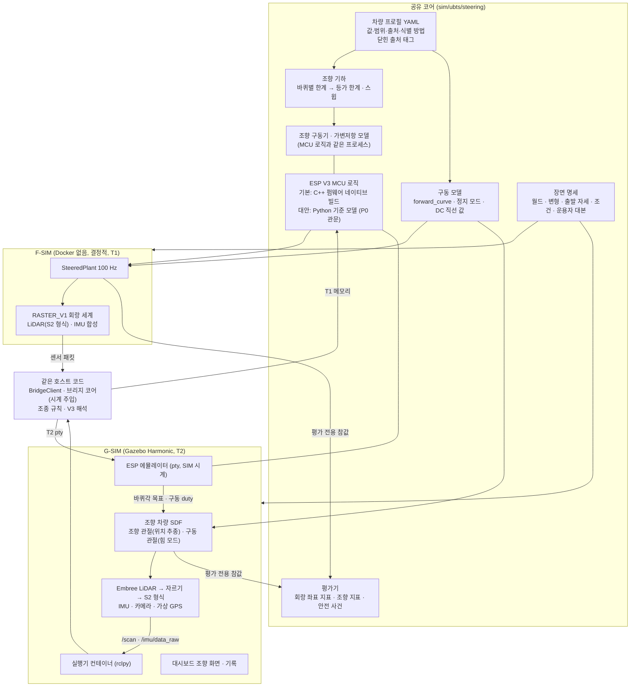
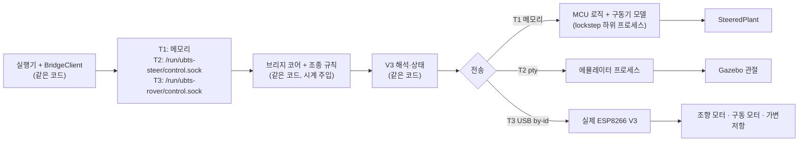
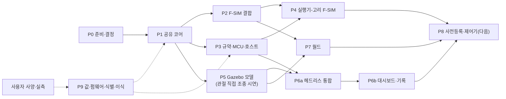

# 앞바퀴 조향 SIM 재구축 설계 v1

- 작성: 2026-11-08
- 상태: 설계 v1이다. 설계 초안 `DESIGN_DRAFT_KO.md`에 검토 `CRITIQUE_KO.md`를 반영했다. 구현 전이다. 저장소·데이터·Docker·Jetson은 바꾸지 않았다. 초안 파일은 그대로 두었다.
- 근거: 같은 폴더 `survey/`의 조사 6개(`gazebo_stack_KO.md`, `original_ackermann_KO.md`, `real_interface_KO.md`, `fast_sim_KO.md`, `worlds_data_KO.md`, `env_ops_KO.md`), 증거 폴더 4개(`fw_v2_harness_check`, `host_contract_check`, `original_ackermann_probe`, `worlds_data_calc`), 단일열 사전등록 `<개발 폴더>/single-row-20261102/PREREG.json`, 검토 문서. 이번에 저장소 소스 몇 곳을 읽기 전용으로 다시 확인했다(부록 A).
- 표기: [확인] 파일·기록으로 확인했다(가능하면 파일:행). [추정] 근거에서 유추했다. [가정] SIM 가정값이다. [제안] 이 문서의 설계다. [미정] 사용자 답이나 실측이 필요하다.
- 값 출처 태그는 닫힌 목록이다(3.8.1절). 목록 밖 태그는 프로필 읽기에서 거부한다.
- 이 문서에는 GNSS 좌표가 없다. 보조 도구 이름도 없다. 저장소 문서로 옮겨도 된다.
- 검토 항목마다 반영 위치는 부록 D에 있다. 기각하거나 일부만 반영한 항목과 이유는 부록 E에 있다.

---

## 0. 요약

1. 목표는 그대로다. 과수원 열 하나를 처음부터 끝까지 행간 중심선을 따라 달리고 열 끝에서 선다. 유턴은 없다. 바뀐 것은 차량이다. 이제 좌우 바퀴 속도차가 아니라 **앞바퀴 조향**으로 돈다.
2. 지금 SIM은 전부 차동 구동이다. Gazebo 모델(DiffDrive 4륜 스키드), 빠른 SIM 플랜트(`FieldPlant`), 명령 규약(`left`/`right`), 대시보드 혼합기, 실행기 출력이 모두 좌우 값이다. 조향 관절·조향 명령·조향각 센서는 어디에도 없다[확인].
3. SIM을 두 단계로 만든다. **G-SIM**은 Gazebo Harmonic에서 조향 차량·물리·센서·대시보드·기록을 함께 돌린다. **F-SIM**은 기구학 자전거 모델 + 조향 구동기 + 구동 응답 + 래스터 LiDAR·IMU 합성으로 빠르고 결정적으로 돈다.
4. 두 SIM은 같은 것을 쓴다. 차량 프로필 하나, 조향 구동기·가변저항 모델 한 벌, MCU 로직 한 벌, 장면 명세 하나, 평가기 하나다.
5. "같은 코드"의 범위를 다시 정했다(2.4절). 실행기, BridgeClient, 새 **시계 주입형 브리지 코어**, 조종 규칙, ESP V3 해석·상태는 SIM과 실차가 같다. 고정 파일 `rover_control_bridge.Bridge`는 쓰지 않는다. Windows에서 import가 실패하고, 기본 `RoverControl`을 직접 만들고, 벽시계를 바로 쓰기 때문이다[확인]. 실차 저장소로 옮긴 뒤 두 사본이 같은지 SHA로 검사한다(A26).
6. G-SIM 구동은 바퀴마다 DC 모터 토크-속도 직선(관절 힘 모드)으로 둔다. 한 드라이버의 두 모터는 같은 duty를 받는다. 네 바퀴를 같은 속도로 묶지 않는다. 기하 검사(A1)에는 바퀴별 기구학 속도 모드를 따로 둔다.
7. 조향 사양이 아직 없다. 조향 값은 모두 자리값과 스윕 범위로 둔다. 출처 태그는 닫힌 목록이다. 개조 전에 얻은 값(앞범퍼·발자국·LiDAR yaw·자기반사·구동 곡선·IMU 진동)은 `stale_after_mod: true`로 표시한다. 조향 한계는 바퀴별로 정의하고 등가각 한계는 계산한다.
8. 조향 요구는 작다. 10/10 열 중심선의 곡률은 p95 0.019 1/m, 최대 0.046 1/m다[확인: `worlds_data_calc/curv_included.txt`]. 0점 1° 오차는 되먹임이 없으면 10 m에서 약 1.15 m 벗어난다. 순수 추종 폐루프의 정상 횡오차는 약 4.6~7.2 cm다(주시거리 2.0~2.5 m, trim 적분 없음)[추정, 계산]. 이 오차들이 성능을 얼마나 좌우하는지는 민감도 스윕으로 답한다.
9. 조향 위치 루프는 ESP에서 닫는다[제안, Q4]. 새 규약 V3는 원자 `C` 프레임과 MCU 쪽 짧은 유효시간(TTL), CRC, 순번, boot_id, handshake, 20 Hz 위치 고정 상태 줄(최악 85 B), BENCH(정비) 모드, 사건별 정지 모드 표를 둔다. PING은 이동을 연장하지 않는다.
10. 안전 항목을 더했다. STOP의 뜻(구동 제동·관성·EN 끔, 조향 유지 시간, 결함 정지 때 조향 출력 0 우선), STOP 확인과 제한된 재전송, 정지 뒤 조향 이동 금지, 정지 중 자동 중앙 복귀 금지, 극성 반전, 드라이버 고착, 가변저항 범위 안 고장, 급전 전압 영향, 주행 중 MCU 리셋, CRC 오류 연속, 전원 차단이다.
11. SIM 합격 검사는 A1~A26이다. 모두 단계에 배정했다. A12는 A1 적합 결과에서 허용 오차를 유도한다. A10 RTF는 월드별로 둔다. A11 처리 시간은 원인 분석 전까지 보고 전용이다.
12. 저장소는 `orchard-rover-clone`의 새 브랜치 `steering-sim-20261108`(origin/main `4791d86`에서 시작)과 새 worktree를 쓴다. main은 건드리지 않는다. 고정 파일 변경은 빠른 SIM 이식에 필요한 7개만 허용한다[확인: `4791d86`..`546fa8c`에서 바뀌는 고정 파일이 정확히 7개].
13. 커밋 작성자·커미터는 `udonsari0101 <yeappidw@gmail.com>`뿐이다. push에 쓰는 GitHub 계정도 `udonsari0101`인지 확인한다. 공동 작성자 trailer, 보조 도구 이름, 도구가 붙이는 생성 표시 줄은 커밋 메시지·파일 내용·파일 이름·브랜치 이름·태그·PR 본문 어디에도 넣지 않는다.
14. 단계는 P0(준비·결정)~P7(월드)이다. P6은 P6a(헤드리스 통합)와 P6b(대시보드·기록)로 나눴다. P5에 관절 직접 조종 시연을 넣어 Gazebo 조향 차를 일찍 보인다. P8(조향 사전등록·제어기)과 P9(사양 반영·펌웨어·실차 이식)는 그다음이다.
15. 사용자 확인 질문은 16개다(9절). 답이 오기 전에는 각 기본값으로 진행한다.

### 0.1 초안에서 바뀐 것

| 번호 | 바뀐 것 | 위치 |
|---|---|---|
| 1 | G-SIM 구동: 네 바퀴 같은 속도 강제 → 바퀴별 DC 모터 직선(힘 모드). 기하 검사용 기구학 속도 모드는 따로. F-SIM의 η·끌림·언더스티어는 범위 안에서 seed로 뽑는다 | 3.5, 3.6, P5 |
| 2 | 고정 `Bridge` 대신 새 시계 주입형 브리지 코어. "같은 코드" 범위 재정의, SHA 동기 검사 A26 | 2.4, 4.2 |
| 3 | P4 가져오기 목록을 import 폐포로 다시 만들었다. `turn_*` 의존은 끊는다. vendor manifest와 `SHA256SUMS` 재생성 절차를 넣었다. `single_row_sim.py`, `RealFormat`을 가져온다 | 8.3 P4, 8.4 |
| 4 | 조향 한계를 바퀴별로 정의. 등가각 한계·스윕 폭은 계산값. 안전 띠·이탈 판정을 프로필에서 다시 유도 | 3.2, 3.8, 7.1 |
| 5 | STOP의 뜻, 정지 모드 표, STOP 확인·재전송, STOP 조향 정책 비교, 정지 뒤 조향 금지 | 3.3, 3.5, 4.1, 4.4, 6.5 |
| 6 | 조향 고장 조건과 결함 코드 범위 검사(A19). B0 극성 확인 단계 | 3.3, 3.4, 3.9, 5.3 |
| 7 | 합격 검사 재정리(배정, A12 유도, A10 월드별, A11 보고, A7 허용 비율, A17 수치, A18~A26) | 7.2 |
| 8 | 고정 파일 충돌 처리(`motor_pwm.py`, `data_recorder_service.py`, `health.py`, `cpu_lidar.py`, `/odom`, 옛 화면, release 유예) | 2.6, 4.3, 4.4, 4.5, P6a·P6b |
| 9 | 출처 태그 닫힌 목록, 빠진 매개변수 추가, LiDAR yaw 표기 통일, 낙관적 기본값 수정 | 3.1, 3.8 |
| 10 | 근거 문장 수정(probe 결과는 속도별, 폐루프 0점 오차, 근거 행, gz 버전 범위, RTF 두 값, 18개·22개·상태 줄 길이) | 0, 2.1, 3.2, 4.1, 6.2 |
| 11 | 09-19 제어 설계 문서 반영(`C` 유효시간, handshake, 적용 확인, brake/coast 프로필, 필수 장애 시험) | 4.1, 7.2 A17·A19 |
| 12 | 버린 자산 복원(`body_mask_static/fit`, `calib_runs`/`calib_analysis`, `tools/field_calib` 구동 부분, upstream 시험, probe 스크립트) | 3.7, 3.9, 8.4 |
| 13 | 단계 계획 수정(기준 trace 생성, 절대 경로 정리, P6 분할, 실행기 컨테이너·시계·메모리, P5 이른 시연, MCU 구현 경로 관문, 기반 이미지 태그, 가변저항 값은 공유 모델에서) | 8.1~8.3 |
| 14 | 구동 곡선 역할을 PREREG에 맞췄다: `P_fit1003` 주, `field1010` bracket | 3.5, 3.8 F |
| 15 | 커밋·운영(push 계정 확인, 금지어 검사 범위, 목표 전환 기록, Python 3.10/3.12/3.13, Jetson 재생성 규칙) | 8.5, P0, P9 |
| 16 | 질문 Q10~Q15 추가(검토), Q16 추가(가변저항 급전, 이번에 더함) | 9 |

---

## 1. 목표와 범위

### 1.1 목표

- 한 열의 시작부터 끝까지 행간 중심선을 따라간다.
- 열 끝에서 정해진 위치에 선다. 정지 위치 e는 앞범퍼와 마지막 줄기 선 s_E의 거리다. 정상 범위는 e ∈ [−1, +1] m다(단일열 사전등록 정의를 이어받는다). 앞범퍼 위치 값 자체는 조향 장치를 단 뒤 다시 잰다(3.8 A표).
- 차량은 앞바퀴 조향이다. 조향 모터는 같은 ESP 보드에서 모터드라이버로 구동한다. 가변저항이 조향각을 되돌려 준다[미정: Q1].
- 위치 추정 입력은 지금처럼 2D LiDAR + raw IMU다. 구동 바퀴 엔코더는 없다.
- 첫 일은 이 차에 맞는 SIM 환경을 다시 만드는 것이다.

### 1.2 범위 밖

- 유턴, 다음 열 진입, 여러 열, 마지막 열 판정.
- 실차 주행 시험, Jetson 설치, 펌웨어 쓰기, 장착 보정. 이것은 사용자가 현장에서 한다.
- 카메라·AI를 위치 추정에 쓰는 것. GPS 융합. 이번 SIM의 제어 입력에는 GPS가 없다.
- 이번 단계의 열 추종 제어기 구현. 6절은 방향만 정한다.

### 1.3 현장 시험 전에 SIM으로 개발·검증할 것

| 항목 | SIM에서 할 일 | 현장에서만 알 수 있는 것 |
|---|---|---|
| 조향 구동기 다루기 | 속도 한계, 지연, 데드밴드, 백래시, 0점 오차, 끝 멈춤, 정지 중 조향 부하, 고장을 넣고 제어·감시 로직을 시험한다 | 실제 값, 실제 부하, 마모·온도 변화 |
| 횡 제어 | 주시거리·이득과 조향 속도의 관계, 0점 오차 흡수(trim), 출발 오차 수렴을 본다 | 실제 타이어와 흙의 미끄럼 |
| 엔코더 없는 속도 제어 | LiDAR 속도 + PWM 앞먹임, 저속 출발, 곡선 감속을 본다 | 새 구동계의 duty→속도 |
| 열 끝 감속·정지 | 열 끝 판정, 접근 감속, 정지 위치, 벽·장애물 앞 정지를 본다 | 실제 열 끝 모양, 실제 정지 거리 |
| 센서 이상 대응 | LiDAR·IMU·조향 상태의 끊김, 지연, 가림을 넣는다 | 실제 진동, 반사, 날씨 |
| 안전 동작 | STOP, deadman, 입력 만료, `C` TTL, watchdog, 통신 끊김, MCU 리셋, 전원 차단 때 조향 상태와 옆 벗어남을 잰다 | 물리 전원 차단, 실제 제동 |
| ESP 규약 V3·펌웨어 로직 | 에뮬레이터로 파서, CRC, 무장, 보정, 결함, 상태 줄, 포트 열기 리셋을 시험한다 | 전기 잡음, 부팅 핀 동작, 실제 ADC |
| 호스트 브리지·대시보드·기록 | 조향 명령·표시·기록 스키마를 끝까지 돌린다 | 느린 망, 실기기 부하 |
| 보정·식별 절차 | 벤치·현장 보정 순서를 SIM에서 미리 돌린다. 식별 도구가 아는 자리값을 되찾는지 본다(A18) | 실제 측정값 |
| 결함 감시 범위 | 결함 코드마다 최소 한 대본이 그 결함을 일으키는지 본다(A19) | 실제 결함 빈도 |
| 사양 민감도 | 어떤 사양이 성능을 가장 좌우하는지 스윕으로 찾는다. 그 순서대로 실측을 요청한다 | 실제 사양 |

### 1.4 지켜야 할 규칙

1. SIM 참값(차 자세, 관절 각, 월드 라벨, 추가 물체)은 센서 합성·구동기 모델·평가에만 쓴다. 실행기·추정기·제어기에는 주지 않는다.
2. 위치 추정 입력은 합성 2D LiDAR(실제 S2 형식)와 raw IMU뿐이다. 바퀴 오도메트리, PWM 적분, 카메라, 참값, 지도 라벨은 넣지 않는다.
3. PWM은 엔코더가 아니다. 가변저항은 조향 링크 각의 측정값이다. 바퀴 속도나 이동 거리를 주지 않는다. 가변저항을 운동 예측에 쓸지는 사용자가 정한다(Q8). 그 전에는 제어 되먹임과 고장 감시에만 쓴다.
4. GPS는 어떤 조건에서도 제어 입력이 아니다. G-SIM의 가상 GPS는 표시·기록 시험용이다.
5. 플랜트를 약하게 바꿔 통과시키지 않는다. 조건 값은 사전등록 값을 쓴다. 단일열 사전등록의 이 규칙을 그대로 이어받는다. 이상값(η 1, 끌림 0)은 기하 검사에만 쓴다.
6. 모든 결과에 차량 프로필 식별값(`profile_id`, SHA-256)과 출처 등급을 붙인다. 자리값 결과는 "자리값 기반 SIM 결과"로 적는다. 현장 검증이 아니다.
7. 출력에 GNSS 좌표, 지도 YAML 원점, 궤적 절대값을 넣지 않는다. push할 모든 파일과 run 출력에 같은 검사를 돌린다(A16).
8. "같은 코드"라고 쓸 때는 2.4절의 범위만 뜻한다. 범위 밖 부품은 "같은 규약을 따르는 다른 코드"로 적는다.
9. 출처 태그는 닫힌 목록만 쓴다. 개조 전 값에는 `stale_after_mod: true`를 둔다.

---

## 2. 구조: 두 단계 SIM

### 2.1 왜 두 단계인가

| 구분 | G-SIM (Gazebo) | F-SIM (빠른 SIM) |
|---|---|---|
| 차체 | SDF 조향 차량. DART 접촉·마찰. 물리 120 Hz. gz-sim 8.15.0, DART 6.13.2는 마찰 검증 실행 이미지의 로드 라이브러리 목록에서 확인한 값이다[확인: 마찰 검증 이미지]. P5 기반 이미지에서는 P5 첫 점검에서 다시 확인한다 | 기구학 자전거(뒤차축 기준) + 조향 효율·언더스티어·끌림 손실·옆 미끄럼·곡률 떠돎 |
| 구동 | 바퀴별 관절 힘 모드 DC 모터 직선(기본). 기하 검사는 바퀴별 기구학 속도 모드 | `forward_curve` + MCU 램프 + 정지 모드(release / brake / coast) |
| 월드 | 원본 과수원, 대체 fixture, 10/10 재구성 열(새 생성기) | 10/10 래스터 회랑(RASTER_V1, 0.05 m 셀), 절차 세계, 통계 맞춤 과수원 |
| 센서 | Embree LiDAR(`/sim/scan`) → unobserved 자르기 → S2 형식 변환, IMU, 카메라, 가상 GPS | 래스터 LiDAR(3200 SIM빔 → 3240 S2빔), IMU 오차 모델 |
| 명령 경로 | 실행기 → 제어 소켓 → 브리지 래퍼 + 브리지 코어 → V3 해석 → pty → 에뮬레이터 | 실행기 → 메모리 → 같은 브리지 코어 → 같은 V3 해석 → 메모리 → 같은 MCU 로직 |
| 속도 | 실시간 이하. 측정 이력: 120 Hz 물리 + 640×360 카메라 + Embree에서 RTF 0.9515(fixture, 45 s)[확인: env_ops 134행]. 원본 과수원 lite + GPU 렌더 + Embree에서 약 0.68배속[확인: worlds_data 54행]. GUI를 켜면 0.05 | 실시간보다 빠름. 전 열 16회의 SIM 60~267 s를 벽시계 10~71 s에 돌린 이력[확인] |
| 결정성 | 없다. 반복 분산을 잰다(A9) | 있다. 같은 seed면 같은 trace(A8) |
| 잘하는 것 | 타이어 접촉, 지형 기울기, ROS·대시보드·기록·카메라 통합, 수동 조종, 시연 | 제어기 개발, 큰 조건 행렬, 민감도 스윕, 사전등록 평가 |
| 못하는 것 | 큰 행렬, 결정적 비교, 조향 자유 회전(free·비자기잠금), EN 끔 관성 주행(3.6절) | 3D 형상, 카메라, ROS 통합, 타이어 동역학 |

- Gazebo만으로는 조건 행렬(1,000회 이상)을 돌릴 수 없다. 100 m 열을 0.5 m/s로 가면 SIM 200 s다. Docker VM 메모리도 7.75 GiB뿐이다[확인].
- 빠른 SIM만으로는 ROS·대시보드·기록·물리 접촉을 확인할 수 없다.
- 그래서 개발과 평가는 F-SIM에서 한다. 통합과 물리 타당성은 G-SIM에서 본다. 두 SIM이 같은 프로필에서 같은 결과를 내는지는 A1 적합 뒤 A12로 확인한다(7.2절).

### 2.2 전체 그림



### 2.3 공유하는 것

| 공유 부품 | 내용 | 위치 [제안] | F-SIM에서 | G-SIM에서 |
|---|---|---|---|---|
| 차량 프로필 | 기하·질량·조향·가변저항·구동·센서 장착 값, 범위, 출처, 식별 방법 | `sim/ubts/steering/profiles/*.yaml`, `sim/ubts/steering/profile.py` | 플랜트 매개변수 | SDF 변환과 에뮬레이터 매개변수 |
| 조향 기하 | 자전거 등가각 ↔ 좌우 바퀴각, 바퀴별 한계 → 등가 한계, 곡률, 스윕 폭 | `sim/ubts/steering/geometry.py` | 곡률 계산 | 좌우 조향 관절 목표, 관절 `<limit>` |
| 조향 구동기·가변저항 | 모터·감속·링크·백래시·끝 멈춤·정지 마찰·고장, ADC 측정 | MCU 로직과 같은 네이티브 프로세스(기본) 또는 Python(대안). 2.3.1 | 플랜트와 10 ms마다 교환 | 에뮬레이터 안. 결과 바퀴각을 Gazebo 관절 목표로 보낸다 |
| 구동 모델 | duty→속도 곡선, 정지 모드(release/brake/coast), 끌림 손실, DC 직선 값(유도) | `sim/ubts/steering/drive.py`(`field_response.py`는 import만) | 차속 | 바퀴 관절 힘 모드 매개변수 |
| ESP V3 MCU 로직 | 파서, CRC, 무장, 구동 램프, 조향 서보, TTL, watchdog, 결함, 상태 줄, 보정 | `firmware/ubts_steer_v3/`(기본) 또는 `sim/ubts/steering/esp_v3_model.py`(대안) | lockstep 하위 프로세스 또는 같은 프로세스 | pty 에뮬레이터 프로세스 |
| 호스트 제어 경로 | 시계 주입형 브리지 코어, 조종 규칙 확장, V3 해석·상태, 전송 3종 | `dashboard/scripts/{steer_bridge_core,steer_control_core,esp_motor_v3}.py` | 메모리 | 제어 소켓 + pty(래퍼 `steer_rover_bridge.py`) |
| S2 형식 변환 | SIM 스캔 → 실제 S2 `LaserScan`(3240빔, raw 순서, 0 = 반사 없음) | `tools/row_executor/s2_format.py`(`sim_in_loop.RealFormat`을 떼어 냄) | 래스터 스캔 변환 | Embree 스캔 변환 노드 |
| 장면 명세 | 월드 원천, 변형, 출발 자세(조향각 포함), 조건, 운용자 대본, 평가 설정 | `sim/ubts/steering/scene_spec.py` | 입력 | 입력 |
| 평가기 | 회랑 좌표 지표, 종료 규칙, 조향 지표, 안전 사건 | 단일열 `evaluate_episode`를 확장한 `sim/ubts/steering/evaluate_steer.py` | trace에서 | 참값 기록에서 오프라인으로 |

#### 2.3.1 MCU 로직과 조향 구동기 모델을 한 프로세스에 둔다

- MCU 조향 서보는 500 Hz~1 kHz로 돈다. 서보는 틱마다 가변저항 값을 읽고 PWM을 낸다. 그 PWM이 구동기 모델을 움직이고 다음 가변저항 값을 만든다. 둘을 다른 프로세스에 두면 틱마다 왕복 통신이 필요하다(초당 500~1,000회).
- 그래서 구동기·가변저항 모델을 MCU 로직과 같은 프로세스에 둔다. 차체 플랜트와는 10 ms마다 한 번 바꾼다. 보내는 것: 직렬 바이트(시각 포함), 차속, 정지 여부, 급전 전압 배율. 받는 것: 직렬 바이트, 구동 duty·EN, 좌우 바퀴각, 가변저항 raw(기록용), 결함.
- MCU 로직 구현 경로는 P0 관문에서 정한다(8.3 P0). 기본안은 C++ 펌웨어 소스를 네이티브로 빌드하고, 같은 프로세스에 C++ 구동기 모델을 링크하는 것이다. 이 PC의 MinGW는 32비트(`mingw32`, GCC 6.3.0)이고 Python은 64비트(3.13.2)다[확인]. 그래서 ctypes 공유 라이브러리 안은 이 도구로 안 된다. lockstep 하위 프로세스로만 된다. 관문을 못 넘으면 대안(Python 기준 모델 + Python 구동기)으로 간다.
- 어느 경로든 구동기·가변저항 모델 구현은 한 벌이다. F-SIM과 G-SIM이 같은 것을 쓴다. 적합성 대본의 기대값은 손으로 정한 규격에서 나온다. 모델끼리 서로를 정답으로 쓰지 않는다.
- 펌웨어 로직은 정수 연산으로 쓴다(ESP8266에는 FPU가 없다). 32비트 빌드에서 부동소수 구동기 모델은 `-msse2 -mfpmath=sse`로 빌드한다. 결정성(A8)은 같은 플랫폼 안에서 요구한다.

### 2.4 "같은 코드"의 범위

| 구성 | T1 F-SIM | T2 G-SIM | T3 실차 | 판정 |
|---|---|---|---|---|
| 실행기 패키지(`tools/row_executor` 조향판) | 같은 소스. 입력은 `sim_in_loop_steer`의 센서 패킷 | 같은 소스. 입력은 ROS(rclpy) | 같은 소스. ROS | 같다. 입력 어댑터만 다르다 |
| BridgeClient | 메모리 전송 | UDS `/run/ubts-steer/control.sock` | UDS `/run/ubts-rover/control.sock` | 같다 |
| 브리지 코어 `steer_bridge_core.py` | 주입 시계(SIM) | 주입 시계(벽 또는 SIM, 2.5절) | 단조 시계 | 같다 |
| 조종 규칙 `steer_control_core.py` + 기반 `rover_control_core.py` | 같음 | 같음 | 같음 | 같다. 기반 파일은 지금 두 저장소에서 SHA가 같다[확인: 앞 12자리 `5cc86b226e88`] |
| V3 해석·상태 `esp_motor_v3.py` | 메모리 전송 | pty 전송 | USB by-id 직렬 | 해석·상태는 같다. 전송 클래스만 다르다 |
| 브리지 래퍼 `steer_rover_bridge.py`(소켓·ROS·루프) | 쓰지 않는다 | 쓴다 | 쓴다 | T2와 T3가 같다 |
| MCU 로직 | 네이티브 빌드(기본) 또는 Python | 같음 | 실제 ESP 펌웨어 | 기본안이면 같은 소스. 대안이면 "같은 규약을 따르는 다른 코드" |
| 플랜트 | SteeredPlant | Gazebo + 공유 구동기 모델 | 실제 차 | 다르다 |
| 시계 | 주입 시계 하나 | SIM 시계 + 벽 또는 SIM | 실제 | 다르다 |

- 원본은 SIM 저장소의 새 파일이다. 실차 저장소(`unist_orachard_dashboard`)로는 P9에서 옮긴다. 옮긴 뒤 두 사본과 기반 파일(`rover_control_core.py`, `esp_wheel_controller.py`, `rover_api.py`, `motor_pwm.py`)의 SHA를 비교한다(A26). 지금 기반 파일들은 두 저장소에서 SHA가 같다[확인: 부록 A].
- 고정 파일 `rover_control_bridge.Bridge`는 하위 클래스로도 쓰지 않는다[확인].
  - `rover_control_bridge.py:13`이 `scripts.esp_motor`를 import한다. `esp_motor.py:2·6`은 모듈 맨 위에서 `fcntl`, `termios`를 import한다. 그래서 Windows에서 import가 실패한다.
  - `rover_control_bridge.py:20`이 기본 `RoverControl(motor)`를 직접 만든다.
  - `rover_control_bridge.py:33·55·139`가 `time.monotonic()`을 바로 쓴다. 큐 0.25 s 만료가 벽시계로 돈다. T1의 주입 시계와 A8 결정성이 깨진다.
  - 반면 `RoverControl`은 시계를 주입받는다[확인: `rover_control_core.py:15`].
- 새 브리지 코어는 기존 `Bridge`의 의미(큐 8개, 요청 만료 0.25 s, busy면 정지, 상태 스냅샷, 한 틱에 요청 하나)를 그대로 옮긴다. Linux에서 기존 `Bridge`와 같은 입력열을 넣어 결과를 비교하는 동등성 시험을 둔다(P3).

### 2.5 전송·시계 단계



| 단계 | 용도 | 연결 | 시계 |
|---|---|---|---|
| T1 F-SIM | 대량 시험. 실시간보다 빠름 | 실행기 → BridgeClient(메모리) → 브리지 코어 → V3 해석(메모리) → MCU 로직 + 구동기 → SteeredPlant | 주입 시계 하나 |
| T2 G-SIM | 센서까지 포함한 통합 | 실행기 컨테이너 → 제어 소켓 → 브리지 래퍼 + 코어 → V3 해석(pty) → 에뮬레이터 ↔ Gazebo | 아래 두 모드 |
| T3 실차(사용자) | 벤치·현장 | 같은 래퍼·코어 → USB → 실제 ESP | 실제 |

G-SIM 시계 모드[제안]:

| 모드 | 호스트·실행기 시계 | MCU·플랜트 시계 | 쓰는 곳 | 조건 |
|---|---|---|---|---|
| 실차 시계 모드(기본) | 벽시계(실차와 같음) | SIM 시계 | 수동 조종, 시연, 통합 | RTF가 0.9 이상일 때만 시간 민감 결과가 유효하다. RTF를 계속 기록한다 |
| SIM 시계 모드 | `/clock`에서 만든 주입 시계 | SIM 시계 | RTF가 낮을 때 실행기 자동 실행 | 브리지 코어·조종 규칙·실행기가 모두 같은 SIM 시계를 쓴다. 수동 조종은 경고를 띄운다 |

- SIM 시계 모드에서는 실차 기한(입력 0.75 s, release 유예 1.1 s)을 SIM 시간으로 그대로 쓴다. 기존 SIM의 release 유예 10 s(`sim/ubts/control.py:6`)는 이 스택에서 쓰지 않는다[확인].
- 실행기의 ROS 입력(`RosInput`)은 수신 시각을 `time.monotonic()`으로 찍는다[확인: `executor_main.py:1445`]. SIM 시계 모드에는 시계 주입이 필요하다. 조향 브랜치에서 실행기에 시계 선택 인자를 더한다(P6a).
- 신원은 네 겹으로 나눈다.
  - 경로: SIM 래퍼는 `/run/ubts-steer/` 아래 장치만 연다. 실차 래퍼는 udev `ID_SERIAL`을 확인한다. pty에는 udev 정보가 없으므로 실차 래퍼는 자연히 거부한다.
  - handshake: 에뮬레이터는 `sim=1`, 장치 ID, 하드웨어 프로필을 낸다. 실차 래퍼는 `sim=1`이면 결함으로 멈춘다. SIM 래퍼는 `sim=0`이면 결함으로 멈춘다. 하드웨어 프로필이 차량 프로필과 다르면 arm을 거절한다.
  - ROS 도메인: 실차 0, 기존 SIM 42, 조향 SIM 43[제안].
  - 조종 화면: arm 요청에 `vehicle_profile: front_steer`가 있어야 한다. 옛 화면은 arm부터 거절된다(4.2, 4.4절).
- 실행기는 조향 상태를 drive·keepalive 응답과 `status` op의 `steering` 블록으로 받는다[제안]. 그래서 추가 요청 없이 10~20 Hz로 조향 되먹임을 받는다. ROS `/rover/steering/state`(20 Hz)는 기록·표시용이다.

### 2.6 참값 격리

- F-SIM: 플랜트 참값은 trace의 평가 전용 칸에만 쓴다. 실행기에 가는 것은 센서 패킷과 MCU 상태 줄뿐이다. 정적 검사로 확인한다(A13 F).
- G-SIM 참값 토픽:
  - 차 자세: `/ground_truth/odom`(`OdometryPublisher`). 고정 파일 `cpu_lidar.py`가 이 이름을 구독하고 `rclpy.init(args=[])`로 시작한다[확인: `cpu_lidar.py:204`, `:250`]. 실행 인자 remap이 먹지 않는다. 그래서 이름을 바꾸지 않고 참값 허용 목록에 넣는다.
  - 조향 참값: `/sim/truth/steering`(참 δ_L, δ_R, 모터 쪽 각).
  - 관절 상태: Gazebo `JointStatePublisher` → `/sim/truth/joint_states`(새 브리지 설정에서 이름을 정한다).
- 실행기 노드의 구독은 허용 목록으로 검사한다: `/scan`, `/imu/data_raw`, `/rover/control/requested`[확인: `executor_main.py:1447` 기본 인자]. 그 밖의 구독이 있으면 A13 실패다.
- `/odom`은 내지 않는다. 기존 adapter의 encoderless 모드는 `/odom`과 동적 TF를 내지 않는다[확인: `adapter.py:131·136`]. 정적 TF만 낸다.
- 에뮬레이터는 플랜트 쪽이다. 차속·정지 여부를 참값에서 읽어도 된다. 실행기·추정기는 안 된다.
- `DiffDrive`·`AckermannSteering` 오도메트리는 이상적 바퀴 오도메트리다. 쓰지 않는다.
- 기존 `world_metadata.json`의 `lane_centers_y` 같은 월드 정답 경로는 새 SIM의 제어 입력으로 쓰지 않는다.

---

## 3. 차량 모델

### 3.1 좌표·부호·기준점

- 차체 축은 x 앞, y 왼쪽, z 위다(REP-103). 조향각은 왼쪽이 +다(위에서 보아 반시계).
- LiDAR 장착 yaw는 실행기 설정의 이름과 관례를 그대로 쓴다. `lidar_yaw_offset_deg = 179.08`은 "스캔 프레임에서 주행축이 −179.08°"라는 뜻이다[확인: `tools/row_executor/config.py:221`]. 프로필·코드·문서 모두 이 이름 하나만 쓴다. 179.08과 −179.08을 섞으면 1.84° 차이가 난다. 0점 1° 문제보다 크다.
- 조향 부호는 LiDAR가 아니라 차체 기준으로 정한다.
- 참값 자세는 지금처럼 발자국 중심(base, Gazebo `base_footprint`)에 둔다. 평가기와 접촉 검사가 base를 쓰기 때문이다.
- 자전거 계산은 뒤차축 중심에서 한다. base에서 뒤차축까지는 `rear_axle_x_in_base_m`(자리값 −0.38 m)이다. 측면 휘두름 규칙의 회전 중심(`rotation_centre_x_m`)도 뒤차축으로 바꾼다(지금은 피벗 중심 0.0 m).
- 앞범퍼는 base + `front_bumper_x_in_base_m`(자리값 0.61 m)이다. 정지 위치 e는 앞범퍼로 잰다. 0.61 m는 절단 전 제품 표기에서 온 값이다. 조향 장치가 앞으로 나올 수 있으므로 `SPEC_PENDING`, `stale_after_mod: true`로 둔다.
- 단위: 내부는 rad·m·s. 호스트 API는 mrad 정수. ESP 줄에서는 보정 반범위의 천분율(−1000..1000)[제안]. 가변저항 잡음은 ADC count 단위로 적는다(3.4절).

### 3.2 조향 기하

- 자전거 등가각 δ는 뒤차축 곡률을 만드는 하나의 각이다.
  - 곡률 κ = tan δ / L. 요레이트 ω = v·tan δ / L. 회전반경 R = L / tan δ.
- 조향 형식은 두 가지를 둔다[미정: Q10].
  - `linkage`(기본): 바퀴마다 킹핀 축으로 돈다. Ackermann 비율 a로 좌우 바퀴각을 정한다.
  - `axle_pivot`: 앞차축 전체가 가운데 축으로 돈다. 바퀴 위치·유효 휠베이스·스윕 폭이 각도에 따라 바뀐다. 두 앞바퀴의 각은 같다.
- `linkage` 좌우 바퀴각:
  - 이상 Ackermann(킹핀 폭 w_k): δ_in = atan(L / (R − w_k/2)), δ_out = atan(L / (R + w_k/2)).
  - 평행 링크: δ_L = δ_R = δ.
  - 바퀴마다 δ_i = δ + a·(δ_i^ideal − δ). a = 0은 평행, 1은 이상이다.
  - a < 1이면 회전 중 앞바퀴가 서로 다투어 끌림이 생긴다. F-SIM은 조향 효율 η와 속도 손실로, G-SIM은 물리 접촉으로 표현한다.
- 링크 비선형: 가변저항 각 ↔ 바퀴각 관계를 조각 선형 표로 둔다. 기본은 직선이다. 벤치 정적 각도표(B3)로 바꾼다.
- 조향 한계는 **바퀴별**로 정의한다[제안].
  - 기계 한계: 바퀴마다, 방향마다 하나씩(`left_wheel_toward_left` 등 4개). Gazebo 관절 `<limit>`와 공유 모델이 같은 값을 쓴다.
  - 소프트 한계: 바퀴별 기계 한계 − `steer_soft_margin_deg`(기본 3°).
  - 등가각 소프트 한계: 두 바퀴가 모두 소프트 한계 안에 드는 가장 큰 δ다. 방향별로 계산한다(`DERIVED`). 호스트 API의 한계는 이 값이다.
  - 자리값 기하(L 0.76 m, w_k 0.46 m, 기계 28°, 소프트 25°)에서 등가각 한계는 a = 0일 때 25°, a = 0.5일 때 약 23.5°, a = 1일 때 약 22.2°다[추정, 계산]. 등가 25°를 그대로 두면 a = 1에서 안쪽 바퀴가 약 28.5°가 되어 기계 한계를 넘는다.
- 숫자 예(L = 0.76 m, 가정):
  - δ 10° → R 4.31 m. 20° → 2.09 m.
  - v 0.4 m/s, δ 20° → ω 11.0°/s.
- 차동 시절과 비교:
  - 차동 제어의 yaw 상한 3.6°/s는 0.40 m/s에서 δ 6.8°와 같다. 조향은 속도와 무관하게 곡률 권한이 있다. δ 20°면 곡률 0.48 1/m다.
  - 대신 조향 속도 한계가 새 지연이 된다. 30°/s면 0→20°에 0.67 s 걸린다. 그동안 0.4 m/s로 0.27 m 간다.
  - dev_r3의 진입 발산 실패 6건은 차동 yaw 상한 때문에 방향 반전이 2.6~4.1 s 걸린 것이 원인이었다[확인: `dev_r4_analysis/tracking/TRACKING_ANALYSIS_KO.md`]. 조향 차에서는 이 원인이 줄어들 수 있다. 대신 조향 속도가 새 한계가 된다.
- 열 중심선은 거의 곧다. 포함 37방향에서 곡률 p95 0.019, 최대 0.046 1/m다[확인]. 정상 조향각은 휠베이스 0.5 / 0.76 / 0.9 m에서 최대 1.3 / 2.0 / 2.4°다. 큰 조향은 출발 오차와 편향 보정에서 나온다.
- 0점 오차의 크기[추정, 계산]:

| 0점 오차 | 곡률 편향 κ_b | 되먹임 없이 10 m 뒤 옆 벗어남 | 순수 추종 정상 횡오차 κ_b·L_d²/2 (L_d 2.0 / 2.5 m, trim 없음) |
|---|---|---|---|
| 0.5° | 0.011 1/m | 약 0.57 m | 약 2.3 / 3.6 cm |
| 1° | 0.023 1/m | 약 1.15 m | 약 4.6 / 7.2 cm |
| 2° | 0.046 1/m | 약 2.3 m | 약 9.2 / 14.4 cm |

  - 되먹임이 있으면 0점 오차는 열 전체 이탈이 아니라 수 cm의 정상 오차가 된다. trim 적분이 있으면 더 준다. probe에서도 데드밴드 1°의 영향은 작았다(6.2절).
  - 그래도 가장 좁은 회랑의 양쪽 여유는 약 0.21 m다(아래). 수 cm는 의미가 있다. 그래서 0점 오차·백래시·양자화는 프로필 기본값에 넣는다. 성능을 얼마나 좌우하는지는 민감도 스윕(P2, P8)으로 답한다.
- 스윕 폭: 조향하면 앞바퀴 모서리가 차체 밖으로 나온다. 안쪽 바퀴는 앞 모서리가, 바깥 바퀴는 뒤 모서리가 나온다. 양쪽이 다 나온다.
  - 계산(자리값: 바퀴 반경 0.14 m, 폭 0.12 m, 킹핀 폭 0.46 m, 윤거 0.56 m, 킹핀 경사 0): 바퀴 28°에서 바퀴 바깥 모서리는 차체 중심에서 약 0.393 m다. 차체 반폭 0.35 m보다 약 0.043 m 바깥이다. 25°에서 약 0.039 m, 20°에서 약 0.031 m다[추정, 계산].
  - 가장 좁은 회랑 자유폭은 1.12 m(051127 c07)다. 차 폭 0.70 m면 양쪽 여유가 약 0.21 m뿐이다.
  - 스윕 폭은 `geometry.py`가 기하에서 계산한다(`DERIVED`). 조향 장치 브래킷 같은 미지 돌출은 `steer_hardware_margin_m`(자리값 0.02 m)로 더한다. 초안의 `steer_sweep_extra_m` 기본 0은 버린다.
  - 발자국 검사·안전 띠·이탈 판정은 현재 조향각의 스윕을 포함한 발자국으로 계산한다(7.1절).

### 3.3 조향 구동 사슬

```
호스트 목표각(mrad) → [보정표] → 천분율 S → ESP 조향 서보(500 Hz~1 kHz)
  내부 목표 cmd = 속도 제한을 건 목표
  오차 = cmd − 가변저항 위치
  PWM = 포화(Kp·오차). 데드밴드, 최소 PWM, 최대 PWM, 방향 전환 휴지
  극성 감시: PWM 방향과 위치 변화 방향이 반대면 빠른 결함(POLARITY)
  → 조향 드라이버(EN 별도 핀) → 조향 모터(무부하 속도, 정지 토크, 1차 지연)
  → 감속기(비, 자기 잠금 여부) → 링크(비, 비선형, 백래시, 탄성)
  → 바퀴 조향각 δ_L, δ_R (바퀴별 기계 끝 멈춤)
가변저항(모터 쪽 또는 바퀴 쪽) → 분압 → A0 10비트 ADC(내부 기준 전압) → 거르기 → 위치
```

모델은 네 수준으로 둔다.

| 수준 | 내용 | 쓰는 곳 |
|---|---|---|
| L0 이상 서보 | 목표각을 속도 한계와 1차 지연으로 따라간다 | 초기 검사, 비교 기준, A1·A12 |
| L1 기본 [제안] | ESP 서보 + 모터 속도 모델(정상 속도 ∝ \|PWM\| − 정지 PWM, 상한 ω_max(v), 1차 지연 τ_m) + 백래시(play 연산자) + 바퀴별 끝 멈춤 + 정지 중 마찰(차가 서 있으면 ω_max↓, 최소 PWM↑) + 주행 중 백래시 안 떠돎(OU) | F-SIM과 G-SIM 모두 |
| L1b 토크 [제안] | L1의 속도 식 대신 모터 토크-속도 직선과 부하 토크(주행 중·정지 중)로 조향 속도와 STALL을 만든다. 모터 사양(Q11)이 오면 쓴다 | 민감도 시험, STALL 오검출 시험 |
| L2 관절 힘 모드(나중) | 모터 사양이 생기면 Gazebo 조향 관절을 힘으로 움직여 타이어 부하를 물리로 받는다 | G-SIM 민감도 시험 |

- 고장 모델(조건 이름은 5.3절):
  - 걸림(특정 각에서 멈춤), 느려짐(배터리 저하), 드라이버 무응답(출력해도 안 움직임).
  - 드라이버 고착(출력이 켜진 채 PWM 0으로 못 멈춤). EN을 끊어야 멈춘다. 그래서 조향 EN은 별도 핀(4.1절 A안의 D2)으로 둔다.
  - 극성 반전(모터 배선 반대, 가변저항 방향 반대). 서보가 양의 되먹임이 되어 끝까지 달린다. 30°/s면 1 s 안에 끝에 닿는다. 그래서 TRACK(3°, 1.0 s)보다 빠른 POLARITY 판정을 둔다(3.8 D2표).
  - 가변저항 고장은 3.4절에 있다.
- 자기 잠금: F-SIM 기본은 `steer_self_locking: false`다[제안]. watchdog·전원 끊김·MCU 리셋 때 더 나쁜 쪽이다. 스윕에는 true도 돈다. G-SIM은 조향 관절을 위치 추종으로 붙잡으므로 false를 표현하지 못한다. G-SIM 결과에는 "자기 잠금 가정"을 적는다.
- 출력 0일 때 비자기잠금 조향의 외력 모델(F-SIM 전용): 복원 모멘트(중앙 쪽, 자리값) + 노면 잡음(OU)으로 바퀴가 움직인다. 값은 `SIM_ASSUMED`다.
- 사건별 조향 동작은 4.1절 정지 모드 표에 모았다. 요점은 다음과 같다.
  - 통신 끊김(watchdog): 측정 위치를 `steer_hold_after_loss_s` 동안 유지한 뒤 출력 0[Q6 기본 hold]. 끊김 때 중앙으로 급히 돌리지 않는다(09-19 제어 설계 7절과 같다).
  - STOP: 구동은 즉시 제동, 조향은 측정 위치를 `steer_hold_after_stop_s` 동안 유지한 뒤 출력 0.
  - 가변저항·극성·드라이버 결함으로 선 경우: 측정 위치를 믿을 수 없다. 조향 출력 0이 우선이다(조향 EN 끔).
  - MCU 리셋·전원 차단: 서보가 멈춘다. 자기 잠금이 아니면 조향이 풀린다.

### 3.4 가변저항 측정 사슬

- raw = clip(round(o + g·s_v·θ_s + n(θ_s) + d(t) + ε), 0, 1023). θ_s는 측정 지점의 각이다. 모터 쪽이면 백래시 앞, 바퀴 쪽이면 백래시 뒤다. s_v는 급전 전압 배율이다. d(t)는 서서히 표류다.
- 자리값[가정]: 270° 단회전 가변저항을 조향축에 1:1로 달면 1 LSB ≈ 0.26°다. 기어로 쓰는 범위를 넓히면 좋아진다.
- 잡음 ε는 sd 1 count(범위 1~3 count)다[가정]. 단위는 count로 통일한다. 빠른 SIM 조사의 0.3°는 0.26°/LSB에서 약 1.15 count다. 비선형 n은 직선성 ±2 %, 이득 오차는 ±5 %, 직진 보정 잔차는 sd 0.5°(±1.5°)다[가정].
- 급전 전압 영향[추정, 확인 필요]: ESP8266 ADC는 내부 기준 전압으로 잰다. 가변저항은 3.3 V 레일로 급전한다. 그래서 비례(ratiometric) 측정이 아니다. 레일이 1 % 처지면 중앙(raw 약 512) 근처에서 약 5 LSB, 약 1.3°가 바뀐다. 조향·구동 PWM이 클 때 레일이 처질 수 있다. 모델에는 PWM과 상관된 s_v 항을 둔다. B7에 부하 중 측정을 더한다.
- NodeMCU A0 분압기 입력 상한은 약 3.2 V다[일반 자료, 확인 필요: real_interface 3.5절]. 3.3 V 급전이면 위쪽 끝 몇 %가 1023에 붙을 수 있다[추정]. 보정 끝점은 raw 60~963 안에 두게 한다.
- MCU 거르기: 1~2 kHz로 읽고 중앙값이나 평균을 쓴다. 상태 줄은 20 Hz(10~50), 지연 0.03 s(0.01~0.1)다.
- 고장:
  - 범위 밖: 단선(0 근처), 단락(1023 근처). 유효 범위를 raw 20~1003으로 두고 보정 범위는 더 안쪽에 둔다. NodeMCU A0 분압기의 단선 동작은 확인이 필요하다.
  - 범위 안: 값 멈춤, 잡음 폭발, 급변(표본 간), 축 미끄럼(오프셋 점프), 서서히 표류(온도·마모), 방향 반대 배선.
  - 범위 안 고장 가운데 축 미끄럼과 서서히 표류는 MCU가 잡기 어렵다. 호스트의 `steering_ineffective`(gyro 대 v·tan δ_pot / L) 판정 시간과 오검출률을 SIM에서 잰다. 저속·작은 각에서는 gyro 신호가 잡음과 비슷하다.
- 모터 쪽 측정이면 백래시 안의 바퀴각을 모른다. 작은 지그재그(한계 순환)가 생길 수 있다. SIM은 두 위치를 모두 시험한다.
- G-SIM의 가변저항 값도 공유 모델의 각에서 만든다. `/sim/truth/joint_states`(약 24 Hz)는 쓰지 않는다. 관절 추종 확인(A25)에만 쓴다.

### 3.5 구동

- 구동 바퀴는 고를 수 있게 한다. 4륜 좌·우 쌍(지금 배선), 뒤 2륜, 앞 2륜. 기본은 지금 배선이다(4륜, 한쪽 앞뒤 모터가 한 드라이버를 나눠 씀, 좌·우 같은 duty)[Q3].
- 좌·우 결합: 같은 duty(기본), 전자식 차동(측정 조향각으로 안·바깥 비를 맞춤, 기본 OFF).
- duty→속도는 `field_response.forward_curve`를 재사용한다. 역할은 PREREG와 같게 둔다[확인: PREREG `plants`].
  - 주 곡선 `P_fit1003`: 10/3 맞춤. 40/55/70/88 % → 0.33/0.47/0.61/0.78 m/s, 데드밴드 5 %.
  - bracket `field1010`: 10/10 측정 90 % 0.72, 100 % 0.90 m/s, 데드밴드 50 %(`SIM_ASSUMED`).
  - 초안은 이유 없이 `field1010`을 기본으로 두었다. 새 근거가 없으므로 PREREG 역할로 되돌린다. 두 곡선 모두 옛 구동계 값이다(`stale_after_mod: true`). 조향 장치를 단 뒤 무게와 구동이 바뀐다. F3으로 다시 잰다.
- 후진 곡선: 수동 조종의 S키에 쓴다. 측정이 없다. 전진 곡선 × 0.8을 자리값으로 둔다(`SIM_ASSUMED`, 0.5~1.0). 실행기는 후진하지 않는다.
- MCU 램프 255 PWM/s(= 100 %/s, 측정 p50 249/s), 방향 전환 휴지 120 ms(펌웨어)다. V3에서도 그대로 둔다.
- 정지 모드는 셋이다[제안]. 사건별 쓰임은 4.1절 표에 있다.

| 모드 | 뜻 | F-SIM 모델 | 출처 |
|---|---|---|---|
| release | 키를 놓거나 DISARM. EN 켬, MCU 램프로 duty를 줄인다 | 감속 시작 0.25 s, 감속 중앙값 1.3 m/s²(log sd 0.15) | `MEASURED_20261010_OLD_DRIVETRAIN`. 0.90~0.95 m/s에서 0.56~0.60 m(n = 3)는 놓은 뒤 페이드 정지 값이다[확인: `field_response.py:144`] |
| brake | STOP·watchdog·결함. EN 켬, duty 즉시 0. BTS7960은 두 입력이 LOW면 두 출력이 GND라 단락 제동에 가깝다[추정, 실차 미확인] | 시작 0.10 s, 감속 중앙값 2.0 m/s²(1.3~4.0) | `SIM_ASSUMED`. 즉시 0의 물리 제동은 측정된 적 없다[확인: `field_response.py:339`] |
| coast | EN 끔(A안 풀다운 + MCU 리셋·부팅, 전원 차단). 출력이 떠서 관성 주행 | 시작 0.05 s, 감속 중앙값 0.6 m/s²(0.3~1.3) | `SIM_ASSUMED` |

- 조향 중 끌림: 4륜에 같은 duty면 회전 중 안·바깥 바퀴 속도 차만큼 끌린다. 필요한 차이는 약 T·tan δ / L이다(δ 10°에서 13 %, 20°에서 27 %). 앞·뒤 바퀴의 회전반경 차이도 있다. F-SIM은 속도 손실 계수와 η 감소로, G-SIM은 바퀴별 DC 모터 직선과 물리 접촉으로 표현한다.
- F-SIM 기본 실행은 η·끌림·언더스티어를 범위 안에서 seed로 뽑는다(3.8 F표). 이상값(η 1, 0, 0)은 A1·A12 기하 검사에만 쓴다. 초안의 기본값 1.0/0/0은 R7이 경고한 끌림을 숨겼다.
- 옆 미끄럼(OU), 곡률 떠돎 κ_w(OU, 거리 기준), 뿌리 걸림(`forward_blocks`)은 기존 것을 쓴다.
  - κ_w 기본값은 10/10 차동 직진 편향(평균 −0.15, sd 0.95 °/m, 상관 8 m)이다. 옛 구동계 값이다. 조향 차에는 과장일 수 있다. 그래도 플랜트를 약하게 하지 않는다는 규칙에 맞춘다. 줄인 값은 민감도 시험에만 쓴다.

### 3.6 G-SIM 물리

- 구동 바퀴는 관절마다 `JointController` 힘 모드로 DC 모터 토크-속도 직선을 근사한다[제안].
  - 식: τ = τ_stall·(d − ω/ω0). 관절 속도 목표 = d·ω0, `p_gain` = τ_stall/ω0, `cmd_max` = τ_stall, `cmd_min` = −τ_stall, i·d 이득 0[확인: gazebo_stack 7.3 선택지 C의 매개변수 의미].
  - 한 드라이버에 묶인 두 모터(한쪽 앞뒤)는 같은 duty d를 받는다. 부하에 따라 바퀴 속도가 달라진다. 그래서 '부드러운 차동'이 된다. 네 바퀴를 같은 속도로 강제하지 않는다.
  - duty 0이면 속도 목표 0이 되어 −τ_stall·ω/ω0의 제동 토크가 생긴다. EN 켬 상태의 단락 제동과 같은 꼴이다.
  - 데드밴드는 구동 관절의 쿨롱 마찰(`<dynamics><friction>` = d0·τ_stall)로 만든다[추정: DART에서 관절 마찰이 동작하는지 P5에서 확인].
  - 값은 주 곡선에서 유도한다. 정상 상태 속도 v = r·ω0·(d − d0)다. `P_fit1003` 직선 맞춤은 기울기 0.00937 m/s/%, 데드밴드 4.8 %다. 그래서 r·ω0 ≈ 0.937 m/s, ω0 ≈ 6.7 rad/s(r 0.14 m), d0 ≈ 0.048이다. `field1010`이면 r·ω0 = 1.8 m/s, ω0 ≈ 12.9 rad/s, d0 = 0.5다[추정, 계산].
  - τ_stall은 모터 사양이 없다. SIM 가속 가정(1.5 m/s², 질량 30 kg)에서 바퀴당 약 1.6 N·m를 자리값으로 둔다(`SPEC_PENDING`, 0.5~5).
  - 안정 조건: `p_gain`·dt / J_바퀴 < 1. 자리값(J 약 0.0147 kg·m², dt 1/120 s)에서 약 0.13이다[추정, 계산]. P5에서 실제로 확인한다.
  - 배터리 전압 배율 s_b(0.85~1.05)는 ω0와 τ_stall에 곱한다.
- 기하 검사용 모드: 바퀴마다 기구학 속도(자전거 모델에서 계산한 바퀴별 속도)를 `JointController` 속도 모드로 준다. 끌림이 거의 없는 기준선이다. A1(G)와 A12 적합에 쓴다. 이상 Ackermann(a = 1)과 고마찰을 같이 쓴다.
- 조향 관절은 `JointPositionController` 속도 모드(`use_velocity_commands=true`, `cmd_max` 5 rad/s 근처)로 공유 모델의 바퀴각을 따라간다. 이 제어기는 매 스텝 오차/dt로 속도를 내고 `cmd_max`로 자른다. SDF의 effort·velocity 한계는 읽지 않는다[확인: gazebo_stack 7.3, 소스 요약]. 그래서 조향 속도·정지 마찰 같은 구동기 특성은 공유 모델이 맡는다. Gazebo 관절은 따라가기만 한다(A25).
- G-SIM이 표현하지 못하는 것(F-SIM 전용으로 표시):
  - watchdog `free` 모드와 비자기잠금 조향. 조향 관절을 위치 추종으로 붙잡기 때문이다. 관절 제어를 끄는 방법은 P5에서 안정성 시험과 함께 따로 본다.
  - EN 끔 관성(coast). `JointController`는 이득을 실행 중에 바꿀 수 없어 토크 0을 낼 방법이 없다. 사용자 정의 gz 시스템 플러그인(DC 모터 + EN)을 P5에서 검토한다. 그전에는 F-SIM 전용이다.
  - 자기 정렬 토크·타이어 미끄럼 강성. 단순 마찰 모델이기 때문이다.
- 질량·관성: 차체 24 kg, 바퀴 1.5 kg, 차체 상자 1.10×0.54×0.24 m는 SIM 가정이다. 실차 질량과 무게중심은 미측정이다.
- 조향 링크 관성을 너무 작게 두지 않는다. 원본 PX4 모델은 가벼운 조향 링크를 힘(PID)으로 제어하다 4 ms 스텝에서 발산했다[확인: `model_gen.py:188-210`]. 우리 스텝은 8.33 ms다.
- 바퀴 마찰: 스키드용 옆 0.15를 버린다. 옆·앞뒤 모두 0.9(0.5~1.0, SIM 가정)로 시작한다. DART는 두 면 마찰의 최솟값을 쓴다. 그래서 지면 마찰(1.0)이 상한이다.
- `fdir1 = 0 0 1`은 바퀴 충돌 좌표 기준이다. 조향 링크와 같이 돌 것으로 본다[추정]. 출발 방향 무관성 시험으로 확인한다.
- 캐스터·킹핀 경사는 0으로 시작한다. 그래도 프로필에 값으로 둔다(3.8 A표). 값이 생기면 관절 축 기울기로 넣는다.

### 3.7 센서 장착

- LiDAR: 높이 약 0.60 m(사용자), base 앞 0.18 m(가정), `lidar_yaw_offset_deg` 179.08(추정, ±10°). roll·pitch는 미측정이다. 실제 S2 형식은 3240빔, 10 Hz, 증분 약 0.111°, 스캔 지연 약 0.08 s(추정)다. yaw와 자기반사는 10/10 옛 장착 값이다(`stale_after_mod: true`). 앞쪽 개조로 바뀔 수 있다[Q14].
- IMU: BNO085. LiDAR와 x·y가 거의 같다(사용자). z는 SIM 가정 0.56 m다. 장착 자세(roll·pitch·yaw)를 프로필에 따로 둔다. 기본은 단위 회전(`SPEC_PENDING`)이고 스윕은 기울기 ±5°, yaw 부호 ±다. raw IMU가 위치 추정 입력이므로 장착 자세는 주기·오차와 같은 무게로 다룬다.
- IMU 주기: 지금 Jetson 설정은 33 Hz다(10/10 기록은 약 20 Hz). 오차 모델은 기존 값을 쓴다. gyro 배율 1.013±0.02, 편향 sd 0.03°/s, 정지 잡음 0.09°/s.
- IMU 진동: 구동 duty 대응 진동은 옛 구동계 값이다(90/100 % 실측, 그 아래 1.7 m/s² 가정)[확인: fast_sim 3.2]. `stale_after_mod: true`로 표시한다. 조향 모터·기어 떨림 항을 새로 둔다(자리값 0, 스윕 0~0.5 m/s², 조향 PWM에 비례).
- 자기반사: 10/10 주행 16,359스캔에서는 1.2 m 안 자기반사 빔이 0개였다. 조향 장치가 LiDAR 평면에 들어올 수 있다. 조향 장치를 단 뒤 조향 −최대 / 0 / +최대에서 정지 스캔을 찍는다. 단일열 도구 `body_mask_static.py`, `body_mask_fit.py`로 마스크를 다시 맞춘다(B10). 두 도구를 P4에서 가져온다.
- 카메라는 G-SIM 표시용이다(기본 640×360, 장착 위치는 SIM 가정 (0.40, 0, 0.48) m). 위치 추정에 쓰지 않는다.
- GNSS 안테나 위치: 가상 GPS 표시용 자리값을 둔다(`SIM_ASSUMED`). 제어 입력이 아니다.
- G-SIM 경로에도 실제 S2 형식 변환을 넣는다(2.3절 S2 형식 변환 모듈). 실행기는 실차와 같은 형식을 받아야 한다.
- 회전 중 스캔 왜곡(rolling scan): 조향 차는 보정 중 yaw rate가 11°/s까지 나온다(차동 상한 3.6°/s의 약 3배). 0.1 s 스윕 동안 1° 넘게 돈다. 두 SIM 모두 순간 스캔을 합성한다. PREREG 한계("rolling-scan deskew 없음")를 조향판 사전등록에 옮긴다. 필요하면 F-SIM에 스윕 중 자세 보간 합성을 선택 기능으로 둔다(P8 전 결정).

### 3.8 자리값 표

모든 값은 차량 프로필 파일 하나에 둔다. 프로필 파일은 버전마다 새로 만들고 고치지 않는다(예: `front_steer_v0_placeholder.yaml` → `front_steer_v1_measured_<날짜>.yaml`). 결과에는 `profile_id`와 `profile_sha256`을 남긴다. 식별 칸의 기호는 3.9절 시험이다.

#### 3.8.1 출처 태그 (닫힌 목록)

| 태그 | 뜻 | 추가로 필요한 칸 |
|---|---|---|
| `SPEC_PENDING` | 사양 대기 자리값 | — |
| `SIM_ASSUMED` | SIM 가정. 근거가 약하다 | — |
| `SIM_NUMERIC` | 수치 안정용. 물리값이 아니다 | — |
| `PRODUCT_LABEL` | 제품 표기 | — |
| `USER_APPROX` | 사용자가 준 대략값 | — |
| `GENERIC_SPEC` | 부품 일반 사양 | — |
| `DEFINITION` | 사전등록·문서의 정의 | `source` |
| `CONFIG` | 우리가 고르는 설정값 | — |
| `FIRMWARE` | 펌웨어 설계값 | — |
| `DERIVED` | 다른 값에서 계산 | `derived_from`(이름 목록) |
| `ESTIMATED` | 기록에서 추정 | `source` |
| `MEASURED_<YYYYMMDD>` | 측정 | `source` |
| `MEASURED_<YYYYMMDD>_OLD_DRIVETRAIN` | 옛 구동계에서 측정 | `source` |

- 모든 항목에 `value`, `range`, `unit`, `provenance`, `identify`, `stale_after_mod`를 둔다. `stale_after_mod: true`는 조향 개조 전에 얻은 값이라는 뜻이다.
- `profile.py`는 다음을 거부한다: 목록 밖 태그, 빠진 칸, 범위 밖 값, `derived_from` 없는 `DERIVED`, `source` 없는 `ESTIMATED`·`MEASURED_*`·`DEFINITION`, 날짜 형식이 틀린 `MEASURED_*`.
- `DERIVED` 값은 파일에 적지 않고 읽을 때 계산한다. 파일에 적힌 값과 계산값이 다르면 거부한다.

```yaml
schema: ubts.vehicle_profile.v2
profile_id: front_steer_v0_placeholder
parameters:
  wheelbase_m: {value: 0.76, range: [0.65, 0.90], unit: m, provenance: SPEC_PENDING, identify: B1, stale_after_mod: false}
  lidar_yaw_offset_deg: {value: 179.08, range: [169.08, 189.08], unit: deg, provenance: ESTIMATED,
                         source: "10/10 기록, 실행기 config.py:221 관례", identify: [B10, F1], stale_after_mod: true}
  steer_soft_limit_eq_left_deg: {provenance: DERIVED, derived_from: [steer_mech_limit_deg, steer_soft_margin_deg,
                                 steer_ackermann_ratio, wheelbase_m, kingpin_width_m], unit: deg, identify: B2}
  # ...
```

#### 3.8.2 값 표

A. 차체 기하

| 이름 | 기본값 | 스윕 범위 | 출처 | stale | 식별 |
|---|---|---|---|---|---|
| `wheelbase_m` | 0.76 | 0.65~0.90 | SPEC_PENDING(기존 SIM 가정) | — | B1 |
| `track_front_m` / `track_rear_m` | 0.56 / 0.56 | 0.50~0.65 | SPEC_PENDING | — | B1 |
| `kingpin_width_m` | 0.46 | 0.40~0.60 | SPEC_PENDING | — | B1 |
| `wheel_radius_front_m` / `wheel_radius_rear_m` | 0.14 / 0.14 | 0.10~0.16 | SPEC_PENDING | — | B1 |
| `wheel_width_m` | 0.12 | 0.08~0.16 | SPEC_PENDING | — | B1 |
| `rear_axle_x_in_base_m` | −0.38 | −0.50~−0.25 | SPEC_PENDING | — | B1 |
| `footprint_length_m` × `footprint_width_m` | 1.22 × 0.70 | 실측으로 교체 | SPEC_PENDING(절단 전 제품 표기에서 옴) | 예 | B1(조향 장치 돌출 포함) |
| `front_bumper_x_in_base_m` | 0.61 | 0.50~0.75 | SPEC_PENDING(값은 절단 전 표기. e의 정의는 DEFINITION) | 예 | B1 |
| `ground_clearance_m` | 0.10 | 0.05~0.20 | SPEC_PENDING | — | B1 |
| `steer_type` | linkage | linkage / axle_pivot | SPEC_PENDING(Q10) | — | 사진·설계 |
| `caster_deg` / `kingpin_inclination_deg` | 0 / 0 | 0~10 / 0~12 | SPEC_PENDING | — | B1 |
| `scrub_radius_m` | 0.05 | 0~0.10 | DERIVED(윤거·킹핀 폭·킹핀 경사) | — | B1 |
| `steer_hardware_margin_m` | 0.02 | 0~0.10 | SPEC_PENDING(브래킷 등 미지 돌출) | — | B1 |
| `steer_sweep_m`(조향각별) | 28°에서 0.043 | 계산 | DERIVED(바퀴 반경·폭, 킹핀 폭, 윤거, 바퀴별 한계) | — | B1 |

B. 질량·관성 (G-SIM)

| 이름 | 기본값 | 스윕 범위 | 출처 | stale | 식별 |
|---|---|---|---|---|---|
| `mass_kg` | 24 | 20~60 | SIM_ASSUMED | — | B1(축별 체중계) |
| `cog_x_in_base_m`, `cog_z_m` | 0.0, 0.32 | ±0.2, 0.20~0.45 | SIM_ASSUMED | — | B1 |
| `wheel_mass_kg` | 1.5 | 1~3 | SIM_ASSUMED | — | 부품 |
| `steer_link_mass_kg` | 0.5 | 0.3 이상 | SIM_NUMERIC | — | 없음 |

C. 조향 기하·구동기

| 이름 | 기본값 | 스윕 범위 | 출처 | stale | 식별 |
|---|---|---|---|---|---|
| `steer_ackermann_ratio` | 0.5 | 0(평행)~1(이상) | SPEC_PENDING | — | B3 |
| `steer_mech_limit_deg`(바퀴·방향별 4개) | 28 / 28 / 28 / 28 | 20~35 | SPEC_PENDING | — | B2, B3 |
| `steer_soft_margin_deg` | 3 | 2~5 | CONFIG | — | 없음 |
| `steer_soft_limit_eq_left_deg` / `_right_deg` | a = 0.5에서 약 23.5 | 계산 | DERIVED | — | B2 뒤 계산 |
| `steer_rate_max_deg_s`(주행 중) | 30 | 10~60 | SPEC_PENDING | — | B5, F4 |
| `steer_rate_standstill_deg_s` | 15 | 5~30 | SPEC_PENDING | — | B5(지면 정지), F5 |
| `steer_motor_tau_s` | 0.08 | 0.03~0.30 | SPEC_PENDING | — | B5 |
| `steer_min_pwm_pct` | 25 | 10~50 | SPEC_PENDING | — | B4 |
| `steer_backlash_deg` | 2.0 | 0~6 | SPEC_PENDING(원래 링크 재사용이면 클 수 있다. Q10) | — | B6 |
| `steer_zero_offset_deg`(run마다 뽑음) | N(0, 0.7) | ±2 | SPEC_PENDING | — | F1 |
| `steer_lr_asymmetry` | 0 | ±10 % | SPEC_PENDING | — | B3 |
| `steer_backlash_wander` | OU, sd 0.3°, 상관 5 m | 0~1° | SIM_ASSUMED | — | F1, F6 |
| `steer_self_locking` | false(F-SIM) | false / true | SPEC_PENDING(Q11) | — | 부품 사양, B8 |
| `steer_release_restoring` | 복원 모멘트 자리값 + OU 잡음 | 0~2배 | SIM_ASSUMED(비자기잠금 출력 0일 때, F-SIM 전용) | — | B8 |
| `steer_link_table` | 직선 | 조각 선형 표 | SPEC_PENDING | — | B3 |
| `steer_gear_ratio` | 미정(L1에서는 안 씀) | — | SPEC_PENDING(Q11) | — | 부품 |
| `steer_motor_stall_torque_nm`(조향축 기준) | 5 | 2~15 | SPEC_PENDING(L1b) | — | 부품, B5 |
| `steer_load_moving_nm` / `steer_load_standstill_nm` | 0.5 / 3 | 0.2~2 / 1~10 | SIM_ASSUMED(L1b) | — | B5, F5 |
| `steer_motor_stall_current_a` | 미정 | — | SPEC_PENDING(Q11, THERMAL 근거용 정보) | — | 부품 |
| `imu_vibration_steer_m_s2` | 0 | 0~0.5(조향 PWM 비례) | SIM_ASSUMED | — | F4 |

D. ESP 조향 서보·통신 (펌웨어 설계값. 벤치에서 조정)

| 이름 | 기본값 | 스윕 범위 | 출처 | 식별 |
|---|---|---|---|---|
| `steer_loop_location` | esp | esp / host | 사용자 확인(Q4). 출처 CONFIG | 없음 |
| `servo_hz` | 500 | 500~1000 | FIRMWARE | B5 |
| `servo_kp_pct_per_deg` | 15 | 5~40 | FIRMWARE(자리값) | B5 |
| `servo_deadband_deg` | 0.5 | 0.2~1.5 | FIRMWARE | B5 |
| `servo_dwell_brake_s` | 0.2 | 0.1~0.5 | FIRMWARE | B5 |
| `servo_reversal_pause_ms` | 20 | 0~120 | FIRMWARE | B5 |
| `c_ttl_max_ms` | 300 | 150~500 | FIRMWARE | B9 |
| `c_resend_hz`(브리지가 현재 명령을 다시 보냄) | 20 | 10~50 | CONFIG | B9 |
| `ttl_expiry_drive_mode` | brake | brake / release | CONFIG | SIM 비교 |
| `watchdog_ms`(링크) | 500 | 300~2000(V2 2000) | FIRMWARE | B9 뒤 결정 |
| `steer_watchdog_mode` | hold | hold / center / free | CONFIG(Q6) | B8 |
| `steer_hold_after_loss_s` | 2.0 | 1~5 | FIRMWARE | B8 |
| `steer_hold_after_stop_s` | 2.0 | 1~5 | FIRMWARE | B8 |
| `steer_hold_after_disarm_s` | 2.0 | 1~5 | FIRMWARE | B8 |
| `stop_policy_steer` | hold_measured | hold_measured / hold_target / center | CONFIG(SIM 비교) | 없음 |
| `stop_confirm_periods` / `stop_resend_interval_ms` / `stop_resend_max` | 2 / 50 / 5 | 1~4 / 20~100 / 3~10 | CONFIG | B8 |
| `status_hz` / `status_latency_s` | 20 / 0.03 | 10~50 / 0.01~0.1 | FIRMWARE | B9 |
| `serial_delay_ms` | 5 | 2~20 | SIM_ASSUMED | B9 |
| `baud` | 115200 | 115200 / 230400 | FIRMWARE | B9 |

D2. 결함 판정값 (자리값. 오검출률을 SIM에서 잰다)

| 이름 | 기본값 | 판정 위치 | 출처 |
|---|---|---|---|
| `pot_valid_raw` | 20~1003 | MCU | FIRMWARE |
| `cal_end_raw_window` | 60~963 | MCU(보정 저장 때) | FIRMWARE |
| `pot_jump_counts` | 거른 값이 2 ms 안에 8 count 넘게 변함 | MCU | FIRMWARE |
| `pot_noise_counts` | 50 ms 창 sd 5 count 초과 | MCU | FIRMWARE |
| `polarity_fault` | \|PWM\| ≥ 최소 PWM인데 위치가 cmd에서 멀어지는 쪽으로 1° 넘게 0.10 s 움직임 | MCU | FIRMWARE |
| `stall_detect` | PWM 60 % 이상인데 0.5 s 동안 위치 변화 0.5° 미만 | MCU | FIRMWARE |
| `track_fault` | 내부 목표와 위치 차 3° 초과가 1.0 s | MCU | FIRMWARE |
| `driver_stuck_fault` | 조향 PWM 0인데 위치가 0.3 s 동안 2° 넘게 한 방향으로 움직임 | MCU | FIRMWARE |
| `thermal_proxy` | 30 s 창에서 \|PWM\| 80 % 이상 누적 5 s | MCU | SIM_ASSUMED |
| `crc_burst_n` | CRC 오류 5줄 연속 | MCU | FIRMWARE |
| `host_status_gap_ms` | 상태 줄 150 ms 끊김(20 Hz의 3주기) | 호스트 | CONFIG |
| `host_seq_gap` | 1 s 안에 상태 번호 `n` 5개 넘게 누락 | 호스트 | CONFIG |
| `host_track_mismatch` | 요청각과 측정각 차 3° 초과가 1.5 s | 호스트 | CONFIG |
| `steering_ineffective` | v > 0.2 m/s, \|δ\| > 3°에서 \|r_gyro − v·tan δ_pot / L\| > max(3°/s, 50 %)가 1.5 s | 호스트 | CONFIG |
| `steering_authority_insufficient` | 등가 소프트 한계의 95 % 이상에 1.5 s 넘게 머물고 그동안 횡오차 크기가 줄지 않음 | 실행기 | CONFIG(PREREG_STEER에서 확정) |

E. 가변저항·ADC

| 이름 | 기본값 | 스윕 범위 | 출처 | 식별 |
|---|---|---|---|---|
| `pot_location` | motor | motor / wheel | SPEC_PENDING | 설계 확인 |
| `pot_range_deg` | 270 | 240~340(단회전) | SPEC_PENDING | 부품 |
| `pot_to_steer_ratio` | 1.0 | 1~5 | SPEC_PENDING | 설계 |
| `adc_bits` | 10 | 없음 | GENERIC_SPEC(ESP8266 A0) | 없음 |
| `adc_ratiometric` | false | false / true | GENERIC_SPEC(내부 기준 전압)[추정, 확인 필요] | B7 |
| `pot_supply_sag_per_pwm` | 조향·구동 PWM 100 %당 0.5 % | 0~2 % | SIM_ASSUMED | B7(부하 중) |
| `pot_lsb_deg` | 0.26 | 0.05~0.5 | DERIVED | B3 |
| `pot_noise_sd_counts` | 1 | 1~3 | SPEC_PENDING | B7 |
| `pot_linearity_pct` | 0 | ±2 | SPEC_PENDING | B3 |
| `pot_gain_error` | 0 | ±5 % | SPEC_PENDING | B3 |
| `pot_cal_residual_deg` | N(0, 0.5) | ±1.5 | SPEC_PENDING | F1 |
| `pot_drift_deg_per_h` | 0 | 0~2 | SIM_ASSUMED | B7(차가울 때·따뜻할 때) |
| `pot_filter` | 1 kHz, 5표본 중앙값 | 조정 | FIRMWARE | B7 |
| 고장 주입 | 단선, 단락, 멈춤, 잡음 10배, 급변, 축 미끄럼, 서서히 표류, 방향 반대 | 없음 | SIM | B8 |

F. 구동

| 이름 | 기본값 | 스윕 범위 | 출처 | stale | 식별 |
|---|---|---|---|---|---|
| `drive_wheels` | 4wd_lr_pairs | rear2 / front2 | SPEC_PENDING(Q3) | — | 배선 확인 |
| `drive_lr_mode` | equal_duty | electronic_diff | CONFIG | — | F2 비교 |
| `forward_curve` | 주 `P_fit1003`(데드밴드 5 %) | bracket `field1010`(데드밴드 50 %) | ESTIMATED(10/3 맞춤) / MEASURED_20261010_OLD_DRIVETRAIN + SIM_ASSUMED | 예 | F3 |
| `reverse_curve` | 전진 × 0.8 | × 0.5~1.0 | SIM_ASSUMED | — | F3(후진) |
| `mcu_ramp` | 255 PWM/s, 반전 휴지 120 ms | 없음 | FIRMWARE, MEASURED_20261010_OLD_DRIVETRAIN | 예 | 없음 |
| `stop_release` | 시작 0.25 s, 1.3 m/s²(log sd 0.15) | 기존 분포 | MEASURED_20261010_OLD_DRIVETRAIN | 예 | F3 |
| `stop_brake` | 시작 0.10 s, 2.0 m/s² | 1.3~4.0 | SIM_ASSUMED | — | F3(STOP) |
| `stop_coast` | 시작 0.05 s, 0.6 m/s² | 0.3~1.3 | SIM_ASSUMED | — | F3(EN 끔, 사용자 결정 뒤) |
| `steering_efficiency` η | run마다 U(0.85, 1.0) | 0.6~1.0 | SIM_ASSUMED | — | F2 |
| `scrub_speed_loss_per_deg` | run마다 U(0, 0.006) | 0~0.01 | SIM_ASSUMED | — | F2 |
| `understeer_gradient` | run마다 U(0, 0.03) s²/m | 0~0.05 | SIM_ASSUMED | — | F2 |
| `curvature_wander` | OU, 평균 −0.15, sd 0.95 °/m, 상관 8 m | 줄임은 민감도에만 | ESTIMATED(10/10 차동) | 예 | F1, F6 |
| 옆 미끄럼·속도 흔들림·뿌리 걸림 | 기존 값 | 기존 bracket | ESTIMATED | 예 | F6 |
| `drive_omega0_rad_s` | 6.7 | 곡선에 따름 | DERIVED(`forward_curve`, 바퀴 반경) | 예 | F3 |
| `drive_deadband_frac` | 0.048 | 0.048(P_fit1003) / 0.5(field1010) | DERIVED(`forward_curve`) | 예 | F3 |
| `drive_tau_stall_nm`(바퀴당) | 1.6 | 0.5~5 | SPEC_PENDING(가속 가정에서 유도) | — | 부품, F3(출발) |
| `battery_voltage_scale` | 1.0 | 0.85~1.05 | SIM_ASSUMED | — | Q13 |
| `v_target_m_s` | 0.4 | 0.2~0.6 | CONFIG(9절 L4) | — | 없음 |

G. 타이어·지면 (G-SIM)

| 이름 | 기본값 | 스윕 범위 | 출처 | 식별 |
|---|---|---|---|---|
| `wheel_mu_lat` / `wheel_mu_long` | 0.9 / 0.9 | 0.5~1.0 | SIM_ASSUMED | F2와 비교 |
| `ground_mu` | 1.0 | 없음 | SIM_ASSUMED | 없음 |
| `terrain` | 평지 | 바퀴자국·두둑·요철(원본 `terrain.py` 값) | SIM_ASSUMED | 10/10 IMU 중력 방향 변화 분포 |

H. 센서

| 이름 | 기본값 | 스윕 범위 | 출처 | stale | 식별 |
|---|---|---|---|---|---|
| `lidar_x_in_base_m` / `lidar_y_in_base_m` | 0.18 / 0.0 | 0~0.35 / ±0.05 | SIM_ASSUMED | 예 | B1 |
| `lidar_z_m` | 0.60 | 0.55~0.65 | USER_APPROX | 예(Q14) | B1 |
| `lidar_yaw_offset_deg` | 179.08 | ±10 | ESTIMATED(옛 장착, `config.py:221` 관례) | 예 | B10, F1 |
| `lidar_roll_pitch_deg` | 0 | ±2 | SPEC_PENDING | — | B1 |
| `lidar_noise_sd_m` | 0.015 | 0.01~0.03 | SIM_ASSUMED | — | F6 |
| `lidar_latency_s` | 0.08 | 0.005~0.15 | ESTIMATED | — | 없음 |
| `lidar_sweep_s` | 0.1(합성하지 않음) | 없음 | GENERIC_SPEC | — | 없음 |
| `imu_pose_in_base`(x, y, z) | (0.18, 0.0, 0.56) | ±0.05 | SIM_ASSUMED | 예 | B1 |
| `imu_mount_rpy_deg` | (0, 0, 0) | 기울기 ±5, yaw 부호 ± | SPEC_PENDING | 예 | 정지 기록 |
| `imu_rate_hz` | 33 | 20 / 33 | CONFIG | — | Jetson 설정 확인 |
| IMU 오차(배율·편향·잡음) | 기존 값 | 기존 bracket | MEASURED_20261010 / ESTIMATED | 예 | F6 |
| IMU 진동(구동 duty 대응) | 기존 값 | 기존 bracket | MEASURED_20261010_OLD_DRIVETRAIN + SIM_ASSUMED | 예 | F6 |
| `camera_pose_in_base` | (0.40, 0, 0.48) | 없음 | SIM_ASSUMED | — | 없음(표시용) |
| `gnss_antenna_pose_in_base` | (0.0, 0.0, 0.9) | 없음 | SIM_ASSUMED | — | 없음(표시용) |
| `self_reflection_mask` | 0빔 | 조향각별 | MEASURED_20261010(옛 장착) | 예 | B10 |

### 3.9 식별 계획

모든 현장 시험은 사람이 함께 걷는 수동 조종이다. 자율 출력은 없다. 기록에는 `steering.jsonl`(20 Hz)과 프로필·보정 사본이 들어가야 한다. 결과가 오면 새 프로필 파일을 만든다. 식별 도구가 아는 자리값을 되찾는지는 SIM에서 먼저 확인한다(A18).

| 기호 | 시험 | 어디서 | 기록 | 바꾸는 값 |
|---|---|---|---|---|
| B0 | **극성 확인(맨 먼저)**. 바퀴를 띄우고 조향 PWM 상한 20 %. `CAL JOG +`·`CAL JOG −`로 raw가 기대 방향으로 변하는지 본다. 조향 EN 차단이 실제로 출력을 끊는지도 본다. 틀리면 배선을 고치거나 보정 묶음의 극성 표시를 바꾼다. 통과 전에는 폐루프 서보를 켜지 않는다 | 벤치 | 상태 줄, 보정 묶음 | 극성, EN 차단 확인 |
| B1 | 치수·질량 측정(바퀴 폭, 지상고, IMU·카메라·안테나 위치, 조향 장치 돌출 포함 발자국, 앞범퍼) | 사용자, 줄자·체중계 | 표 | 차체 기하, 질량, 센서 위치 |
| B2 | 끝점·중앙 보정(`CAL JOG`/`MARK`/`SAVE`) | 벤치, 바퀴 띄움 | 상태 줄, 보정 묶음 | 바퀴별 한계, 소프트 한계, 보정표, `cal_id` |
| B3 | 정적 각도표(설정 −1000…+1000 천분율에서 좌우 바퀴각 측정) | 벤치, 각도기·사진 | 표 | Ackermann 비율, 링크 표, 가변저항 전달·LSB, 좌우 비대칭 |
| B4 | 느린 PWM 램프 | 벤치(띄움)와 지면 정지 | 상태 줄 | 최소 PWM |
| B5 | 계단 응답(작은 계단·큰 계단) | 띄움 / 지면 정지 / 저속 주행 | 상태 줄 20 Hz | 조향 속도, τ, 서보 이득·데드밴드, 한계 순환 |
| B6 | 왕복(히스테리시스) 시험 | 벤치, 바퀴 쪽 기준 각 | 상태 줄 + 각도 | 백래시 |
| B7 | 정지 잡음 60 s(차가울 때·따뜻할 때)와 부하 중 측정(조향·구동 PWM을 켠 채) | 벤치 | 상태 줄 | 잡음 sd, 표류, 급전 전압 영향 |
| B8 | 결함 시험(와이퍼 분리, 바퀴 막기, PING만 보내고 `C` 끊기, 링크 끊기, 조향 EN 차단) | 벤치 | 상태 줄, 결함 줄 | POT_OPEN·STALL·TTL·WATCHDOG·DRV_STUCK 판정 시간과 동작, 정지 뒤 조향 유지 |
| B9 | 직렬 지연·PING 간격 통계, 포트 열기 때 리셋(DTR/RTS) 여부 | 벤치 | 브리지 바이트 기록 | 상태 지연, TTL·watchdog 값, 연결 절차 |
| B10 | 자기반사 정지 스캔(조향 −최대 / 0 / +최대) | 지면 정지 | LiDAR | `self_reflection_mask`, `lidar_yaw_offset_deg` 재확인(`body_mask_static/fit`) |
| F1 | 직진(조향 명령 0) 왕복 주행 | 평지·과수원 | LiDAR, IMU, 조향 | 0점 오차, 백래시 떠돎, 곡률 떠돎 |
| F2 | 고정 조향 원 주행(조향 몇 단계, 0.3 m/s, 노면별) | 평지·풀·흙 | LiDAR, IMU, 조향 | 동적 곡률표 κ(δ), η, 언더스티어, 끌림 손실 |
| F3 | 30~60 % 직진·출발·정지(놓기, STOP 각각), 후진 짧게 | 평지 | LiDAR, IMU, 모터 | duty→속도, 데드밴드, 정지 모드별 거리, 후진 곡선 |
| F4 | 저속 지그재그 조향 | 평지 | 조향, IMU | 주행 중 조향 동역학, 조향 진동 |
| F5 | 정지 상태 조향 | 지면 | 조향 | 정지 조향 속도, stall 빈도 |
| F6 | 과수원 열 수동 주행 기록 | 과수원 | 전체 | SIM과 분포 비교(조향 활동량, yaw rate, 속도), 자기반사 마스크 |

- 분석 도구: 단일열의 `calib_runs.py`, `calib_analysis.py`, `tools/field_calib`의 구동 부분(records, odometry, steps, timeline, validate_drive_evidence. C2 breakaway, C3b rolldown, C7 stop)을 P4에서 가져온다. 차동 전용 C5 arc는 가져오지 않는다. 조향용 분석(B2~B7, F1, F2, F4, F5)은 새로 만든다.
- 식별 순서는 민감도 스윕 결과로 다시 정한다. 기본 순서는 B0 → B1 → B2 → B3 → B5 → B6 → B8 → B9 → B10 → F1 → F2 → F3이다.

---

## 4. 인터페이스

### 4.1 ESP 규약 V3 (초안)

원칙:

1. 조향 위치 루프는 MCU에서 돈다. 호스트 루프는 Python 약 50 Hz이고 USB 직렬에는 지연이 있다. 끝단 보호는 통신이 끊겨도 동작해야 한다.
2. 호스트는 목표각만 보낸다. MCU는 목표를 속도 제한하며 따라간다.
3. 지금의 조종권·정지 구조(lease, ticket, 순번, deadman, STOP 우선, 자동 재무장 없음)는 그대로 둔다.
4. 이동 명령에는 MCU 쪽 짧은 유효시간(TTL)이 있다. TTL은 호스트에 남은 입력 기한보다 길지 않다. PING은 링크만 살리고 이동을 연장하지 않는다(09-19 제어 설계 6·8절).
5. 링크가 끊기면(유효 입력 없음) 구동을 제동으로 멈춘다. 조향은 측정 위치를 정해진 시간 유지한 뒤 출력을 끈다(기본, Q6). 끊김 때 중앙으로 급히 돌리지 않는다.
6. 사건마다 정지 모드(release / brake / coast)와 조향 동작을 표로 정한다(아래 정지 모드 표).
7. "받음"과 "적용함"을 구분한다. 적용 결과는 상태 줄에 MCU 시각과 함께 나온다. 실제 바퀴 회전은 모른다(엔코더 없음).
8. 구동 쪽 V2 동작(램프 255 PWM/s, 반전 휴지 120 ms, 즉시 정지)은 그대로 둔다. V2 네이티브 시험 22개는 V3 대응표로 옮긴다(부록 C). 그대로는 통과할 수 없다. V3는 ARMED에서 `D` 핀 명령을 거절하기 때문이다.

틀:

- `\n`으로 끝나는 ASCII 한 줄이다. 상태를 바꾸는 명령은 끝에 `*HH`(CRC-8, 다항식 0x07, `*` 앞 바이트 전체)를 붙인다. CRC는 오류 검출용이다. 인증이 아니다.
- `STOP`, `PING`, `INFO`는 CRC 없이도 받는다. 정지를 막지 않기 위해서다.
- 줄 버퍼는 64 B다(V2 48 B). 제어문자·과길이·반쪽 줄은 명령으로 처리하지 않는다.

상태:

- BOOT → DISARMED → ARMED(`ARM`) 또는 BENCH(`BENCH`) → DISARMED(`STOP` / `DISARM` / watchdog / 결함).
- ARMED와 BENCH 사이를 바로 오가지 않는다.
- `ARM` 조건: boot_id 일치, 보정 유효, 보정 묶음에 극성 확인 통과 표시(B0), 래치된 결함 없음.
- watchdog은 ARMED·BENCH에서만 출력을 다룬다.

호스트 → MCU:

| 명령 | 예 | 동작 | 조건 |
|---|---|---|---|
| `INFO` | `INFO` | handshake 배너 + 보정 보고. watchdog 갱신 안 함 | 언제나 |
| `PING` | `PING` | 링크 watchdog만 갱신. `C` TTL은 갱신하지 않는다 | 언제나 |
| `STOP` | `STOP` | 구동 brake. 조향은 측정 위치를 `steer_hold_after_stop_s` 유지 후 출력 0. DISARMED. 이미 정지면 아무 일 없음(반복 가능) | 언제나 |
| `ARM <boot_id>*HH` | `ARM 5f3a19c2*7d` | ARMED | DISARMED, 위 조건 |
| `DISARM*HH` | `DISARM*1c` | 구동 release. 조향 유지 후 출력 0. DISARMED | ARMED, BENCH |
| `C <q> <ttl> <L> <R> <S>*HH` | `C 1842 250 102 102 -310*4a` | 원자 명령. L/R = 구동 목표 duty(−255..255, 부호 = 방향). S = 조향 목표 천분율(−1000..1000). ttl = 유효시간 ms(1..`c_ttl_max_ms`). 링크 watchdog 갱신 | ARMED. q는 직전보다 커야 한다(16비트 감김 규칙) |
| `CAL ...*HH` | `CAL JOG 60 200*..`, `CAL POL*..`, `CAL MARK L*..`, `CAL SAVE*..` | 보정(짧은 조그, 극성 확인, 끝·중앙 기록, 저장, 삭제, 조회) | DISARMED, 구동 0 |
| `CFG <key> <value>*HH` | `CFG kp 15*..` | 서보 변수. 보정 묶음에 함께 저장 | DISARMED |
| `BENCH <boot_id>*HH` | `BENCH 5f3a19c2*..` | 정비 모드. V2식 핀 명령을 받는다. 램프·휴지·watchdog은 V2와 같다 | DISARMED |
| `D<n> <v>` | `D8 77` | V2 호환 핀 명령 | BENCH만. ARMED·DISARMED에서는 거절 |

MCU → 호스트:

| 줄 | 예 | 주기 |
|---|---|---|
| handshake 배너 | `UBTS_STEER_V3 hello proto=3 build=<소스 SHA 8자리> dev=<칩 ID> boot=<id> rst=<리셋 원인> hw=front_steer_v0 out=drive2,steer1 cal=<id 또는 none> sim=0 wd=500 ttl=300 st=20` | 부팅, `INFO` |
| 상태(위치 고정 필드) | `S 123456 2210 2 1842 102 102 3 611 -310 -323 -318 -64 0000 40 260*5C` | 20 Hz(설정 10~50) |
| 거절 | `N 1842 crc*..` | 거절한 명령마다 즉시 |
| 결함 | `F POT_OPEN 3 123456*..` | 즉시 |
| watchdog | `W 123456*..` | 즉시 |
| 보정 | `UBTS_STEER_V3 cal id=7 crc=... left=... center=... right=... soft=... pol=ok` | `INFO`, `CAL` |

- 상태 줄 필드 순서: `ms`(MCU 시각, 32비트 감김) `n`(상태 번호, 누락 확인) `st`(0 BOOT, 1 DISARMED, 2 ARMED, 3 BENCH) `q`(마지막으로 **적용한** 명령 번호) `L` `R`(적용 중인 구동 duty) `en`(비트: 구동 EN, 조향 EN) `raw`(거른 ADC) `pos`(보정 위치, 천분율) `tgt`(받은 목표) `cmd`(속도 제한 뒤 내부 목표) `sp`(조향 PWM, 부호 있음) `fl`(결함 비트, 16진) `wd`(마지막 유효 입력 뒤 ms) `tl`(`C` TTL 남은 ms) `*HH`.
- 길이: 예시 69 B, 모든 필드가 최대일 때 85 B다[추정, 계산]. 초안의 이름 붙은 줄은 118 B(최악 약 139 B)였다. ESP8266 UART 하드웨어 송신 FIFO는 128 B다[일반 자료, 확인 필요: real_interface 9.3절]. 초안 줄은 FIFO를 거의 채우거나 넘는다. 그래서 위치 고정 필드로 줄였다. 사람이 읽는 형식은 `INFO`와 기록 도구가 만든다.
- 적용 확인: 성공한 `C`마다 따로 응답하지 않는다. 상태 줄의 `q`, `L`, `R`, `en`, `tgt`가 같은 MCU 시각으로 적용 결과를 보인다. 거절은 `N`으로 바로 알린다. 그래서 받음(브리지 송신 기록), 적용(상태 줄), 실제 회전(알 수 없음)이 구분된다.
- TTL: `C`를 받으면 그 ttl 동안만 구동 목표를 쓴다. 새 `C` 없이 만료되면 구동은 `ttl_expiry_drive_mode`(기본 brake)로 멈춘다. 조향은 마지막 목표를 유지한다. ARMED는 유지하고 계수만 올린다. 다음 유효 `C`가 오면 다시 움직인다. 호스트 쪽 자동 재출발 금지 규칙(입력 기한·deadman)은 그대로다.
- 브리지는 유효 입력 기한 안에서 현재 명령을 20 Hz로 다시 보낸다. ttl = min(`c_ttl_max_ms`, 남은 입력 기한)이다. 그래서 브라우저 7 Hz·실행기 10 Hz 입력과 MCU TTL이 서로 묶이지 않는다.
- 보정 저장: EEPROM(플래시 에뮬레이션)에 버전, CRC32, `cal_id`(1씩 증가), 끝·중앙 raw, 소프트 한계, 극성 확인 결과, 서보 변수를 둔다. 명시적 저장 때만 쓴다(쓰기 횟수 제한). 호스트는 MCU `cal_id`가 프로필과 다르면 arm을 거절한다.
- 포트 열기 리셋: NodeMCU는 포트를 열 때 DTR/RTS로 리셋될 수 있다(09-19 제어 설계 6절). 래퍼는 포트를 연 뒤 새 boot_id 배너를 기다린다. 포트 열림만으로 준비 완료로 보지 않는다. 적합성 대본 `port_open_reset`이 이것을 시험한다.
- ESP8266 Arduino core의 UART 송신은 FIFO가 차면 기다리는 것으로 알려져 있다(확인 필요). 서보 루프 안에서 여러 줄을 내지 않는다. 주기 `INFO`를 없앤다. baud 230400은 벤치 확인 뒤 검토한다.
- 최소 확장안(V2 + `S <값>`)은 쓰지 않는다. 체크섬과 순번이 없어 숫자 하나가 깨지면 큰 조향각이 될 수 있다.

정지 모드 표[제안]:

| 사건 | 구동 | 조향 | 상태 | 래치 |
|---|---|---|---|---|
| 운영자 `STOP` | brake | 측정 위치 유지(`steer_hold_after_stop_s`) → 출력 0 | DISARMED | 아니오 |
| `DISARM`(정상 종료) | release | 유지(`steer_hold_after_disarm_s`) → 출력 0 | DISARMED | 아니오 |
| 키 놓기·실행기 감속(throttle 0) | release(MCU 램프) | 목표 유지 | ARMED | 아니오 |
| `C` TTL 만료 | brake(설정) | 마지막 목표 유지 | ARMED | 아니오(계수) |
| 링크 watchdog | brake | 측정 위치 유지(`steer_hold_after_loss_s`) → 출력 0(Q6 기본 hold) | DISARMED | 예 |
| POT_OPEN / POT_SHORT / POT_JUMP / POT_NOISE / POLARITY | brake | 즉시 출력 0, 조향 EN 끔(측정값을 믿지 않는다) | DISARMED | 예 |
| DRV_STUCK | brake | 조향 EN 끔 | DISARMED | 예 |
| STALL / TRACK | brake | 즉시 출력 0 | DISARMED | 예 |
| THERMAL | release | 출력 0 | DISARMED | 예 |
| CRC 연속 | brake | 유지 → 출력 0 | DISARMED | 예 |
| MCU 리셋·저전압 리셋 | coast(EN 풀다운) | 서보 없음. 비자기잠금이면 풀림 | BOOT | 호스트가 boot_id 변경으로 감지하고 래치 |
| 전원 차단(물리 비상정지) | coast | 서보 없음(Q15) | — | — |

- 결함으로 선 뒤 조향 유지 오차 밖 이동을 명령하는 일은 없다. 조향 출력 0 뒤 바퀴가 외력으로 움직이는 것은 물리 현상이다. 명령 이동과 구분해 기록한다.

결함:

| 코드 | 판정(값은 3.8 D2표) | MCU 동작 | 래치 |
|---|---|---|---|
| `NOCAL` | 보정 없음·CRC 틀림 | 조향 비활성. ARM 거절 | 예 |
| `POT_OPEN` / `POT_SHORT` | raw가 유효 범위 밖 | 정지 모드 표 | 예 |
| `POT_JUMP` / `POT_NOISE` | 표본 간 급변, 창 안 산포 과다 | 같음 | 예 |
| `POLARITY` | 출력 방향과 위치 변화 방향이 반대 | 같음 | 예 |
| `DRV_STUCK` | 조향 PWM 0인데 한 방향으로 계속 움직임 | 같음 | 예 |
| `SOFTLIMIT` | 측정 위치가 소프트 한계 밖 | 바깥 방향 출력 금지 | 아니오(경고) |
| `STALL` | PWM이 큰데 위치가 일정 시간 안 변함 | 정지 모드 표 | 예 |
| `TRACK` | 내부 목표와 위치 차이가 일정 시간 큼 | 같음 | 예 |
| `THERMAL` | 고출력 누적 시간 초과(전류를 못 재므로 대신 씀) | 같음 | 예 |
| `TTL` | `C` 유효시간 만료 | 정지 모드 표 | 아니오(계수) |
| `WATCHDOG` | 링크 유효 입력 끊김 | 같음 | 예 |
| `CRC` | CRC 틀린 줄 N개 연속 | 같음 | 예 |
| `BOOT` | 방금 부팅. 배너에 리셋 원인을 싣는다 | DISARMED | 정보 |

- 호스트 쪽 결함(브리지가 정지하고 래치): 상태 줄 끊김(`host_status_gap_ms`), MCU `ms` 역행 또는 boot_id 변경(리셋), `cal_id` 불일치, 하드웨어 프로필 불일치, 측정각과 요청각의 지속 불일치, `n` 누락 과다, STOP 확인 실패, `steering_ineffective`.
- 복구는 운영자가 다시 arm할 때만 한다. 자동 복구는 없다. 지금 호스트의 래치 결함 2건(PC heartbeat 만료가 영구 오류로 남음, 모터 층 `RuntimeError`가 `Bridge.step` 밖으로 나가 영구 fault)은 새 브리지 코어에서 "운영자 재무장으로 풀리는 래치"로 고친다. 기존 V2 파일은 바꾸지 않는다.

주기와 대역:

| 흐름 | V2 지금 | V3 제안 |
|---|---|---|
| 구동·조향 명령 | 요청 때(브라우저 7 Hz, 실행기 10 Hz) | 브리지가 유효 입력 동안 `C`를 20 Hz로 다시 보냄 |
| PING | 무장 중 5 Hz | 연결 중 10 Hz |
| INFO | 항상 2 Hz | 연결 때와 요청 때만 |
| MCU 상태 줄 | 없음 | 20 Hz |
| 조향 서보 루프 | 없음 | 500 Hz~1 kHz |
| `/rover/status` | 2 Hz | 2 Hz + `steering` 블록 |
| `/rover/steering/state` | 없음 | 20 Hz |

- 115200 baud 8N1은 초당 11,520 B다. 상태 줄 최악 85 B × 20 Hz = 1.7 kB/s, 약 15 %다. `C` 약 27 B × 20 Hz = 0.54 kB/s, 약 5 %다. PING과 거절 줄을 더해도 약 20 %다[추정, 계산].

핀(같은 ESP8266일 때, Q5): 지금 8개 핀을 쓰고 D4(GPIO2)와 A0만 남는다. 구동 드라이버 enable 4선을 부팅 때 조용한 GPIO 하나로 묶고 각 EN 선에 풀다운을 두는 안(A안)을 먼저 검토한다. 그러면 D6/D7이 조향 PWM, D2가 조향 enable로 남고 A0가 가변저항이다. 조향 EN을 따로 두는 이유는 조향 드라이버 고착 때 출력을 끊기 위해서다. GPIO0/2/15/16은 조향에 쓰지 않는다. 가변저항은 3.3 V로 급전하고 와이퍼에 직렬 저항과 커패시터를 둔다. A안의 풀다운 때문에 MCU 리셋 중에는 구동이 관성 주행(coast)이 된다. 이것을 정지 모드 표와 SIM 조건(`mcu_reset_midrow`)에 넣었다.

전환 순서: 호스트를 먼저 V2·V3 겸용으로 만든다. 펌웨어는 네이티브 시험과 SIM 에뮬레이터를 통과한 뒤 사용자가 현장에서 올린다. V2 바이너리와 백업은 롤백용으로 둔다.

### 4.2 호스트 브리지 코어와 제어 API

새 파일(SIM 저장소, 새 파일만)[제안]:

| 파일 | 내용 |
|---|---|
| `dashboard/scripts/steer_bridge_core.py` | 시계 주입형 브리지 코어. 큐(8), 요청 만료 0.25 s, busy면 정지, 한 틱에 요청 하나, 상태 스냅샷, `C` 재전송(20 Hz, TTL ≤ 남은 입력 기한), STOP 확인·재전송, 운영자 재무장으로 풀리는 래치. ROS·소켓·직렬·`fcntl`·`termios`를 import하지 않는다 |
| `dashboard/scripts/steer_control_core.py` | `RoverControl` 하위 클래스. drive 검증(throttle, steer_mrad), arm에 `vehicle_profile` 요구, 조향만 바꾸는 명령도 lease·deadman·ARMED 필요, 옛 left/right 거절 |
| `dashboard/scripts/esp_motor_v3.py` | V3 해석·상태·CRC·handshake 확인·상태 줄 파서. 전송 3종(`MemoryTransport`, `PtyTransport`, `SerialTransport`). `fcntl`·`termios`는 `SerialTransport` 안에서만 import한다 |
| `dashboard/scripts/steer_rover_bridge.py` | 래퍼. UDS 소켓 서버, ROS 발행, 전송 선택, 실행 루프. T2·T3 공용 |

- 기존 `Bridge`와의 동등성: 같은 요청열(정상, 만료, busy, STOP 우선)을 Linux에서 기존 `Bridge`(가짜 모터)와 새 코어에 넣고 응답·정지 이유·호출 순서를 비교한다. 조향 필드를 뺀 공통 op에서 같아야 한다.
- Python 버전: 호스트 코드는 Jetson(ROS Iron, Python 3.10), Jazzy 컨테이너(3.12), Windows(3.13)에서 돈다. 세 버전에서 시험한다. 3.11 이상 전용 문법·모듈을 쓰지 않는다.

`drive` 요청[제안]:

```json
{"op": "drive", "owner": "...", "lease": "...", "ticket": "...", "seq": 12,
 "deadman": true, "throttle": 40, "steer_mrad": -120}
```

`arm` 요청에는 `"vehicle_profile": "front_steer"`가 있어야 한다. 없으면 `steer_profile_required`로 거절한다. 옛 화면(4.4절)은 이 필드를 보내지 않으므로 arm부터 막힌다.

- `throttle`: 정수 −100..100. 실행기는 0..100만 보낸다(단일열 모드에서 후진 금지).
- `steer_mrad`: 자전거 등가 조향각, 정수 mrad, 왼쪽 +. 계산된 등가 소프트 한계 밖이면 정지 + `invalid_drive`.
- 조향 프로필에서는 옛 `left`/`right` 형식을 거절한다(`differential_command_rejected`, 정지). 차동 명령이 실수로 나가는 것을 막는다.
- 브리지가 `throttle`을 좌우 duty로 바꾼다. 기본은 같은 값이다. 전자식 차동은 기본 OFF다.
- 브리지가 `steer_mrad`를 보정표로 천분율로 바꿔 `C` 프레임에 넣는다.
- 입력 기한(0.75 s)은 그대로다. keepalive는 이동 기한을 늘리지 않는다.
- 조향만 바꾸는 명령(throttle 0)도 lease·deadman·ARMED가 필요하다. 정지 중 조향은 Q7 정책을 따른다(정지 조향 속도 상한).
- STOP: 조종권 없이 누구나 보낸다. 큐를 건너뛴다. 구동 brake, 조향 측정 위치 유지.
- STOP 확인: 상태 줄에서 `st` = DISARMED, `L` = `R` = 0을 `stop_confirm_periods`(2주기, 20 Hz에서 100 ms) 안에 본다. 못 보면 50 ms 간격으로 최대 5번 다시 보낸다. 그래도 안 되면 `stop_unconfirmed`로 래치하고 화면에 물리 비상정지를 쓰라고 띄운다.
- 응답: 새 `ticket`, `seq`, 그리고 최신 `steering` 블록(측정각, 나이, 결함).
- 오류 코드: `firmware_v3_required`, `steering_uncalibrated`, `calibration_mismatch`, `hardware_profile_mismatch`, `polarity_check_missing`, `steer_profile_required`, `differential_command_rejected`, `steering_fault_latched`, `steering_status_stale`, `stop_unconfirmed`.

`/rover/status`의 조향 블록[제안]:

```json
{"firmware": "UBTS_STEER_V3", "protocol": 3, "boot_id": "5f3a19c2", "device_id": "...", "reset_reason": "power_on",
 "hw_profile": "front_steer_v0", "simulated": false, "profile": "front_steer", "cal_id": 7,
 "requested": {"throttle": 40, "steer_mrad": -120, "left": 40, "right": 40},
 "steering": {"measured_mrad": -115, "measured_permille": -310, "raw": 611,
              "target_permille": -323, "cmd_permille": -318, "pwm": -64,
              "mcu_ms": 123456, "seq": 2210, "applied_q": 1842, "age_ms": 18,
              "ttl_remaining_ms": 260, "drive_en": true, "steer_en": true, "hold_remaining_ms": null,
              "stop_mode": null, "faults": [], "servo_state": "tracking", "saturated": false, "calibrated": true}}
```

- `requested.left`/`right`에는 throttle에서 만든 구동 duty를 싣는다. 그래서 고정 파일 `motor_pwm.py`가 SIM에서도 구동 duty를 기록한다(4.5절).

### 4.3 ROS 토픽

실차와 SIM 공통:

| 토픽 | 형식 | 주기 | 내용 |
|---|---|---|---|
| `/scan` | `sensor_msgs/LaserScan` | 10 Hz | S2 형식(3240빔). SIM은 형식 변환을 거친다 |
| `/imu/data_raw` | `sensor_msgs/Imu` | 33 Hz(설정) | raw IMU |
| `/rover/status` | `std_msgs/String`(JSON) | 2 Hz | 브리지 스냅샷 + `steering` 블록 |
| `/rover/control/requested` | `std_msgs/String` | 2 Hz | `throttle`, `steer_mrad`(+ 계산된 left/right) |
| `/rover/control/applied` | `std_msgs/String` | 2 Hz | 구동 적용 duty + 조향 PWM + EN |
| `/rover/steering/state`(새) | `std_msgs/String`(JSON) | 20 Hz | 상태 줄 + 호스트 수신 시각 + 보정각 |
| `/rover/steering/joint`(검토) | `sensor_msgs/JointState` | 20 Hz | 관절 `steering`, rad. 도구·RViz용 |
| `/gps/data`, `/gps/fix` | 기존 | 기존 | 실차 수신기 / SIM 가상값. 제어 입력 아님 |
| `/camera/image_raw` | 기존 | 기존 | 표시용 |

SIM 전용(평가·구동):

| 토픽 | 쓰는 곳 | 비고 |
|---|---|---|
| `/ground_truth/odom` | Embree LiDAR 배치(`cpu_lidar.py`), 가상 GPS, 에뮬레이터, 평가 기록 | 참값. 실행기 금지. 이름을 바꾸지 않는다(2.6절) |
| `/sim/scan` | `cpu_lidar.py` 출력(3200빔) → 자르기 노드 → S2 형식 노드 → `/scan` | 실행기 금지[확인: `cpu_lidar.py:203`] |
| `/sim/truth/steering` | 평가 기록 | 참 δ_L, δ_R, 모터 쪽 각 |
| `/sim/truth/joint_states` | 관절 추종 확인(A25), 평가 기록 | 실행기 금지. 가변저항 값을 만들지 않는다 |
| `/sim/act/steer_left_cmd`, `/sim/act/steer_right_cmd` | 에뮬레이터 → Gazebo | `std_msgs/Float64` → `gz.msgs.Double` |
| `/sim/act/<바퀴>_cmd` | 에뮬레이터 → Gazebo | 힘 모드: 속도 목표 = duty·ω0. 기구학 모드: 바퀴별 속도 |
| `/clock` | 에뮬레이터, SIM 시계 모드의 호스트·실행기, 기록 | |

- 쓰지 않는 것: `/sim/cmd_vel`(Twist), `/sim/wheel_odom`, `/odom`, 동적 `/tf`(바퀴 오도메트리), `PlanarOdometry`.

### 4.4 대시보드

조작:

- Arm / Release / STOP. STOP은 크게, 언제나 누를 수 있게, Esc로도.
- W/S: throttle. 누르는 동안만 간다. 속도 상한 슬라이더 0~60 %.
- A/D: 누르는 동안 선택 각(5 / 10 / 15 / 20°, 계산된 등가 소프트 한계 이하)으로 간다. 목표 변화율에 상한을 둔다(예: 20°/s)[제안].
- A/D를 뗄 때 중앙 복귀는 **움직이는 중에만** 한다. 움직이는 중은 MCU가 보고한 구동 duty가 0이 아닌 상태가 최근 0.3 s 안에 있었던 경우다. 서 있을 때는 바퀴를 그 자리에 둔다. 옆에서 걷는 사람이 끼일 수 있기 때문이다.
- 서 있을 때 중앙으로 맞추려면 "중앙 맞춤" 버튼을 계속 누른다(deadman). 정지 조향 속도 상한을 쓴다(Q7).
- 보정 주행용 "조향 고정" 모드. 누른 만큼 유지한다.
- 조향만 바꾸는 입력도 조종권·deadman·ARMED가 필요하다.
- 제자리 회전(pivot)은 없다. 자동 재무장도 없다.

옛 조종 화면:

- `/`는 고정 파일 `index.html`·`app.js`의 차동 조종 화면을 그대로 낸다[확인: `app.py:129`]. 이 화면은 18090에서도 열린다.
- 이 화면은 `vehicle_profile`을 보내지 않으므로 arm이 거절된다. left/right drive는 `differential_command_rejected`로 정지된다. 그래서 옛 화면으로는 차가 움직이지 않는다(A14 검사).
- 조향 화면 `/static/steer-control.html`에 "이 차량은 조향 화면만 쓴다"는 안내를 둔다.
- 선택안: 조향 스택 대시보드 컨테이너에만 새 파일(예: `sim/ubts/steering/web/index_steer.html`)을 `static/index.html` 위에 읽기 전용으로 bind해 옛 화면을 가린다. 저장소의 고정 파일은 바뀌지 않는다. 기존 센서 카드 모듈을 새 화면에서 다시 쓸 수 있을 때만 쓴다(P6b에서 결정).

표시:

- 목표각(호스트), MCU 내부 목표(속도 제한 뒤), 측정각(가변저항), 추종 오차.
- 포화: 목표가 소프트 한계에 걸림, 속도 제한 중, 서보 PWM 최대.
- 결함: NOCAL, POT_OPEN/SHORT/JUMP/NOISE, POLARITY, DRV_STUCK, SOFTLIMIT, STALL, TRACK, THERMAL, TTL, WATCHDOG, CRC, BOOT, 호스트 결함. 색과 짧은 문구.
- `cal_id`, 펌웨어, boot_id, 리셋 원인, 하드웨어 프로필, SIM 여부, 상태 나이(ms)와 신선도, 무장 상태, TTL 남은 시간, 정지 모드, 조향 유지 남은 시간.
- 위에서 본 작은 그림: 바퀴 조향각과 예상 곡률 호(정보용). 스윕 폭도 그린다.
- 구동: 요청 throttle, MCU 구동 duty, EN 상태.
- SIM 전용(분명히 표시): 참 바퀴각, 참 곡률. "시뮬레이터 / 실제 출력 없음"을 항상 띄운다. 실차 화면에는 없다.

구현:

- SIM 사본의 새 정적 페이지 `dashboard/static/steer-control.html`, `steer-control.js`, `steer-control.css`로 만든다. `/static/` 아래 파일은 그대로 서빙된다[확인: `app.py:273-274`]. `/api/rover/*` 본문도 `op`·`owner`만 바뀌고 브리지로 간다[확인: 검토 부록 A]. 그래서 `app.py`를 바꾸지 않아도 된다.
- 기존 `app.js`·`index.html`은 고정 파일이라 바꾸지 않는다.
- 표시용 조향 상태는 20 Hz로 받는다. 새 WebSocket 브리지와 HTTP 짧은 폴링 중 P6b에서 정한다.
- 실차 대시보드 저장소(`unist_orachard_dashboard`)에는 하드웨어가 준비된 뒤 따로 옮긴다(P9).

### 4.5 기록 스키마

SIM 단계의 기록 범위를 정직하게 적는다. 고정 녹화 파일을 바꾸지 않으므로 SIM에서는 아래가 한계다.

- `motor.jsonl`(고정 `motor_pwm.py`): 펌웨어 허용 목록이 차동 기준이다[확인: `motor_pwm.py:87`]. 그래서 SIM `motor.jsonl`의 firmware는 null이 된다. `requested`는 left/right만 남는다. 조향 필드는 빠진다. 대신 브리지가 `requested.left/right`에 구동 duty를 실어 구동 기록은 남긴다. SIM 여부는 `simulated: true`로 표시된다[확인: `motor_pwm.py:73-75`]. 브리지 상태 문자열은 허용값(`armed_manual`, `disarmed`, `fault`)만 남으므로 새 상태도 이 셋 가운데 하나로 낸다[확인: `motor_pwm.py:86`].
- rosbag(고정 `data_recorder_service.py`): 토픽이 인자마다 하나씩 고정이다. 임의 토픽을 더하는 인자가 없다[확인: 1257~1372행 인자]. `--cmd-topic`은 Twist용이라 조향 명령에 맞지 않는다[추정]. 그래서 조향 토픽은 별도 bag 기록 프로세스(`ros2 bag record /rover/steering/state`)로 남긴다.
- 조향 사이드카 `steering.jsonl`(새, 별도 기록 프로세스), 스키마 `orchard.steering.timeline.v1`, 20 Hz:
  - `t_s`, `elapsed_monotonic_s`, `clock_offset_s`, `source_kind`(`mcu_status` / `simulation`), `received_at`
  - `mcu_ms`, `mcu_seq`, `boot_id`, `reset_reason`, `cal_id`, `state`, `stale`
  - `raw_adc`, `pos_permille`, `angle_mrad`(그 녹화의 보정표로 계산), `target_mrad`, `cmd_permille`, `steer_pwm`, `drive_l`, `drive_r`, `drive_en`, `steer_en`, `applied_q`, `ttl_remaining_ms`, `stop_mode`, `faults`
- 조향 설명자: 토픽, `sample_hz` 20, `time_base`, `stale_after_s`, 보정표 사본(`cal_id`, 표), 프로필 id·SHA, 의미 문구("가변저항은 링크 각의 측정값이며 타이어 접지각이 아니다", "PWM은 엔코더가 아니다"), `frames_file`, `frame_count`, 미리보기.
- 둘 곳: 기본은 녹화 폴더 옆 별도 폴더 `<archive_dir>/_steering/<recording_id>/`다. 녹화기 마감 절차(파일 목록·해시)가 낯선 파일을 어떻게 다루는지 P6b에서 읽은 뒤, 녹화 폴더 안에 둘지 정한다.
- 허용 목록 방식으로 거른다(지금 `motor_pwm.py`와 같다).
- SIM 평가 trace는 녹화와 나눈다. 저장소 밖 `<runs>/<run_id>/`에 `EPISODES.jsonl`, `SUMMARY.json`, `trace/<episode>.npz`를 둔다. 참값은 trace의 평가 칸에만 둔다.
- 실차 저장소로 옮길 때(P9) 녹화기 본체(`data_recorder_service.py`의 조향 토픽 인자, `motor_pwm.py`의 `UBTS_STEER_V3` 허용과 `throttle`·`steer_mrad` 필드)에 넣는다. 과거 녹화의 핀 표는 그대로 둔다.

---

## 5. 월드와 조건

### 5.1 월드 세트

| 기호 | 월드 | 쓰는 SIM | 용도 |
|---|---|---|---|
| W0 | 평지 보정 장면. 빈 바닥 + LiDAR 정합용 기둥 몇 개 | F, G | 원 주행, 계단 응답, 직진, 정지 조향, 마찰 시험, A1 적합, 두 SIM 일치(A12) |
| W1 | 원본 과수원(`orchard_gazebo.world_gen`: 6열, 3.8 m, 30 m)과 `follow` 조건(2열·15 m·통로 1개), 대체 fixture 6종(`alternate_world.py`), `sensor_test` | G | 통합, 수동 조종, 시연, 회귀 |
| W2 | 10/10 재구성 열. 포함 25회랑·37방향(23.8~106.9 m, 합 2,331 m). 동결 8방향, 봉인 3방향 | F(지금 바로, RASTER_V1), G(새 생성기 `field_world`) | 개발, 평가, 실제에 가까운 기하 |
| W3 | 통계 맞춤 절차 과수원 | F, 나중 G | 정확한 정답, 새 holdout seed |
| W4 | 10/3 도로 지도(072530) | F | 음성 시험: 열이 없는 곳에서 출발 거부 |

- 원본 과수원은 0.60 m 평면에서 실제보다 깨끗하다. 첫 가지가 0.8 m 위다. 낮은 가지·수관 단면을 선택 옵션으로 더한다. 값은 10/10 통계로 맞춘다.
- 원본 `world_gen.py`에는 실제 지명 근처의 GPS 원점 기본값이 있다. 새 월드에는 넣지 않는다. 가상 GPS 원점은 명백한 가상값으로 둔다.
- 10/10 지도는 SLAM 재구성이다. 재방문 어긋남 0.35~1.0 m, 이중선 구간 12~39 %, 042301 축척 의심(0.84)이 있다. 결과는 "SLAM이 본 과수원"에서의 결과로 적는다.

### 5.2 10/10 재구성 열을 Gazebo로 (`field_world`)

- 한 장면 명세에서 래스터 사본과 SDF를 함께 만든다. 같은 회랑·같은 변형이면 두 세계의 LiDAR 반사가 같아야 한다(A7).
- 모드 R(래스터 동등): 모든 OCCUPIED 셀(0.05 m)을 상자로 세운다(z 0.3~0.9 m). LiDAR 동등성의 기준 월드다.
- 모드 T(나무 형상): 줄기 후보 원기둥(행 단위, 대각 0.30 m 이하, 0~0.9 m, 물리 충돌), 수관 단면 셀 상자(충돌 없음), 끝·교차 구조물(0~1.5 m, 충돌), 선택 위쪽 수관(SIM_ASSUMED)을 넣는다. 시연과 기울어진 스캔 민감도용이다.
- 모드 V(선택, 방문 일관): `<개발 폴더>/maps-1010-20261022/quality/data/offline_submaps/`로 한 방문만으로 다시 그린 격자를 쓴다. 이중선이 줄어든다[확인: worlds_data 3.5]. 자료가 73 MB이고 우선순위가 낮아 P7 선택 항목으로 둔다.
- 접촉·충돌 지표의 정본은 래스터 평가기다. Gazebo 물리 충돌은 확실한 것만 넣는다. 잎에 닿아 차가 튕기는 일을 막기 위해서다.
- 좌표: SDF에는 회랑 시작점 기준 좌표만 쓴다(+x = 시작점 접선). manifest에는 래스터 국소 미터 변환만 쓴다. `<spherical_coordinates>`는 넣지 않는다. 생성물마다 좌표 누출 검사(lint)를 시험으로 고정한다.
- 크기: 회랑 ±12 m 띠는 병합 상자 495~2,761개(삼각형 약 5.9k~33k)다. 지도 전체도 상자 10,359개 이하(삼각형 124k 이하)다. 원본 상세 과수원 lite는 삼각형 768k다.
- UNOBSERVED 차이: 래스터에서는 광선이 unobserved 셀에서 반사 없이 끝난다. Gazebo는 지나간다. 고정 파일 `cpu_lidar.py`는 바꾸지 않는다. 대신 새 노드 `sim/ubts/steering/scan_unobserved_clip.py`가 `/sim/scan`을 받아 래스터(장면 명세에서 온 센서 합성용 참값)로 광선마다 첫 unobserved 셀까지 거리를 구한다. Embree 거리가 그보다 길면 반사 없음으로 바꾼다. 그 뒤 S2 형식 노드가 `/scan`을 낸다. gpu_lidar로는 못 맞추므로 쓰지 않는다.

### 5.3 조건 목록

기존 사전등록 조건은 이름과 배치 규칙을 그대로 쓴다. 차동 전용 조건은 조향판으로 바꾼다. 조향 조건을 새로 더한다. 출발 조건은 사전등록 전에 물리적으로 가능한지 거른다(A24). 불가능한 조건의 실패를 제어기 탓으로 세지 않는다.

| 분류 | 이름 | 내용(기본값) | SIM | 비고 |
|---|---|---|---|---|
| 기준 | `nominal` | 가운데 출발, 프로필 기본 분포(η·끌림·언더스티어·0점 오차는 seed로 뽑음) | F, G | 기존 |
| 출발 | `entry_lat_p04` / `entry_lat_m04` | 출발 옆 ±0.40 m | F, G | 기존. A24로 거름 |
| 출발 | `entry_hdg_p08` / `m08` / `p12` / `m12` | 출발 방향 ±8°, ±12° | F, G | 기존. A24로 거름 |
| 출발 | `entry_div_pos` / `entry_div_neg` | 0.40 m + 8° 벌어짐 | F, G | 기존. 가장 좁은 회랑(1.12 m)에서는 불가능할 수 있다 |
| 출발 | `start_wheels_turned_p10` / `m10` | 출발 때 바퀴가 ±10° 꺾임 | F, G | 새 |
| 떠돎·미끄럼 | `drift_mean_p06` / `m06` | 곡률 떠돎 평균 ±0.6 °/m | F | 기존 |
| 떠돎·미끄럼 | `slip_x2` | 옆 미끄럼 2배 | F | 기존 |
| 떠돎·미끄럼 | `soft_ground_eta07` | 조향 효율 0.7(G는 마찰 낮춤) | F, G | 새 |
| 떠돎·미끄럼 | `yaw_bursts` | 외부 yaw 버스트 | F | 기존 |
| 떠돎·미끄럼 | `drive_imbalance_085` | 좌·우 구동 이득 0.85 | F, G | `gain_left085`/`gain_right085`를 바꿈 |
| 조향 편향·유격 | `steer_zero_p15` / `m15` | 0점 ±1.5° | F, G | 새 |
| 조향 편향·유격 | `pot_offset_p2` / `m2` | 보정 잔차 ±2° | F, G | 새 |
| 조향 편향·유격 | `steer_backlash_x2` | 백래시 기본의 2배(4°) | F, G | 새(초안 `steer_backlash_2deg`는 기본값이 2°가 되어 이름을 바꿈) |
| 조향 편향·유격 | `pot_scale_m10` | 가변저항 이득 −10 % | F | 새 |
| 조향 편향·유격 | `pot_noise_x3` | 잡음 3배 | F | 새 |
| 조향 편향·유격 | `pot_drift_slow` | 표류 2°/h를 열 시작부터. trim 적분과의 관계를 본다 | F | 새(보고) |
| 조향 편향·유격 | `pot_supply_sag` | 급전 처짐 배율 2 %/100 % PWM | F | 새 |
| 조향 응답 | `steer_rate_slow_10` | 조향 10°/s | F, G | 새 |
| 조향 응답 | `steer_servo_lag` | 서보 τ 0.3 s | F | 새 |
| 조향 응답 | `steer_weak` | 바퀴별 소프트 한계 10° 또는 η 0.5. CONTROL_AUTHORITY 정지 허용 | F | `arc006`을 바꿈 |
| 조향 응답 | `arc_eff_low` / `arc_eff_high` | 유효 L·η ± | F | `arc012`/`arc030`을 바꿈 |
| 조향 응답 | `steer_status_2hz` | 조향 상태 2 Hz | F, G | 새 |
| 고장(반드시 정지) | `pot_open`, `pot_stuck`, `steer_jam_midrow`, `steer_driver_dead` | 열 중간에 주입 | F, G | 새. 정지 분류와 정지까지 시간을 본다 |
| 고장(반드시 정지) | `steer_polarity_reversed`, `pot_reversed` | 모터 배선 반대, 가변저항 방향 반대 | F, G | 새. POLARITY 판정 시간과 끝까지 간 각을 본다 |
| 고장(반드시 정지) | `steer_driver_stuck_on` | 조향 드라이버가 켜진 채 고착 | F, G | 새. DRV_STUCK·TRACK 판정 시간, 조향 EN 차단, 구동 STOP까지 옆 벗어남 |
| 고장(반드시 정지) | `pot_offset_jump_midrow` | 가변저항 축 미끄럼(범위 안 오프셋 점프, ±5°) | F, G | 새. 호스트 `steering_ineffective` 판정 시간과 오검출률 |
| 고장(반드시 정지) | `mcu_reset_midrow` | 주행 중 MCU 리셋(서보 멈춤, EN 풀다운 → coast) | F | 새. G-SIM은 coast를 표현 못 함 |
| 고장(반드시 정지) | `power_cut_midrow` | 구동·조향 모두 무전원(물리 비상정지) | F | 새. Q15 |
| 통신 | `serial_crc_burst` | 모터 잡음 흉내로 CRC 오류 묶음. 거짓 정지 빈도와 영향 | F, G | 새 |
| 통신 | `c_frame_gap` | PING만 오고 `C`가 끊김 | F, G | 새. TTL 정지 시간 |
| 통신 | `bridge_kill` | 브리지 강제 종료 | F, G | 새. watchdog |
| 통신 | `port_reopen_reset` | 포트 다시 열기로 MCU 리셋 | G | 새. 래퍼 연결 절차 |
| 정지 정책 | `stop_policy_hold_measured` / `_hold_target` / `_center` | STOP 때 조향 정책 비교 | F | 새(보고). 정지 거리 동안 옆 벗어남 |
| 지연 | `lidar_latency`, `latency_accel`, `command_latency_p01`, `serial_delay_20ms` | LiDAR 지연·지터, 가속 지연, 명령 +0.1 s, 직렬 20 ms | F, G | 기존 + 새 |
| 센서 끊김 | `scan_drop10`, `lidar_blackout_0p4` / `1p0`, `imu_blackout_0p3`, `steer_status_blackout_0p5` | | F, G | 기존 + 새 |
| 결주·가지·가림 | `gap2_left`, `gap4_right`, `gap2_both`, `branches`, `occlusion` | 기존 배치 규칙 | F(G 선택) | 기존 |
| 열 끝 | `wall_3p0`, `wall_1p5`, `wall_0p8` | 끝 너머 벽 3.0 / 1.5 / 0.8 m | F, G | 기존 + 새(좁음) |
| 열 끝 | 지도 실제 끝 구조물 | 끝 앞 구조물이 1 m 안인 방향(042301 c01 fwd 0.72, c03 rev 0.92, 045553 c02 rev 0.2, c03 fwd 0.29, 051127 c11 fwd 0.02) | F | 기존 회랑 |
| 열 안 장애물 | `obstacle_in_row` | 중심선 위 0.60×0.60 m 상자 | F, G | 기존 |
| 열 안 장애물 | `low_unseen_obstacle` | 0.35×0.35×0.2 m. 0.6 m 평면에 안 보임. 못 피하는 것이 예상 결과(보고만) | G | 새 |
| GPS | `gps_absent` | 모든 조건에서 제어 입력 GPS는 없다(기본). G에서는 가상 GPS도 꺼서 대시보드·녹화가 GPS 없이 정상인지 본다 | G | 새 |
| 지형 | `terrain_ruts` | 바퀴자국·두둑·요철로 스캔 평면이 기운다 | G | 새 |
| 복합 | `combo_backlash_offset_drift`, `combo_entry_slowsteer` | 몇 개만. 처음에는 보고 전용 | F | 새 |

- 결함 코드마다 최소 한 조건이 그 결함을 일으켜야 한다(A19). NOCAL·THERMAL·SOFTLIMIT·BOOT는 위 조건이 아니라 적합성 대본과 안전 대본(P3, P4)에서 일으킨다.

---

## 6. 제어기 방향 (이번 단계는 설계만)

이번 단계에서는 열 추종 제어기를 구현하지 않는다. SIM이 아래 제어기를 받아들일 수 있게 인터페이스와 지표를 준비한다.

### 6.1 구조

- 바깥 루프: 추정기의 통로 중심선에서 곡률 기준을 만든다.
- 안쪽 루프: 곡률 기준과 gyro에서 조향 목표각을 만든다.
- 속도 루프: LiDAR 속도로 throttle을 맞춘다.
- 열 끝·전방 분류·출발 검사·정지 분류는 단일열 제어기의 구조를 유지한다.

### 6.2 횡 제어

- 바깥: pure pursuit. κ_ref = 2·y_L / L_d²(주시점의 횡 위치 y_L, 주시거리 L_d). 기준점은 뒤차축이다. base 횡오차를 뒤차축으로 바꾼다(d_rear ≈ d_base − (x_base − x_r)·sin ψ_e).
- 주시거리 근거[확인: `survey/original_ackermann_probe/result.json`, 이번에 다시 집계]:
  - 가정값 예시 시험 1,476회(자전거 1,440 + 유니사이클 36)다. 속도는 0.5·0.8 m/s만 돌렸다. 30 m 직선 열, 관측 잡음 0.03 m·1°, 10 Hz, 지연 0.1 s, 조향은 1차 지연·속도 제한·데드밴드다.
  - 통과 = 완주 + 5 m 뒤 최대 횡오차 < 0.30 m다. 발산 판정이 아니다.

| 주시거리 | 0.5 m/s | 0.8 m/s |
|---|---|---|
| 2.5 m | 조향 4~30°/s·제한 없음 모두 48/48 | 모두 48/48 |
| 1.5 m | 4°/s 24/48, 8°/s 이상 48/48 | 4°/s 0/48, 8°/s 24/48, 15°/s 이상 48/48 |
| 1.0 m | 4·8°/s 0/48, 15°/s 33/48, 30°/s 48/48 | 4~15°/s 0/48, 30°/s 30/48, 제한 없음 36/48 |

  - 짧은 주시거리는 같은 관측 잡음에서 조향 명령 흔들림을 키웠다. 명령 sd(5 m 뒤, 구동기 제한 없음)는 2.5 m 약 0.8°, 1.5 m 약 1.6°, 1.0 m 약 3.2°다.
  - 경계는 속도에 따라 다르다. 목표 속도 0.4 m/s와 주시거리 2.0 m는 시험하지 않았다. 백래시·0점 오차·곡률 떠돎도 없었다.
  - 그래서 "실제 조향 속도를 재기 전까지 주시거리 2.0 m 이상"은 [추정]이다. P2에서 0.4 m/s, L_d 2.0 m, 백래시·0점 오차·떠돎을 넣어 다시 돌린다. probe 스크립트 `probe_pure_pursuit_bicycle.py`는 회귀 시험의 씨앗으로 쓴다.
- 비교 후보: Stanley(앞차축 기준, δ = ψ_e + atan(k·e_f / (k_s + v))). 저속에서 민감하므로 비교용으로만 둔다.
- 안쪽: δ_cmd = atan(L̂·(κ_ref + k_r·(r_ref − r_gyro) / max(v, v_min))) + b_δ.
  - b_δ는 조향 trim 적분이다. 움직일 때, 포화·속도 제한이 아닐 때, 통로 추적이 좋을 때만 적분한다. 0점 오차와 백래시 떠돎을 흡수한다. 3.2절의 폐루프 정상 오차(1°에서 약 5~7 cm)를 줄이는 장치다.
  - 진동이 크면 gyro 이득을 줄이는 기존 규칙(`gyro_trust_vibration_m_s2`)을 유지한다.
- 명령 다듬기: 변화율 상한(측정 조향 속도의 0.8배), 저역 필터, 데드밴드 안 반전 금지(헌팅 방지), 계산된 등가 소프트 한계.
- 가변저항 쓰임: 추종 감시(목표와 측정의 지속 차이), 조향 무효 감시(gyro와 v·tan δ_pot / L의 지속 불일치). 운동 예측 사전정보로 쓰는 것은 Q8 결정 뒤다.

### 6.3 속도 제어 (구동 엔코더 없음)

- 속도 측정은 추정기의 LiDAR 정합 속도다. IMU 가속도 적분은 쓰지 않는다.
- PWM = forward_curve⁻¹(v_ref) 앞먹임 + LiDAR 속도 PI(느린 대역).
- v_ref 상한: 목표 0.4 m/s, 곡률 상한(옆 가속 0.3 m/s² 이하), 횡오차 상한, 조향 포화 상한, 열 끝 접근 상한.
- 출발: 데드밴드를 넘는 짧은 출발 duty를 제한된 크기로 준다. 후진은 없다.

### 6.4 열 끝 감속·정지

- 열 끝 근거: 양쪽 지지의 지속적 끝 + 앞쪽 빈 공간 또는 구조물. 단일열 추정기 개선안(P1d, P3, P4c, P5, P7)을 그대로 이어서 쓴다. 열 끝 실패는 조향과 무관하게 남아 있는 문제다(dev_r3 실패 73건 중 42건이 이른·거짓 열 끝).
- 접근: 남은 거리가 접근 거리 안이면 0.2 m/s로 줄인다.
- 정지: 앞범퍼 추정이 s_E에 닿으면 선다. 정지 모드별 측정 정지 거리를 반영한다(release와 brake가 다르다). 끝 구조물이 가까우면 0.30 m 여유를 두고 먼저 선다(END_STRUCTURE).
- 정지 뒤 조향은 그 자리에서 유지한다. 자동 재출발은 없다.

### 6.5 출발과 정지 중 조향

- 출발 전: 정지 상태에서 조향을 0(또는 첫 명령)으로 정지 조향 속도로 천천히 맞춘다. stall을 감시한다. 통로와 크게 어긋나면 출발하지 않는다.
- 주행 중: 조향 변경은 움직일 때만 한다(Q7 기본값).
- 종결 뒤: 실행기가 종결(PAUSED/ENDED)한 뒤에는 조향 목표를 바꾸지 않는다. 유지 허용 오차(max(1°, 2·서보 데드밴드)) 밖의 명령 조향 이동은 금지 사건 `STEER_AFTER_TERMINAL`로 센다(7.1절). PREREG의 AUTO_RESTART(duty ≠ 0)와 나란히 둔다.

### 6.6 감시와 새 정지 이유

- 새 정지 이유(예): `steering_feedback_invalid`, `steering_feedback_stale`, `steering_not_following`, `steering_stalled`, `steering_ineffective`, `steering_uncalibrated`, `steering_polarity_fault`, `steering_driver_fault`, `steering_authority_insufficient`, `stop_unconfirmed`.
- `steering_authority_insufficient`는 지금 차동 권한으로 계산한다. 조향판 정의는 3.8 D2표의 자리값(등가 소프트 한계의 95 % 이상에 1.5 s 넘게 머물고 횡오차가 줄지 않음)으로 두고 PREREG_STEER에서 확정한다.
- 정지 분류(CONTROL_AUTHORITY 등)는 평가 전에 조향 사전등록에서 정한다. 나중에 더 유리한 분류로 바꾸지 않는다.
- 실행기 설정의 GO 규칙을 조향판으로 바꾼다[확인: `tools/row_executor/config.py:50-56`(이번 확인), `README_FIELD.txt:186-190`(검토 확인)].

| 지금(차동) | 조향판[제안, P8에서 확정] |
|---|---|
| `min_yaw_authority_deg_s ≥ 2`, `yaw_authority_fraction ≤ 0.6`, `measured_yaw_at_max_diff_deg_s`(C5 arc) | 측정 조향 범위(B2/B3)가 있고, 측정 조향 속도(B5)가 주시거리에 맞는 하한 이상(자리값 8°/s, probe 재실행 뒤 확정) |
| `inner_margin_pct ≥ 10` | 바퀴별 소프트 한계 ≤ 기계 한계 − 2°, 등가 한계는 계산값 |
| breakaway·rolling ≥ 20 %(C2, C3b) | 구동 쪽은 유지. 조향 최소 PWM(B4) 측정 필요 |
| `imu_yaw_sign +1`, `lidar_yaw_offset_deg` ±10° | 유지 |
| (없음) | 0점 오차(F1) \|offset\| ≤ 1.5°, 서보 데드밴드 ≤ 1.0°, 극성 확인(B0) 통과, `cal_id` 일치, 펌웨어 V3 |

### 6.7 회전 중심·피벗 값

- 측면 휘두름 규칙의 `rotation_centre_x_m`는 지금 피벗 중심 0.0 m다[확인: fast_sim 3.3]. 조향 차는 뒤차축(자리값 −0.38 m)으로 바꾼다.
- 추정기의 `pivot_icr_behind_lidar_m`, `pivot_clearance`, `pivot_radius_required`는 조향판에서 쓰지 않는다. 끄는 설정과 시험(값이 결과에 영향이 없음)을 둔다.

### 6.8 제어기 파일 위치와 vendor

- P8의 조향 제어기는 새 파일 `sim/ubts/closed_loop/steer_control.py`에 둔다. 기존 `controllers.py`·`single_row.py`는 될 수 있으면 바꾸지 않는다.
- 실행기는 `tools/row_executor/vendor/`의 사본을 쓴다. `vendor/SOURCE_MANIFEST.json`의 sha256을 `core.load_vendor()`가 import 전에 다시 계산하고 다르면 거부한다[확인: manifest 설명, source_commit `c3512602…`]. 그래서 SIM 트리의 `controllers.py`, `estimator.py`, `single_row.py`, `steer_control.py`를 바꾸면 다시 vendoring한다(8.3 P4의 절차). `sim_in_loop.py`는 SIM 트리와 vendor 사본이 바이트 동일하다고 가정한다[확인: `sim_in_loop.py:86`]. 동일성 검사 도구를 둔다.

---

## 7. 평가

### 7.1 에피소드 지표

단일열 사전등록 지표를 그대로 쓰고 조향 지표를 더한다. 차체 기준의 기하 상수는 프로필에서 다시 유도한다.

| 지표 | 정의 | 출처 |
|---|---|---|
| 횡오차 | base의 d. 열 안 창에서 RMSE, \|d\| p95, 최대. 안전 띠를 모든 표본에서 검사. 뒤차축·앞범퍼 d도 보고 | 기존 + 보고 추가 |
| 방향 오차 | ψ_err = wrap(yaw − 접선). RMSE, 최대 | 기존 |
| 완주 | 정지 때 s, 진행 비율, 종료 종류 | 기존 |
| 정지 위치 | e = 정지 때 앞범퍼 s − s_E. FALSE(e < −2) / EARLY / OK(−1~+1) / LATE / MISSED | 기존 |
| 넘어감 | max(0, 앞범퍼 s의 최대 − s_E) | 기존 |
| 조향 포화 | \|δ_cmd\| ≥ 0.95 × 등가 소프트 한계 비율, 변화율 제한 비율, 가장 긴 포화 시간 | 새(차동 `pwm_saturation` 대체) |
| 조향 활동량 | 거리당 조향 총변화(°/m), 10 m당 부호 변화, 조향 속도 p95 | 새 |
| 조향 추종 | 목표와 측정의 차이 p95. SIM에서는 측정과 참 바퀴각의 차이도 | 새 |
| 안전 사건 | 충돌, 주행 중 접촉, 안전 띠 위반, 통로 이탈, 열 끝 놓침, 거짓 열 끝, 후진 명령, 자동 재출발, 종결 뒤 조향 이동(`STEER_AFTER_TERMINAL`), watchdog 발생, TTL 만료 수, 래치 결함 | 기존(PIVOT_OR_REVERSE → REVERSE) + 새 |
| 정지 반응 | 정지 계기에서 구동 0까지, 정지(속도 0)까지 시간. 정지 모드(release / brake / coast)별로 | 새 |
| 끊김 동안 옆 벗어남 | 통신 끊김에서 정지까지 횡 이동(조향 유지 때문) | 새 |
| 정지 여유 | 정지 때 벽·장애물까지 발자국 여유(스윕 포함) | 기존 + 스윕 |
| 처리 시간 | `ExecutorLoop.step` p50 / p99 / p99.9, MCU 로직 비용 | 기존 + 새 |
| 정지 분류 | 실행기 정지 이유 → 분류 표 | 기존 + 새 이유 |

차체 기하 상수의 재유도[제안, PREREG_STEER에서 고정]:

- 지금 PREREG의 안전 띠는 3.7/2 − 0.60(수관) − 0.35(몸체 반폭) − 0.30(여유) = 0.60 m다. 모서리 휩쓸기는 0.35 cos ψ + 0.61 sin ψ다. 통로 이탈은 \|d_base\| > 간격/2 − 0.35 m다[확인: PREREG `safety_band_derivation`, `episode_termination`].
- 조향판에서는 이 세 식의 0.35·0.61을 프로필의 발자국(`footprint_*`, `front_bumper_x_in_base_m`)과 현재 조향각의 바퀴 스윕으로 바꾼다. 발자국 다각형 + 앞바퀴 사각형(현재 δ_L, δ_R)의 회랑 법선 방향 최대 거리를 쓴다.
- 자리값에서 열 추종 중의 작은 조향(\|δ\| ≤ 5°)은 바퀴가 차체 반폭 안에 있다. 그래서 띠 값은 0.60 m 그대로다. 출발 보정처럼 큰 조향에서는 접촉 검사와 이탈 판정이 실제 스윕을 쓴다. 바퀴 28°에서 약 0.043 m가 더해진다.
- 클래스 한계는 기존 값을 기본으로 한다. 예: NOMINAL은 횡 RMSE 0.20 m, p95 0.35 m, 최대 0.50 m, 방향 RMSE 5°, 최대 15°다. 조향판이 쉬워졌다고 낮추거나 높이지 않는다. 조향 사전등록에서 정한다.

### 7.2 SIM 자체 합격 검사

기준은 초안이다. 각 단계 완료 때 SIM 합격 사전등록(`docs/steering/SIM_ACCEPTANCE_KO.md`)으로 고정하고 바꾸지 않는다. "보고"는 합격선 없이 값을 남긴다는 뜻이다.

| ID | 검사 | SIM | 단계 | 방법 | 합격 기준(초안) |
|---|---|---|---|---|---|
| A1 | 기하 재현 | F, G | F: P1. G: P5 | W0 고정 조향 원(δ 5/10/20°, v 0.3/0.5 m/s) | F(이상값 η 1, 끌림 0, 언더스티어 0, 미끄럼 0): R = L/tan δ 오차 ≤ 1 %. G 기구학 속도 모드(a = 1, 고마찰): R 오차 ≤ 3 %, ω ≈ v·tan δ / L ±5 %. G 힘 모드: 보고 + 적합(유효 L, η, 언더스티어)과 잔차 기록. 요레이트 부호는 모두 일치 |
| A2 | 조향 구동기 응답 | F | P1 | 계단·램프 명령 | 속도 한계, τ, 데드밴드, 백래시, 끝 멈춤이 설정값 ±5 %. G는 같은 모델이라 A25로 본다 |
| A3 | 가변저항 측정 | F, G | F: P1. G: P6a | 정지 10,000표본, 고장 주입 | 잡음 sd ±10 %, LSB 정확, 고장 코드와 판정 시간이 설계값(±1틱). G는 같은 입력열에서 F와 같은 raw |
| A4 | 구동 응답 | F, G | F: P1. G: P5 | duty 계단, 정지 모드별 정지 | F: `forward_curve` 재현 ±1 %, 램프 255/s, release 정지 거리 중앙값이 0.56~0.60 m 안(옛 구동계 재현), brake·coast는 설정 분포 재현. G: DC 직선 적합 뒤 정상 속도 ±5 %(duty 3점), release·brake 정지 거리 보고(release 목표 0.56~0.60 m ±15 %) |
| A5 | 센서 형식·통계 | F, G | F: P4(`RealFormat` 뒤). G: P6a | 형식 검사, 정지·주행 통계 | LiDAR 3240빔·10 Hz·frame `laser`·`lidar_yaw_offset_deg` 관례·raw 순서·0 = 반사 없음. IMU 주기·잡음이 프로필값. G: 카메라·가상 GPS 표시 |
| A6 | 실제 스캔 비교 | F(G 모드 R) | P7 | 10/10 궤적 노드에서 합성 스캔 vs `scans.npz` | 보고(자기 일관성). 기준선 값을 남기고 회귀 비교 |
| A7 | 세계 동등성 | G | P7 | 모드 R + Embree + 자르기 노드 vs 래스터 DDA(37방향 × 6자세, 710,400광선) | 반사 여부가 다른 광선 ≤ 0.1 %. 거리 차가 셀 대각선(0.071 m)을 넘는 광선 ≤ 0.5 %. 불일치는 셀 모서리 스침인지 분류해 보고. 첫 측정 전에 고정 |
| A8 | 결정성 | F | P1, P2, P4 | 같은 seed 두 번, 작업자 수 바꿔 | trace SHA-256 같음. P4에서는 메모리 직렬 줄 바이트까지 같음. 같은 플랫폼 안 |
| A9 | 반복 분산 | G | P6a | 같은 장면 5회(W0, W1) | 종료 위치·횡오차 분산 보고 |
| A10 | 실시간 비율 | G | P5(W0), P6a(W1), P7(W2 모드 R) | 장시간 실행 RTF 기록(GUI 끔, 카메라 640×360) | W0 중앙값 ≥ 0.9. W2 모드 R ≥ 0.8(첫 측정 뒤 고정). W1 원본 lite는 보고(기록 0.68배속). 실차 시계 모드에서 RTF < 0.9 구간의 시간 민감 결과는 무효. 그때는 SIM 시계 모드 |
| A11 | 처리 시간 | F | P2, P4 | 에피소드 벽시계, step 지연, MCU 로직 비용 | 보고. 작업자 1개와 N개(기록)에서 p50/p99/p99.9. dev_r3에서 이미 p99 56.2 ms로 50 ms를 넘었다[확인: `dev_r3/SUMMARY.json`]. 원인 분석 뒤 기준을 정한다. "100 m 열 1회 시간"은 MCU 비용을 잰 뒤 정한다 |
| A12 | 두 SIM 일치 | F vs G | P7 | ① A1 힘 모드 결과로 F의 유효 L·η·언더스티어를 맞춘다. ② 무작위 항(0점 오차, 백래시 떠돎, 곡률 떠돎, 옆 미끄럼, 잡음)을 끄거나 두 SIM에서 같은 값으로 고정한다. ③ 같은 개방 루프 대본(W0, W2 모드 R) | 위치 차 ≤ max(0.10 m, 1.5 × A1 잔차로 예측한 차이). 방향 차 ≤ max(2°, 1.5 × 예측). 참고: 곡률 5 % 차이는 δ 10°·10 m에서 약 6.6°·0.58 m다. 그래서 적합 없이 A1(G)의 5 %만으로는 0.10 m·2°를 맞출 수 없다 |
| A13 | 참값 격리 | F, G | F: P2·P4(정적). G: P6a(ROS 그래프) | 정적 검사 + ROS 그래프 검사 | 실행기·추정기 입력에 참값, `/odom`, 동적 `/tf`, `/joint_states`, `/ground_truth/odom`, `/sim/truth/*`, `/gps/*` 0. 실행기 노드 구독은 허용 목록(`/scan`, `/imu/data_raw`, `/rover/control/requested`)만 |
| A14 | 신원 분리 | G | P6a, P6b | `sim=1` 배너, 경로, 도메인, 하드웨어 프로필, 옛 화면 | 실차 래퍼가 SIM 장치를 거부, 반대도 거부. 옛 조종 화면으로는 arm·이동 불가 |
| A15 | 고정 파일 | 모든 단계 | 모든 단계 | `check_pins` | 허용 목록 밖 변경 0, import 가림 0 |
| A16 | 좌표 누출 | 월드 생성, push | P7 + 모든 push | lint | 월드 생성물, push할 모든 파일(가져온 testdata 포함), run 출력에서 위경도 형식 숫자·YAML 원점·GNSS 경로 0 |
| A17 | 안전 동작 | F, G | F: P4. G: P6a | STOP·deadman·TTL·watchdog·고장·필수 장애 대본 | 아래 7.2.1 |
| A18 | 식별 복원 | F(G 일부) | F: P4. G: P6b | B0~B7, F1~F5를 SIM에서 돌려 기록을 만들고 식별 도구로 분석 | 조향 속도 ±10 %, 백래시 ±0.3°, 0점 오차 ±0.2°, κ(δ) 표 ±5 %, 최소 PWM ±3 %p, τ ±20 %, duty→속도 ±5 %[제안] |
| A19 | 결함 코드 범위 | MCU, F, G | P3(MCU 적합성), P4(F), P6a(G) | 결함 코드마다 대본 | NOCAL, POT_OPEN/SHORT/JUMP/NOISE, POLARITY, DRV_STUCK, SOFTLIMIT, STALL, TRACK, THERMAL, TTL, WATCHDOG, CRC, BOOT, 호스트 결함 각각을 최소 한 대본이 일으킨다. 판정 시간과 결과 상태가 설계값. 정상 대본의 오검출 0(보고: STALL·`steering_ineffective` 오검출률) |
| A20 | 적합성 | MCU | P3, P9 | 적합성 대본, V2 22개 대응표(부록 C) | 100 % 통과. P9: 네이티브 빌드와 실기 벤치(사용자)에서 같은 대본 |
| A21 | 한계·스윕 | F, G | P1(기하), P2(평가기), P5(Gazebo) | 한계 밖 명령, 큰 조향 대본 | 바퀴별 기계 한계를 넘는 바퀴각 0(F 모델, G 관절). 등가 한계 계산이 바퀴별 한계를 지킨다. 발자국 검사가 조향각별 스윕을 반영 |
| A22 | 정지 뒤 조향 | F, G, 화면 | F: P4. 화면·G: P6b | 종결·STOP 뒤 관찰 3 s, 정지 중 A/D 놓기 | 종결 뒤 명령 조향 이동 0(유지 허용 안). 정지 중 자동 중앙 복귀 0 |
| A23 | 기록 | G | P6b | 녹화 1회 | `steering.jsonl` 스키마 일치, 20 Hz(누락률 보고), stale 표시, 설명자 SHA, 보정표 사본, 별도 bag 토픽·개수 |
| A24 | 출발 조건 가능성 | F | P2 | 회랑 × 출발 조건 | 이상 제어(최대 조향 속도로 즉시 최대 조향)의 기구학 궤적이 이탈 판정에 걸리면 INFEASIBLE로 표시. 사전등록 전에 목록 고정 |
| A25 | G 관절 추종 | G | P5 | 계단·사인 목표, 정지 60 s | 관절 각 − 공유 모델 목표의 오차 p99 ≤ 0.2°. 정지 60 s 표류 1 cm·0.1° 미만. 관절 속도 튐 없음 |
| A26 | 같은 코드 | 호스트 | P3(SHA 기록), P9(검사) | SHA 비교 | SIM 사본과 실차 사본의 `steer_*.py`, `esp_motor_v3.py`, 기반 파일 SHA 일치. 다르면 차이 목록과 이유 |

#### 7.2.1 A17 기준

시간은 SIM 시간이다. T1에서는 결정적이다.

- STOP 요청 수신 → `STOP` 바이트 송신 ≤ 20 ms(브리지 1틱).
- MCU `STOP` 파싱 → 구동 출력 0 ≤ 1 서보 틱.
- STOP 확인(상태 줄) ≤ 2 상태 주기. 확인 실패 대본에서는 50 ms 간격 재전송 ≤ 5회 뒤 `stop_unconfirmed` 래치.
- `C` TTL 만료 → 구동 0 ≤ ttl + 1틱.
- 링크 watchdog → 구동 0 ≤ `watchdog_ms` + 1틱, DISARMED, 래치.
- 결함 정지 → 조향 출력 0 ≤ 1틱. 유지 정지에서 조향 유지 오차 ≤ max(1°, 2·서보 데드밴드).
- 자동 재출발 0. 래치는 운영자 재무장으로만 풀린다.
- 끊김 동안 옆 벗어남:
  - 정합성 기준: SIM 결과가 해석값(유지 조향각, 속도, 정지 모드로 계산한 호)과 ±10 % 또는 ±0.01 m 안.
  - 설계 목표(보고): 기본 프로필, \|δ\| ≤ 5°, 0.4 m/s에서 ≤ 0.05 m.
  - 참고 계산[추정]: 0.4 m/s, brake(시작 0.10 s, 2.0 m/s²)에서 정지까지 시간이 V2식 watchdog 2.0 s면 옆 벗어남은 δ 5°에서 약 0.045 m, 20°에서 약 0.18 m다. V3 TTL 0.3 s면 5°에서 약 0.002 m, 20°에서 약 0.010 m다.
- 09-19 제어 설계의 필수 장애 시험을 대본으로 둔다: 두 화면과 CLI 동시 조종, 누른 채 통신 끊김, 대시보드·브리지 강제 종료, USB 분리·재연결(pty 다시 열기), MCU 리셋, 반쪽 프레임, CRC·범위 오류, 상태 줄 유실, STOP 직후 늦게 온 drive, 시스템 시각 변경(단조 시계 유지).

### 7.3 개발·평가 분리와 표기

- 개발: 동결 8방향 + 봉인 밖 포함 방향, 개발 seed(0, 1).
- 보고용 일반화: 봉인 3방향(042301 L1-R8·L11-R5·L13-R17 fwd). 노출 이력을 함께 밝힌다. 같은 열 쌍 역방향은 개발 근거로 쓰지 않는다.
- 새 holdout: 통계 맞춤 과수원의 새 seed, 그리고 조향 차로 얻을 실측 기록. 단일열 holdout seed 7·8은 쓰이지 않았지만 회랑과 조건은 노출됐다.
- 이 구분은 첫 조향 평가 실행 전에 조향 사전등록(`PREREG_STEER.json`)으로 고정한다.
- 단일열 PREREG의 `known_limitations`를 조향 사전등록에 옮긴다[확인]: SLAM 재구성 오차, 카탈로그 발자국 접촉 검사, 저 duty 구동 미측정, 3200 → 3240 합성·rolling-scan deskew 없음·거리 잡음 가정, 결주 모델, holdout은 seed뿐, 이 PC의 병렬 부하에서 잰 시간, GPS·카메라 없음.
- 조향판 한계를 더한다: 조향 사양 전부 자리값, G-SIM의 free·비자기잠금·coast 미표현, 자기 정렬 토크·타이어 미끄럼 강성 없음, 회전 중 스캔 왜곡 미합성(yaw rate 최대 약 11°/s), 옛 구동계·옛 장착 값, MCU 로직이 대안(Python)이면 실기 펌웨어와 다른 코드.
- 모든 결과에 프로필 id·SHA, 출처 등급, 장면 명세 SHA, 저장소 커밋, MCU 로직 빌드 SHA를 남긴다.

---

## 8. 단계별 계획

### 8.1 요약

| 단계 | 목표 | 핵심 산출물 | 완료 기준 |
|---|---|---|---|
| P0 준비·경계·결정 | 브랜치, 신원·push 계정, 고정 검사, push 검사, MCU 구현 경로 관문, Python 환경, 목표 전환 기록, 사양 요청서 | worktree, `tools/steer_sim/check_pins.py`, 저장소 밖 `safe_push.ps1`, `docs/steering/DECISIONS_KO.md`, `docs/steering/VEHICLE_SPEC_REQUEST_KO.md` | 고정 423개 일치, 신원·push 계정 확인, 금지 패턴 차단 확인, 관문 결정 기록 |
| P1 공유 코어 | 프로필·기하·구동기·가변저항·구동 모델, `SteeredPlant` | `sim/ubts/steering/{profile,geometry,drive,steered_plant}.py`, 구동기·가변저항(관문 경로), `profiles/front_steer_v0_placeholder.yaml`, 시험 | A1(F), A2, A3(F), A4(F), A8, A21(기하), 출처 표 누락·잘못된 태그 0 |
| P2 F-SIM 결합 | 이식, 절대 경로 정리, 기준 trace, 하네스 hook, 대본, 평가기, probe 재실행, 출발 조건 거르기 | 이식 커밋, 경로 정리 커밋, `scene_spec.py`, `maneuvers.py`, `fast_sim.py`, `evaluate_steer.py`, `entry_feasibility.py` | hook 비트 동일, A1·A4·A8(F), A11(보고), A13(F), A21(평가기), A24 |
| P3 규약·MCU·호스트 | V3 규격, MCU 로직(관문 경로), 적합성 대본, 호스트 코어 | `docs/steering/ESP_PROTOCOL_V3_DRAFT_KO.md`, `firmware/ubts_steer_v3/` 또는 `esp_v3_model.py`, `conformance/`, `dashboard/scripts/steer_*.py`, `esp_motor_v3.py` | A19(MCU), A20, 코어 동등성 시험, Python 3.10/3.12/3.13 시험, A26용 SHA 기록, V2 파일 0바이트 변경 |
| P4 실행기-고리 F-SIM | import 폐포, turn 의존 끊기, vendor·`SHA256SUMS` 재생성, 출력 일반화, T1 전체 경로, 식별 도구 | 실행기 일부 이식, `s2_format.py`, `SteerOutputGuard`, BridgeClient 조향 필드, `sim_in_loop_steer.py`, 대본 제어기, 식별 도구 이식 | A5(F), A8, A11(보고), A13(F), A17(F), A18(F), A19(F), A22(F) |
| P5 Gazebo 조향 모델 | SDF 변환, 구동 힘 모드, 평지 장면, 이미지, 이른 시연 | `gz_model.py`, `gz_assemble.py`, `gz_direct_drive.py`, `docker/Dockerfile.ubts-steer` | A1(G), A4(G), A10(W0), A21(G), A25, 관절 안정, 출발 방향 무관 |
| P6a 헤드리스 통합 | 에뮬레이터, 감독기, 래퍼·실행기 컨테이너, 센서 계약, 상태 파일, 시계 모드 | `gz_esp_emulator.py`, `supervisor_steer.py`, `scan_unobserved_clip.py`, S2 형식 노드, `verify_steer.py`, `bridge_steer.yaml`, `compose.ubts-steer.yaml` | A3(G), A5(G), A9, A10(W1), A13(G), A14, A17(G), A19(G), healthcheck 통과 |
| P6b 대시보드·기록 | 조향 화면, 옛 화면 처리, 사이드카·별도 bag | `dashboard/static/steer-control.{html,js,css}`, `steering_sidecar.py` | 원본 과수원 수동 주행, A14(옛 화면), A18(G 일부), A22(화면·G), A23 |
| P7 월드 | 10/10 Gazebo 월드, 통계 맞춤 과수원, 두 SIM 일치 | `sim/ubts/field_world/*`, `sim/ubts/steering/procedural_orchard.py` | A6, A7, A10(W2), A12, A16, 크기·로드 시간 상한 |
| P8(다음) 조향 사전등록·제어기 | 사전등록, 제어기 개발, 행렬 | `PREREG_STEER.json`, `sim/ubts/closed_loop/steer_control.py`, 평가 | 사전등록 규칙 |
| P9(사양 뒤) 값·펌웨어·식별·이식 | 자리값 교체, 펌웨어 V3 실기 준비, 보정, 실차 저장소 이식 | 새 프로필, 실기 빌드 설정, 보정 체크리스트, 실차 브랜치 | A20(실기), A26, 민감도 재실행 |

### 8.2 의존 관계



- P2·P3·P5는 P1 뒤에 나란히 진행할 수 있다.
- 사용자가 처음 볼 수 있는 Gazebo 조향 차 화면은 P5의 관절 직접 조종 시연이다. 안전 사슬까지 포함한 수동 조종 화면은 P6b 완료 때 나온다.
- 사양이 오면 언제든 P9를 시작한다. P9는 P1의 프로필과 P3의 펌웨어에 되돌아간다.

### 8.3 단계별 상세

#### P0 준비·경계·결정

- 할 일:
  1. `git fetch origin`으로 origin/main이 `4791d86`인지 확인한다(네트워크 필요).
  2. 새 worktree `<개발 폴더>/sim-wt-steering-20261108`, 브랜치 `steering-sim-20261108`을 origin/main에서 만든다.
  3. 신원: 저장소 설정 user.name = `udonsari0101`, user.email = `yeappidw@gmail.com`이다. worktree는 이 설정을 공유한다[확인: env_ops 9.1]. 전역 email은 noreply 주소다. 그래서 저장소 설정이 없는 곳(NAS 사본 등)에서는 커밋하지 않는다.
  4. push 계정: GitHub 자격 증명의 활성 계정이 `udonsari0101`인지 확인한다. 예: `git config --get credential.helper`, Git Credential Manager의 계정 목록(설치 버전의 명령을 확인), 또는 `gh auth status`. 토큰과 비밀번호는 출력하지 않는다. 다른 계정이면 멈추고 사용자에게 묻는다. `git remote -v`가 `2026-BTS-UNI-Car/orchard-rover-clone`인지 본다. GitHub 계정에 `yeappidw@gmail.com`이 등록돼 있어야 커밋이 계정에 연결된다(사용자가 웹에서 확인).
  5. `tools/steer_sim/check_pins.py`: `tools/native_mapping_pc/fullsensor_sim/REPOSITORY_SOURCE_INPUTS.json`(423개)을 읽어 바이트를 비교한다. 허용 목록(P2의 7개) 밖 변경이 있으면 실패한다. 새 파일 이름이 기존 import 이름(`yaml`, `numpy`, `scripts` 등)을 가리는지도 검사한다.
  6. push 검사 스크립트는 저장소 밖 `<작업 폴더>/tools/safe_push.ps1`에 둔다. 금지어 목록 파일도 저장소 밖에 둔다. 검사 범위는 8.5절에 있다.
  7. MCU 구현 경로 관문(2.3.1절):
     - (a) Windows MinGW로 V2 하네스처럼 네이티브 실행 파일을 빌드하고 lockstep 파이프 왕복 비용을 잰다. 목표는 10 ms 스텝당 0.2 ms 이하다.
     - (b) WSL에 64비트 g++가 있는지 본다.
     - (c) 기반 이미지 안에 g++·cmake가 있는지 짧은 컨테이너(`--rm`)로 본다(P5 점검과 같이 해도 된다).
     - (d) T2 컨테이너용 Linux 빌드를 apt 없이 할 방법을 정한다.
     - 결과로 기본안(C++ 펌웨어 + C++ 구동기, lockstep 하위 프로세스) 또는 대안(Python 기준 모델 + Python 구동기)을 정하고 `docs/steering/DECISIONS_KO.md`에 적는다.
     - 이미 확인한 것: MinGW는 32비트(`mingw32`, GCC 6.3.0), Python은 64비트(3.13.2)다. ctypes 공유 라이브러리 안은 이 도구로 안 된다[확인].
  8. Python 환경 목록: Windows 3.13.2, Jazzy 컨테이너 3.12, Jetson과 같은 3.10. 로컬에 3.10이 없으면 기록하고, 문법·모듈 검사로 3.11 이상 전용 기능을 막는다.
  9. 목표 전환 기록: 작업 루트의 `todo.md` 맨 위, 작업 루트 지침 문서의 맨 위 절, 재개 체크포인트에 "차동 단일열·10/24 전체 검증은 일시중지, 앞바퀴 조향 SIM 재구축이 새 목표"를 적는다. 단일열 폴더에는 새 파일 `STATUS_DIFFERENTIAL_HISTORY_KO.md`를 두어 PREREG가 차동 이력임을 표시한다. 등록된 `PREREG.json`은 바꾸지 않는다. 노션은 사용자가 요청할 때 한다.
  10. 사양 요청서 `docs/steering/VEHICLE_SPEC_REQUEST_KO.md`: 9절 질문, 3.8절의 `SPEC_PENDING` 항목, 3.9절 측정 순서. (2026-11-22 공개 정리 때 저장소에서 뺐다. 정해지지 않은 값의 목록은 [`../HARDWARE_KO.md`](../HARDWARE_KO.md).)
- 검증: `check_pins` 423/423 일치. 금지 패턴이 든 시험 메시지·파일 이름·브랜치 이름을 검사 스크립트가 막는다. 신원·push 계정 확인 기록. 관문 결정 기록. 첫 커밋의 작성자·커미터 확인.

#### P1 공유 코어

- 새 파일: `sim/ubts/steering/__init__.py`, `profile.py`(읽기, 닫힌 태그 검사, `DERIVED` 계산, `stale_after_mod`, 출처 표, `provenance()`, SHA), `profiles/front_steer_v0_placeholder.yaml`, `geometry.py`(등가각 ↔ 바퀴각, 바퀴별 한계 → 등가 한계, `linkage`/`axle_pivot`, 스윕), `drive.py`(`forward_curve` 사용, 정지 모드 3개, DC 직선 값 유도), `steered_plant.py`, 시험 `test_steering_*.py`.
- 조향 구동기·가변저항(고장 모델 포함, 3.3·3.4절):
  - 기본 경로: `sim/ubts/steering/native/`(C++ `actuator.cc`, `potentiometer.cc`, lockstep 드라이버) + Python 연결 `actuator_link.py`. P1에서는 MCU 로직 없이 구동기·가변저항만 빌드해 시험한다.
  - 대안 경로: `actuator.py`(L0, L1, L1b, 고장, watchdog 모드), `potentiometer.py`.
- `SteeredPlant`는 기존 하네스가 읽는 이름을 모두 제공한다: `__init__(params, surface, seed, pose)`, `command(...)`, `step(dt)`, `imu_sample()`, `lidar_pose()`, `x, y, yaw, v, w, distance_m`, `external_yaw_rate`, `forward_blocked`, `gyro_bias`, `pivot_count`(0), `pivot_log`(빈 목록) 등. 추가로 `command_actuation(drive, steer_target)`, `steer_status()`, `truth()`를 둔다.
- `FieldPlant.step`의 적분 부분은 `icr_x`를 뒤차축 위치로 두면 그대로 기구학 자전거다[확인: `lateral = self.lateral - w * icr_x`]. 같은 방식을 쓰되 차동 부분(`_targets`, 피벗, `yaw_tau_s`)은 쓰지 않는다.
- `field_response.py`는 import만 한다(`forward_curve`, `McuRamp`의 값, IMU 모델). 고치지 않는다.
- 씨앗 시험: `_KinematicBicycle` 계약 플랜트(fast_sim 10절 3항), probe 스크립트의 자전거 모델, upstream 순수 함수 시험(`test_controller.py` 등 24개, 이 PC에서 통과 이력)의 곡률 함수 부분을 회귀 시험으로 둔다.
- 검증: 단위 시험(곡률 = tan δ / L, 바퀴별 한계·등가 한계, 스윕, 속도 한계·지연·데드밴드·백래시·끝 멈춤, 정지 마찰, 가변저항 잡음·양자화·급전 처짐·고장, 정지 모드, seed 재현), A1(F), A2, A3(F), A4(F), A8, A21(기하). 출처 표에서 빠진 칸·잘못된 태그·`DERIVED` 불일치 0.

#### P2 F-SIM 결합

- 단일열 작업 `546fa8c`에서 구동과 무관한 자산을 경로로 가져온다. cherry-pick하지 않는다. 그 커밋들에는 옛 공동 작성자 trailer가 있다.
  - `sim/ubts/closed_loop/`(raster_corridor, raster_catalogue, harness, estimator, world, matrix, evaluate, controllers, single_row, single_row_eval, testdata, 시험)
  - `sim/ubts/orchard_perception/scan_corridor.py`와 시험·testdata
  - `sim/ubts/test_closed_loop_*.py`, `sim/ubts/test_resolved_sensor_path.py`
  - 새 메시지로 커밋한다. 가져온 파일 전체(testdata 포함)에 금지어·좌표 검사를 돈다.
- 이 이식으로 고정 파일 7개가 바뀐다: `sim/ubts/closed_loop/{controllers,estimator,evaluate,harness,matrix,world}.py`, `sim/ubts/orchard_perception/scan_corridor.py`[확인: `4791d86`..`546fa8c`에서 바뀌는 고정 파일은 이 7개뿐]. `check_pins` 허용 목록에 이 7개만 넣는다. 이 브랜치에서는 fullsensor 프로필을 쓰지 않는다고 받아들인다.
- 절대 경로 정리 커밋: 가져오는 파일에 절대 경로가 박혀 있다[확인]. `raster_corridor.py:66-69`(`MAP_ROOTS`, `CATALOGUE_PATHS`. 환경 변수 이름 `UBTS_MAPS_1010`, `UBTS_SINGLE_ROW_CATALOGUE`는 이미 있다), `raster_catalogue.py:107`(`ROWS_ROOTS`), `single_row_eval.py:35`(HOLD 파일을 `parents[4]`로 찾음). 저장소 밖 설정 파일이나 환경 변수로 바꾸고 값이 없으면 분명한 오류를 낸다. 새 worktree 위치에서 `parents[4]`가 같은 폴더(`<개발 폴더>`)를 가리키는지 확인한다. 이 커밋 뒤 비트 동일 시험을 다시 한다.
- 기준 trace: `546fa8c`를 `git archive`로 저장소 밖(`<작업 폴더>/baseline_546fa8c/src/`)에 풀고, 같은 Python·numpy로 `python -B`로 돌려 새 출력 폴더에 만든다. 기존 단일열 worktree에서는 돌리지 않는다(바이트코드 파일도 남기지 않는다). Python·numpy 버전과 trace SHA를 기록한다. 환경이 바뀌면 비교는 무효다.
- 하네스에 `actuation`, `plant_factory` hook을 넣는다. 기본값은 지금 동작과 비트 동일해야 한다. 고정 episode 몇 개로 기준 trace SHA와 같은지 시험한다.
- 새 파일: `scene_spec.py`(장면 명세), `maneuvers.py`(계단, 램프, 고정 원, 사인 스윕, 지그재그, 정지 시험, 정지 모드별 정지), `fast_sim.py`(대본 실행기), `evaluate_steer.py`(조향 지표, 스윕 포함 발자국, REVERSE 규칙, 구동 기준 재출발, `STEER_AFTER_TERMINAL`), W0 평지 래스터 생성, `entry_feasibility.py`(A24).
- probe 재실행: 0.4 m/s, 주시거리 2.0 m, 백래시·0점 오차·곡률 떠돎을 넣어 6.2절 표를 갱신한다(보고).
- 외부 입력은 절대 경로를 코드에 박지 않는다(지도, `CATALOGUE.json`, 실차 대시보드 `rover_control_core.py`).
- 검증: hook 비트 동일 시험, A1·A4·A8(F), A11(보고), A13(F 정적), A21(평가기), A24, 평가기 단위 시험(합성 trace).

#### P3 규약·MCU·호스트

- 새 파일:
  - `docs/steering/ESP_PROTOCOL_V3_DRAFT_KO.md`: 4.1절을 규격으로 옮긴다(상태 줄 필드, TTL, 정지 모드 표, 결함, BENCH, 포트 열기 리셋).
  - MCU 로직(관문 경로):
    - 기본: `firmware/ubts_steer_v3/`(Arduino 형식, 정수 연산)과 `sim/ubts/steering/native/`의 Arduino 흉내 층(`analogRead(A0)`, `EEPROM`, `millis`, `Serial`, `ESP.getChipId()`, `ESP.getResetReason()`), 구동기·가변저항 모델, lockstep 드라이버. V2 하네스(`tests/native/Arduino.h`, 22개 시나리오 통과 이력[확인: `fw_v2_harness_check/RESULT.json`]) 방식을 넓힌다.
    - 대안: `sim/ubts/steering/esp_v3_model.py`. MCU 동작 기준 모델이다(SIM 시간 1 ms 틱, 플랜트 10 ms마다 틱 10개).
  - `sim/ubts/steering/conformance/`: 적합성 대본(호스트 바이트와 시각, ADC 입력열 → 기대 MCU 바이트와 핀 duty)과 실행기 `run_conformance.py`. 기대값은 규격에서 손으로 정한다. 09-19 필수 장애 시험, `port_open_reset`, V2 22개 대응표(부록 C)를 넣는다.
  - `dashboard/scripts/steer_bridge_core.py`, `steer_control_core.py`, `esp_motor_v3.py`, `steer_rover_bridge.py`(4.2절).
- 같은 대본은 나중에 실기 벤치(사용자)에도 돌린다.
- 검증: A20, A19(MCU), 브리지 코어 동등성 시험(Linux, 기존 `Bridge` + 가짜 모터), 호스트 시험(WSL, 기존 `tests/test_esp_rover.py` 방식)을 Python 3.10/3.12/3.13에서, A26용 SHA 기록, 기존 V2 파일 0바이트 변경(`check_pins`).

#### P4 실행기-고리 F-SIM

- 가져오기: `tools/row_executor`에서 **import 폐포**를 가져온다[확인: 이번 정적 분석].
  - `executor_main.py`는 `calib_runs`, `config`, `bridge_client`, `core`, `turn_observation`, `navigation_observation`을 import하고, `operator_http`를 지연 import한다(85~90, 1546행).
  - `core.py`는 `calib_runs`, `config`, `guard`를 import한다(136~138행).
  - `turn_observation`은 `core`, `turn_assist`를 부른다.
  - `sim_in_loop.py`는 SIM 트리 `closed_loop`, `field_response`, 그리고 `executor_main`, `core`, `config`, `bridge_client`를 import한다(86~95행).
  - `single_row_sim.py`는 `sim_in_loop`, `core`, `config`, `raster_corridor`, `harness`를 쓴다.
- 가져올 목록: `__init__.py`, `bridge_client.py`, `calib_runs.py`, `calib_analysis.py`, `config.py`, `core.py`, `executor_main.py`, `guard.py`, `navigation_observation.py`, `operator_http.py`, `sim_in_loop.py`, `single_row_sim.py`, `single_row_video.py`(선택, 지연 import), `body_mask_static.py`, `body_mask_fit.py`, `write_sha256sums.py`, `vendor/`, 관련 시험. 그리고 `tools/field_calib`의 구동 부분(records, odometry, steps, timeline, validate_drive_evidence)과 시험.
- 가져오지 않는 것: `turn_*`, `replay_*`, `row_shadow_replay.py`, `convert_1003.py`, `deploy/field10_c0_shadow_v3`, `tools/field_calib`의 차동 전용 C5 arc. 그래서 `executor_main.py`에서 `turn_observation` import와 사용처를 지우는 수정을 한다(유턴은 범위 밖). `turn_*` 없이 `executor_main`이 import되는지 시험한다.
- 문자열 정리[확인: 이번 셈]:
  - 보조 도구 이름 문자열: 가져올 코드 가운데 `bridge_client.py`, `config.py`, `calib_analysis.py`에 있다(가져오지 않는 `turn_assist.py`에도 있다). 시험 6개, 안내 txt 3개, `tools/field_calib` 3개에도 있다. 초안의 "18개"는 `tools/row_executor`와 `tools/field_calib`을 합친 수였다.
  - 절대 경로 문자열: `sim_in_loop.py`, `single_row_sim.py`, `single_row_video.py`, `config.py`(설명문).
  - 경로는 설정값으로, 이름 문자열은 중립 문구로 바꾼다. 커밋 전에 `safe_push` 검사를 돈다.
- `s2_format.py`: `sim_in_loop.RealFormat`(305행)을 새 모듈로 떼어 내고 `sim_in_loop`이 그것을 import하게 한다. F-SIM과 G-SIM이 같은 변환 코드를 쓴다. 떼어 낸 뒤 trace가 비트 동일한지 본다.
- vendor·무결성 파일 재생성 절차:
  1. SIM 트리 변경을 먼저 커밋한다.
  2. `git show <commit>:<path>`로 바이트 그대로 `tools/row_executor/vendor/`에 복사한다.
  3. `vendor/SOURCE_MANIFEST.json`을 새 source_commit과 sha256으로 다시 쓴다. 새 파일(`steer_control.py` 등)을 넣을 때는 목록에 더한다.
  4. `write_sha256sums.py`로 `SHA256SUMS`를 다시 만든다. `executor_main.verify_sources()`는 빠진·남는·바뀐 파일을 모두 실패로 본다[확인: `executor_main.py:131-142`]. 일부만 가져오면 반드시 다시 만든다.
  5. `tools/steer_sim/check_vendor_sync.py`로 SIM 트리와 vendor 사본이 같은지 본다. `safe_push`에도 넣는다.
- 출력 일반화: `Decision`을 (throttle, steer_mrad)로 바꾼다. `SteerOutputGuard`(구동 0~상한 정수, 조향 목표 유한·등가 소프트 한계 안·변화율 한계). 안쪽 바퀴 규칙을 지운다. 조향 상태 입력과 신선도 규칙을 둔다. GO 규칙(6.6절)과 회전 중심·피벗 값(6.7절)을 바꾼다.
- BridgeClient: `drive(throttle, steer_mrad)`. arm 전 점검에 펌웨어 V3, `vehicle_profile`, `calibrated`, `cal_id` 일치, 극성 확인 표시, 결함 없음, 조향 상태 신선함, SIM 설정에서만 `sim=1` 허용을 더한다.
- `sim_in_loop_steer.py`: 실행기 ↔ 메모리 BridgeClient ↔ 브리지 코어 ↔ V3 해석(메모리, 주입 시계) ↔ MCU 로직 + 구동기 ↔ `SteeredPlant` ↔ 래스터 세계·센서.
- 제어기는 대본 제어기다(직진 유지, 기동 대본). 열 추종 제어기는 P8이다.
- 안전 대본: 열 중간 STOP(구동 brake, 조향 유지), deadman 끊김, `C` 끊김(TTL), 브리지 멈춤(watchdog), 가변저항 고장(래치 정지, 조향 0), 극성 반전, 드라이버 고착, `cal_id` 불일치(arm 거절), 조향 상태 오래됨(정지), STOP 확인 실패(래치), MCU 리셋, 전원 차단, 09-19 필수 장애 시험.
- 식별 도구: 이식한 `calib_runs`/`calib_analysis`/`field_calib` 구동 부분과 새 조향 분석으로 A18(F)을 돈다.
- 검증: A5(F), A8(메모리 직렬 줄 바이트까지), A11(보고), A13(F), A17(F), A18(F), A19(F), A22(F).

#### P5 Gazebo 조향 모델

- 새 파일 `sim/ubts/steering/gz_model.py`: `generate_world.generate()`가 만든 SDF를 받아 고친다(기존 파일은 고치지 않는다. `verify_wheel_friction.build_fixture`와 같은 방식).
  - 앞바퀴마다 `left_front_steering_link`·`right_front_steering_link`와 `*_steering_joint`(축 z, 바퀴별 기계 한계)를 넣고 앞바퀴 관절의 부모를 조향 링크로 바꾼다. `axle_pivot` 형식이면 앞차축 링크 하나에 관절 하나를 둔다.
  - 바퀴 관절 이름 `*_wheel_joint` 4개, 모델 이름 `ubts_rover`, 원점 `base_footprint`, 링크 `base_link`·`laser`·`imu_link`·`camera_link`는 그대로 둔다(`cpu_lidar.py`가 모델 이름에 기댄다). 조향 관절 이름은 `_wheel_joint`로 끝나지 않게 한다.
  - `DiffDrive`를 지운다. 조향 관절마다 `JointPositionController`(`use_velocity_commands=true`, `cmd_max` 5 rad/s 근처)를 단다.
  - 구동 바퀴마다 `JointController`를 단다. 기본은 힘 모드 DC 직선(3.6절)이고 구동 관절 쿨롱 마찰로 데드밴드를 만든다. 기하 검사용으로 바퀴별 기구학 속도 모드 장면을 따로 만든다.
  - 바퀴 마찰을 프로필 값으로 바꾼다. `OdometryPublisher`(참값, `/ground_truth/odom`)와 `JointStatePublisher`(`/sim/truth/joint_states`)는 유지한다.
  - IMU 주기·장착 자세를 프로필 값으로 맞춘다.
- `sim/ubts/steering/gz_assemble.py`: `assemble_world.py`를 호출한 뒤 변환한다. W0 평지 장면도 만든다.
- 기하 교차 확인: 별도 장면에서 표준 `AckermannSteering`(일반 모드)으로 같은 명령의 반경을 비교한다. 이 플러그인은 P 이득 1.0·속도 제한 없음이라 본 경로로는 쓰지 않는다.
- 이른 시연: `sim/ubts/steering/gz_direct_drive.py`. V3·에뮬레이터 없이 키보드나 대본으로 조향 관절 목표와 구동 duty를 바로 보낸다. W0와 원본 과수원(W1)에서 조향 차가 도는 모습을 일찍 보이고 일찍 틀린 점을 찾는다. 안전 사슬이 없으므로 평가에는 쓰지 않는다. 화면과 기록에는 "관절 직접 조종 시연"이라고 표시한다.
- 이미지: `docker/Dockerfile.ubts-steer`.
  - 기반은 태그 `ubts-sim-clean-tenth:20261008-1791399576735742400-14657b29`로 지정한다. 이 태그의 이미지 ID는 `sha256:6209168a3507cf7a…`다[확인: 읽기 전용 `docker image inspect`]. 로컬 RepoDigest도 같은 값이다. 그래서 `태그@sha256:…` 형식으로 고정할 수 있는지 첫 빌드 전에 본다. 빌드 전후에 기반 ID를 검사하고 manifest에 남긴다.
  - apt·pip 없이 COPY만 한다. 이미지 안 옛 소스(`/opt/ubts/...`)를 지운 뒤 브랜치 소스를 COPY해 없어진 파일이 남지 않게 한다. 개발 중에는 브랜치 소스를 읽기 전용 bind mount해도 된다. 이미지 ID와 소스 커밋을 manifest에 남긴다.
- 먼저 짧은 컨테이너(`--rm`)로 확인한다: 이미지 안 gz-sim·DART 버전, 플러그인(`gz-sim-ackermann-steering-system`, `-joint-position-controller-system`, `-joint-controller-system`), Embree 의존성, 구동 관절 쿨롱 마찰 동작, g++·cmake 유무(P0 관문 (c)).
- coast·free 표현 검토: 사용자 정의 gz 시스템 플러그인(DC 모터 + EN)의 빌드 가능성과 비용을 본다. 안 되면 F-SIM 전용으로 둔다.
- 검증: A1(G 기구학 모드, 힘 모드 적합), A4(G), A10(W0), A21(G), A25, 120 Hz에서 조향 관절 안정(관절 속도 튐 없음, 정지 60 s 동안 저절로 움직임 1 cm 미만), 출발 방향 무관(세 방향 같은 반경), 구동 관절 힘 모드 안정 조건.

#### P6a 헤드리스 통합

- 새 파일:
  - `sim/ubts/steering/gz_esp_emulator.py`: pty `/run/ubts-steer/esp-tty`를 만든다. MCU 로직 + 구동기 모델(관문 경로)을 SIM 시계로 돈다. 물리 한 스텝(8.33 ms)마다 MCU 틱 8~9개를 묶는다. 바퀴각과 구동 duty를 `/sim/act/*`로 보낸다(힘 모드는 속도 목표 = duty·ω0). 가변저항 값은 공유 모델의 각에서 만든다. 차속·정지 여부는 참값에서 읽어도 된다(플랜트 쪽). 참값은 `/sim/truth/steering`으로 낸다.
  - `sim/ubts/steering/supervisor_steer.py`: 조립 → `gz sim` → `ros_gz_bridge`(`bridge_steer.yaml`) → Embree LiDAR(`cpu_lidar.py` → `/sim/scan`) → 자르기 노드(field_world일 때) → S2 형식 노드(`/scan`) → IMU 오차 덧붙임 → 에뮬레이터 → 브리지 래퍼(pty 전송, SIM 설정) → 카메라·가상 GPS → WebSocket 브리지.
  - 상태 파일: `/runtime/simulation_status.json`을 기존 스키마(`updated_at`, `sim_time`, `clock_alive`, `sensors_alive`, `counts` 등)로 쓴다. 그래야 고정 `health.py`가 그대로 통과한다[확인: `health.py`는 5 s 안 갱신과 `sensors_alive` 전부 참을 요구]. 조향 정보는 따로 `/runtime/steering_status.json`에 쓴다.
  - 센서 계약: 기존 `adapter.py`의 encoderless 모드 함수를 하위 클래스로 재사용한다(`/odom`·동적 TF 없음). 제어 소켓과 `SimMotor`는 쓰지 않는다. 하위 클래스로 나눌 수 없으면 센서 계약만 새 파일로 옮긴다(원본은 그대로).
  - `sim/ubts/steering/scan_unobserved_clip.py`(5.2절), S2 형식 노드(`s2_format.py` 사용).
  - `sim/ubts/steering/verify_steer.py`: 기존 `lifecycle.py`·`verify.py`(바퀴 관절 4개, 피벗 `drive(-35,35)`, left/right·`commanded_wheel_m_s`)를 대신한다. 피벗 시험은 고정 조향 원 시험과 STOP 시험으로 바꾼다.
  - `sim/ubts/steering/bridge_steer.yaml`, `compose.ubts-steer.yaml`(project `ubts-steer`, `127.0.0.1:18090`, ROS domain 43, GZ partition `ubts-steer`, 볼륨 `ubts-steer_runtime`·`ubts-steer_control`·`ubts-steer_cache`, 실행 디렉터리 `/run/ubts-steer/`, healthcheck는 고정 `health.py`). GPU 카메라 경로는 기존 `compose.ubts.gpu.yaml` 방식(카메라 D3D12/Ogre1 + LiDAR Embree)을 따른다.
- 실행기 컨테이너: 같은 기반 이미지(rclpy, Python 3.12), 브랜치 소스 읽기 전용, `network_mode`·`ipc`를 SIM 서비스와 공유(FastDDS 공유 메모리), 볼륨 `ubts-steer_control`(`/run/ubts-steer/control.sock`), ROS domain 43, 메모리 0.5 GiB, CPU 1~2. Windows 호스트에는 ROS가 없어서 컨테이너가 필요하다[확인: `executor_main.py:1448-1452`가 rclpy를 쓴다].
- 시계: 2.5절의 두 모드를 둔다. 실행기에 시계 선택 인자(`--clock wall|sim`)를 더한다. 브리지 코어도 같은 시계를 주입받는다. release 유예는 실차 값(1.1 s)을 쓴다.
- 자원: 조향 G-SIM 전체를 6 GiB 안에 둔다(sim 3.5 GiB, 대시보드 1 GiB, 에뮬레이터·브리지 0.5 GiB, 실행기 0.5 GiB, 기록 0.5 GiB). 기존 `ubts-sim` 스택이나 fullsensor와 동시에 켜지 않는다. `HOLD_MEASUREMENT`가 있으면 무거운 작업을 시작하지 않는다.
- 검증: A3(G), A5(G), A9, A10(W1), A13(G 그래프, `/tf`·`/odom` 포함), A14, A17(G), A19(G), healthcheck 통과.

#### P6b 대시보드·기록

- 대시보드 조향 화면(4.4절), 옛 화면 처리(arm 거절 확인, 선택안 검토), 조향 사이드카 기록 `sim/ubts/steering/steering_sidecar.py`와 별도 bag(4.5절).
- 녹화기 마감 절차를 읽고 사이드카를 녹화 폴더 안에 둘지 정한다.
- 원본 과수원(W1)에서 대시보드로 수동 주행한다. 정지 중 A/D 놓기, 중앙 맞춤 버튼, STOP 확인 표시, 결함 표시를 본다.
- 검증: A14(옛 화면), A18(G 일부: F2 원 주행 기록을 식별 도구로), A22(화면·G), A23, 녹화 폴더 확인.

#### P7 월드

- 새 파일: `sim/ubts/field_world/scene_spec.py`, `build_field_world.py`(모드 R 먼저, 그다음 T, 선택 V), `test_field_world.py`(동등성, 결정성, lint, 상한), `sim/ubts/steering/procedural_orchard.py`(통계 맞춤 과수원. 같은 명세에서 래스터와 SDF).
- `gz_assemble.py`에 preset `field1010`을 더한다. 기존 `assemble_world.py`는 고치지 않는다. 새 metadata 스키마를 쓰고 정답은 `eval_truth.json`에만 둔다.
- A12 절차(7.2절)를 W0와 W2 모드 R에서 돈다.
- 검증: A6(보고), A7(허용 비율), A10(W2 모드 R), A12, A16, 상자 수·SDF 크기·로드 시간·첫 스캔까지 시간 상한. 다시 래스터화해 행 선·중심선·끝이 원래 카탈로그와 맞는지(폐합).

#### P8(다음) 조향 사전등록·제어기

- `PREREG_STEER.json`: 플랜트 bracket(프로필, 주·bracket 구동 곡선), 조건(5.3절, A24로 거른 목록), 클래스 한계, 재유도한 안전 띠·이탈 식(7.1절), 정지 분류(새 이유 포함), seed, 회랑, 봉인 세트, 판정 규칙, known_limitations(7.3절). 첫 평가 실행 전에 고정한다.
- 제어기 개발(6절)은 F-SIM 개발 seed에서 한다. 제어기 파일은 `sim/ubts/closed_loop/steer_control.py`이고 vendor에 넣는다(6.8절). 실행기-고리로 돌린다. G-SIM에서는 조건별 몇 회만 확인한다.
- 실행 틀은 `single_row_sim.py`에서 파생한 조향판(PREREG 판정 틀, 병렬 작업자, 재실행 건너뛰기, HOLD 대기)을 쓴다.
- 큰 행렬은 HOLD 규약을 따른다. `HOLD_SIM_MATRIX`가 남아 있는 동안 시작하지 않는다(9절 L1).

#### P9(사양 뒤) 값·펌웨어·식별·이식

- 사양이 오면 새 프로필(`front_steer_v1_...yaml`)을 만들고 민감도 시험을 다시 돈다.
- 펌웨어 V3: 기본 경로였다면 `firmware/ubts_steer_v3/`가 이미 있다. 실기용 빌드 설정을 더한다. V2 소스(`wheel_pwm.ino`, SHA256 `a470445d…`)와 플래시된 바이너리(SHA256 `0209ecf4…`)의 대응을 기록한다. 배너에 소스 SHA를 넣는다. 대안 경로였다면 이때 C++ 펌웨어를 쓰고, Python 기준 모델과 적합성 대본 결과가 같아야 Python 모델을 바꾼다. Python 모델은 시험 기준으로 남긴다.
- 벤치·현장 체크리스트(3.9절)를 현장용으로 만든다. 펌웨어 쓰기와 벤치 시험은 사용자가 현장에서 한다.
- 실차 대시보드 저장소로 호스트 변경을 옮긴다(새 브랜치, 같은 신원·push 규칙, 저장소 설정 신원 확인). 옮길 목록: `steer_*.py`, `esp_motor_v3.py`, 조향 화면, 녹화기 조향 토픽 인자, `motor_pwm.py`의 `UBTS_STEER_V3`·조향 필드 허용, 차동 출력을 내는 `encoderless_drive_preview.py`·`native_autonomy_supervisor.py`의 조향판. 옮긴 뒤 A26을 돈다.
- Jetson 설치는 사용자 결정이 있을 때만, 기본 OFF로 한다. Jetson 대시보드는 compose로 다시 만들면 옛 이미지로 돌아간다. 저장한 inspect로 Docker API 재생성을 하는 기존 규칙을 따른다. 설치 명령 전체를 자동 재시도하지 않는다.

### 8.4 재사용과 새로 만들 것

그대로 쓴다(import·호출만, 고치지 않음):

| 경로 | 쓰는 방식 |
|---|---|
| `sim/ubts/assemble_world.py`, `sim/ubts/generate_world.py` | 호출한 뒤 결과 SDF를 새 모듈이 고친다 |
| `ros2_ws/src/orchard_gazebo/orchard_gazebo/{world_gen,terrain,vegetation,meshes}.py` | 원본 과수원과 지형·메시 도구 |
| `sim/ubts/cpu_lidar.py`, `sim/ubts/mesh_raycast.py` | Embree LiDAR. 모델 이름 `ubts_rover`, 참값 토픽 `/ground_truth/odom` 유지 조건 |
| `sim/ubts/sim_telemetry.py` | 가상 GPS(표시용) |
| `sim/ubts/sensor_output.py`, `sim/ubts/raw_sensor_source.py`, `sim/ubts/fastdds.xml`, `sim/ubts/gui/*`, `sim/ubts/rviz/*` | 차량과 무관 |
| `sim/ubts/field_response.py` | `forward_curve`, MCU 램프 값, IMU 모델 import |
| `sim/ubts/adapter.py` | encoderless 모드 센서 계약 함수(하위 클래스) |
| `sim/ubts/health.py` | 상태 파일 스키마를 맞춰 그대로 healthcheck로 |
| `dashboard/scripts/rover_control_core.py` | `RoverControl` 기반 클래스(시계 주입) |
| `dashboard/dashboard_server/app.py`, `rover_api.py` | 그대로(새 필드 통과) |
| `dashboard/dashboard_server/motor_pwm.py`, `dashboard/scripts/data_recorder_service.py` | 그대로. SIM 기록 한계를 적고 조향은 사이드카·별도 bag |
| `sim/ubts/alternate_world.py` | 대체 fixture. 조향 모델 변환을 거친다 |

단일열 작업(`546fa8c`)에서 경로로 가져온다:

| 경로 | 메모 |
|---|---|
| `sim/ubts/closed_loop/{raster_corridor,raster_catalogue,harness,estimator,world,matrix,evaluate,controllers,single_row,single_row_eval}.py`, testdata, 시험 | 고정 파일 6개 포함. hook 추가. 절대 경로 정리 |
| `sim/ubts/orchard_perception/scan_corridor.py`, 시험 | 고정 파일 1개 |
| `tools/row_executor`(import 폐포, P4 목록) | 경로·이름 문자열 정리, `turn_*` 의존 끊기, vendor·`SHA256SUMS` 재생성 |
| `tools/row_executor/{body_mask_static,body_mask_fit,calib_runs,calib_analysis,single_row_sim}.py` | 자기반사 재확인, 식별, PREREG 실행 틀 |
| `tools/field_calib`(구동 부분) | C2·C3b·C7 분석. C5 arc는 빼고 |

읽기 전용 외부 자료:

| 경로 | 용도 |
|---|---|
| `<개발 폴더>/maps-1010-20261022/offline/maps/<id>/` | 10/10 오프라인 지도 5장 |
| `<개발 폴더>/maps-1010-20261022/quality/data/offline_submaps/` | 선택 모드 V(방문 일관 월드) |
| `<개발 폴더>/single-row-20261102/corridors/CATALOGUE.json`, `CORRIDOR_FREEZE.json`, `SEALED_CORRIDORS.json` | 회랑, 동결, 봉인 |
| `<개발 폴더>/orchard-realdata-audit/20261010-field-manual/lidar/<rid>.scans.npz`, 지도 폴더의 `trajectory.csv` | 실제 스캔 비교(평가 전용) |
| `<팀 NAS>/rover_control_test/firmware/wheel_pwm/wheel_pwm.ino`, `tests/native/*` | V2 펌웨어와 네이티브 시험(V3의 바탕) |
| `<팀 NAS>/rover_control_test/docs/control-architecture.md` | 09-19 제어 설계(TTL, handshake, 적용 확인, 정지 프로필, 필수 장애 시험) |

참고만 한다(upstream 등):

| 경로 | 쓰는 것 |
|---|---|
| `ros2_ws/src/orchard_navigation/orchard_navigation/controller.py` | pure pursuit 곡률 함수, 신뢰도·장애물 감속 |
| `ros2_ws/src/orchard_navigation/orchard_navigation/mission.py` | 통로 1개 상태기계 뼈대 |
| `ros2_ws/src/orchard_gazebo/orchard_gazebo/lane_error_monitor.py` | 참값을 평가에만 쓰는 패턴 |
| `ros2_ws/src/orchard_gazebo/orchard_gazebo/model_gen.py`의 `stabilize_steering` | 조향 관절 속도 명령 교훈 |
| `ros2_ws/src/orchard_msgs/msg/RowCenterline.msg` | 추정기·제어기 인터페이스 후보 |
| upstream 순수 함수 시험 24개(`test_controller.py` 등), `survey/original_ackermann_probe/probe_pure_pursuit_bicycle.py` | 회귀 시험·계약 플랜트의 씨앗 |

쓰지 않는다(이력으로 둔다): `sim/ubts/actuator_response.py`, `yaw_rate_tracker.py`, `planar_odometry.py`, DiffDrive 모델 경로, `command_sink/ExpiringDiffDrive*`, `tools/sim_native_command_owner`, `sim/ubts/control.py`(release 유예 10 s), `lifecycle.py`·`verify.py`(조향 스택은 `verify_steer.py`), `dashboard/scripts/rover_control_bridge.py`·`esp_motor.py`(조향 스택에서 import하지 않는다), 단일열 `turn_*`·`replay_*`·`deploy/field10_c0_shadow_v3`, `tools/field_calib`의 C5 arc, fullsensor `virtual_control.py`(옛 스키드 차량으로 둔다), PX4 브리지, 3D 인식, 카메라 AI 노드.

새로 만든다:

| 영역 | 경로 |
|---|---|
| 공유 코어 | `sim/ubts/steering/{profile,geometry,drive,steered_plant,scene_spec,maneuvers,fast_sim,evaluate_steer,entry_feasibility,sim_in_loop_steer,procedural_orchard}.py`, `sim/ubts/steering/profiles/`, `sim/ubts/steering/conformance/` |
| 구동기·MCU(관문 경로) | 기본: `sim/ubts/steering/native/`, `actuator_link.py`, `firmware/ubts_steer_v3/`. 대안: `sim/ubts/steering/{actuator,potentiometer,esp_v3_model}.py` |
| Gazebo | `sim/ubts/steering/{gz_model,gz_assemble,gz_direct_drive,gz_esp_emulator,supervisor_steer,scan_unobserved_clip,verify_steer,steering_sidecar}.py`, `sim/ubts/steering/bridge_steer.yaml`, `compose.ubts-steer.yaml`, `docker/Dockerfile.ubts-steer` |
| 월드 | `sim/ubts/field_world/{scene_spec,build_field_world,test_field_world}.py` |
| 실행기 | `tools/row_executor/s2_format.py`, `SteerOutputGuard`, 조향 BridgeClient 필드 |
| 호스트 | `dashboard/scripts/{steer_bridge_core,steer_control_core,esp_motor_v3,steer_rover_bridge}.py` |
| 대시보드 | `dashboard/static/steer-control.{html,js,css}`, 선택 `sim/ubts/steering/web/index_steer.html` |
| 도구·문서 | `tools/steer_sim/{check_pins,check_vendor_sync}.py`, `docs/steering/*.md` |
| P8 | `sim/ubts/closed_loop/steer_control.py` |

- 새 이름은 기존 import 이름을 가리지 않는다(`steering`, `field_world`는 지금 저장소에서 쓰이지 않는다)[확인: `git ls-files`].

### 8.5 저장소·브랜치·커밋

- 저장소: `<개발 폴더>/orchard-rover-sim`(GitHub `2026-BTS-UNI-Car/orchard-rover-clone`).
- 시작점: origin/main `4791d86`. 이미 공개된 기준이고 fullsensor 고정 바이트와 일치한다.
- 새 worktree와 브랜치(이름에 보조 도구 이름을 넣지 않는다):

```powershell
cd <개발 폴더>\orchard-rover-sim
git fetch origin                                   # 네트워크 필요
git rev-parse origin/main                          # 4791d86… 확인
git worktree add -b steering-sim-20261108 <개발 폴더>\sim-wt-steering-20261108 origin/main
cd <개발 폴더>\sim-wt-steering-20261108
git config user.name; git config user.email        # udonsari0101 / yeappidw@gmail.com
python -I tools\steer_sim\check_pins.py            # P0 이후: 허용 목록 밖 변경 0
```

- 단일열 자산 가져오기(P2). 그다음 절대 경로 정리 커밋을 따로 만든다:

```powershell
git checkout 546fa8c -- sim/ubts/closed_loop sim/ubts/orchard_perception/scan_corridor.py `
  sim/ubts/orchard_perception/test_scan_corridor_exact.py sim/ubts/orchard_perception/testdata `
  'sim/ubts/test_closed_loop_*.py' sim/ubts/test_resolved_sensor_path.py
git commit -m "Import raster corridor world and sensor-only estimator (from 546fa8c)"
```

- 커밋 규칙:
  - 작성자와 커미터는 `udonsari0101 <yeappidw@gmail.com>`뿐이다. 저장소 설정을 쓰고, 커밋 전 매번 확인한다.
  - 공동 작성자 trailer(`Co-Authored-By`), 보조 도구 이름, 도구가 자동으로 붙이는 생성 표시 줄을 넣지 않는다. 커밋 메시지, 파일 내용, 파일 이름, 브랜치 이름, 태그 이름·메시지, PR 제목·본문 모두에 적용한다.
  - NAS 사본 `<팀 NAS>/orchard-rover`에서는 커밋하지 않는다. 저장소 단위 email이 없어 다른 주소(전역 noreply)가 쓰인다.
  - 파일은 LF로 쓴다(`.gitattributes`는 `* text=auto eol=lf`, 전역 `core.autocrlf=true`). Python으로 쓸 때는 `write_bytes` 또는 `newline=''`.
- push 전 검사(저장소 밖 `safe_push.ps1`):
  1. `git log origin/main..HEAD --format='%an <%ae> | %cn <%ce>'`가 모두 `udonsari0101 <yeappidw@gmail.com>`인지.
  2. 커밋 메시지(`git log origin/main..HEAD --format='%B'`)에 금지어 목록(저장소 밖 파일), `Co-Authored-By`, 생성 표시 줄이 없는지.
  3. 추가된 내용(`git diff origin/main..HEAD`)에 금지어가 없는지. 좌표 lint(A16)도 같이 돈다.
  4. 파일 이름(`git diff --name-only origin/main..HEAD`), 브랜치 이름, 태그 이름·메시지에 금지어가 없는지.
  5. `check_pins.py`, `check_vendor_sync.py`, `SHA256SUMS` 검증 통과.
  6. push 계정이 `udonsari0101`인지(P0의 방법. 비밀값은 출력하지 않는다).
  7. 통과하면 `git push -u origin steering-sim-20261108`. 강제 push는 하지 않는다.
  - PR을 만들 때(사용자 결정 뒤) 제목·본문에도 같은 검사를 한다.
- hook은 쓰지 않는다. `core.hooksPath`를 저장소 설정에 두면 같은 저장소의 다른 worktree(main, 단일열 등)에도 걸린다. `extensions.worktreeConfig`를 켜면 `git config --worktree core.hooksPath`로 이 worktree에만 걸 수 있다. 하지만 공유 저장소 설정에 확장 한 줄이 생긴다(지금은 그 확장이 없다[확인: env_ops 9.1]). 저장소 밖 검사 스크립트로 충분하므로 hook은 선택 사항으로 남긴다.
- main에는 합치지 않는다. 합칠 때는 사용자 결정 뒤, 고정 목록(`REPOSITORY_SOURCE_INPUTS.json`, `PACKAGE_SOURCE_MANIFEST.json`) 갱신과 `launch.py --simulate-fullsensor` 재검증을 한 검토 단위로 한다.
- 실차 대시보드 저장소(`<개발 폴더>/dashboard-live-raw`, GitHub `unist_orachard_dashboard`)는 하드웨어 준비 뒤 별도 브랜치에서 같은 규칙으로 바꾼다. 이 저장소의 저장소 설정 신원도 `udonsari0101` / `yeappidw@gmail.com`이다[확인: 이번 읽기].
- 실행 결과는 저장소 밖 `<runs>/`에 둔다.

### 8.6 운영

- Docker: 다른 프로젝트 컨테이너(`ctf_agent_local*`)를 건드리지 않는다. `prune`·`volume prune`·`rm -v`를 쓰지 않는다. 기존 `ubts-sim` 컨테이너와 볼륨은 차동 기준선으로 남긴다. 새 이미지는 1~2개만 만든다. 짧은 점검 컨테이너는 고유 이름 + `--rm`으로 돌리고 결과는 호스트 폴더에 남긴다.
- HOLD: `<개발 폴더>/HOLD_SIM_MATRIX`가 아직 있다(10/21 생성, 예정 종료 10/25 지남)[확인]. 큰 행렬(P8)은 미룬다. `HOLD_MEASUREMENT`는 지금 없다. 생기면 `HOLD_PROTOCOL.txt`대로 무거운 작업(행렬, 빌드, 큰 시험)을 시작하지 않는다.
- 가져온 트리와 기준 트리에서는 `python -B`로 돌려 바이트코드 파일을 남기지 않는다.
- 단계마다 작업 루트 `todo.md`와 재개 체크포인트를 갱신한다. 노션은 사용자가 요청할 때 한다.

### 8.7 위험

| 번호 | 위험 | 영향 | 대응 |
|---|---|---|---|
| R1 | 사양 없이 만든 SIM | 결과는 자리값 범위에 대한 견고성만 보여 준다 | 출처 표기, 범위 스윕, 사양 오면 재실행. 현장 검증으로 적지 않는다 |
| R2 | main 고정 파일 변경 | fullsensor가 Docker 전에 거부된다 | 새 파일, 새 브랜치, `check_pins`, 허용 목록 7개 |
| R3 | 새 파일 이름이 import를 가림 | 바이트 검사는 통과해도 동작이 바뀐다 | `check_pins`의 가림 검사 |
| R4 | Gazebo 조향 관절 발산 | 관절 속도 튐, 저절로 미끄러짐 | 속도 모드 위치 추종, 링크 관성 하한, 안정 시험(A25) |
| R5 | 표준 `AckermannSteering`을 본 경로로 씀 | 느린 조향(P 이득 1.0), 속도 제한 없음 | 교차 확인에만 쓴다 |
| R6 | G-SIM 구동 값이 자리값 | 정상 속도·가속·정지가 실차와 다르다 | `forward_curve`에서 ω0·d0 유도, A4(G) 적합, 마찰 스윕 |
| R7 | 4륜 같은 duty의 타이어 다툼을 빼먹음 | SIM이 실차보다 좋게 나온다 | G 힘 모드 DC 직선, F 기본 실행에 η·끌림·언더스티어 표본 |
| R8 | 0점 오차·백래시·양자화를 빼먹음 | 직진 추종이 과대평가된다(되먹임 없으면 1° → 10 m에 약 1.15 m, 폐루프 정상 오차 약 5~7 cm) | 프로필 기본값에 넣고 조건으로 키운다. 민감도 스윕 |
| R9 | 상태 보고 2 Hz | 호스트 조향 루프 불가 | MCU 루프, V3 20 Hz 상태 줄 |
| R10 | SIM과 실차 규약·코드 불일치 | SIM 결과가 실차에 안 맞음 | 같은 호스트 코드(2.4절), 적합성 대본 세 곳, A26 |
| R11 | 참값 누출 | 엔코더가 있는 것처럼 된다 | 구독 허용 목록, A13 정적·그래프 검사 |
| R12 | 표준 플러그인에 명령 만료가 없음 | 끊김 때 마지막 명령 유지 | MCU `C` TTL·watchdog, 브리지 기한, 감독기 종료 |
| R13 | 이미지에 구운 옛 소스 | 새 코드가 안 돈다 | 옛 소스를 지우고 COPY, 개발 중 bind mount, manifest에 커밋·기반 ID 기록 |
| R14 | G-SIM RTF가 1에서 멂 | SIM에서만 생기는 정지·미정지 | RTF 기록, 실차 시계 모드의 범위 밖 시험 무효, SIM 시계 모드, A10 월드별 |
| R15 | VM 메모리 7.75 GiB | Gazebo + 대시보드 + 실행기 + 브라우저 메모리 부족 | 6 GiB 예산(실행기 포함), 다른 스택 동시 실행 금지, GUI 끔 |
| R16 | WSLg·D3D12 렌더러 취약 | GUI 종료(X11 끊김), 카메라 문제 | 카메라 D3D12/Ogre1 + LiDAR Embree 유지, GUI 선택, 드라이버 갱신 뒤 재확인 |
| R17 | 10/10 월드의 SLAM 오차 | 통로가 좁거나 열이 두꺼운 가짜 물체 | "SLAM이 본 과수원" 표기, 통계 맞춤 과수원·선택 모드 V로 보완 |
| R18 | 개발·평가 오염 | 일반화 과대평가 | 첫 평가 전 조향 사전등록, 노출 이력 공개, 새 holdout |
| R19 | ESP 핀 부족 | 규약·배선 재설계 | Q5, A안 검토, 규약은 장치 1개·2개 모두 수용하도록 |
| R20 | 펌웨어 소스가 Git에 없음 | 에뮬레이터와 실기 차이 | Q9, 기본 경로에서 펌웨어 소스를 SIM 브랜치에 둠, 배너에 소스 SHA |
| R21 | 호스트 래치 결함(L1, L2) | 현장 복구에 컨테이너 재시작 필요 | 새 브리지 코어에서 운영자 재무장 래치 |
| R22 | 정지 상태 조향 과부하 | 모터·링크 손상, stall | Q7, 낮은 속도 제한, stall 감시, L1b 토크 모델로 오검출률 확인 |
| R23 | 통신 끊김 때 조향 유지로 호를 그림 | 0.4 m/s, brake 가정에서 V2식 2.0 s면 δ 20°에 약 0.18 m | `C` TTL 0.3 s(같은 조건에서 약 0.01 m), watchdog 단축 검토(B9 뒤), 지표로 보고 |
| R24 | 가져온 파일의 보조 도구 이름 문자열 | 사용자 지시 위반 | 경로·문구 정리, push 전 검사(파일 이름·testdata 포함) |
| R25 | Docker 디스크 증가 | C: 여유 99.2 GB, 볼륨 518개 | 새 이미지 1~2개만, prune 금지, 정리는 사용자 결정 |
| R26 | 다른 작업자의 HOLD 파일 | 큰 행렬 시작 불가 | 9절 L1. 작은 개발 실행은 진행 |
| R27 | MinGW 32비트·Python 64비트 | ctypes 공유 라이브러리 불가 | lockstep 하위 프로세스, WSL·컨테이너 빌드, P0 관문 |
| R28 | 비비례 ADC | 급전 1 % 처짐에 중앙 근처 약 1.3° 오차 | 모델 항, B7 부하 중 측정, Q16 |
| R29 | 포트 열기 리셋 | 연결 직후 상태 혼란 | 배너 대기, `port_open_reset` 대본 |
| R30 | G-SIM이 coast·free·자기 정렬 토크를 표현 못 함 | 그 조건의 G 결과가 낙관적 | F-SIM 전용 표시, 플러그인 검토(P5) |
| R31 | UART 송신 FIFO 막힘 | 서보 루프 지연 | 상태 줄 ≤ 96 B(최악 85 B), 서보 루프 안 여러 줄 출력 금지 |
| R32 | 극성 반전 폭주 | 1 s 안에 끝까지 감 | B0 극성 확인, POLARITY 빠른 판정, 조향 EN 차단 |
| R33 | vendor·`SHA256SUMS` 묶임 | 실행기 import·시작 거부 | 재생성 절차, 동기 검사, `safe_push` 포함 |
| R34 | A12 거짓 실패 | 맞는 SIM을 틀렸다고 판정 | A1 적합 뒤 비교, 무작위 항 고정, 기준을 잔차에서 유도 |
| R35 | 새 브리지 코어가 기존 `Bridge` 의미와 어긋남 | 실차 조종권 동작이 바뀜 | Linux 동등성 시험 |
| R36 | STOP이 전달되지 않음 | 정지 실패 | 상태 줄 확인, 제한된 재전송, 래치, 물리 비상정지 안내 |
| R37 | push 계정이 다름 | 사용자 지시 위반 | P0 확인, `safe_push` 확인 |

---

## 9. 사용자 확인 질문

막히는 질문이다. 답이 오기 전에는 기본값으로 진행한다.

| 번호 | 질문 | 왜 필요한가 | 그동안 쓸 기본값 |
|---|---|---|---|
| Q1 | 가변저항 "휠엔코더"는 앞바퀴 조향각 센서인가? | 구동 바퀴 회전 센서라면 센서 모델·핀·규약이 달라진다. 가변저항은 연속 회전을 재기 어렵다 | 조향각 센서. 구동 바퀴 엔코더는 없다 |
| Q2 | 조향 장치 기본 사양: 휠베이스·윤거, 좌·우 바퀴의 최대 조향각(바퀴마다), 조향 모터·감속기·드라이버, 가변저항 종류·회전 범위·설치 위치(모터 쪽/바퀴 쪽) | 기하·구동기·측정 모델의 구조와 범위를 정한다 | 3.8절 자리값과 범위 스윕(L 0.76 m, 바퀴 기계 한계 28°, 30°/s, 백래시 2°, 0점 sd 0.7°, 가변저항 모터 쪽, Ackermann 비율 0~1) |
| Q3 | 개조 뒤 구동 바퀴는? 좌·우를 같은 명령으로 묶는가? | 구동 모델, 회전 중 끌림, 전자식 차동 여부 | 지금 배선 유지(4륜, 한쪽 앞뒤 모터가 한 드라이버, 좌·우 같은 duty), 전자식 차동 OFF. 뒤 2륜은 변형 조건 |
| Q4 | 조향 위치 루프를 ESP에서 닫고 호스트는 목표각만 보내는 안에 동의하는가? | 펌웨어·규약·제어 주기를 정한다 | ESP 루프(500 Hz~1 kHz). SIM은 호스트 PWM 루프도 비교 옵션으로 둔다 |
| Q5 | 같은 ESP8266에 조향을 붙일 때 구동 enable 4선을 GPIO 하나로 묶는 안(D6/D7 조향 PWM, D2 조향 EN, A0 가변저항)이 되는가? 아니면 조향용 별도 MCU·ESP32인가? | 직렬 장치 수와 규약 구조 | 같은 보드 A안, 직렬 장치 하나(V3) |
| Q6 | 통신 끊김 때 조향은? 측정 위치 유지 후 출력 0 / 중앙 복귀 / 바로 풀림 | 안전 동작, 펌웨어, 끊김 동안 옆 벗어남 | 측정 위치를 2 s 유지한 뒤 출력 0. SIM은 셋을 비교해 옆 벗어남을 보고. 결함 정지에서는 조향 출력 0이 우선 |
| Q7 | 정지 상태 조향을 어디까지 허용하는가? | 모터·링크 부하, 출발 절차, 옆 사람 끼임 | 출발 전 정렬과 "중앙 맞춤" 버튼을 누르는 동안만, 낮은 속도로 허용. 정지 중 자동 중앙 복귀는 없다. 주행 중에는 움직일 때만 조향 변경. stall 감시 |
| Q8 | 가변저항 조향각을 위치 추정·운동 예측 입력으로 써도 되는가? | 추정기 설계와 규칙 | 아니오. 제어 되먹임·고장 감시·불확실한 예측에만 쓴다. 위치 추정은 LiDAR + raw IMU |
| Q9 | 펌웨어 V3 소스는 어느 Git 저장소에 둘까? 지금 V2는 커밋이 없는 NAS 폴더다 | 에뮬레이터 빌드와 실기 펌웨어를 같은 소스로 묶는다 | 조향 SIM 브랜치의 `firmware/ubts_steer_v3/`(에뮬레이터와 같은 커밋). 실기 쓰기는 사용자가 현장에서 |
| Q10 | 조향 장치는 원래 어린이차 조향 링크를 다시 쓰는가, 새 링크인가, 앞차축 전체가 도는 형식인가? | 백래시·스윕·기하 모델이 달라진다. 지금 SIM 설정에 "앞 조향 고정 가정" 주석이 있다[확인: `sim/ubts/rover.yaml:22`]. 원래 링크가 있었을 수 있다[추정] | 링크형, 백래시 0~6°(기본 2°) |
| Q11 | 조향 모터 종류(DC 기어드, 웜기어, 리니어 액추에이터, RC 서보)와 정격·정지 전류·감속비는? | 정지 조향 부하, 자기 잠금, STALL·THERMAL 판정 | DC 기어드. 자기 잠금은 F-SIM 기본 false, 스윕에 true |
| Q12 | ESP 보드 전원은 Jetson USB인가, 배터리 레귤레이터인가? | 조향 모터 정지 전류로 리셋될 수 있는지 | Jetson USB. 주행 중 리셋 조건(`mcu_reset_midrow`)을 SIM에 넣음 |
| Q13 | 배터리 전압·모터 전류를 잴 계획이 있는가? | THERMAL·STALL 판정과 구동 모델의 전압 배율이 이것에 달려 있다 | 없음(위치 기반 판정) |
| Q14 | 조향 장치를 달면서 LiDAR·IMU 장착이 바뀌었는가? | LiDAR yaw·자기반사·레버암·IMU 자세 | 바뀐 것으로 보고 B1·B10으로 재확인 |
| Q15 | 물리 비상정지가 조향 모터 전원도 끊는가? | 정지 뒤 조향 상태 | 끊는다고 보고 F-SIM에서 coast·조향 풀림을 시험 |
| Q16 | 가변저항 급전을 안정된 별도 전압(레귤레이터)으로 하거나 외부 ADC를 쓸 수 있는가? | ESP8266 ADC는 비례 측정이 아니라 급전 처짐이 0점 오차가 된다(1 %에 약 1.3°)[추정] | 3.3 V 레일 급전. 모델에 처짐 항, B7에 부하 중 측정 |

나중 단계 전에 정할 것(지금 작업은 막지 않는다):

| 번호 | 항목 | 기본값 |
|---|---|---|
| L1 | 다른 작업자의 `HOLD_SIM_MATRIX`(10/21 생성, 10/25 종료 예정이었다)가 아직 남아 있다. 지워도 되는가? | 그대로 둔다. 큰 조건 행렬(P8)만 미룬다. 작은 개발 실행은 진행 |
| L2 | 원격 이력에 이미 있는 옛 공동 작성자 trailer 커밋(각 저장소 26개)과 관련 문서·원격 브랜치 이름을 정리할까? 강제 push가 필요하다 | 그대로 둔다. 새 커밋에만 규칙을 적용한다 |
| L3 | `.wslconfig` 메모리(8G)를 늘릴까? | 그대로. 조향 G-SIM을 6 GiB 안에 둔다 |
| L4 | 열 추종 목표 속도는? | 0.4 m/s(0.2~0.6 m/s 스윕) |
| L5 | Gazebo 화면을 언제 먼저 보고 싶은가? | P5의 관절 직접 조종 시연(평가 아님). 안전 사슬까지 포함한 수동 조종 화면은 P6b |

---

## 부록 A. 근거

근거 문서:

- `<작업 폴더>/survey/gazebo_stack_KO.md`: Gazebo 스택, 차동 가정 위치, 플러그인 선택지, 고정 파일.
- `<작업 폴더>/survey/original_ackermann_KO.md`: 원본 Ackermann 자산, pure pursuit 조향 지연 예시 시험(`original_ackermann_probe/`).
- `<작업 폴더>/survey/real_interface_KO.md`: 실차 제어 경로, ESP V2, V3 제안, 에뮬레이터 구조, 래치 결함 재현.
- `<작업 폴더>/survey/fast_sim_KO.md`: 빠른 SIM 구조, 재사용·차동 부분, 조향 플랜트 제안, 조건 재매핑.
- `<작업 폴더>/survey/worlds_data_KO.md`: 월드·10/10 데이터, `field_world` 제안, 실차 기하 미정 목록.
- `<작업 폴더>/survey/env_ops_KO.md`: 로컬 실행 환경, 이미지·볼륨, Git 상태, 새 브랜치 시작점.
- `<작업 폴더>/CRITIQUE_KO.md`: 설계 초안 검토.
- `<개발 폴더>/single-row-20261102/PREREG.json`: 지표, 종료 규칙, 클래스 한계, 조건, 판정 규칙, 플랜트 역할, known_limitations(차동판, 이력).
- `<팀 NAS>/rover_control_test/docs/control-architecture.md`: 2026-09-19 제어 설계(6~13절).

이번에 다시 읽은 파일(모두 읽기 전용):

- SIM 저장소 `<개발 폴더>/orchard-rover-sim`(main `4791d86`):
  - `dashboard/scripts/rover_control_bridge.py`(1~40, 50~60, 130~145행), `esp_motor.py`(1~12행), `rover_control_core.py`(1~30행)
  - `dashboard/dashboard_server/app.py`(26, 120~140, 270~276, 636~642행), `motor_pwm.py`(60~100행)
  - `dashboard/scripts/data_recorder_service.py`(1257~1380행 인자 이름)
  - `sim/ubts/cpu_lidar.py`(170, 203~204, 250행), `health.py`, `control.py`(1~14행), `adapter.py`(129~145, 427행), `field_response.py`(90~98, 144~148, 333~345행), `rover.yaml`(15~30행)
  - `tools/native_mapping_pc/fullsensor_sim/REPOSITORY_SOURCE_INPUTS.json`(423개에서 관련 파일의 소속 확인)
  - `git diff --name-only 4791d86 546fa8c`(바뀌는 고정 파일이 정확히 7개), `git worktree list`, `git ls-files`
- 단일열 worktree `<개발 폴더>/sim-wt-singlerow-20261102`(`546fa8c`):
  - `tools/row_executor/core.py`(130~140행), `executor_main.py`(80~145, 1444~1456, 1544~1548행), `sim_in_loop.py`(60~112, 305행), `single_row_sim.py`(48~93행), `config.py`(44~60, 105, 214~226행)
  - `tools/row_executor/vendor/SOURCE_MANIFEST.json`, `SHA256SUMS`(74줄)
  - import 폐포 정적 분석(AST, 파일을 import하지 않음), 보조 도구 이름·절대 경로 문자열 셈
  - `sim/ubts/closed_loop/raster_corridor.py`(62~72행), `raster_catalogue.py`(104~110행), `single_row_eval.py`(30~38행), `tools/field_calib/` 목록
- 실차 대시보드 저장소 `<개발 폴더>/dashboard-live-raw`(HEAD `3372139`): 기반 파일 SHA(앞 12자리)가 SIM 사본과 같음(`rover_control_core.py` `5cc86b226e88`, `rover_control_bridge.py` `c0a9945ee6d0`, `esp_motor.py` `3ff12d0d3f60`, `esp_wheel_controller.py` `d31e12eda589`, `motor_pwm.py` `60ac85934bb9`, `rover_api.py` `c69f3573ab39`), 저장소 설정 신원.
- 그 밖: `<개발 폴더>/single-row-20261102/dev_r3/SUMMARY.json`(step 시간), `survey/original_ackermann_probe/result.json`(속도·주시거리·조향 속도별 재집계), `survey/fw_v2_harness_check/RESULT.json`, `<개발 폴더>/HOLD_PROTOCOL.txt`, `<개발 폴더>/HOLD_SIM_MATRIX`.
- 도구·환경: `C:/MinGW/bin/g++.exe -dumpmachine` → `mingw32`, 버전 `MinGW.org GCC-6.3.0-1`. Python 3.13.2 64비트(AMD64). 읽기 전용 `docker images`, `docker image inspect 6209168a3507`(태그 3개, RepoDigest = 이미지 ID).

계산값(자리값 기하·가정, 실측 아님):

- 등가 25°, 킹핀 폭 0.46 m, L 0.76 m, Ackermann 비율 1 → 안쪽 바퀴 약 28.5°, 바깥 약 22.2°. 안쪽 25°에 맞추는 등가각은 a = 1에서 약 22.2°, a = 0.5에서 약 23.5°.
- 바퀴 반경 0.14 m, 폭 0.12 m, 윤거 0.56 m, 킹핀 폭 0.46 m, 바퀴 28° → 바퀴 바깥 모서리 약 0.393 m(차체 반폭 0.35 m보다 약 0.043 m 바깥). 25°에서 0.039 m, 20°에서 0.031 m.
- δ 10° 원(κ 0.232 1/m)에서 곡률 5 % 차이 → 10 m 뒤 방향 약 6.65°, 위치 약 0.58 m.
- 0점 오차 0.5/1/2°, 순수 추종 L_d 2.0/2.5 m → 정상 횡오차 약 2.3/3.6, 4.6/7.2, 9.2/14.4 cm(κ_b·L_d²/2, trim 없음).
- 조향 중 끌림 T·tan δ / L → δ 10°에서 13 %, 20°에서 27 %.
- `P_fit1003` 직선 맞춤 → 기울기 0.00937 m/s/%, 데드밴드 4.8 %, r·ω0 0.937 m/s, ω0 6.7 rad/s(r 0.14 m). `field1010` → r·ω0 1.8 m/s, ω0 12.9 rad/s, 데드밴드 50 %.
- 가속 1.5 m/s², 질량 30 kg(차체 24 + 바퀴 4 × 1.5), r 0.14 m → τ_stall 바퀴당 약 1.6 N·m. `p_gain`·dt / J 약 0.13(J 0.0147 kg·m², dt 1/120 s).
- 0.4 m/s, brake(시작 0.10 s, 2.0 m/s²), 조향 유지 → 정지까지 2.0 s 뒤면 옆 벗어남 δ 2/5/10/20°에서 0.018/0.045/0.090/0.183 m. 0.3 s 뒤면 0.001/0.002/0.005/0.010 m.
- 상태 줄: 초안 예시 118 B(최악 약 139 B). 위치 고정 필드 예시 69 B, 최악 85 B. 115200 baud에서 최악 85 B × 20 Hz는 약 15 %.

## 부록 B. 용어

| 용어 | 뜻 |
|---|---|
| F-SIM | 빠른 결정적 SIM. Docker 없음. 래스터 세계 + 기구학 자전거 플랜트 |
| G-SIM | Gazebo Harmonic 전체 SIM. 물리·센서·대시보드·기록 |
| T1 / T2 / T3 | 실행기 명령의 전송 단계. 메모리 / pty / 실제 USB |
| 실차 시계 모드 / SIM 시계 모드 | G-SIM에서 호스트·실행기가 벽시계를 쓰는지, `/clock`에서 만든 SIM 시계를 쓰는지 |
| 자전거 등가각 δ | 뒤차축 곡률을 만드는 하나의 조향각 |
| 바퀴별 한계 / 등가 소프트 한계 | 바퀴·방향마다 정한 기계·소프트 한계 / 두 바퀴가 모두 소프트 한계 안에 드는 가장 큰 δ(계산값) |
| 스윕 폭 | 조향 때 앞바퀴 모서리가 차체 밖으로 나오는 거리 |
| 가변저항 | 조향 링크 각을 재는 센서(Q1 확인 전 가정) |
| `C` 프레임 / TTL | 구동·조향을 한 번에 담은 원자 명령 / 그 명령을 MCU가 쓰는 유효시간 |
| 링크 watchdog | `C`나 PING이 끊겼을 때 MCU가 정지·DISARMED로 가는 감시 |
| BENCH | 정비 모드. V2식 핀 명령을 받는다 |
| 정지 모드 | release(MCU 램프 감속), brake(EN 켬, duty 즉시 0), coast(EN 끔, 관성) |
| lockstep | 플랜트와 MCU 프로세스가 같은 SIM 시간 간격으로 번갈아 한 걸음씩 가는 방식 |
| MCU 구현 경로 관문 | P0에서 C++ 펌웨어 우선안과 Python 기준 모델 안 가운데 하나를 고르는 검사 |
| 차량 프로필 | 차량 값·범위·출처·식별 방법을 담은 버전 파일 |
| `stale_after_mod` | 조향 개조 전에 얻은 값이라는 표시 |
| 장면 명세 | 월드·변형·출발 자세·조건·운용자 대본·평가 설정을 담은 파일. 두 SIM이 같이 읽는다 |
| 참값 | SIM이 알고 있는 실제 상태. 센서 합성·구동기 모델·평가에만 쓴다 |
| 고정 파일 | fullsensor 프로필이 바이트를 고정한 저장소 파일 423개 |
| import 폐포 | 한 모듈을 import할 때 함께 필요해지는 모든 모듈의 모음 |
| s_E | 회랑 끝. 두 열 모두의 마지막 행 단위 |
| e | 정지 위치. 정지 때 앞범퍼 s − s_E |

## 부록 C. V2 네이티브 시험 22개 → V3 대응표

V2 시나리오 이름은 `survey/fw_v2_harness_check/RESULT.json`에서 왔다[확인]. V3 적합성 대본(P3)에 같은 이름의 대응 대본을 둔다.

| 번호 | V2 시나리오 | V3 대응 | 기대값 변화 |
|---|---|---|---|
| 1 | `boot_order` | 부팅 때 구동 방향 핀 LOW → 구동 EN(단일 GPIO) HIGH. 조향 EN은 DISARMED 동안 LOW | 조향 EN 조건 추가 |
| 2 | `mapping_and_full_range` | BENCH `D` 명령 범위(V2와 같음) + ARMED `C`의 L/R −255..255, S −1000..1000 | `C` 범위 추가 |
| 3 | `reversal_interlock` | `C`로 L 부호 반전: 0 도달 뒤 120 ms 휴지 후 가속 | 같음 |
| 4 | `pending_stop` | 램프 진행 중 `STOP`: 예약 변경 취소, 구동 brake | 조향 유지 추가 |
| 5 | `watchdog_active` | 둘로 나눈다: `C` TTL 만료(구동 brake, ARMED 유지), 링크 watchdog(DISARMED·래치) | TTL 추가 |
| 6 | `watchdog_pending` | 램프 중 TTL·watchdog 만료 | 같음 |
| 7 | `late_ping_no_resurrection` | watchdog 뒤 PING이 와도 DISARMED·래치 유지 | 같음 |
| 8 | `timely_ping` | PING은 링크 watchdog만 갱신. `C` TTL은 갱신하지 않는다 | **바뀜**: PING이 이동을 연장하지 않는다 |
| 9 | `locked_power_and_d4` | 구동 EN은 ARMED·BENCH 동안 ON, 끄는 `D` 명령은 무시(BENCH). D4는 거절 유지 | EN 단일 GPIO |
| 10 | `strict_parser` | V3 문법(CRC, q, ttl)으로 다시 쓴다. V2 `D` 문법은 BENCH에서 | 문법 바뀜 |
| 11 | `nul_rejected` | 같음 | 같음 |
| 12 | `crlf_and_embedded_cr` | 같음 | 같음 |
| 13 | `overflow_and_recovery` | 버퍼 64 B 기준 | 길이 바뀜 |
| 14 | `bounded_serial_work` | loop당 최대 바이트 + 서보 틱 지연 상한 | 서보 조건 추가 |
| 15 | `info_does_not_renew_watchdog` | `INFO`·`STOP`은 watchdog을 갱신하지 않는다 | 같음 |
| 16 | `millis_rollover` | `ms` 감김에서 TTL·watchdog·서보 dt 계산 | 범위 넓힘 |
| 17 | `gradual_acceleration_and_soft_release` | `C` 램프 100 %/s, throttle 0은 release | 같음 |
| 18 | `latest_request_wins` | `C`의 q가 커질 때만 적용. 같거나 작은 q는 `N`으로 거절 | 규칙 바뀜 |
| 19 | `stall_catchup_capped` | 루프가 늦어도 구동은 한 틱에 최대 50 ms분만 반영. 조향 서보 dt에도 상한 | 서보 추가 |
| 20 | `emergency_stop_immediate` | `STOP` 즉시 구동 0(brake) + 조향 측정 위치 유지 | 조향 추가 |
| 21 | `bounded_actual_reports` | 상태 줄 20 Hz, 줄 길이 ≤ 96 B | 형식 바뀜 |
| 22 | `repeated_zero_ack_without_gpio_write` | 같은 0 명령 반복 때 GPIO 쓰기 없음 | 같음 |

## 부록 D. 검토 반영표

검토 문서의 항목 번호를 그대로 쓴다. 검토 4절의 P1~P5는 단계 이름과 겹치므로 "값P1~값P5"로 적는다. 검토 2절의 자산 1~9는 "자산1~자산9"로 적는다. 우선순위 표 16항은 아래 항목들로 모두 덮인다(0.1절).

| 검토 항목 | 처리 | 반영 위치 |
|---|---|---|
| C1 probe 일반화 | 반영 | 6.2(속도별 표, 2.0 m는 [추정]), P2 재실행 |
| C2 "성능 좌우" 과장 | 반영 | 0절 8항, 3.2 표(폐루프 정상 오차), R8 |
| C3 [확인] 근거 행 | 반영 | 2.4(Bridge 단서), 4.4(`app.py:273-274`), 8.4(`git ls-files`) |
| C4 gz 버전 범위 | 반영 | 2.1, P5 점검 |
| C5 RTF 두 값 | 반영 | 2.1, A10 |
| C6 "18개" | 반영 | P4 문자열 정리(다시 셈) |
| C7 V2 22개 | 반영 | 4.1 원칙 8, BENCH, 부록 C |
| C8 상태 줄 길이 | 반영 | 4.1(118 B → 위치 고정 최악 85 B, FIFO 128 B, 대역) |
| C9 가정 표시·잡음 단위 | 반영 | 3.4([가정], count 단위) |
| C10 두 사본 | 반영 | 2.4, A26 |
| 자산1 09-19 설계 | 반영 | 4.1(TTL, handshake, 적용 확인, 정지 프로필, 포트 열기 리셋), 7.2.1(필수 장애 시험) |
| 자산2 `single_row_sim.py` | 반영 | P4, P8 |
| 자산3 `RealFormat` | 반영 | 2.3(`s2_format.py`), P4, A5 |
| 자산4 `body_mask_static/fit` | 반영 | 3.7, 3.9 B10, P4 |
| 자산5 `calib_runs`·`calib_analysis`·`field_calib` | 반영 | 3.9, P4 |
| 자산6 upstream 시험·probe | 부분 반영(참고 회귀) | P1, 6.2, 8.4. 부록 E |
| 자산7 방문 일관 월드 | 부분 반영(선택) | 5.2 모드 V. 부록 E |
| 자산8 known_limitations | 반영 | 7.3 |
| 자산9 불리한 증거 | 반영 | 2.1, A10, A11 |
| D1 `Bridge` | 반영 | 2.4, 4.2 |
| D2 import 폐포 | 반영 | P4 |
| D3 vendor 해시 | 반영 | 6.8, P4(그리고 `SHA256SUMS` 추가) |
| D4 PREREG 기하 상수 | 반영 | 7.1 |
| D5 회전 중심·피벗 값 | 반영 | 3.1, 6.7 |
| D6 실행기 GO 규칙 | 반영 | 6.6 |
| D7 `steering_authority_insufficient` | 반영 | 3.8 D2, 6.6 |
| D8 잠긴 차동 | 반영(coast는 F 전용) | 3.5, 3.6, P5. 부록 E |
| D9 상태 검사·기존 시험 | 반영 | P6a(상태 파일, `verify_steer.py`) |
| D10 고정 녹화 파일 | 반영 | 4.5 |
| D11 release 유예 | 반영 | 2.5(시계 모드, 1.1 s) |
| D12 옛 조종 화면 | 부분 반영 | 4.4. 부록 E |
| D13 IMU 진동 | 반영 | 3.7, 3.8 C·H |
| D14 구동 곡선 역할 | 반영 | 3.5, 3.8 F |
| D15 실차 차동 출력 코드 | 반영 | P9 |
| 값P1 출처 어휘 | 반영 | 3.8.1 |
| 값P2 약한 자리값 표시 | 반영 | 3.1, 3.7, 3.8 |
| 값P3 빠진 값 | 반영 | 3.8(IMU 자세, 카메라·안테나, 조향 형식, 캐스터·킹핀·스크럽, 조향 모터 토크·전류·감속비, 구동 힘 값·전압 배율, 후진 곡선, 결함 판정값, 바퀴 폭·지상고) |
| 값P4 낙관적 기본값 | 반영(자기 잠금은 F만) | 3.2 스윕, 3.3, 3.5, 3.8 C·F. 부록 E |
| 값P5 한계 기준계 | 반영 | 3.2, 3.8 C |
| S1 STOP의 뜻 | 반영(재전송은 제한) | 3.3, 3.5, 4.1 정지 모드 표, 4.2, 5.3. 부록 E |
| S2 극성 반전 | 반영 | 3.3, 3.8 D2, 3.9 B0, 5.3 |
| S3 드라이버 고착 | 반영 | 3.3, 4.1, 5.3 |
| S4 범위 안 고장·비비례 ADC | 반영 | 3.4, 3.8 E, 5.3, Q16 |
| S5 MCU 리셋 | 반영 | 4.1, 5.3, Q12 |
| S6 정지 뒤 조향 | 반영 | 4.2, 4.4, 6.5, A22 |
| S7 STALL 오검출·THERMAL | 반영 | 3.3 L1b, 3.8 D2, A19 |
| S8 PING의 watchdog 갱신 | 반영 | 4.1 TTL |
| S9 물리 비상정지 | 반영 | 4.1, 5.3, Q15 |
| S10 CRC 래치 | 반영 | 3.8 D2, 5.3 |
| A-1 미배정 검사 | 반영 | 7.2 단계 칸, 8.1 |
| A-2 A12 대 A1 | 반영 | A12 |
| A-3 A10 | 반영 | A10 |
| A-4 A11 | 반영 | A11 |
| A-5 A7 | 반영 | A7, 5.2 자르기 노드 |
| A-6 A17 수치 | 반영(옆 벗어남은 두 기준) | 7.2.1. 부록 E |
| A-7 A2(G) | 반영 | A2, A25 |
| A-8 더할 검사 | 반영 | A18~A26, A13·A16 보강 |
| Ph1 기준 trace | 반영 | P2(`git archive`) |
| Ph2 절대 경로 | 반영 | P2 경로 정리 커밋 |
| Ph3 import 폐포·vendor | 반영 | P4 |
| Ph4 P6 분할 | 반영 | P6a, P6b |
| Ph5 실행기 컨테이너 | 반영 | P6a, 2.5 |
| Ph6 이른 시연 | 반영 | P5 |
| Ph7 MCU 이중 구현 | 조건부 반영 | 2.3.1, P0 관문. 부록 E |
| Ph8 기반 이미지 태그 | 반영 | P5 |
| Ph9 가변저항 값 출처 | 반영 | 3.4, P6a |
| Ph10 참값 토픽 이름 | 부분 반영(옛 이름 유지) | 2.6, 4.3. 부록 E |
| Ph11 free·비자기잠금 | 반영 | 3.3, 3.6 |
| Ph12 rolling scan | 반영 | 3.7, 7.3 |
| G1 push 계정 | 반영 | P0, 8.5 |
| G2 hook 근거 | 부분 반영(사실 정정) | 8.5. 부록 E |
| G3 금지어 검사 범위 | 반영 | 8.5 |
| G4 목표 전환 기록 | 반영 | P0 |
| G5 Python 버전 | 반영 | P0, 4.2, P3 |
| G6 Jetson 재생성 | 반영 | P9 |
| Q10~Q15 | 반영 | 9절(그리고 Q16 추가) |

이번에 새로 찾아 반영한 것(검토에 없던 것):

| 발견 | 반영 위치 |
|---|---|
| 실행기의 `SHA256SUMS` 검사는 빠진 파일도 실패로 본다(`executor_main.py:131-142`). 일부만 가져오면 반드시 다시 만들어야 한다 | P4 |
| 이 PC의 MinGW는 32비트, Python은 64비트다. ctypes 공유 라이브러리 안이 안 된다 | 2.3.1, P0 관문, R27 |
| `cpu_lidar.py`가 `rclpy.init(args=[])`로 시작해 실행 인자 remap이 먹지 않는다 | 2.6, 4.3 |
| 호스트 기반 파일 6개의 SHA가 SIM·실차 저장소에서 같다 | 2.4, A26 |
| 실차 저장소의 저장소 설정 신원도 `udonsari0101` / `yeappidw@gmail.com`이다 | 8.5 |
| 기반 이미지의 태그 3개와 RepoDigest = 이미지 ID | P5 |
| `HOLD_SIM_MATRIX`가 예정 종료가 지났는데 아직 있다. `HOLD_MEASUREMENT`는 없다 | 8.6, L1 |
| 09-19 설계의 포트 열기 리셋(DTR/RTS), "끊김 때 중앙으로 급회전시키지 않는다" | 4.1, 3.3 |
| `motor_pwm.py`는 `simulated: true`를 받아 SIM 기록을 구분한다. 상태 문자열은 허용값만 남는다 | 4.5 |
| `stop_from_release` 0.56~0.60 m는 놓은 뒤 페이드 정지 값이다. 즉시 0의 물리 제동은 측정된 적 없다 | 3.5, 3.8 F |

## 부록 E. 기각하거나 일부만 반영한 항목과 이유

| 검토 항목 | 결정 | 이유 |
|---|---|---|
| Ph10의 remap 선택지 | 기각. 검토의 다른 선택지(옛 이름 `/ground_truth/odom` 유지 + A13 허용 목록)를 쓴다 | `cpu_lidar.py:250`이 `rclpy.init(args=[])`로 시작해 실행 인자 remap이 노드에 전달되지 않는다[확인]. 고정 파일이라 고칠 수도 없다 |
| G2 hook | 사실 정정만 반영. hook 도입은 기각 | `extensions.worktreeConfig`를 켜면 공유 저장소 설정이 바뀐다. 같은 저장소의 다른 worktree 여러 개가 그 설정 파일을 읽는다. 저장소 밖 검사 스크립트로 같은 목적을 이룬다 |
| D12 옛 화면 숨기기 | 일부 반영. arm 거절·차동 명령 거절·안내로 막는다. 컨테이너 bind로 가리는 안은 선택 | `app.py:129`가 `static/index.html`을 고정 경로로 읽는다[확인]. 고정 파일 `index.html`·`app.js`를 바꾸지 않으면 저장소 안에서 숨길 수 없다 |
| Ph7 C++ 우선 | 조건부 반영(P0 관문). "네이티브 라이브러리" 형태는 lockstep 하위 프로세스로 바꾼다 | 이 PC의 MinGW는 32비트라 64비트 Python에 ctypes로 올릴 수 없다[확인]. 서보 틱마다 왕복하면 비용이 커서 구동기 모델도 같은 프로세스에 둔다. 관문을 못 넘으면 초안의 Python 기준 모델로 간다 |
| D8 힘 모드 | 반영. 다만 EN 끔 관성(coast)은 F-SIM 전용 | `JointController`는 실행 중에 이득을 바꿀 수 없어 토크 0 상태를 만들 수 없다. 사용자 정의 플러그인은 P5에서 검토만 한다 |
| 값P4 `steer_self_locking` false | F-SIM에만 반영 | G-SIM은 조향 관절을 위치 추종으로 붙잡아 false를 표현하지 못한다(Ph11과 같은 이유). G 결과에는 "자기 잠금 가정"을 적는다 |
| S1 "확인될 때까지 다시 보낸다" | 제한을 두어 반영(50 ms 간격 최대 5번 뒤 래치) | 무제한 재전송은 직렬 대역을 채워 상태 줄을 막을 수 있다. 실패는 래치하고 물리 비상정지를 안내하는 편이 낫다 |
| A-6의 "끊김 동안 옆 벗어남 ≤ 정한 값" | 두 기준으로 나눠 반영 | 옆 벗어남은 물리 결과라 SIM 정합성 합격선 하나로 쓰기 어렵다. 해석값 일치를 합격선으로, 절대값은 설계 목표(보고)로 둔다 |
| 자산7 방문 일관 월드 | 선택 항목으로만 반영 | 자료가 크고(73 MB) 핵심 경로(모드 R·T, 래스터 평가)를 막지 않는다 |
| 자산6 upstream 시험 24개 | 참고 회귀로만 반영 | 그 폐루프 시험은 조향 지연이 없는 유니사이클 모델이다[확인: original_ackermann 15행]. 조향 차의 합격 근거로 쓰지 않는다 |
| C10 "원본 저장소를 하나로 정한다" | 다른 선택지(A26 SHA 검사)를 쓴다. SIM 저장소의 새 파일을 원본으로 둔다 | 실차 저장소는 하드웨어 준비 전까지 바꾸지 않는다는 기존 결정이 있다. 그래서 이식 뒤 SHA로 맞춘다 |

- 위 표 밖의 검토 항목은 모두 반영했다(부록 D).
