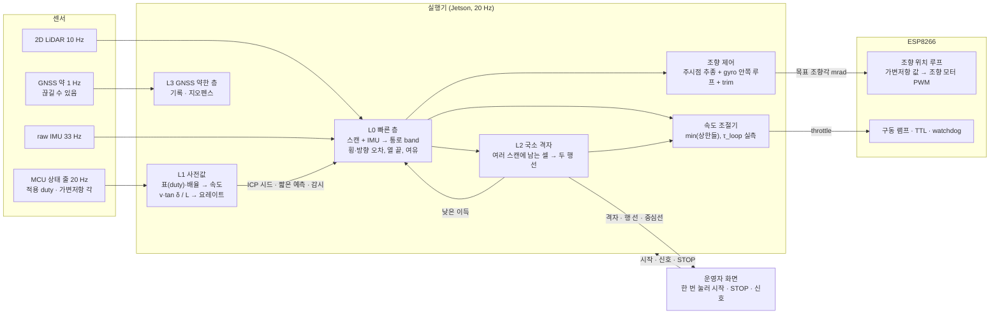

# 앞바퀴 조향 설계 v2 — v1 개정

- 작성: 2026-11-12. 작업 번호 ST-08(PC-01을 함께 한다).
- 상태: 개정 문서다. 구현 전이다. 이 문서로 바뀌는 코드는 아직 없다.
- v1 파일 `DESIGN_v1_KO.md`(SHA-256 `41efde0e5771b0f131b9e129cf194c5c87e3e89b99caa2cf0f3b721a9acc1c51`)는 바꾸지 않았다. 결정 기록과 합격 기준이 이 SHA를 가리킨다.
- 읽는 법: v1과 이 문서를 같이 읽는다. 둘이 다르면 이 문서가 우선한다. 이 문서와 `DECISIONS_KO.md`가 다르면 결정 기록이 우선한다(결정 기록 머리말의 규칙 그대로).
- 각 개정에는 바꾸는 v1 절(행 번호), v1 규칙, 새 규칙, 이유, 맡는 작업을 적었다. 결정 기록 번호는 R30~R38이다. 합격 기준 개정은 `SIM_ACCEPTANCE_KO.md` 개정 30~32다.
- 근거: 2026-11-11 사용자 요청과 2026-11-12 계획 승인(계획 문서 `todo.md` 1절 2~21번, 4절 가1~가4, 나10·나11·나16). 조사 `D:/Develop/UBTS/steering-sim-20261108/runs/replan_20261111/RESULT_perception_control.txt`, `RESULT_steer_status.txt`. PWM 분석 `D:/Develop/UBTS/steering-sim-20261108/runs/pwm_20261112/REPORT_KO.md`. 지연 값은 `TIMING_BASELINE_KO.md`.
- 표기는 v1과 같다: [확인] 파일·기록으로 확인, [추정] 근거에서 유추, [가정] SIM 가정값, [제안] 이 문서의 설계, [미정] 사용자 답이나 실측이 필요. 근거가 약한 숫자는 '자리값'이라고 적는다.
- 이 문서에는 GNSS 좌표와 접속 정보가 없다.

---

## 0. 요약

1. 목표는 그대로다. 과수원 열 하나를 처음부터 끝까지 행간 중심선을 따라 달리고 열 끝에서 선다. 유턴은 없다.
2. 입력 규칙을 바꾼다(V2-1). 통로 위치와 열 끝은 지금처럼 LiDAR와 raw IMU로 정한다. PWM과 조향각은 한정된 사전값으로 쓴다. GNSS는 끊김을 허용하는 약한 층으로 쓴다. 일반 GNSS 오차(10/10 기록 p50 5.3~10.0 m)가 열 간격(3.6~4.1 m)보다 커서 횡 위치에는 쓰지 않는다.
3. 자율 주행은 한 번 눌러 시작해 열 끝까지 간다(V2-2). 누르고 있을 필요가 없다. 대신 시작한 화면이 운영자 신호를 계속 보내고, 마지막 신호 뒤 0.5 s가 지나면 선다. 화면 STOP, 센서 신선도, 브리지·MCU 기한, 물리 비상정지와 동행자는 그대로다. 자동 재출발은 없다.
4. 실행기 안에 굴러가는 국소 점유 격자를 둔다(V2-3). 여러 스캔에 남는 셀로 두 행 선을 맞춰 빠른 층을 안정시키고 화면에 그린다. Jetson의 누적 지도는 표시·교차 확인용이다.
5. 속도는 연산 지연과 스캔 나이에 맞춰 정한다(V2-4). v_ref = min(순항, d_scan/T_scan, d_blind/τ_loop, d_map/A_map, 정지 거리, 곡률, 횡오차, 조향 포화, 품질, 열 끝). τ_loop 시작값은 0.35 s(추정)이고 틱마다 잰다.
6. 현장에서 고칠 값을 기본·고급·잠금 묶음으로 나눈다(V2-5). 정지 상태에서만 바꾼다. 실차와 두 SIM이 같은 파일을 읽고, 바꿀 때마다 기록을 남긴다.
7. 조향 하드웨어 기본 가정을 사용자 설명에 맞춘다(V2-6). 벨트로 이은 가변저항, 일반 DC 모터와 모터 드라이버, ESP 안의 위치 루프, 리밋 스위치 없음. 값은 모두 자리값이다.
8. 목표 속도는 0.40 m/s(0.20~0.50)다. 열 끝 정지 위치 e(앞범퍼 − 마지막 줄기 선)는 v1 그대로 ±1.0 m 안이다(V2-7).
9. 이 문서 때문에 바뀌는 합격 기준은 셋이다. A13(GNSS·사전값 입력), A17(자율 시작·정지 항목 추가), A11(보고 항목 추가). 그 기준으로 재는 측정은 아직 없다.

## 1. 바뀐 절 한눈에

| 개정 | 바꾸는 v1 절(행) | v1 규칙 | 새 규칙 | 이유 | 결정 |
|---|---|---|---|---|---|
| V2-0 범위 | 1.2(69행), 6절 머리말(1003행) | 열 추종 제어기는 이번 단계 범위 밖. 6절은 방향만 | 제어기·속도 조절기·격자 층·GNSS 층·현장 조정 값을 4단계에서 만든다 | 목표가 한 열 추종 제어기까지로 정해졌다 | R30 |
| V2-1 입력 | 1.1(61행), 1.2(68행), 1.4 2·3·4항(90~92행), 2.6(256행), 3.7(423행), 4.3(848행), 5.3 `gps_absent`(993행), 6.2 가변저항 쓰임(1033행), 9절 Q8(1551행) | 위치 추정은 LiDAR + raw IMU만. PWM 적분 금지. GPS는 어떤 조건에서도 제어 입력 아님. 가변저항은 되먹임·감시만 | LiDAR + raw IMU가 주 입력. PWM·조향각은 한정된 사전값. GNSS는 약한 층(기본 기록만) | 사용자 요청 10·12, 계획 가2. GNSS 정확도 | R31 |
| V2-2 시작·정지 | 6.5(1049행)에 새 6.9 더함, 4.4(865행)에 자율 화면 더함. 실행기의 누름 유지 규칙(`EXECUTOR_STEER_KO.md` 3절, `executor_main.py` 머리말) | 자율 주행은 누르고 있는 동안만. 놓거나 누름 신호가 0.5 s 끊기면 정지 | 한 번 눌러 시작. 운영자 신호가 0.5 s 끊기면 정지. 새 누름 없이 재출발 없음 | 사용자 요청 7, 계획 가1 | R32 |
| V2-3 격자 층 | 6.1(1005행) 구조 | 바깥 루프는 추정기의 통로 중심선. 격자 없음 | 네 층(빠른 층, 사전값, 국소 격자, GNSS). 격자를 화면에 그림 | 사용자 요청 14, 계획 가3 | R33 |
| V2-4 속도 | 6.3(1035~1040행) 전체 | 상한은 목표·곡률·횡오차·조향 포화·열 끝뿐. 연산 지연과 무관 | 연산 지연·스캔 나이·격자 나이·정지 거리를 넣은 조절기 | 사용자 요청 15 | R34 |
| V2-5 조정 값 | 새 절(v1에 없음). 3.8 F표 `v_target_m_s`(604행)와 이어짐 | 현장 조정 키 3개(실행기 화면) | 기본·고급·잠금 묶음, 정지 상태에서만, 한 파일, 변경 기록 | 사용자 요청 20·21, 계획 나16 | R35 |
| V2-6 조향 하드웨어 | 3.3(318행), 3.4(354행), 3.8 C·E표(570행 `pot_to_steer_ratio`), 9절 Q1·Q2·Q10·Q11 | 벨트 없음. 비 1~5. 리밋 스위치 언급 없음 | 벨트로 이은 가변저항, 일반 DC 모터·드라이버, ESP 위치 루프, 리밋 스위치 없음 | 사용자 요청 2~5, 계획 가4 | R36 |
| V2-7 속도·열 끝 | 3.8 F표 604행, 9절 L4(1568행), 1.1(59행) | 목표 0.4 m/s, 범위 0.2~0.6 | 목표 0.40 m/s, 범위 0.20~0.50, 잠금 최대 0.50. 열 끝 정의는 그대로 | 계획 나10·나11 | R37 |

v1에서 바꾸지 않는 것: 참값 격리(1.4 1항), 두 단계 SIM 구조(2절), 차량 모델과 자리값 표(3절, V2-6이 더하는 항목 말고), ESP 규약 V3와 정지 모드 표(4.1절), 브리지 제어 API(4.2절), 기록 스키마(4.5절), 월드(5.1·5.2절), 횡 제어의 형태(6.2절, V2-5가 이득을 드러내는 것 말고), 열 끝 판정 규칙(6.4절), 평가 지표의 정의(7.1절).

---

## 2. 전체 구조



- 조향 명령과 열 끝 판정은 L0(필요하면 L2가 안정시킨 L0)에서만 나온다. L1과 L3은 조향 명령을 직접 만들지 않는다.
- 직진을 붙잡는 힘은 ESP의 가변저항 위치 루프가 낸다(V2-6). 실행기는 목표 조향각만 보낸다.

---

## 3. 개정

### V2-0 범위

- 바꾸는 절: 1.2절 69행("이번 단계의 열 추종 제어기 구현"은 범위 밖), 6절 머리말 1003행("이번 단계에서는 열 추종 제어기를 구현하지 않는다").
- 새 규칙:
  - 열 추종 제어기, 속도 조절기, 국소 격자 층, GNSS 약한 층, 현장 조정 값은 4단계(계획 6.4절, PC-04~PC-19)에서 만든다.
  - 범위 밖은 그대로다: 유턴, 다음 열 진입, 여러 열, 카메라 영상 인식, 실차 주행, Jetson 설치, 펌웨어 쓰기, 장착 보정.
- 이유: 2026-11-11에 목표가 '열 하나를 추종하는 자율 주행'으로 정해졌고 2026-11-12에 계획 전체가 승인됐다.

### V2-1 입력 규칙

바꾸는 절: 1.1절 61행, 1.2절 68행, 1.4절 2·3·4항(90~92행), 2.6절 256행(실행기 구독 허용 목록), 3.7절 423행, 4.3절 848행, 5.3절 `gps_absent`(993행), 6.2절 마지막 항(1033행), 9절 Q8(1551행).

v1 규칙:

- 위치 추정 입력은 합성 2D LiDAR와 raw IMU뿐이다. PWM 적분은 넣지 않는다.
- PWM은 엔코더가 아니다. 가변저항은 제어 되먹임과 고장 감시에만 쓴다(Q8 기본 '아니오').
- GPS는 어떤 조건에서도 제어 입력이 아니다.

새 규칙(1.4절 2·3·4항을 아래로 바꾼다):

1. **주 입력.** 통로 위치(횡오차, 방향 오차, 폭)와 열 끝 판정의 주 입력은 2D LiDAR(S2 형식)와 raw IMU다(L0 빠른 층). 이 둘이 신선하지 않으면 조향하지 않고 선다(V2-2의 신선도 규칙).
2. **PWM과 조향각은 사전값이다(L1).**
   - 입력: MCU 상태 줄의 적용 duty(`L`, `R`)와 보정한 가변저항 각(`pos`), 그리고 실행기가 보낸 명령. 요청값만으로 계산하지 않는다. 플랜트 참값은 쓰지 않는다.
   - 계산: 속도 사전값 v_p = 표(duty) × k_field. 요레이트 사전값 r_p = v_p·tan δ_meas / L. 표와 k_field는 V2-5의 현장 조정 파일에서 온다.
   - 쓰임:
     - (가) ICP 시드. 이동 시드에 v_p·Δt를 쓴다. 회전 시드는 지금처럼 gyro다.
     - (나) 스캔 정합이 실패한 짧은 구간의 예측. 최대 1 s 또는 0.5 m 가운데 먼저 오는 것까지만(자리값). 그동안 속도 상한은 최저 속도다. 넘으면 일시정지한다(`prediction_limit`).
     - (다) 어긋남 감시. LiDAR 속도와 v_p의 비를 약 20 s 평균으로 화면에 보이고 기록한다(온라인 배율, PW-10). 오래 어긋나면 '표 어긋남'을 표시한다. 그것만으로 서지는 않는다.
     - (라) 속도 앞먹임(V2-4).
     - (마) 진행 거리의 보조. LiDAR 거리와 함께 기록하고 백스톱 판단에 참고한다.
   - 금지: 사전값만으로 1 s 넘게 조향하기, 사전값으로 열 끝 판정하기, LiDAR 확인 없이 사전값을 위치에 쌓아 가기.
   - 상태 줄이 조향 상태 나이 문턱(0.3 s)보다 늦으면 사전값을 끄고 LiDAR만 쓴다.
   - PWM은 여전히 엔코더가 아니다. 가변저항은 조향 링크 각의 측정값이다. 둘 다 바퀴 속도를 재지 않는다.
   - 기본 가중은 0이다. PC-06의 SIM 확인 전에는 (가)·(나)를 끄고 (다)·(마)만 켠다.
3. **GNSS는 약한 층이다(L3).**
   - 모드: `off` / `log_only` / `geofence` / `weak_constraint`. 기본은 `log_only`다(열린 선택 4).
   - 쓰임:
     - 기록과 화면 표시(나이, 수평 정확도, fix 종류, 모드).
     - 지오펜스(`geofence` 모드): 시작할 때 구역을 정한다. 시작점, L0가 정한 열 방향, 열 길이(운영자 입력 또는 백스톱 최대값)로 만든 직사각형에 여유를 둔다. 품질이 좋은 GNSS 위치가 구역 밖으로 여유보다 멀리 나가면 정지한다(`gnss_geofence`). 시작 때 품질이 나쁘면 그 run에서는 지오펜스를 쓰지 않고 기록만 한다.
     - 진행 거리의 큰 어긋남 표시. 표시만 한다.
   - 쓰지 않는 곳: 횡오차, 진행 방향, 어느 열인지, 열 끝 판정, 조향 명령.
   - 품질 문턱(모두 자리값): 수평 정확도 ≤ 10 m, 나이 ≤ 2.5 s, 튐 기각은 L0로 예측한 위치와의 차이 > 3 × 수평 정확도. 지오펜스 여유는 max(10 m, 3 × 수평 정확도).
   - 끊김, 품질 미달, 튐은 'GNSS 없음'으로 처리한다. 그것만으로 서지 않는다.
   - `weak_constraint`는 RTK 보정을 쓰게 될 때까지 끈다(계획 4절 다7 미답).
   - 실행기 기록과 화면 전송에는 시작점 기준 국소 미터만 남긴다. 위경도를 남기지 않는다(A16).
4. **카메라.** 추정기에 '통로 관측 공급자' 자리만 둔다. 기본 꺼짐이다(v1과 같다).
5. **참값 격리는 그대로다(1.4절 1항).** SIM의 가상 GNSS는 참 자세에서 합성한 측정이다(잡음 5~10 m, 약 1 Hz, 끊김·튐 조건). LiDAR·IMU 합성과 같은 대우다. 실행기에 가는 것은 합성 측정뿐이다.

함께 바뀌는 것:

- 1.1절 61행 "위치 추정 입력은 2D LiDAR + raw IMU" → 위 1~3항.
- 1.2절 68행 "GPS 융합"은 범위 밖에서 뺀다. 카메라·AI 위치 추정은 그대로 범위 밖이다.
- 3.7절 423행과 4.3절 848행의 "제어 입력이 아니다/아님" → "약한 층 입력(V2-1)".
- 2.6절 256행의 실행기 구독 허용 목록에 GNSS 모드가 `off`가 아닐 때만 `/gps/fix`, `/gps/data`를 더한다. 합격 기준 A13은 개정 30으로 바꾼다.
- 5.3절 `gps_absent`의 뜻: G-SIM에서 가상 GNSS를 끄고 대시보드·녹화가 정상인지 본다(그대로). 그리고 F·G에서 `log_only`로 GNSS를 켠 실행과 끈 실행의 조향·구동 명령이 같은지 본다(새).
- 5.3절에 GNSS 조건을 더한다: `gnss_dropout_5s` / `_30s` / `_60s`, `gnss_jump_5m` / `_15m`, `gnss_hacc_x3`(PC-12).
- 6.2절 1033행 "운동 예측 사전정보로 쓰는 것은 Q8 결정 뒤" → 위 2항의 한정된 사전값으로 쓴다.
- 9절 Q8의 기본값 '아니오' → '한정된 사전값으로만 쓴다(V2-1 2항)'.

이유:

- 사용자는 중심선 추종에 LiDAR, IMU, PWM, GPS를 모두 쓰고, GPS가 끊길 수 있음을 고려하라고 했다(2026-11-11, 계획 1절 10·12번, 가2).
- 10/10 기록의 GNSS는 수평 정확도 p50 5.3~10.0 m, 속도 정확도 p50 0.43~0.56 m/s였다(`TIMING_BASELINE_KO.md` 6.2절). 열 간격 3.6~4.1 m보다 크고, 목표 속도 0.40 m/s보다 크다. 그래서 횡 위치와 진행 방향에는 쓸 수 없고 구역 확인과 기록에만 쓴다.
- PWM 표는 조향 장치를 달기 전 차의 값이고 자율 속도대(25~60 %)는 거의 측정이 없다(`TIMING_BASELINE_KO.md` 7절). 그래서 위치를 쌓는 데 쓰지 않고, 짧은 구간과 감시에만 쓴다.

맡는 작업: PC-05(추정기 입력·출력), PC-06(L1), PC-12(L3와 GNSS 조건).

### V2-2 자율 주행 시작과 정지

바꾸는 것: 6.5절(1049행)에 아래 6.9절을 더한다. 4.4절(865행)에 자율 화면을 더한다. 실행기의 누름 유지 규칙(`EXECUTOR_STEER_KO.md` 3절, `tools/row_executor/executor_main.py` 머리말, `hold_timeout_s`)을 자율 run에 한해 바꾼다.

지금 규칙: 운영자 화면에서 Start → Arm → '누르고 있는' 동안만 간다. 화면은 누르는 동안 100 ms마다 신호를 보내고, 마지막 신호 뒤 0.5 s(`hold_timeout_s`)가 지나면 선다. 놓으면 선다. 새 누름마다 다시 출발한다[확인: `operator_http.py` 16·32행, `config.py` `hold_timeout_s`].

새 6.9절(자율 시작과 정지):

1. **수동 조종은 그대로다.** 4.4절의 W/S/A/D는 누르는 동안만 간다.
2. **자율 주행은 한 번 눌러 시작한다.**
   - 순서: 조종권을 가진 화면에서 Start → Arm(지금 절차) → '자율 주행 시작'을 한 번 누른다 → 열 끝까지 간다.
   - 버튼은 아래가 모두 참일 때만 켜진다: ARMED, `cal_id` 일치, 래치된 결함 없음, 센서 신선(스캔·IMU·조향 상태 문턱 안), 통로 획득(양쪽 band), 차 정지(LiDAR 속도 < 0.03 m/s), 현장 조정 파일 검사 통과(V2-5), 운영자 신호 살아 있음.
   - 조종권이 없는 다른 화면은 시작할 수 없다. STOP은 누구나 된다.
3. **운영자 신호.**
   - 시작한 화면이 run 동안 신호를 자동으로 보낸다. 버튼을 누르고 있을 필요가 없다.
   - 지금의 신호 경로와 기한을 그대로 쓴다: 100 ms마다 보내고, 마지막 신호 뒤 0.5 s가 지나면 '운영자 연결 끊김'(`operator_link_lost`)으로 일시정지한다(열린 선택 2).
   - 화면을 가리거나(visibility hidden) 페이지를 떠나면(pagehide) 신호가 멈추고 차가 선다. 지금 규칙 그대로다.
4. **정지 수단(주행 중 언제나).**

| 정지 수단 | 동작 | 출처 |
|---|---|---|
| 화면 STOP | 조종권 없이 누구나. 브리지 큐를 건너뛴다. 구동 brake, 조향 측정 위치 유지. 실행기는 래치 | v1 4.2절 |
| 운영자 연결 끊김 | 마지막 신호 뒤 0.5 s. 구동 0, 조향 그 자리. 일시정지 | 위 3항 |
| 센서 오래됨 | 스캔 나이 > 0.45 s, IMU > 0.40 s, 조향 상태 > 0.3 s, 루프 틈 > 0.35 s | 실행기 설정 `lidar_max_age_s`, `imu_max_age_s`, `steer_status_max_age_s`, `stall_guard_s` |
| 실행기 판정 | 통로 잃음, 기하 벗어남(방향 25° 등), 앞 막힘, 구동 무응답, 조향 결함·무효, 사전값 예측 한도, 지오펜스, 열 끝 | v1 6.4·6.6절, 이 문서 V2-1·V2-4 |
| 브리지·MCU 기한 | 브리지 입력 기한 0.75 s(지금 값), `C` TTL 300 ms와 링크 watchdog 500 ms(펌웨어 자리값) | v1 4.1·4.2절 |
| 물리 비상정지, 동행자 | 사람이 옆에서 걷는다. 소프트웨어 STOP은 전원 차단이 아니다 | 계획 가1 |

5. **자동 재출발 없음.**
   - 일시정지 뒤 다시 가려면 입력이 1 s 신선해진 뒤 운영자가 다시 누른다(`fresh_recover_s`).
   - 한 run의 일시정지(신선도, 운영자 연결, 속도 상한, 격자, 예측 한도)를 합쳐 3번을 넘으면 run을 끝낸다. 지금은 신선도 일시정지만 센다(`max_stale_events` 3). 세는 범위를 넓힌다.
   - 래치(STOP, 가드 위반 등) 뒤에는 확인 → Start → Arm부터 한다.
6. **브리지 쪽은 바꾸지 않는다.** 실행기는 run 동안 `deadman: true`를 담아 보낸다(지금과 같다). 브리지의 입력 기한 0.75 s와 MCU TTL은 그대로다.

4.4절에 더하는 자율 화면(대시보드 UI-08, UI-09에서 만든다):

- '자율 주행 시작' 버튼과 켜지지 않는 이유.
- STOP. 언제나 보이고 크게.
- run 상태: 주행 / 일시정지(이유) / 끝(이유). 재출발하려면 다시 눌러야 한다는 안내.
- 속도: v_ref, LiDAR 속도, 지금 묶인 상한 이름(V2-4), τ_loop.
- 격자와 두 행 선, 중심선(V2-3).
- GNSS: 모드, 나이, 수평 정확도. '없음'도 정상 상태로 보인다.
- 온라인 배율(V2-1 2항 (다)).

이유:

- 사용자는 열 시작에서 자율 주행 버튼을 클릭하면 전진하라고 했다(2026-11-11, 계획 1절 7번). 계획 가1에서 '한 번 누르면 열 끝까지, 정지는 화면 STOP, 연결이 끊기거나 센서가 오래되면 스스로 선다'로 정했다.
- 놓으면 서는 안전 장치가 없어진다. 그 대신 운영자 신호의 기한을 지금 누름 신호와 같은 0.5 s로 두고, 물리 비상정지와 동행자를 그대로 둔다.

맡는 작업: 실행기 쪽은 PC-10과 함께, 서버는 D-10, 화면은 UI-08. 합격 기준 A17에 개정 31을 더한다.

### V2-3 네 층 구조와 국소 격자

바꾸는 절: 6.1절(1005행). 지금 6.1절은 "바깥 루프: 추정기의 통로 중심선에서 곡률 기준을 만든다"로 시작한다. 실행기는 격자 없이 현재 스캔에서 바로 band를 구한다[확인: 조사 1절, `estimator.py`].

새 6.1절:

| 층 | 무엇 | 주기 | 제어에서의 쓰임 | 상태 |
|---|---|---|---|---|
| L0 빠른 층 | 현재 스캔 + raw IMU. 키프레임 ICP, 통로 band, 횡·방향 오차, 폭, 열 끝, 앞옆 여유 | 스냅샷 20 Hz, 통로 탐색은 N 스캔마다 | 주 입력 | 있음 |
| L1 사전값 | 표(duty)·배율 → 속도, v·tan δ / L → 요레이트 | 상태 줄 20 Hz | ICP 시드, 짧은 예측, 감시, 앞먹임(V2-1 2항) | 새로 |
| L2 국소 격자 | 실행기 안의 굴러가는 국소 점유 격자. 여러 스캔에 남는 셀로 두 행 선을 맞춤 | 스캔 2개마다(자리값) | L0 band를 낮은 이득으로 당김. 한쪽 가림을 버팀. 화면에 그림 | 새로 |
| L3 GNSS | V2-1 3항 | 약 1 Hz | 기록, 지오펜스 | 새로 |

L2 국소 격자:

- 실행기 안에 둔다(조사 4a절의 안 A). 창은 약 20 × 10 m, 셀은 0.05~0.10 m다(자리값, PC-07에서 셀 크기·광선 솎기·갱신 주기를 비교한다).
- L0 odometry 좌표에 스캔을 쌓는다. 창 밖으로 나간 셀은 버린다. 전역 지도가 아니다. 한 열 직진이라 전역 일관성이 필요 없다.
- 여러 스캔에 남는 점유 셀로 두 행 선을 맞춘다. 그 선과 L0 band를 섞는 융합 이득은 기본 0이다. PC-07의 SIM·재생 확인 뒤 올린다(자리값 0.2).
- 격자 나이 A_map은 융합에 쓴 행 선의 나이다.
- 격자가 늦을 때:
  - 융합 이득이 0이면 격자 나이는 제어에 영향이 없다(표시만).
  - 융합 이득이 0보다 크면 V2-4의 v_map이 속도를 낮춘다. v_map이 최저 속도 아래면 일시정지한다(`grid_stale`, 열린 선택 3). 스캔만으로 저속 버티기는 SIM 비교용 선택이다(기본 꺼짐).
- 계산 목표는 PC p99 ≤ 15 ms, ARM 오프라인 p99 ≤ 60 ms다(PC-07). 못 맞추면 갱신 주기를 낮추거나 셀을 키운다. 20 Hz 루프를 막지 않게 한다. 필요하면 별도 스레드에서 돌리고 루프는 최신 결과만 읽는다.
- 화면: 실행기는 격자 요약(행 선 두 개, 중심선, 품질, 나이)을 상태로 내고, 격자 자체는 낮은 주기(≤ 2 Hz, 자리값)로 낸다. 느린 통신에서 보내는 방법은 대시보드 묶음(UI-09, NET)이 정한다.

Jetson native 누적 지도:

- 표시와 교차 확인용이다. 제어의 필수 입력이 아니다(조사 4a절의 안 B를 쓰지 않는다).
- 이유: 10/10 기록 재생에서 지도가 기록당 6~33 s만 이어졌다(`TIMING_BASELINE_KO.md` 3.1절 J4).

이유: 사용자는 점유 격자를 실시간으로 그려 과수열을 찾고 중심선을 그리라고 했다(계획 1절 14번, 가3). 스캔 기반 빠른 층은 이미 있고 검증된 경로라 주 입력으로 남기고, 격자는 그것을 안정시키는 층으로 더한다.

맡는 작업: PC-05, PC-07, 화면은 UI-09.

### V2-4 속도 조절기

바꾸는 절: 6.3절(1035~1040행) 전체.

v1 6.3절: 속도 측정은 LiDAR 정합 속도. PWM = `forward_curve`⁻¹(v_ref) 앞먹임 + LiDAR 속도 PI. v_ref 상한은 목표 0.4 m/s, 곡률, 횡오차, 조향 포화, 열 끝뿐이다. 연산 지연이나 스캔 나이로 속도를 줄이는 규칙이 없다.

새 6.3절:

1. 속도 측정은 그대로 LiDAR 정합 속도다. IMU 가속도 적분은 쓰지 않는다.
2. 목표 속도:

```
v_ref = min(v_cruise, v_scan, v_blind, v_map, v_stop, v_curv, v_lat, v_sat, v_qual, v_end)
```

| 상한 | 식 | 시작값(자리값) | 뜻 |
|---|---|---|---|
| v_cruise | 현장 조정 값 '목표 속도' | 0.40 m/s(0.20~0.50) | 순항 |
| v_scan | d_scan / T_scan | d_scan 0.05 m | 스캔 사이에 d_scan 넘게 가지 않는다 |
| v_blind | d_blind / τ_loop | d_blind 0.15 m | 스캔이 찍히고 명령이 적용되기까지 d_blind 넘게 가지 않는다 |
| v_map | d_map / A_map | d_map 0.20 m | 격자 융합 이득 > 0일 때만 |
| v_stop | s(v) + 앞 여유 ≤ 앞쪽 빈 거리 | s(v) = v·(τ_loop + t_onset) + v²/(2a), t_onset 0.25 s, a 1.07 m/s², 앞 여유 0.35 m | 정지 거리 |
| v_curv | √(a_lat,max / \|κ_ref\|) | a_lat,max 0.3 m/s² | 곡률(v1과 같다) |
| v_lat | 횡오차가 클수록 낮춤 | PC-10에서 정함 | v1과 같다 |
| v_sat | 조향 포화 중 낮춤 | 등가 소프트 한계 95 % 이상 또는 변화율 제한 중 | v1과 같다 |
| v_qual | 통로 한쪽만 보임, 사전값 예측 중 | 최저 속도 | 새 |
| v_end | 열 끝 접근 | 남은 거리 ≤ 1.5 m + 정지 거리면 0.20 m/s(접근 거리는 자리값, 조사 4d절) | v1 6.4절의 접근 감속 |

3. 실측: τ_loop, T_scan, A_map은 틱마다 잰다.
   - τ_loop(t) = (명령 송신 시각) − (그 명령을 만든 스캔의 시각, 실행기의 헤더 보정 시각) + t_link. t_link는 상수 0.03 s(자리값)다.
   - T_scan은 처리한 스캔 사이 간격이다.
   - 조절기는 τ_loop와 T_scan의 최근 2 s 창 p90을 쓴다(열린 선택 5). 단발 틈은 신선도 문턱(V2-2 4항)이 막는다.
   - 표본이 없을 때(run 시작 직후)는 `TIMING_BASELINE_KO.md` 1절의 시작값(τ_loop 0.35 s, T_scan 0.10 s)을 쓴다.
4. 출력:
   - duty = clamp(표⁻¹(v_ref / k_field) + PI(v_ref − v_LiDAR), duty_min, duty_max). 표와 k_field는 V2-5의 파일에서 온다. k_field는 '표 속도 × k_field = 예상 속도'라는 뜻이다.
   - 호스트 쪽 duty 변화 속도는 올림 5 %/s, 내림 15 %/s다(자리값). MCU 램프 100 %/s는 그대로다.
   - 출발은 데드밴드를 넘는 짧은 출발 duty를 제한된 크기로 준다(v1과 같다). 후진은 없다.
5. 최저 속도: v_ref가 최저 속도(0.20 m/s) 아래로 묶이면 구동 0으로 일시정지한다(`speed_cap_below_min`, 열린 선택 6). 데드밴드 근처의 어중간한 duty를 내지 않는다. 다시 가려면 새 누름이 필요하다. 앞 막힘(v_stop)과 열 끝(v_end 뒤 정지)은 지금 분류(OBSTACLE, 열 끝)를 그대로 쓴다.
6. 과속 보호: LiDAR 속도가 잠금 최대 속도 + 0.05 m/s를 넘으면 duty를 표⁻¹(최저 속도)로 낮추고, 1 s 넘게 이어지면 일시정지한다(`overspeed`, 자리값).
7. 상태와 기록: 상한마다 값, 지금 묶인 상한 이름, τ_loop, T_scan, A_map, 온라인 배율을 상태와 실행 기록에 낸다.

시작값으로 계산한 예(`TIMING_BASELINE_KO.md` 8.3절): 정상이면 v_scan 0.50, v_blind 0.43, v_map 0.67 m/s라 순항 0.40 m/s가 묶인다. 스캔 하나가 빠지면 0.25 m/s, 격자 나이 1.5 s면 일시정지다.

이유: 사용자는 연산이 실시간으로 되는 한에서 속도를 조절하되 너무 느리지 않게 하라고 했다(계획 1절 15번). Jetson에서 주행 중 잰 처리 시간이 없어 고정 속도를 정할 근거가 없다(`TIMING_BASELINE_KO.md` 머리말). 그래서 시작값을 추정으로 두고 실측으로 맞추는 조절기로 한다.

맡는 작업: PC-10. 조건은 PC-11(`compute_slow_x3`, `compute_stall_0p2`·`_0p5`, `map_stale` 사다리). 합격 기준 A11에 개정 32를 더한다.

### V2-5 현장 조정 값

새 절이다. v1에는 현장 조정 값의 형식이 없다. 지금 실행기 화면에서 바꿀 수 있는 값은 3개(`base_duty_pct`, `reduce_duty_pct`, `max_differential_pct`)이고 모두 차동용이다[확인: 조사 1-3절].

1. **파일 하나.** 실차 실행기, F-SIM, G-SIM이 같은 파일을 읽는다(PW-08). 실행 기록마다 그 파일의 SHA-256과 프리셋 이름을 남긴다. 스키마 이름은 `ubts.field_tuning.v1`을 제안한다[제안, PW-07에서 확정].
2. **세 묶음(계획 나16).**

| 묶음 | 값(시작값은 자리값) | 화면 |
|---|---|---|
| 기본 | 속도 표 배율 k_field 1.00(0.5~1.3), 목표 속도 0.40(0.20~0.50) m/s, 주시거리(바닥 1.5 m, 속도당 1.25 s, 상한 3.0 m), 횡 이득 k_d 1.0, 방향 이득 k_ψ 1.0, 조향 명령 변화 속도 상한(측정 조향 속도의 0.8배 이하) | 고칠 수 있음 |
| 고급 | duty→속도 표의 점, 지면 사전 설정 배율, 배터리 배율, duty 범위, 속도 PI 이득, duty 올림·내림 속도, 출발 duty, gyro 안쪽 이득 k_r 0.3, trim 적분 이득과 한도 ±3°, 손 0점 보정 ±3°, 추종 중 조향 한도 ±12°, 명령 저역 필터 0.25 s, 반전 히스테리시스 1.0°, 반전 사이 0.5 s, 오차 데드밴드 0.03 m·1°, 통로 탐색 주기, band 이득, 격자 셀·창·융합 이득, d_scan·d_blind·d_map, 열 끝(정지 오프셋, 접근 구간, 확인 횟수, 열 길이), GNSS(모드, 품질 문턱, 튐 문턱, 지오펜스 여유) | 고칠 수 있음(펼쳐야 보임) |
| 잠금 | 최대 속도 0.50 m/s, duty 상한, 신선도 문턱(스캔 0.45 s, IMU 0.40 s, 조향 상태 0.3 s, 루프 틈 0.35 s), 운영자 연결 기한 0.5 s, 앞 여유 0.35 m, 기하 가드(방향 25°, 횡), 조향 소프트 한계, stall·결함 문턱, TTL·watchdog, 사전값 예측 한도(1 s·0.5 m), 과속 한도 | 읽기만. 파일을 고치고 다시 시작해야 바뀐다 |

3. **주시점 추종의 이득.** v1 6.2절의 주시점 횡 위치 y_L을 횡오차 몫과 방향 오차 몫(L_d·sin ψ_e)으로 나누고, 각각에 횡 이득 k_d와 방향 이득 k_ψ를 곱한다[제안]. 두 몫의 부호는 v1의 y_L과 같게 둔다. κ_ref = 2·y_L / L_d²는 그대로다. 기본 k_d = k_ψ = 1이면 v1과 같다. 주시거리는 L_d = clamp(1.5 + 1.25·v, 1.5, 3.0) m라 0.40 m/s에서 2.0 m다(조사 4b절).
4. **적용 시점.**
   - 정지 상태에서만 바꾼다: run 밖이고, 구동 0이고, LiDAR 속도가 0.03 m/s 아래일 때.
   - run을 시작할 때 값을 읽어 그 run 동안 고정한다.
   - run 중 바꾸려는 요청은 거절하고 이유를 보인다(`tuning_locked_while_running`).
5. **검사(PW-07).** 범위, 중복 키, NaN, duty에 따라 줄어드는 표를 거부한다. 값 사이 규칙도 본다: 최저 속도 < 목표 속도 ≤ 잠금 최대 속도, 주시거리 바닥 ≤ 상한, 추종 중 조향 한도 ≤ 등가 소프트 한계.
6. **기록.**
   - 변경 기록(JSONL) 한 줄: 시각, 키, 이전 값, 새 값, 바꾼 뒤 설정 digest.
   - run 결과에 그 run의 digest와 프리셋 이름을 묶는다.
   - 프리셋(이름, 날짜, 지면, 배터리 메모)을 저장하고 불러온다. 기본 프리셋으로 되돌리면 digest가 기본값과 같다.
7. **온라인 배율.** LiDAR 속도 ÷ 표 속도를 약 20 s 평균으로 보이고 기록한다. 저장은 주행 뒤 운영자가 고른다. 자동으로 바꾸지 않는다(PW-10).

이유: 사용자는 현장에서 자율 주행 성능을 보고 PWM-이동거리 값을 손으로 고치고, 가중치 같은 값도 바꿔 가며 실험하겠다고 했다(계획 1절 20·21번). 계획 나16에서 기본·고급 묶음, 잠긴 안전 한계, 정지 상태에서만 적용으로 정했다. 잘못된 값으로 달리는 일을 막기 위해서다.

맡는 작업: PW-07(스키마·검사), PW-08(세 곳 연결), PC-13(프리셋·변경 기록), PW-10(온라인 배율), 화면은 UI-12.

### V2-6 조향 하드웨어 기본 가정

바꾸는 절: 3.3절(318행), 3.4절(354행), 3.8 C·E표(570행 `pot_to_steer_ratio` 등), 9절 Q1·Q2·Q10·Q11의 기본값.

사용자 설명(2026-11-11): 조향 장치와 가변저항을 벨트로 잇는다. 가변저항 값을 기준으로 모터를 돌려 조향을 제어한다. 조향 모터는 서보가 아닌 일반 모터이고, 모터 드라이버로 구동 바퀴처럼 돌린다.

새 기본 가정:

1. 가변저항은 조향각 센서다. 조향 장치에 벨트로 이어져 있다. 구동 바퀴 엔코더는 없다(Q1 답).
2. 조향 모터는 일반 DC 모터다. 모터 드라이버(PWM 입력 두 개와 EN, BTS7960류를 자리값으로 둔다)로 돌린다(Q11 일부 답). 자기 잠금은 기본 false다(v1 그대로).
3. 위치 루프는 ESP에서 가변저항 값으로 닫는다. Jetson은 목표 조향각만 보낸다(계획 가4, Q4 답). v1 4.1절 규약 V3 그대로다.
4. **리밋 스위치는 없다고 본다.**
   - 끝 보호는 가변저항 소프트 한계, 기계 끝 멈춤, STALL·TRACK 판정뿐이다.
   - 벨트가 미끄러지면 소프트 한계도 같이 어긋난다. 그래서 호스트에 '0점 이동' 감시를 둔다: trim 적분이 한도의 80 %를 넘거나 `steering_ineffective`가 켜지면 정지하고 재보정을 요구한다(`steering_zero_shift`, 자리값).
   - 같은 ESP8266을 쓰면 남는 핀이 D4 하나라 스위치 둘을 MCU로 읽기 어렵다(v1 4.1절 A안). 스위치가 생기면 배선 방식과 함께 다시 정한다.
5. **벨트 모형(ST-10에서 프로필 v0.2에 넣는다. 모두 자리값, 출처 `SPEC_PENDING`).**
   - 벨트 비: `pot_to_steer_ratio` 범위를 1 미만도 받게 넓힌다(자리값 0.5~5). 프로필을 읽을 때 '조향 전 범위 × 비'가 가변저항 유효 범위(raw 60~963, 270° 가운데 약 238°) 안인지, 보정 반쪽 폭이 50 count 이상인지 검사한다.
   - 측정 쪽 유격: 벨트 늘어남·물림 틈을 링크 백래시와 따로 둔다.
   - 정상 운행 중 미끄럼: 이가 있는 벨트의 이 건너뜀(계단), 마찰 벨트의 누적 미끄럼.
   - 끊어짐·벗겨짐: 가변저항이 멈춘 것과 같은 꼴이다. 서보가 끝까지 민다. STALL·TRACK이 기계 끝 전에 잡는지와 그동안 옆 벗어남을 잰다.
   - 배터리: 조향 모터가 구동과 같은 배터리면 전압 배율을 조향 속도에도 건다.
6. **직진 유지.** 외력이 조향을 밀면 ESP 위치 루프가 되돌린다. 데드밴드와 유격 안의 움직임은 서보가 못 보므로 실행기의 바깥 루프와 trim이 잡는다. 규칙: 프로필에 적은 외란 크기 안에서는 래치 결함 없이 돌아와야 하고, 그보다 크면 정해진 결함으로 선다(ST-11). 지금 자리값(TRACK 3°·1.0 s, STALL, THERMAL 30 s 중 5 s)은 외력에 버티는 동안 결함 정지가 먼저 날 수 있다[확인: `EXECUTOR_STEER_KO.md` 7절, `DECISIONS_KO.md` R18]. 문턱은 ST-10에서 정리한다.

이유: 사용자 설명(계획 1절 2~5번)과 가4. 지금 모형과 큰 틀은 같다. 빠진 것은 벨트(비, 유격, 미끄럼, 끊어짐)와 리밋 스위치에 대한 가정이다[확인: 조사 `RESULT_steer_status.txt` '조향 하드웨어' 항목].

맡는 작업: ST-09(질문 개정), ST-10(모형과 프로필 v0.2), ST-11(외란과 직진 유지 시험), ST-17(사양 반영).

### V2-7 목표 속도와 열 끝 정지 위치

- 목표 속도: 기본 0.40 m/s, 범위 0.20~0.50 m/s, 잠금 최대 0.50 m/s(계획 나10). v1 3.8 F표 `v_target_m_s`의 범위 0.2~0.6과 9절 L4의 0.2~0.6 m/s 스윕을 0.20~0.50으로 바꾼다.
  - 이유: 스캔이 10 Hz라 0.40 m/s면 스캔 사이에 4 cm 간다. 옛 기록의 100 % duty는 약 0.9 m/s였다. 0.40 m/s에 해당하는 duty는 조향 장착 전 차 기준 약 42~44 %다(`TIMING_BASELINE_KO.md` 7절).
- 열 끝 정지 위치: 계획 나11 '마지막 나무를 지나 1 m 안에서 정지(±1.0 m)'를 v1의 정의와 같은 것으로 본다. e = 정지 때 앞범퍼 s − 마지막 줄기 선 s_E, 목표 0, OK 띠 [−1, +1] m다(v1 1.1절 59행, 7.1절). 바꾸지 않는다(열린 선택 7).

맡는 작업: PC-10, PC-14.

---

## 4. 합격 기준 개정

`SIM_ACCEPTANCE_KO.md`에 아래를 등록한다. 이 기준으로 재는 첫 측정보다 먼저 커밋한다. 이 작업에서는 아무것도 재지 않았다.

| 개정 | 검사 | 내용 | 기준 변경 |
|---|---|---|---|
| 30 | A13 참값 격리 | GNSS 모드가 `off`가 아닐 때만 `/gps/fix`, `/gps/data` 구독 허용. GNSS 값이 통로 추정과 조향 명령으로 가는 경로 0. `log_only`에서 GNSS 유무에 따른 명령 차이 0. 사전값 입력은 상태 줄·실행기 명령뿐 | 허용 목록을 넓히고 확인 항목을 더함 |
| 31 | A17 안전 동작 | 운영자 연결 끊김 → 구동 0 송신 ≤ 0.5 s + 1틱. 새 누름 없이 재출발 0. 다른 화면의 시작 거절. 신선도 문턱 넘으면 0.1 s 안에 구동 0 | 항목 추가. 기존 항목은 그대로 |
| 32 | A11 처리 시간(보고) | τ_loop 구성(스캔 나이, 틱 기다림, 한 걸음, 송신 기다림)의 분포와 묶인 상한 이름의 시간 비율 | 아님(보고 전용) |

## 5. 조향 사전등록(PC-14)에 넣을 것

- 새 정지 이유와 분류: `operator_link_lost`, `prediction_limit`, `gnss_geofence`, `grid_stale`, `speed_cap_below_min`, `overspeed`, `steering_zero_shift`, `tuning_locked_while_running`(거절 이유). 분류는 평가 전에 정하고 뒤에 더 유리한 쪽으로 바꾸지 않는다(v1 6.6절 규칙).
- 새 지표: 틱마다 v_ref ≤ 공식값 + 0.02 m/s인 비율, 묶인 상한 이름별 시간 비율, 일시정지 이유별 횟수, 사전값 예측 구간의 길이와 끝의 위치 오차, `log_only` GNSS의 명령 차이, 지오펜스 거짓 정지 수.
- 새 조건: PC-11(`steer_kick_rut`, `side_slope_crab`, `lateral_push_step`, `battery_sag`, `speed_scale_06`, `pwm_table_off_±30`, `compute_slow_x3`, `compute_stall_0p2`·`_0p5`, `map_stale` 사다리), PC-12(GNSS 조건, V2-1).
- 알려진 한계에 더할 것: 주행 중 Jetson 처리 시간 없음, τ_loop 추정, PWM 표는 조향 장착 전 차의 값, GNSS는 일반 fix.

## 6. 열린 선택

계획이 정하지 않은 것은 보수적인 쪽을 골랐다. 답이 오거나 측정이 나오면 결정 기록에 새 번호로 바꾼다.

| 번호 | 선택 | 고른 것 | 다른 안 | 이유 |
|---|---|---|---|---|
| 1 | 결정·개정 번호 | R30~, 개정 30~ | 이어지는 번호 | 같은 날 다른 브랜치가 R21부터 쓰고 있어 겹치지 않게 했다 |
| 2 | 운영자 연결 기한 | 지금 `hold_timeout_s` 0.5 s 그대로 | 브리지 입력 기한 0.75 s 등 더 긴 값 | 새 값을 만들지 않고 지금 안전 기한을 지킨다. 느린 2.4 GHz에서 거짓 정지가 많으면 측정 뒤 다시 정한다 |
| 3 | 격자가 늦을 때 | 일시정지 | 스캔만으로 저속 버티기(최대 5 s 또는 2 m) | 더 보수적이다. 다른 안은 SIM 비교용 선택으로 둔다 |
| 4 | GNSS 기본 모드 | `log_only` | `geofence` 기본 | 지오펜스는 PC-12에서 거짓 정지 0을 확인한 뒤 켠다. RTK 보정 계획은 미답(다7) |
| 5 | τ_loop·T_scan 창 통계 | 최근 2 s p90 | 최댓값 | 최댓값이면 10/10 기록의 단발 스캔 틈(최대 0.309 s)만으로 일시정지가 잦아진다. 단발 틈은 신선도 문턱이 막는다. 최댓값 안은 SIM 비교로 남긴다 |
| 6 | 속도 상한이 최저 속도 아래일 때 | 일시정지(새 누름 필요) | 최저 속도로 계속 | 상한을 어기지 않는다. 자동 재출발 없음 원칙과 맞다 |
| 7 | 열 끝 정지 위치 | v1 정의 그대로(목표 e = 0, ±1.0 m) | 열을 완전히 빠져나간 뒤 정지 | 나11이 초안이고 v1과 맞는다 |
| 8 | GNSS 품질 문턱과 지오펜스 여유 | 수평 정확도 10 m, 나이 2.5 s, 여유 max(10 m, 3 × 수평 정확도) | 더 좁은 값(예: 5 m) | 거짓 정지를 줄이는 쪽으로 넓게 잡았다. 5 m 문턱이면 10/10 기록의 fix 대부분이 걸러진다 |
| 9 | 조향 하드웨어 미정 값 | 모두 자리값(리밋 스위치 없음, 벨트 비 0.5~5) | 사양 대기 | 계획 4절 다1이 아직 답이 없다 |

## 7. 근거

- 계획 `todo.md` 1절(요청 2~21번), 4절 가1~가4, 나10·나11·나16, 다1·다7·다9, 6.4절(ST-08, PC-02, PC-05~PC-14).
- 조사 `D:/Develop/UBTS/steering-sim-20261108/runs/replan_20261111/RESULT_perception_control.txt`: 1절(지금 사슬), 4a~4e절(네 층, 조향, 속도 조절기, 열 끝·이상 처리), 5절(현장 조정 값), 8절(규칙과 달라지는 곳), PC-01.
- 조사 `D:/Develop/UBTS/steering-sim-20261108/runs/replan_20261111/RESULT_steer_status.txt`: 조향 하드웨어 항목, 목표 비교 항목, ST-08.
- PWM 분석 `D:/Develop/UBTS/steering-sim-20261108/runs/pwm_20261112/REPORT_KO.md`.
- 이 저장소: `tools/row_executor/config.py`(신선도 문턱, `hold_timeout_s`, `send_hz`, `scan_latency_s`), `tools/row_executor/operator_http.py` 16·32행(신호 100 ms, 화면 가림 때 해제), `sim/ubts/closed_loop/controllers.py` 122~126행(정지 모형), `docs/steering/EXECUTOR_STEER_KO.md` 3·7절, `DECISIONS_KO.md` R18, `TIMING_BASELINE_KO.md`.
