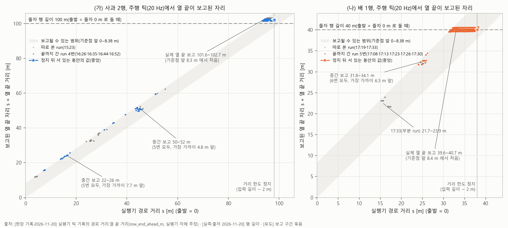
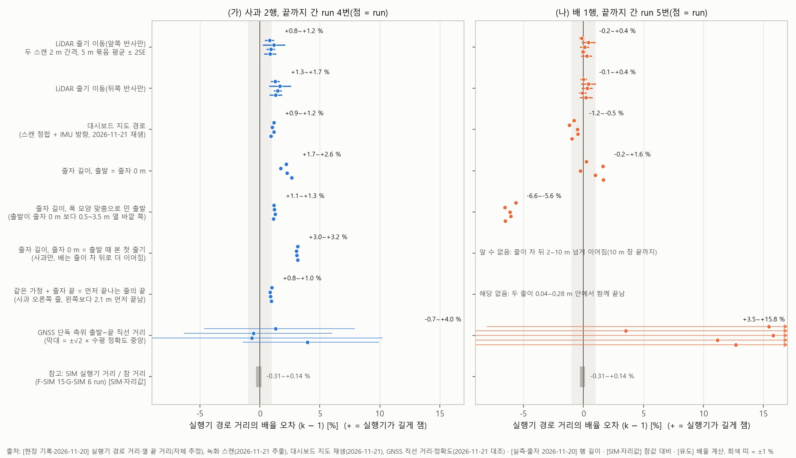
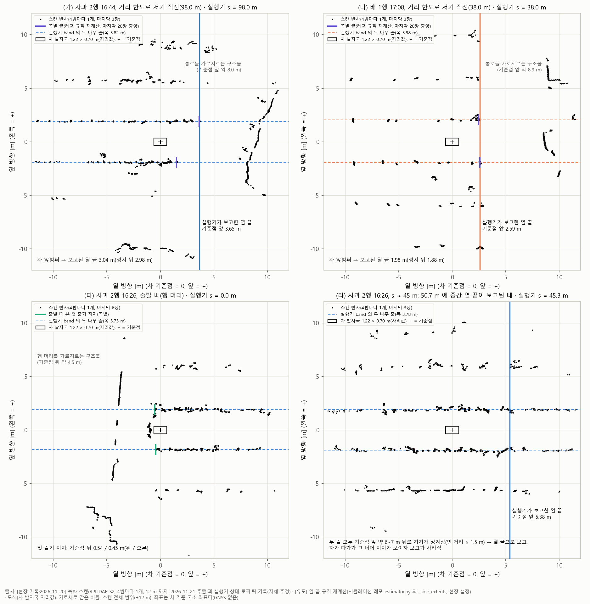
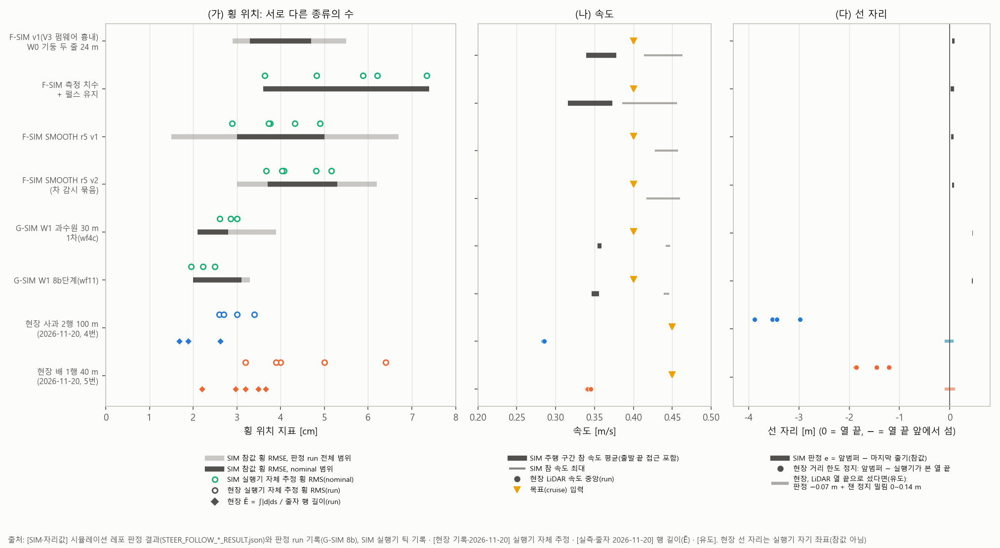

# 2026-11-20 과수원 run 추가 분석: 줄자 길이로 본 거리, 현장의 LiDAR 열 끝, SIM 과 현장

- 작성: 2026-11-22. 2026-11-20 과수원 자율주행 run 을 세 가지 물음으로 다시 봤다. (1) 실행기 경로 거리가 줄자 행 길이와 얼마나 맞는가, (2) 현장에서 LiDAR 열 끝 검출이 무엇을 보고했는가, (3) SIM 판정 수치와 현장 수치를 나란히 놓으면 무엇을 말할 수 있는가.
- 값 표지: **[현장 기록·2026-11-20]** 실행기 틱 기록·상태 토픽과 녹화 스캔에서 읽은 값(거리, 횡 오차, 열 끝 거리는 실행기 자체 추정이다), **[실측·줄자 2026-11-20]** 현장 시험 담당자가 줄자로 잰 행 길이·폭, **[SIM·자리값]** 자리값 기반 SIM 결과(현장 성능이 아니다), **[유도]** 이 문서의 계산, **[도식]** 설명용 그림 요소.
- 새로 내려받은 자료는 없다. 2026-11-21 까지 작업 폴더에 옮겨 둔 기록만 썼고 Jetson 에 접속하지 않았다. 녹화 스캔은 2026-11-21 에 뽑아 둔 배열(4빔마다 1개, 12 m 까지)을 썼다.
- GNSS 좌표는 읽지도 적지도 않았다. 틱 기록은 줄마다 `gnss` 묶음과 국소 위치 `rel_m` 을 먼저 지운 뒤 읽었고, 녹화 배열은 이름을 지정한 칸만 열었다(GNSS 칸 `gp_*` 는 열지 않음). GNSS 는 2026-11-21 대조표에 이미 m 로 줄여 둔 출발~끝 직선 거리와 수평 정확도만 썼다. 그림의 좌표는 모두 차 기준 국소 좌표다.
- 이 저장소의 추정기 코드([`sim/ubts/closed_loop/estimator.py`](../../sim/ubts/closed_loop/estimator.py), 현장 실행기 키트와 같은 코드)는 읽기 전용으로 불러 열 끝 규칙을 다시 계산하는 데만 썼다.
- 분석 스크립트와 중간 산출물은 저장소 밖 작업 폴더에 있다(10절). 경로의 `<runs>` 는 작업 폴더의 실행 기록 폴더, `<자료 폴더>` 는 현장 기록 폴더다([`PATHS_KO.md`](PATHS_KO.md) 0절).
- 이 분석으로 기존 문서의 값 몇 개를 바로잡았다(8절).

## 1. 목적

1. **거리.** 실행기는 사과 2행(줄자 100 m)에서 98 m, 배 1행(줄자 40 m)에서 38 m 에서 거리 한도로 섰다. 그때 실행기가 본 나무 줄 끝이 출발에서 어디였는지, 그것이 줄자 길이와 얼마나 다른지, 그 차이 가운데 얼마가 odometry 거리의 배율 오차인지 정직한 범위로 낸다.
2. **LiDAR 열 끝.** 현장에서는 어느 run 도 LiDAR 열 끝으로 서지 않았다. 틱 기록에서 실행기가 열 끝을 언제, 어디로, 얼마나 꾸준히 보고했는지, 정지 판정이 걸릴 수 있었는지, 걸렸다면 어디서 섰을지 본다. 줄자 행 끝과 견주고, 이것으로 말할 수 있는 것과 없는 것을 가른다.
3. **SIM 과 현장.** SIM 판정 결과(F-SIM `steer_follow_v1`·측정 치수·SMOOTH r5, Gazebo W1)의 횡 RMSE, 속도, 선 자리를 현장 수치(실행기 자체 추정 횡 RMS, 줄자 정규화 Ē, 폭 치우침)와 나란히 놓고, 왜 같은 종류의 수가 아닌지와 공정하게 말할 수 있는 것을 적는다.

## 2. 쓴 자료

| 자료 | 위치 | 쓴 것 |
|---|---|---|
| 실행기 틱 기록 원본 [현장 기록·2026-11-20] | `<자료 폴더>/recordings/field-20261120/executor_logs/`(세 실행기 세션 6개 파일) | run 마다 start 부터 run_end 뒤 90 s 까지의 모든 틱(ACTIVE·ENDED 등): 경로 거리 `dist`, 열 끝 거리 `end`(= `row_end_ahead_m`), 남은 거리 `sr.rem`, 묶인 속도 상한 `sr.cap`, 정지 판정 `still`, 속도, 횡·방향 오차, 폭, 사건(start, go, run_end) |
| 녹화 추출 배열 [현장 기록·2026-11-20] | `<runs>/field_1120_notion/out/<녹화>.npz`(2026-11-21 추출) | 스캔 점(4빔마다 1개 = 810빔, 12 m 까지, 기준점 좌표), 실행기 상태 토픽(약 7 Hz: 거리, 횡 오차, 방향 오차, 폭, 통로 유효) |
| 녹화 대조표 [현장 기록·2026-11-20] | `<runs>/field_1120_notion/out/CHECKS.json` | GNSS 출발~끝 직선 거리와 수평 정확도 중앙(m), 녹화 구간의 실행기 거리 |
| 줄자 [실측·줄자 2026-11-20] | [`orchard_tape/orchard_tape.json`](orchard_tape/orchard_tape.json) | 사과 2행 100 m(끝점 = "돌기둥 바로 앞"), 배 1행 40 m, 처음 → 끝 순서 |
| 줄자 평가 [유도] | [`ORCHARD_MEASURED_KO.md`](ORCHARD_MEASURED_KO.md), `<runs>/report_1122/orchard_tape/out/orchard_measured.json` | run ↔ 행 대응, 폭 모양 밀기 탐색 값, 지도 경로 길이(대시보드 위치 추정, IMU 방향), Ē |
| run 분석 [현장 기록·2026-11-20] | [`AUTONOMY_RUNS_ANALYSIS_KO.md`](AUTONOMY_RUNS_ANALYSIS_KO.md), `<runs>/report_1122/analysis/out/run_stats.json` | run 별 실행기 횡 RMS(실행기 지표 정의), 속도 |
| SIM 판정 결과 [SIM·자리값] | [`STEER_FOLLOW_RESULT.json`](STEER_FOLLOW_RESULT.json), [`STEER_FOLLOW_REALDIMS_RESULT.json`](STEER_FOLLOW_REALDIMS_RESULT.json), [`STEER_FOLLOW_SMOOTH_RESULT.json`](STEER_FOLLOW_SMOOTH_RESULT.json), [`STEER_FOLLOW_SMOOTH_V2_RESULT.json`](STEER_FOLLOW_SMOOTH_V2_RESULT.json), [`STEER_FOLLOW_GSIM_RESULT.json`](STEER_FOLLOW_GSIM_RESULT.json) | 판정 run 의 참값 횡 RMSE, 속도, e, 끝난 이유 |
| SIM 판정 run 기록 [SIM·자리값] | `<runs>/sim_realdims_20261116/measure/realdims_v1/runs/`, `<runs>/sim_smooth_model_20261117/measure/smooth_matrix/runs/`, `<runs>/sim_smooth_wide_20261117/measure/smooth2/runs/`, `<runs>/steer_gsim_follow_20261112/sessions/it1_*/follow/`, `<runs>/gsim_stage8_20261114/stage8b/sessions/s8b2a_*/follow/` | 같은 run 의 참값 궤적(TRACE·odom)과 SIM 실행기 틱 기록: 자체 추정 횡 RMS, 추정 오차, 경로 거리, 열 끝 보고. Gazebo 8b단계의 판정 값(저장소 결과표에는 e 만 있음) |
| 정의 | [`AUTONOMY_ALGORITHM_KO.md`](../AUTONOMY_ALGORITHM_KO.md) 5·6·7·10.2·12.9·15절 | 경로 거리(resolved polyline), 열 끝 보고 조건(두 번 확인, 8.38 m 한도), 단일 열 규칙, 정지 판정, 거리 한도, 지표 |

run 은 조향 가운데를 옮긴 뒤 끝까지 간 사과 2행 4번(16:26, 16:35, 16:44, 16:52)과 배 1행 5번(17:08, 17:13, 17:23, 17:26, 17:30)이 중심이다. 15:23(가운데 옮기기 전, 오른쪽 44 cm 치우침), 17:19(브리지 오류로 33.3 m), 17:33(Jetson 재시작으로 19.8 m)은 따로 적었다. 저녁 조각(17:54~18:01)은 차를 옮겨 다시 놓은 조각이라 거리 분석에서 뺐다. 시각은 출발(go) KST 다.

## 3. 방법

### 3.1 거리

- **실행기가 본 나무 줄 끝의 자리** D [현장 기록·2026-11-20]: 경로 거리 s + 열 끝 거리 `end`. `end` 는 기준점(발자국 가운데)에서 늦게 끝나는 쪽 나무 줄 끝까지의 열 방향 거리이고, 두 번 연속 확인(서로 1.0 m 안)된 때만, 기준점 앞 8.38 m 안일 때만 보고된다(알고리즘 문서 7.5절). 두 값을 냈다: **서 있을 때** = 거리 한도로 선 뒤 차가 움직이지 않는 동안(`still`, 거리 변화 2 cm 안, 6~71 s)의 `end` 중앙 + 그때의 거리, **달릴 때** = 마지막 열 끝 보고 구간에서 s + `end` 의 중앙. 표에는 서 있을 때 값을 쓴다.
- **출발 때 본 첫 줄기 지지** [유도]: 출발 직후 1 s(차가 0.1 m 미만 움직임)의 스캔 6~13장을 실행기의 방향 오차·횡 오차·폭으로 열 축 좌표에 놓고, 쪽마다 줄 위(±0.3 m) 반사가 3개 이상 0.3 m 안에 모인 덩어리를 차 쪽에서 뒤로 이어 간다(덩어리 사이 빈 거리 2.5 m 까지, 비교로 4.5 m 까지). 사과 2행은 2.5 m 로 이으면 행 머리 첫 줄기에서 멈추고, 4.5 m 로 이으면 그 뒤 약 4.5 m 의 가로 구조물까지 간다(그림 2 (다)). 배 1행은 나무가 띄엄띄엄해 어느 쪽으로도 줄이 차 뒤로 2~10 m 넘게 이어진다.
- **LiDAR 줄기 이동으로 본 거리 배율** [유도]: 실행기 거리로 약 2.0 m 떨어진 두 스캔(3장마다 한 쌍, 사과 run 당 약 1,000쌍, 배 약 290쌍)을 각자의 열 축 좌표에 놓고, 두 나무 줄 위 반사들이 가장 잘 겹치는 열 방향 이동 δ 를 찾는다(옆 방향은 실행기 횡 오차 차이만큼 맞춤, 최근접 거리 0.15 m 에서 자른 평균을 최소화, 0.01 m 격자 + 포물선 보간). 배율 k = 실행기 거리 차 / δ 다. ICP 적분과 경로 거리 계산을 거치지 않고 같은 LiDAR 의 거리만으로 잰 이동과 견주는 내부 확인이다. 줄기의 보이는 면이 바뀌는 치우침을 보려고 앞쪽 반사만(두 스캔 모두 기준점 앞 1~9.5 m), 뒤쪽 반사만(−7~−1 m), 전체로 따로 냈다. 쌍들이 겹치므로 5 m 구간마다 중앙을 내고 그 평균과 표준오차(SE)를 적었다.
- **줄자 길이로 본 배율** [유도]: k = D / (줄자에서 차 출발점부터 줄자 끝까지의 길이). 줄자 0 m 와 차 출발점의 관계, 줄자 끝이 어느 줄의 끝인지 적혀 있지 않아 네 경우를 냈다. (가) 출발 = 줄자 0 m, (나) 줄자 평가의 폭 모양 밀기 탐색 값(출발이 줄자 0 m 보다 사과 0.5~1.5 m, 배 2.5~3.5 m 열 바깥 쪽), (다) 줄자 0 m = 출발 때 본 첫 줄기(사과만). 이 셋은 줄자 끝 = 실행기가 보고한 열 끝(늦게 끝나는 줄)으로 둔다. (라) 줄자 0 m = 첫 줄기, 줄자 끝 = 먼저 끝나는 줄의 끝(사과만, 쪽별 끝은 아래 열 끝 규칙 재계산에서 냄).
- **다른 확인**: 대시보드 지도 위치 추정 경로(스캔 정합 + IMU 방향, 2026-11-21 재생) 길이 대비 실행기 거리, GNSS 단독 측위의 출발~끝 직선 거리 대비 실행기 거리(막대 = ±√2 × 수평 정확도 중앙, 느슨한 범위), SIM 실행기 거리 대비 참 거리(F-SIM 15 run, Gazebo 6 run).

### 3.2 LiDAR 열 끝

- 주행 틱(ACTIVE, 구동 > 0)에서 `end` 가 보고된 틱을 3 s 넘는 틈으로 나눠 보고 구간을 만들었다. 각 구간의 보고된 자리 D = s + `end`, 처음 보고된 때의 앞 거리, 가장 가까울 때의 앞 거리, 최소 `sr.rem`(= `end` − 0.61 m, 기준점에서 앞범퍼까지)을 냈다. 마지막(실제) 열 끝보다 3 m 넘게 짧은 자리를 보고한 구간을 **중간 보고**로 셌다.
- **정지 판정**(알고리즘 문서 7.7절): 통로가 유효할 때 `sr.rem` ≤ d_stop(v) = v × 0.25 + v²/(2 × 1.07) 이면 `row_end` 다. 모든 주행 틱에서 이 조건이 참이었던 틱을 셌다. **접근 감속**(10.2절): `sr.rem` ≤ 1.5 + d_stop(v_cruise, τ) 이면 0.20 m/s 로 묶는다(`sr.cap` = `end`).
- **LiDAR 열 끝으로 섰다면** [유도]: 접근 속도 0.20 m/s 에서 d_stop = 0.069 m 이므로 `end` ≤ 0.61 + 0.069 = 0.679 m 인 틱에서 판정이 난다. 그 자리(실행기 거리) = D − 0.679 m. 판정 뒤 실제로 더 미끄러진 거리는 거리 한도 정지에서 잰 값(run_end 의 거리 → 서 있을 때의 거리)을 범위로 썼다.
- **열 끝 규칙 재계산** [유도]: 정지 직전 스캔 20장에 이 저장소 추정기의 쪽별 끝 규칙(`SensorEstimator._side_extents`)을 현장 설정 그대로(단일 열 규칙: 지지 자르기 2.0 m, 마지막 줄기 켬, 엇갈린 끝 4.0 m·창 2 m, 굽은 열 포물선 켬; 현장 설정 사건에서 저장소의 설정 변환으로 다시 만든 값) 그리고 단일 열 규칙을 끈 원래 규칙으로 돌렸다. 녹화 스캔은 4빔마다 1개이고 12 m 까지라, 20 m 까지 보는 "빈 거리" 판정과 점 수 문턱은 현장과 다를 수 있다. 끝 자리 비교에만 쓴다.

### 3.3 SIM 과 현장

- SIM 값은 저장소 결과 JSON 의 판정 값을 그대로 옮겼다(Gazebo 8b단계는 판정 run 기록의 값). 판정 run 의 원본 기록이 작업 폴더에 남아 있는 묶음(측정 치수·SMOOTH r5 v1·v2 의 nominal 각 5 run, Gazebo 1차 nominal 3 run, 8b단계 nominal 3 run)에서는 **같은 run 의 실행기 자체 추정 횡 RMS**(현장과 같은 정의: 주행 틱, 통로 유효)와 참값을 견줬고, 실행기 횡 추정 − 참 횡 위치의 RMS(추정 오차)를 냈다. `steer_follow_v1` 은 판정 run 원본이 작업 폴더에 없어 판정 값만 있다.
- Gazebo 1차 nominal_2 의 기록에는 앞 세션 틱이 섞여 있어([`STEER_FOLLOW_GSIM_RESULT_KO.md`](STEER_FOLLOW_GSIM_RESULT_KO.md) 평가 수정 1 의 원인) 마지막 주행 구간만 썼다.

## 4. 결과 1: 줄자 길이로 본 거리



**그림 1.** 주행 틱(20 Hz)에서 실행기가 열 끝을 보고한 자리(가로 = 그 순간의 경로 거리 s, 세로 = s + 열 끝 거리). 옅은 띠 = 보고될 수 있는 범위(기준점 앞 0~8.38 m), 파선 = 줄자 행 길이(출발 = 줄자 0 m 로 둘 때), 점선 = 거리 한도 정지(입력 길이 − 2 m), 별 = 정지 뒤 서 있는 동안의 값. 회색 = 따로 본 run(15:23, 17:19, 17:33). 출처: [현장 기록·2026-11-20] 실행기 틱 기록(자체 추정) · [실측·줄자 2026-11-20] 행 길이 · [유도] 보고 구간 묶음.



**그림 3.** 실행기 경로 거리의 배율 오차 (k − 1) 를 방법별로 낸 것(점 = run, 숫자 = run 범위). 줄자 네 경우는 줄자 0 m 와 끝을 무엇으로 두느냐에 따른 것이다. LiDAR 줄기 이동은 5 m 구간 평균 ± 2SE, GNSS 막대는 ±√2 × 수평 정확도 중앙(오른쪽 화살표 = 그림 밖으로 이어짐), 회색 띠 = ±1 %. 맨 아래는 SIM 의 실행기 거리 / 참 거리 [SIM·자리값]. 출처: [현장 기록·2026-11-20] 실행기 거리·열 끝 거리, 녹화 스캔, 대시보드 지도 재생, GNSS 직선 거리·정확도 · [실측·줄자 2026-11-20] 행 길이 · [SIM·자리값] · [유도].

### 4.1 run 별 값

| run | 행(줄자 m) | 정지 거리 m | 서 있을 때 거리 m | 서 있을 때 열 끝 거리 m | 나무 줄 끝 D m(서 있을 때 / 달릴 때) | D − 줄자 m | 출발 때 첫 줄기 m | 첫 줄기 → 보고된 끝 m |
|---|---|---|---|---|---|---|---|---|
| 15:23 | 사과 2행(100) | 98.02 | 98.05 | 4.88 | 102.93 / 103.22 | +2.93 | – | – |
| 16:26 | 사과 2행(100) | 98.03 | 98.14 | 4.49 | 102.63 / 102.58 | +2.63 | −0.49 | 103.12 |
| 16:35 | 사과 2행(100) | 98.03 | 98.13 | 4.14 | 102.27 / 102.23 | +2.27 | −0.78 | 103.05 |
| 16:44 | 사과 2행(100) | 98.02 | 98.12 | 3.59 | 101.71 / 101.63 | +1.71 | −1.30 | 103.01 |
| 16:52 | 사과 2행(100) | 98.04 | 98.12 | 4.05 | 102.17 / 102.13 | +2.17 | −0.95 | 103.12 |
| 17:08 | 배 1행(40) | 38.04 | 38.16 | 2.49 | 40.66 / 40.60 | +0.66 | 줄이 뒤로 이어짐 | – |
| 17:13 | 배 1행(40) | 38.24 | 38.33 | 2.07 | 40.39 / 40.19 | +0.39 | – | – |
| 17:23 | 배 1행(40) | 38.03 | 38.09 | 1.82 | 39.90 / 39.66 | −0.10 | 줄이 뒤로 이어짐 | – |
| 17:26 | 배 1행(40) | 38.04 | 38.18 | 2.47 | 40.65 / 40.60 | +0.65 | 줄이 뒤로 이어짐 | – |
| 17:30 | 배 1행(40) | 38.02 | 38.03 | 2.07 | 40.10 / 40.03 | +0.10 | 줄이 뒤로 이어짐 | – |
| 17:19(부분) | 배 1행(40) | 33.33 | 33.38 | 6.55 | 39.93 / 39.78 | – | 줄이 뒤로 이어짐 | – |

정지·서 있을 때 거리와 열 끝 거리는 [현장 기록·2026-11-20], 나머지는 [유도](줄자는 [실측·줄자 2026-11-20]). 첫 줄기는 기준점 기준(− = 뒤), 두 쪽의 평균이다. 15:23 과 17:13 은 출발 직후 실행기 통로 상태가 없어 첫 줄기를 내지 못했다.

실행기는 두 나무 줄 가운데 **늦게 끝나는 쪽**을 열 끝으로 보고한다(알고리즘 문서 7.5절). 정지 직전 스캔 20장에 저장소 규칙을 다시 돌려 쪽별 끝을 실행기 거리로 냈다 [유도].

| run | 왼쪽 줄 끝 m | 오른쪽 줄 끝 m | 엇갈림 m | 먼저 끝나는 줄 − 줄자 m | 서 있을 때 앞범퍼 → 먼저 끝나는 줄 끝 m | 첫 줄기 → 먼저 끝나는 줄 끝 m |
|---|---|---|---|---|---|---|
| 15:23 | 103.13 | 100.77 | 2.36 | +0.77 | 2.11 | – |
| 16:26 | 102.57 | 100.47 | 2.10 | +0.47 | 1.72 | 100.96 |
| 16:35 | 102.16 | 100.07 | 2.09 | +0.07 | 1.33 | 100.85 |
| 16:44 | 101.63 | 99.52 | 2.11 | −0.48 | 0.79 | 100.82 |
| 16:52 | 102.14 | 100.04 | 2.10 | +0.04 | 1.31 | 100.99 |
| 17:08 | 40.48 | 40.60 | 0.12 | +0.48 | 1.71 | – |
| 17:13 | 40.14 | 40.18 | 0.04 | +0.14 | 1.20 | – |
| 17:23 | 39.59 | 39.87 | 0.28 | −0.41 | 0.89 | – |
| 17:26 | 40.45 | 40.55 | 0.10 | +0.45 | 1.66 | – |
| 17:30 | 39.94 | 40.05 | 0.11 | −0.06 | 1.30 | – |

사과 2행은 오른쪽 줄이 왼쪽 줄보다 2.09~2.11 m 먼저 끝났다(조향 가운데 옮긴 뒤 4번 모두 같음). 배 1행은 두 줄이 0.04~0.28 m 안에서 함께 끝났다.

| run | LiDAR 줄기 이동 k − 1 %(전체 / 앞쪽 / 뒤쪽, ±SE) | 지도 경로 m(k − 1 %) | GNSS 직선 m, 정확도 m(k − 1 %) | 줄자, 출발 = 0 m | 줄자, 폭 밀기(밀기 m) | 줄자, 0 m = 첫 줄기 |
|---|---|---|---|---|---|---|
| 15:23 | +0.89 / +0.76 / +1.09(±0.17) | 96.25(+1.8) | – | +2.9 | +0.9(−2.0) | – |
| 16:26 | +1.14 / +0.84 / +1.32(±0.24) | 97.12(+0.9) | 94.28, 3.6(+4.0) | +2.6 | +1.1(−1.5) | +3.1 |
| 16:35 | +1.22 / +0.90 / +1.47(±0.14) | 96.81(+1.2) | 98.62, 6.9(−0.7) | +2.3 | +1.3(−1.0) | +3.1 |
| 16:44 | +1.47 / +1.16 / +1.67(±0.42) | 97.00(+1.0) | 98.51, 4.3(−0.5) | +1.7 | +1.2(−0.5) | +3.1 |
| 16:52 | +1.11 / +0.80 / +1.27(±0.16) | 96.87(+1.2) | 96.74, 4.2(+1.3) | +2.2 | +1.2(−1.0) | +3.2 |
| 17:08 | +0.32 / +0.26 / +0.21(±0.22) | 38.33(−1.0) | 33.73, 7.9(+12.7) | +1.7 | −6.5(−3.5) | 알 수 없음 |
| 17:13 | −0.01 / −0.04 / −0.07(±0.06) | 38.39(−0.5) | 34.37, 7.7(+11.2) | +1.0 | −6.1(−3.0) | 알 수 없음 |
| 17:23 | +0.21 / +0.08 / +0.29(±0.20) | 38.17(−0.5) | 32.79, 6.9(+15.8) | −0.25 | −6.1(−2.5) | 알 수 없음 |
| 17:26 | +0.52 / +0.41 / +0.40(±0.27) | 38.44(−1.2) | 36.69, 6.0(+3.5) | +1.6 | −6.6(−3.5) | 알 수 없음 |
| 17:30 | −0.10 / −0.16 / 0.00(±0.08) | 38.29(−0.8) | 32.90, 5.9(+15.4) | +0.25 | −5.6(−2.5) | 알 수 없음 |
| 17:19(부분) | −0.44 / −0.50 / −0.29(±0.20) | 33.27(+0.1) | 26.40, 7.3(+26.1) | – | – | – |

모두 [유도](지도 경로는 2026-11-21 재생, GNSS 직선 거리와 정확도는 2026-11-21 대조표 [현장 기록·2026-11-20]). k − 1 이 + 면 실행기가 실제보다 길게 잰 것이다. 지도 경로와 GNSS 의 k 는 녹화 구간의 실행기 거리(97.94~98.00 m, 37.97~38.21 m)로 냈다.

### 4.2 묶음

| 방법 | 사과 2행 4번: k − 1 % | 배 1행 5번: k − 1 % | 무엇에 기대나 |
|---|---|---|---|
| LiDAR 줄기 이동, 앞쪽 / 뒤쪽 반사 | +0.8~+1.2 / +1.3~+1.7 | −0.2~+0.4 / −0.1~+0.4 | 같은 LiDAR 의 거리 눈금. 줄자와 무관 |
| 대시보드 지도 경로(스캔 정합 + IMU) | +0.9~+1.2 | −1.2~−0.5 | 같은 LiDAR, 다른 정합기 |
| 줄자, 출발 = 줄자 0 m | +1.7~+2.6 | −0.25~+1.65 | 줄자 0 m 와 출발점이 같다는 가정 |
| 줄자, 폭 모양 밀기 | +1.1~+1.3 | −6.6~−5.6 | 줄자 지점이 고른 간격이라는 가정, 10~20점의 모양 맞춤 |
| 줄자, 0 m = 출발 때 본 첫 줄기 | +3.0~+3.2 | 알 수 없음 | 줄자가 첫 줄기에서 시작해 늦게 끝나는 줄 끝까지였다는 가정 |
| 줄자, 0 m = 첫 줄기, 끝 = 먼저 끝나는 줄의 끝 | +0.8~+1.0 | 해당 없음(두 줄이 함께 끝남) | 줄자가 첫 줄기에서 먼저 끝나는 오른쪽 줄 끝까지였다는 가정 |
| GNSS 단독 측위 직선 거리 | −0.7~+4.0(막대 대략 ±6~10) | +3.5~+15.8(막대 대략 −16~+68) | 출발·끝 두 fix 의 오차(정확도 4~8 m) |
| 참고: SIM 실행기 거리 / 참 거리 | −0.31~+0.14(21 run) [SIM·자리값] | 같음 | 평지 기둥(W0) 23.4 m, Gazebo 과수원(W1) 33.5 m |

### 4.3 읽은 것

1. **실행기가 본 나무 줄 끝은 출발에서 사과 2행 101.7~102.6 m(평균 102.2 m), 배 1행 39.9~40.7 m(평균 40.3 m)였다** [현장 기록·2026-11-20]. 서 있을 때와 달릴 때 값의 차이는 사과 0.04~0.08 m, 배 0.05~0.24 m 다. 거리 한도 정지(98 m, 38 m)는 이것보다 사과 3.6~4.5 m, 배 1.8~2.5 m 앞이었다(기준점 기준).
2. **같은 LiDAR 로 한 두 확인이 사과에서 실행기 거리가 약 1 % 길다고 말한다.** 줄기 이동 확인은 앞쪽 반사 +0.8~+1.2 %, 뒤쪽 반사 +1.3~+1.7 % 이고, 대시보드 지도 경로는 +0.9~+1.2 % 다. 앞쪽과 뒤쪽의 차이(약 0.4 %p)는 이 확인 방법 자체의 치우침(줄기·잎의 보이는 면이 시야각에 따라 바뀜)으로 보고 범위로 남긴다. 배 1행에서는 줄기 이동 −0.2~+0.4 %, 지도 경로 −1.2~−0.5 % 로 ±1 % 안이다. SIM 에서는 실행기 거리와 참 거리가 −0.31~+0.14 % 안이었다 [SIM·자리값]. 사과에서만 1 % 가 남는 까닭(빽빽한 받침대 줄에서 열 방향 정합이 약해짐 등)은 확인하지 않았다.
3. **사과 2행의 두 줄은 2.1 m 엇갈려 끝나고, 실행기가 보고한 끝은 늦게 끝나는 왼쪽 줄이다.** 출발 때 본 첫 줄기에서 왼쪽 줄 끝까지는 실행기 거리로 103.0~103.1 m, 먼저 끝나는 오른쪽 줄 끝까지는 100.8~101.0 m 였다(4번, 출발 자리가 0.5~1.3 m 달랐는데도 0.2 m 안에서 같음) [유도]. 줄기 이동 배율(+0.8~+1.7 %)로 고치면 왼쪽 줄 약 101.3~102.3 m, 오른쪽 줄 약 99.1~100.2 m 다. **줄자 100 m 가 "출발 때 본 첫 줄기 → 먼저 끝나는 오른쪽 줄 끝"이었다면 줄자로 본 배율은 +0.8~+1.0 % 로, 두 LiDAR 확인(+0.8~+1.7 %, +0.9~+1.2 %)과 모두 맞는다.** 이 경우는 모든 값과 어긋나지 않지만, 줄자가 어느 줄을 따라 어디서 어디까지 쟀는지 기록이 없어 맞다고 확인할 수는 없다. 줄자 평가의 폭 모양 밀기(출발이 줄자 0 m 보다 0.5~1.5 m 열 바깥, 끝은 늦게 끝나는 줄)를 쓴 경우도 +1.1~+1.3 % 로 LiDAR 확인과 맞는다. 반대로 "출발 = 줄자 0 m, 끝 = 늦게 끝나는 줄"(+1.7~+2.6 %)과 "0 m = 첫 줄기, 끝 = 늦게 끝나는 줄"(+3.0~+3.2 %)은 LiDAR 확인보다 크다.
4. **배 1행: 출발 = 줄자 0 m 로 두면 줄자로 본 배율이 −0.25~+1.65 % 로, LiDAR 줄기 이동(−0.2~+0.5 %)과 겹친다.** 출발 때 스캔에서 두 나무 줄은 차 뒤로 2~10 m 넘게(스캔 창 끝까지) 이어졌다. 그러니 배 1행 줄자의 0 m 는 줄의 첫 나무가 아니고, 차를 놓은 자리 근처의 한 지점이었을 것이다(확인한 것은 아님). 폭 모양 밀기 값(−2.5~−3.5 m)을 쓰면 −5.6~−6.6 % 가 되는데, 이것은 두 LiDAR 확인과 나무 줄 끝(39.9~40.7 m)과 모두 맞지 않는다. 줄자 평가 문서도 이 밀기가 나무 줄 끝과 어긋난다고 적었다.
5. **GNSS 직선 거리는 이 물음을 가르지 못한다.** 사과에서는 −0.7~+4.0 %(평균 +1.0 %)로 다른 방법과 어긋나지 않지만 정확도 막대가 ±6~10 % 다. 배에서는 여섯 번 모두 GNSS 쪽이 짧아 +3.5~+15.8 % 로 나오지만, 38 m 에 정확도 6~8 m 라 막대가 −16~+68 % 이고, 두 LiDAR 확인은 1 % 안(−1.2~+0.5 %)이다. 앞선 결과 문서의 "40 m 열은 GNSS 쪽이 1.3~6.9 m 짧다"는 odometry 가 길게 잰 증거라기보다 단독 측위 오차로 본다.
6. **정직한 범위.** 줄자와 무관한 LiDAR 내부 확인은 사과 2행 **+0.8~+1.7 %**(가장 그럴듯한 값 약 +1 %), 배 1행 **−1.2~+0.5 %**(가장 그럴듯한 값 약 0 %)다. 줄자 기반 값은 줄자 양 끝의 정의에 따라 사과 +0.8~+3.2 %, 배 −0.25~+1.65 %(출발 = 줄자 0 m)로 퍼지고, 그 가운데 LiDAR 확인과 맞는 경우가 각 행에 있다. 줄자 0 m 와 차 출발점의 관계, 줄자가 어느 줄의 어디까지였는지를 모르는 한 줄자로는 이 범위를 좁힐 수 없다. 이 문서의 결론은 "사과 약 +1 %, 배 약 0 %, 둘 다 ±0.5 %p 정도의 방법 불확실성"이다.
7. **거리 한도 정지가 남긴 거리** [유도]: 거리 한도는 기준점 98 m(앞범퍼 98.61 m)에서 서도록 되어 있어, 줄 끝이 출발에서 정확히 입력 길이(100 m, 40 m)라면 앞범퍼와 줄 끝 사이가 1.39 m 다. 서 있을 때 실행기가 잰 앞범퍼 → 보고된 열 끝(늦게 끝나는 줄)은 사과 2.98~3.88 m, 배 1.21~1.88 m, 먼저 끝나는 줄까지는 사과 0.79~1.72 m, 배 0.89~1.71 m 였다. 사과에서 보고된 열 끝까지가 1.6~2.5 m 더 길었던 것은 두 줄의 엇갈림 2.1 m 가 대부분이다. 나머지(−0.6~+0.3 m)에는 run 마다의 출발 자리 차이, odometry 약 1 %(실제로는 약 1 m 덜 감), 출발에서 줄 끝까지의 실제 길이와 입력 길이의 차이가 섞여 있어 나눌 수 없다. 이 거리들은 LiDAR 가 정지 순간 직접 잰 값이라 odometry 배율과 무관하다.

## 5. 결과 2: 현장의 LiDAR 열 끝 검출



**그림 2.** 차의 열 축 좌표에 놓은 녹화 스캔(가로세로 같은 비율, 스캔 전체 범위 ±12 m). (가) 사과 2행 16:44 정지 직전: 오른쪽 줄은 기준점 앞 약 1.5 m, 왼쪽 줄은 약 3.6 m 에서 끝나고(보라 = 저장소 규칙으로 다시 계산한 쪽별 끝), 실행기는 늦게 끝나는 왼쪽을 열 끝(3.65 m)으로 보고했다. 앞 약 8 m 에 통로를 가로지르는 구조물. (나) 배 1행 17:08 정지 직전: 두 줄이 2.5~2.6 m 에서 함께 끝난다. (다) 사과 2행 16:26 출발 때: 첫 줄기 지지(청록)는 기준점 뒤 약 0.5 m, 그 뒤 약 4.5 m 에 행 머리를 가로지르는 구조물. 기준점 가까이의 점 무리는 차 뒤에 선 사람으로 보인다. (라) 사과 2행 16:26, s ≈ 45 m: 두 줄 모두 기준점 앞 약 6~7 m 뒤로 지지가 성겨져 50.7 m 에 중간 열 끝이 보고된 때. 출처: [현장 기록·2026-11-20] 녹화 스캔(4빔마다 1개, 12 m 까지, 2026-11-21 추출)과 실행기 상태 토픽·틱 기록(자체 추정) · [유도] 열 끝 규칙 재계산(저장소 `estimator.py` 의 `_side_extents`, 현장 설정) · [도식] 차 발자국 1.22 × 0.70 m(자리값). 좌표는 차 기준 국소 좌표다.

### 5.1 실제 열 끝의 보고

| run | 처음 보고된 s m(그때 앞 거리 m) | 정지까지 보고가 있던 틱 % | 정지 직전 앞 거리 m(서 있을 때) | 서 있을 때 앞범퍼 → 열 끝 m | 최소 `sr.rem` m | 판정 조건이 참인 틱 | `end` 속도 상한 틱 | LiDAR 로 섰다면 판정 자리 m(거리 한도보다 더 간 거리 m) |
|---|---|---|---|---|---|---|---|---|
| 15:23 | 94.9(8.27) | 72.5 | 5.27(4.88) | 4.27 | 4.66 / 4.18 | 0 | 0 | 102.25(+4.23) |
| 16:26 | 94.2(8.38) | 59.3 | 4.54(4.49) | 3.88 | 3.93 / 3.93 | 0 | 0 | 101.95(+3.92) |
| 16:35 | 93.9(8.38) | 66.2 | 4.22(4.14) | 3.53 | 3.61 / 3.61 | 0 | 0 | 101.59(+3.57) |
| 16:44 | 93.3(8.37) | 81.3 | 3.65(3.59) | 2.98 | 3.04 / 3.04 | 0 | 0 | 101.03(+3.01) |
| 16:52 | 93.7(8.35) | 66.7 | 4.15(4.05) | 3.44 | 3.54 / 3.54 | 0 | 0 | 101.49(+3.45) |
| 17:08 | 32.1(8.37) | 99.1 | 2.59(2.49) | 1.88 | 1.98 / 1.98 | 0 | 0 | 39.98(+1.94) |
| 17:13 | 31.7(8.38) | 90.7 | 1.97(2.07) | 1.46 | 1.36 / 1.36 | 0 | 20 | 39.71(+1.48) |
| 17:23 | 31.2(8.37) | 92.6 | 1.96(1.82) | 1.21 | 1.34 / 1.34 | 0 | 56 | 39.22(+1.20) |
| 17:26 | 32.2(8.37) | 100.0 | 2.61(2.47) | 1.86 | 2.00 / 2.00 | 0 | 0 | 39.97(+1.94) |
| 17:30 | 31.6(8.36) | 100.0 | 2.05(2.07) | 1.46 | 1.44 / 1.44 | 0 | 33 | 39.42(+1.40) |

[현장 기록·2026-11-20](처음 보고, 비율, 앞 거리, `sr.rem`, 상한 틱) · [유도](판정 자리). "정지 직전 앞 거리"는 마지막 보고 구간의 최솟값이다. 최소 `sr.rem` 은 실제 열 끝 보고 구간 / run 전체(중간 보고 포함)다.

1. **열 끝이 보고될 수 있는 거리에 들어오자마자 보고됐다.** 처음 보고된 앞 거리는 8.27~8.38 m 로 보고 한도 8.38 m(10 − 1.5 − 0.1185)와 같다. 그 뒤 정지까지 보고된 자리는 run 안에서 0.1~0.35 m 안에 머물렀다(달릴 때 D 범위: 사과 0.11~0.35 m, 배 0.12~0.24 m). 사과는 보고가 있던 틱이 59~81 % 로, 두 번 확인과 2.5 s 유효 시간 사이에서 끊겼다 이어졌다. 배는 91~100 % 다.
2. **어느 run 에서도 정지 판정은 걸릴 수 없었다.** 판정에는 `sr.rem` 이 0.07~0.11 m 아래로 내려가야 하는데, 정지 때까지의 최소 `sr.rem` 은 사과 3.0~3.9 m, 배 1.3~2.0 m 였다. 거리 한도가 먼저 걸렸다. 배 3번(17:13, 17:23, 17:30)에서는 `sr.rem` 이 1.9 m 아래로 내려가 마지막 20~56 틱(1~3 s) 동안 접근 감속 상한(0.20 m/s)이 속도를 묶었다. 열 끝 판정 쪽 코드가 현장에서 실제로 영향을 준 것은 이것뿐이다.
3. **LiDAR 열 끝으로 섰다면** [유도]: 접근 속도 0.20 m/s 에서 `end` ≤ 0.679 m 인 틱에 판정이 나므로, 실행기 거리로 사과 101.0~102.0 m, 배 39.2~40.0 m 에서 판정, 거리 한도보다 사과 3.0~3.9 m, 배 1.2~1.9 m 더 갔을 것이다. 판정 때 앞범퍼는 실행기가 본 열 끝 0.069 m 앞이고, 거리 한도 정지에서 잰 판정 뒤 밀림(0.18~0.39 m/s 에서 0.02~0.14 m)을 더하면 앞범퍼는 실행기가 본 열 끝의 약 −0.07~+0.07 m 에 섰을 것이다. 이 자리는 LiDAR 가 마지막 8 m 를 직접 재므로 odometry 배율 오차의 영향을 받지 않는다. 다만 0.20 m/s 접근, 정지 확인(0.4 s), 실제 미끄러짐은 현장에서 해 보지 않았다.
4. **줄자 행 끝과의 비교.** 실행기가 보고한 열 끝은 줄자 끝보다 사과 +1.7~+2.6 m, 배 −0.1~+0.7 m 뒤였다(출발 = 줄자 0 m 로 둘 때). 사과 2행은 두 줄이 엇갈려 끝나, 먼저 끝나는 오른쪽 줄의 끝은 줄자 끝과 −0.5~+0.5 m 다(4.1절 둘째 표, 그림 2 (가)). 실행기는 늦게 끝나는 왼쪽 줄을 열 끝으로 쓰므로, LiDAR 열 끝으로 섰다면 오른쪽 줄 끝을 약 2.1 m 지나 섰을 것이다. 줄자 끝점은 "돌기둥 바로 앞"이다. 그 돌기둥이 어느 줄의 끝에 있는지, 줄자가 어느 줄을 따라 쟀는지는 기록으로 가를 수 없다. 배 1행은 두 줄이 함께 끝나 줄자 길이 안에서 맞는다.

### 5.2 중간 보고

| 행 | 보고된 자리 m | run | 가장 가까울 때 앞 거리 m | 최소 `sr.rem` m | 가장 긴 보고 s |
|---|---|---|---|---|---|
| 사과 2행 | 15.5~16.0 | 16:35, 16:44, 16:52 | 8.21 | 7.60 | 0.5 |
| 사과 2행 | 22.1~25.7 | 15:23, 16:26, 16:35, 16:44, 16:52 | 7.70 | 7.09 | 3.5 |
| 사과 2행 | 39.0~39.2 | 15:23, 16:35 | 7.08 | 6.47 | 0.5 |
| 사과 2행 | 42.7~43.0 | 15:23, 16:26, 16:35 | 8.12 | 7.51 | 0.2 |
| 사과 2행 | 47.7 | 16:26 | 8.30 | 7.69 | 0.2 |
| 사과 2행 | 50.0~52.0 | 15:23, 16:26, 16:35, 16:44, 16:52 | 4.79 | 4.18 | 6.2 |
| 사과 2행 | 59.5~59.9 | 15:23, 16:35, 16:52 | 7.90 | 7.29 | 0.4 |
| 사과 2행 | 12.0, 32.3~32.6, 36.6, 62.4 | 15:23 만 | 5.67 | 5.06 | 4.3 |
| 배 1행 | 31.8~34.1 | 17:08, 17:13, 17:19, 17:23, 17:26, 17:30 | 6.46 | 5.85 | 2.9 |
| 배 1행 | 21.7~23.9 | 17:33 만(부분 run) | 4.24 | 3.62 | 6.5(끊겼다 이어짐) |

[현장 기록·2026-11-20] · [유도](자리 묶음). 자리는 실행기 거리(출발 = 0)다.

1. **확인된 열 끝이 행 중간에서도 보고됐다.** 사과 2행은 22~26 m 와 50~52 m 에서 다섯 run 모두, 배 1행은 32~34 m 에서 여섯 run 모두 같은 자리를 보고했다. 같은 자리에서 되풀이되므로 잡음이 아니라 행의 성질이다. 녹화 스캔에서 50.7 m 보고 때는 두 줄 모두 기준점 앞 약 6~7 m 뒤로 지지가 성겨져(빈 거리 1.5 m 이상, 그림 2 (라)) 끝 조건을 넘었다. 배 32~34 m 보고 때는 왼쪽 줄에 약 4 m 빈 곳이 보였다. 오른쪽 줄까지 끝난 것으로 판정된 까닭은 4빔마다 1개인 녹화 스캔으로 다시 확인하지 못했다.
2. **중간 보고는 주행에 영향을 주지 않았다.** 모두 차가 다가가 그 너머 지지가 보이자 사라졌고, 가장 가까이 온 것이 사과 4.8 m(`sr.rem` 4.2 m), 배 6.5 m, 17:33 4.2 m 앞이었다. 정지 판정(0.07~0.11 m)과 접근 감속(약 1.9 m)에 한참 못 미쳤다. 15:23(통로 오른쪽으로 44 cm 치우침)은 중간 보고가 12구간으로 가장 많았다.
3. **단일 열 규칙.** 정지 직전 스캔에 저장소 규칙을 다시 돌리면, 현장 설정(단일 열 규칙 켬)의 열 끝은 사과 101.63~102.57 m, 배 40.05~40.60 m(17:08, 17:13, 17:26, 17:30)로 실행기가 보고한 값과 0.07 m 안에서 같았다. 단일 열 규칙을 끈 원래 규칙으로는 사과의 왼쪽 줄 끝이 0.6~0.7 m 가까워지고(열 끝 101.05~101.95 m) 그 쪽이 "끝남"으로 판정된 스캔이 0~5 % 뿐이어서, 이 자리에서는 열 끝이 확인되지 않았을 것이다. 배에서는 두 규칙의 결과가 같았다. 17:23 은 몇 장에서 한쪽 끝이 멀리 튀어 스캔마다 낸 열 끝의 중앙이 43.8 m 로 나왔지만, 쪽별 끝의 중앙(39.59 / 39.87 m)은 실행기(39.9 m)와 맞는다. 4빔마다 1개·12 m 까지인 녹화 스캔의 한계로 본다. [유도]

### 5.3 이것으로 말할 수 있는 것과 없는 것

- **말할 수 있는 것.** 열 끝 검출은 사과 2행과 배 1행 모두에서 실제 나무 줄 끝을 보고 한도(8.38 m)에 들어오자마자 보고했고, 정지까지 run 안에서 0.1~0.35 m 안의 같은 자리를 유지했다. 같은 행의 run 사이에서는 실행기 거리로 사과 0.9 m, 배 0.8 m 범위였다(출발 자리 차이를 포함). 거리 한도 정지 때 앞범퍼는 실행기가 본 열 끝 사과 3.0~3.9 m, 배 1.2~1.9 m 앞이었다. 사과 2행의 두 줄이 2.1 m 엇갈려 끝나는 것과, 실행기가 늦게 끝나는 쪽을 열 끝으로 쓴다는 것이 기록과 재계산에서 함께 보였다. 중간 보고가 행 중간의 정해진 자리에서 되풀이됐지만 4.2 m 안으로 다가오기 전에 사라졌다.
- **말할 수 없는 것.** (1) LiDAR 열 끝으로 실제로 섰을 때의 자리와 그 반복성: 한 번도 하지 않았다. 5.1절 3항의 −0.07~+0.07 m 는 실행기 자기 좌표에서 계산한 예상이다. (2) 실행기가 본 열 끝이 줄자 끝(또는 실제 마지막 나무)과 cm 단위로 같은 자리인지: 줄자는 행 끝 자리를 표시하지 않았고, 줄자 0 m 와 출발점의 관계도 모른다. (3) 중간 보고가 다른 날·다른 속도·다른 잎 상태에서 4 m 안까지 남아 거짓 정지를 낼 수 있는지: 이날은 사라졌다는 것만 안다. (4) 가로 구조물이 열 끝 바로 앞에 있는 행, 굽은 행: 이날의 두 행에는 없었다.

## 6. 결과 3: SIM 과 현장



**그림 4.** (가) 횡 위치 지표: 회색 막대 = SIM 참값 횡 RMSE(판정 run 전체 범위), 짙은 막대 = nominal 범위, 청록 빈 원 = 같은 SIM run 의 실행기 자체 추정 횡 RMS, 파랑·주황 빈 원 = 현장 실행기 자체 추정 횡 RMS, 마름모 = 현장 Ē(∫|d|ds ÷ 줄자 행 길이). (나) 속도: SIM 주행 구간 참 속도 평균·최대, 현장 LiDAR 속도 중앙, ▼ = 목표 입력. (다) 선 자리: SIM 판정 e(앞범퍼 − 마지막 줄기, 참값), 현장 거리 한도 정지 때 앞범퍼 − 실행기가 본 열 끝(점), 현장에서 LiDAR 열 끝으로 섰다면의 예상(옅은 막대, [유도]). 출처: [SIM·자리값] 저장소 판정 결과와 판정 run 기록 · [현장 기록·2026-11-20] 실행기 자체 추정 · [실측·줄자 2026-11-20] 행 길이(Ē) · [유도].

### 6.1 나란히 놓은 표

| 구분 | 세계·길이 | 목표 / 실제 속도 m/s | 횡 지표(종류) | 값 cm | 선 자리(정의) | 값 m |
|---|---|---|---|---|---|---|
| F-SIM `steer_follow_v1`, 15/15 [SIM·자리값] | W0 평지 기둥 두 줄(±1.75 m, 1.5 m 간격), 열 24 m, 주행 23.4 m | 0.40 / 평균 0.34~0.38, 최대 0.42~0.46 | 참값 RMSE | 2.9~5.5(nominal 3.3~4.7) | e = 앞범퍼 − 열 끝선, 참값 | +0.04~+0.09 |
| F-SIM 측정 치수 + 펄스 유지, 15/15 [SIM·자리값] | 같음 | 0.40 / 0.32~0.37, 0.39~0.46 | 참값 RMSE | 3.6~7.4 | 같음 | +0.02~+0.08 |
| F-SIM SMOOTH r5 v1, 15/15 [SIM·자리값] | 같음 | 0.40 / –, 0.43~0.46 | 참값 RMSE | 1.5~6.7(nominal 3.0~5.0) | 같음 | +0.03~+0.08 |
| F-SIM SMOOTH r5 v2(차 감시 묶음), 15/15 [SIM·자리값] | 같음 | 0.40 / –, 0.42~0.46 | 참값 RMSE | 3.0~6.2(nominal 3.7~5.3) | 같음 | +0.04~+0.09 |
| G-SIM W1 1차(wf4c), 평가 수정 뒤 4/4 [SIM·자리값] | Gazebo 원본 과수원, 열 30 m, 주행 33.5 m | 0.40 / 0.354~0.359, 0.443~0.446 | 참값 RMSE | 2.1~3.9(nominal 2.1~2.8) | e = 앞범퍼 − 두 줄 줄기의 최대 s, 참값 | +0.45~+0.46 |
| G-SIM W1 8b단계(wf11), 4/4 [SIM·자리값] | 같음 | 0.40 / 0.346~0.356, 0.440~0.445 | 참값 RMSE | 2.0~3.3(nominal 2.0~3.1) | 같음 | +0.44~+0.46 |
| 현장 사과 2행, 4번 [현장 기록·2026-11-20] | 받침대에 붙인 촘촘한 줄, 줄자 100 m, 폭 3.75~3.90 m | 0.45 / LiDAR 속도 중앙 0.284 | 실행기 자체 추정 RMS | 2.6~3.4(모은 값 2.93) | 거리 한도 정지, 앞범퍼 − 실행기가 본 열 끝 | −3.88~−2.98 |
| 같음 | 같음 | 같음 | Ē = ∫\|d\|ds ÷ 100 m(줄자) | 1.68~2.62(평균 2.02) | LiDAR 로 섰다면(예상, [유도]) | 약 −0.07~+0.07 |
| 현장 배 1행, 5번 [현장 기록·2026-11-20] | 띄엄띄엄 선 나무, 줄자 40 m, 폭 3.76~4.07 m | 0.45 / 0.341 | 실행기 자체 추정 RMS | 3.2~6.4(모은 값 4.63) | 거리 한도 정지, 앞범퍼 − 실행기가 본 열 끝 | −1.88~−1.21 |
| 같음 | 같음 | 같음 | Ē = ∫\|d\|ds ÷ 40 m(줄자) | 2.20~3.66(평균 3.10) | LiDAR 로 섰다면(예상, [유도]) | 약 −0.07~+0.07 |

SMOOTH r5 의 결과 JSON 에는 주행 평균 속도 칸이 없다. 현장의 폭 치우침(실행기 폭 − 줄자 폭)은 사과 −3.3 cm, 배 −7.5 cm 다 [유도](줄자 평가 5.2절).

### 6.2 SIM 안에서 본 자체 추정과 참값

| SIM 묶음(nominal) | run | 자체 추정 횡 RMS cm | 참값 횡 RMSE cm | 자체 추정 − 참값(같은 run) cm | 추정 오차 RMS cm(평균) | 실행기 거리 / 참 거리 − 1 % | 실행기 열 끝 − 참 열 끝 m | 처음 보고 앞 거리 m |
|---|---|---|---|---|---|---|---|---|
| F-SIM 측정 치수 | 5 | 3.63~7.34 | 3.62~7.45 | −0.12~+0.03 | 0.41~0.46(−0.2~+0.1) | −0.25~+0.08 | −0.13~−0.09 | 8.37~8.38 |
| F-SIM SMOOTH r5 v1 | 5 | 2.89~4.90 | 2.96~5.02 | −0.12~−0.03 | 0.37~0.46(−0.2~0.0) | −0.25~−0.02 | −0.15~−0.10 | 8.35~8.38 |
| F-SIM SMOOTH r5 v2 | 5 | 3.67~5.16 | 3.71~5.31 | −0.15~+0.03 | 0.38~0.49(−0.2~−0.1) | −0.31~−0.08 | −0.15~−0.11 | 8.36~8.38 |
| G-SIM W1 1차 | 3 | 2.61~3.00 | 2.14~2.76 | +0.11~+0.47 | 1.10~1.15(−0.5) | −0.03~+0.14 | +0.37~+0.41 | 8.30~8.32 |
| G-SIM W1 8b단계 | 3 | 1.95~2.49 | 1.97~3.08 | −0.59~−0.02 | 1.16~1.18(−0.5) | −0.01~+0.14 | +0.35~+0.42 | 8.30~8.32 |

[SIM·자리값] · [유도]. 참값 RMSE 는 F-SIM 은 TRACE 에서 판정과 같은 식으로 다시 낸 값(판정 값과 0.1 mm 안), G-SIM 은 판정 값이다. 추정 오차 = 같은 시각의 실행기 횡 추정 − 참 횡 위치. "참 열 끝"은 F-SIM 은 마지막 기둥 중심, G-SIM 은 줄기의 최대 s 다.

### 6.3 왜 같은 종류의 수가 아닌가

1. **참값과 자체 추정.** SIM 의 횡 RMSE 는 SIM 이 아는 참 위치에서 낸다. 현장의 횡 RMS 는 실행기가 자기 LiDAR 로 잡은 중심선에서 잰 값이고, Ē 도 같은 횡 추정을 줄자 길이로 나눈 것이다. SIM 에서는 자체 추정 RMS 가 참값과 0.6 cm 안이었고 추정 오차는 0.4~0.5 cm(F-SIM), 1.1~1.2 cm(G-SIM)였다. 이 관계는 줄기가 깨끗한 SIM 세계와 자리값 LiDAR 잡음(빠른 SIM 1.5 cm, Gazebo 1 cm)에서 잰 것이다. 현장에서 같은 관계를 잰 적은 없다. 현장에서 확인된 것은 두 줄 간격(줄자 대비 사과 −3.3 cm, 배 −7.5 cm)과 스캔 좌우 거리 차의 절반(3.7 cm 안)뿐이다. 잎이 한쪽만 안쪽으로 읽히면 중심이 폭 오차의 절반(1.7 cm, 3.8 cm)까지 치우칠 수 있다.
2. **세계.** F-SIM 은 평지의 원기둥 두 줄 24 m, G-SIM 은 Gazebo 원본 과수원 30 m 다. 현장은 100 m 의 촘촘한 받침대 사과 줄과 40 m 의 띄엄띄엄한 배나무 줄, 흙 바닥이다. 열 끝도 다르다. F-SIM 은 기둥 줄이 그냥 끝나고(실행기 열 끝이 마지막 기둥 중심보다 0.09~0.15 m 가까움, 기둥 반지름 0.12 m), G-SIM 은 실행기가 본 열 끝이 줄기 끝보다 0.35~0.42 m 뒤에 있어 e 가 +0.45 m 쯤 된다. 현장 사과 2행은 두 줄이 약 2 m 엇갈려 끝나고 8 m 앞에 가로 구조물이 있었다.
3. **속도.** SIM 은 목표 0.40 m/s 에서 달렸다(최대 0.39~0.46 m/s, 평균은 출발·끝 접근 포함 0.32~0.38). 현장은 목표 0.45 m/s 였지만 제어 지연 상한(blind)이 0.28·0.34 m/s 로 묶었고, 그 지연의 절반 넘는 몫이 Jetson 에서 재지 않은 자리값 0.24 s 다(run 분석 7.1절). 더 느리게 달린 현장의 횡 값을 SIM 과 같은 조건의 값으로 볼 수 없다.
4. **자리값.** SIM 의 조향 구동기(속도, 유격, 영점 오차), 구동 표, 곡률 떠돎, LiDAR 잡음은 자리값이다. 현장의 조향 각도 눈금(±30 %)도 각도계로 잰 적이 없다.
5. **창과 정의.** SIM 판정 RMSE 는 주행 구간 전체(10 ms 표본, 옆·방향 출발 조건은 6 m 뒤)이고, 현장 지표는 실행기 지표 정의(20 Hz 주행 틱 중 통로 유효)다. Ē 는 시간이 아니라 거리로 적분해 줄자 행 길이로 나눈 값이라 RMS 보다 작게 나온다(사과 2.02 대 2.93 cm).
6. **선 자리.** SIM 의 e 는 LiDAR 열 끝으로 선 자리를 참값으로 잰 것이다. 현장은 모두 거리 한도로 섰으므로 같은 것을 잰 적이 없다. 현장의 −3.9~−1.2 m 는 정지 규칙이 다른 결과다.

### 6.4 공정하게 말할 수 있는 것

- 현장 실행기 자체 추정 횡 RMS(사과 2.6~3.4 cm, 배 3.2~6.4 cm)와 줄자 정규화 Ē(1.7~3.7 cm)는 SIM 참값 횡 RMSE(판정 run 1.5~7.4 cm, nominal 2.0~7.4 cm)와 **같은 크기(수 cm)**다. 알고리즘 문서 15.3절대로 "크기가 비슷하다"까지만 말할 수 있다.
- SIM 에서는 실행기 자체 추정이 참값을 잘 따랐다(RMS 차 0.6 cm 안). 현장에서도 그렇다는 근거는 폭(줄자와 수 cm)과 스캔 직접 계산(3.7 cm 안)의 간접 확인뿐이다. "현장 오차가 SIM 보다 작다/크다", "SIM 이 현장 횡 오차를 맞혔다"고 쓸 수 없다.
- 거리 추정은 SIM 에서 −0.31~+0.14 %, 현장에서 LiDAR 내부 확인으로 사과 약 +1 %, 배 약 0 % 였다. 현장 사과의 1 % 는 SIM 에서 보지 못한 크기다(원인 미확인).
- 열 끝 검출이 처음 보고하는 거리는 SIM(8.30~8.38 m)과 현장(8.27~8.38 m)이 같다. 둘 다 보고 한도가 정한다. 현장에는 SIM 에 없던 중간 보고가 있었다(사과 2구간·배 1구간에서 모든 run). SIM 판정 세계는 줄이 고르게 이어져 이런 자리가 없다.
- 선 자리는 견줄 수 없다. SIM 은 LiDAR 열 끝으로 +0.02~+0.09 m(F-SIM)·+0.44~+0.46 m(G-SIM)에 섰고, 현장은 거리 한도로 열 끝 1.2~3.9 m 앞에 섰다.

## 7. 찾은 것

1. **거리.** 실행기가 보고한 나무 줄 끝은 출발에서 사과 2행 101.7~102.6 m, 배 1행 39.9~40.7 m 다(줄자 100 m, 40 m). 사과 2행은 두 줄이 2.1 m 엇갈려 끝나며 먼저 끝나는 오른쪽 줄은 99.5~100.5 m 다. LiDAR 내부 확인 두 가지(줄기 이동, 지도 경로)는 실행기 경로 거리가 사과에서 약 1 %(+0.8~+1.7 %) 길고 배에서는 1 % 안(−1.2~+0.5 %)이라고 말한다. 줄자 기반 값은 줄자 양 끝의 정의에 따라 사과 +0.8~+3.2 %, 배 −0.25~+1.65 % 로 퍼진다. 사과에서 "출발 때 본 첫 줄기 → 먼저 끝나는 줄 끝 = 100 m"로 두면 +0.8~+1.0 % 로 LiDAR 확인과 맞지만 확인할 수는 없다. 배 1행 줄은 출발 자리 뒤로 2~10 m 넘게 이어져 줄자 0 m 가 첫 나무가 아니다.
2. **GNSS 직선 거리**는 사과 −0.7~+4.0 %, 배 +3.5~+15.8 % 로 나오지만 정확도 4~8 m 의 범위 안이다. 배에서 GNSS 가 짧은 것은 odometry 오차의 증거가 되지 못한다.
3. **열 끝 검출**은 실제 열 끝을 보고 한도 8.38 m 에 들어오자마자 보고했고(8.27~8.38 m), 정지까지 run 안에서 0.1~0.35 m 안의 같은 자리를 유지했다. 정지 판정은 한 틱도 참이 되지 않았다(최소 `sr.rem` 사과 3.0~3.9 m, 배 1.3~2.0 m). 배 3번에서만 마지막 1~3 s 동안 접근 감속 상한이 걸렸다.
4. **LiDAR 열 끝으로 섰다면** 거리 한도보다 사과 3.0~3.9 m, 배 1.2~1.9 m 더 가서 앞범퍼가 실행기가 본 열 끝의 약 ±0.07 m 에 섰을 것이다(예상 [유도], 시험한 적 없음). 거리 한도 정지 때 앞범퍼 → 보고된 열 끝은 사과 2.98~3.88 m, 배 1.21~1.88 m 로, 설계 의도(줄 끝이 출발에서 입력 길이 그대로면 1.39 m)보다 사과에서 1.6~2.5 m 길었다. 대부분은 사과 2행의 두 줄 엇갈림(2.1 m)이고, 먼저 끝나는 줄까지는 0.79~1.72 m 였다.
5. **중간 보고.** 확인된 열 끝이 사과 22~26 m·50~52 m, 배 32~34 m 에서 모든 run 에 되풀이 보고됐다. 지지가 성긴 자리(빈 거리 ≥ 1.5 m)이고, 4.2 m 안으로 다가오기 전에 사라져 주행에 영향이 없었다.
6. **단일 열 규칙**은 사과 2행의 열 끝(엇갈려 끝나는 두 줄)을 확인하는 데 필요했다. 정지 직전 스캔 재계산에서 원래 규칙으로는 왼쪽 줄이 끝난 것으로 판정되지 않았다. 배 1행에서는 차이가 없었다.
7. **SIM 과 현장**의 횡 지표는 같은 크기(수 cm)지만, 참값 대 자체 추정, 세계, 속도(SIM 0.40 m/s 대 현장 0.28·0.34 m/s), 자리값, 정지 규칙이 달라 크기 비교 이상을 말할 수 없다. SIM 에서는 자체 추정이 참값과 0.6 cm 안이었다(추정 오차 F-SIM 0.4~0.5 cm, G-SIM 1.1~1.2 cm).

## 8. 기존 문서와 다른 것, 고친 곳

1. **줄자 평가([`ORCHARD_MEASURED_KO.md`](ORCHARD_MEASURED_KO.md)) 5.1절 1항과 [`AUTONOMY_ALGORITHM_KO.md`](../AUTONOMY_ALGORITHM_KO.md) 12.9절·18절의 "나무 줄이 앞으로 4.1~5.3 m 더 이어졌다"는 틀린 값이었다.** 틱 기록의 열 끝 거리는 정지 직전 3.65~4.54 m(조향 가운데 옮긴 뒤 4번)·5.27 m(15:23), 서 있을 때 3.59~4.49 m·4.88 m(모두 합쳐 3.59~4.88 m)다. 같은 문서의 나무 줄 끝 101.6~103.2 m 에서 정지 거리 98.0 m 를 빼도 3.6~5.2 m 다. 또 그 열 끝은 늦게 끝나는 왼쪽 줄의 끝(서 있을 때 101.7~102.6 m)이고, 오른쪽 줄은 2.1 m 먼저 끝나 줄자 100 m 와 0.5 m 안에서 맞는다. 2026-11-22 세 곳을 이 값으로 고쳤다.
2. **같은 문서 5.1절의 줄자 출발점 밀기(배 1행 −2.5~−3.5 m)**: 그 문서도 나무 줄 끝과 어긋난다고 적었다. 이 분석에서는 이 밀기를 쓰면 거리 배율이 −5.6~−6.6 % 가 되어 두 LiDAR 확인(−1.2~+0.5 %)과도 맞지 않는다. 배 1행 줄은 출발 자리 뒤로 2~10 m 넘게 이어져 "줄자 0 m = 첫 나무"도 아니다. 배 1행의 밀기 값은 쓰지 않는 것이 맞다. 사과 2행의 밀기(−0.5~−1.5 m)는 거리 배율 +1.1~+1.3 % 로 LiDAR 확인과 맞는다. 2026-11-22 그 문서 5.1절에 이 점을 적었다.
3. **[`ORCHARD_1120_RESULT_KO.md`](ORCHARD_1120_RESULT_KO.md) 5절**: "40 m 열 여섯 번은 GNSS 쪽이 1.3~6.9 m 짧다(… GNSS 정확도 6~8 m 와 같은 크기)". 어긋나지 않는다. 이 분석의 LiDAR 확인으로 배 1행의 실행기 거리는 1 % 안(줄기 이동 −0.2~+0.5 %)이므로, 이 차이는 odometry 가 아니라 단독 측위 쪽으로 본다.
4. **알고리즘 문서 7.7절·18절과 run 분석([`AUTONOMY_RUNS_ANALYSIS_KO.md`](AUTONOMY_RUNS_ANALYSIS_KO.md)) 10절**의 "LiDAR 열 끝으로 선 주행은 0번", "열 끝 인식이 현장에서 확인되지 않았다": 서지 않은 것은 맞다. 다만 검출 자체는 현장에서 동작했다(실제 열 끝을 8.3 m 앞에서 보고, 정지까지 유지). 또 이 문서들에 없던 사실로, 확인된 열 끝이 행 중간에서도 되풀이 보고됐다(5.2절). 2026-11-22 세 곳에 "정지는 시험하지 않았고, 검출은 현장 기록에서 실제 끝과 중간 보고를 모두 냈다"는 뜻을 더했다.
5. **알고리즘 문서 17절** "100 m 열 거리는 GNSS 직선 거리와 4 m 안"과 줄자 평가의 "실행기 거리는 지도 경로보다 약 1 % 길었다": 어긋나지 않는다. 이 분석의 줄기 이동 확인이 같은 크기(+0.8~+1.7 %)를 따로 냈다.
6. **알고리즘 문서 15.3절** "SIM 지표와 현장 지표는 크기가 비슷하다까지만": 이 분석의 결론과 같다. SIM 안에서 자체 추정과 참값의 관계(0.6 cm 안)를 새로 냈다.
7. **줄자 평가 5.1절의 "나무 줄 끝은 출발에서 101.6~103.2 m"**: 실행기가 보고한 끝, 곧 늦게 끝나는 왼쪽 줄의 끝이다. 오른쪽 줄은 그보다 2.1 m 앞(99.5~100.5 m, 15:23 은 100.8 m)에서 끝났다. 그 문서의 "나무 줄은 출발에서 약 100 m 이어진 것이고 사과 2행에 맞는다"는 결론과 어긋나지 않고, 오른쪽 줄 끝이 줄자 100 m 와 0.5 m 안에서 맞으므로 오히려 뒷받침한다. 앞선 문서들은 두 줄이 엇갈려 끝난다는 것을 적지 않았다(1항과 함께 고침).

## 9. 한계

- **줄자.** 줄자 0 m·끝이 무엇의 자리인지, 0 m 와 차 출발점의 관계, 100 m·40 m 를 어떻게 쟀는지 적혀 있지 않다. 그래서 거리 배율의 줄자 기반 값은 경우마다 낸 범위일 뿐이다.
- **LiDAR 내부 확인.** 줄기 이동과 지도 경로는 같은 LiDAR 의 거리 눈금을 쓴다. LiDAR 거리 눈금 자체의 오차(배율)는 이 확인으로 보이지 않는다. 줄기 이동 확인은 보이는 면이 바뀌는 치우침이 있어 앞쪽·뒤쪽 결과가 사과에서 약 0.4 %p 달랐다. 사과에서 실행기 거리가 1 % 긴 원인은 확인하지 않았다.
- **녹화 스캔.** 4빔마다 1개, 12 m 까지만 남아 있다. 열 끝 규칙 재계산은 실행기가 받은 스캔(3,240빔, 20 m 까지의 빈 거리 판정)과 다르다. 17:19·17:33(열 끝이 보고 한도 근처나 밖)에서는 실행기와 맞지 않았고, 17:23 은 쪽별 중앙만 맞았다. 쪽별 끝(엇갈림 2.1 m)은 이 재계산에서 나온 값이고 실행기는 늦게 끝나는 쪽만 기록한다. 출발 때 첫 줄기는 차 뒤에 선 사람과 섞일 수 있어 줄 위(±0.3 m) 반사만 썼다.
- **서 있을 때 값.** 거리 한도 정지 뒤 6~71 s 의 값이다. 정지 뒤 차를 손으로 옮긴 때부터는 쓰지 않았다. 17:23·17:30 은 서 있던 시간이 6~8 s 로 짧다.
- **LiDAR 로 섰다면.** 판정 식과 거리 한도 정지에서 잰 미끄러짐으로 낸 예상이다. 0.20 m/s 접근, 정지 확인, 열 끝에서의 실제 정지는 현장에서 해 보지 않았다.
- **GNSS.** 단독 측위(정확도 4~8 m)이고 좌표는 읽지 않았다. 출발·끝 두 fix 의 오차가 서로 얼마나 상관인지 몰라 막대는 느슨한 범위다.
- **SIM.** 모든 SIM 값은 자리값 기반이다. `steer_follow_v1` 의 판정 run 원본은 작업 폴더에 없어 자체 추정 비교에서 빠졌다. Gazebo 1차 nominal_2 는 기록에 앞 세션이 섞여 마지막 주행 구간만 썼다. Gazebo 1차의 판정 run 기록 파일에는 4번 가운데 3번이 통과로 남아 있고, 결과 문서는 평가 수정 뒤 4/4 로 적는다. 이 문서의 표는 저장소 결과 JSON 의 값을 쓴다.
- **표본.** 하루, 사과 2행 4번(+ 15:23), 배 1행 5번(+ 부분 2번). 같은 행 안에서도 출발 자리가 run 마다 0.5~1 m 달랐다.

## 10. 다시 내는 법

스크립트와 산출물은 저장소 밖 작업 폴더 `<runs>/report_1122/extra/` 에 있고, 아래 경로는 그 폴더 기준이다. 입력은 읽기만 한다. 원본 틱 기록과 녹화는 GNSS 를 담고 있어 저장소에 넣지 않는다. 표준 라이브러리 + numpy, scipy, matplotlib(Malgun Gothic).

```
cd <runs>/report_1122/extra/scripts
python -I -B extract_rowend.py   # 틱 기록 원본 -> out/cache/<run>.npz, out/rowend_index.json (약 10 s, GNSS 칸은 읽는 즉시 지움)
python -I -B scan_checks.py      # 녹화 스캔 -> out/scan_checks.json, out/cache/displacement_series.npz (약 5분; --start-only, --replay-only 는 그 부분만 다시)
python -I -B sim_compare.py      # SIM 결과 JSON·판정 run 기록 -> out/sim_compare.json
python -I -B analyze_extra.py    # -> out/extra.json (이 문서의 수)
python -I -B figures.py          # -> figs/fig1~fig4 (이 저장소에는 256색 팔레트 PNG 로 줄여 넣음)
```

| 파일 | 내용 |
|---|---|
| `scripts/common_x.py` | 경로, run 목록(틱 키 ↔ 녹화 ↔ 출발 시각 ↔ 행), 현장 상수(x_L 0.1185 m, 앞범퍼 0.61 m, 정지 모형 0.25 s·1.07 m/s², 보고 한도 8.38 m), 읽기·쓰기 |
| `scripts/extract_rowend.py` | 틱 기록 원본에서 run 마다 모든 상태의 틱(거리, 열 끝, `sr.rem`, `sr.cap`, `still`, 속도 등)과 사건을 뽑음 |
| `scripts/scan_checks.py` | 줄기 이동 배율(전체·앞쪽·뒤쪽), 출발 때 첫 줄기, 정지 직전 열 끝 규칙 재계산(저장소 `estimator.py` 를 읽기 전용으로 불러 현장 설정과 원래 규칙으로) |
| `scripts/sim_compare.py` | SIM 판정 값, 같은 SIM run 의 자체 추정·참값·거리·열 끝 |
| `scripts/analyze_extra.py` | run 별 열 끝 보고 구간, 서 있을 때 값, 판정 조건, 중간 보고 묶음, 거리 배율의 방법별 값과 묶음 |
| `scripts/figures.py` | 그림 4장(출처 표지를 그림 안에 그림) |
| `out/rowend_index.json` | run 별 start·go·run_end 사건(거리, 끝 이유) |
| `out/scan_checks.json` | 줄기 이동 배율(쌍 수, 중앙, 사분위, 5 m 구간 평균·SE), 출발 때 첫 줄기, 열 끝 재계산(쪽별 끝, 가로 구조물, 끝남 비율), 쓴 추정기 설정 |
| `out/sim_compare.json` | SIM 판정 값 범위와 run 별 값, SIM 자체 추정 대 참값 |
| `out/extra.json` | 이 문서의 모든 수(열 끝 보고, 중간 보고 묶음, 거리 배율 표와 묶음, 상수) |
| `out/cache/*.npz` | run 별 틱 배열(GNSS 없음), 줄기 이동 쌍 값 |

### 그림 목록

그림은 `docs/steering/figures/field_extra/` 에 있다. 그림 안의 "시뮬레이션 레포" 는 이 저장소다.

| 파일 | 내용 | 출처 표지(그림 안) |
|---|---|---|
| [`fig1_rowend_track.png`](figures/field_extra/fig1_rowend_track.png) | 주행 틱에서 열 끝이 보고된 자리(사과 2행, 배 1행), 보고 가능 범위, 줄자 길이, 거리 한도, 서 있을 때 값, 중간 보고 | [현장 기록·2026-11-20] · [실측·줄자 2026-11-20] · [유도] |
| [`fig2_scans.png`](figures/field_extra/fig2_scans.png) | 열 축 좌표의 녹화 스캔 4장면(사과·배 정지 직전, 사과 출발, 사과 중간 보고), 가로세로 같은 비율, 스캔 전체 범위 ±12 m | [현장 기록·2026-11-20] · [유도] · 도식 |
| [`fig3_distance_scale.png`](figures/field_extra/fig3_distance_scale.png) | 방법별 거리 배율 오차(LiDAR 줄기 이동, 지도 경로, 줄자 네 경우, GNSS, SIM 참고) | [현장 기록·2026-11-20] · [실측·줄자 2026-11-20] · [SIM·자리값] · [유도] |
| [`fig4_sim_vs_field.png`](figures/field_extra/fig4_sim_vs_field.png) | SIM 판정 값과 현장 값: 횡 지표의 종류별 값, 속도, 선 자리 | [SIM·자리값] · [현장 기록·2026-11-20] · [실측·줄자 2026-11-20] · [유도] |
