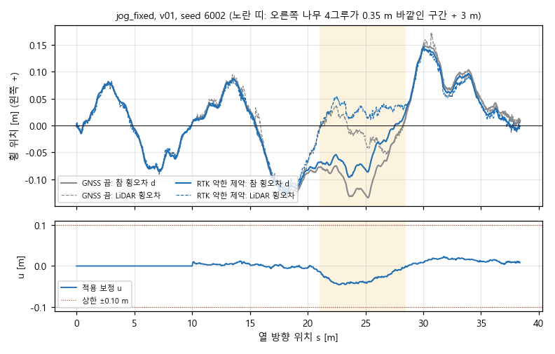
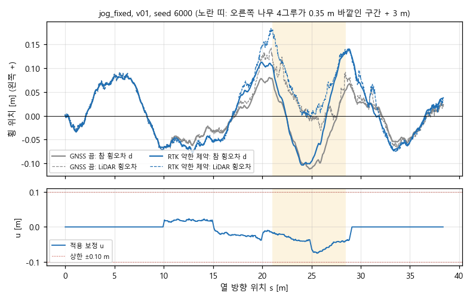

# GNSS RTK 약한 제약 빠른 SIM 행렬 결과 (`gnss_rtk_weak_v1`)

- 사전등록: [`PREREG_GNSS_RTK_KO.md`](PREREG_GNSS_RTK_KO.md), JSON 사본(측정 전 커밋 `3da67ff`). 설계: [`GNSS_RTK_KO.md`](GNSS_RTK_KO.md).
- 측정: 2026-11-16 03:48~04:09 KST, 커밋 `3da67ff` 그대로(작업 트리 깨끗), 무거운 측정 잠금 안, 프로세스 4개, 110 run, 1241 s. 기록 원본은 저장소 밖 `runs/rtk_design_20261116/measure/judge/`(run마다 trace·직렬·실행기 기록, `RTK_MATRIX.json`).
- 기계가 읽는 결과: `GNSS_RTK_RESULT.json`(run마다 잰 값, 실패 항목, 세 digest와 명령 열 SHA-256, (프로필, 조건) 묶음 판정).
- 모든 수치는 **자리값 기반 SIM 결과**다. 가상 RTK 수신기는 자리값 모형이고, 실제 수신기가 나무 아래에서 어떻게 움직이는지는 잰 적이 없다. 현장 성능이 아니다.

## 1. 판정: 불합격 (등록 기준 그대로)

| 항목 | 결과 |
|---|---|
| rtk run의 run 기준(1~5) | **75/80**. 실패 5: `curve_fixed`(v01) 3, `jog_fixed_transitions` 2(v01 s6001, v1 s6003) |
| off 쌍의 `follow_wide` 검사 | **27/30**. 실패 3: v01 `curve_l60` s6000·6001·6003 |
| (프로필, 조건) 묶음 기준(6~9) | **12/12** 합격 |
| 보정 상한·계단(3·4) | 80/80. 최대 \|u\| 0.099 m(상한 0.10), 틱 사이 변화가 속도 한도를 넘은 적 0 |
| 역할 '같음'(5) | 20/20. FLOAT만 10 run, 거울 좌표계 10 run 모두 명령 열이 off 쌍과 SHA-256까지 같고 보정 0 |

실패의 까닭(2절, 3절):

- `curve_fixed` v01 3 run: 보정이 run 내내 0이었고 명령 열이 off 쌍과 같다. off 쌍도 같은 3 seed에서 `steering_driver_fault`로 섰다. 40 m로 늘린 반지름 60 m 열(약 38° 도는 열)을 v0.1 프로필이 끝까지 못 간 것이다. RTK 제약 탓이 아니지만, 등록 기준 1은 rtk run에도 `follow_wide` 검사를 요구하므로 실패로 센다. 개발 seed 100·101에서는 이 세계가 통과해서 등록 전에 보지 못했다.
- `jog_fixed_transitions` 2 run: 일반 GNSS 층의 지오펜스(`gnss_geofence`)가 run을 끝냈다. `weak_constraint`는 `geofence`를 포함한다. FIXED → (FLOAT, 없음) → **단독(7 m급)** → FIXED 전이에서 일반 층이 단독 해로 다시 잡고(reanchor) 다시 FIXED로 다시 잡을 때, 경로가 아직 정렬 고정 거리(30 m)에 이르기 전이라 진행 방향 정렬을 짧고 흔들리는 새 궤적으로 다시 맞추고 그 값으로 고정했다. 틀린 회전으로 옮긴 fix가 경로를 따라 멀어져(위치 불일치 5.9 → 12.4 m) 펜스 밖 확인 3번으로 섰다. 일반 층(`gnss_layer.py`, PC-12)의 결함이고, 합성 재현으로 확인했다(정렬각 30° → 36.4°). 이번에는 고치지 않았다(4절).

## 2. 조건별 (seed 6000~6004)

횡 값은 주행 구간의 참값이다. jog 평균 |d|는 s 21.0~28.5 m(옮긴 나무 구간 + 3 m)의 평균이다. "계단 초과"는 틱 사이 보정 변화에서 속도 한도(0.05 m/s × 틱 간격)를 뺀 값의 최대다(0 이하이면 한도 안).

| 프로필 | 조건 | 역할 | run 통과 | 횡 RMSE 평균 rtk / off | 횡 최대 평균 rtk / off | jog 평균 \|d\| rtk / off | 최대 \|u\| | 좌표계 판정 | 묶음 |
|---|---|---|---|---|---|---|---|---|---|
| v01 | `nominal_fixed` | 해 없음 | 5/5 | 0.049 / 0.049 | 0.113 / 0.114 | - | 0.027 | 확인 | 합격 |
| v01 | `jog_fixed` | 이득 | 5/5 | 0.052 / 0.057 | 0.121 / 0.136 | 0.050 / 0.078 | 0.075 | 확인 | 합격(35 % 줄어듦, 4/5 seed) |
| v01 | `jog_float_only` | 같음 | 5/5 | 0.057 / 0.057 | 0.136 / 0.136 | 0.078 / 0.078 | 0 | 확인 전 | - |
| v01 | `jog_fixed_transitions` | 해 없음 | 4/5 | 0.055 / 0.057 | 0.129 / 0.136 | 0.063 / 0.078 | 0.067 | 확인 | 합격 |
| v01 | `jog_fixed_jump` | 해 없음 | 5/5 | 0.054 / 0.057 | 0.130 / 0.136 | 0.065 / 0.078 | 0.056 | 확인 | 합격 |
| v01 | `nominal_mirror` | 같음 | 5/5 | 0.049 / 0.049 | 0.114 / 0.114 | - | 0 | 거부 | - |
| v01 | `jog_lever` | 이득 | 5/5 | 0.048 / 0.057 | 0.109 / 0.136 | 0.048 / 0.078 | 0.099 | 확인 | 합격(38 %, 5/5) |
| v01 | `curve_fixed` | 해 없음 | 2/5 | 0.117 / 0.117 | 0.203 / 0.203 | - | 0 | 확인 | 합격 |
| v1 | `nominal_fixed` | 해 없음 | 5/5 | 0.055 / 0.055 | 0.120 / 0.116 | - | 0.098 | 확인 4, 확인 전 1 | 합격 |
| v1 | `jog_fixed` | 이득 | 5/5 | 0.056 / 0.063 | 0.147 / 0.164 | 0.059 / 0.085 | 0.092 | 확인 | 합격(31 %, 5/5) |
| v1 | `jog_float_only` | 같음 | 5/5 | 0.063 / 0.063 | 0.164 / 0.164 | 0.085 / 0.085 | 0 | 확인 전 | - |
| v1 | `jog_fixed_transitions` | 해 없음 | 4/5 | 0.059 / 0.063 | 0.156 / 0.164 | 0.072 / 0.085 | 0.059 | 확인 | 합격 |
| v1 | `jog_fixed_jump` | 해 없음 | 5/5 | 0.057 / 0.063 | 0.158 / 0.164 | 0.071 / 0.085 | 0.052 | 확인 4, 확인 전 1 | 합격 |
| v1 | `nominal_mirror` | 같음 | 5/5 | 0.055 / 0.055 | 0.116 / 0.116 | - | 0 | 거부 4, 확인 전 1 | - |
| v1 | `jog_lever` | 이득 | 5/5 | 0.053 / 0.063 | 0.138 / 0.164 | 0.061 / 0.085 | 0.098 | 확인 | 합격(28 %, 5/5) |
| v1 | `curve_fixed` | 해 없음 | 5/5 | 0.130 / 0.130 | 0.257 / 0.257 | - | 0 | 확인 | 합격 |

본 것:

- 이득: 옮긴 나무 구간에서 참 횡오차가 v01 35 %, v1 31 % 줄었다(레버암 오차 조건 38 %, 28 %). 20 묶음 run 중 19가 off보다 나빠지지 않았고, 나빠진 하나는 v01 `jog_fixed` s6000(0.058 → 0.068 m, 그림 2)이다. 보정이 걸린 크기는 0.05~0.10 m다. LiDAR 치우침(개발 run에서 0.07~0.15 m)의 반쯤(이득 0.5)만 당기고 상한이 0.10 m라, 치우침을 다 없애지는 않는다.
- FLOAT만, 거울 좌표계: 20 run 모두 명령 열이 off와 같다. 거울은 v1 s6000 하나만 '확인 전'(궤적 옆 퍼짐 부족)으로 끝났고 나머지 9 run은 거부했다. 확인된 거울은 없다.
- 튐·잘못된 FIXED 계단: 10 run에서 RTK 튐 문 기각 89, 궤적 새로 시작 10. 보정 상한·계단 기준 안. 일반 층 3 m 튐 문은 0.49 m 계단을 받아들였다(RTK 문이 걸러 냄).
- 정상 열: v1 s6004에서 보정이 0.094 m까지 갔다. s 30 m에서 다시 맞춘 선이 거절된 점이 많아 남은 32점(8.98 m)으로 맞춰졌고, LiDAR가 맞는데도 선이 0.17~0.19 m 어긋나 거른 불일치 0.20 m 문에서 선을 버릴 때까지 약 4 m 동안 반대로 당겼다. 그 run의 횡 최대 +0.022 m, RMSE +0.009 m(묶음 기준 안). 3절 한계.
- 굽은 열: 직선 선이 한 번도 쓰이지 않아(방향 문, 잔차 문) 보정이 0이었다. 이득도 해도 없다.

그림 1. `jog_fixed` v01 seed 6002(줄어듦 35 %, 이 조건의 가운데 seed). 위: 참 횡오차(실선)와 실행기 LiDAR 횡오차(점선), 회색은 GNSS 끔, 파랑은 RTK 약한 제약. 아래: 제어기에 더한 보정 u와 상한. 노란 띠는 오른쪽 나무 4그루가 0.35 m 바깥인 구간 + 3 m. LiDAR가 바깥 나무 쪽(오른쪽)으로 끌린 동안 u가 음수(제어기가 차를 오른쪽에 있다고 보게)가 되어 왼쪽으로 당긴다. [SIM · 자리값] 평지 기둥 두 줄(W0)과 자리값 RTK 모형, 과수원 기록이 아니다.

그림 2. 같은 조건의 v01 seed 6000, off보다 나빠진 하나(jog 평균 |d| 0.058 → 0.068 m). 보정이 구간 앞(s 10~15 m)에서 양수였다가 구간에서 음수로 바뀌고, 구간 끝 뒤 차가 왼쪽으로 더 나갔다(+0.14 m, off +0.13 m). [SIM · 자리값]

## 3. 한계

- 직선 열 선의 다시 맞춤이 거절된 점이 많은 창에서 적은 점으로 맞춰지면 틀릴 수 있다(2절 v1 s6004). 상한 0.10 m와 거른 불일치 0.20 m 문이 크기와 길이를 묶지만, 그동안은 LiDAR가 맞아도 반대로 당긴다. 후보: 다시 맞춤에 창 안 학습 점의 비율 하한을 두거나, 새 선이 옛 선과 지금 위치에서 학습 문보다 다르면 받지 않기(돌리지 않음).
- `weak_constraint`에 포함된 지오펜스가 FIXED ↔ 단독 전이에서 거짓 정지를 낼 수 있다(1절). 일반 층의 결함이므로 `geofence` 모드에도 같은 위험이 있다(일반 수신기만 쓰는 지금 기록에서는 단독 ↔ 단독이라 다시 잡을 일이 드물다).
- 굽은 열에서는 쓰이지 않는다. 출발 직후의 LiDAR 치우침(선을 배우기 전, 최소 8 m + 늦춤 2 m)은 고치지 못한다.
- 가상 수신기는 자리값이다. 나무 아래 다중경로, 잘못된 FIXED의 빈도·크기, 수신기 지연, FIXED 비율은 잰 적이 없다. 실차 입력에서 FIXED를 가르는 경로가 아직 없다(`GNSS_RTK_KO.md` 5.3절).
- 판정 seed로 고쳐 다시 재지 않았다(등록 4절).

## 4. 다음 할 일 (돌리지 않음)

1. 일반 층(`gnss_layer.py`): 다시 잡은(reanchor/restart) 뒤에는 새 궤적이 `course_baseline_m`를 다시 채울 때까지 옛 정렬을 쓰고, 짧은 궤적으로 다시 맞추거나 고정하지 않기. 고친 뒤 `GNSS_LAYER_KO.md` 5절의 비교와 이 행렬의 `jog_fixed_transitions`를 새 seed로 다시 재기.
2. `gnss_rtk.py`: 3절 첫 항목의 다시 맞춤 규칙.
3. 이 행렬의 `curve_fixed`는 v0.1 프로필이 못 가는 세계였다. 다음 등록에서는 off 쌍이 통과하는 굽은 열(예: 28.5 m 열, 반지름 60 m)로 바꾸기.
4. 실차: FIXED/FLOAT를 가르는 입력 경로 결정(드라이버 또는 `/gps/data` 허용), `log_only`로 FIXED 비율·hAcc 기록, 안테나 레버암 측정.

## 5. 끔이면 그대로인지 (같은 세션, 판정 전)

`weak_constraint`를 쓰지 않는 설정이 바뀌지 않았는지, 이 브랜치의 기반 커밋 `1463af3`(분리 작업 트리)과 `3da67ff`를 같은 PC·잠금 안에서 비교했다.

| 확인 | 결과 |
|---|---|
| 빠른 SIM `steer_follow_v1` 15 run | 둘 다 15/15 통과. 설정 digest·직렬 로그·trace 15/15 같음. 실행기 기록은 튜닝 파일 경로(작업 트리 이름)와 시간 칸만 다름 |
| T1 안전 대본 71 개 | 둘 다 71/71 기대대로. 직렬 로그·trace 71/71 같음(실행기 기록은 같은 까닭으로 다름) |
| 기본 설정 digest | 시험 `test_untouched_block_keeps_the_546fa8c_digests_and_dump` 통과(`gnss_rtk_*`는 기본이면 `to_dict`에서 빠짐) |
