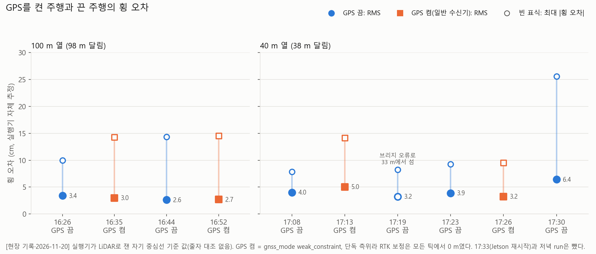
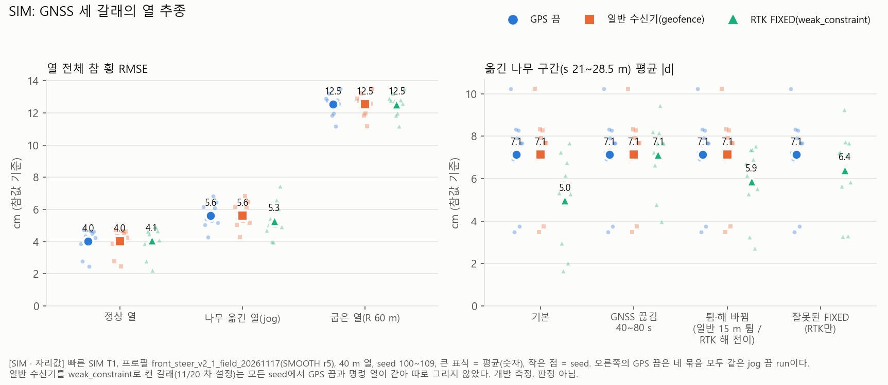

# GPS 유무에 따른 성능 비교 (2026-11-22)

- 목적: 자율주행 열 추종 성능이 GPS를 켜고 끄는 것에 따라 얼마나 달라지는지 잰다.
- 두 갈래로 쟀다. 하나는 2026-11-20 과수원 기록(현장 기록)에서 GPS를 켠 주행과 끈 주행을 견준 것이고, 다른 하나는 빠른 SIM에서 같은 seed로
  GPS 끔·일반 수신기·RTK 수신기를 나란히 돌린 개발 측정이다. SIM 수치는 모두 **자리값 기반 SIM 결과**이고 현장 성능이 아니다. SIM 측정은 판정이 아니다(사전등록 없음, 등록된 행렬은 건드리지 않음).
- GNSS 좌표는 읽어 내지 않았다. 현장 기록에서는 GNSS 층의 횟수, 정확도, 상대 거리와 각도 차만 썼다.
- 측정한 코드는 이 저장소 main `487b151` 그대로다. 측정 스크립트와 원본 결과(run마다 TRACE·SERIAL·실행기 기록, 약 1.3 GB)는 저장소 밖 `<runs>/gps_compare_1122/`에 있다(`<runs>`는 작업 폴더의 runs 폴더).

## 1. 요약

- **11/20 차에서 "GPS 사용함"은 `gnss_mode weak_constraint`였고, 수신기가 단독 측위(수평 정확도 약 4~8 m)라 RTK 보정은 한 번도 걸리지 않았다.** 실행기 기록상 GPS를 켠 11번 모두
  보정 0 m(모든 틱), 펜스 밖 0번, GNSS 탓 정지 0번이었다. 조향·구동 명령은 켬·끔 모두 같은 길(GNSS 없이)로 만들어졌다.
- **현장 주행 수치는 켬·끔이 갈리지 않았다**(실행기 자체 추정). 100 m 열 횡 RMS 평균 끔 3.0 / 켬 2.8 cm, 40 m 열 끔 4.8 / 켬 4.1 cm. 최대 오차는 100 m 열에서 켬이 2.3 cm 컸고
  40 m 열에서 2.4 cm 작았다. 속도(0.28·0.34 m/s), 거리, 끝난 이유(모두 거리 한도)는 같았다. 주행 수가 2~3번씩이라 이 차이는 주행마다의 흩어짐 안이다.
- **SIM(자리값 기반 SIM 결과, 판정 아님)에서도 일반 수신기는 명령을 바꾸지 않았다**: `geofence`·`weak_constraint` 80 run 모두 명령 열이 GPS 끔과 SHA-256까지 같았고,
  끊김·5 m·15 m 튐에서도 거짓 정지 0이었다.
- **RTK FIXED는 SIM에서 한쪽 나무가 비켜 선 구간(jog)의 오차만 줄였다**: 그 구간 평균 |d| 7.1 → 5.0 cm(30 %, 10/10 seed). 곧은 정상 열(4.0 → 4.1 cm)과 굽은 열(12.5 → 12.5 cm)에서는
  차이가 없고, GNSS가 그 구간에서 끊기면 이득이 0 %가 됐다. 해 전이 18 %, 잘못된 FIXED 계단 10 %로 줄었고 정지는 없었다.
- 결론: 지금 설정에서 GPS 켬·끔은 성능 차이가 없고(넓은 펜스만 더해짐), 횡 정밀도의 이득은 RTK 보정 신호와 FIXED 구분 경로가 생긴 뒤에야 기대할 수 있다. 그 이득도 SIM에서는
  LiDAR가 속는 구간에 한정됐다.

## 2. 지금 차에서 "GPS 켬"이 뜻하는 것

- 대시보드 자율주행 화면의 GPS 선택 "GPS 사용함"은 실행기에 `gnss_mode: weak_constraint`를 보낸다("GPS 사용 안 함"은 `off`). 11/20에 달린 18번 가운데
  GPS를 켠 11번은 실행기 출발 기록에 모두 `gnss_mode weak_constraint`(출처 `request`)로, 끈 7번은 `off`로 남아 있다. 실행기 설정 파일의 기본값은 `off`다.
- `weak_constraint`는 `geofence`(열 범위를 크게 벗어난 것이 확인되면 정지)에 RTK 보정을 더한 모드다. RTK 보정은 수신기 해가 RTK FIXED이고
  보고 정확도가 5 cm 이하일 때만 제어기의 횡 오차 입력을 최대 ±0.10 m 당긴다.
- 11/20의 수신기(F9P)는 보정 신호 없이 단독 측위였다(수평 정확도 약 4~8 m). 그래서 RTK 보정은 한 번도 걸릴 수 없었다. 기록에서도 그랬다(3.1절):
  RTK 문은 모든 fix를 해 종류(`single`)로 걸렀고 보정 값은 모든 틱에서 0 m였다.
- 보정이 0이면 실행기는 제어기에 원래 스냅숏 객체를 그대로 넘긴다(`gnss_rtk.RtkConstraint.apply`: `u == 0`이면 `s` 그대로). 그러니 11/20의 "GPS 켬"이
  조향·구동 명령을 바꿀 수 있었던 길은 펜스 정지 하나뿐이었고, 펜스는 한 번도 밖으로 나가지 않았다.
- 현장 실행기는 sim 레포 `ee5804e`이고, 그 뒤 main `487b151`까지 `tools/row_executor/`와 `sim/ubts/steering/`의 바뀐 곳은 없다(`git diff --stat ee5804e 487b151`).
  SIM 측정은 그 main을 내보낸 트리에서 돌렸다.

## 3. 현장 기록 (2026-11-20)

### 3.1 GPS를 켠 주행에서 GNSS 층이 한 일

실행기 틱 기록(주행 중 틱)의 `gnss` 블록에서 셌다. 오후의 GPS 켬 다섯 번(17:33은 Jetson 재시작으로 19.8 m에서 끊김)과 저녁 여섯 번이다.

| 출발 | 열 | 주행 중 받은 fix (속도) | 품질 미달 / 튐 기각 / 다시 잡음 / 끊김 뒤 재시작 | 수평 정확도 중앙 (범위) m | 정렬 (달린 거리) | 진행 방향 어긋남 최대 | 위치 불일치 중앙 / 최대 m | 펜스 밖 / 정지 | RTK 보정 |
|---|---|---|---|---|---|---|---|---|---|
| 16:35 | 100 m | 664 (2.0 Hz) | 0 / 0 / 0 / 0 | 6.9 (3.5~7.6) | 약 14 m | 14.4° | 1.5 / 4.2 | 0 / 0 | 0 m, 쓴 fix 0 |
| 16:52 | 100 m | 672 (2.0 Hz) | 0 / 0 / 0 / 0 | 4.2 (3.8~4.8) | 약 14 m | 6.3° | 1.0 / 3.5 | 0 / 0 | 0 m, 쓴 fix 0 |
| 17:13 | 40 m | 228 (2.0 Hz) | 0 / 0 / 0 / 0 | 7.7 (6.9~8.4) | 약 14 m | 9.9° | 1.1 / 2.0 | 0 / 0 | 0 m, 쓴 fix 0 |
| 17:26 | 40 m | 220 (2.0 Hz) | 0 / 0 / 0 / 0 | 6.0 (5.7~6.7) | 약 15 m | 4.3° | 0.6 / 1.1 | 0 / 0 | 0 m, 쓴 fix 0 |
| 17:33 (끊김) | 40 m | 116 (2.0 Hz) | 0 / 0 / 0 / 0 | 5.7 (5.5~6.2) | 약 15 m | 1.9° | 0.7 / 0.9 | 0 / 0 | 0 m, 쓴 fix 0 |
| 저녁 6번 (17:54~18:00) | 40 m 등 | 28~104 (1.8~2.1 Hz) | 0 / 0 / 0 / 0 | 4.2~7.0 | 17:54만 (약 12 m) | 1.2° (17:54) | 1.2 / 1.3 (17:54) | 0 / 0 | 0 m, 쓴 fix 0 |

- GNSS는 주행 내내 '있음'이었다(마지막 fix 나이 최대 2.1 s, 문턱 2.5 s). 품질 미달·튐·다시 잡음은 한 번도 없었다.
- 정렬(odometry 경로와 GNSS 궤적의 회전 맞춤)은 출발 뒤 약 45~54 s, 14~15 m에서 됐다. 그 뒤 GNSS를 odometry 좌표로 옮겼을 때 실행기 자세 추정과의 차이(위치 불일치)는
  중앙 0.6~1.5 m, 최대 4.2 m였다. 표시 문턱 max(10 m, 3 × 정확도)와 펜스 여유(같은 값)에 한참 못 미쳤다. 진행 방향 어긋남(마지막 15 m 창과 기준 정렬의 차)도 최대 14.4°로
  표시 문턱 45°보다 작았다. 표시(`course_disagree`, `position_disagree`, `fence_outside`)는 모두 0이었다.
- RTK 쪽: 실행기가 본 해 종류는 모든 틱에서 `single`이었다(녹화의 `/gps/data`는 같은 시간을 `dgps` 또는 `autonomous`로 적었다. 어느 쪽이든 RTK가 아니다).
  RTK 문은 받은 fix 모두를 해 종류로 걸렀고(`fix_type` 거름 = 받은 수, 쓴 수 0), 상태는 내내 `learning`, 좌표계는 `unverified`, 보정 `u`와 목표는 모든 틱에서 0 m였다.
- 그러니 GPS 켬 주행에서도 제어기가 받은 입력과 조향·구동 명령은 GPS 끔일 때와 같은 길로 만들어졌다(2절). 다른 길(펜스 정지)은 한 번도 걸리지 않았다.
- 처리 시간: 실행기 루프 p99는 100 m 열에서 켬 108.9~109.2 ms, 끔 108.5~109.2 ms, 40 m 열에서 켬 50.5~58.9 ms, 끔 51.6~59.4 ms로 갈리지 않았다.
- 수신기 자체는 GPS를 끈 주행에서도 켜져 있었다(녹화에는 모든 주행의 `/gps/data`가 있다. 실행기가 그것을 쓰지 않았을 뿐이다). 끈 주행의 수평 정확도 중앙값도 3.6~7.9 m로
  켠 주행(4.2~7.7 m)과 같은 크기였다. 15:23 주행의 녹화에는 fix가 하나도 없었다(`no_fix`, 그 주행은 GPS 끔).

### 3.2 주행 수치: 켬과 끔

조향 가운데를 옮긴 뒤(16:13 실행기 재설치 뒤) 오후에 같은 열을 GPS 켬·끔으로 번갈아 달린 주행이다. 횡 오차, 방향 오차, 거리는 **실행기가 LiDAR로 잰 자체 추정**이고
줄자나 측량으로 잰 값이 아니다. 속도는 실행기 틱의 속도 중앙값이다.

| 출발 | 열 | GPS | 거리 m | 시간 s | 끝난 이유 | 속도 중앙 m/s | 횡 RMS cm | 횡 최대 cm | ±10 cm 안 % | 방향 RMS ° |
|---|---|---|---|---|---|---|---|---|---|---|
| 16:26 | 100 m | 끔 | 98.0 | 337 | 거리 한도 | 0.28 | 3.4 | 10 | 100 | 1.27 |
| 16:35 | 100 m | 켬 | 98.0 | 335 | 거리 한도 | 0.28 | 3.0 | 14 | 98.4 | 1.07 |
| 16:44 | 100 m | 끔 | 98.0 | 335 | 거리 한도 | 0.28 | 2.6 | 14 | 99.8 | 0.71 |
| 16:52 | 100 m | 켬 | 98.0 | 337 | 거리 한도 | 0.28 | 2.7 | 15 | 98.4 | 0.83 |
| 17:08 | 40 m | 끔 | 38.0 | 113 | 거리 한도 | 0.34 | 4.0 | 8 | 100 | 1.18 |
| 17:13 | 40 m(입력 40.2) | 켬 | 38.2 | 115 | 거리 한도 | 0.34 | 5.0 | 14 | 92.2 | 1.73 |
| 17:19 | 40 m | 끔 | 33.3 | 100 | 브리지 오류(비교에서 뺌) | 0.34 | 3.2 | 8 | 100 | 0.98 |
| 17:23 | 40 m | 끔 | 38.0 | 114 | 거리 한도 | 0.34 | 3.9 | 9 | 100 | 1.42 |
| 17:26 | 40 m | 켬 | 38.0 | 112 | 거리 한도 | 0.34 | 3.2 | 10 | 100 | 1.11 |
| 17:30 | 40 m | 끔 | 38.0 | 112 | 거리 한도 | 0.34 | 6.4 | 26 | 92.4 | 1.35 |
| 17:33 | 40 m | 켬 | 19.8 | – | Jetson 재시작(비교에서 뺌) | 0.34 | – | – | – | – |

끝까지 간 주행만 모은 평균(켬 − 끔):

| 열 | 끔 (주행 수) | 켬 (주행 수) | 횡 RMS cm | 횡 최대 cm | ±10 cm 안 % | 방향 RMS ° | 속도 m/s | 끝난 이유 |
|---|---|---|---|---|---|---|---|---|
| 100 m | 16:26, 16:44 (2) | 16:35, 16:52 (2) | 끔 3.0 / 켬 2.8 (−0.2) | 12.2 / 14.4 (+2.3) | 99.9 / 98.4 (−1.5) | 0.99 / 0.95 (−0.04) | 0.284 / 0.284 | 모두 거리 한도 |
| 40 m | 17:08, 17:23, 17:30 (3) | 17:13, 17:26 (2) | 끔 4.8 / 켬 4.1 (−0.65) | 14.2 / 11.9 (−2.4) | 97.5 / 96.1 (−1.4) | 1.32 / 1.42 (+0.11) | 0.341 / 0.341 | 모두 거리 한도 |

- 차이는 열마다 방향이 바뀌고(100 m 열은 켬이 최대 오차가 컸고 40 m 열은 작았다), 같은 쪽 안의 흩어짐보다 작다. 예를 들어 40 m 열 끔 세 번의 횡 RMS는 3.9~6.4 cm,
  최대는 8~26 cm로 퍼져 있다. 끝까지 간 비율, 속도, 거리, 끝난 이유도 같았다.
- 2절과 3.1절대로 켬 주행에서도 명령은 GPS 없이 만들어졌으므로, 이 차이는 GPS 탓이 아니라 주행마다의 차이(출발 자세, 조향 영점, 땅, 바람, 사람)로 본다.
  이 기록으로 말할 수 있는 것은 "11/20 설정의 GPS 켬은 주행 수치를 바꾸지 않았고, 거짓 정지도 내지 않았다"까지다.

[현장 기록·2026-11-20] 오후에 같은 두 열을 GPS 켬·끔으로 번갈아 달린 주행의 횡 오차(실행기 자체 추정). 채운 표식은 RMS, 빈 표식은 최대 |횡 오차|.

### 3.3 이 비교를 읽을 때

- 주행 수가 적다: 100 m 열은 켬 2 · 끔 2, 40 m 열은 켬 2 · 끔 3. 통계로 차이를 가를 수 있는 수가 아니다.
- 시간이 다르다: 켬과 끔을 번갈아 달려 시간 흐름(해, 배터리)이 한쪽에 몰리지는 않았지만, 같은 시각의 짝은 없다.
- 조향 영점이 주행마다 달랐다: 주행 중 가변저항 중앙값(녹화의 브리지 값)이 16:26은 1953, 17:23은 1986, 나머지는 2008~2017이었다([`ORCHARD_1120_RESULT_KO.md`](ORCHARD_1120_RESULT_KO.md) 4절).
  조향 각 중앙값도 16:26만 −36 mrad로 다른 주행(−14~+12 mrad)과 달랐다.
- 횡 오차는 실행기 자체 추정이다. 참 중심선과의 차이가 아니다. 특히 RTK 보정이 실제로 걸리는 차에서는 보정이 차를 LiDAR 중심선에서 일부러 옮기므로,
  실행기 자체 추정은 보정의 이득을 보지 못한다(4.3절 SIM에서 확인). RTK 효과는 줄자나 측량 기준으로 재야 한다.
- 같은 열을 같은 방향으로 달렸는지: 녹화 GNSS의 출발~끝 변위 방향을 같은 열의 첫 주행과 견주면 100 m 열 −1.6~+1.4°, 40 m 열 −6.4~+2.1°로 같은 방향이었다
  (방향 차만 계산했고 절대 방위나 좌표는 남기지 않았다. 단독 측위라 40 m에서 몇 도의 흔들림은 정확도 탓이다).
- 15:23 주행(조향 가운데를 옮기기 전, 횡 RMS 45 cm)은 GPS 끔이었고 비교에서 뺐다. 저녁 여섯 번(17:54~18:00)은 모두 GPS 켬이지만 브리지 오류로 2.4~15.2 m에서 섰고
  어두워진 뒤 열 길이를 바꿔 가며 달린 것이라 뺐다. GNSS 층 수치(3.1절)에는 넣었다: 거기서도 GNSS 탓 정지·표시는 0이었다.

## 4. SIM 개발 측정 (자리값 기반 SIM 결과)

### 4.1 방법

- **판정이 아니다.** 사전등록을 하지 않았고 등록된 행렬(`gnss_rtk_weak_v1` 등)은 건드리지 않았다. 개발 seed로 잰 비교다.
- 코드: sim 레포 main `487b151`을 `git archive`로 내보낸 트리(고치지 않음)에서, `rtk_matrix.py`의 세계·측정 규칙(`follow_wide` 2차 규칙, jog 구간 지표)을
  그대로 가져다 쓰는 작은 구동 스크립트(저장소 밖 `scripts/sim_gps_compare.py`)로 돌렸다. 하네스는 고치지 않았다.
- 차: 프로필 `front_steer_v2_1_field_20261117`(측정 치수, 조향 보드 SMOOTH r5 펌웨어 모형, 차의 감시 묶음 esp32_r5). 11/20 차에 가장 가까운 프로필이다.
  제어기 `row_follow`(휠베이스 0.657 m), 실행기 설정은 리그가 만드는 그대로(`follow_smooth2`와 같은 방식)에 갈래의 `gnss_mode`만 더했다.
  현장 조정 파일(`orchard_1120` 프리셋)은 넣지 않았다. SIM 평균 속도는 0.33~0.38 m/s였다(현장 0.28~0.34 m/s).
- 세계: 빠른 SIM T1의 평지 기둥 두 줄(W0), 40 m 열(줄 사이 3.5 m, 기둥 1.5 m 간격).
  - 정상 열(`nominal`): 곧은 열.
  - jog(`jog_r`): 오른쪽 나무 네 그루(s 21~25.5 m)를 0.35 m 바깥으로 옮긴 곧은 열. LiDAR가 본 통로 가운데가 그쪽으로 끌리고 참 중심선(심은 줄)은 곧다.
    jog 지표는 s 21~28.5 m 구간의 참 |d| 평균이다.
  - 굽은 열(`curve_l60`): 반지름 60 m로 휘는 열(40 m 동안 약 38°).
- 갈래(같은 세계·seed는 모든 갈래에서 같은 난수 흐름 키를 써서 차·LiDAR·IMU 잡음이 같다. 가상 GNSS는 따로 흐름을 쓴다):
  - **끔**: `gnss_mode off`, GNSS 패킷 없음.
  - **일반 수신기(geofence)**: 가상 일반 수신기(자리값: 약 1 Hz, 보고 정확도 7 m, 편향 σ 3 m, 떠돎 1.5 m / 60 s, 흰 잡음 0.4 m) + `geofence`.
  - **일반 수신기(weak_constraint)**: 같은 수신기 + `weak_constraint`. 11/20 차의 "GPS 사용함"과 같은 설정이다.
  - **RTK**: 가상 RTK 수신기(자리값: 5 Hz, FIXED 보고 정확도 0.014 m) + `weak_constraint`. 계획한 수신기다.
- 조건: 정상·jog·굽은 열, 그리고 jog 열 위에서 GNSS 끊김 40~80 s(jog 구간을 지나는 약 56~77 s를 덮음), 일반 수신기의 한 fix짜리 튐 5 m·15 m 세 번(30·45·60 s),
  RTK의 해 전이(60~66 s FLOAT, 66~70 s 없음, 76~79 s 단독)와 잘못된 FIXED 계단(59 s부터 6 s 동안 약 0.5 m, 70·75 s에 0.2 s짜리 계단). 마지막 두 가지는 등록 행렬의 조건 그대로다.
- seed 100~109(10개), 17 조건 × 10 = 170 run. 2026-11-22 02:22:45~02:41:51 KST, 1146 s(19.1분), 프로세스 4개, 무거운 측정 잠금 안(02:21~02:42).
- 지표: 참값 기준 열 전체 횡 RMSE·최대(`follow_wide` 규칙), jog 구간 평균 |d|, 열 끝 도착, GNSS 탓 정지(`gnss_geofence`), 실행기가 낸 명령 열(스로틀·조향)의 SHA-256이
  같은 seed의 끔 run과 같은지, 실행기 자체 횡 추정 RMS(현장 표와 같은 종류의 수), RTK 보정 최대 |u|.

### 4.2 결과

| 조건 · 갈래 | 열 끝 도착 | GNSS 탓 정지 | 명령 열 = 끔 | 참 횡 RMSE 평균 cm | 횡 최대 평균 cm (최악) | jog 구간 평균 \|d\| cm | 실행기 자체 횡 RMS cm | 최대 \|u\| cm |
|---|---|---|---|---|---|---|---|---|
| 정상 열 · 끔 | 10/10 | 0 | – | 4.0 | 9.1 (11.1) | – | 4.0 | – |
| 정상 열 · 일반(geofence) | 10/10 | 0 | 10/10 | 4.0 | 9.1 (11.1) | – | 4.0 | – |
| 정상 열 · 일반(weak_constraint) | 10/10 | 0 | 10/10 | 4.0 | 9.1 (11.1) | – | 4.0 | 0 |
| 정상 열 · RTK | 10/10 | 0 | 1/10 | 4.1 | 9.2 (11.8) | – | 4.0 | 3.0 |
| jog · 끔 | 10/10 | 0 | – | 5.6 | 14.2 (17.0) | 7.1 | 5.0 | – |
| jog · 일반(geofence) | 10/10 | 0 | 10/10 | 5.6 | 14.2 (17.0) | 7.1 | 5.0 | – |
| jog · 일반(weak_constraint) | 10/10 | 0 | 10/10 | 5.6 | 14.2 (17.0) | 7.1 | 5.0 | 0 |
| jog · RTK | 10/10 | 0 | 1/10 | 5.3 | 13.6 (16.5) | **5.0** | 5.3 | 10.0 |
| jog + 끊김 40~80 s · 일반 | 10/10 | 0 | 10/10 | 5.6 | 14.2 (17.0) | 7.1 | 5.0 | – |
| jog + 끊김 40~80 s · RTK | 10/10 | 0 | 2/10 | 5.6 | 14.2 (16.4) | 7.1 | 5.0 | 3.2 |
| jog + 5 m 튐 3번 · 일반 | 10/10 | 0 | 10/10 | 5.6 | 14.2 (17.0) | 7.1 | 5.0 | – |
| jog + 15 m 튐 3번 · 일반 | 10/10 | 0 | 10/10 | 5.6 | 14.2 (17.0) | 7.1 | 5.0 | – |
| jog + 해 전이 · RTK | 10/10 | 0 | 0/10 | 5.3 | 13.7 (15.3) | 5.9 | 5.1 | 6.9 |
| jog + 잘못된 FIXED 계단 · RTK | 10/10 | 0 | 0/10 | 5.5 | 14.3 (15.7) | 6.4 | 5.2 | 6.8 |
| 굽은 열 · 끔 | 10/10 | 0 | – | 12.5 | 22.6 (25.7) | – | 6.0 | – |
| 굽은 열 · 일반(geofence) | 10/10 | 0 | 10/10 | 12.5 | 22.6 (25.7) | – | 6.0 | – |
| 굽은 열 · RTK | 10/10 | 0 | 10/10 | 12.5 | 22.6 (25.7) | – | 6.0 | 0 |

jog 구간 평균 |d|를 같은 seed의 끔과 견준 것:

| 조건 · 갈래 | 끔 → 켬 cm | 줄어듦 | 끔보다 나빠지지 않은 seed | 열 전체 RMSE 끔 → 켬 cm |
|---|---|---|---|---|
| jog · 일반(두 모드) | 7.1 → 7.1 | 0 % | 10/10(같은 명령) | 5.6 → 5.6 |
| jog · RTK | 7.1 → 5.0 | 30 % | 10/10 | 5.6 → 5.3 |
| jog + 끊김 40~80 s · RTK | 7.1 → 7.1 | 0 % | 6/10 | 5.6 → 5.6 |
| jog + 해 전이 · RTK | 7.1 → 5.9 | 18 % | 10/10 | 5.6 → 5.4 |
| jog + 잘못된 FIXED 계단 · RTK | 7.1 → 6.4 | 10 % | 9/10 | 5.6 → 5.5 |

seed별 값과 run마다의 원본은 저장소 밖 `<runs>/gps_compare_1122/out/sim/`의 `TABLES.md`, `GPS_COMPARE_SIM.json`에 있다. 170 run 모두 열 끝에서 섰고(`row_end`) `follow_wide` 2차 검사
(횡 RMSE·p95·최대, 방향, 속도, 열 끝 정지 위치 등)를 모두 통과했다.

[SIM · 자리값] 빠른 SIM T1, 40 m 열, seed 100~109. 왼쪽: 열 전체 참 횡 RMSE. 오른쪽: 옮긴 나무 구간의 참 |d| 평균. 큰 표식이 평균, 작은 점이 seed다.

### 4.3 본 것

- **일반 수신기는 주행을 바꾸지 않았다.** `geofence`든 `weak_constraint`든 80 run 모두 명령 열이 끔과 SHA-256까지 같고 차의 궤적(trace digest)도 같았다.
  직렬 기록은 첫 줄(리그 설정에 GNSS 항목이 붙음)만 달랐다(80/80). 끊김 40 s, 5 m·15 m 튐에서도 GNSS 탓 정지 0, 튐 기각 = 주입(3 = 3, 20 run 모두), 표시 0이었다.
  SIM 일반 수신기의 진행 방향 어긋남 최대 11~16°, 위치 불일치 최대 3.6~5.0 m는 11/20 현장(최대 14.4°, 4.2 m)과 같은 크기였다.
- **RTK는 옮긴 나무 구간에서만 이득이 있었다.** jog 구간 평균 |d|가 7.1 → 5.0 cm(30 %)로 줄었고 10 seed 모두 나빠지지 않았다. 11/16 등록 행렬(v1 31 %, v01 35 %)과 같은 크기다.
  보정은 상한 0.10 m까지 갔다. 열 전체로 보면 RMSE 5.6 → 5.3 cm, 최대 14.2 → 13.6 cm라 차이가 작다.
- **정상 열에서는 이득도 해도 거의 없다**(RMSE 4.0 → 4.1 cm, 최대 9.1 → 9.2 cm, seed별 횡 최대 변화 −0.3~+0.7 cm). LiDAR 중심과 참 중심이 같으니 당길 것이 없다.
- **굽은 열에서는 RTK가 한 번도 걸리지 않았다**(직선 열 선을 받아들이지 않아 보정 0, 명령 10/10 같음). 굽은 열의 횡 오차(RMSE 12.5 cm)는 GNSS로 줄지 않았다.
- **끊기면 이득이 사라진다.** jog 구간을 GNSS 끊김(40~80 s)이 덮으면 보정이 유지 시간 뒤 0으로 돌아가 이득이 0 %가 됐다(seed별 −2.0~+1.3 cm, 6/10만 나빠지지 않음). 정지는 없었다.
- **해 전이·잘못된 FIXED:** FIXED → FLOAT → 없음 → 단독 → FIXED 전이에서 이득이 18 %로 줄었다. 일반 층의 다시 잡음이 run마다 0~2번 일어나 위치 불일치가 최대 7.3 m까지 갔지만
  펜스 정지와 표시는 0이었다(2026-11-16 R101 고침 뒤). 잘못된 FIXED 계단은 이득을 10 %로 줄였고 한 seed(104)는 끔보다 0.9 cm 나빴다.
- **한 seed(101)에서는 RTK가 정상 열·jog 모두 한 번도 걸리지 않았다.** 좌표계 확인이 끝나지 않아(`frame unverified`) 보정이 0이었고 명령이 끔과 같았다.
- **실행기 자체 횡 추정은 RTK 이득을 거꾸로 보인다.** jog RTK에서 참 jog 오차는 30 % 줄었는데 실행기 자체 횡 RMS는 5.0 → 5.3 cm로 늘었다. 보정이 차를 LiDAR 중심에서 일부러 옮기기 때문이다.

## 5. 무엇을 뜻하나

- **지금 차(11/20 설정)에서 GPS를 켜고 끄는 것은 열 추종 성능을 바꾸지 않는다.** 현장에서는 켬 주행에서도 RTK 보정이 0이고 펜스가 걸리지 않아 명령이 GPS 없이 만들어졌고,
  주행 수치(끝까지 간 9번의 횡 RMS 2.6~6.4 cm, 속도, 거리, 끝난 이유)도 켬·끔이 같은 범위에 있었다. SIM에서도 일반 수신기 갈래 80 run의 명령 열이 끔과 비트까지 같았다.
- **켜서 얻는 것은 넓은 안전망 하나다.** 열 범위 밖으로 넓은 여유(max(10 m, 3 × 수평 정확도), 11/20 수신기로는 약 12~25 m)를 넘어 벗어난 것이 fix 세 번 이어서 확인되면 서는 펜스와, 실행기 방향이 크게 무너졌는지 보는 점검(표시만)이다.
  11/20에는 걸릴 일이 없었다. 켜서 잃은 것(거짓 정지, 처리 시간)도 현장·SIM 모두 0이었다.
- **횡 성능의 차이를 내려면 RTK FIXED가 있어야 한다.** SIM에서 RTK는 LiDAR가 본 통로 가운데가 참 중심선에서 벗어나는 곳(한쪽 나무가 바깥으로 비켜 선 구간)에서만
  그 구간 오차를 30 % 줄였다(7.1 → 5.0 cm, 자리값). 곧은 정상 열과 굽은 열에서는 차이가 없었고, 끊기면 이득이 사라졌다. 열 전체 RMSE로는 0.3 cm 차이다.
- 그런데 지금 차는 RTK를 쓸 준비가 안 됐다: 보정 신호(기지국 또는 NTRIP)를 수신기에 넣는 경로가 없고, 실행기가 구독하는 `/gps/fix`로는 FIXED와 FLOAT를 가를 수 없어
  기본 설정(FIXED만)에서는 RTK 수신기를 달아도 보정이 걸리지 않는다([`GNSS_RTK_KO.md`](GNSS_RTK_KO.md) 5.2~5.3절, 6절).
- 실차에서 RTK 효과를 재려면 실행기 자체 횡 추정으로는 안 된다(보정이 걸리면 오히려 커 보인다). 출발·중간·끝 지점의 횡 위치를 줄자로 재거나 측량 기준이 있어야 한다.

## 6. 한계

- 현장: 하루, 두 열, 오후 주행 9번(켬 4, 끔 5)만 견줬다. 같은 시각의 짝이 없고, 조향 영점·출발 자세가 주행마다 달랐다. 수치는 실행기 자체 추정이고 줄자·측량 대조는 없다.
- 현장의 "GPS 켬"은 일반 수신기 + `weak_constraint`였다. RTK 보정이 실제로 걸린 주행은 하나도 없으므로, 현장 기록은 RTK의 효과에 대해 아무것도 말하지 않는다.
- 현장의 수신기 해 종류: 실행기는 `single`로, 녹화의 `/gps/data`는 `dgps`/`autonomous`로 적었다. 둘이 다른 까닭(드라이버의 `status` 변환)은 확인하지 않았다. 어느 쪽이든 RTK가 아니라 결론은 같다.
- 펜스가 현장에서 실제로 서게 한 적은 없다. 펜스가 거는 경우는 합성 시험과 SIM으로만 확인돼 있다.
- SIM: 가상 일반 수신기와 RTK 수신기는 자리값 모형이다. 나무 아래 다중경로, FIXED 비율, 잘못된 FIXED의 빈도·크기, 수신기 지연은 잰 적이 없다. SIM 일반 수신기는 1 Hz,
  현장 수신기는 약 2 Hz였다(실행기 기준).
- SIM 세계는 평지 기둥 두 줄(줄 사이 3.5 m, 1.5 m 간격)의 40 m 열이다. 현장 열(약 3.8 m 폭, 성긴 나무, 100 m)과 다르고, 현장 조정 파일과 실제 속도(0.28~0.34 m/s)도 넣지 않았다.
  jog는 0.35 m짜리 한쪽 비킴 하나로 만든 조건이다. 실제 과수원에서 이런 구간이 얼마나 있는지는 모른다.
- SIM 차 프로필의 조향 사양 값은 자리값이 남아 있다(측정 치수와 SMOOTH r5 모형만 실측 바탕). 개발 seed 10개의 비교이고 판정이 아니다.
- RTK 보정 설정(이득 0.5, 상한 0.10 m, 문턱들)은 기본값 그대로 쟀다. 다른 값은 보지 않았다.

## 7. 다시 내는 법

스크립트는 저장소 밖 `<runs>/gps_compare_1122/scripts/`에 있다.

- 현장: `python -I -B scripts/field_gnss_compare.py` → `out/field/FIELD_GNSS.json`. 2026-11-20 실행기 틱 기록과 녹화 확인 배열을 읽기만 하고,
  틱의 국소 위치(`rel_m`)는 읽을 때 버린다.
- SIM: 이 저장소 `487b151`을 `git archive`로 내보낸 트리에서, 무거운 측정 잠금 안에서
  `python -B scripts/sim_gps_compare.py --out <결과 폴더> --seeds 100 101 102 103 104 105 106 107 108 109 --workers 4`
  → `GPS_COMPARE_SIM.json`(run마다 잰 값, 명령 열 SHA-256, digest)과 run 폴더(TRACE, SERIAL, EXECUTOR, RESULT). 표는 `scripts/sim_tables.py`, 그림은 `scripts/make_figures.py`.
