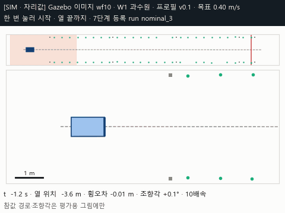
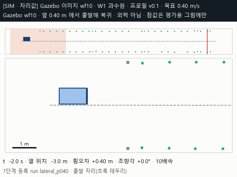
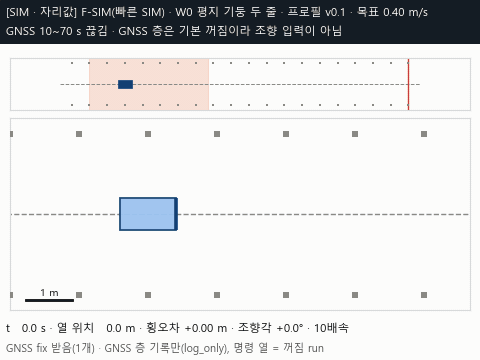
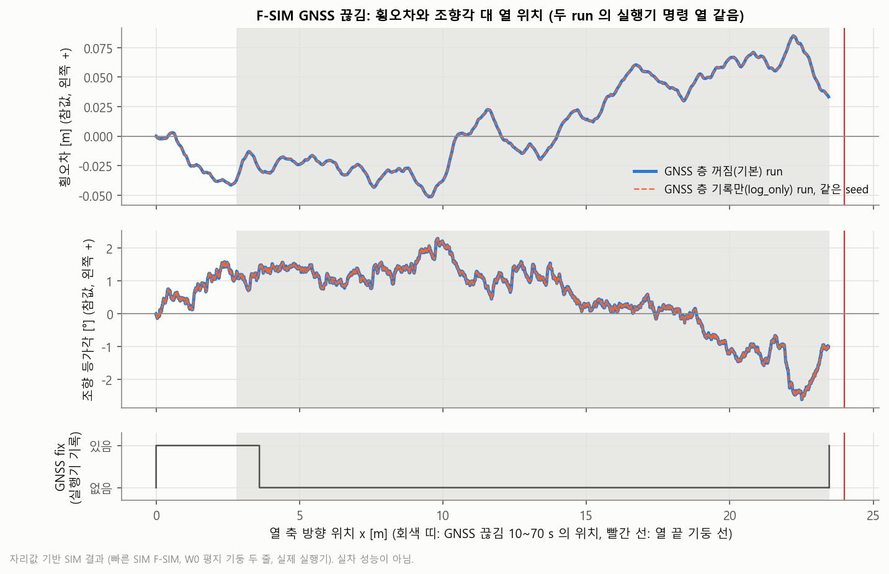
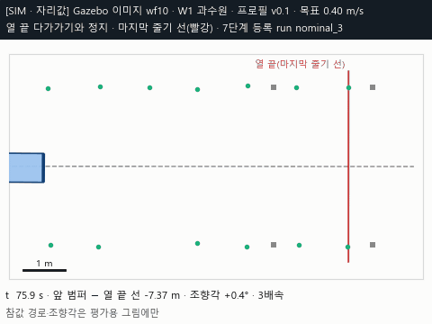
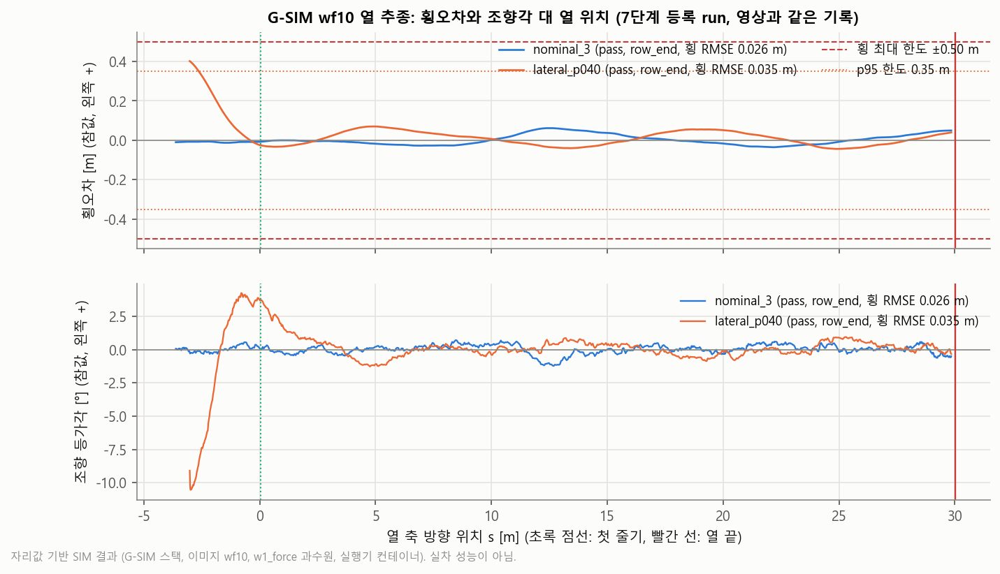

# G-SIM 매체: 열 추종·복귀·GNSS 끊김·열 끝 정지 (DOC-15)

- 작성: 2026-11-14. 완료 기준 S2 의 영상 부분과 DOC-15 의 매체다. **판정이 아니다.** 새 사전등록도, 합격 기준이나 제어기 값의 변경도
  없다. 모든 수치는 **자리값 기반 SIM 결과**이며 현장 성능이 아니다.
- 공통 조건: 프로필 `front_steer_v0_1_placeholder`(v0.1), 제어기 `row_follow`, 목표 속도 0.40 m/s(`field_tuning.default.json`
  기본 프리셋). 그림 속 참값 경로와 조향각(등가각)은 평가용 그림에만 쓴 것이고 실행기 입력이 아니다(검사 A13).
- 매 프레임 위 띠에 조건(시뮬레이터와 이미지, 월드, 프로필, 목표 속도, `[SIM · 자리값]`)을, 아래 줄에 시각·열 위치·횡오차·조향각과
  배속을 적었다.
- 도구: `tools/steer_sim/gsim_media.py`(위에서 본 프레임, 그래프), `tools/steer_sim/make_assets.py`(GIF·mp4 와 매니페스트).

## 1. 목록

| 항목 | 파일 | 크기 · 길이 | 기록(run) | 조건 |
|---|---|---|---|---|
| (a) 정상 주행, 열 끝까지 | `assets/video/row_follow_wf10_top_10x.gif` | 314,515 B · 11.0 s(480×360) | 최종 확인 7단계 A 등록 run `nominal_3`(pass, `row_end`, e +0.454 m) | Gazebo 이미지 wf10, W1(`w1_force`), SIM 시계, 한 번 눌러 시작 |
| (b) 옆 0.40 m 에서 출발해 복귀 | `assets/video/recover_side040_wf10_top_10x.gif` | 320,101 B · 10.4 s | 같은 단계 등록 run `lateral_p040`(pass, `row_end`, e +0.449 m) | 위와 같음. 중심선 왼쪽 0.40 m 에 놓고 출발(외력 아님) |
| (c) GNSS 끊김 | `assets/video/gnss_dropout_fsim_top_10x.gif` | 207,830 B · 6.9 s | 빠른 SIM `follow_gnss_dropout_60s_s0__gnss_log`(`row_end`) | **F-SIM(빠른 SIM)**, W0 평지 기둥 두 줄, 가상 GNSS 10~70 s 끊김 |
| (d) 열 끝 정지(가까이) | `assets/video/row_end_stop_wf10_top_3x.gif` | 165,840 B · 11.2 s | (a)와 같은 run `nominal_3` | (a)와 같음, 열 끝 선 8 m 앞부터 정지 4 s 뒤까지 3배속 |
| 그래프 1 | `figures/steer_follow_gsim/gsim_fig03_lateral_steer_wf10.png` | 152,498 B | `nominal_3`, `lateral_p040` | 횡오차·조향 등가각 대 열 위치 |
| 그래프 2 | `figures/steer_follow_gsim/gsim_fig04_gnss_dropout_fsim.png` | 175,549 B | F-SIM `..._off`, `..._gnss_log` | 횡오차·조향 등가각·GNSS fix 대 열 위치 |

(a)·(b)·(d)의 기록은 `STEER_FOLLOW_GSIM_FINAL_KO.md` 16.4 절의 등록 run 그대로다(새로 돌리지 않았다). 그 run 들에는 카메라
프레임이 없어서, 위 GIF 는 기록된 참값 자세(약 8 Hz)를 SIM 1 s(10배속)·0.3 s(3배속) 간격으로 보간해 위에서 그린 것이다. 차 외곽은
1.22 × 0.70 m 사각형(자리값), 줄기·기둥은 장면 메타데이터다. 위 칸은 열 전체, 아래 칸은 차를 따라가는 10 m 창이며 두 칸 모두
가로세로 비율이 같다(아래 칸의 막대가 1 m).

## 2. (a) 정상 주행



[SIM · 자리값] 이미지 wf10, W1 과수원 한 통로를 한 번 눌러 시작해 열 끝까지(7단계 등록 run `nominal_3`, 약 109 s 를 10배속).
횡 RMSE 0.026 m, 횡 최대 0.062 m, 조향 등가각 −1.3~+0.7°, 거리 33.5 m, 105.4 s.

## 3. (b) 옆 0.40 m 에서 출발해 복귀



[SIM · 자리값] 중심선 왼쪽 0.40 m 에 차를 놓고(초록 테두리) 출발해 중심선으로 돌아온 run(`lateral_p040`, 약 103 s 를 10배속).
**외력을 건 것이 아니라 등록된 출발 어긋남이다.**

- 참값으로 잰 것: 출발 횡 +0.401 m, 처음 조향 등가각이 −10.5°(오른쪽)까지 가고 출발 뒤 11.1 s·2.1 m 에 |횡| < 0.05 m 로 들어왔다.
  6 m 뒤 |횡| 최대 0.070 m, 등록 RMSE(6 m 뒤) 0.035 m, 방향 최대 11.0°.
- Gazebo 에서 주행 중 외력(조향축 토크, 차체 밀기)을 걸지 못한 까닭: G-SIM 의 ESP 에뮬레이터 hook(`gz_esp_emulator.py`: status,
  mark, event, adc_pattern, adc_ramp, link, status_loss, corrupt, half_frame, inject_line, banner_rewrite, restart, unplug, record,
  record_finish, kill_bridge)에는 주행 중 외력이 없다. 조향축 외부 토크(`steer_ext`)는 빠른 SIM T1 대에만 있다
  (`STEER_HOLD_RESULT_KO.md`). `restart` 의 주입은 MCU 를 새로 시작하므로 주행 중 방해가 아니고, `adc_*` 는 가변저항 측정 고장이다.

## 4. (c) GNSS 끊김 — 빠른 SIM



[SIM · 자리값] **F-SIM(빠른 SIM)**, W0 평지 기둥 두 줄(28.5 m 열), 가상 GNSS 를 10~70 s 동안 끊은 run(약 68 s 를 10배속). GNSS 층은
기본 꺼짐이라 조향 입력이 아니다. 이 run 은 층을 기록만(`log_only`) 켜서 실행기의 GNSS 상태를 화면 아래 줄에 보였다.

- Gazebo 로 만들지 못한 까닭: G-SIM 의 가상 GPS(`sensor_contract_steer.py`)는 표시 전용이고 끊는 hook 이 없다. 실행기의 `gnss_mode`
  기본값이 `off` 라 `/gps/fix` 를 구독하지도 않는다(`GNSS_LAYER_KO.md` 6절: G-SIM 가상 GPS 는 이 층과 이어 보지 않았다).
- 잰 것(같은 seed 의 `off` run 과 `log_only` run): 둘 다 `row_end`, 횡 RMSE 0.0406 m, 최대 0.085 m, e +0.077 m. **실행기 명령 열
  (스로틀·조향)이 두 run 에서 같다**(perception_compare 의 `commands_equal_off` True). 실행기는 fix 10개를 받은 뒤 12.05 s 부터
  'GNSS 없음'(마지막 fix 나이 2.5 s 넘음)이었고, 67.6 s 에 열 끝에서 선 뒤 70.55 s 에 다시 받았다(`restarted`).



[SIM · 자리값] 그래프 2. 두 run(GNSS 층 꺼짐, 기록만)의 횡오차·조향 등가각(참값)과 실행기가 기록한 GNSS fix 있음/없음, 열 위치에
대해. 회색 띠는 수신기가 조용했던 10~70 s 의 위치다. 두 선이 겹친다.

## 5. (d) 열 끝 정지



[SIM · 자리값] (a)와 같은 run 의 마지막 부분(열 끝 선 8 m 앞부터 정지 4 s 뒤까지, 약 33 s 를 3배속). 빨간 선이 마지막 줄기 선이고, 앞
범퍼가 그 선을 0.45 m 지나 섰다(등록 한도 ±1.0 m, 끝 속도 0.000 m/s).

## 6. 그래프 1: 횡오차와 조향각 대 열 위치 (wf10)



[SIM · 자리값] 그래프 1. 위 영상과 같은 두 기록(`nominal_3`, `lateral_p040`)의 횡오차와 조향 등가각(참값), 주행 구간. 빨간 점선은
횡 최대 한도 ±0.50 m, 주황 점선은 p95 한도 0.35 m 다(등록 `steer_follow_gsim_v1`; `lateral_p040` 의 RMSE·p95 는 6 m 뒤부터).

## 7. 차량 카메라 영상

wf10 의 차량 카메라 영상은 **만들지 못했다.** 위 기록(7단계 등록 run)에는 카메라 프레임이 없다. 사용자 스택(`ubts-steer`, wf10,
SIM 시계)에서 사용자 명령 그대로 한 열을 달리며 카메라를 갈무리하는 매체용 run(판정 아님)을 준비했지만, 이 PC 의 실행 권한 확인이
돌고 있는 사용자 스택의 차를 움직이는 명령(`sim_auto.py reset`, `start`)을 막아 실행하지 않았다. 사용자 스택은 건드리지 않았다.

지금 있는 차량 카메라 영상은 앞 이미지의 것이다: wf7 사용자 명령 run([README 첫 화면](../assets/video/row_follow_wf7_user_10x.gif),
`STEER_FOLLOW_GSIM_FINAL_KO.md` 13.5 절), wf6 의 열 끝 정지(`STEER_FOLLOW_GSIM_FINAL_KO.md` 12절). wf10 카메라 영상은 남은 일이다.

## 8. 다시 만드는 법

`<runs>`는 저장소 밖 기록 폴더(조향 SIM 작업의 runs)다. 저장소 맨 위에서:

```
# (c) 의 빠른 SIM 두 run (Docker 없음, 한 프로세스; env: UBTS_STEER_BUILD_DIR, UBTS_STEER_CXX)
(cd sim/ubts && python -B -m steering.safety_scripts.perception_compare --out <runs>/gsim_media_20261114/fsim/gnss_dropout \
    --workers 1 --variants off gnss_log --only gnss_dropout_60s --gnss-seeds 0)
# 위에서 본 프레임 네 묶음과 그래프 두 장 ((a)(b)(d) 는 <runs>/gsim_stage7_20261114/sessions/s7a_*/follow 를 읽는다)
python -B tools/steer_sim/gsim_media.py --runs-root <runs> frames
python -B tools/steer_sim/gsim_media.py --runs-root <runs> figures
# GIF 와 매니페스트(docs/assets/ASSETS.json)
python -B tools/steer_sim/make_assets.py --runs-root <runs> --only row_follow_wf10_top_10x recover_side040_wf10_top_10x \
    row_end_stop_wf10_top_3x gnss_dropout_fsim_top_10x
```

wf10 카메라 영상을 만들 때(아직 하지 않음): 돌고 있는 스택에서 `python -I tools/steer_sim/capture_media.py camera --project <p>
--seconds 170 --out <runs>/<기록>/media/cam` 을 켜 둔 채 한 열을 달리고(사용자 스택이면 `sim_auto.py start`, 끝나면 `sim_auto.py
reset`), `make_assets.py` 에 카메라 프레임 recipe(여러 줄 `label` 에 위 조건)를 더한다. 사용자 스택을 움직이려면 사용자 승인이 먼저다.

## 9. 이 매체가 보이지 않는 것

- 실차 성능이 아니다. 조향·차량·속도 값은 자리값이고 과수원은 생성기 모델이다.
- (b)는 외력에 대한 복귀가 아니다(출발 어긋남). 외력 아래 직진 유지는 ESP 위치 루프만의 빠른 SIM 결과가 따로 있다
  (`STEER_HOLD_RESULT_KO.md`, 불합격 39/40).
- (c)는 Gazebo 가 아니다. GNSS 가 조향 입력이 아니므로 끊겨도 주행이 같다는 것을 보일 뿐, GNSS 층의 품질을 판정하지 않는다.
- 7단계 최종 확인의 판정(열 추종 3/4, 사용자 명령 0/3 등, `STEER_FOLLOW_GSIM_FINAL_KO.md` 16절)은 그대로 불합격이다. 이 매체는
  통과한 run 을 골라 보인 것이다.
