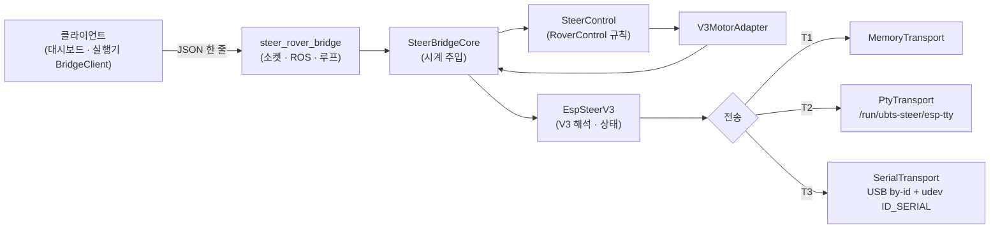

# 호스트 브리지 V3 (조향 차량, P3 호스트 쪽)

- 작성: 2026-11-09 (P3 호스트 작업). 고침: 2026-11-09 fix_p3(검토 결과 RH-01~RH-12 반영, 11절 끝에 요약)
- 근거: `DESIGN_v1_KO.md` 2.4, 2.5, 4.1, 4.2, 4.3, 4.5, 7.2.1, 8.3 P3. `ESP_PROTOCOL_V3_DRAFT_KO.md`(V3 규격). `LOCKSTEP_PROTOCOL_KO.md` 11절. `DECISIONS_KO.md` R1~R12. 2026-09-19 제어 설계(`rover_control_test/docs/control-architecture.md`).
- 상태: 소스와 시험이 있다. 실기 ESP·실제 USB 포트·Jetson에서는 돌리지 않았다. 시험은 손으로 쓴 가짜 V3 MCU(`test_steer_support.FakeMcu`)와 메모리 전송으로 했다. 모든 수치는 자리값이다. 결과는 자리값 기반 SIM 결과이고 현장 검증이 아니다.
- 고정 파일(`rover_control_bridge.py`, `rover_control_core.py`, `esp_motor.py`, `esp_wheel_controller.py`, `motor_pwm.py`, `tests/test_esp_rover.py`)은 바꾸지 않았다.

## 1. 모듈 지도

| 파일 | 내용 | import 규칙 |
|---|---|---|
| `dashboard/scripts/esp_motor_v3.py` | V3 해석·상태. CRC-8, 명령 줄 만들기, MCU 줄 엄격 파서, 링크(`EspSteerV3`: handshake, 신원 규칙, 상태 줄·n·ms 기록, q 번호), 전송 3종 | ROS·numpy·sim 없음. `fcntl`·`termios`·`select`는 `PtyTransport`·`SerialTransport` 함수 안에서만 |
| `dashboard/scripts/steer_control_core.py` | `SteerControl`(`RoverControl` 하위 클래스). 조종 규칙 | 하드웨어·소켓·ROS 없음 |
| `dashboard/scripts/steer_bridge_core.py` | `SteerBridgeCore`(큐·만료·busy·한 틱 한 요청·C 재전송·PING·STOP 확인·호스트 래치·상태 블록), `HostProfile`(호스트 프로필 JSON 읽기), `V3MotorAdapter` | ROS·소켓·직렬·`fcntl`·`termios`·`os` 없음. 시계 주입 |
| `dashboard/scripts/steer_rover_bridge.py` | 래퍼. 제어 소켓, ROS 발행, 전송·시계 선택, 실행 루프. T2·T3 공용 | `rclpy`는 늦게 import(시험은 ROS 없이 돈다) |
| `sim/ubts/steering/host_profile_export.py` | 차량 프로필 → 호스트 프로필 JSON | SIM 쪽. 호스트는 이 모듈을 import하지 않는다 |

- 호스트 코드는 `sim/ubts`에서 아무것도 import하지 않는다. 그래서 실차 대시보드 저장소로 그대로 옮길 수 있다(P9, A26).
- 실행: 대시보드 루트에서 `python3 -m scripts.steer_rover_bridge ...`(기존 `scripts.rover_control_bridge`와 같은 방식).



## 2. 요청과 응답

전송: 기존 브리지와 같다. 연결 하나에 JSON 객체 한 줄(4096 B 이하), 응답 한 줄. 읽기 제한 0.4 s. 소켓 권한 0660. 소켓 폴더의 `bridge.lock`으로 두 번째 브리지를 거절한다. 경로: SIM `/run/ubts-steer/control.sock`, 실차 `/run/ubts-rover/control.sock`(환경 변수 `ROVER_CONTROL_SOCKET`이 이긴다). 소켓은 역할에 묶인다: SIM 래퍼는 `/run/ubts-rover/` 아래, 실차 래퍼는 `/run/ubts-steer/` 아래 소켓을 쓸 수 없다(인자든 환경 변수든 설정 오류로 시작하지 않는다. 검토 RH-07).

| op | 필드 | 동작 |
|---|---|---|
| `status` | 없음 | 마지막 스냅샷(큐를 거치지 않는다) |
| `stop` | (`reason`은 무시) | 비상 사건. 다음 틱 첫머리에 STOP을 보내고 대기 요청을 모두 `stop_barrier`로 끝낸다. 응답 `{"ok": true, "state": "stop_requested"}` |
| `arm` | `owner`, `"vehicle_profile": "front_steer"` | 4.2 조건 검사 → `STOP`, `ARM <boot>` 송신 → lease 발급(seq 0). MCU 확인은 다음 상태 줄 |
| `drive` | `owner`, `lease`, `ticket`, `seq`(직전 + 1), `"deadman": true`, `throttle`(정수 −100..100), `steer_mrad`(정수, 등가 소프트 한계 안) | 요청 저장, 입력 기한 0.75 s, `C`를 같은 틱에 송신 |
| `keepalive` | `owner`, `lease`, `ticket`, `seq` | ticket·조종권만 갱신. 이동 기한은 늘지 않는다 |
| `release` | `owner`, `lease`, `ticket`, `seq` | throttle 0(MCU 램프 감속), 조향 목표 유지, 1.1 s 안에 정지가 안 보이면 정지 |
| `motion` | `owner`, `lease`, `yaw_rate_rad_s`, `speed_m_s` | lease 보유자(실행기)가 센서에서 얻은 움직임 표본(자이로 요레이트, 센서 속도 추정)을 준다. `steering_ineffective` 감시의 입력이다. 큐를 거치지 않고 바로 답한다. ticket·seq를 쓰지 않고 기한을 늘리지 않는다(움직임 입력이 아니다). 다른 클라이언트·lease 없음은 `control_not_owned`, 수가 아니거나 \|값\| > 10(rad/s, m/s)이면 `invalid_motion`. 거절해도 정지하지 않는다. 2026-11-09 3단계에서 더했다(P3 열린 항목 4) |

- `drive`에 `left`나 `right`가 있으면 조종권 검사 전에 정지하고 `differential_command_rejected`로 거절한다. 옛 차동 화면은 arm(`steer_profile_required`)도 drive도 할 수 없다(A14).
- 조향만 바꾸는 명령(throttle 0)도 lease·ticket·seq·deadman·arm이 필요하다. throttle 0이면 "움직이는 중"이 아니므로 입력 기한이 지나도 lease를 거두지 않는다. 그때는 `C` 재전송이 멈추고 MCU `C` TTL이 끝나 구동이 brake로 선다. 조향은 마지막 목표를 유지한다(V3 규격 6.3).
- 성공 응답: `{"ok": true, "lease", "ticket", "seq", "ticket_ttl_s", "status": {...}}`. `status`에는 아래 4절의 조향 블록이 들어 있다.
- 실패 응답: `{"ok": false, "error": "<code>"}`.
- 제자리 회전(pivot)은 없다. 모르는 op(문자열이 아닌 op 포함)는 `unknown_operation`이다. 자동 재무장은 없다.
- 단일 스레드(T1)에서는 `core.submit(request)`가 Future를 돌려준다. 다음 `core.step()`이 결과를 채운다. 래퍼는 `core.request(request)`(0.4 s 기다림)를 쓴다.

## 3. 오류 코드와 래치

오류 코드(응답 `error` 또는 정지 이유 `reason`):

| 코드 | 언제 | 정지 |
|---|---|---|
| `steer_profile_required` | arm에 `vehicle_profile: front_steer` 없음 | — |
| `differential_command_rejected` | drive에 `left`/`right` | 예 |
| `firmware_v3_required` | 열린 링크에 V3 배너가 없음(V2 펌웨어 포함) | — |
| `sim_identity_mismatch` [추가] | 실차 래퍼에 `sim=1` 장치, SIM 래퍼에 `sim=0` 장치 | 예 |
| `hardware_profile_mismatch` | 배너 `hw`가 호스트 프로필 `hw_profile`과 다름 | 예 |
| `link_config_mismatch` [추가] | 배너 `wd`, `ttl`, `st`가 호스트 프로필 값과 다름 | — |
| `steering_status_stale` | 상태 줄이 `host_status_gap_ms`(150 ms)보다 오래 없음 | 예 |
| `stop_unconfirmed` | STOP 확인이 아직 없음(arm 거절), 재전송 5회 뒤에도 없음(래치) | 예 |
| `steering_uncalibrated` | `cal=none`, 보정 줄 없음, 표시나 soft가 빔. MCU `N - nocal` | 예 |
| `calibration_mismatch` | `cal_id`가 호스트 프로필과 다름, 배너와 보정 줄의 id가 다름, `caldirty=1`. MCU `N - cal` | 예 |
| `config_unsaved` [추가] | 보정 줄 `cfgdirty=1`(저장하지 않은 `CFG` 값이 MCU RAM에 있음). MCU는 ARM을 받지만(벤치용) 호스트는 arm을 거절한다(V3 규격 12.1-74) | — (arm 거절) |
| `polarity_check_missing` | 보정 줄 `pol=no`, 또는 상태 줄 `fl`에 POLARITY·DRV_STUCK 비트(통과한 `CAL POL`만 MCU 래치를 지운다, V3 규격 12.1-71). MCU `N - pol` | 예 |
| `steering_fault_latched` | ARM에 MCU `N - fault`(활성 결함 조건) | 예 |
| `steering_busy`, `arm_rejected_<사유>`, `arm_unconfirmed` [추가] | ARM에 `N - busy` 등, ARM 뒤 `arm.confirm_ms`(150 ms) 안에 `st` = 2 없음 | 예 |
| `internal_error` [추가] | 요청 처리·`step()`·래퍼 루프의 예상하지 못한 예외(코드 결함). 응답 또는 정지 이유 | 예 |
| `invalid_motion` [추가] | op `motion`의 값이 유한한 수가 아니거나 범위 밖 | 아니오 |
| 기존 코드 | `operator_required`, `control_in_use`, `control_not_owned`, `stale_input_rearm_required`, `invalid_sequence`, `invalid_drive`, `unknown_operation`, `control_busy_stopped`, `stop_barrier`, `request_expired`, `request_too_large`, `object_required`, 정지 이유 `input_expired`, `operator_expired`, `device_unavailable`, `operator_stop`, `shutdown` | 기존과 같다 |

호스트 래치(정지하고 남긴다. 운영자 재무장이 MCU에서 확인될 때만 지운다):

| 래치 | 켜는 것 |
|---|---|
| `steering_status_stale` | 상태 줄 간격 > 150 ms |
| `mcu_reset_detected` | 새 boot_id 배너, 상태 줄 `ms` 역행(2^32 감김 고려), 이어지지 않는 상태 줄 `n`(새 부팅은 0부터), 또는 ARM에 온 `N - boot`(V3 규격 12.1-76). 배너 없이 알면 배너가 올 때까지 `INFO`를 보내고 arm을 이 코드로 거절한다(12.1-61) |
| `calibration_mismatch` | 배너·보정 줄의 `cal_id` ≠ 호스트 프로필 `cal_id` |
| `hardware_profile_mismatch` | 배너 `hw` ≠ 호스트 프로필 |
| `sim_identity_mismatch` | 신원 규칙 위반(5절) |
| `steering_not_following` | 요청각과 측정각 차 > 3°가 1.5 s 지속(`host_track_mismatch`) |
| `steering_ineffective` | 움직임 입력이 있을 때만: v > 0.2 m/s, \|δ_pot\| > 3°에서 \|r_gyro − v·tan δ_pot / L\| > max(3°/s, 0.5 × 예측)이 1.5 s 지속 |
| `status_seq_gap` | 1 s 창 안에 빠진 상태 번호 n이 5개 넘음 |
| `stop_unconfirmed` | STOP 확인 실패(4절 시간) |
| `mcu_disarmed` | ARMED 확인 뒤 MCU가 스스로 DISARMED(원인: `W` 줄, `F` 줄) |
| `mcu_state_mismatch` | 호스트 lease·대기 STOP·대기 ARM이 없는데 MCU가 ARMED |
| `c_rejected` | 보낸 `C`에 `N <q> old|range|syntax|nocrc` |
| `hardware_fault` | 전송 쓰기·읽기 오류(USB 분리 포함). 링크를 닫고 1 s마다 다시 연다 |
| `arm_rejected` [추가] | 운영자 재무장의 ARM에 MCU `N` 거절(사유는 상세 칸) |
| `arm_unconfirmed` [추가] | ARM 뒤 `arm.confirm_ms` 안에 `st` = 2 상태 줄이 없음 |
| `internal_error` [추가] | 요청 처리·`step()`·래퍼 루프의 예상하지 못한 예외. 정지하고 루프는 계속 돈다 |
| `mcu_ttl_expired` [추가, 4단계] | lease와 확인된 ARM이 있을 때 MCU C TTL 만료(`F TTL` 줄, 또는 ARMED 상태 줄 `fl`의 TTL 비트)를 읽었는데, 그 읽기 `TTL_INPUT_LAG_S`(50 ms [자리값]) 전의 루프에서 운영자 입력 기한이 아직 남아 있었다(C 줄을 잃었거나 늦었다). 바로 STOP하고 lease를 버린다. 입력 기한이 이미 지난 TTL(정지 상태 throttle 0에서 기한이 끝나 C를 더 보내지 않은 경우)은 예정된 끝이라 래치하지 않고 `ttl_expected`로만 센다(`DECISIONS_KO.md` R18 결정 1) |

- `arm`이 운영자 재무장이다. 조건(4.2 오류 코드 표의 arm 조건)이 모두 풀린 뒤에만 받는다. 래치는 MCU가 그 ARM을 확인할 때(첫 `st` = 2 상태 줄) 지운다(V3 규격 12.1-75). ARM의 `N` 거절, 확인 없음, 쓰기 실패는 래치를 그대로 두고 `arm_rejected`·`arm_unconfirmed`(쓰기 실패는 `hardware_fault`)를 더한다. 확인 전에 STOP을 쓰면 그 재무장은 끝나고 래치는 그대로다. 그래서 `state`가 `fault`로 남는다(검토 RH-01: 예전에는 ARM을 보내기 전에 지워, 거절된 재무장 뒤 MCU 결함이 남은 채 `disarmed`가 되었다). 조건이 남은 래치는 arm을 그 코드로 거절한다.
- 래치가 있고 lease가 없으면 `state`는 `fault`다(`motor_pwm.py` 허용값 안).
- `mcu_ttl_expired`(4단계, R18 결정 1): MCU 규격 6.3에서는 TTL이 조건이라 다음 `C`가 TTL 비트를 지우고 120 ms 휴지 뒤 다시 출발한다. 실행기는 TTL을 drive 응답(100 ms마다)에서만 보므로 그 사이 브리지의 자동 `C` 재전송이 운영자 모르게 다시 출발시킬 수 있었다. 이제 브리지가 `F TTL` 줄(잃어도 ARMED 상태 줄의 TTL 비트)에서 스스로 멈추고, 운영자 재무장 전에는 `C`를 내지 않는다. 래치 판단의 기준은 최근 16번 루프의 (시각, 입력 기한) 기록이다. 50 ms는 MCU 만료와 그 줄을 읽는 사이(줄 시간, USB 지연, 루프 한 번, 약 35 ms 이하) 호스트가 새 요청에 답한 경우를 예정된 끝으로 보기 위한 여유다. 보수적인 쪽의 한계: 정지 중 TTL 비트가 남은 채 운영자가 다시 누른 직후 첫 `C` 하나를 잃으면 래치한다(재무장 필요). MCU 쪽 TTL 래치는 P9 펌웨어 후보로 둔다. 시험: `test_steer_bridge_core.py` TTL 래치 시험 6개, `test_steering_host_firmware.py` LinkLossTest, T1 대본 `c_line_loss_ttl*`, `bridge_stall_ttl`, `c_line_loss_ttl_executor_stall*`, 위상 훑기 `steering.safety_scripts.ttl_window`.
- `steering_ineffective`는 센서에서 나온 움직임 표본(gyro, LiDAR 속도)을 받을 때만 돈다. 표본은 op `motion`(lease 보유자, 2절) 또는 같은 프로세스의 `core.observe_motion(yaw_rate_rad_s, speed_m_s)`로 온다. 참값을 넣지 않는다. 실행기가 op `motion`으로 보내는 것이 실행기 쪽 공급원이다(T1: `t1_rig.RigClient.observe_motion`). 래퍼는 요청을 코어에 그대로 넘기므로 T2·T3에서도 같은 op가 된다. G-SIM 실행기 쪽 연결은 P6a다.

## 4. 시간 규칙

모든 시간은 주입 시계 기준이다. 값은 호스트 프로필에서 온다(자리값).

| 규칙 | 값 |
|---|---|
| 요청 큐 | 8개. 가득 차면 즉시 `control_busy_stopped` + 정지 |
| 요청 만료 | 큐에서 0.25 s 넘게 기다리면 `request_expired`(정지 아님) |
| 응답 대기(래퍼) | 0.4 s 넘으면 `control_busy_stopped` + 정지 |
| 틱 | 래퍼 루프 20 ms. 한 틱에 요청 하나 |
| 입력 기한 | 0.75 s(`RoverControl.INPUT_TTL`). keepalive는 늘리지 않는다. release 1.1 s |
| `C` 재전송 | 유효 입력 동안 20 Hz(`c_resend_hz`). 새 요청은 그 틱에 바로 보내고 주기를 다시 잰다 |
| `C` ttl | min(`c_ttl_max_ms`, 배너 `ttl`, 남은 입력 기한 ms 내림). 1 ms 미만이면 보내지 않는다 |
| q | `C` 줄마다 1 증가(재전송도 새 q). 새 boot에서 1부터. 같은 boot에 다시 붙으면 첫 상태 줄의 q + 1부터 |
| PING | 링크가 준비된 동안 10 Hz(설계 4.1 표). watchdog만 갱신한다 |
| STOP 송신 | `stop` 요청 뒤 첫 틱의 첫 송신(A17: ≤ 1 틱) |
| STOP 확인 | `st` = 1, `L` = `R` = 0인 상태 줄을 STOP 뒤 `stop_confirm_periods` 주기(100 ms) 안에. STOP을 쓴 단계에서 읽은 줄도 확인이 된다(DISARMED·구동 0은 STOP이 만드는 상태다). 예외: ARM 확인을 기다리는 동안 쓴 STOP은 마지막으로 읽은 상태 줄 번호 n + 2 이상인 줄만 확인한다. 그 전 줄은 ARM이 MCU에 닿기 전에 만들어졌을 수 있다. 새 부팅의 줄(`ms` 역행, `n` 재시작)은 바로 확인한다(V3 규격 12.1-77, 검토 RH-05) |
| STOP 재전송 | 첫 STOP 시각 t0에 묶인 고정 격자: 확인이 없으면 t0 + 100 ms, 그 뒤 50 ms마다, 최대 5번(t0 + 100, 150, 200, 250, 300 ms). 마지막 예정 재전송 뒤 100 ms에도 없으면 `stop_unconfirmed` 래치(t0 + 400 ms). 20 ms 래퍼 루프에서는 각 시각을 다음 단계로 올린다(t0 + 100, 160, 200, 260, 300 ms, 래치 t0 + 400 ms. V3 규격 12.1-62) |
| ARM 확인 | ARM 뒤 150 ms(`arm.confirm_ms`, 상태 주기 3개) 안에 `st` = 2. 없으면 `arm_unconfirmed` 래치와 정지. ARM에 `N - boot`가 오면 `mcu_reset_detected` 래치, 정지, 배너가 올 때까지 `INFO`(V3 규격 12.1-76, 검토 RH-02) |
| 배너 대기 | 포트를 연 뒤 배너 전 바이트는 버린다. 1.5 s 안에 배너가 없으면 `INFO`, 그 뒤에도 1.5 s마다 |
| 세션 시작 | 새 배너(새 세션·새 boot)마다 STOP을 보내고 확인한다. arm은 이 확인이 있어야 받는다 |
| 보정 줄 | 준비된 링크에 배너 뒤 0.1 s가 지나도 보정 줄이 없으면 `CAL GET`, 그 뒤 1 s마다(보정 줄은 보통 배너 바로 뒤에 온다) |
| 무장 중 조회 금지 | lease가 있거나 ARM 확인을 기다리는 동안 `INFO`, `CAL GET`을 보내지 않는다. 그 답이 MCU 송신 고리에 쌓여 STOP 확인 줄을 늦출 수 있다(V3 규격 12.1-60) |
| 리셋 뒤 배너 | 배너 없이 상태 줄로 MCU 리셋을 알면 정지한 뒤 `INFO`를 바로, 그 뒤 `banner_timeout_s`마다 보낸다. 배너가 오면 새 boot_id로 세션을 다시 시작한다(V3 규격 12.1-61) |
| 다시 열기 | 링크가 닫히면 1 s마다 다시 연다. 자동 재무장은 없다 |

- V3 arm은 STOP 확인(DISARMED 상태 줄)을 먼저 요구한다. 그래서 정지 직후 약 60 ms 안의 arm은 `stop_unconfirmed`로 거절된다. V2 Bridge와 다른 점이다(7절).

## 5. 전송과 신원

| 전송 | 단계 | 규칙 |
|---|---|---|
| `MemoryTransport` | 시험, T1 | 주입 시계. 장치 쪽 `device.take_timed()`는 (쓴 시각, 바이트)를 준다(T1에서 LOCKSTEP 11.7절 도착 틱 계산용). `device.send(data, at)`은 그 시각부터 읽힌다. 닫힌 동안 온 바이트는 버린다. `on_open` 콜백으로 포트 열기 리셋을 흉내 낸다 |
| `PtyTransport` | T2 | `/run/ubts-steer/` 아래 경로만 연다. 열기 전에 `os.stat`(링크를 따라감, 장치를 열지 않음)으로 문자 장치이고 Unix98 pty 슬레이브(major 136~143)인지 본다. 링크가 다른 장치를 가리키면 열지 않는다(검토 RH-08). 연 뒤 tty인지, `fstat`의 장치 번호가 검사한 것과 같은지 본다. raw termios |
| `SerialTransport` | T3 | 명시한 by-id 경로와 udev `ID_SERIAL`이 필요하다. `/run/ubts-steer/` 아래는 거절. `/run/lock` 잠금, `TIOCEXCL`, raw termios 115200(230400 허용). 시험은 열지 않는다 |

신원 규칙(설계 2.5, A14):

- 래퍼의 역할은 전송으로 정한다. `serial` = 실차 래퍼, `pty`·`memory` = SIM 래퍼. 역할이 시계·소켓·`cal_id` 규칙을 정한다: 실차 래퍼는 `--clock wall`만, 실차 소켓 폴더만, 고정 `cal_id`만 쓴다(8절, 2절, 6절).
- 실차 래퍼는 배너 `sim=1` 장치를 거절한다. SIM 래퍼는 `sim=0` 장치를 거절한다. 거절한 링크는 준비 상태가 되지 않고 STOP 말고는 쓰지 않는다(PING도 없다).
- 배너 `hw`가 호스트 프로필과 다르면 arm을 거절한다.
- 포트가 열렸다고 준비가 아니다. 이번 세션에서 CRC가 맞는 새 배너를 받아야 한다.

## 6. 호스트 프로필 JSON

호스트는 SIM 코드를 import하지 않는다. 차량 프로필에서 만든 작은 JSON을 경로로 읽는다(`--host-profile` 또는 `UBTS_STEER_HOST_PROFILE`).

만들기(`sim/ubts`에서):

```
python -B -m steering.host_profile_export --out <저장소 밖 경로>/host_profile.json [--profile <yaml>] [--cal-id 1|any]
```

스키마 `ubts.steer_host_profile.v1`(모르는 키·빠진 키는 거부). 값마다 범위를 보고, 값끼리의 관계도 본다(검토 RH-10. 하나씩은 맞아도 함께 맞지 않는 값을 거부한다):

- PING 주기(1000 / `ping_hz` ms) ≤ `watchdog_ms` / 2
- `C` 재전송 주기(1000 / `c_resend_hz` ms) < `c_ttl_max_ms`
- `host_faults.status_gap_ms` ≥ 상태 주기 2개(2 × 1000 / `status_hz` ms)
- `arm.confirm_ms` ≥ 상태 주기 2개

내보내기 도구(`host_profile_export.py`)도 같은 검사를 하고, 어긋나면 파일을 쓰지 않고 오류로 끝난다. `calibration.cal_id`가 null(`--cal-id any`)인 프로필은 SIM 역할만 받는다. 실차(serial) 래퍼는 시작할 때 설정 오류로 끝난다(검토 RH-11).

| 절 | 키 | 자리값 프로필의 값 |
|---|---|---|
| 맨 위 | `vehicle_profile`, `hw_profile` | `front_steer`, `front_steer_v0` |
| `source_profile` | `profile_id`, `profile_sha256`, `provenance_grade`, `result_kind`, `field_validated`, `overrides` | `front_steer_v0_placeholder`, `56168151…`, placeholder, 자리값 기반 SIM 결과, false |
| `steer_limit` | `left_rad`, `right_rad`, `left_mrad`, `right_mrad`(내림) | 0.40940 rad(23.457°), 409 mrad |
| `calibration` | `cal_id`, `mark_left_mrad`, `mark_right_mrad`, `permille_per_deg`, `expected_soft_permille`, `rule` | 1, 438.03, 438.03, 39.845, {935, −935} |
| `link` | `baud`, `status_hz`, `c_ttl_max_ms`, `c_resend_hz`, `ping_hz`, `watchdog_ms`, `banner_timeout_s` | 115200, 20, 300, 20, 10, 500, 1.5 |
| `stop` | `confirm_periods`, `resend_interval_ms`, `resend_max`, `steer_policy`, `hold_after_*_ms`, `watchdog_steer_mode`, `ttl_expiry_drive_mode` | 2, 50, 5, hold_measured, 2000, hold, brake |
| `arm` | `confirm_ms` | 150 |
| `host_faults` | `status_gap_ms`, `seq_gap_missing`, `seq_gap_window_s`, `track_error_deg`, `track_duration_s`, `ineffective` | 150, 5, 1.0, 3.0, 1.5, (프로필 값) |
| `servo` | `deadband_permille`, `max_pwm` | 20, 255 |
| `drive` | `lr_mode` | `equal_duty`(다른 값은 거부) |
| `vehicle` | `wheelbase_m` | 0.76 |
| `provenance` | 값마다 프로필 이름·태그 또는 문서 근거 | |

steer_mrad ↔ 천분율(보정표): δ ≥ 0이면 S = round(1000·δ / mark_left), δ < 0이면 S = −round(1000·\|δ\| / mark_right)(0.5는 0에서 먼 쪽). 측정각은 반대로 계산한다. SIM 표시는 LOCKSTEP 11.11절 규칙(등가 기계 한계 − 1°, 중앙 0)이다. 현장에서는 B2·B3에서 잰 표시각으로 바꾼다. MCU는 각도를 모른다. 가변저항 각은 링크 각의 측정값이고 타이어 접지각이 아니다.

구동 duty: throttle %에서 V2 식 (|p| × 255 + 50) // 100, 부호 유지, 좌우 같은 값. 예: 40 % → 102.

## 7. 상태 출력

`/rover/status`(2 Hz)와 `status` op 응답은 기존 스냅샷 칸(`ok`, `state`, `connected`, `armed`, `moving`, `reason`, `input_ttl_s`, `automatic_input_enabled`, `outputs`, `last_error`, `updated_at`, `transport`, `serial_port`, `serial_open`, `mode`, `device_identity`)에 아래를 더한다.

- 설계 4.2의 맨 위 칸: `firmware`, `protocol`, `boot_id`(MCU가 낸 대문자 그대로), `device_id`, `reset_reason`, `hw_profile`, `simulated`, `profile`, `cal_id`, `requested`(`throttle`, `steer_mrad`, `left`, `right`).
- `steering` 블록: 설계 4.2 예와 같은 19칸만 있다: `measured_mrad`, `measured_permille`, `raw`, `target_permille`, `cmd_permille`, `pwm`, `mcu_ms`, `seq`, `applied_q`, `age_ms`, `ttl_remaining_ms`, `drive_en`, `steer_en`, `hold_remaining_ms`(호스트 추정), `stop_mode`(`brake`/`release`/null), `faults`(MCU `fl` 비트 이름 + 호스트 래치), `servo_state`(`off`/`hold`/`slewing`/`tracking`/`settled`/`unknown`), `saturated`, `calibrated`.
- `steering_host` 블록(설계 블록 밖의 진단): `arm_state`, `stop_state`, `mcu_state`, `fl`, `stale`, `target_mrad`, 래치 상세, 마지막 `C`, 다음 q, 링크 계수, 호스트 프로필 신원, soft 한계 일치 여부.
- `requested.left`/`right`에는 throttle %를 싣는다. 그래서 고정 `motor_pwm.py`가 구동 duty를 기록한다(시험으로 확인: 40 % → 파생 PWM 102). `firmware`는 그 파일의 허용 목록 밖이라 null로 남는다(설계 4.5의 알려진 한계).
- `outputs`는 상태 줄에서 만든 핀 값이다: D8/D5/D3/D0 = 구동 방향 핀, D1 = 구동 EN(255/0), D2 = 조향 EN, D6/D7 = 조향 PWM. `motor_pwm.py`의 역할 이름(D1·D2·D6·D7 = driver_enable)은 V2 기준이다.
- `/rover/control/requested`: `requested`. `/rover/control/applied`: 핀 값 + `drive_l`, `drive_r`, `drive_en`, `steer_pwm`, `steer_en`, `applied_q`, `mcu_ms`, `age_ms`.
- `/rover/steering/state`: MCU 상태 줄마다 하나(20 Hz). 래퍼 루프 한 번에 줄을 여러 개 읽으면 줄마다 하나씩 그 줄의 값으로 낸다(링크가 최근 16줄을 들고 있고, 넘쳐 버린 줄은 `status_history_dropped`로 센다. 검토 RH-09). 스키마 `ubts.steer_state.v1`. 칸은 설계 4.5 사이드카 이름을 따른다(`mcu_ms`, `mcu_seq`, `boot_id`, `reset_reason`, `cal_id`, `state`, `stale`, `raw_adc`, `pos_permille`, `angle_mrad`, `target_mrad`, `cmd_permille`, `steer_pwm`, `drive_l`, `drive_r`, `drive_en`, `steer_en`, `applied_q`, `ttl_remaining_ms`, `stop_mode`, `faults`, `received_at`, `received_monotonic`, `source_kind`). 상태 줄이 끊기면 0.5 s마다 `stale: true`로 다시 낸다.
- 상태 파일은 `--status-file`(또는 `ROVER_BRIDGE_STATUS_FILE`)을 줄 때만 쓴다(기존 브리지는 기본 경로에 썼다).

## 8. 시계

- `SteerBridgeCore(link, host_profile, clock, wall_clock)`. `clock`은 초 단위 단조 시계다. 모든 기한·확인·재전송이 이것을 쓴다. `wall_clock`은 스냅샷 `updated_at`에만 쓴다(`motor_pwm.py`의 나이 계산이 벽시계를 쓴다).
- T1: 주입 시계 하나. `submit()` + `step()`. 결정적이다.
- T2 래퍼 `--clock wall`(실차 시계 모드, 기본): `time.monotonic`. T2 `--clock sim`(SIM 시계 모드): ROS `/clock`(`use_sim_time`). 첫 `/clock` 전에는 코어를 돌리지 않는다. 시계는 뒤로 가지 않게 묶었다. `--clock sim`은 `--no-ros`와 함께 쓸 수 없다. `--clock sim`은 SIM 역할(pty·memory)에서만 쓴다. `--transport serial`과 함께 주면 설정 오류다(설계 2.4, 검토 RH-03).
- 전송의 쓰기 기한(0.1 s)은 입출력 한계라 벽시계다. 규약 시간이 아니다.
- 벽시계가 바뀌어도 기한은 그대로다(시험으로 확인).

## 9. 기존 V2 Bridge와 같은 점·다른 점

같은 점(동등성 시험 `test_steer_bridge_equivalence.py`, Linux): 정상 요청열, 큐 만료, busy, STOP 우선, 입력 기한 만료, ticket 재사용, seq 오류, 다른 owner에서 응답(조향 칸 제외), 정지 이유, 모터 호출 순서(`STOP`, `enable`, drive, `release`)가 같다. V2 Bridge는 그대로 import해서 쓴다. 0.4 s 대기만 빼고 `Bridge.request`와 같은 튜플을 큐에 넣는다.

다른 점(의도):

1. arm 조건이 더 많다(3절). arm은 STOP 확인을 먼저 요구한다.
2. arm 성공 응답은 lease를 주지만 MCU 확인은 비동기다(`steering_host.arm_state` = `pending` → `confirmed`). 확인 전 drive는 받아 두고 `C`는 확인된 틱에 보낸다. MCU가 ARM을 거절하면 그때 lease를 거둔다.
3. 모터 층 예외가 `step()` 밖으로 나가지 않는다. `hardware_fault` 래치 + 링크 닫기 + 1 s 뒤 다시 열기다(기존: 영구 fault). PC heartbeat 만료가 영구 오류로 남던 V2 결함도 없다(heartbeat 대신 MCU watchdog + PING). 그 밖의 예외(코드 결함)도 `step()`, 요청 처리, 래퍼 루프 밖으로 나가지 않는다. `internal_error` 래치 + 정지이고 루프는 계속 돈다(검토 RH-06). 소켓 스레드가 0.4 s 뒤 취소한 요청의 답은 버리고 `answers_after_cancel`로 센다.
4. 링크를 열 때마다 STOP을 보내고 확인한다.
5. 상태 파일은 설정할 때만 쓴다.

## 10. 시험 실행

작업 트리 루트에서(시험은 트리 안에 파일을 만들지 않는다):

| 환경 | 명령 |
|---|---|
| WSL Python 3.10 | `PYTHONDONTWRITEBYTECODE=1 python3 -B -m unittest discover -s dashboard/scripts -p "test_steer_*.py"` |
| Windows Python 3.13 | `python -B -m unittest discover -s dashboard/scripts -p "test_steer_*.py"`(Linux 전용 10개는 이유와 함께 건너뜀: V2 Bridge의 `fcntl`, pty, Unix 소켓) |
| 기반 이미지 Python 3.12 | 위 명령을 `--network none`, 작업 트리 읽기 전용 마운트로 |
| pytest(3.12, 3.13) | `python -B -m pytest -q -p no:cacheprovider --basetemp=<저장소 밖> dashboard/scripts -k steer`(시험 모듈은 `scripts.test_steer_*`로 import된다) |
| 호스트 프로필 내보내기 | `sim/ubts`에서 `python -B -m pytest -q -p no:cacheprovider --basetemp=<저장소 밖> test_steering_host_profile_export.py`(3.10은 `python3 -B -m unittest test_steering_host_profile_export`) |

시험 파일: `test_steer_codec.py`(CRC 벡터, 명령 줄, 파서 엄격성), `test_steer_link.py`(handshake, 신원, 전송, 다른 장치를 가리키는 링크 거절, import 규칙), `test_steer_control_core.py`(조종 규칙), `test_steer_bridge_core.py`(STOP 확인·재전송·래치 시간과 20 ms 루프의 격자, C 재전송·ttl, 만료, busy, 큐, 래치·재무장, 거절·확인 없는 재무장의 래치 유지, ARM에 온 `N - boot`, ARM 확인 전 STOP의 확인 줄 번호, 배너를 잃은 MCU 리셋과 `INFO`, 상태 줄 `n` 재시작, `CAL GET` 유예, 오류 코드와 arm 조건(`config_unsaved`, POLARITY 래치), 예외 처리(`internal_error`), 호스트 프로필 값 관계, 조향 블록, `motor_pwm.py` 기록), `test_steer_rover_bridge.py`(인자, 역할별 시계·소켓·`cal_id`, 신원 규칙, 발행 주기, 상태 줄마다 `/rover/steering/state`, 루프 예외, 상태 파일, 소켓), `test_steer_bridge_equivalence.py`(V2 Bridge 동등성), 도움 모듈 `test_steer_support.py`(가짜 V3 MCU, 시험 칸 없음).

실제 펌웨어와의 T1 결합(P3 통합): `sim/ubts/test_steering_host_firmware.py`. 이 호스트 코드(`SteerBridgeCore` + `SteerControl` + `EspSteerV3` + `MemoryTransport`)를 lockstep v2 firmware 모드의 실제 펌웨어(`FirmwareSteeringBackend`)에 SIM 시계 하나로 붙인다. 브리지는 20 ms 단계, 호스트 → MCU는 LOCKSTEP 11.7절 UART 도착 규칙, MCU → 호스트는 마지막 비트가 나간 틱의 끝에 읽힌다. 시험 13개: handshake와 boot_id(포트 열기 리셋, LF 있는·없는 부트 쓰레기), 호스트 프로필과 EEPROM 보정 일치, cal_id 불일치의 arm 거절, arm·조향 주행·`C` 20 Hz 재전송과 ttl 규칙·q, STOP 확인과 HOLD·재출발 없음, MCU 멈춤과 직렬 끊김의 STOP 확인 실패(재전송 5회, 래치), 호스트가 멈춘 동안의 TTL 만료, 링크 끊김의 MCU watchdog과 호스트 래치(`wd` 200·500), 배너가 깨진 MCU 리셋의 boot_id 변경·래치·재무장, 배너와 첫 상태 줄 사이 리셋에서 ARM에 온 `N - boot`와 새 배너(fix_p3), 가변저항 결함의 `F` 줄·래치·결함 중 재무장 거절(거절된 재무장 뒤에도 래치와 `fault` 상태가 남는다). Python 3.10에서는 `cd sim/ubts && python3 -B -m unittest test_steering_host_firmware`. 자리값 기반 SIM 결과다.

## 11. 남은 일과 한계

- 실기 ESP·USB·Jetson에서 돌리지 않았다. `SerialTransport`는 열어 보지 않았다(시험 금지). 펌웨어 쪽 적합성(A20)은 다른 작업이다.
- 가짜 MCU는 손으로 쓴 단순 모델이다(램프 없음, 서보 없음). 실제 펌웨어와의 T1 결합은 P3 통합에서 했다(10절 끝, `test_steering_host_firmware.py`). 플랜트·추정기·실행기를 넣은 닫힌 루프(A17(F))는 P4다.
- P3 통합에서 바꾼 것: STOP 재전송을 t0에 묶은 고정 격자로 했다(20 ms 루프에서 60 ms 간격, 래치 t0 + 440 ms가 되던 것). 배너 없이 상태 줄로 MCU 리셋을 알면 `INFO`로 배너를 받는다(예전에는 옛 boot_id로 ARM을 보내 `N - boot`를 받았고 링크를 다시 열기 전에는 재무장할 수 없었다). 상태 줄 `n` 재시작도 MCU 리셋으로 본다. 배너 직후 보정 줄을 기다리는 0.1 s 유예로 중복 `CAL GET`을 없앴다. lease 동안에는 `INFO`·`CAL GET`을 보내지 않는다.
- `steering_ineffective`의 움직임 공급원: 2026-11-09 3단계에서 op `motion`을 더했다(실행기가 보낸다). 시험: `test_steer_bridge_core.py::test_motion_op_of_the_lease_holder`, `test_steering_ineffective_through_the_motion_op`, T1 `test_steering_t1_rig.py::MotionSourceTest`. 실행기가 실제로 보내는 일은 p4_exec, G-SIM은 P6a다.
- `mcu_state_mismatch`(호스트 lease·대기 STOP·대기 ARM이 없는데 MCU가 ARMED·BENCH)를 일으키는 시험: `test_steer_bridge_core.py::test_mcu_armed_or_bench_without_a_host_lease_latches_and_stops`(가짜 MCU), `test_steering_t1_rig.py::McuStateMismatchTest`(실제 펌웨어에 다른 쓰는 쪽이 ARM). 2026-11-09 3단계(P3 열린 항목 1, A19 호스트 부분).
- 큰 조향 계단(정지 중 약 21° 넘게 한 번에)은 MCU 속도 제한(정지 중 12°/s) 때문에 `steering_not_following`(3°, 1.5 s)을 걸 수 있다. 정의대로 요청각과 비교한다. 실행기는 변화율 상한으로 막는다(설계 6.2).
- 보정(CAL)·설정(CFG)·BENCH 명령은 줄 만들기만 있다. 브리지 op로 열지 않았다(정비 도구에서 쓸 것).
- 실차 저장소로 옮길 때(P9) A26 SHA 비교를 한다. 기반 파일: `rover_control_core.py`, `rover_api.py`, `motor_pwm.py`, `esp_wheel_controller.py`(설계 2.4).
- fix_p3(2026-11-09)에서 바꾼 것(검토 RH-01~RH-12): 래치는 MCU가 ARM을 확인할 때만 지운다(12.1-75). ARM에 온 `N - boot`를 MCU 리셋으로 본다(12.1-76). ARM 확인 전 STOP의 확인 줄 번호(12.1-77). arm 조건 `config_unsaved`(12.1-74)와 POLARITY·DRV_STUCK 비트의 `polarity_check_missing`(12.1-71). 예외를 `internal_error` 래치로 잡는다. 시계·소켓·`cal_id`를 래퍼 역할에 묶었다. `/rover/steering/state`를 상태 줄마다 낸다. 호스트 프로필 값 관계 검사. pty 열기 전 장치 검사. 주석의 결정 번호(12.1-60). 고치기 전 호스트 코드(저장소 밖 복사본)로 새 시험 12개(하위 시험 포함)를 돌리면 실패 19건, 오류 2건이었다. 고친 뒤 Windows 3.13 112개(10개 건너뜀), WSL 3.10 112개, 기반 이미지 3.12 112개 통과.

모든 결과는 자리값 기반 SIM 결과이고 현장 검증이 아니다.
