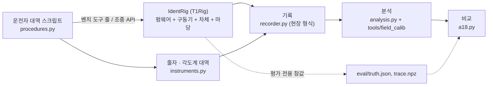

# 식별 도구 (`sim/ubts/steering/ident/`, `tools/field_calib/`, 설계 3.9 · 8.3 P4)

- 작성: 2026-11-09 (3단계 WF-3a p4_ident)
- 근거: 설계 `DESIGN_v1_KO.md` 3.9(식별 계획), 4.5(기록 스키마), 8.3 P4 "식별 도구". `SIM_ACCEPTANCE_KO.md` A18. 장치 `T1_RIG_KO.md`. 규약 `ESP_PROTOCOL_V3_DRAFT_KO.md`.
- 상태: 소스와 시험이 있다. A18(F)를 시드 3개 × 프로필 3개로 돌렸다(6절). 벤치 값과 duty→속도는 모두 한계 안, 0점 오차 7/9, κ(δ) 행 50/54(실패는 곡률 떠돎 때문).
- **A18(F) 판정: 불합격**(0점 오차 2행, κ(δ) 4행이 한계 밖). 결과 파일 `A18_RESULTS.json`의 `summary.all_passed`도 false다.
- 모든 수치는 자리값이다. 여기 나온 결과는 자리값 기반 SIM 결과이고 현장 검증이 아니다.

## 1. 무엇을 하나

현장 식별 시험(B0~B7, F1~F5)은 사람이 차 옆에서 하는 수동 시험이다. 여기서는 스크립트가 사람을 대신한다. T1 장치가 차를 대신한다. 시험마다 현장과 같은 형식의 기록을 남긴다. 분석 도구는 그 기록만 읽는다. SIM 상태(참값)는 읽지 않는다.

A18은 이 과정이 자리값을 되찾는지 본다. 알려진 값은 평가 폴더(`eval/`)에만 있고 기록에는 들어가지 않는다.



## 2. 파일

| 파일 | 역할 | 참값 |
|---|---|---|
| `ident/yard.py` | 교정 마당(평지, 벽 4개, 짧은 판 8개, 기둥 8개). LiDAR 광선을 정확히 교차 계산 | 플랜트 쪽 |
| `ident/rig.py` | `IdentRig(T1Rig)`. 벤치 모드(벤치 도구가 직렬을 쥠, 브리지 꺼짐)와 주행 모드(브리지 켜짐, 조종 API). 보정 뒤 호스트 재구성. `place()`는 서 있는 차를 출발 표시에 옮긴다(현장: 운전해 가거나 민다) | 플랜트 쪽 |
| `ident/bench.py` | 벤치 도구. V3 줄(INFO, CAL JOG/MARK/SOFT/POL/SAVE, CFG, ARM, C, BENCH, D, STOP). THERMAL 예산 관리 | 엄격 검사 통과 |
| `ident/instruments.py` | 줄자(B1, sd 3 mm, 1 mm 눈금)와 디지털 각도계(바퀴마다, sd 0.05°, 0.1° 눈금) 대역 | 엄격 검사 통과 |
| `ident/recorder.py` | 기록 쓰기. 녹화 보관 형식, 조향 사이드카, 벤치 기록 | 엄격 검사 통과 |
| `ident/procedures.py` | B0~B7, F1~F5 운전자 대역과 세션 실행기 | 플랜트 쪽(운전자 눈) |
| `ident/analysis.py` | 기록만 읽는 추정기 | 엄격 검사 통과 |
| `ident/a18.py` | A18(F): 프로필 변형 × 시드, 알려진 값과 비교 | 평가 쪽 |
| `tools/field_calib/` | 546fa8c의 구동 분석을 가져옴(records, odometry, steps, timeline, validate_drive_evidence, 시험). 새 `drive_calib.py`가 C2·C3·C4·C7을 묶는다 | — |

- `tools/field_calib`은 546fa8c에서 바이트 그대로 가져온 뒤 다듬었다. 차동 전용 C5 arc·C6 pivot, 추천·보고서·설정 생성기는 가져오지 않았다. 원본은 저장소 밖 runs 폴더(`field_calib_546fa8c/`)에 있다. 가져오기 기록은 `logs/field_calib_import.json`.
- `steps.py`에서 C5·C6 부분을 뺐다. `validate_drive_evidence.py`에서 C5·C6 행과 `--pivot-events-dir`을 뺐다.
- `drive_calib.py`: 기록을 열고 C1(정지), C2(출발 문턱), C3(duty→속도), C3b(굴러 멈춤), C4(직진 편향), C7(정지 거리)을 낸다. 조향 사이드카를 주면 조향 명령이 0에서 35 mrad 넘게 벗어난 구간을 구동 요청에서 뺀다.
- 참값 격리: `analysis.py`, `recorder.py`, `bench.py`, `instruments.py`는 엄격 역할(`shared`)로 검사해도 오류가 없다(시험 `test_steering_ident.py`). `ident/*`의 표 역할은 플랜트다(`truth_isolation.ROLE_PATTERNS`).

## 3. 시험 절차

순서: B1 → B7(차가울 때) → B0 → B2 → B3 → B4 → B5 → B6 → B7(따뜻할 때) → B7(부하) → 호스트 재구성 → F5 → F4 → F2 → F3 → F1.

| 시험 | 어디서 | 운전자 대역이 하는 일 | 기록 |
|---|---|---|---|
| B1 | 줄자 | 축거, 킹핀 폭, 앞 윤거, 뒤 차축·LiDAR x·y, 앞범퍼 x | 벤치 기록 설명자 `b1_measurements` |
| B7 | 벤치 | 차가울 때 60 s, 따뜻할 때 60 s 정지. 부하: 구동 핀 60 %(바퀴 띄움 대역) 20 s, 이어서 ARM + 구동 duty + 서보 유지 20 s | 상태 줄 |
| B0 | 벤치 | `CAL JOG ±`를 20 %부터 올려 raw가 반대로 움직이는지 본다. JOG 중 STOP으로 출력이 끊기는지 본다. B2 끝에 `CAL POL` | 직렬 기록, 메모 |
| B2 | 벤치 | 끝점까지 JOG(60 %, 0.5 s) → MARK L/R. 각도계가 0을 읽을 때까지 짧은 JOG → MARK C. 소프트 한계는 각도계 끝점 값과 공칭 여유. CAL POL, CAL SAVE | 직렬, 각도계 |
| B3 | 벤치 | 천분율 −750…750 9점을 오르내림 2번. 첫 점은 300 천분율 뒤에서 들어온다(유격보다 크게). 점마다 정착 뒤 각도계 | 각도계, 상태 줄 |
| B4 | 벤치(정지) | JOG 30~100 %(5 % 간격, 2회, 0.5 s), 방향을 번갈아 | 상태 줄 50 Hz |
| B5 | 벤치 | 속도 제한을 풀고(rmov/rstd 5000) 출력 상한을 단계로(정지 100·60 %, 주행 100·80·60·50·40·35·30 %). ±300 천분율 계단. 주행은 구동 40 %를 켠 채. 진척 없는 단계는 0.8 s 안에 목표를 되돌린다(7절 5) | 상태 줄 50 Hz |
| B6 | 벤치 | ±320 천분율 40 간격 오르내림. 첫 점은 300 천분율 뒤에서. 점마다 각도계 | 각도계, 상태 줄 |
| F5 | 지면 정지 | 12°, 0, −12°, 0, 6°, 0을 짧게 끊어 누른다(7절 1). 각 8 s 유지 | 조향 사이드카 |
| F4 | 평지 | 30 % 전진 30 s, 후진 30 s. ±6° 지그재그(반주기 5 s) | 조향 사이드카 |
| F2 | 평지 | 8° 2바퀴 × 2, −8° 2바퀴 × 2, ±13° 3바퀴, ±18° 3바퀴, 40 %. 원마다 중심이 마당 가운데 오도록 출발 표시에 놓고(크기 짐작 L/tan δ), 서서 바퀴를 돌린 뒤 출발. 처음 60°에서 본 원 크기가 짐작과 1.5 m 넘게 다르면 멈추고 그 크기로 다시 놓는다(원마다 한 번) | LiDAR, IMU, 사이드카 |
| F3 | 평지 | duty 30·40·50·60 %마다 10 s 직진 후 놓기·STOP·놓기, 그때마다 짧은 후진 | LiDAR, IMU, 모터 |
| F1 | 평지 | 조향 0 왕복 12번. 왕복마다 차를 출발 표시에 줄 방향으로 놓고, 40 %로 20 m 전진(운전자 속도 짐작 시간), 같은 거리 후진 | LiDAR, IMU, 사이드카 |

- 운전자 대역은 운전자가 가진 것만 쓴다: 벤치 도구 줄과 상태 줄, 대시보드 조종 API와 표시(목표각, 측정각, 추종 오차), 줄자, 각도계, 그리고 차가 어디 있는지 보는 눈(`operator_view()`, 거친 판단에만).
- 조종: 10 Hz 입력, 대시보드 목표 변화율 20°/s. 서 있을 때는 짧게 끊어 누른다(7절 1).
- 운전자는 벽·기둥 2 m 안에 들어오면 멈춘다(`operator_clearance_stop`).
- F1을 마지막에 둔 까닭: 긴 왕복이 차를 가장 많이 옮긴다. F2 원은 마당 가운데의 빈 곳이 필요하다.
- 출발 표시에 놓기(`place()`): F1 왕복마다, F2 원마다, F3·F4 시작에. 서 있을 때만 한다. 조향과 MCU는 건드리지 않는다.

## 4. 기록 형식

설계 4.5를 따른다. 경로는 기록 뿌리 `<root>` 아래다.

- 주행 기록(F 시험 하나 = 녹화 하나): `<root>/<rid>/metadata.json`(state archived), `motor.jsonl`(`orchard.motor_pwm.timeline.v1`, 2 Hz, `requested.left/right` = throttle에서 만든 구동 duty, 핀 D8/D5/D3/D0 보고값), `mapping_source/sensors.jsonl.gz`(`/scan` S2 실제 형식 3240빔, 0.0 = 반사 없음, `/imu/data_raw`, `bag_time_ns` = 수신 시각), `mapping_source/manifest.json`.
- 조향 사이드카: `<root>/_steering/<rid>/steering.jsonl`(`orchard.steering.timeline.v1`, MCU 상태 줄마다 한 줄, 20 Hz). 칸은 설계 4.5와 같다. `angle_mrad`는 그 녹화의 보정표로 계산한다. `descriptor.json`(`orchard.steering.descriptor.v1`: 토픽, 20 Hz, 시간 기준, `stale_after_s`, 보정표 사본, 프로필 id·SHA, 호스트 프로필 사본과 SHA, 의미 문구, 프레임 수, 미리보기, 파일 SHA-256), `host_profile.json`.
- 벤치 기록: `<root>/_bench/<rid>/bench.jsonl`(직렬 h2m/m2h와 호스트·벽시계 시각, 운전자 메모), `steering.jsonl`(상태 줄), `gauge.jsonl`(각도계), `descriptor.json`(시험 목록, 프로필 사본, B1, 보정표, 수, 파일 SHA).
- 세션: `<out>/session.json`(기록 이름, 호스트 보정, 계획, 시간). 평가 전용: `<out>/eval/truth.json`, `trace.npz`, `operator_events.json`. 기록 폴더에는 참값이 없다.
- `tools/field_calib/records.py`가 주행 기록을 그대로 연다(시험 `test_field_calib_records_reads_the_archive`).

## 5. 추정기 (`analysis.py`)

| 값 | 시험 | 방법 |
|---|---|---|
| 보정표 | B3 | 각도계 두 바퀴 각을 B1 길이와 Ackermann 비(격자 탐색)로 등가각으로 바꾼다. 등가각 = c0 + kL·max(p, 0) + kR·min(p, 0)을 두 방향 합쳐 최소제곱(유격 평균). 표시각(±1000 천분율의 등가각), 0점, Ackermann 비, 좌우 비대칭 |
| 정지 최소 PWM, 정지 조향 속도 | B4 | JOG 하나의 변위/T가 정상 속도다(1차 지연이면 정확히 rate·T). 1.5°/s 넘는 JOG로 속도 = a·u + c 직선: 최소 PWM = −c/a, 속도 = a + c |
| τ | B4 | 70 % 넘는 JOG의 상태 줄(50 Hz)에 1차 지연 응답을 맞춘다(τ 격자 + 선형 최소제곱). MCU 시계는 상태 줄로 맞춘다(수신 − ms − 전송 시간 − 1 ms의 최솟값) |
| 주행 조향 속도, 주행 최소 PWM | B5 | 출력이 상한에 붙은 구간에 1차 지연 응답(τ는 B4)을 맞춰 정상 속도를 낸다. 단계별 속도로 직선 |
| 백래시 | B6 | 각도계 평균 = k·가변저항각 + 방향별 상수. 백래시 = 내림 상수 − 오름 상수 |
| 잡음 | B7 | 상태 줄 raw의 sd, 차가움→따뜻함 평균 차, 부하 때 평균 이동과 sd |
| 0점 오차 | F1 | LiDAR 주행 거리계(field_calib odometry)로 조향 0 구간의 방향 변화와 뒤 차축 경로(B1 레버 팔). κ0 = Σ방향 변화·sign(경로)/Σ|경로|, 0점 오차 = atan(L·κ0) |
| κ(δ) 표 | F2 | 원마다 3 s 정착 뒤 방향 변화/경로. 같은 목표각의 원은 경로 가중으로 합친다. η(원점 지나는 최소제곱)도 보고 |
| duty→속도, 정지 거리 | F3 | `drive_calib`(C3 정상 속도 p50, C7 놓기·STOP 거리, C2는 사다리가 없어 보통 미확정). STOP(손 정지)의 명령 시각은 조향 사이드카의 MCU 상태 줄(20 Hz)에서 구동이 있던 줄과 0이 된 줄의 중점이다(감사 AUD3A-03). 사이드카가 없으면 2 Hz 모터 기록으로는 제동 시각을 정할 수 없어 그 사건은 깨끗하지 않다 |
| 조향 움직임 | F4, F5 | 상태 줄 사이 속도 p50/p90/최대, 추종 오차 p95, 결함 |

- F1이 재는 것은 조향 0에서의 곡률이다. 곡률 떠돎(도로 기울기·타이어 끌림 같은 것)과 조향 0점은 기록으로 나눌 수 없다. 그래서 0점 오차는 "조향 0에서 나타나는 곡률의 등가각"이다.
- B5 직선 기울기로 속도를 재면 상한 구간이 짧을 때 오르는 중의 속도를 읽어 낮게 나온다(τ 0.08 s에서 약 −3~5 %). 그래서 1차 지연 맞춤을 쓴다.

## 6. A18 결과

자리값 기반 SIM 결과다. 현장 검증이 아니다.

- 실행: runs 폴더 `a18_full_v5/`(요약 `A18_RESULTS.json`, 표 `A18_TABLES.txt`). 기본 계획, 시드 11·12·13 × 프로필 3개 = 9 사례. 원천 commit `0c1311e`, 작업 트리 상태 SHA-256 `9c1b198c…`(다른 단계가 같은 작업 트리를 바꾸는 중이었다), 펌웨어 빌드 `04353B49`. 9 사례를 동시에 돌려 1278 s 걸렸다.
- 변형(`VehicleProfile.with_overrides`, 스윕 범위 안, 기본값과 다름):

| 값 | 기본 v0.1 | 변형 A(빠름·짧은 지연) | 변형 B(느림·긴 지연) |
|---|---|---|---|
| `steer_rate_max_deg_s` | 30 | 40 | 20 |
| `steer_rate_standstill_deg_s` | 15 | 20 | 10 |
| `steer_motor_tau_s` | 0.08 | 0.06 | 0.12 |
| `steer_min_pwm_pct` / `_standstill_pct` | 25 / 35 | 18 / 28 | 30 / 33 |
| `steer_backlash_deg` | 2.0 | 3.5 | 0.8 |
| `battery_voltage_scale` | 1.0 | 0.92 | 1.04 |

- 결과(통과 행/행, 괄호는 가장 큰 오차):

| 값 | 시험 | 한계 | 기본 v0.1 | 변형 A | 변형 B | 전체 |
|---|---|---|---|---|---|---|
| 주행 조향 속도 | B5 | ±10 % | 3/3 (−1.3 %) | 3/3 (−1.6 %) | 3/3 (−3.4 %) | 9/9 (−3.4 %) |
| 정지 조향 속도 | B4 | ±10 % | 3/3 (−0.8 %) | 3/3 (−0.5 %) | 3/3 (−2.3 %) | 9/9 (−2.3 %) |
| 주행 최소 PWM | B5 | ±3 %p | 3/3 (+0.19 %p) | 3/3 (−0.52 %p) | 3/3 (−0.76 %p) | 9/9 (−0.76 %p) |
| 정지 최소 PWM | B4 | ±3 %p | 3/3 (+0.66 %p) | 3/3 (−0.25 %p) | 3/3 (−1.33 %p) | 9/9 (−1.33 %p) |
| τ | B4 | ±20 % | 3/3 (−4.4 %) | 3/3 (+5.0 %) | 3/3 (−5.4 %) | 9/9 (−5.4 %) |
| 백래시 | B6 | ±0.3° | 3/3 (+0.102°) | 3/3 (−0.038°) | 3/3 (+0.063°) | 9/9 (+0.102°) |
| 0점 오차 | F1 | ±0.2° | 2/3 (+0.201°) | 3/3 (+0.181°) | 2/3 (+0.537°) | 7/9 (+0.537°) |
| κ(δ) 표(행마다) | F2 | ±5 % | 16/18 (−5.4 %) | 16/18 (−8.7 %) | 18/18 (−4.5 %) | 50/54 (−8.7 %) |
| duty→속도(duty마다) | F3 | ±5 % | 12/12 (−2.2 %) | 12/12 (−3.6 %) | 12/12 (+4.7 %) | 36/36 (+4.7 %) |

- **A18(F) 판정: 불합격.** 0점 오차 2행(7/9)과 κ(δ) 4행(50/54)이 등록 한계(±0.2°, ±5 %) 밖이다. 한계는 바꾸지 않았다(검토 P4R-08: 판정을 문서에 적는다).
- 검토 처리(fix_wf3a) 뒤 같은 계획을 다시 돌렸다(runs 폴더 `fix_wf3a/a18_full/`, 1013 s). `A18_RESULTS.json`을 a18_full_v5와 칸마다 비교했다. 다른 것은 시간 값(19칸)뿐이고 추정값, 오차, 행 판정, `summary.all_passed`(false)가 모두 같다.
- 벤치 값(조향 속도, 최소 PWM, τ, 백래시)과 duty→속도는 모든 사례가 한계 안이다.
- 실패 6행은 모두 F1·F2이고 곡률 떠돎 때문이다. LiDAR 주행 거리계가 잰 곡률은 실제로 지나간 경로의 곡률(떠돎 포함)과 0점 오차로 최대 0.0011°, κ 행으로 최대 0.61 % 차이 났다(9·54행). 즉 도구는 지나간 길을 정확히 잰다. 알려진 값에는 떠돎의 평균(−0.15°/m)만 넣었고 무작위 부분은 넣지 않았다. 무작위 부분이 오차로 남는다.

| 사례 | 행 | 추정 | 알려진 값 | 오차 | 떠돎이 주는 크기(1 sd) | 설명 |
|---|---|---|---|---|---|---|
| default_s12 | 0점 오차 | 0.137° | −0.064° | +0.201° | 0.14°(438 m) | 1.4 sd |
| B_s12 | 0점 오차 | 0.433° | −0.104° | +0.537° | 0.14°(454 m) | 그 F1 구간의 떠돎 평균이 +0.56°/m(프로필 평균 −0.15°/m)였다. 떠돎의 상관 길이는 F1 안에서도 약 8 m로 맞았다. 드문 큰 치우침이다(약 4 sd) |
| default_s11 | κ +8° | 0.1633 | 0.1725 | −5.4 % | 3.1 %(152 m) | 1.7 sd |
| A_s11 | κ +8° | 0.1531 | 0.1627 | −5.9 % | 3.2 %(162 m) | 1.8 sd |
| A_s13 | κ −8° | −0.0703 | −0.0769 | −8.7 % | 6.1 %(198 m) | 변형 A는 백래시 3.5°라 −8° 명령의 실제 곡률이 작다(반지름 약 13 m). 같은 경로에서 상대 잡음이 커진다. 1.4 sd |
| default_s13 | κ −18° | −0.3640 | −0.3464 | +5.1 % | 2.7 %(51 m) | 1.9 sd |

- 떠돎 크기는 sd 0.95°/m, 상관 8 m(OU)에서 경로 D의 평균이 sd ≈ 3.8/√D °/m인 것으로 셌다. 0점 오차로는 L × 그 값(°), κ로는 그 값/κ.
- 한계를 넓히지 않았다. 떠돎을 줄이는 길은 경로를 늘리는 것뿐이다(8절).
- 이전 실행(모두 runs 폴더에 남김): `a18_full_v1_first_order`(F1이 F2보다 먼저, 차가 판에 닿고 DRV_STUCK·TRACK으로 4 사례 중단), `a18_full_v2_yard_drift`(F2 원이 떠돌아 마당 밖으로, F1 분석 불가), `a18_full_v3`(변형 B의 주행 중 줄 맞춤이 호스트 추종 규칙에 걸림, 7 사례 완료), `a18_full_v4`(F1을 출발 표시에서 왕복, 9 사례 완료, F2 크기 맞춤 전). v5에서 바뀐 것은 F2 원 크기 맞춤이다.

### 6.1 ST-03 (2026-11-14): brake 정지 거리 행, 권장 경로 길이 계획

자리값 기반 SIM 결과다. 기준은 측정 전에 등록했다(`SIM_ACCEPTANCE_KO.md` 개정 80·81, `8b434c5`). 결과 원본은 저장소 밖 `runs/st03_20261114/measure/`.

- **F3 brake 정지 거리.** 11/09 감사(AUD3A-03)의 오류는 2 Hz 모터 기록으로 손 정지의 명령 시각을 정한 것이었다(LiDAR 감속 시작으로 대신하면 0~0.04 m로 짧게 나왔다). `1c4263f`부터 명령 시각은 조향 사이드카의 MCU 상태 줄이다. 이제 A18 표에 손 정지마다 행이 있다: 추정(C7 `hard_stop` 거리) 대 참값(플랜트가 그 제동 사건을 시작한 스텝부터 처음 멈춘 스텝까지 차 방향으로 투영한 이동, `eval/truth.json` `f3_stop_events`), 한계 ±0.03 m. 보고 행으로 명령 시각 속도와 '참값 − 모형 v·onset + v²/2a'를 낸다. 예전 보고 칸 `distance_over_model`(546fa8c 차동 모형 대비 비)은 참값 비교가 아니다.
- **권장 경로 길이 계획**(`--plan recommended`, 8절: F2 8°는 부호마다 2바퀴 원 4번, 13°·18°는 3바퀴 원 2번, F1은 기본 그대로 480 m). 9 사례, 2개씩, 5176 s, 사례 오류 0. 원천 commit `cb2f85f`. 분석된 F2 경로(각도·부호 한 행): 8° 278~563 m, 13° 123~209 m, 18° 92~129 m(권고 300·70·50 m; 8° 몇 행은 300 m 아래).

| 값 | 시험 | 한계 | 통과 행/행 | 가장 큰 오차 |
|---|---|---|---|---|
| 주행 조향 속도 | B5 | ±10 % | 9/9 | −3.4 % |
| 정지 조향 속도 | B4 | ±10 % | 9/9 | −2.3 % |
| 주행 최소 PWM | B5 | ±3 %p | 9/9 | −0.76 %p |
| 정지 최소 PWM | B4 | ±3 %p | 9/9 | −1.33 %p |
| τ | B4 | ±20 % | 9/9 | −5.4 % |
| 백래시 | B6 | ±0.3° | 9/9 | +0.10° |
| 0점 오차 | F1 | ±0.2° | **6/9** | −0.388° |
| κ(δ) 표 | F2 | ±5 % | **51/54** | −5.8 % |
| duty→속도 | F3 | ±5 % | 36/36 | −4.99 % |
| brake 정지 거리 | F3 | ±0.03 m | 36/36 | −0.0174 m |

- **판정: 불합격**(한계는 바꾸지 않았다). 실패 행: 0점 오차 default_s13 −0.388°(분석 경로 381 m, 떠돎 sd 약 0.15°, 2.6 sd), A_s13 +0.207°(344 m, 1.3 sd), B_s12 −0.281°(454 m, 2.0 sd). κ default_s12 +13° +5.3 %(123 m, 떠돎 약 2.1 %), A_s11 +8° −5.0 %(328 m, 2.3 %), A_s13 −8° −5.8 %(378 m, 4.4 %). F2 경로를 늘리면 κ의 떠돎 몫은 줄지만 행마다 남는 무작위 몫(1.3~2.6 sd)이 한계를 넘는 행이 여전히 나온다. F1 길이는 같은데 0점 오차 실패가 기본 계획(11/09, 7/9)보다 하나 많다. F2가 길어져 F1 때의 떠돎 실현이 달라졌기 때문이다(같은 확률의 다른 표본).
- **기본 계획 다시**(지금 코드, `b548ba2`, 9 사례, 2816.7 s, 사례 오류 0): 벤치 6줄 9/9, duty→속도 36/36(최악 +4.67 %), **brake 정지 거리 36/36**(오차 −0.0191~+0.0028 m, 중앙 −0.0044 m), 0점 오차 **7/9**(default_s12 +0.201°, B_s12 +0.537°), κ(δ) **50/54**(default_s11 +8° −5.4 %, default_s13 −18° +5.1 %, A_s11 +8° −5.9 %, A_s13 −8° −8.7 %). **판정: 불합격.** 0점 오차·κ 실패 행의 값은 11/09(`a18_full_v5`)와 같다. 그 사이 식별 코드의 변경(CAL POL 다시 하기, B7 왕복 옵션, C7 사이드카 시각)은 이 행들을 바꾸지 않았다. B_s12의 추정값은 11/13 다시 실행과 모두 같다.
- brake 정지 거리(권장 계획): 36행 모두 한계 안. 오차 −0.0174~+0.0041 m(중앙 −0.0054 m, 평균 절댓값 0.0069 m), 참값 0.025~0.144 m. 추정이 조금 짧은 쪽으로 치우친다(정지 판정이 0.5 s 창의 평균 속도 0.03 m/s 아래라 끝을 조금 이르게 잡는다). 명령 시각 속도 오차 −0.0067~+0.0163 m/s. 플랜트 이동은 모형식보다 0.0009~0.0029 m 짧다(10 ms 스텝).

## 7. 이번에 찾은 문제

1. **서 있을 때 느린 조향 경사는 호스트 추종 규칙에 걸린다.** 정지 중 서보는 (시작 PWM + 속도 몫)/kp만큼 늦다. 자리값에서 8°/s 경사면 4~5° 늦다. 호스트는 3° 넘게 1.5 s 가면 `steering_not_following`을 건다. 그래서 운전자 대역은 서 있을 때 5°씩 끊어 누르고, 측정각이 1° 안에 오면 다음을 누른다. 추종 오차가 3°를 넘은 채 1 s가 되면 2.5° 앞으로 되돌린다. 대시보드 설계(4.4)의 "정지 조향 속도 상한"만으로는 이 규칙을 지키기 어렵다.
2. **POLARITY 오판 두 가지.** (가) 서보 최소 PWM 40 %가 정지 시작 PWM보다 2 %p만 높으면(정지 시작 38 %) 서보가 아주 느리게 기어가고 가변저항 잡음 때문에 "멀어진다"고 보아 POLARITY가 난다(B3 정적 표에서). (나) τ 0.14 s, 42°/s 모터에서 kp를 650으로 올린 B5 계단은 목표를 지나쳐 POLARITY가 난다. 그래서 B5는 kp를 기본값(245)으로 두고, A18 변형은 τ를 속도와 맞췄다(6절). 처음 고른 두 변형의 기록은 runs 폴더 `a18_quick_v1_first_variants/`에 있다.
3. **DRV_STUCK 오판.** 자기 잠금이 없는 조향은 주행 중 출력 0이면 바퀴가 가운데로 돌아온다(`steer_release_restoring`). 큰 각(15°)을 주행 중 천천히 가운데로 되돌리면 서보 출력이 0인 채 2°/0.3 s 넘게 움직여 DRV_STUCK이 난다. 처음 F1(주행하며 조향으로 줄 맞춤)에서 실제로 났다(`a18_full_v1_first_order/default_s11`). 현장 펌웨어 규칙과 대시보드 조작에 함께 걸리는 문제다.
4. **느린 구동기와 호스트 추종 규칙(주행 중).** 변형 B(20°/s, 주행 시작 PWM 30 %)는 조향 목표를 계속 조금씩 바꾸면 추종 오차가 3°를 넘은 채 1.5 s를 넘겨 `steering_not_following`이 난다(줄 맞춤 F1, `a18_full_v3/B_s11`, `B_s13`). 서보가 움직이려면 시작 PWM/kp = 2°가 먼저 필요하고 속도 몫이 더해지기 때문이다. 그래서 F1은 주행 중 줄 맞춤을 그만두고 왕복마다 출발 표시에 놓는다.
5. **TRACK과 B5 낮은 상한.** 상한이 시작 PWM 이하면 모터가 안 움직인다. MCU는 3° 넘게 떨어진 채 0.5 s 동안 0.5° 넘게 다가가지 못한 상태가 1 s 이어지면 TRACK을 건다. 운전자 대역은 같은 규칙으로 보고 0.8 s 안에 목표를 되돌린다. 0.7~1°/s로 기어가는 단계는 대역 검사는 통과하고 MCU는 걸 수 있다. 계획의 단계는 이 띠를 피한다.
6. **THERMAL 예산.** 30 s 안에 80 % 넘는 출력이 5 s를 넘으면 THERMAL이다. B4·B5의 강한 단계와 F5 같은 반복 조향은 이 예산 안에 들어가게 쉬어야 한다(벤치 도구 `cool_down()`).
7. **곡률 떠돎과 마당 크기.** 자리값 떠돎(평균 −0.15°/m, sd 0.95°/m, 8 m)이면 20 m 직진에서 방향이 약 15° 돈다(한 다리에서 37°도 보았다). 8° 원 4바퀴는 원 중심이 수 m 떠돈다. 그래서 F1은 왕복마다, F2는 원마다 출발 표시에서 시작한다. 이렇게 하기 전 실행(`a18_full_v2_yard_drift/`)은 F2 원이 판에 걸려 F2·F3·F1이 끊겼다. 또 유격과 0점 때문에 같은 ±8°라도 원 크기가 크게 다를 수 있다(변형 A의 −8°는 반지름 약 13 m). 짐작 크기로 놓으면 원이 마당을 벗어나 짧게 끊겼다(`a18_full_v3/A_s13`). 그래서 처음 60°를 보고 다시 놓는다.
8. **B3 유격 접근.** 첫 점을 유격보다 작은 거리에서 들어오면 그 점은 유격 반대쪽에 서서 보정 기울기가 약 2 % 낮아진다. 첫 점을 300 천분율 뒤에서 들어오게 고쳤다.
9. **B0 CAL POL 멈춤(2026-11-12 짧은 실행 변형 B 시드 13).** 서 있는 차의 느린 구동기는 CAL POL 펄스가 옳은 방향으로 움직여도 3/−3 카운트라 펌웨어 최소 4(규격 7.10)에 못 미쳐 세션이 B0에서 끝났다. 현장 절차는 B0·B2를 앞바퀴를 띄우고 한다(설계 3.9). 그래서 펄스가 옳은 방향인데 최소보다 작으면 조향 바퀴를 띄운 대역(`rig.set_steering_lifted`, T1 `steer_wheels_lifted`: 움직이는 부하와 시작 PWM)으로 CAL POL을 한 번 더 한다(`1c4263f`). 2026-11-14 같은 조합(`a18 --quick --variants B --seeds 13`)에서 첫 시도 3/−3 실패 → 띄워서 10/−9 통과 → 세션이 끝까지 갔다(기록 `runs/st03_20261114/measure/a18_quick_b13/`). 방향이 틀리면 다시 하지 않고 실패다.

## 8. 현장 자료에 필요한 것

| 시험 | 필요한 것 | 왜 |
|---|---|---|
| B1 | 줄자 값(축거, 킹핀 폭, 앞 윤거, 뒤 차축·LiDAR·앞범퍼 위치) | 등가각 변환, 뒤 차축 레버 팔 |
| B2·B3·B6 | 바퀴마다 디지털 각도계(0.1°), 사진, 바퀴 띄움 | 보정표, Ackermann 비, 백래시 |
| B4·B5 | 50 Hz 상태 줄(`CFG sthz 50`), 바퀴 띄움, 구동 duty를 켤 수 있는 받침 | 최소 PWM, 속도, τ |
| B7 | 60 s 두 번(차가움·따뜻함), 부하 20 s | 잡음, 표류 |
| F1 | 조향 0으로 400 m 넘게(자리값 떠돎이면 480 m에서 떠돎 sd 약 0.13°, 0.2° 안에 들 확률 약 87 %). 평지, 직선 경로. 왕복마다 출발선에 다시 세운다 | 0점 오차 |
| F2 | 각도마다 원을 여러 번. 자리값 떠돎이면 경로 합이 8°는 150 m(떠돎 약 3 %, ±5 % 안에 들 확률 약 90 %), 95 %를 원하면 약 300 m. 13°는 70 m, 18°는 50 m 넘게. 유격·0점 때문에 ±8° 원의 반지름이 6~13 m로 다를 수 있으니 지름 35 m 넘는 빈 땅 | κ(δ) ±5 %(떠돎이 약 3.8/√경로 °/m를 더한다) |
| F3 | duty마다 10 s 넘는 직진 3번, 놓기와 STOP 모두 | duty→속도, 정지 거리 |
| F4·F5 | 20 Hz 조향 사이드카 | 조향 움직임, stall |
| 공통 | LiDAR가 두 방향의 선 구조를 보는 곳(건물, 울타리, 기둥). `sensors.jsonl.gz`, `motor.jsonl`, 조향 사이드카, 보정 묶음 사본, 프로필 사본 | LiDAR 주행 거리계, 기록 연결 |

- 분석은 scipy(cKDTree)가 필요하다(F1, F2, F3). B 시험 분석은 numpy만 쓴다.

## 9. 한계

- 바퀴 띄움을 모델하지 못한다. 벤치의 "정지"는 차가 서 있는 정지 값(시작 PWM, 정지 속도)을 쓰고, B5 "주행"은 구동 duty를 켜서 주행 값으로 들어간다. 현장 벤치(바퀴 띄움)는 둘 다와 다를 수 있다.
- 가변저항 raw는 약 10 천분율 단위로 끊긴다. 짧은 JOG의 변위는 이 단위의 영향을 받는다.
- B7 부하의 두 번째 부분(ARM + 구동 duty + 서보 유지)에서는 바퀴가 서 있어 서보가 데드밴드 안에 머문다. 조향 PWM이 켜진 비율은 0이었다(`steer_pwm_on_fraction`). 그래서 "조향 PWM을 켠 채" 잡음은 아직 재지 못했다. 계획 옵션 `b7_servo_sweep_s`(구동 duty를 켠 채 느린 목표 삼각 왕복, 분석은 0.5 s 창 국소 직선 잔차의 sd, 감사 AUD3A-16)가 있지만 기본 0이고 A18 계획에서는 돌지 않았다.
- F4·F5는 보고만 한다(조향 움직임 p50/p90/최대, 추종 오차, 결함). 정지 조향 속도의 A18 비교는 B4로 한다.
- 운전자 대역은 참 자세를 "눈"으로 쓴다(원 바퀴 수, 원 크기, 출발 표시, 벽까지 거리). 분석 입력은 아니다.
- `place()`는 현장에서 차를 다시 출발 표시에 가져다 두는 일을 대신한다. 기록에는 서 있는 동안 LiDAR 장면이 바뀐 것으로 남는다.
- T1 장치 자체의 한계는 `T1_RIG_KO.md`를 따른다.

## 10. 실행

저장소의 `sim/ubts`에서(출력은 저장소 밖):

```
python -B -m steering.ident.a18 --out <runs>/wf3a/p4_ident/<이름> --variants default,A,B --seeds 11,12,13 --jobs 9
python -B -m steering.ident.a18 --out <runs>/... --quick      # 짧은 계획(연기 시험, A18 수치 아님)
python -B -m steering.ident.a18 --out <runs>/... --plan recommended --jobs 2   # 8절 경로 길이(합격 기준 개정 81)
```

- 네이티브 빌드는 `UBTS_STEER_BUILD_DIR`(저장소 밖), Windows 컴파일러는 `UBTS_STEER_CXX`.
- 결과: `<out>/A18_RESULTS.json`(요약, 사례별 행), 사례마다 `records/`, `eval/`, `session.json`, `analysis.json`, `compare.json`.
- `eval/truth.json`의 `f3_stop_events`는 F3 동안 플랜트의 감속 사건(놓기·제동)과 그 이동 거리다(`procedures.StopEventLog`, 평가 전용). A18 brake 정지 거리 행의 참값이다(합격 기준 개정 80).

## 11. 시험

| 파일 | 내용 |
|---|---|
| `sim/ubts/test_steering_ident.py` | 추정기 수학(속도 직선, τ, 계단 맞춤, 곡률 합치기, 보정), 합성 B3·B6, 기록 형식과 field_calib 읽기, 엄격 참값 검사, A18 비교·요약. 엄격 검사에서 `bench.py`는 벤치 장치를 직렬 포트와 시계로 쥐므로 장치 손잡이 규칙(`rig_reference`, 검토 RS-05)만 뺀다. 나머지 규칙(참값, MCU 채널, 장면)은 그대로이고, 트리에서 이 파일의 역할은 plant다 |
| `sim/ubts/test_steering_ident_rig.py` | IdentRig에서 B7·B0·B2·B3·B7 부하, 보정 뒤 주행 모드에서 서서 8° 조향, 기록으로 확인 |
| `tools/field_calib/tests/test_field_calib.py` | 가져온 구동 도구(scipy가 없으면 주행 거리계 부분 건너뜀) |

실행 결과(2026-11-09, 마지막 코드):

| 환경 | 결과 |
|---|---|
| Windows Python 3.13.2, pytest | 위 3개 + `test_steering_truth_isolation.py` + `tools/row_executor/tests/test_calib_runs.py`·`test_review_fixes_day2.py`: 117 통과(하위 시험 45) |
| WSL Python 3.10.12, numpy 2.2.6, unittest | 식별 2개 + 참값 격리: 30 통과. field_calib: 14 중 7 건너뜀(시스템 scipy가 numpy 2와 맞지 않아 cKDTree 불가). row_executor 보정 시험은 `core.py`가 scipy를 들여오다 38 오류(환경 문제, 이 단계 코드 아님) |
| Docker 3.12.3(이미지 6209168a3507, numpy 1.26.4, scipy 1.11.4, 망 없음, CPU 2, 2 GiB) | 식별 2개 + 참값 격리 30 통과, field_calib + row_executor 보정 87 통과 |
