# 과수원 첫 자율주행 결과 (2026-11-20, 현장 기록)

- 작성: 2026-11-21. 준비 문서는 [`ORCHARD_1120_KO.md`](ORCHARD_1120_KO.md), 실내 복도 시험은 [`FIELD_CORRIDOR_20261119_KO.md`](FIELD_CORRIDOR_20261119_KO.md).
- 이 문서의 수치는 **현장 기록**이다(SIM 결과가 아니다). 조향 장치를 단 차가 과수원 두 열(100 m, 40 m)에서 실행기 MOTOR 모드로 실제로 달린 날의 기록에서 나왔다.
- 거리, 횡 위치, 속도, 열 폭은 **실행기가 LiDAR 로 스스로 잰 값**이다. 줄자나 측량으로 잰 값은 없다. 5절에서 다른 센서(GNSS, 스캔 원본)와 맞춰 본 만큼만 확인됐다.
- 본 자료(레포 밖, 팀 보관): 실행기 틱 기록 9개(12:47~18:02), 브리지 조종 사건 기록, Jetson 커널 기록, 녹화 20개(rosbag 원본 약 40 GB, 파일마다 SHA-256 대조).
- GNSS 좌표는 싣지 않았다(GNSS 는 출발점에서의 거리(m)로만 썼다). 기록에서 다시 그린 지도와 차량 카메라 장면은 2026-11-21 사용자 동의로 실었다
  ([`../DOCS_POLICY_KO.md`](../DOCS_POLICY_KO.md)). 사람이 보이는 장면은 쓰지 않았다.
- 조향 사양 값(벨트 비, 유격, 가변저항 범위 등)은 여전히 자리값이고, 실행기의 조향 각 눈금(끝 26°)도 주행으로 추정한 값이다(±30 %).

## 1. 한눈에

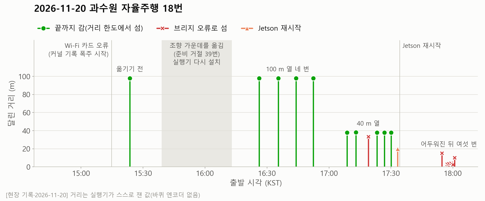

[현장 기록 · 2026-11-20] 출발 시각별 달린 거리와 끝난 이유. 거리는 실행기가 잰 값이다.

| 항목 | 값 |
|---|---|
| 자율주행 | 18번, 합계 약 772 m |
| 열 끝까지 간 것 | 10번 (98 m 다섯 번, 38 m 다섯 번). 모두 "열 길이 − 2 m"의 거리 한도에서 섰다 |
| 끝까지 간 주행의 멈춤·센서 끊김 | 0번 |
| 횡 오차(실행기 자체 추정) | 조향 가운데를 옮긴 뒤 끝까지 간 9번: RMS 2.6~6.4 cm, 최대 8~26 cm. 옮기기 전 한 번(15:23): RMS 45 cm |
| 속도 | 목표 0.40 m/s 를 넣었고 실제는 0.28 m/s(100 m 열), 0.34 m/s(40 m 열) |
| 중간에 선 것 | 브리지 오류 7번(Jetson → 보드 명령이 잠깐 끊김, 원인 미확정), 주행 중 Jetson 재시작 1번 |
| LiDAR 로 열 끝을 보고 선 것 | 0번(현장에서 아직 확인되지 않았다) |

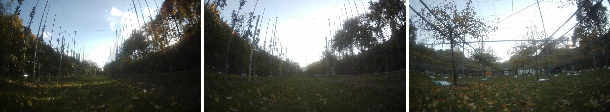

[현장 기록 · 2026-11-20] 달린 곳(차량 카메라). 왼쪽: 15:23의 100 m 열, 가운데: 16:26의 100 m 열(받침대에 붙여 키운 나무 줄), 오른쪽: 17:08의 40 m 열(나무가 띄엄띄엄 선 구역).

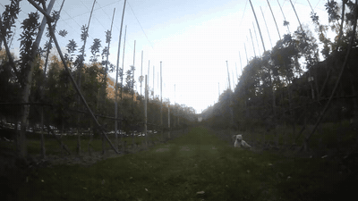

[현장 기록 · 2026-11-20] 16:26 주행(98 m, 337 s)의 차량 카메라를 20배속으로 줄인 것. 출발부터 열 끝 2 m 앞에서 멈춤 명령이 나갈 때까지다(기록은 거기서 끝난다).

## 2. 그날의 차와 설정

- 차: 앞바퀴 조향(일반 DC 모터 + 벨트로 이은 가변저항), ESP32-S3 보드(BTS7960 3개, SMOOTH r5 펌웨어 + 구동 감시 300 ms), Jetson Orin Nano, RPLIDAR S2, BNO085 IMU, F9P GNSS(단독 측위).
- 실행기: 단일 열 모드, MOTOR. 운영자는 대시보드 자율주행 탭에서 열 길이·GPS 사용·속도를 고르고 준비 → 자율 주행 시작을 눌렀다.
- 열 길이는 운영자가 넣은 값이다(100, 40, 40.2, 35, 25, 18 m). 실행기는 열 끝 인식이 안 될 때를 대비해 "열 길이 − 2 m"에서 서는 거리 한도를 같이 쓴다.
- 15:23 주행 뒤 현장에서 조향 가운데(가변저항 값)를 1885 → 2005 로 옮겼다. 그 뒤 조종 활성화가 보정 값 불일치로 39번 거절됐고(15:39~15:54),
  16:13 에 보정 허용 폭을 넓힌 실행기를 다시 설치했다(±300 counts, 커밋 ee5804e).
- GPS 를 켠 주행에서도 위성 단독 측위(수평 정확도 4~8 m)라 중심선 보정에는 쓰이지 않았다. 범위 벗어남 정지는 0번이다.

## 3. 주행 18번

출발 시각은 KST 다.

| 출발 | 열 길이 m | GPS | 거리 m | 시간 s | 끝난 이유 | 속도 중앙 m/s | 횡 RMS cm | 횡 최대 cm | ±10 cm 안 % | LiDAR 폭 중앙 m |
|---|---|---|---|---|---|---|---|---|---|---|
| 15:23 | 100 | 끔 | 98.0 | 479 | 거리 한도 | 0.19 | 45.0 | 57 | 0.9 | 3.80 |
| 16:26 | 100 | 끔 | 98.0 | 337 | 거리 한도 | 0.28 | 3.4 | 10 | 100 | 3.80 |
| 16:35 | 100 | 켬 | 98.0 | 335 | 거리 한도 | 0.28 | 3.0 | 14 | 98.4 | 3.80 |
| 16:44 | 100 | 끔 | 98.0 | 335 | 거리 한도 | 0.28 | 2.6 | 14 | 99.8 | 3.80 |
| 16:52 | 100 | 켬 | 98.0 | 337 | 거리 한도 | 0.28 | 2.7 | 15 | 98.4 | 3.80 |
| 17:08 | 40 | 끔 | 38.0 | 113 | 거리 한도 | 0.34 | 4.0 | 8 | 100 | 3.86 |
| 17:13 | 40.2 | 켬 | 38.2 | 115 | 거리 한도 | 0.34 | 5.0 | 14 | 92.2 | 3.89 |
| 17:19 | 40 | 끔 | 33.3 | 100 | 브리지 오류(보드 구동 감시) | 0.34 | 3.2 | 8 | 100 | 3.82 |
| 17:23 | 40 | 끔 | 38.0 | 114 | 거리 한도 | 0.34 | 3.9 | 9 | 100 | 3.89 |
| 17:26 | 40 | 켬 | 38.0 | 112 | 거리 한도 | 0.34 | 3.2 | 10 | 100 | 3.89 |
| 17:30 | 40 | 끔 | 38.0 | 112 | 거리 한도 | 0.34 | 6.4 | 26 | 92.4 | 3.89 |
| 17:33 | 40 | 켬 | 19.8 | 59 | Jetson 재시작(주행 중) | 0.34 | – | – | – | 3.79 |
| 17:54 | 40 | 켬 | 15.2 | 47 | 브리지 오류(쓰기 실패) | 0.33 | 4.8 | 11 | 99.3 | 3.78 |
| 17:57 | 40 | 켬 | 3.0 | 12 | 브리지 오류(보드 구동 감시) | 0.28 | 5.6 | 9 | 100 | 3.58 |
| 17:58 | 40 | 켬 | 3.5 | 15 | 브리지 오류(쓰기 실패) | 0.19 | 14.4 | 29 | 63.1 | 3.71 |
| 17:59 | 35 | 켬 | 4.0 | 14 | 브리지 오류(쓰기 실패) | 0.29 | 9.4 | 15 | 54.6 | 3.81 |
| 17:59 | 25 | 켬 | 2.4 | 16 | 브리지 오류(쓰기 실패) | 0.13 | 37.8 | 43 | 0 | 3.92 |
| 18:00 | 18 | 켬 | 10.1 | 48 | 브리지 오류(쓰기 실패) | 0.17 | 74.9 | 104 | 12.6 | 3.95 |

- 출발하지 않고 끝난 준비는 60번이다: 조종 활성화 실패 39번(위 2절), 멈추기·끝내기 17번, 조향 따라가지 못함 4번(7절).
- 저녁 여섯 번(17:54~)은 어두워진 뒤이고 열 길이를 바꿔 가며 한 것이라 오후 주행과 조건이 다르다. 그 가운데 네 번은 사람이 차 뒤 1.3~1.5 m 에 붙어 따라온 것이 스캔에 보인다(5절).
- 처음 정리할 때는 16:13 뒤의 틱 기록만 읽어 15:23 주행이 빠져 있었다(17번, 9번, 674 m). 녹화를 하나씩 확인하다 찾아 바로잡았다.

## 4. 열을 따라간 정밀도

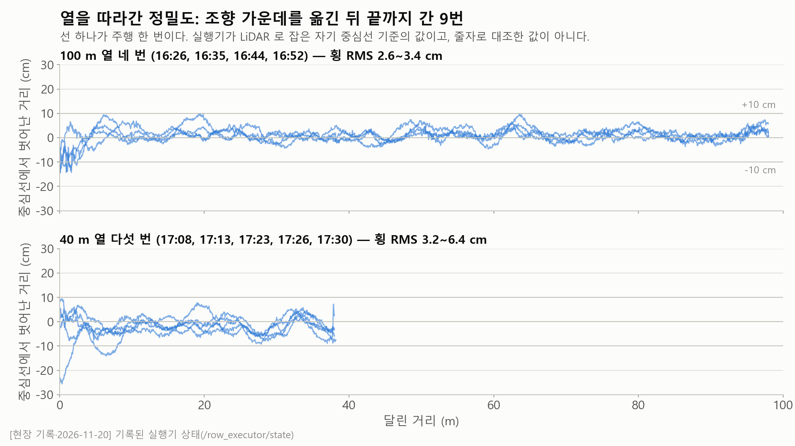

[현장 기록 · 2026-11-20] 선 하나가 주행 한 번이다. 실행기가 LiDAR 로 잡은 자기 중심선 기준의 값이고 줄자로 대조한 값이 아니다.

- 조향 가운데를 옮긴 뒤: 100 m 열 네 번 횡 RMS 2.6~3.4 cm, 40 m 열 다섯 번 3.2~6.4 cm. ±10 cm 안에 있던 비율 92~100 %.
- 참고로 SIM 의 열 추종 판정(참값 기준 횡 RMSE)은 빠른 SIM 0.029~0.074 m, Gazebo 0.021~0.039 m 였다([`../RESULTS_KO.md`](../RESULTS_KO.md)).
  현장 값은 참값이 아니라 실행기의 자체 추정이라 같은 뜻의 수가 아니다. 크기가 비슷하다는 것까지만 말할 수 있다.

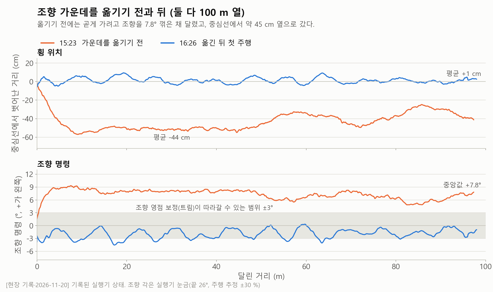

[현장 기록 · 2026-11-20] 15:23(옮기기 전)과 16:26(옮긴 뒤 첫 주행)의 횡 위치와 조향 명령. 조향 각은 실행기 눈금(끝 26°, 주행 추정 ±30 %)이다.

- 15:23 주행은 열 끝까지 갔지만 처음부터 끝까지 중심선에서 약 45 cm 한쪽으로 치우쳐 있었다(횡 평균 −44 cm). 그동안 조향 명령은 +136 mrad(7.8°)로 걸려 있었다.
  곧게 가려면 그만큼 꺾어야 하는 차였다는 뜻이다.
- 제어기에는 조향 영점의 치우침을 천천히 지우는 보정(트림)이 있지만 ±3° 까지만 따라간다(`trim_limit_deg` 기본값, 그날 조정 기록에 바꾼 흔적 없음).
  필요한 7.8° 가 한도를 넘어 남은 만큼이 횡 오차로 남은 것으로 본다. 트림 값은 틱 기록에 없어 직접 확인하지는 못했다.
- 횡 오차가 커서 속도 제한(lateral)이 목표를 0.2 m/s 로 낮췄다. 그래서 이 주행만 479 s 가 걸렸다.
- 가운데를 옮긴 뒤 곧게 달릴 때의 조향 각 중앙값은 대부분 0~+0.6° 다(16:26 만 −2.1°). 곧게 달릴 때의 가변저항 중앙값은 주행마다 1953~2053 사이에서 달랐다.

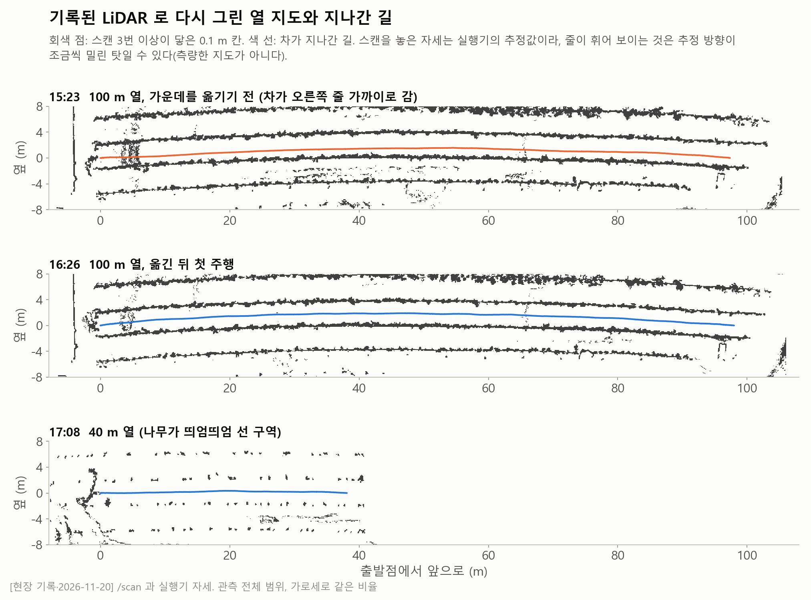

[현장 기록 · 2026-11-20] 15:23과 16:26 주행의 기록된 LiDAR를 실행기의 자세 추정으로 놓아 다시 그린 열 지도(관측 전체 범위, 가로세로 같은 비율)와 차가 지나간 길. 측량한 지도가 아니다.

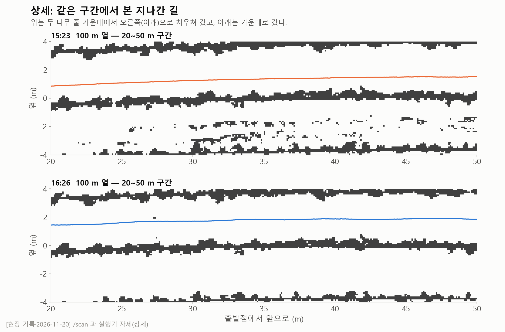

[현장 기록 · 2026-11-20] 상세: 위 지도의 20~50 m 구간. 15:23에는 오른쪽 줄 가까이로, 16:26에는 두 줄 가운데로 갔다.

## 5. 다른 센서와 맞춰 본 것 (2026-11-21)

녹화의 bag 원본 20개를 처음부터 끝까지 읽어(닫히지 않은 2개는 잘린 곳까지, 풀지 못한 메시지 0개) 실행기 값을 GNSS, 스캔 원본과 견줬다.

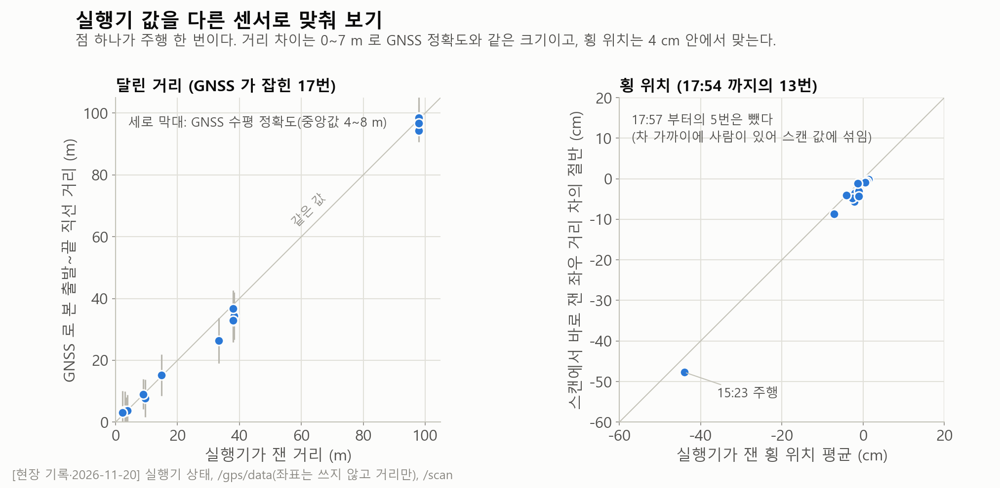

[현장 기록 · 2026-11-20] 왼쪽: 실행기 거리와 GNSS 로 본 출발~끝 직선 거리(세로 막대는 GNSS 수평 정확도). 오른쪽: 실행기 횡 위치 평균과 스캔에서 바로 잰 좌우 거리 차의 절반.

| 견준 것 | 결과 |
|---|---|
| 거리: 실행기 대 GNSS 직선 거리 | 100 m 열 네 번은 94.3~98.6 m(실행기 98.0 m)로 4 m 안. 40 m 열 여섯 번은 GNSS 쪽이 1.3~6.9 m 짧다(여섯 번 모두 같은 쪽, GNSS 정확도 6~8 m 와 같은 크기) |
| 속도: 실행기 대 GNSS | 중앙값이 0.05 m/s 안에서 맞는다 |
| 횡 위치: 실행기 대 스캔(좌우 가장 가까운 반사까지 거리 차의 절반) | 17:54 까지의 13번에서 3.7 cm 안. 15:23 주행의 −44 cm 는 스캔에서도 −48 cm(왼쪽 2.20 m, 오른쪽 1.24 m) |
| 열 폭: 실행기 대 스캔 | 스캔의 가장 가까운 반사 사이가 0.1~0.3 m 좁다(안쪽으로 나온 가지와 줄에 맞춘 선의 차이) |
| 조향 각: 실행기 대 브리지 | 실행기 값이 브리지 값의 1.3배(눈금 26° 대 20°) |
| 방향: IMU 대 실행기의 열 대비 방향 | IMU 방향에 실행기가 잰 열 대비 방향을 더한 값(곧은 열이면 일정)이 주행 한 번 동안 1.5° 안에서 일정했다(18번 모두. 100 m 열 다섯 번은 −0.7~−1.5°, 나머지 13번은 −0.3~+0.7°) |

- 줄자로 잰 거리와 선 자리는 없다. 거리는 GNSS 정확도 수준에서만, 횡 위치는 같은 LiDAR 의 다른 계산과만 맞춰 본 것이다.
- 17:57 부터의 다섯 번은 횡 위치 비교에서 뺐다. 그 가운데 네 번(17:57:57, 17:59:03, 17:59:55, 18:00:44)은 스캔의 87~100 % 에서 차 뒤 1.3~1.5 m, 두 줄 사이에 반사 뭉치(뒤따른 사람)가 있었다.
  횡 오차가 컸던 주행들과 겹치지만 원인인지는 확인하지 않았다.
- 기록의 받은 시각은 최대 1.1 s 뭉쳐 있었다(센서 시각은 고르다). 분석에는 센서 시각을 썼다. 기록은 마지막 주행 상태 뒤 0.0~1.1 s 에 끝나 차가 서는 과정은 들어 있지 않다.

## 6. 속도

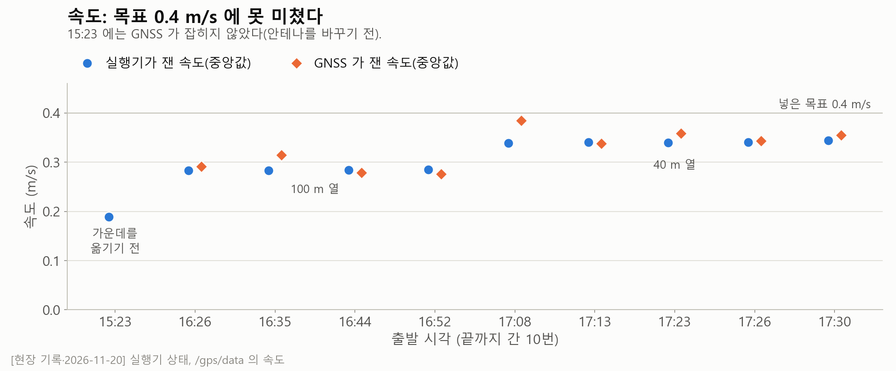

[현장 기록 · 2026-11-20] 끝까지 간 10번의 속도 중앙값(실행기와 GNSS).

- 목표 0.40 m/s 를 넣었지만 실제는 0.28 m/s(100 m 열)와 0.34 m/s(40 m 열)였다.
- 실행기의 속도 제한(제어 지연 동안 15 cm 넘게 가지 않기)이 목표를 0.31~0.37 m/s 로 낮췄고, 과수원 땅에서는 구동 표 속도의 76~85 % 만 나와 그보다도 약 10 % 느렸다.
- 주행 뒤 뜨는 구동 배율 제안은 한 번도 저장되지 않았다. 구동 표는 여전히 조향 장치를 달기 전(2026-10)의 기록 값이다.

## 7. 멈춘 것들

**브리지 오류 7번.** 모두 같은 종류다. Jetson 이 ESP32 보드로 보내는 명령이 잠깐 전달되지 않았다.

- 2번(17:20, 17:57)은 보드가 구동 명령이 300 ms 동안 오지 않아 스스로 구동을 세웠고, 5번(17:55~18:01)은 브리지의 보드 쓰기가 0.1 s 안에 끝나지 않아 연결을 닫았다 열었다.
- 일곱 번 모두 차는 섰다. 보드의 구동 감시와 브리지의 정지가 설계대로 동작했다.
- 아닌 것으로 확인한 것: 실행기·LiDAR·IMU 지연(직전 1 s 동안 LiDAR 나이 0.17 s 이하, IMU 0.06 s 이하), USB 가 빠졌다 붙은 것(커널 기록에 끊김 없음), 보드 재부팅, 조향을 많이 쓴 것.
- 언제: 16:26~17:20 의 약 28분 주행 동안 0번, 17:20 에 1번, 17:54~18:01 에 주행 12~48 s 마다 1번씩 6번.
- 원인은 기록만으로 가르지 못했다. 가능성: 전원·잡음(저녁으로 갈수록 잦아짐, 배터리 전압 센서 없음), 보드 펌웨어의 출력 막힘(1초에 약 130줄 출력, 추정).
- 그날 밤 브리지에 원인 기록(`link_diag`, `slow_step`)을 넣어 다음에 나면 어느 쪽인지 가를 수 있게 했다(대시보드 저장소).

**Jetson 재시작 1번.** 17:34:12 주행 중(19.8 m)에 재시작했다. 15:14:47 에 커널이 Wi-Fi 카드(PCIe)의 잘못된 메모리 접근을 기록했고 그 뒤 드라이버가 2초마다 송신 큐 내용을 커널 기록에 쏟아냈다.
재시작 직전 마지막 줄도 이 출력이다. 재시작의 원인인지는 확인하지 못했다. 저녁 구간에는 이 출력이 없었는데도 브리지 오류가 났으므로 브리지 오류의 직접 원인은 아니다.
그 주행의 녹화는 녹화기가 끝맺지 못해(bag 이 닫히지 않고 타임라인이 없음) 대시보드에서 재생되지 않았다. 2026-11-21 에 녹화기 코드로 bag 을 다시 흘려 마무리하는 도구(대시보드 저장소 `scripts/recover_interrupted_recording.py`)로 되살려, bag 에 남은 앞 33.8 s(19.8 m 가운데 약 9.6 m)를 재생할 수 있다.

**조향 따라가지 못함 4번.** 모두 준비 뒤 서서 기다리는 동안이다. 명령은 그대로인데 잰 조향 각이 3~5° 갑자기 바뀌고 돌아오지 않아 2.5 s 뒤 멈췄다.
사람이 차를 밀었는지, 벨트가 밀렸는지, 읽기가 튀었는지는 기록으로 가르지 못한다.

**실행기 처리 시간.** 16:13~18:02 에 실행기 루프가 150 ms 를 넘은 틱은 6번이다: 브리지 쓰기 실패 5번의 그 순간(약 410 ms, 브리지 응답을 기다린 시간)과 16:48 의 한 번(스캔 처리 123 ms).

## 8. 지도에서 본 열 방향 (대시보드의 격자 지도)

대시보드는 같은 기록의 LiDAR·IMU·GNSS로 격자 지도를 따로 그린다(실행기는 이 지도를 쓰지 않고 매 순간의 스캔으로 열을 따라간다). 2026-11-21에 그 지도를 이날의 기록으로 확인했다.

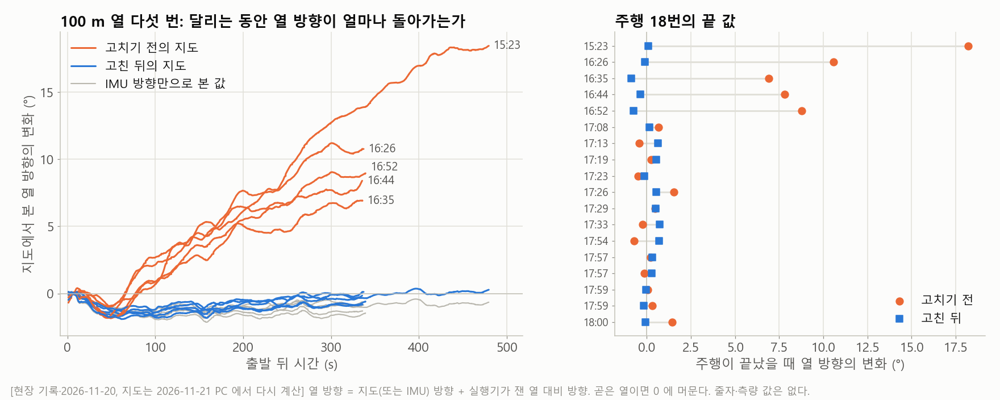

[현장 기록 · 2026-11-20] 지도(또는 IMU)의 방향에 실행기가 잰 열 대비 방향을 더한 값. 곧은 열이면 0에 머문다. 지도는 2026-11-21에 PC에서 같은 기록으로 다시 계산했다.

- 고치기 전의 지도는 100 m 열을 달리는 동안 열 방향이 7~18° 돌아갔다(열이 휘어 그려졌다). 같은 값을 IMU 방향으로 계산하면 1.5° 안이었고, GNSS 궤적도 곧았다.
- 원인은 지도의 방향을 스캔 맞추기가 사실상 혼자 정한 것이었다. 지도의 방향 추정이 IMU 방향의 변화를 따르게 고친 뒤 같은 기록에서 1° 안이 됐다
  (대시보드 저장소 `docs/GRID_MAP_KO.md`).
- 조향 각을 지도의 방향에 넣는 것은 재 본 뒤 하지 않았다. 조향 각과 속도로 방향을 계산하면(자전거 모델, 휠베이스 0.657 m) 끝까지 간 10번에서 주행이 끝났을 때
  IMU 방향과 9~807° 차이가 난다. 조향 영점이 주행마다 다르기 때문이다(4절). 주행마다 평균 치우침을 빼도 주행 중 최대 3.7~13.7° 틀린다.
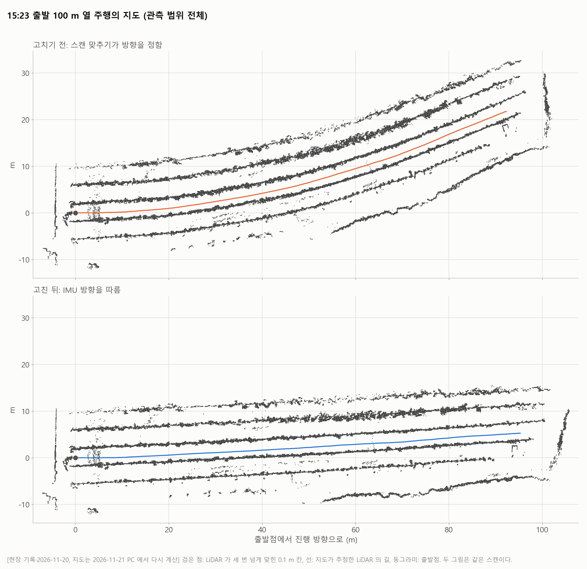

[현장 기록 · 2026-11-20] 15:23 주행(가장 크게 휘었던 것)의 지도를 고치기 전과 뒤의 위치 추정으로 그린 것. 관측 전체 범위, 가로세로 같은 비율. 같은 스캔이고 측량한 지도가 아니다.

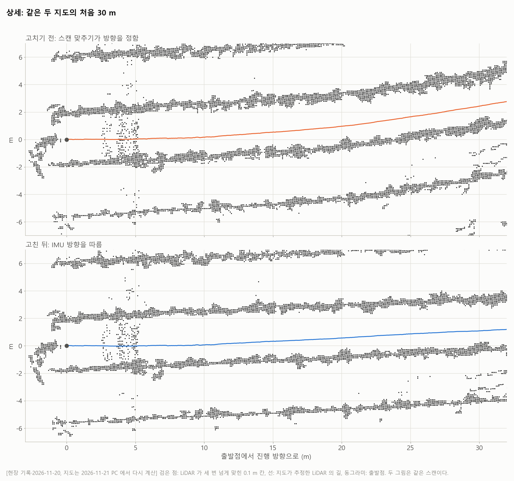

[현장 기록 · 2026-11-20] 상세: 같은 두 지도의 처음 30 m.

- 실행기 쪽에 남는 사실: IMU 방향은 5~8분 주행 동안 열 방향과 1.5° 안에서 맞았고, 주행끼리도 비슷했다(100 m 열 다섯 번 −0.7~−1.5°, 나머지 13번 −0.3~+0.7°).

## 9. 한계

- 하루, 과수원 두 열, 맑은 오후와 어두워진 저녁의 기록이다. 다른 열, 다른 지면, 다른 계절의 결과가 아니다.
- 횡 오차와 거리는 실행기의 자체 추정이다. 실제 나무 줄 가운데와의 차이, 선 자리, 달린 거리를 줄자나 측량으로 재지 않았다.
- LiDAR 로 열 끝을 보고 서는 동작은 현장에서 한 번도 나오지 않았다(모두 거리 한도에서 섰다).
- 브리지 오류와 Jetson 재시작의 원인은 확정하지 못했다.
- 조향 영점 보정 한도(±3°)는 곧게 달릴 때의 가변저항 값이 주행마다 달라지는 폭과 견줘 본 적이 없다.
- 뒤따르는 사람이 열 추정에 영향을 줬는지는 확인하지 않았다.
- 구동 표와 조향 사양 값은 자리값이거나 조향 장치 전의 값이다.

## 10. 다음에 할 것

- 다음 현장: 출발점과 선 자리에 표시를 하고 달린 거리와 선 자리를 줄자로 잰다. 열 끝 인식으로 서는지 본다(거리 한도를 열 길이보다 길게 두고, 사람이 STOP 을 준비한 채).
- 조향 영점 보정 한도를 넓힐지 SIM 에서 본다(영점이 수 도 어긋난 차, 한도 3°·6°·9°).
- 브리지 오류 재현: 차를 띄운 채 기록을 켜고 10분 넘게 구동·조향을 돌린다. 새 배터리와 줄어든 배터리로 한 번씩. 모터를 돌리는 일이라 사람이 차 옆에 있을 때만 한다.
- 구동 배율: 주행 뒤 배율 제안을 저장해 과수원 지면의 속도를 표에 반영한다.

## 11. 수치를 다시 내는 법

- 주행 표(3절): 실행기 틱 기록의 run 마다 거리·시간·끝난 이유·횡 오차·속도를 모은 것이다(틱 기록 형식은 [`../SYSTEM_REFERENCE_KO.md`](../SYSTEM_REFERENCE_KO.md) 7절).
- 5절: [`tools/field_records/`](../../tools/field_records/README_KO.md)의 `bag_extract.py`(bag 을 순서대로 읽어 주제별 시계열을 뽑음)와 `checks.py`(실행기 값과 GNSS·스캔 대조).
  녹화 원본은 레포에 없다. 녹화 폴더와 결과 폴더는 환경 변수로 준다.
- 그림: 같은 폴더의 시계열에서 그렸다. 그림마다 아래에 출처 줄이 있다.
