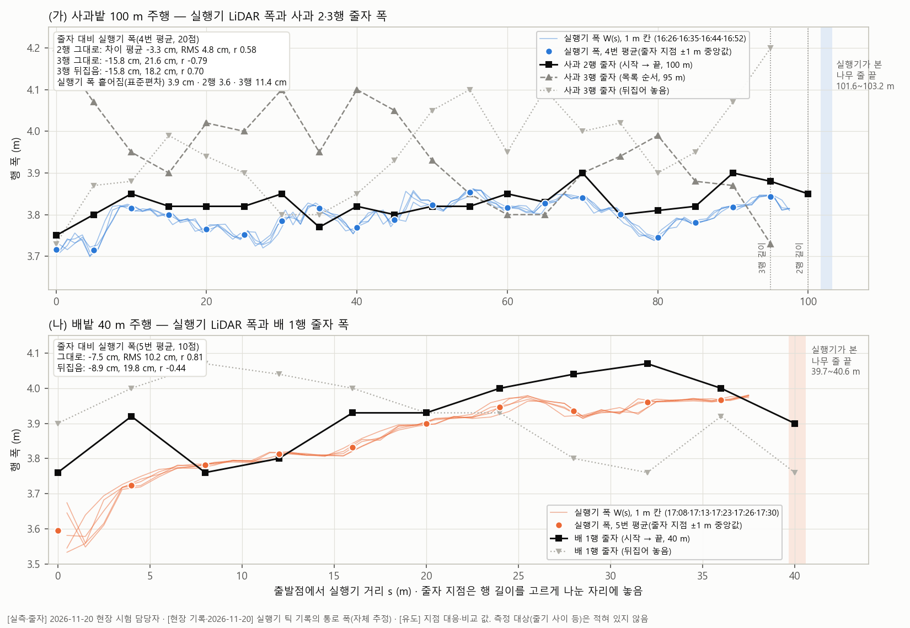
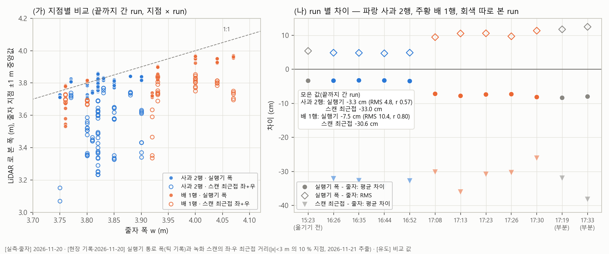
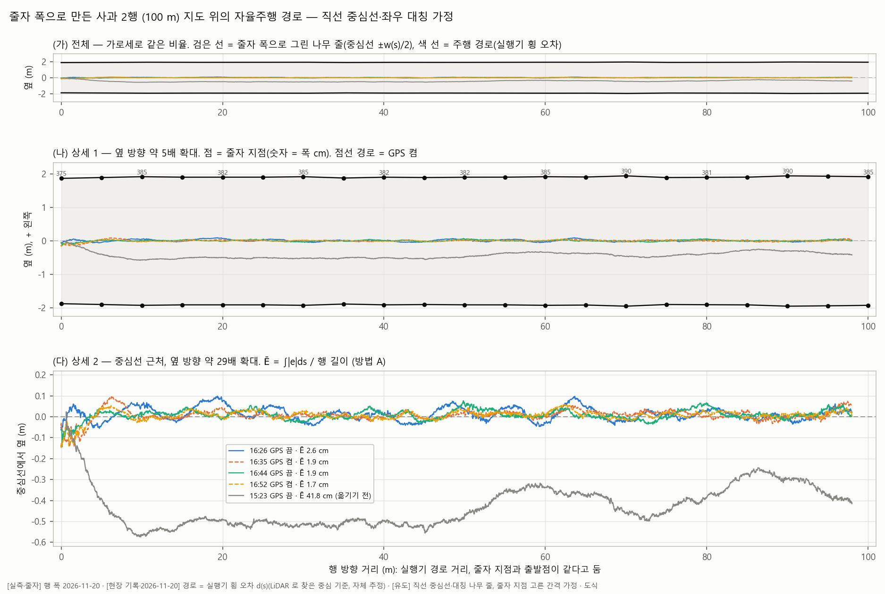
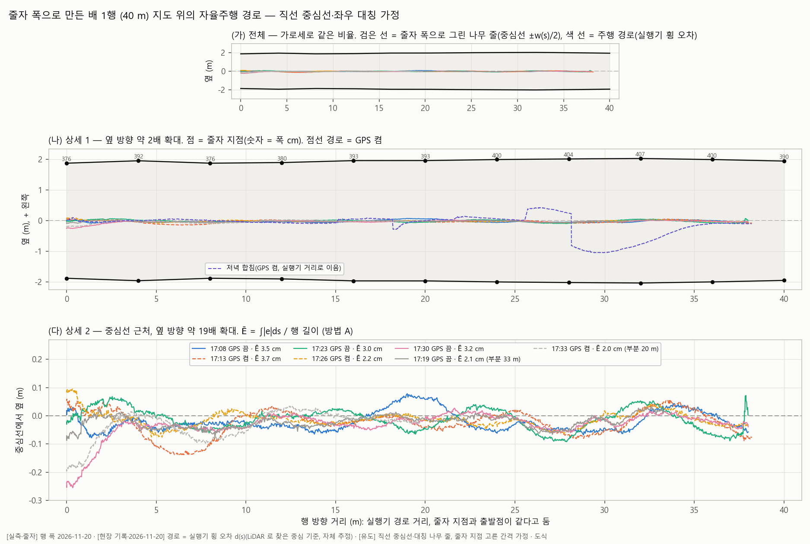
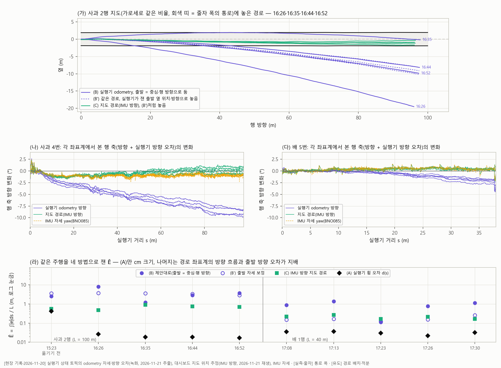
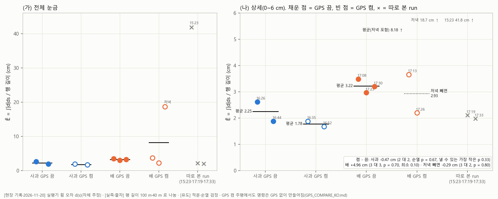
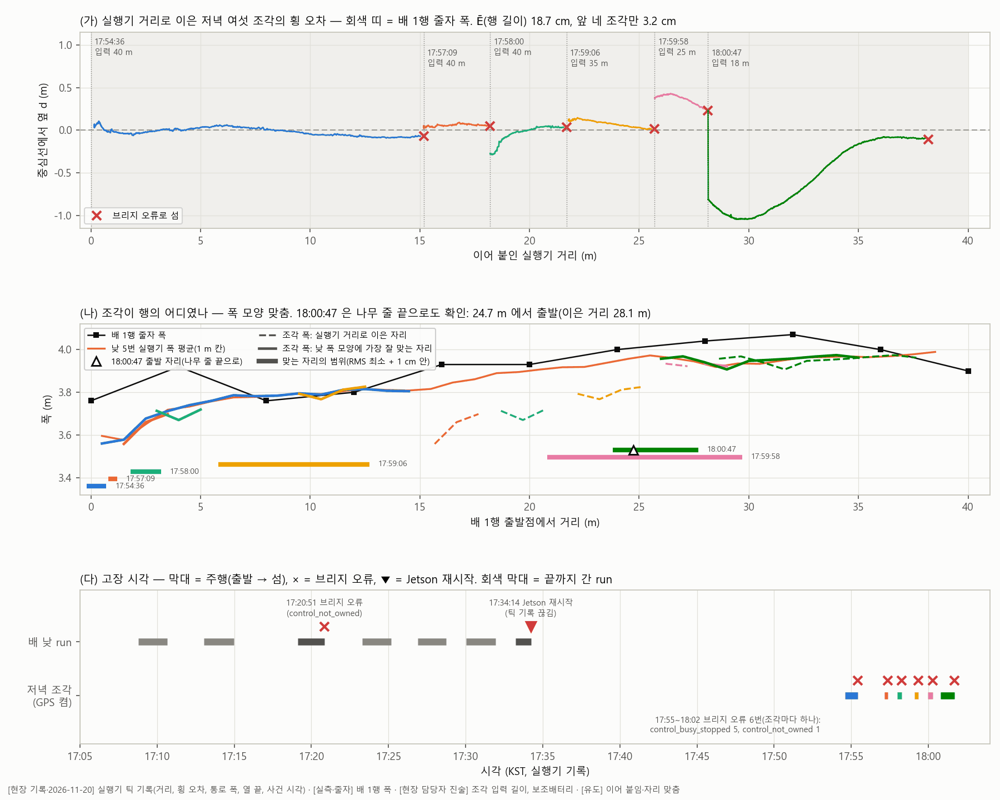

# 줄자로 잰 행 폭으로 본 2026-11-20 과수원 자율주행 평가

- 작성: 2026-11-22. 2026-11-20 과수원 자율주행 기록을 같은 날 현장 시험 담당자가 줄자로 잰 행 폭과 맞춰 보고, 현장 시험 담당자가 제안한 평가 방법(실측 지도 위 위치 오차 적분, 행 길이로 정규화)으로 다시 잰 결과다.
- 값 표지: **[현장 기록·2026-11-20]** 실행기가 스스로 잰 값(LiDAR 로 찾은 중심 기준의 횡 오차, 통로 폭, 경로 거리, odometry 자세)과 녹화에서 뽑은 값, **[실측·줄자 2026-11-20]** 현장 시험 담당자가 줄자로 잰 행 폭, **[유도]** 이 문서의 계산, **[현장 시험 담당자 진술]** 현장 시험 담당자가 전한 말.
- 줄자는 행 폭만 쟀다. 나무 줄의 위치(중심선이 어디에 있는지)는 재지 않았으므로, 이 문서의 횡 오차도 끝까지 **실행기 자체 추정**이다. 줄자는 폭(실행기가 본 두 나무 줄 사이 거리)을 검증하고, 지도의 모양과 정규화 길이를 준다.
- GNSS 좌표는 읽지도 적지도 않았다. 틱 기록의 `rel_m`은 앞선 추출에서 이미 버렸고, 녹화 배열의 GNSS 칸은 열지 않았다. 실행기 odometry 자세는 run 마다 출발점을 원점으로 둔 국소 좌표다.
- 새로 내려받은 자료는 없다. 모두 PC 에 있던 틱 기록 추출본, 녹화 추출 배열, 지도 재생 결과를 썼다. Jetson 에 접속하지 않았고, 저장소의 코드와 설정은 고치지 않았다.

## 1. 목적

1. 각 run 이 어느 행을 달렸는지 기록으로 확인한다(사과 2행 100 m, 사과 3행 95 m, 배 1행 40 m).
2. 실행기 LiDAR 가 잰 통로 폭이 줄자 폭과 얼마나 맞는지 잰다.
3. 줄자 폭으로 행 지도를 그리고 그 위에 주행 경로를 놓아, 현장 시험 담당자가 제안한 지표(위치 오차의 적분을 행 길이로 나눈 값)를 run 마다 낸다. 경로를 놓는 두 방법(실행기 횡 오차, 실행기 odometry 경로)을 견주고 어느 쪽이 뜻 있는 수인지 밝힌다.
4. 그 지표로 GPS 켬·끔을 현장 시험 담당자의 설계대로 다시 견준다.
5. 저녁에 여러 조각으로 나뉜 배밭 세 번째 GPS 켬 run 을 이어 붙이고, 보조배터리 진술이 브리지 고장을 얼마나 설명하는지 본다.

## 2. 쓴 자료

| 자료 | 위치 | 쓴 것 |
|---|---|---|
| 줄자 행 폭 [실측·줄자 2026-11-20] | [`orchard_tape/orchard_tape.json`](orchard_tape/orchard_tape.json)([csv](orchard_tape/orchard_tape.csv)) | 사과 2행 21점(100 m), 사과 3행 20점(95 m), 배 1행 11점(40 m), 처음·끝 요약 값, 메모 |
| 실행기 틱 기록 추출본 [현장 기록·2026-11-20] | `<runs>/report_1122/analysis/out/runs/*.npz`(원본 `작업 폴더 data/recordings/field-20261120/executor_logs/`) | 20 Hz 틱의 경로 거리 s, 횡 오차 d, 방향 오차, 통로 폭 W, 열 끝, 앞 여유, 옆 여유, 시각, 사건 |
| 녹화 추출 배열 [현장 기록·2026-11-20] | `<runs>/field_1120_notion/out/<녹화>.npz`, `CHECKS.json`(2026-11-21 추출) | 실행기 상태 토픽(약 7 Hz)의 odometry 자세 x, y, 방향, 거리, 횡·방향 오차, 스캔 좌·우 최근접 거리, IMU 자세(BNO085) |
| 대시보드 지도 위치 추정 재생 [현장 기록·2026-11-20] | `<runs>/gridmap_1121/out/imu1/<녹화>.npz`(2026-11-21 재생) | 스캔 정합 + IMU 자세 방향으로 만든 경로 |
| 지표 정의 | sim 레포 `docs/AUTONOMY_ALGORITHM_KO.md` 3·5·6·15절 | 부호(d: + = 왼쪽, 방향 오차 = 행 축 − 차 방향), 통로 폭의 뜻, 실행기 지표 |
| 앞선 분석 | `<runs>/report_1122/analysis/ANALYSIS_KO.md`, `<runs>/gps_compare_1122/GPS_COMPARE_KO.md` | run 목록, GPS 켬의 뜻(명령이 GPS 없이 만들어짐) |

run 은 오후 과수원 run 12번과 저녁 조각 6번이다. 사과밭(입력 열 길이 100 m) 15:23, 16:26, 16:35, 16:44, 16:52, 배밭(40 m) 17:08, 17:13, 17:19(부분), 17:23, 17:26, 17:30, 17:33(부분), 저녁 17:54:36~18:00:47 여섯 조각이다. 시각은 출발(go) KST 다.

## 3. 가정

1. **줄자 지점은 행 길이를 고르게 나눈 자리에 있다**(사과 2·3행 5 m, 배 1행 4 m 간격). 실제 잰 자리와 몇 m 어긋날 수 있다.
2. **줄자 출발점 = 차 출발점.** 차의 경로 거리 0 m 를 줄자 0 m 지점에 맞췄다. 어긋남은 5.1절에서 탐색으로만 봤다.
3. **줄자 지도의 중심선은 곧고, 두 나무 줄은 중심선에서 ±w(s)/2 에 대칭으로 있다.** 줄자는 폭만 줬으므로 중심선의 휨과 좌우 치우침은 알 수 없다.
4. **실행기가 LiDAR 로 찾은 중심을 줄자 지도의 중심선으로 둔다.** 그래서 방법 A 의 횡 오차는 실행기 자체 추정 그대로다.
5. 줄자가 무엇과 무엇 사이를 쟀는지(줄기 사이, 줄기 중심 사이 등)는 적혀 있지 않다. 각 행의 처음·끝 요약 값이 목록의 처음·끝 값과 다르다(사과 2행 요약 380/380 대 목록 375/385, 사과 3행 390/365 대 420/373, 배 1행 요약 390·400(어느 끝인지 표기 없음) 대 목록 376/390). 이 문서는 목록 값을 쓰고, 요약 값은 5.2절에서 실행기 값과 함께 나란히 적기만 했다.

## 4. 방법

### 4.1 행 확인

- 실행기 통로 폭 W(s)(주행 중이고 통로가 유효한 틱)를 줄자 지점마다 ±1 m 창의 중앙값으로 뽑아 줄자 폭 w 와 견줬다. 평균 차, RMS 차, 평균을 뺀 RMS(모양 차), 피어슨 r, 기울기(cm/10 m), 기울기를 뺀 r 을 냈다.
- 후보: 사과 run 은 사과 2행과 3행 각각을 목록 순서 그대로와 뒤집어서, 배 run 은 배 1행을 그대로와 뒤집어서 견줬다. 줄자를 앞뒤로 −10~+10 m 밀어 보는 탐색도 했다.
- 같은 행 run 끼리 W(s)(1 m 칸)의 상관으로 반복성을 봤다.
- 행 길이: 실행기가 본 나무 줄 끝 = 경로 거리 s + 틱의 열 끝 거리(마지막 15 m 의 중앙값). 입력한 열 길이와 출발 뒤 거리 한도도 함께 봤다.

### 4.2 폭 비교

세 가지 LiDAR 폭을 줄자와 견줬다.

- **실행기 폭 W** [현장 기록·2026-11-20]: band 의 두 평행선 사이 거리. 각 선은 가장 가까운 점유 띠에서 바깥 0.6 m 안의 가장 센 띠(잎 가장자리 대신 줄기 선)에 놓이고, 그 띠 ±0.25 m 점의 중앙값이다(알고리즘 문서 6.2·6.4절). LiDAR 꼭대기는 지면에서 약 0.57 m 다.
- **스캔 최근접 좌+우** [현장 기록·2026-11-20]: 녹화 스캔에서 차 앞뒤 |x| < 3 m, 옆 0.6~6 m 점의 옆 거리 10 % 지점을 왼쪽·오른쪽 따로 내어 더한 값(2026-11-21 추출). 통로 안쪽으로 가장 튀어나온 잎·가지 쪽이다.
- **옆 여유 최근접**(틱의 `sideL + sideR` + 차 폭 자리값 0.70 m): 차 길이 안의 최솟값이라 성긴 배나무 사이에서는 한쪽이 비어 큰 값이 나온다. 배밭에서 쓸 수 없어 표에만 남겼다(`out/orchard_measured.json`).

### 4.3 현장 시험 담당자의 지표

run 의 위치 오차 e(s) 를 줄자 지도 위에 놓고

$$
E=\int_0^{D}\lvert e(s)\rvert\,ds,\qquad \bar E_L=\frac{E}{L_{row}},\qquad \bar E_D=\frac{E}{D},\qquad
\mathrm{RMS}_L=\sqrt{\frac{1}{L_{row}}\int_0^{D}e(s)^2\,ds}
$$

를 낸다. $L_{row}$ 는 줄자 행 길이(사과 2행 100 m, 배 1행 40 m), $D$ 는 run 이 실제 적분한 거리다(끝까지 간 run 은 98 m·38 m, 거리 한도 = 입력 열 길이 − 2 m). 적분은 s 순서로 정렬한 표본의 사다리꼴 합이다. 현장 시험 담당자가 제안한 정규화는 $\bar E_L$ 이다. 끝까지 간 run 에서 $\bar E_L$ 은 평균 |e| 보다 2 %(사과)·5 %(배) 작고, 부분 run 은 달리지 않은 구간이 0 으로 들어가므로 $\bar E_D$ 를 함께 봐야 한다.

e(s) 를 얻는 방법 넷을 같은 run 에 적용했다.

- **(A) 실행기 횡 오차**: $e_A(s)=d(s)$. 실행기가 LiDAR 로 찾은 중심선에서 차 기준점까지의 옆 거리(+ = 왼쪽, 틱 기록 20 Hz). 가정 4 로 줄자 지도의 중심선에 놓는다.
- **(B) 제안대로 놓은 odometry 경로**: 실행기 odometry 자세(run 의 첫 스캔이 원점·0 rad 인 국소 좌표의 기준점 자세, 녹화 약 7 Hz)를 "출발 = 행 중심, 출발 방향 = 행 방향"으로 놓는다. $e_B$ = 출발 방향 직선에서의 옆 거리.
- **(B') 출발 자세를 보정한 odometry 경로**: 같은 경로를 실행기가 잰 출발 옆 위치 $d_0$(처음 1 m 중앙값)와 출발 때의 행 방향 $\psi_0$ 로 놓는다. $\psi_0$ = (자세 방향 + 실행기 방향 오차)의 s = 0.5~5 m 중앙값. 그러면 출발 오차가 빠지고 좌표계의 방향 흐름만 남는다.
- **(C) IMU 방향 지도 경로**: 대시보드 지도 위치 추정(스캔 정합 + IMU 자세 방향, 2026-11-21 재생)의 경로를 (B')처럼 놓는다. 이 경로의 방향 기준은 IMU 자세라 0 이 따로 있어, run 마다 "1 m 이동 방향 − 지도 방향"의 중앙값으로 한 번 맞췄다(−178.6~−179.5°).

각 좌표계의 **방향 흐름**은 그 좌표계에서 본 행 축 = 자세 방향 + 실행기 방향 오차(방향 오차 = 행 축 − 차 방향)가 출발(0.5~5 m)과 끝(마지막 5 m) 사이에 바뀐 양이다. 행이 곧으면 이 값은 그 좌표계의 방향 흐름이다. 실행기 odometry 경로는 작은 각에서 다음과 같이 나뉜다. 사과·배 7번에서 이 식과 기록된 경로의 차이는 최대 0.09~0.37 m 였다(부호와 정의 확인).

$$
e_B(s)\approx d(s)-d_0+\int_0^s\tan\psi_{row}(u)\,du,\qquad \psi_{row}(u)=\underbrace{\psi_0}_{\text{출발 방향 오차}}+\underbrace{\psi_{row}(u)-\psi_0}_{\text{좌표계 방향 흐름}}
$$

출발 방향을 0.1° 잘못 잡으면 98 m 끝에서 17 cm, 38 m 끝에서 6.6 cm 옆으로 간다 [유도].

### 4.4 GPS 켬·끔 설계

[현장 시험 담당자 진술] 사과밭·배밭에서 GPS 를 끔·켬 번갈아 3번씩 달렸다. 기록과 맞춘 묶음은 다음과 같다.

- 사과 끔: 16:26, 16:44. 사과 켬: 16:35, 16:52. 세 번째 켬은 기록에 없다. 15:23(끔)은 조향 가운데를 옮기기 전이라 따로 둔다.
- 배 끔: 17:08, 17:23, 17:30(17:19 는 브리지 오류로 33 m 에서 선 부분 run 이라 따로). 배 켬: 17:13, 17:26, 저녁 합침(17:33 은 Jetson 재시작으로 끊긴 부분 run 이라 따로).

묶음 평균의 차와 정확 순열 검정(모든 나눔)을 냈다. 2 대 2 는 나눔이 6가지라 양쪽 p 가 0.33 보다 작아질 수 없고, 3 대 3 은 20가지라 0.10 이 가장 작다. 앞선 비교(`GPS_COMPARE_KO.md`)대로 11/20 의 GPS 켬은 단독 측위 + `weak_constraint`였고 RTK 보정이 한 번도 걸리지 않아 조향·구동 명령은 켬·끔 모두 GPS 없이 만들어졌다.

### 4.5 저녁 조각 잇기

- 실행기 경로 거리로 이었다: 조각 k 의 출발 자리 = 앞 조각들의 거리 합(`run_end`의 `distance_m`).
- 확인 셋: (1) 입력한 열 길이(40, 40, 40, 35, 25, 18 m)를 "남은 길이"로 본 자리 = 40 − 입력 길이, (2) 조각의 W(s) 모양을 낮 배 1행 5번의 실행기 폭 평균(1 m 칸)에 0.5 m 간격으로 맞춰 본 자리(RMS 최소, 최소 + 1 cm 안의 범위), (3) 마지막 조각은 열 끝(나무 줄 끝)이 보여 낮 run 의 나무 줄 끝 자리(중앙 40.19 m)로 출발 자리를 냈다.
- 조각 사이에 차가 그대로였는지는 앞 조각 끝(마지막 0.3 m)과 다음 조각 출발(처음 0.3 m)의 횡 오차·방향 오차 차이로 봤다.

## 5. 결과

### 5.1 어느 행을 달렸나

**그림 1.** 위: 사과밭 100 m run 4번(16:26·16:35·16:44·16:52)의 실행기 폭 W(s)(1 m 칸, 옅은 파랑), 4번 평균(줄자 지점 ±1 m 중앙값, 파랑 점)과 사과 2행(검정), 사과 3행(회색 파선), 사과 3행을 뒤집은 것(회색 점선). 파란 띠는 실행기가 본 나무 줄 끝. 아래: 배밭 40 m run 5번과 배 1행. 출처: [실측·줄자 2026-11-20] 현장 시험 담당자 · [현장 기록·2026-11-20] 실행기 틱 기록의 통로 폭(자체 추정) · [유도] 지점 대응·비교 값.

| 비교 | 지점 | 평균 차 cm | RMS cm | 평균 뺀 RMS cm | r | 실행기 폭 표준편차 cm | 실행기 기울기 cm/10 m | 줄자 기울기 cm/10 m | 기울기 뺀 r |
|---|---|---|---|---|---|---|---|---|---|
| 사과 4번 평균 대 사과 2행(목록 순서) | 20 | −3.3 | 4.8 | 3.5 | 0.58 | 3.9 | +0.71 | +0.66 | 0.42 |
| 사과 4번 평균 대 사과 2행(뒤집음) | 20 | −3.8 | 6.9 | 5.7 | −0.28 | 3.9 | +0.71 | −0.48 | −0.07 |
| 사과 4번 평균 대 사과 3행(목록 순서) | 20 | −15.8 | 21.6 | 14.7 | −0.79 | 3.9 | +0.71 | −2.66 | −0.69 |
| 사과 4번 평균 대 사과 3행(뒤집음) | 20 | −15.8 | 18.2 | 9.1 | 0.70 | 3.9 | +0.71 | +2.66 | 0.56 |
| 배 5번 평균 대 배 1행(목록 순서) | 10 | −7.5 | 10.2 | 6.8 | 0.81 | 11.5 | +9.44 | +7.89 | 0.09 |
| 배 5번 평균 대 배 1행(뒤집음) | 10 | −8.9 | 19.8 | 17.7 | −0.44 | 11.5 | +9.44 | −4.92 | 0.52 |

[실측·줄자 2026-11-20] 줄자 표준편차: 사과 2행 3.6 cm, 사과 3행 11.4 cm, 배 1행 10.3 cm. 나머지는 [유도](실행기 폭은 [현장 기록·2026-11-20]).

**사과밭 run 은 사과 2행을 목록의 시작 → 끝 방향으로 달린 것으로 본다.** 근거:

1. **길이.** 끝까지 간 run 은 모두 거리 한도(100 − 2 = 98 m)에서 섰고, 그때 실행기는 나무 줄이 앞으로 4.1~5.3 m 더 이어지는 것을 봤다. 나무 줄 끝은 출발에서 101.6~103.2 m(5번, 실행기 거리)다 [현장 기록·2026-11-20]. 실행기 거리는 지도 경로(IMU 방향)보다 약 1 % 길었다(98.0 m 대 96.8~97.1 m) [유도]. 그래도 나무 줄은 출발에서 약 100 m 이어진 것이고, 95 m 인 사과 3행보다 100 m 인 사과 2행에 맞는다. 운영자가 넣은 열 길이도 100 m 였다 [현장 기록·2026-11-20].
2. **폭의 크기.** 실행기 폭 중앙값은 3.795~3.805 m 다 [현장 기록·2026-11-20]. 사과 2행 줄자 평균 3.828 m 와 −3.3 cm, 사과 3행 3.952 m 와 −15.8 cm 차이다. 같은 방법이 배 1행(알려진 행)에서 −7.5 cm 였으므로 −3.3 cm 가 더 자연스럽다.
3. **폭 변화의 크기와 기울기.** 실행기 폭의 지점 간 표준편차는 3.9 cm, 기울기는 +0.71 cm/10 m 다. 사과 2행은 3.6 cm, +0.66 cm/10 m 로 같은 크기다. 사과 3행은 11.4 cm, ∓2.66 cm/10 m 로 세 배쯤 크다. 배 1행에서는 실행기가 줄자의 변화(표준편차 10.3 cm 대 11.5 cm, 기울기 +7.89 대 +9.44 cm/10 m)를 그대로 따라갔다. 그러니 사과 3행을 달렸다면 실행기 폭도 그만큼 흔들렸어야 한다.
4. **반복성.** 같은 행 run 끼리 W(s)(1 m 칸)의 상관은 사과 4번 평균 0.95(0.89~0.99), 배 5번 0.98(0.95~1.00)이다 [유도]. 실행기 폭의 모양은 잡음이 아니라 행의 성질이라 위 비교가 뜻이 있다.

**맞지 않는 한 가지.** 모양만의 상관(r)은 사과 3행을 뒤집은 것(0.70, 기울기 뺀 r 0.56)이 사과 2행(0.58, 0.42)보다 조금 높다. 이 근거는 약하게 봤다. 행을 아는 배밭에서도 기울기를 뺀 r 은 맞는 방향 0.09, 틀린 방향 0.52 로 거꾸로 나왔다. 줄자 10~20점에서 기울기를 뺀 모양은 행을 가르는 근거가 못 된다. 사과 3행을 뒤집은 경우라면 차가 돌기둥 쪽 끝에서 출발했고 나무 줄이 95 m 보다 6 m 넘게 이어졌어야 하는데, 이를 뒷받침하는 기록은 없다.

**배밭 run 은 배 1행을 목록(뒤집어 놓은 시작 → 끝) 방향으로 달렸다.** 그대로 놓으면 r 0.81, RMS 10.2 cm 이고, 뒤집으면 r −0.44, RMS 19.8 cm 다. 나무 줄 끝은 출발에서 39.7~40.6 m(5번)로 줄자 40 m 와 맞는다 [현장 기록·2026-11-20]. 17:19·17:33 부분 run 도 같은 모양이다(그대로 r 0.77·0.57).

**줄자 출발점과 차 출발점의 어긋남(탐색).** 줄자를 밀어 보면 모양 차가 가장 작은 자리는 사과 2행 −0.5~−2.0 m, 배 1행 −2.5~−3.5 m 다(차가 줄자 0 m 지점보다 그만큼 앞에서 출발했다는 뜻) [유도]. 그런데 배 1행에서 그렇게 밀면 나무 줄 끝(실행기 40.2 m)이 줄자 37 m 근처가 되어 줄자 길이 40 m 와 어긋난다. 지점 간격이 고르다는 가정(3절 1)과 함께 몇 m 의 불확실성으로만 적는다. 이 문서의 지도와 지표는 밀기 0 을 썼다.

### 5.2 폭: LiDAR 대 줄자

**그림 2.** 왼쪽: 줄자 지점마다 줄자 폭(가로)과 LiDAR 로 본 폭(세로, 지점 ±1 m 중앙값). 채운 점 = 실행기 폭, 빈 점 = 스캔 최근접 좌+우. 파랑 = 사과 2행(4번 × 20점), 주황 = 배 1행(5번 × 10점). 오른쪽: run 별 평균 차(점), RMS(마름모), 스캔 최근접의 평균 차(역삼각형). 출처: [실측·줄자 2026-11-20] · [현장 기록·2026-11-20] 실행기 통로 폭과 녹화 스캔의 좌·우 최근접 거리(2026-11-21 추출) · [유도] 비교 값.

| run | 행 | 지점 | 실행기 폭 − 줄자 평균 cm | RMS cm | r | 스캔 최근접 − 줄자 평균 cm | RMS cm | r |
|---|---|---|---|---|---|---|---|---|
| 15:23 | 사과 2행 | 20 | −3.3 | 5.4 | 0.48 | −36.3 | 43.7 | 0.49 |
| 16:26 | 사과 2행 | 20 | −3.3 | 4.9 | 0.53 | −32.1 | 36.6 | 0.36 |
| 16:35 | 사과 2행 | 20 | −3.2 | 4.9 | 0.56 | −32.7 | 38.0 | 0.38 |
| 16:44 | 사과 2행 | 20 | −3.3 | 4.7 | 0.60 | −34.4 | 38.1 | 0.27 |
| 16:52 | 사과 2행 | 20 | −3.4 | 4.9 | 0.59 | −32.7 | 37.2 | 0.29 |
| 17:08 | 배 1행 | 10 | −7.2 | 9.5 | 0.82 | −30.1 | 38.7 | 0.55 |
| 17:13 | 배 1행 | 10 | −7.8 | 10.5 | 0.80 | −36.0 | 56.6 | 0.53 |
| 17:19(부분) | 배 1행 | 9 | −8.3 | 11.8 | 0.77 | −31.9 | 48.9 | 0.56 |
| 17:23 | 배 1행 | 10 | −7.4 | 10.6 | 0.80 | −30.8 | 47.9 | 0.57 |
| 17:26 | 배 1행 | 10 | −7.3 | 9.7 | 0.82 | −30.3 | 41.0 | 0.54 |
| 17:30 | 배 1행 | 10 | −8.1 | 11.4 | 0.79 | −26.1 | 33.8 | 0.62 |
| 17:33(부분) | 배 1행 | 6 | −8.0 | 12.5 | 0.57 | −38.1 | 48.9 | – |
| **모음 사과 4번** | 사과 2행 | 80 | **−3.3** | **4.8** | **0.57** | **−33.0** | 37.5 | 0.33 |
| **모음 배 5번** | 배 1행 | 50 | **−7.5** | **10.4** | **0.80** | **−30.6** | 44.3 | 0.54 |

[유도] (줄자는 [실측·줄자 2026-11-20], LiDAR 폭은 [현장 기록·2026-11-20])

- **실행기 폭은 줄자보다 사과 2행에서 3.3 cm, 배 1행에서 7.5 cm 좁았다.** 끝까지 간 run 사이 흩어짐은 0.2 cm(사과)·0.9 cm(배)뿐이라 이 차이는 run 마다 같은 치우침이다. 지점마다의 RMS 는 4.8 cm·10.4 cm 다.
- **스캔 최근접 폭은 30~33 cm 좁았다.** 통로 쪽으로 가장 튀어나온 잎·가지를 재기 때문이다. 앞선 확인 표(`CHECKS.json`)의 "폭 실행기 3.80 / 스캔 3.52 m"에서 줄자 쪽에 가까운 것은 실행기 폭이다.
- **처음·끝 값.** 실행기 폭(처음 2 m·마지막 2 m 중앙의 run 평균)은 사과 2행 3.72 / 3.81 m, 배 1행 3.58 / 3.97 m 다 [현장 기록·2026-11-20]. 줄자 목록은 3.75 / 3.85, 3.76 / 3.90 m 이고, 요약 값은 3.80 / 3.80, 3.90·4.00(어느 끝인지 모름)이다 [실측·줄자 2026-11-20]. 사과 2행은 목록 값이 실행기와 3~4 cm 안에서 맞고, 요약 값 처음 3.80 과는 8 cm 다르다. 배 1행 처음은 실행기가 목록보다 18 cm 좁다.
- **그럴듯한 까닭(확인하지 않음).** 줄자가 줄기 중심 사이를 쟀다면, LiDAR(지면에서 약 0.57 m)는 통로 쪽 줄기 겉면과 그 높이의 가지·잎을 보므로 줄기 지름의 절반 두 번 + 안쪽으로 나온 잎만큼 좁게 읽는다. 받침대에 붙여 키운 사과 줄(벽처럼 촘촘함)보다 띄엄띄엄 선 배나무에서 가지가 통로 쪽으로 더 나와 차이가 큰 것과 맞는다. 배 1행 첫 지점(0~2 m)에서 18 cm 좁은 것은 열 머리의 덤불·구조물일 수 있다. 그 밖에 줄자는 한 단면, LiDAR 는 ±1 m 창이고, 지점 자리가 가정(고른 간격)과 몇 m 다를 수 있다.
- 배 1행의 상관(0.80)은 대부분 행을 따라 넓어지는 기울기에서 나온다(기울기를 빼면 0.09). LiDAR 는 몇 m 규모의 폭 변화를 따라가지만, 줄자 한 지점의 ±1~2 cm 단위 흔들림까지 같다고 말할 수는 없다.

### 5.3 실측 지도 위의 경로와 Ē (방법 A)

**그림 3.** 줄자 폭으로 그린 사과 2행(100 m) 지도. (가) 전체, 가로세로 같은 비율. 검은 선 = 중심선 ±w(s)/2 에 놓은 나무 줄(직선·대칭 가정), 색 선 = 각 run 의 경로(실행기 횡 오차 d(s)). (나) 상세 1: 옆 방향 약 5배 확대, 점 = 줄자 지점(숫자 = 폭 cm). (다) 상세 2: 중심선 근처, 옆 방향 약 29배 확대. 점선 = GPS 켬, 회색 = 15:23(조향 가운데 옮기기 전). 출처: [실측·줄자 2026-11-20] 행 폭 · [현장 기록·2026-11-20] 실행기 횡 오차(자체 추정) · [유도] 직선·대칭 가정과 지점 배치 · 도식.

**그림 4.** 같은 방식의 배 1행(40 m) 지도. (나)의 보라 파선은 저녁 여섯 조각을 실행기 거리로 이은 것(5.6절), (다)는 낮 run 7번(옆 방향 약 19배 확대). 출처는 그림 3 과 같다.

| run | 행 | GPS | 적분 거리 m | E m² | **Ē = E/L cm** | E/달린 거리 cm | RMS(L) cm | 최대 cm | 비고 |
|---|---|---|---|---|---|---|---|---|---|
| 15:23 | 사과 2행 | 끔 | 97.4 | 41.834 | **41.83** | 42.96 | 43.44 | 57.4 | 조향 가운데 옮기기 전 |
| 16:26 | 사과 2행 | 끔 | 98.0 | 2.615 | **2.62** | 2.67 | 3.33 | 9.9 | |
| 16:35 | 사과 2행 | 켬 | 98.0 | 1.883 | **1.88** | 1.92 | 2.85 | 14.3 | |
| 16:44 | 사과 2행 | 끔 | 98.0 | 1.881 | **1.88** | 1.92 | 2.52 | 14.4 | |
| 16:52 | 사과 2행 | 켬 | 98.0 | 1.684 | **1.68** | 1.72 | 2.43 | 14.6 | |
| 17:08 | 배 1행 | 끔 | 38.0 | 1.394 | **3.49** | 3.67 | 3.94 | 7.8 | |
| 17:13 | 배 1행 | 켬 | 38.2 | 1.465 | **3.66** | 3.84 | 5.00 | 14.2 | |
| 17:19 | 배 1행 | 끔 | 33.3 | 0.844 | 2.11 | **2.53** | 2.85 | 8.7 | 부분(브리지 오류) |
| 17:23 | 배 1행 | 끔 | 38.0 | 1.190 | **2.97** | 3.13 | 3.79 | 9.3 | |
| 17:26 | 배 1행 | 켬 | 38.0 | 0.879 | **2.20** | 2.32 | 2.87 | 9.5 | |
| 17:30 | 배 1행 | 끔 | 38.0 | 1.278 | **3.20** | 3.36 | 5.19 | 25.6 | |
| 17:33 | 배 1행 | 켬 | 19.8 | 0.793 | 1.98 | **4.02** | 4.20 | 19.6 | 부분(Jetson 재시작) |
| 저녁 합침 | 배 1행 | 켬 | 37.4 | 7.472 | **18.68** | 19.97 | 34.13 | 104.4 | 여섯 조각, 5.6절 |

[유도] (d(s)는 [현장 기록·2026-11-20] 실행기 자체 추정, L 은 [실측·줄자 2026-11-20])

- 조향 가운데를 옮긴 뒤 끝까지 간 run 의 Ē 는 **사과 2행 1.68~2.62 cm(4번 평균 2.02 cm), 배 1행 2.20~3.66 cm(5번 평균 3.10 cm)** 다. 거리로 잰 RMS 는 2.43~3.33 cm·2.87~5.19 cm 로, 앞선 분석의 시간 기준 횡 RMS(2.6~3.4 cm·3.2~6.4 cm)와 같은 크기다(정의만 다르다).
- 15:23 은 Ē 41.8 cm 로 다른 사과 run 의 16~25배다. 출발 5 m 뒤부터 끝까지 통로 가운데에서 오른쪽으로 0.25~0.57 m 벗어나 있었고, 줄자 지도 위에서 차 중심과 오른쪽 나무 줄 사이는 1.3~1.7 m 였다(그림 3 (나)).
- 부분 run(17:19, 17:33)은 Ē_L 이 작아 보이지만 달리지 않은 구간이 0 으로 들어간 탓이다. 이들은 E/달린 거리(2.53, 4.02 cm)로 봐야 한다.
- 줄자 폭은 사과 2행 3.75~3.90 m, 배 1행 3.76~4.07 m 이고, 경로는 15:23 과 저녁을 빼면 중심선 ±15 cm 안이었다(17:30 은 출발 직후 25.6 cm, 17:33 은 19.6 cm 까지). 차 폭(자리값 0.70 m)의 절반을 빼도 나무 줄까지 1.2 m 넘게 남았다 [유도].

### 5.4 방법 B 는 왜 cm 크기의 수가 되지 않나

**그림 5.** (가) 사과 2행 지도(가로세로 같은 비율, 회색 띠 = 줄자 폭의 통로) 위에 같은 4번의 경로를 (B) 제안대로, (B') 출발 자세 보정, (C) IMU 방향 지도 경로로 놓은 것. (나)·(다) 각 좌표계에서 본 행 축의 변화(자세 방향 + 실행기 방향 오차): 보라 = 실행기 odometry, 청록 = 지도 경로(IMU 방향), 노랑 점선 = IMU 자세(BNO085). (라) 같은 run 을 네 방법으로 잰 Ē(로그 눈금). 출처: [현장 기록·2026-11-20] 실행기 상태 토픽의 odometry 자세·방향 오차(녹화, 2026-11-21 추출), 대시보드 지도 위치 추정(IMU 방향, 2026-11-21 재생), IMU 자세 · [실측·줄자 2026-11-20] 통로 폭 · [유도] 경로 배치·적분.

| run | 출발 옆 d₀ cm | 출발 방향 오차 ° | Ē_A cm | Ē_B m | B 끝 옆 m | Ē_B' m | B'−A 끝 m | Ē_C m | C−A 끝 m | 실행기 odometry 방향 흐름 ° | 지도(IMU) 흐름 ° | IMU 자세 흐름 ° |
|---|---|---|---|---|---|---|---|---|---|---|---|---|
| 15:23 | −4.9 | +1.15 | 41.8 | 2.56 | −6.86 | 3.54 | −8.44 | 0.56 | +0.43 | −8.57 | +1.73 | −0.63 |
| 16:26 | −2.0 | −5.53 | 2.6 | 8.10 | −18.82 | 3.71 | −9.73 | 0.47 | −0.38 | −9.25 | +0.81 | −0.72 |
| 16:35 | −9.3 | +5.60 | 1.9 | 1.21 | −0.03 | 3.53 | −9.45 | 0.91 | −1.72 | −9.64 | −0.62 | −1.09 |
| 16:44 | −6.4 | +0.53 | 1.9 | 2.90 | −7.80 | 3.39 | −8.80 | 0.75 | −1.20 | −8.31 | +0.02 | −0.93 |
| 16:52 | −13.0 | −1.08 | 1.7 | 3.64 | −9.41 | 2.88 | −7.76 | 0.70 | −0.93 | −8.19 | +0.42 | −1.00 |
| 17:08 | +1.7 | −2.23 | 3.5 | 0.86 | −1.87 | 0.15 | −0.48 | 0.22 | +0.48 | −1.99 | +0.32 | +0.17 |
| 17:13 | +3.4 | −3.75 | 3.7 | 1.39 | −2.79 | 0.17 | −0.41 | 0.27 | +0.56 | −1.63 | +0.49 | +0.34 |
| 17:19 | −7.4 | −1.33 | 2.1 | 0.35 | −0.88 | 0.09 | −0.21 | 0.13 | +0.37 | −1.51 | +0.61 | +0.51 |
| 17:23 | −0.8 | +0.02 | 3.0 | 0.11 | −0.43 | 0.12 | −0.38 | 0.16 | +0.33 | −1.82 | +0.22 | +0.41 |
| 17:26 | +8.6 | −1.70 | 2.2 | 0.76 | −1.65 | 0.15 | −0.49 | 0.21 | +0.46 | −2.17 | +0.53 | +0.36 |
| 17:30 | −24.1 | −3.57 | 3.2 | 1.15 | −2.67 | 0.26 | −0.68 | 0.17 | +0.34 | −2.77 | +0.32 | +0.37 |

출발 옆 위치·방향 오차와 흐름 각은 [현장 기록·2026-11-20] 실행기 추정에서 낸 [유도] 값, 나머지는 [유도]. 17:33 은 녹화가 9.6 m 에서 끊겨 표에서 뺐다(`out/TABLES_KO.md` T2 에 있음).

- **(B) 제안대로 놓으면 Ē 가 m 크기다**: 사과 1.21~8.10 m, 배 0.11~1.39 m(끝까지 간 run). 98 m 끝에서 경로가 통로 밖 18.8 m 까지 간다. 차는 통로 안을 달렸으므로(LiDAR 로 본 두 나무 줄 사이를 끝까지 유지, 통로 유효 100 %) 이 수는 추종 오차가 아니다.
- **까닭 1: 출발 방향.** 실행기가 잰 출발 때의 방향 오차는 사과 −5.5~+5.6°, 배 −3.8~0.0° 였다. "출발 = 행 방향"으로 두면 이 각이 그대로 기울기가 되어 98 m 끝에서 ±9.5 m 가 된다. 16:35 의 Ē_B 가 1.21 m 로 작은 것은 출발 방향(+5.6°)과 아래의 흐름(−9.6°)이 우연히 상쇄된 것이다.
- **까닭 2: 실행기 odometry 의 방향 흐름.** 실행기 좌표계에서 본 행 축은 사과 98 m 동안 −8.2~−9.6°, 배 38 m 동안 −1.5~−2.8° 돌았다(모든 run 에서 같은 쪽). 1 m 마다 약 −0.09°(사과)·−0.05°(배)다. 같은 때 IMU 자세로 본 행 축은 사과 −1.1~−0.6°, 배 +0.2~+0.5°, IMU 방향 지도 경로는 사과 −0.6~+1.7°, 배 +0.2~+0.6° 만 바뀌었다. 행이 실행기 흐름만큼 휘었다면 IMU 도 그만큼 돌았어야 하므로, 이 흐름은 실행기 odometry(LiDAR 키프레임 ICP)의 방향 흐름이다. 출발 자세를 보정해도(B') 98 m 끝에서 −7.8~−9.7 m, 38 m 끝에서 −0.4~−0.7 m 가 남는다.
- **(C) IMU 방향 경로도 cm 에는 못 미친다**: Ē_C 사과 0.47~0.91 m, 배 0.16~0.27 m, 끝에서 (A)와의 차이 사과 −1.7~+0.4 m, 배 +0.3~+0.6 m. 남은 1° 안팎의 방향 흐름과 출발 방향을 정하는 데 쓴 실행기 방향 오차의 흔들림(0.1° 마다 98 m 에서 17 cm)이 그만큼을 만든다. 행의 실제 휨도 이 안에 섞이며, 줄자만으로는 가를 수 없다.
- **그래서 뜻 있는 수는 (A)다.** (A)는 차가 지금 보고 있는 두 나무 줄 사이에서 어디에 있었는지이므로 좌표계 흐름이 들어가지 않는다. 그 기준이 되는 두 나무 줄의 간격은 5.2절에서 줄자와 −3.3 cm(사과)·−7.5 cm(배)로 맞았다. 현장 시험 담당자의 정규화(행 길이로 나눔)는 (A)에 그대로 쓸 수 있다. (B)처럼 경로를 고정된 직선 지도에 놓는 방식을 cm 수준으로 하려면 100 m 동안 방향을 0.03° 안(끝 옆 5 cm)으로 알아야 한다. odometry 나 IMU 로는 안 되고, RTK FIXED GNSS·토털스테이션·말뚝 같은 바깥 기준이 있어야 한다.

### 5.5 GPS 켬·끔

**그림 6.** 방법 A 의 Ē(행 길이로 나눔). (가) 전체 눈금, (나) 0~6 cm 상세. 채운 점 = GPS 끔, 빈 점 = GPS 켬, 가로 막대 = 묶음 평균, × = 따로 본 run(15:23, 17:19, 17:33). 출처: [현장 기록·2026-11-20] 실행기 횡 오차(자체 추정) · [실측·줄자 2026-11-20] 행 길이 · [유도] 적분·순열 검정.

| 묶음 | run | Ē 평균 cm (범위) | E/달린 거리 평균 cm | RMS(L) 평균 cm | 최대 평균 cm |
|---|---|---|---|---|---|
| 사과 끔 | 16:26, 16:44 | 2.25 (1.88~2.62) | 2.29 | 2.92 | 12.2 |
| 사과 켬 | 16:35, 16:52 | 1.78 (1.68~1.88) | 1.82 | 2.64 | 14.4 |
| 배 끔 | 17:08, 17:23, 17:30 | 3.22 (2.97~3.49) | 3.39 | 4.31 | 14.2 |
| 배 켬(설계대로, 저녁 합침 포함) | 17:13, 17:26, 저녁 합침 | 8.18 (2.20~18.68) | 8.71 | 14.00 | 42.7 |
| 배 켬(낮 2번만) | 17:13, 17:26 | 2.93 (2.20~3.66) | 3.08 | 3.94 | 11.8 |

| 비교 | 켬 대 끔 | 켬 − 끔 cm | 순열 p(양쪽) | 낼 수 있는 가장 작은 p |
|---|---|---|---|---|
| 사과 | 2 대 2 | −0.47 | 0.67 | 0.33 |
| 배(저녁 합침 포함) | 3 대 3 | +4.96 | 0.70 | 0.10 |
| 배(낮만) | 2 대 3 | −0.29 | 0.80 | 0.20 |

[유도]

- **GPS 켬·끔은 이 지표로도 갈리지 않는다.** 사과는 켬이 0.47 cm 작고 배(낮)는 0.29 cm 작지만, 같은 쪽 안의 흩어짐(사과 끔 1.88~2.62, 배 끔 2.97~3.49 cm)보다 작고 순열 p 는 0.67·0.80 이다.
- 배의 설계대로 저녁 합침을 켬에 넣으면 켬이 4.96 cm 커진다. 이것은 GPS 탓이 아니다. 저녁 마지막 두 조각이 중심에서 +38 cm·−81 cm, 방향 −9°·+18° 로 놓인 채 출발해 그것을 되돌리는 두 조각이 E 의 83 % 를 차지한다(5.6절). 어두워진 뒤였고 차 뒤에 사람이 따라왔으며 조각마다 브리지 오류로 섰다. 11/20 의 GPS 켬은 명령에 들어가지 않았다(4.4절).
- **표본 크기.** 사과 2 대 2, 배 3 대 3(또는 2 대 3)이다. 이 설계로는 차이가 아무리 커도 양쪽 p 가 0.33(사과)·0.10(배) 아래로 갈 수 없다. 사과의 세 번째 켬 run 은 기록에 없다.

### 5.6 저녁 합친 run 과 브리지 고장

**그림 7.** (가) 저녁 여섯 조각을 실행기 경로 거리로 이은 횡 오차(회색 띠 = 배 1행 줄자 폭), × = 브리지 오류로 선 자리. (나) 조각마다의 실행기 폭을 실행기 거리로 이은 자리(파선)와 낮 폭 모양에 가장 잘 맞는 자리(실선), 맞는 자리의 범위(아래 막대), 18:00:47 조각의 출발 자리를 나무 줄 끝으로 낸 것(△). (다) 배밭 run 과 고장 시각: 막대 = 출발 → 섬, × = 브리지 오류, ▼ = Jetson 재시작(틱 기록 끊김). 출처: [현장 기록·2026-11-20] 실행기 틱 기록(거리, 횡 오차, 통로 폭, 열 끝, 사건 시각) · [실측·줄자 2026-11-20] 배 1행 폭 · [현장 시험 담당자 진술] 입력 길이와 보조배터리 · [유도] 이어 붙임·자리 맞춤.

| 조각(출발) | 입력 길이 m | 오류 시각 | 오류 | 출발→오류 s | 거리 m | 이은 자리 m | 40 − 입력 m | 폭 맞춤 자리 m (범위) | 이은 자리의 폭 RMS cm | 폭 맞춤 RMS cm | 출발 d cm | 출발 방향 ° | 앞 조각 끝 대비 d / 방향 | E m² |
|---|---|---|---|---|---|---|---|---|---|---|---|---|---|---|
| 17:54:36 | 40 | 17:55:25 | busy_stopped | 49.4 | 15.17 | 0.0 | 0 | 0.0 (0.0~0.5) | 1.2 | 1.2 | +4.3 | +7.3 | – | 0.604 |
| 17:57:09 | 40 | 17:57:23 | not_owned | 13.7 | 3.02 | 15.2 | 0 | 1.0 (1.0~1.0) | 21.0 | 1.7 | +4.3 | +0.2 | +11 cm / +1.9° | 0.175 |
| 17:58:00 | 40 | 17:58:16 | busy_stopped | 16.2 | 3.50 | 18.2 | 0 | 2.5 (2.0~3.0) | 19.9 | 3.9 | −27.3 | +2.1 | −33 cm / +0.5° | 0.218 |
| 17:59:06 | 35 | 17:59:22 | busy_stopped | 16.1 | 4.01 | 21.7 | 5 | 9.0 (6.0~12.5) | 14.3 | 1.4 | +11.8 | +1.0 | +9 cm / +2.9° | 0.287 |
| 17:59:58 | 25 | 18:00:17 | busy_stopped | 19.2 | 2.44 | 25.7 | 15 | 27.5 (21.0~29.5) | 2.9 | 0.4 | +37.8 | −8.8 | +36 cm / −10.1° | 0.870 |
| 18:00:47 | 18 | 18:01:41 | busy_stopped | 53.9 | 10.05 | 28.1 | 22 | 25.5 (24.0~27.5) | 2.3 | 1.1 | −81.2 | +17.9 | −106 cm / +12.2° | 5.316 |

오류는 `drive_refused:control_busy_stopped`(뒤따라 watchdog `not_armed:LATCHED`, `watchdog_stall` 루프 틈 0.36~0.39 s) 또는 `drive_refused:control_not_owned` 다. 입력 길이는 [현장 기록·2026-11-20](운영자 입력), 나머지는 [현장 기록·2026-11-20]과 [유도].

**이어 붙인 결과.**

- 여섯 조각의 실행기 거리 합은 38.19 m 로, 끝까지 간 배밭 run 의 거리 한도 38 m 와 거의 같다 [현장 기록·2026-11-20].
- 이어 붙인 run 의 E 는 7.472 m², **Ē = 18.7 cm**(÷40 m), E/달린 거리 20.0 cm, 거리 RMS 34.1 cm, 최대 104 cm 다 [유도]. E 의 71 % 가 마지막 조각(18:00:47, 출발 −81 cm·+18°), 12 % 가 그 앞 조각(17:59:58, +38 cm·−9°)에서 나왔다.
- 앞 네 조각만 보면 E 1.284 m², Ē 3.2 cm 로 낮 run(2.2~3.7 cm)과 같은 크기다. 다만 달린 거리가 25.0 m 라 E/달린 거리는 5.1 cm 로 낮 run(2.3~3.8 cm)보다 크다. 조각마다 출발 뒤 맞춰 가는 구간이 다시 들어갔기 때문이다 [유도]. E 는 조각마다 자기 거리로 적분하므로 잇는 방법에 따라 바뀌지 않는다. 바뀌는 것은 지도 위 자리뿐이다.

**"같은 자리에서 이어 달렸다"는 진술과 맞지 않는 곳.**

- [현장 시험 담당자 진술] "세 조각 정도로 나뉘었다" → 기록은 여섯 조각이다.
- 실행기 거리로 이으면 조각의 폭이 낮 폭 모양과 맞지 않는다. 17:57:09 조각(폭 3.58 m)은 이은 자리 15.2 m 에서 RMS 21 cm 인데, 1.0 m 자리에서 1.7 cm 로 맞는다. 낮 run 에서 폭이 3.6 m 쯤인 곳은 행 머리(0~2 m)뿐이다. 17:58:00(이은 자리 18.2 m)도 2.0~3.0 m 에서, 17:59:06(21.7 m)도 6.0~12.5 m 에서 맞는다. 17:54:36 조각 뒤 차가 행 머리 쪽으로 돌아가 다시 출발했을 가능성이 크다.
- 입력 길이를 "남은 길이"로 보면 출발 자리가 0, 0, 0, 5, 15, 22 m 이고, 폭 맞춤(0, 1.0, 2.5, 9.0, 27.5, 25.5 m)과 앞 네 조각에서 비슷하다. 운영자는 17:57:09 를 행 머리에서 다시 시작한 것으로 보고 길이를 넣은 셈이다. 폭 전체로 견주면 입력 길이 쪽(평균 차 −7.2 cm, RMS 11.0 cm, r 0.78)이 실행기 거리 쪽(−14.2 cm, 18.2 cm, 0.59)보다 낮 run(−7.5, 10.2, 0.81)에 가깝다.
- 마지막 조각은 나무 줄 끝이 보여 출발 자리를 따로 낼 수 있었다: 24.7 m [유도]. 실행기 거리로 이은 자리 28.1 m 와 입력 길이 자리 22 m 사이다. 폭 맞춤 범위(24.0~27.5 m)와 맞는다.
- 조각 사이 출발 자세가 바뀌었다: 17:58:00 앞에서 −33 cm, 17:59:58 앞에서 +36 cm·−10°, 18:00:47 앞에서 −106 cm·+12° [현장 기록·2026-11-20]. 차가 선 채로는 생길 수 없는 크기라 차를 옮기거나 돌려 놓았다고 본다. 저녁 조각 넷은 녹화에서 스캔의 87~100 % 동안 차 뒤 1.3~1.5 m 에 사람이 보였다(앞선 분석 5.1절).
- 그래서 이어 붙인 run 은 행을 한 번에 지나간 것이 아니다. 행 머리 쪽 0~15 m 를 두 번 달렸고, 대략 13~21 m 와 35~38 m 는 저녁에 달리지 않았을 수 있다(자리 추정의 범위 안에서). 이 run 의 Ē 18.7 cm 는 낮 run 과 같은 뜻의 수가 아니다.

**보조배터리 진술은 고장을 얼마나 설명하나.**

- 배밭의 브리지 오류는 모두 7번이다: 17:20:51 한 번(17:19 run, `control_not_owned`, 출발 104 s·33.3 m 뒤)과 저녁 17:55:25~18:01:41 의 6번(조각마다 하나) [현장 기록·2026-11-20]. 그 사이 17:34:14 에 Jetson 이 재시작했다(17:33 run 의 틱 기록이 19.8 m 에서 끊김).
- **저녁 6번은 진술과 맞는다.** 6분 16초 동안 조각마다 13.7~53.9 s 달린 뒤 섰고, 다시 출발하기까지 30~104 s 였다. 보드 전원이 부하를 버티지 못하는 경우에 볼 수 있는 모양이다. 다만 기록에 전압 센서가 없고, 녹화의 보드 상태는 끝까지 '연결됨'이며 조향 고장 표시도 낮 run 에도 있던 `steer_hold_cancelled`(17:58:00 조각) 말고는 없어, 기록만으로 전원 탓이라고 확인할 수는 없다.
- **17:20:51 은 진술만으로 설명되지 않는다.** 저녁 묶음보다 34.5분 앞이고, 그 뒤 17:23, 17:26, 17:30 세 run 이 고장 없이 끝까지 갔다. 보조배터리가 그때부터 약해지기 시작한 첫 증상일 수도 있지만 기록으로는 가를 수 없다. 오류 이름(`control_not_owned`)은 저녁 17:57:23 과 같고, 나머지 저녁 5번(`control_busy_stopped` + `not_armed:LATCHED`)과는 다르다.
- **17:34:14 Jetson 재시작**은 다른 장치의 일이다. 진술은 조향 보드의 보조배터리만 말한다. Jetson 전원이 같은 보조배터리였는지는 알 수 없다.

## 6. 찾은 것

1. **행.** 사과밭 run 은 사과 2행(100 m)을 목록 순서대로 달린 것으로 본다(길이, 폭 크기 −3.3 대 −15.8 cm, 폭 변화의 크기·기울기, 입력 열 길이 100 m). 모양 상관만은 사과 3행을 뒤집은 쪽이 조금 높았다(0.70 대 0.58). 배밭 run 은 배 1행을 목록 순서대로 달렸다(r 0.81, 나무 줄 끝 39.7~40.6 m). 저녁 조각도 배 1행이다.
2. **폭.** 실행기 LiDAR 폭은 줄자보다 사과 2행 3.3 cm, 배 1행 7.5 cm 좁았다(지점 RMS 4.8·10.4 cm, 끝까지 간 run 사이 흩어짐 0.2·0.9 cm, 배의 부분 run 을 넣으면 1.1 cm). 스캔 최근접 폭은 30~33 cm 좁았다. 실행기가 중심선을 잡는 두 나무 줄의 간격은 줄자 기준으로 몇 cm 안에서 맞는다.
3. **지표(방법 A).** Ē = ∫|d|ds / 행 길이는 조향 가운데를 옮긴 뒤 끝까지 간 run 에서 사과 2행 1.68~2.62 cm, 배 1행 2.20~3.66 cm 다. 15:23 은 41.8 cm, 저녁 합침은 18.7 cm(앞 네 조각만 3.2 cm)다.
4. **방법 B(제안대로 odometry 경로를 직선 지도에 놓기).** 같은 run 이 Ē 0.11~8.1 m 로 나온다. 출발 방향 오차(최대 ±5.6°)와 실행기 odometry 의 방향 흐름(사과 98 m 동안 −8.2~−9.6°, 배 38 m 동안 −1.5~−2.8°, 98 m 끝 옆 −7.8~−9.7 m)이 지배한다. IMU 방향 경로(C)로 바꿔도 0.13~0.91 m 다. 행을 따라가는 성능을 재는 수는 (A)이고, (B)형 평가는 RTK 같은 바깥 기준이 있어야 한다.
5. **GPS.** 이 지표로도 켬·끔은 갈리지 않는다(사과 −0.47 cm, 배 낮 −0.29 cm, p 0.67·0.80). 설계대로 저녁을 넣은 배의 +4.96 cm 는 저녁 조각들의 놓인 출발 탓이고 GPS 와 관계없다. 2 대 2·3 대 3 설계로는 어떤 차이도 통계로 가를 수 없다.
6. **저녁 run.** 여섯 조각(진술은 "세 조각 정도")은 거리 합 38.2 m 지만 한 번에 이어 달린 것이 아니다. 17:57:09 는 행 머리에서 다시 출발했고, 17:58·17:59:58·18:00:47 앞에서는 차가 옮겨졌다. 보조배터리 진술은 저녁 고장 6번과 맞지만 기록으로 확인되지는 않는다. 17:20:51 고장과 17:34:14 Jetson 재시작은 진술로 설명되지 않는다.

## 7. 기존 문서와 다른 것

1. **열 이름.** 앞선 문서의 "과수원 100 m 열"은 사과 2행, "40 m 열"은 배 1행이다(5.1절). 사과 3행일 가능성은 낮다.
2. **저녁 run 의 행.** 통합 분석([`AUTONOMY_RUNS_ANALYSIS_KO.md`](AUTONOMY_RUNS_ANALYSIS_KO.md), 작업 폴더의 `ANALYSIS_KO.md`) 5.1절은 "저녁(17:54~)은 … 어느 열을 달렸는지는 기록에 따로 없다"고 적었다. 17:54:36 조각의 폭 모양이 낮 배 1행 폭과 출발 0 m 에서 RMS 1.2 cm 로 맞고, 18:00:47 조각이 배 1행 나무 줄 끝을 봤으므로 배 1행이다.
3. **저녁 run 의 성격.** `GPS_COMPARE_KO.md` 3.3절은 저녁 6번을 "열 길이를 바꿔 가며 달린 것"이라 비교에서 뺐다. [현장 시험 담당자 진술]로 이것은 배밭 세 번째 GPS 켬 run 을 이어 달린 것이다. 그러나 기록으로는 같은 자리에서 이어지지 않았고 조각 수도 진술("세 조각 정도")과 다르다(5.6절). 비교에서 빼는 판단 자체는 이 문서의 결과와 맞다.
4. **어느 폭이 실제에 가까운가.** 앞선 확인 표의 "폭 실행기 3.80 / 스캔 3.52 m"(사과)·"3.87 / 3.72 m"(배)에서 줄자에 가까운 것은 실행기 폭이다(−3.3·−7.5 cm). 스캔 최근접은 통로 쪽 잎 가장자리라 30 cm 남짓 좁다.
5. **실행기 odometry 방향 흐름.** 2026-11-21 지도 작업은 스캔 정합만으로 만든 대시보드 지도가 100 m 열에서 7~18° 휘었다고 적었다. 실행기 자신의 odometry 도 사과 98 m 동안 −8.2~−9.6°, 배 38 m 동안 −1.5~−2.8° 흘렀다(5.4절). 실행기는 행 축을 이 좌표계에 고정한 band 로 들고 있지만 관측으로 계속 고치므로 횡 오차(A)에는 이 흐름이 들어가지 않는다. 그러나 "odometry 경로 = 실제 경로"로 쓰는 일(지도, 경로 그림, (B)형 평가)에는 쓸 수 없다.
6. **15:23 의 줄자 지도 위 자리.** 앞선 분석의 횡 평균 −44.1 cm 는 줄자 지도에서도 그대로다. 통로 폭 3.75~3.90 m 의 가운데에서 0.25~0.57 m 오른쪽이었고 차 중심에서 나무 줄까지는 1.3 m 넘게 남았다. 다른 문서와 어긋나는 것은 아니고 줄자로 처음 본 자리다.

## 8. 한계

- **줄자는 폭만 줬다.** 나무 줄의 위치, 중심선의 휨, 좌우 치우침은 모른다. 방법 A 의 횡 오차는 여전히 실행기 자체 추정이고, 줄자는 그 기준(두 나무 줄 간격)을 폭으로만 검증한다. 한쪽 나무 줄만 잎 때문에 안쪽으로 읽히면 중심이 폭 오차의 절반(몇 cm)만큼 치우칠 수 있다.
- **줄자의 뜻.** 무엇과 무엇 사이를 쟀는지, 지점이 정확히 어디였는지(고른 간격 가정), 줄자 0 m 와 차 출발점의 관계가 적혀 있지 않다. 처음·끝 요약 값이 목록과 다르다. 한 지점을 한 번씩 잰 값이라 측정 반복성은 모른다.
- **거리.** 실행기 경로 거리는 지도 경로와 1 % 안에서 다르고(사과 98.0 대 96.8~97.1 m, 배 38.0 대 38.2~38.3 m), 줄자 출발점과의 어긋남은 몇 m 일 수 있다. 행 방향 자리는 ±1~3 m 의 불확실성이 있다.
- **(C) 경로**는 2026-11-21 재생한 대시보드 지도 위치 추정(IMU 방향 변형)이고, 방향 0 을 run 마다 이동 방향으로 맞췄다. 출발 방향은 실행기 방향 오차로 정했으므로 0.5° 흔들림이 98 m 에서 0.9 m 다.
- **녹화가 끊긴 run.** 17:33 과 18:00:47 은 녹화가 9.6 m·9.0 m 에서 끊겨 (B)·(B')·(C)는 그 앞만 있다. (A)는 틱 기록에서 끝까지(19.8 m·10.05 m) 냈다.
- **표본.** 하루, 사과 2행 5번(옮긴 뒤 4번), 배 1행 7번 + 저녁 조각 6. GPS 켬·끔은 2 대 2·3 대 3 이다. 같은 시각의 짝이 없고, 조향 영점과 출발 자세가 run 마다 달랐다.
- **저녁 조각의 자리**는 폭 모양 맞춤과 나무 줄 끝으로 추정한 것이다. 행 뒤쪽(24 m 넘어)은 폭이 평평해 범위가 넓다(최대 8.5 m). 조각 사이에 차를 옮겼는지는 출발 자세 변화로만 판단했다.
- **보조배터리.** 전압 기록이 없어 전원과 브리지 오류의 관계는 시각과 모양으로만 말했다.

## 9. 다시 내는 법

스크립트는 저장소 밖 작업 폴더 `<runs>/report_1122/orchard_tape/scripts/`에 있다(`common_ot.py`, `analyze.py`, `make_tables.py`, `figures.py`를 `python -I -B`로 차례로 실행, 몇 초).
입력은 위 2절의 추출본이고 읽기만 한다. 원본 기록은 GNSS를 담고 있어 저장소에 넣지 않으며, 원본 기록은 차의 Jetson에 있다.

### 그림 목록

| 파일 | 내용 | 출처 표지(그림 안에 그려진 짧은 표기. [실측·줄자]는 [실측·줄자 2026-11-20], [현장 담당자 진술]은 [현장 시험 담당자 진술]과 같다) |
|---|---|---|
| `figs/fig1_row_identity.png` | 실행기 폭 W(s)와 사과 2·3행, 배 1행 줄자 폭, 나무 줄 끝 | [실측·줄자] · [현장 기록·2026-11-20] · [유도] |
| `figs/fig2_width_validation.png` | 줄자 대 실행기 폭·스캔 최근접 폭, run 별 차이 | [실측·줄자] · [현장 기록·2026-11-20] · [유도] |
| `figs/fig3_map_apple.png` | 사과 2행 줄자 지도와 경로: 전체(같은 비율), 상세 1(약 5배), 상세 2(약 29배) | [실측·줄자] · [현장 기록·2026-11-20] · [유도] · 도식 |
| `figs/fig4_map_pear.png` | 배 1행 줄자 지도와 경로: 전체, 상세 1(약 2배), 상세 2(약 19배) | 같음 |
| `figs/fig5_odometry_drift.png` | (B)·(B')·(C) 경로를 같은 비율 지도에, 좌표계별 행 축 흐름, 네 방법의 Ē | [현장 기록·2026-11-20] · [실측·줄자] · [유도] |
| `figs/fig6_metric_gps.png` | GPS 켬·끔 묶음별 Ē(전체·상세) | [현장 기록·2026-11-20] · [실측·줄자] · [유도] |
| `figs/fig7_evening_merged.png` | 저녁 여섯 조각: 이은 횡 오차, 폭 모양으로 본 자리, 고장 시각 | [현장 기록·2026-11-20] · [실측·줄자] · [현장 담당자 진술] · [유도] |
