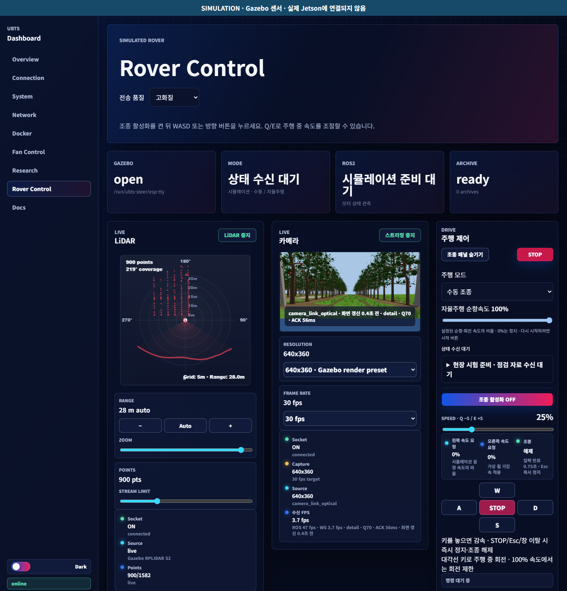
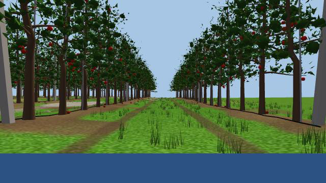

# S2 형식 노드와 실행기 컨테이너 (P6a 나머지, 작업 표지 s2exec)

- 작성: 2026-11-09 (4단계 WF-4, 빌드 단계 s2exec).
- 설계: `DESIGN_v1_KO.md` 2.2~2.6, 3.7, 4.3, 8.3 P6a('S2 형식 노드', '실행기 컨테이너'). 결정: `DECISIONS_KO.md` R16, R18, R19, R20.
- 합격 기준: `SIM_ACCEPTANCE_KO.md` A5, A13(개정 11), A17(7.2.1, 개정 4·7·10), A19(G, 개정 17). 기준은 바꾸지 않았다.
- 모든 값은 자리값 프로필 v0.1(`front_steer_v0_1_placeholder`)에서 온다. 결과는 **자리값 기반 SIM 결과**다. 현장 검증이 아니다. 이 문서에는 GNSS 좌표, 지도 원점, 실제 기록의 궤적 절대값이 없다.
- 이 단계의 스택 측정은 개발 값이다. 시간 민감 판정(실차 시계 A17 STOP, A10 W2)은 R20대로 다른 단계가 돌지 않는 최종 자격 검사에서 다시 한다.
- **스택 측정(ST-05, 2026-11-12).** 새 이미지 `ubts-steer-sim:wf4a`(커밋 3289d16)와 `ubts-steer-sim:wf4b`(커밋 c2b1941)를 만들었다. 둘 다 실행기 패키지와 S2 형식 노드가 들어 있다. compose 기본 이미지는 그 뒤 `ubts-steer-sim:wf4c`(열 추종 제어기 포함, `STEER_FOLLOW_GSIM_RESULT_KO.md`)로 바꿨다. 실행기 컨테이너와 S2 형식 노드가 스택에서 도는 것, `/scan`이 실차 형식으로 나오는 것, 대본 제어기 run 하나가 실행기를 거쳐 끝나는 것을 확인했다. 측정한 값은 7절, 남은 것은 10절이다. 스택을 올리고 내리는 규칙은 `STACK_OPERATIONS_KO.md`다.

## 1. 요약

1. S2 형식 노드 `sim/ubts/steering/s2_format_node.py`(노드 `ubts_steer_s2_format`)를 만들었다. `/sim/scan`(field1010에서는 `/sim/scan_clipped`)을 받아 `/scan`을 낸다. 변환은 F-SIM과 같은 코드(`s2_format.RealFormat`)다. 감독기가 기본으로 켠다(`--s2-node none`이면 끈다).
2. 실행기 컨테이너 `sim/ubts/steering/exec_container_main.py`와 compose 서비스 `executor`(프로필 `executor`)를 만들었다. 실제 실행기(`tools/row_executor`)가 대본 제어기를 슬롯에 넣고 MOTOR 모드로 돈다. 제어 소켓만으로 브리지와 말한다. `--clock wall|sim` 두 모드가 있다.
3. 감독기(`supervisor_steer.py`)에 S2 노드 준비 확인, 옛 상태 파일 정리(감사 G06), steer 역할의 브리지 신호 걸이를 더했다.
4. 검사 모듈 `sim/ubts/steering/exec_checks.py`를 만들었다: A13(G) 실행기 구독, A5(G) `/scan`·IMU·카메라·가상 GPS, W2 감지 사슬, A17(G) 실행기 고리 대본 22개.
5. `docker/Dockerfile.ubts-steer`가 `tools/row_executor`를 복사하고 새 모듈을 import해 본다. 새 이미지는 ST-05(2026-11-12)에서 만들었다(9절). 2026-11-09의 개발 스택은 `ubts-steer-sim:p6a`에 스냅숏 소스를 읽기 전용으로 붙여 돌렸다.

## 2. S2 형식 노드

### 2.1 토픽 계약

| 항목 | 값 |
|---|---|
| 입력 | `--input`(감독기: 자르기 노드가 있으면 `/sim/scan_clipped`, 없으면 `/sim/scan`). LaserScan, best effort, keep last 10 |
| 입력 규약 | cpu_lidar `ScanSynthesizer`: 3200빔, 2π, angle_min −π, 증분 2π/3200, 몸체 좌표, frame `laser`. 다르면 변환하지 않고 이유별로 센다(`beam_count`, `angle_min`, `angle_increment`, `frame_id`, `stamp_invalid`). 모르는 형식을 짐작해 바꾸지 않는다 |
| 출력 | `/scan`, LaserScan, reliable, keep last 10(실제 드라이버 sllidar_ros2와 같은 QoS) |
| ranges | 3240빔, raw 순서, float32, 1 mm 반올림. 반사 없음(+inf, NaN, 30 m 이상)은 0.0 |
| angle_min / 증분 / angle_max | float32(−π) = `RAW_AMIN`, `RAW_INC`, angle_min + 3239 × 증분 |
| frame_id | `laser`. raw 빔 j는 몸체 각 wrap(angle_min + j × 증분 + `lidar_yaw_offset_deg`)를 본다(프로필 값 179.08°) |
| range_min / range_max | 0.05 m / 30 m |
| scan_time / time_increment | 0.1 s / 0(F-SIM `scan_message`와 같다). intensities 없음 |
| header.stamp | 입력 stamp 그대로(cpu_lidar가 쓴 자세의 SIM 시각. 자르기 노드도 그대로 둔다). F-SIM처럼 실행기는 SIM 센서 stamp를 본다 |
| 한 스캔 | 입력 하나에 출력 하나. 합치거나 다시 쓰거나 몰래 버리지 않는다 |

- 노드는 참값을 읽지 않는다(자세, `/ground_truth/*`, `/sim/truth/*` 구독 없음). `p6a_graph.S2_NODE`는 `/sim/scan`·`/sim/scan_clipped`의 허용 구독자이고 참값 허용 목록에는 없다.
- 변환 코드는 F-SIM `sim_in_loop_steer`가 쓰는 `s2_format.RealFormat` 하나다(R16). 시험이 바이트 동일을 확인한다.

### 2.2 계수와 상태 파일

- `--status-file`(감독기: `/runtime/s2_node_status.json`), 약 1 s마다: state(waiting, running, input_rejected, stopped), 계수(입력, 출력, 거부와 이유, stamp 틈, 빠진 스캔 추정, 줄지 않은 stamp, 반사 있음·없음 빔 수), 변환 시간과 콜백 시간(last, mean, max ms), 마지막 입력·출력 stamp, 감독기의 실행 토큰, 프로필 id, `lidar_yaw_offset_deg`, 출력 형식.
- stamp 틈: 이웃 입력 stamp 간격이 주기(0.1 s)의 1.5배를 넘으면 틈 1개, 빠진 스캔 round(간격/주기) − 1개로 센다. 앞 단계(cpu_lidar, 자르기 노드, 전송)에서 빠진 스캔이 조용히 묻히지 않게 한다.

## 3. 감독기 변경 (`supervisor_steer.py`)

### 3.1 S2 노드 연결

- `--s2-node`(환경 변수 `UBTS_STEER_S2_NODE`) 기본값은 `steering.s2_format_node`다. `none`, `off`, `0`이면 켜지 않는다(P6a처럼 `/scan` 없음).
- 명령: `python3 -B -m MODULE --input <입력> --output /scan --status-file <runtime>/s2_node_status.json --run-token <토큰> [--profile P]`(`s2_node_command`). 시험이 이 명령을 노드 자신의 인자 해석기로 읽어 맞춘다.
- 준비: 상태 파일이 이번 실행 토큰이고 waiting 또는 running이며 10 s 안에 갱신됐다(`s2_node_ready`, 60 s 한도).
- 순서: gz → ros_gz_bridge → cpu_lidar → [자르기 노드] → S2 노드 → 센서 계약(`--s2-present`: `/scan`을 구독하고 `sensors_alive`에 `scan`을 더한다) → WebSocket 다리.

### 3.2 옛 상태 파일 정리 (감사 G06)

- runtime 볼륨은 실행 사이에 남는다. 그래서 앞 실행의 상태 파일이 뒤 실행의 결과에 섞였다(W1 결과에 field1010 자르기 노드 값).
- 각 역할은 자식을 켜기 전에 자기 자식들의 상태 파일(`ROLE_STATUS_FILES`)을 `<runtime>/steer/retired/<이번 실행 토큰>/`으로 옮긴다. 이번 장면이 돌리지 않는 노드(W0의 자르기 노드, `--s2-node none`의 S2 노드)와 앞 실행의 파일이 모두 빠진다. 준비 확인이 옛 파일을 이번 실행 것으로 읽는 일도 없어진다.
  - sim: `simulation_status.json`, `cpu_lidar_status.json`, `scan_clip_status.json`, `s2_node_status.json`, `camera_driver_status.json`, `imu_driver_status.json`, `lidar_bridge_status.json`, `camera_bridge_status.json`, `imu_bridge_status.json`, `gps_bridge_status.json`
  - steer: `steering_status.json`, `rover_bridge_status.json`
  - recorder: `data_recorder_status.json`
- 옮긴 목록은 `supervisor_<역할>.json`의 `retired_status_files`와 사건 `RETIRED_STATUS`에 있다. retired 폴더는 최근 5개만 남긴다.
- 검사 쪽 규칙(이번 실행 토큰 뒤에 갱신된 파일만 넣기)은 `p6a_checks`(g_gaps) 몫이다.

### 3.3 감독기 걸이 (steer 역할, SIM 전용)

- 소켓 `--supervisor-hook-socket`(기본 `/run/ubts-steer-emu/supervisor.sock`, hooks 볼륨. 실행기 컨테이너는 이 볼륨을 붙이지 않는다). 한 연결에 JSON 한 줄.
- `{"op": "status"}`: 자식과 pid. `{"op": "signal", "child": "bridge", "signal": "KILL" | "TERM" | "STOP" | "CONT", "resume_after_s": s}`: 브리지 래퍼 프로세스에 신호를 보낸다. `resume_after_s`는 STOP에만 쓰고(0 < s ≤ 30) 그 뒤 CONT를 보낸다.
- 쓰는 곳: 실행기를 고리에 넣은 '브리지 강제 종료'(KILL, 감독기가 1 s 뒤 다시 켠다)와 '브리지 멈춤'(STOP 1.5 s). 종료할 때 감독기는 TERM 뒤 CONT도 보낸다(멈춘 자식도 끝난다).
- 같은 목적의 에뮬레이터 걸이 `kill_bridge`를 g_gaps가 따로 만드는 중이다. 이 걸이는 STOP/CONT도 다룬다.

## 4. 실행기 컨테이너 (`exec_container_main.py`)

### 4.1 서비스와 자원

| 항목 | 값 |
|---|---|
| compose 서비스 | `executor`, 프로필 `executor`(그냥 `up`으로는 켜지지 않는다) |
| 이미지 | 같은 기반 이미지(`UBTS_STEER_IMAGE`). Dockerfile이 `tools/row_executor`를 `/opt/ubts/tools/row_executor`로 복사한다. `wf4a`부터 이미지에 들어 있다(p6a에는 없다) |
| 네트워크·IPC | `service:sim`(ROS 도메인 43, FastDDS 공유 메모리, sim 네트워크 이름공간의 127.0.0.1) |
| 볼륨 | `control:/run/ubts-steer`만. runtime 볼륨(SIM 상태·참값 파일)과 에뮬레이터 hooks 볼륨은 붙이지 않는다 |
| 메모리·CPU | 512m, 1.5 CPU |
| 시계 | `UBTS_STEER_CLOCK`(브리지 래퍼와 같은 값) |
| 재시작 | no, stop_grace_period 20 s |

- 6 GiB 예산: sim 3.5 + 대시보드 1 + steer 0.5 + recorder 0.5 + 실행기 0.5 = 6.0(설계 P6a 자원). 검사 서비스(0.5)는 따로 자리를 쓴다. 실행기와 함께 검사할 때는 대시보드 없이 켠다(sim + steer + recorder + 실행기 5.0 + 검사 0.5). 시험이 compose 파일에서 세 조합을 확인한다.

### 4.2 설정

- `gsim_executor_config`: T1 설정(`sim_in_loop_steer.steer_executor_config`)과 같은 값에 SIM 제어 소켓(`/run/ubts-steer/control.sock`)과 운영자 페이지 주소(127.0.0.1:8097)를 더한다. 차량 프로필 `front_steer`, 단일열 모드, MOTOR, 프로필에서 온 SIM '측정'값(SIM_ASSUMED 자리값), `steer_allow_sim` 참, `steer_cal_id` 1(steer 역할이 내보내고 MCU가 보고하는 값).
- 시험이 두 설정을 견준다: 소켓·주소 세 칸 말고는 같다.
- `--config-overrides`(또는 `UBTS_STEER_EXEC_OVERRIDES`)로 칸을 덮을 수 있고 `validate()`를 통과해야 한다. 실제 설정은 `/run/ubts-steer/exec/config.json`에 쓴다(digest 포함).
- 소스 검사: 실차처럼 `verify_sources()`(SHA256SUMS)와 `verify_vendor()`를 돈다. `--skip-source-check`(개발 스냅숏용)는 config.json과 상태에 적힌다.

### 4.3 제어기 슬롯

- Runner의 `controller_factory`는 대본 제어기(`scripted_control`) 하나다. 행 추종 제어기는 P8이다.
- `--controller`(또는 `UBTS_STEER_EXEC_CONTROLLER`) JSON, 기본 `{"kind": "straight_hold", "drive_pct": 40, "distance_m": 8.0}`. 재개마다 새 제어기를 만든다. SIM 걸이 `controller`로 run 사이에 바꿀 수 있다(ACTIVE 중에는 거부).

### 4.4 시계 모드

| 부분 | `--clock wall` | `--clock sim` |
|---|---|---|
| ROS 입력 | `executor_main.RosInput` 그대로(수신 시각 `time.monotonic()`) | `SimRosInput`: 같은 토픽·QoS + `/clock`. 수신 시각은 콜백 때의 SIM 시각 |
| 루프 | `executor_main.run_loop` 그대로(단조 시계 20 Hz) | `run_loop_sim`: 2 ms(벽시계)마다 보고 SIM 시각이 다음 50 ms 격자점에 닿으면 한 번 돈다. 여러 격자점을 건너뛰면 한 번만 돌고 건너뛴 수를 센다(따라잡지 않음). 예외 처리는 MOTOR의 run_loop 규칙 |
| 실행기 시계(정지 감시 0.35 s, 누름 만료 0.5 s, 조향 상태 나이, 클라이언트 시각) | 단조 시계 | SIM 시각 |
| 벽시계(기록 'wall', 스냅숏 나이 검사) | time.time() | time.time() |
| 브리지 기한(입력 0.75 s, release 1.1 s) | 브리지 래퍼의 시계(같은 모드) | 같음 |

- 실차와 같은 기한을 쓴다: 브리지 코어 `SteerControl.RELEASE_TTL` 1.1 s, 입력 기한 0.75 s(옛 SIM의 release 유예 10 s는 이 스택에 없다). 시험이 값을 확인한다.
- SIM 시계 모드의 실행기 노드만 `/clock`을 구독한다(개정 11).

### 4.5 운영자 페이지

- `operator_http`를 127.0.0.1:8097(sim 네트워크 이름공간)에 연다. 토큰은 `/run/ubts-steer/exec/log/operator_token.txt`(0600). 검사(`exec_checks`)가 운영자처럼 쓴다: Start, Arm, 실행기의 `start_mode`에 따라 one_press면 세션 heartbeat 100 ms마다와 go 한 번(`GoBeater`), hold_to_run이면 누름 심장 박동 100 ms마다와 놓기(`HoldBeater`), STOP, ack(2026-11-13, `OPERATOR_API_KO.md` 8절).
- 대시보드 컨테이너는 다른 네트워크 이름공간이라 이 페이지에 닿지 않는다(P6b 화면 연결은 ui·통합 단계 몫).

### 4.6 SIM 걸이 (`/run/ubts-steer/exec/hooks.sock`, SIM 전용)

| op | 뜻 |
|---|---|
| `status` | 시계, Runner 상태·사유, 클라이언트 스냅숏, 계수, 걸이 상태 |
| `controller {spec}` | 다음 재개의 대본 제어기(ACTIVE 중 거부) |
| `stall {duration_s}` | 주 루프가 그 시간 동안 돌지 않는다. 정지 감시 스레드는 돈다 |
| `freeze {duration_s}` | 프로세스 전체 SIGSTOP. 도우미 프로세스가 시간 뒤 SIGCONT |
| `kill` | 실행기 프로세스 SIGKILL(조종 프로세스 강제 종료). 컨테이너는 다시 켜지지 않는다 |
| `wall_offset {seconds}` | 실행기의 벽시계만 뛴다(09-19 '시스템 시각 변경'의 실행기 쪽) |

- 응답을 보낸 뒤 freeze·kill을 한다.

### 4.7 파일

- `/run/ubts-steer/exec/`(control 볼륨): `config.json`, `status.json`(1 s), `log/`(실행기 JSONL, 최근 30개 유지, 운영자 토큰), `hooks.sock`. 앞 실행의 `status.json`은 시작 때 `retired/<토큰>/`으로 옮긴다(G06).

### 4.8 명령줄

```
python3 -B -m steering.exec_container_main --clock wall|sim [--controller JSON] [--config-overrides JSON]
    [--profile YAML] [--cal-id N] [--exec-dir DIR] [--socket PATH] [--bind-port N] [--max-log-mb MB]
    [--skip-source-check] [--max-runtime-s S]
```

## 5. 쓰는 법

### 5.1 스택 올리기와 내리기

- 기본 이미지는 `ubts-steer-sim:wf4c`다(`UBTS_STEER_IMAGE`로 바꾼다). 이 이미지에는 실행기 패키지, S2 형식 노드, 열 추종 제어기(`row_follow`)가 있다. 7절의 측정은 wf4a·wf4b에서 했다.
- 그냥 `up`(프로필 없음)은 sim, steer, recorder, dashboard를 켠다. S2 형식 노드는 sim 안에서 기본으로 돈다. 그래서 `/scan`(실차 형식)이 나오고 대시보드 LiDAR 패널에 스캔이 보인다(7.6절). 끄려면 `UBTS_STEER_S2_NODE=none`.
- 실행기는 프로필 `executor`를 줘야 켜진다. 다른 override 파일이나 환경 변수는 필요 없다.
- 측정 작업은 `tools/steer_sim/stack.py`로 올리고 내린다(프로젝트 이름 `ubts-steer-<작업>`, 예산 예약, 잠금; `STACK_OPERATIONS_KO.md`).

```
# 실행기와 검사(5.5 GiB): 대시보드 없이
python -I tools/steer_sim/stack.py up --project ubts-steer-<작업> --profile executor sim steer recorder executor
python -I tools/steer_sim/stack.py run --project ubts-steer-<작업> -- python3 -B -m steering.exec_checks <검사> --out /runs/<폴더>
python -I tools/steer_sim/stack.py down --project ubts-steer-<작업> --receipt <영수증.json>      # -v 없이
```

- 환경: `UBTS_STEER_SCENE`(w0_force | w1_force | field1010), `UBTS_STEER_CLOCK`(wall | sim), `UBTS_STEER_RUNS_DIR`(검사 컨테이너의 `/runs`), `UBTS_STEER_BUDGET_TOOL`, `UBTS_STEER_STACK_STATE`. `up` 때의 값이 잠금 파일에 남고 `run`·`down`이 그대로 쓴다.
- 손으로 볼 때(사용자의 로컬 보기 스택, 프로젝트 `ubts-steer`): `docker compose -p ubts-steer -f compose.ubts-steer.yaml up -d`. 실행기까지는 `--profile executor up -d`(6.0 GiB, 검사 컨테이너 자리는 없다).

### 5.2 제어기를 고르는 법

- 실행기 컨테이너의 주 모듈은 `steering.exec_container_main`이다. Runner의 `controller_factory`는 `ControllerSlot(spec, cfg)`이고, 이 슬롯은 `steering.scripted_control.make_factory(spec, executor_cfg)`가 돌려준 무인자 공장을 재개마다 부른다.
- spec은 JSON 객체 `{"kind": ..., ...}`다. kind는 `scripted_control.KINDS`의 `straight_hold`, `segments`, `hold_still`과 열 추종 제어기 `row_follow`(`closed_loop/steer_control.py`, wf4c부터)다. 기본은 `{"kind": "straight_hold", "drive_pct": 40, "distance_m": 8.0}`.
- spec을 주는 길은 셋이다.
  1. 컨테이너 시작 때: 환경 변수 `UBTS_STEER_EXEC_CONTROLLER`(JSON 글 또는 파일 경로. compose가 executor 서비스에 넘긴다) 또는 명령줄 `--controller`.
  2. run 사이: SIM 걸이 소켓 `/run/ubts-steer/exec/hooks.sock`의 `{"op": "controller", "spec": {...}}`(ACTIVE 중에는 거부). `exec_checks`의 `start_drive`가 이 길을 쓴다.
  3. 검사 명령: `steering.exec_checks drive --controller '<JSON>'`(안에서 2번을 부른다).
- 제어기 객체가 갖춰야 하는 것(`scripted_control._Base`와 같다): `step(t, s)`가 `SteerCommand(state, reason, throttle, steer_mrad)`(속성 `left`, `right` = throttle)를 돌려준다. `t`는 재개 뒤 시간(s), `s`는 실행기 스냅숏(dict)이다. 그리고 `current_phase()`, `telemetry()`, 속성 `state`, `reason`, `pending`, `counts`, `phase_events`.
- 열 추종 제어기는 kind `row_follow`로 들어왔다(`make_factory`가 `closed_loop.steer_control`로 넘긴다). 스택에서 돌린 결과는 `STEER_FOLLOW_GSIM_RESULT_KO.md`다.

### 5.3 run을 밖에서 시작하고 멈추는 법

- 지금 있는 길은 실행기의 운영자 페이지(`operator_http`, sim 네트워크 이름공간의 127.0.0.1:8097)다. 토큰은 `/run/ubts-steer/exec/log/operator_token.txt`(control 볼륨, 0600)에 있다. 대시보드 컨테이너에서는 닿지 않는다. front_steer 실행기의 기본 시작 방식은 설계 v2 R32의 '한 번 눌러 시작'(one_press)이다. 설정 `start_mode: hold_to_run`이면 누르고 있는 동안만 달린다.
- 순서(`exec_checks.start_drive`): `POST /api/start {"row_len_m": null}` → 브리지가 arm 받을 준비가 될 때까지 기다림 → `POST /api/arm` → one_press: 세션 heartbeat `POST /api/heartbeat`(약 100 ms마다)와 시작 조건이 맞을 때 `POST /api/go` 한 번 / hold_to_run: 누름 시작과 심장 박동 `POST /api/hold`(약 100 ms마다) → Runner가 ACTIVE.
- 멈춤: one_press는 heartbeat가 0.5 s 끊기면 PAUSED `operator_link_lost`(다시 가려면 새 go), hold_to_run은 누름을 놓으면(`POST /api/release` 또는 박동이 끊김) PAUSED, `POST /api/stop`은 운영자 STOP(래치, `POST /api/ack`로 풂), `POST /api/end`는 run 끝. 제어기가 스스로 끝내면(예 `script_distance`) ENDED가 된다.
- 끝난 run은 차가 설 때까지 또는 `terminal_stop_wait_s`(1.5 s) 동안 임대를 쥐고 있다가 스스로 STOP을 보낸다. 다음 Start는 그 뒤에 한다(`exec_checks.ensure_idle`이 기다린다).
- 검사 컨테이너에서 한 번에 하는 명령이 `steering.exec_checks drive`다(Start, Arm, 누름, 끝날 때까지 기다림, 결과 `EXEC_DRIVE.json`). 열 추종 run을 평가까지 하는 것은 `steering.exec_checks follow`다.
- 검사 컨테이너 없이 호스트에서 run을 시작·정지하는 도구가 `steering.exec_run`이다(`docker exec`로 실행기 컨테이너에서 `start`·`stop`·`status`, sim 컨테이너에서 `reset`). 누름 박동을 이 도구가 보낸다. 쓰는 법은 `STEER_FOLLOW_GSIM_RESULT_KO.md` 5절.

```
python -I tools/steer_sim/stack.py run --project ubts-steer-<작업> -- python3 -B -m steering.exec_checks drive \n    --out /runs/drive --distance 8 [--controller '<JSON>']
```

## 6. 검사 (`exec_checks.py`)

| 검사 | 내용 |
|---|---|
| `graph` | A13(G): 모든 토픽의 발행·구독(`ROS_GRAPH.json`, `GRAPH_LISTING.txt`), p6a_graph R1~R5, 실행기 노드 R6(개정 11: `/scan`, `/imu/data_raw`, `/rover/control/requested`, `/parameter_events`, `/rosout`, SIM 시계 모드에서만 `/clock`), 참값·금지 토픽 0, S2 노드는 입력 하나만 읽고 `/scan`을 낸다 |
| `scan` | A5(G) `/scan`: 형식 항목, 0 = 반사 없음, 10 Hz(헤더 stamp), F-SIM 변환과 바이트 동일(같은 stamp의 SIM 스캔), W0 기둥으로 `lidar_yaw_offset_deg` 관례(참값 자세, 평가), S2 노드 계수(입력 = 출력, 거부 0, 틈 0), 정지 거리 잡음(보고) |
| `imu` | A5(G) `/imu/data_raw` 정지: 주기(프로필 ±10 %), 자이로·가속도 잡음 sd(이번 실행 IMU 오차 모델, ±10 %, A5(F)와 같은 허용), frame, 자세 미제공 |
| `display` | A5(G) 표시: `/camera/image_raw` 640×360·30 Hz, 카메라 WebSocket(대시보드가 중계하는 흐름)의 JPEG를 640×360으로 해독, `/gps/fix` 0 N 0 E 근처, GPS WebSocket 스냅숏 |
| `chain` | W2 감지 사슬(field1010): 헤더 stamp로 짝지어 단계별 지연(앞 단계 수신 대비, 첫 단계는 SIM 시계가 stamp에 닿은 벽시각 대비), SIM·벽시계 율, 단계별 빠진 스캔, 노드 계수. 개발 값 |
| `safety` | A17(G) 실행기 고리 대본 22개(7절 표). 항목마다 측정값과 등록 기준. 실차 시계에서는 대본마다 A10 유효성(개정 10). 몰아 받은 A19(G) 정상 대본 오검출 |
| `drive` | 대본 제어기 run 하나와 실행기의 입력 수용(개발) |

## 7. 결과 (ST-05, 2026-11-12)

모두 자리값 기반 SIM 결과다. 현장 검증이 아니다. 기록 폴더는 저장소 밖 `runs/steer_docker_20261112/sessions/<세션>/`이다(이 PC). 호스트 부하 판정은 `STACK_OPERATIONS_KO.md` 2절의 확인이고, '바쁨'인 세션의 시간 값은 개발 값으로만 본다.

### 7.1 세션

| 세션 | 이미지 | 장면 | 시계 | 서비스 | 호스트 부하 | 한 것 |
|---|---|---|---|---|---|---|
| `sr11_w0` | wf4a | w0_force | wall | sim, steer, recorder, dashboard | 바쁨(가용 메모리 5,748 MB) | `verify_steer` 통과, P6a 그래프 통과 |
| `st05_dev1` | wf4a + 작업 트리 검사 코드 | w0_force | wall | sim, steer, recorder, executor | 바쁨(다른 작업의 pytest) | 그래프, `/scan`, IMU, 대본 run |
| `st05_w0_wall` | wf4a + 검사 코드 | w0_force | wall | sim, steer, recorder, executor | 조용함 | 그래프, `/scan`, IMU, A17(G) 1차 |
| `st05_w0_wall2` | wf4a + 검사 코드 스냅숏 | w0_force | wall | sim, steer, recorder, executor | 시작 때 조용함, 실행 중 멈춤 있음 | A17(G) 2차(검사 고침 뒤) |
| `st05_w1_default` | wf4b | w1_force | wall | sim, steer, recorder, dashboard(그냥 `up`) | 바쁨(CPU 51~65 %) | 그래프(실행기 없음), 대시보드 화면, 카메라 프레임 |
| `st05_w1_exec` | wf4b | w1_force | wall | sim, steer, recorder, executor | 조용함 | 그래프, 표시, 대본 run, 카메라 영상 |

### 7.2 A13(G) 실행기 구독 (개정 11의 R6)

`st05_w0_wall`(wf4a)과 `st05_w1_exec`(wf4b)에서 통과했다. 값은 두 세션이 같다.

| 항목 | 값 | 판정 |
|---|---|---|
| 발견 끝남, R1~R5 발견 0 | 0 | 통과 |
| 실행기 노드 구독(R6) | `/scan`, `/imu/data_raw`, `/rover/control/requested`(와 `/parameter_events`, `/rosout`) | 통과 |
| 실행기의 참값·금지 토픽 구독 | 0 | 통과 |
| `/clock` 구독(실차 시계 모드) | 없음 | 통과 |
| S2 노드 입력 / `/scan` 발행자 | `/sim/scan` 하나 / `ubts_steer_s2_format` 하나 | 통과 |

### 7.3 A5(G)

`/scan`(W0, `st05_w0_wall`, 조용한 호스트): 통과.

| 항목 | 값 | 기준 | 판정 |
|---|---|---|---|
| 받은 스캔 | 196 | > 0 | 통과 |
| 형식(3240빔, 각, frame, 한계, 음수·비유한 없음) | 어긋남 없음 | 없음 | 통과 |
| 반사 없는 빔 | 스캔마다 3216개 이상, 모두 0.0 | 0.0 | 통과 |
| 주기(헤더 stamp) | 10.0 Hz, 틈 0 | 10 Hz | 통과 |
| 주기(수신, 벽시계) | 9.9997 Hz | 보고 | - |
| F-SIM 변환과 바이트 동일 | 196개 비교, 다름 0 | 다름 0 | 통과 |
| S2 노드 계수 | 입력 480 = 출력 480, 거부 0, stamp 틈 0 | 같음, 0, 0 | 통과 |
| `lidar_yaw_offset_deg` | 179.08 | 179.08 | 통과 |
| W0 기둥(관례 확인) | 기둥 6개, 확인 240번, 가장 큰 오차 0.0288 m | 0.1 m 이하 | 통과 |
| 정지 거리 잡음 sd | 0.0103 m | 보고 | - |

- 바쁜 호스트(`st05_dev1`)에서는 S2 노드 계수의 stamp 틈이 1이어서 그 한 항목이 실패였다(스캔 218개, 바이트 비교 184개 다름 0, 기둥 132번 0.0249 m, 잡음 0.00999 m). 앞 단계에서 빠진 스캔을 노드가 센 것이다.

IMU(W0, `st05_w0_wall`): 통과. 주기 32.791 Hz(기준 33.0 ±10 %), frame `imu_link`, 자세 미제공(-1), 자이로 잡음 sd 0.002314 / 0.002341 / 0.002263 rad/s(모델 0.002268 ±10 %), 가속도 잡음 sd 0.03729 / 0.03535 / 0.03505 m/s²(모델 0.03607 ±10 %), 기록 중 차 정지.

표시(W1, `st05_w1_exec`, wf4b, 조용한 호스트): 통과. `/camera/image_raw` 640×360, 30.3 Hz(SIM, 기준 30 ±10 %), 카메라 WebSocket의 JPEG 한 장을 640×360으로 해독, 가상 GPS가 0 N 0 E 근처, GPS WebSocket 스냅숏 받음.

### 7.4 A17(G) 실행기 고리 (실차 시계, W0, 개발 값)

- 대본 22개(운영자 STOP 5번 반복은 한 대본)를 두 번 돌렸다. 1차(`st05_w0_wall`)는 검사 코드 결함(8절 1) 때문에 대본 15개가 시작하지 못했다. 2차(`st05_w0_wall2`)는 고친 검사 코드로 돌렸다.
- 2차 결과: 항목 26개(운영자 STOP 5개 포함) 가운데 통과 16, 실패 3, 무효 7. 전체 판정은 통과가 아니다.
- 2차 실행 중 호스트가 여러 번 멈췄다: 에뮬레이터 `/clock` 벽시계 틈이 100 ms를 넘은 것이 14번, 가장 긴 틈 1.72 s, RTF 창 47개 중 1개가 0.9 미만(중앙값 1.000, 최소 0.881). 무효 7개는 A10 유효성 규칙(개정 10)이 그 틈 때문에 낸 것이다.

운영자 STOP(5번, 모두 통과):

| 항목 | 1차(조용한 호스트) | 2차 | 기준 |
|---|---|---|---|
| STOP 요청 → STOP 바이트 | 1.2 ~ 14.8 ms | 3.5 ~ 18.2 ms | 20 ms 이하 |
| STOP 바이트 → 호스트 확인 | 20.5 ~ 60.7 ms | 40.4 ~ 60.8 ms | 100 ms 이하 |
| MCU STOP → 구동 0 | 0 틱 | 0 틱 | 2 틱 이하 |
| 조향 유지 오차 | 0.14 ~ 0.39° | 0.18 ~ 0.30° | max(1°, 2 × 불감대) 이하 |
| 자동 재시작 | 0 | 0 | 0 |

2차의 나머지:

| 판정 | 대본 |
|---|---|
| 통과 | `deadman_release`, `hold_lost`, `link_watchdog`, `steering_status_loss`, `second_screen_and_cli`, `mcu_reset`, `usb_unplug`, `half_frame`, `crc_one_line`, `bridge_stall`, `bridge_forced_kill` |
| 실패 | `executor_freeze`, `executor_forced_kill`: 구동 0·차 정지·자동 재시작 0은 통과했고, `input_expired_after_last_request_s` 값을 검사가 얻지 못했다(null). `stop_unconfirmed`: STOP 다시 보내기가 6번(기준 5번)이고 시각이 20.2, 100.2, 160.3, 200.3, 260.4, 300.4 ms였다(기준 100, 150, 200, 250, 300의 첫 루프 틱). 400.8 ms의 `stop_unconfirmed` 래치는 통과 |
| 무효(A10 규칙) | `c_ttl_link_returns`, `fault_stop`, `executor_loop_stall`, `crc_burst`, `range_error`, `output_guard`, `system_time_change` |

- 1차에서 본 것: `system_time_change`, `bridge_stall`, `bridge_forced_kill` 통과. `output_guard`는 종료 사유(`guard_violation:steer_rate_above_limit`)와 래치는 맞았고 `violating_target_not_sent`가 실패였다(C 줄의 S 값 0, 55, 107, 144). 이 대본은 2차에서 무효라 다시 판정되지 않았다.
- 정상 대본 오검출(A19(G) 몫): 0건(정상 SIM 시간 152.6 s). SIM이 만든 멈춤 래치 3건은 규칙대로 따로 셌다.
- 원인을 가르지 않은 실패 3개와 무효 7개는 조용한 호스트에서 다시 돌려야 한다(10절). 기준은 바꾸지 않았다.

### 7.5 실행기를 거친 대본 run

W1(`st05_w1_exec`, wf4b, 조용한 호스트), 제어기 `{"kind": "straight_hold", "drive_pct": 40, "distance_m": 8.0}`, 명령 `steering.exec_checks drive --out /runs/drive --distance 8`.

| 항목 | 값 |
|---|---|
| 끝남 / 사유 | ENDED / `script_distance` |
| 이동(참값, 평가용) | 8.126 m |
| SIM 시간 | 29.53 s |
| 실행기 틱 / 빠뜨린 틱 / 루프 예외 | 2241 / 0 / 0 |
| 받아들인 스캔 / 버린 스캔 | 927 / 6 |
| 통로가 유효한 틱 | 626 |
| 보낸 동작 요청 | 235 |
| 에뮬레이터 `/clock` 틈(run 동안, 20 ms 넘음) | 0 |
| Arm | 첫 요청 409(`arm_precheck:steering_fault:steering_status_stale`), 0.65 s 뒤 둘째 요청 200 |

- W0(`st05_dev1`, 바쁜 호스트, 거리 6 m)에서는 run이 거리에서 끝나지 않았다: 100 s 동안 32.85 m를 갔고 Runner 사유는 `hold_dead_reckoning`, 통로가 유효한 틱은 0이었다. W0에는 열이 없다. 검사가 `/api/end`로 끝냈다. 행 추종 확인은 열이 있는 장면(w1_force)에서 한다.
- 판정 기준이 있는 검사가 아니다(개발 run). 행 추종 제어기는 아직 없다.

### 7.6 기본 스택의 `/scan`과 대시보드 LiDAR 패널

`st05_w1_default`: 프로필과 override 없이 올린 스택(sim, steer, recorder, dashboard), 이미지 wf4b.

- `/scan` 발행자는 `ubts_steer_s2_format` 하나다. S2 노드 상태: running, 3240빔, frame `laser`, 입력 653 = 출력 653, 거부 0(바쁜 호스트라 stamp 틈 2).
- LiDAR 다리(`lidar_bridge_status.json`): `scan_topic_alive` 참, 마지막 스캔 나이 0.027 s, 점 1583개, frame `laser`.
- 대시보드 `http://127.0.0.1:18090/rover-control`의 LiDAR 패널에 스캔이 보인다(아래 그림: 900점, Source live). p6a 이미지에는 S2 노드가 없어 `/scan`이 나오지 않는다.
- 같은 세션의 `exec_checks graph --no-executor`는 실행기 항목 둘(`executor_node_present`, `executor_subscribes_its_inputs`)만 실패했다. 실행기를 켜지 않은 스택이라 그렇다. R1~R5 발견 0, S2 노드 항목은 통과.

### 7.7 그림과 영상

모두 실제 실행에서 갈무리했다(자리값 기반 SIM 결과, 현장 검증 아님). 도구는 `tools/steer_sim/capture_media.py`다.



그림 1. 자리값 기반 SIM 결과. 기본 스택(이미지 wf4b, 장면 w1_force)의 SIM 대시보드 rover-control 화면. 왼쪽 LiDAR 패널이 실차 형식 `/scan`을, 가운데가 Gazebo 차량 카메라를 보여 준다. 세션 `st05_w1_default`.

```
python -I tools/steer_sim/capture_media.py page --out <기록>/media/dashboard_rover_control.png --wait-s 12
```



그림 2. 자리값 기반 SIM 결과. 장면 w1_force에서 열 사이에 선 차량의 Gazebo 카메라 한 장(640×360). 아래 파란 띠는 차체다. 세션 `st05_w1_default`.

```
python -I tools/steer_sim/capture_media.py camera --project ubts-steer-<작업> --seconds 3 --out <기록>/media/cam_static
python -I tools/steer_sim/capture_media.py still --frames <기록>/media/cam_static --index 40 --out docs/steering/figures/gsim_camera_row_w1.png
```

영상 1. 자리값 기반 SIM 결과. [figures/gsim_exec_drive_w1.mp4](figures/gsim_exec_drive_w1.mp4)(H.264, 640×360, 18 s, 2.2 MB). 7.5절의 대본 run(실행기를 거친 직진 유지 8 m)을 차량 카메라로 본 것이다. 행 추종 제어가 아니다. 세션 `st05_w1_exec`.

```
# 대본 run 바로 앞에 시작해 70 s 동안 프레임을 받는다(받은 2085장, 29.8 fps)
python -I tools/steer_sim/capture_media.py camera --project ubts-steer-<작업> --seconds 70 --out <기록>/media/cam_drive
python -I tools/steer_sim/capture_media.py clip --frames <기록>/media/cam_drive --out docs/steering/figures/gsim_exec_drive_w1.mp4 --first 240 --last 780 --every 2 --max-mb 5
```

- 화면 갈무리는 이 PC의 playwright 패키지와 설치된 Chrome을 쓴다(호스트에 딸린 부분). 개요(Overview) 화면에는 PC 주소가 보이므로 rover-control 화면만 갈무리한다.
- 그림과 영상에 사용자 이름, 주소, 좌표가 없는 것을 눈으로 확인했다.

## 8. 발견한 것

1. `exec_checks.ensure_idle`이 브리지 상태 `armed_manual`을 평범한 상태로 보지 않았고, 끝난 run이 임대를 놓기 전에 다음 대본이 Start를 요청했다(`bridge_still_armed`로 대본 15개가 시작 못 함). 고쳤다: 대본마다 클라이언트가 ARMED를 떠날 때까지 기다린다(시험 `test_ensure_idle_waits_for_the_executor_to_release_the_lease`).
2. A19(G) 판정 둘(`p6a_checks`): `host_not_following`의 기준 줄을 찾지 못하던 것(래퍼가 코어 단계 뒤에 상태를 내서 래치 줄의 목표가 비어 있다), 감시(watchdog) 사례가 `mcu_disarmed`를 기대하던 것(호스트는 R18 결정 1의 `mcu_ttl_expired`를 낸다)을 고쳤다. 조용한 호스트에서 다시 돌리는 일은 ST-04 몫이다.
3. 실행기의 첫 Arm 요청이 `steering_status_stale`로 거절되고 0.65 s 뒤 둘째 요청이 받아들여졌다(W0와 W1 run 모두). Start 직후 조향 상태가 아직 신선하지 않은 때다. 한 번 눌러 시작(R32)을 만들 때 볼 것.
4. W0에서는 `straight_hold`가 거리에서 끝나지 않았다(7.5절). 통로가 없으면 Runner가 `hold_dead_reckoning`에 머문다.
5. 여러 세션에서 스택 시작 뒤 에뮬레이터의 가장 긴 벽시계 틈이 약 0.34 s로 기록됐다(`clock_wall_gap_max_us_since_start` 336,000 ~ 342,000). 7.5절의 run 동안에는 20 ms를 넘는 틈이 없었다. 원인은 가르지 않았다(ST-04의 멈춤 탐침 `steering.p6a_stall_probe` 몫).
6. `exec_checks graph --no-executor`는 발견 기대 목록에서만 실행기를 빼고 실행기 항목은 그대로 판정한다(실행기 없는 스택에서 두 항목 실패).
7. A17(G) 2차의 실패 셋(7.4절): `input_expired_after_last_request_s`를 얻지 못함(둘), `stop_unconfirmed`의 다시 보내기 한 번 더. 검사 쪽 문제인지 동작 문제인지 가르지 않았다.

## 9. 이미지와 스냅숏

### 9.1 이미지

| 태그 | ID | 소스 커밋 | 내용 |
|---|---|---|---|
| `ubts-steer-sim:wf4a` | sha256:6415f81496344ab7e22be4640708e5a69c4075a21fc7053317e8f6633972b73b | 3289d16 | 실행기 패키지와 S2 형식 노드가 든 첫 이미지 |
| `ubts-steer-sim:wf4b` | sha256:fbd0a5eb4235c7a17273efac38e5fbfcce1d234f970097176d2dd323a5f6f37f | c2b1941 | wf4a + 검사 코드 고침(8절 1·2) |
| `ubts-steer-sim:wf4c` | sha256:8ff8e78e906cec718ac9d69536f25a3275074ca3ebbd965bc06181c8e2acb8f0 | becf605 | 열 추종 제어기(`row_follow`), 추정기 선택 입력, `exec_checks follow`, `exec_run`. compose 기본 이미지. 매니페스트 595개 파일 = 커밋 blob. 이미지 안 시험은 새·바뀐 시험 파일 12개(263 통과, 1 건너뜀), 적합성 92/92 두 전송, 참값 격리만 돌렸다 |

- 기반 이미지는 둘 다 이 PC의 로컬 기반(`ubts-sim-clean-tenth:…@sha256:6209168a…`)이다. 공개 꾸러미로 다시 만드는 정의는 `docker/Dockerfile.base`에 있고 아직 만들지 않았다(`docs/provenance/BASE_IMAGE_KO.md`).
- 두 이미지 모두 `/opt/ubts/STEER_IMAGE_MANIFEST.json`을 커밋과 견줬다: 파일 576개의 SHA-256이 커밋 blob과 같고, `source_commit`이 맞고, `firmware_build_id`는 04353B49다.
- wf4a → wf4b에서 이미지에 든 소스의 차이는 검사 코드와 시험 5개 파일뿐이다(`exec_checks.py`, `p6a_checks.py`, 시험 셋). 스택이 돌리는 프로세스(감독기, 에뮬레이터, 브리지, S2 노드, 실행기)의 소스는 같다.
- wf4a 안에서 돌린 시험(Python 3.12.3, numpy 1.26.4): 조향 1085 통과·10 건너뜀, 월드 20, 실행기 441 통과·13 건너뜀, 호스트 127, 현장 보정 21, 적합성 대본 92/92(네이티브와 백엔드 각각). wf4b에서는 다시 돌리지 않았다.

### 9.2 검사 코드 스냅숏

- 이미지가 만들어진 뒤 검사 코드를 고쳤을 때는 `sim/ubts` 스냅숏을 검사 컨테이너에만 읽기 전용으로 붙였다(`stack.py up --override <파일>`). 스택 프로세스는 이미지의 소스로 돈다. `st05_dev1`, `st05_w0_wall`, `st05_w0_wall2`가 이 방식이다. wf4b 세션은 이미지의 자기 소스만 썼다.

### 9.3 다음 이미지 만드는 법

```
python -I <tools>/docker_budget.py acquire --label <표지> --gib 4
docker build -f docker/Dockerfile.ubts-steer \
  --build-arg BASE_IMAGE_ID=$(docker image inspect --format '{{.Id}}' ubts-sim-clean-tenth:20261008-1791399576735742400-14657b29) \
  --build-arg SOURCE_COMMIT=$(git rev-parse HEAD) \
  --build-arg SOURCE_STATUS_SHA256=$(git status --porcelain | sha256sum | cut -d' ' -f1) \
  --build-arg IMAGE_TAG_HINT=ubts-steer-sim:<태그> -t ubts-steer-sim:<태그> .
python -I <tools>/docker_budget.py release --label <표지>
```

- 작업 트리가 깨끗한 커밋에서 만든다(빌드 문맥이 작업 트리다). 만든 뒤 매니페스트를 커밋과 견준다. 기본 태그를 바꿀 때는 `compose.ubts-steer.yaml`의 기본값과 Dockerfile의 `IMAGE_TAG_HINT` 기본값을 같은 커밋에서 바꾼다. 옛 이미지(p5, wf3, p6a, wf4a, wf4b)는 지우지 않는다.

## 10. 시험하지 않은 것

| 항목 | 왜 | 돌리는 법 |
|---|---|---|
| A17(G) 무효 7개와 실패 3개의 재판정 | 2차 실행 중 호스트 멈춤. 원인 가르기는 하지 않음 | 조용한 호스트에서 `steering.exec_checks safety --out /runs/safety`(W0, wall, 약 5분). 일부만: `--only <대본 이름>` |
| A17(G) SIM 시계 모드 | 조용한 호스트에서 돌리지 못함 | `UBTS_STEER_CLOCK=sim`으로 스택을 올리고 같은 명령 |
| W2 감지 사슬(`chain`) | field1010 장면 준비(지도·목록 마운트)가 필요 | field1010 스택(override로 지도와 목록을 sim에 읽기 전용으로 붙임, `UBTS_STEER_FIELD_SPEC`)에서 `steering.exec_checks chain --out /runs/chain` |
| A10(W2) RTF 240 s | 긴 측정, 조용한 호스트가 필요 | 같은 field1010 스택에서 `steering.p6a_checks rtf --seconds 240 --warmup-s 20 --out /runs/a10`(기준: 중앙값 0.8 이상) |
| field1010의 자르기 노드 + S2 노드 | 위와 같음 | 위 스택의 `scan` 검사 |
| W0의 표시 검사, wf4b의 `/scan`·IMU 검사 | W1 표시와 wf4a의 값으로 대신함(스택 쪽 소스는 같다) | `steering.exec_checks scan|imu|display` |
| wf4b 안의 전체 시험 | wf4a에서 돌림. 차이는 검사 코드 5개 파일 | 9.1절의 시험 묶음 |
| 한 번 눌러 시작(R32), 대시보드에서 운영자 페이지로 가는 길 | 아직 만들지 않음 | - |
| 행 추종 제어기를 넣은 run | 했다(2026-11-12) | `STEER_FOLLOW_GSIM_RESULT_KO.md` |

## 11. 다른 단계에 넘기는 것

- 행 추종 제어기(`sim/ubts/closed_loop/steer_control.py` 예정): 5.2절의 길로 슬롯에 넣고, 9.3절대로 새 이미지를 만들고, w1_force에서 5.3절의 `drive` 명령과 7.7절의 갈무리 명령을 그대로 쓴다.
- ST-04: A19(G) 판정 고침(8절 2)을 조용한 호스트에서 다시 확인, 약 0.34 s 멈춤의 원인.
- ST-06: 조향 기록 사이드카를 recorder 역할에 붙이는 일은 스택에서 확인하지 못해 넣지 않았다.
- 통합 단계: 시간 민감 판정(A17 STOP, A10 W2)의 최종 자격 검사(R20).

## 12. 시험

- Docker 없이: `sim/ubts/test_steering_exec_container.py`(30 통과, 1 건너뜀), `test_steering_s2_node.py`, `test_steering_stack.py`, `test_steering_capture_media.py`(4), `test_steering_p6a_checks_units.py`(13).
- 이미지 안: 9.1절.
- 스택: 7절.
