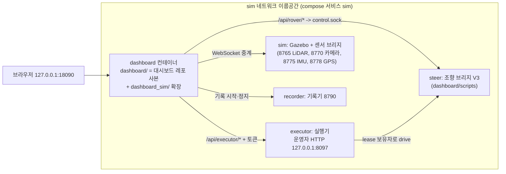
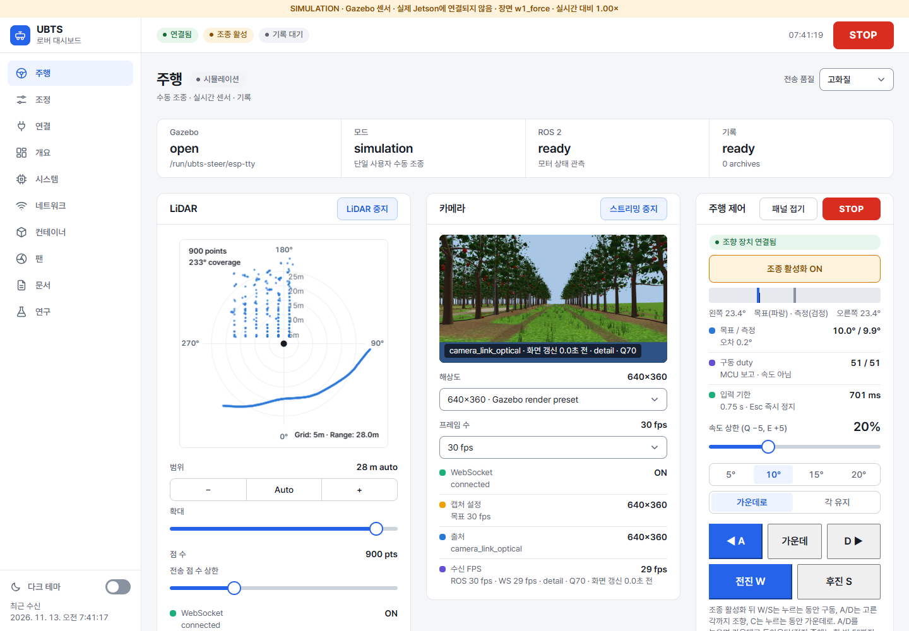

# SIM 대시보드: 대시보드 레포 사본과 시뮬레이션 확장 (D-13, UI-15 SIM 쪽, 아4)

- 작성: 2026-11-13 (묶음 S5, 브랜치 `sim-dashboard-20261113`, 시작 main `09cc932`).
- 무엇: 조향 스택의 대시보드(http://127.0.0.1:18090)를 대시보드 레포의 새 디자인으로 바꾼다. 그 화면에서 조향 차량의
  수동 조향 조종과 자율주행 한 번 눌러 시작·STOP 이 SIM 실행기와 동작하게 한다.
- 가져온 판: [unist_orachard_dashboard](https://github.com/2026-BTS-UNI-Car/unist_orachard_dashboard) 커밋
  `654f80b`(브랜치 `ui-20261112`). 파일별 해시는 `dashboard/DASHBOARD_SOURCE.json`. 처음에는 `f4b2ee8` 을 가져왔고(7.1 의
  세션 s1 은 그 판), 그 뒤 대시보드 정리(설치 묶음, 안 쓰는 모듈·그림 지움) 판으로 다시 동기했다. 마지막 판은 조정 쪽이 정한다.
- 근거: 대시보드 레포 `docs/STEERING_SERVER_KO.md`(조향 서버 사양, 확장 지점 2절, 실행기 중계 6절), 규약
  `AUTONOMY_API_CONTRACT_20261113.txt` v0 개정 1·2, todo D-13·UI-15·아4.
- 모든 SIM 수치는 자리값 기반 SIM 결과이고 현장 성능이 아니다.

## 1. 결정

| 물음 | 정한 것 | 까닭 |
| --- | --- | --- |
| 대시보드를 어떻게 가져오나 | submodule 이 아니라 **사본 + 동기 도구**. `tools/steer_sim/sync_dashboard.py --source <대시보드 레포> --commit <판>` 이 세 폴더를 git blob 그대로 쓰고 출처 매니페스트(커밋, 파일별 sha256·크기·blob id)를 남긴다. 같은 판으로 다시 돌리면 같은 파일과 같은 매니페스트(시각 없음) | 이미지 빌드(`COPY dashboard`)와 여러 작업 트리가 submodule 초기화에 기대지 않는다. 대시보드 레포 접근 권한 없이도 SIM 레포만으로 빌드·검토할 수 있다. 사본이어도 판이 매니페스트로 고정되고, 손으로 고치면 검사(`--check`, 이미지 빌드, 시험)가 실패한다. 대시보드 레포 파일(`654f80b` 663개) 중 이미지가 쓰는 것은 199개다 |
| 무엇을 가져오나 | `config/`, `dashboard_server/`, `static/` 세 폴더 전부(`654f80b`: 199 파일, 6,205,600 B). `scripts/` 는 가져오지 않는다 | 대시보드 서버는 세 폴더만으로 돈다(`scripts` 를 부르지 않음). `scripts/` 는 SIM 컨테이너(sim·steer·recorder)가 돌리는 센서 브리지·기록기와 조향 호스트 코드다(3절) |
| SIM 전용은 어디에 | `dashboard_sim/` (대시보드 폴더 밖). 대시보드의 확장 지점으로 꽂는다: `DASHBOARD_PROVIDER=ubts_sim_dashboard.provider:SimulationProvider`, `DASHBOARD_EXTENSION=ubts_sim_dashboard.extension`, `DASHBOARD_EXTRA_STATIC=/opt/ubts/dashboard_sim/static` | 대시보드 사본은 그대로 두고(같은 경로의 다른 내용 0) SIM 기능만 따로 바뀐다. 확장 지점은 `DASHBOARD_MODE=simulation` 에서만 읽히므로 실차 대시보드에 닿지 않는다 |
| 실행기 연결 | 대시보드 컨테이너를 sim 네트워크 이름공간에 넣는다(`network_mode: service:sim`, 18090 포트는 sim 서비스가 낸다). `UBTS_EXECUTOR_URL=http://127.0.0.1:8097`, `UBTS_EXECUTOR_TOKEN_FILE=/run/ubts-steer/exec/log/operator_token.txt`(control 볼륨) | 실행기 운영자 HTTP 는 와일드카드 바인드를 거부하고 Host 머리글을 바인드 주소와 맞춘다. 같은 이름공간이면 지금 바인드(127.0.0.1:8097)를 그대로 부르므로 실행기 코드(`core.py`, `config.py`, `exec_container_main.py`)를 고칠 것이 없다. 실차도 대시보드와 실행기가 같은 호스트 네트워크에 있다. 토큰은 대시보드 서버만 읽고 화면에 내보내지 않는다 |
| 차량 종류 | `DASHBOARD_VEHICLE=front_steer` | 조향 패널을 보이고 차동 패드를 숨긴다(옛 차동 경로는 대시보드 안에 남아 있고 조향 브리지가 거절한다) |

## 2. 구성

- 이미지(`docker/Dockerfile.ubts-steer`): `dashboard/` 와 `dashboard_sim/` 을 복사하고, 빌드 때 사본 파일 전부를
  `DASHBOARD_SOURCE.json` 과 견주고(다르면 빌드 실패), 확장 설정으로 대시보드와 확장 모듈을 불러 본다. 대시보드의 raster
  커널은 대시보드 레포에서 `dashboard_server/native_raster.cc` 로 옮겨졌다.
- 옛 이미지(`ubts-steer-sim:wf4c` 까지)는 자기 안의 옛 대시보드를 돌리고 새 환경 변수를 무시한다. 그래서 compose 를 바꿔도
  옛 이미지가 깨지지 않는다(옛 화면이 sim 이름공간에서 돈다). 새 화면은 새 이미지(묶음 S2 최종 이미지)부터이고, 그 전에는
  덮어쓰기(5절)로 본다.
- `p6a_checks --dashboard-url` 기본을 `http://127.0.0.1:8080` 으로 바꿨다(검사 컨테이너도 sim 이름공간이고, 대시보드에는 따로
  `dashboard` 호스트 이름이 없다).

## 3. 옛 사본 150 파일의 분류

옛 `dashboard/` 는 2026-09 배포판의 subtree 에 SIM 덧붙임을 얹은 사본이었다(`dashboard/UPSTREAM.md` 의 "Earlier copy").
대시보드 레포 `654f80b` 와 견준 결과(처음 판 `f4b2ee8` 에서는 같음 42, SIM 에만 50, 대시보드에만 139):

| 묶음 | 파일 수 | 처리 |
| --- | --- | --- |
| 사본 세 폴더, 바이트 같음 | 39 | 그대로(사본) |
| 사본 세 폴더, 대시보드 판과 다름 | 21 | **실제 것 사용**: 대시보드 판으로 바뀜. SIM 고유 내용이 있던 곳: `app.py`(SIM 경로 `/api/sim/*` -> 확장으로, 아래), `adaptive_video.py`(SIM 영상 시계 `clock-index.json` -> **대시보드에 반영 필요**, 4절) |
| 사본 세 폴더, SIM 에만 있음 | 53 | 빠짐(main `09cc932` 이력에 남음). 대시보드 레포가 지운 `lidar_odometry.py`, `test_live_mapping.py`, 로고 그림도 여기. `simulation.py` -> `dashboard_sim/ubts_sim_dashboard/provider.py`로 옮겨 고침(**확장 폴더로**). 옛 SIM 지도(`sim_mapping`, `raw_sim_mapping`, `sensor_mapping/` 15, `sim_map_history`, `sim-map.*`), native 지도 프록시(`native_mapping_*`, `sim_native_*`, `external_native_pc`, `native-probability/` 9), 옛 `app.js`·CSS 조각, 옛 `steer-control-rules.js`(대시보드 레포 `static/steer/` 판이 원본이 됨)와 그 node 시험 |
| 사본 세 폴더, 대시보드에만 있음(새로 들어옴) | 139 | 새 화면(`static/app/*`, `static/steer/*`, `static/css/*`), 확장 지점(`extensions.py`), 실행기 중계(`executor_proxy.py`), 조정(`steer_tuning.py`) 등 |
| `scripts/`, 바이트 같음 | 13 | 그대로. 조향 호스트 4개(`esp_motor_v3`, `steer_bridge_core`, `steer_control_core`, `steer_rover_bridge`)는 이 레포가 원본이고 대시보드 레포가 이식본(`STEERING_HOST_PORT_KO.md`) |
| `scripts/`, SIM 형태로 다름 | 11 | 그대로(SIM 컨테이너가 돌림). 센서 브리지(`camera_ws_bridge` SIM 카메라 건강·시계, `lidar_ws_bridge`·`gps_ws_bridge` SIM 진단 이벤트 끔), `data_recorder_service`(SIM 영상 시계 앵커), `ros_executor`, 기록 후처리 5개. 대시보드 레포 판은 그 뒤 바뀐 것도 있다(LiDAR `profile=mapping` 원본 스캔 등). **대시보드에 반영 또는 SIM 판 유지**는 사용자 결정(D-13 사용자 항목, SR-17) |
| `scripts/`, SIM 에만 있음 | 11 | 그대로: `sim_clock`, `sim_camera_health`, `sim_video_clock`, `native_stage_timing`, 조향 호스트 시험 7개 |
| 메타 파일 | 3 | `.gitattributes`(사라진 4 파일의 CRLF 규칙 지움), `UPSTREAM.md`(새 방식 설명을 앞에 더하고 옛 기록 보존), `DASHBOARD_SOURCE.json`(새) |

기록기(recorder 컨테이너)가 부르는 `dashboard_server` 모듈 4개(`imu_processing`, `gps`, `recording_clock`, `motor_pwm`)는
옛 사본과 새 사본이 바이트 같다. 그래서 새 이미지에서도 기록기의 동작은 바뀌지 않는다.

## 4. SIM 전용 기능: 스택이 실제로 쓰던 것과 지금

| 기능 | 옛 사본 | 조향 스택에서 쓰였나(2026-11-13 확인) | 지금 |
| --- | --- | --- | --- |
| SIM 상태 제공자(가상 센서 표시, 하드웨어 동작 막기) | `simulation.py` | 쓰임: `/runtime/simulation_status.json` 의 `sensors_alive`, 카메라 드라이버 상태 | `ubts_sim_dashboard.provider.SimulationProvider`(새 `TelemetryProvider` 위). 팬·네트워크·Docker·카메라 설정·IMU 영점은 `simulation_only`. 기록은 스택의 기록기(`http://sim:8790`, `http://127.0.0.1:8790`)만 |
| SIM 배너 | 페이지 바꾸기 | 쓰임 | 대시보드의 simulation 모드 + `sim-info.js`(장면·실시간 대비·멈춘 센서, `GET /api/sim/status`). GPS 원점·IMU 모형·참값은 내보내지 않는다 |
| 옛 SIM 지도 `/api/sim/map*`, 지도 이력 | `sim_mapping` 외 | **안 쓰임**: 조향 스택에 매핑 표본 파일이 없어 `scan_count 0`, `cell_count 0`, 이력 0 | 뺌. 새 화면의 실시간 지도는 대시보드 자체 지도(`/api/live/map`)다. SIM LiDAR 브리지가 `profile=mapping` 원본 스캔을 내지 않아 그 지도가 쌓이지 않을 수 있다(7절 결과) |
| native 지도 관찰자·외부 PC 지도 | `sim_native_*`, `external_native_pc` | 안 쓰임(옛 18089 경로, 설정 없음) | 뺌 |
| SIM 기록 재생의 영상 시계 | `adaptive_video.py` `clock-index` | SIM 기록을 대시보드에서 재생할 때만 | 새 사본에 없음: SIM 기록 중 영상 시계가 있는 것은 영상이 재생되지 않을 수 있다. 대시보드 레포에 반영할 일로 남김 |
| 옛 SIM 자율주행 `/api/sim/autonomy*` | `app.py` | 안 쓰임(차동 SIM 감독기) | 뺌. 조향 자율은 `/api/executor/*` |

## 5. 운영

- 새 대시보드 판 가져오기: 대시보드 레포에서 판을 정한 뒤
  `python -I tools/steer_sim/sync_dashboard.py --source <대시보드 레포 clone> --commit <커밋>` -> `git add -A dashboard` ->
  `python -I tools/steer_sim/sync_dashboard.py --check --source <clone>` -> 시험 두 개(아래) -> 이미지 빌드.
  `--dry-run` 은 더해질·바뀔·지워질 파일 수만 보인다.
- 검사: `python -I tools/steer_sim/sync_dashboard.py --check`(사본 파일과 매니페스트), `python -I tools/steer_sim/check_pins.py`
  (옛 시뮬레이터에서 가져온 파일의 핀 115개. 사본 세 폴더의 핀 111개는 이 변경에서 빼고 사본 검사로 넘김. 이름 규칙은
  사본 파일을 보지 않는다: 대시보드 패키지 안의 `_field10/row_executor/vendor/closed_loop` 같은 이름은 최상위가 아니다).
- 개발 중 덮어쓰기: 이미지를 다시 만들지 않고 새 사본을 보려면 대시보드 서비스에 compose override 로 사본 세 폴더와
  `dashboard_sim/` 을 읽기 전용으로 붙인다(`/opt/ubts/dashboard/{config,dashboard_server,static}`, `/opt/ubts/dashboard_sim`).
  레포 밖 로컬 도구 `sim_stack.py start --dashboard-overlay` 가 같은 일을 한다.
- 화면 사용(자리값 기반 SIM): 주행 화면 `/rover-control` 의 조향 패널에서 "조종 활성화" 뒤 W/S/A/D(버튼은 누르는 동안),
  자율 칸 "준비"(start + Arm) -> "자율 주행 시작"(go) -> 열 끝에서 스스로 선다. STOP(패널·상태 막대·Esc)은 브리지 stop 과
  실행기 stop 을 같이 보낸다. 탭을 숨기면 heartbeat 가 멈추고 실행기가 0.5 s 뒤 선다(`OPERATOR_LINK_LOST`), 다시 보이면
  "다시 출발"(자동 재출발 없음). 한 번에 한 화면만 운영자 연결을 쥔다(다른 세션은 409 `session_conflict`).

## 6. 시험

| 시험 | 무엇 | 결과(2026-11-13) |
| --- | --- | --- |
| `sim/ubts/test_steering_ui_routes.py` | 사본 대시보드 + SIM 확장 + 실제 조향 호스트 코드(가짜 V3 MCU) + 실제 실행기 운영자 페이지(`operator_http.py`, 각본 루프): 옛 차동 요청 거절(A14), 조향 요청 흐름, 상태 칸, 고장 목록, 확장(설정·페이지·`/api/sim/status` 에 GPS 원점 없음·텔레메트리), 실행기 중계(토큰·Host·Origin 규칙 통과, 토큰·GNSS 칸 숨김, 토큰 다시 읽기, one-press go·heartbeat·끊김, 실행기 없음) | Windows 3.13: 29 중 20 통과, 9 건너뜀(Linux 소켓 8, one-press 1). WSL 3.10: 28 통과, 1 건너뜀(one-press: 이 판의 운영자 페이지에 `/api/go` 가 아직 없음). S1 브랜치(`8d17f94`)의 `operator_http.py` 로 중계 시험 6/6 통과(one-press 포함). main `89af3be`(S1) 병합 뒤: Windows 21 통과 8 건너뜀(Linux 소켓), WSL 29 모두 통과 |
| `sim/ubts/test_steering_dashboard_sync.py` | 사본 = 매니페스트, 커밋된 blob id = 대시보드 레포 blob id, 동기 도구(작은 git 레포: 복사·지움·scripts 보존·다시 돌려도 같음·바뀐 바이트/남는 파일/손으로 고친 매니페스트 찾기), compose·Dockerfile·실행기 연결 일치 | 12 통과 |
| `tools/steer_sim/check_pins.py` | 핀 115, 이름 규칙 | OK |

## 7. 스택 확인 (자리값 기반 SIM 결과)

이미지를 다시 만들지 않고 개발용 덮어쓰기(5절)로 확인했다. 이미지 `ubts-steer-sim:wf4c`, 장면 `w1_force`, 시계 wall,
프로젝트 `ubts-steer-s5`(이 브랜치의 compose), 브라우저는 이 PC 의 Chrome(headless, 1440 × 1000).

### 7.1 세션 s1 (2026-11-13 07:37 ~ 07:42, 가짜 실행기)

한 번 눌러 시작 실행기(S1)가 아직 병합 전이라 실행기 자리에 규약 v0 개정 1·2 를 따르는 가짜 실행기를 두었다(sim 이름공간
127.0.0.1:8097, 실제 실행기와 같은 토큰 파일 위치, 같은 Host·Origin·토큰 규칙. 차는 움직이지 않는다). 브라우저 확인 27개 중 26개
통과.

| 확인 | 결과 |
| --- | --- |
| 새 화면 | `/rover-control` 이 front_steer·simulation 으로 열림. 차동 패드 숨김, 조향 패널 "조향 장치 연결됨" |
| SIM 확장 | `/api/dashboard/config`: provider `SimulationProvider`, extension `ubts_sim_dashboard.extension`, extra_static, executor_configured. 배너 "… · 장면 w1_force · 실시간 대비 1.00×" |
| 카메라 | 640 × 360 디코딩, 수신 29 fps(ROS 30 fps, WS 29 fps) |
| LiDAR | 900 점 표시(원본 1,580 점), 그림 화소 109,561, 갱신 확인 |
| IMU | 가속도 9.80 m/s², 각속도 갱신 확인 |
| 수동 조향 | 조종 활성화(Arm, `vehicle_profile: front_steer`) 통과. W 누름 4 s: 구동 duty 20 %(화면 속도 상한 기본 20 %), 에뮬레이터 차 속도 0.058 ~ 0.082 m/s. W+A 2 s: 등가 조향각(참값) +8.5°, 측정 172 mrad(왼쪽). A 놓음(W 누른 채): 2.5 s 뒤 0.69°(가운데 복귀). W 놓음: 3 s 뒤 −0.02 m/s(정지). 상태 막대 STOP: `/api/rover/stop`, 브리지 disarmed |
| **불합격 1** | "W 누름에 차 속도 > 0.1 m/s" — 확인 기준을 측정 전에 0.1 m/s 로 잡았는데 화면 기본 속도 상한 20 % 에서 0.058 ~ 0.082 m/s 였다. 차는 움직였다. 기준이 화면 기본값을 생각하지 않은 것이다(이 판정은 고치지 않고 남긴다) |
| 자율 화면(가짜 실행기) | "준비" -> start + Arm -> "자율 주행 시작" -> go_ready(armed 부터 heartbeat) -> "주행 중". heartbeat 24 회, 간격 최대 0.105 s. 탭 숨김 1.5 s 뒤 실행기 paused, `OPERATOR_LINK_LOST`, 숨긴 뒤 heartbeat 0 회. 다시 보임: "다시 출발", paused 유지(자동 재출발 없음). Esc: latched. 래치 확인 -> run 끝내기: ended |
| 페이지·콘솔 오류 | 0 |
| 내리기 | 컨테이너 0, 네트워크 0 남음. 사용자 스택(ubts-steer, wf4c, 옛 화면)을 다시 올림 |

그림: 세션 s1 수동 조향 중(W+A, 목표 10.0° / 측정 9.9°, 구동 duty 51/51). 자리값 기반 SIM 결과이며 현장 성능이 아니다.

### 7.2 세션 s2 (2026-11-13 08:18 ~ 08:28, 실제 실행기)

main `89af3be`(S1 한 번 눌러 시작)를 병합한 이 브랜치(`2ac8340`, 대시보드 사본 `654f80b`)의 `tools/row_executor` 와
`sim/ubts` 를 실행기 컨테이너에 읽기 전용으로 붙였다(이미지의 실행기는 그 전 판이다). 실행기: one_press, MOTOR, 제어기
row_follow(compose 기본), operator_timeout 0.5 s.

| 확인 | 결과 |
| --- | --- |
| 화면·센서 | s1 과 같음(카메라 640 × 360 28 fps, LiDAR 900 점, IMU). "LiDAR 글이 2.5 s 사이에 바뀜" 확인은 불합격(점 수 글이 900/1582 로 같았다: 글만 본 확인 방식 탓. 그림 화소 109,561) |
| 준비 -> 출발 | "준비" 한 번에 start(실행기 기록 t 59888.99) 와 Arm(53 ms 뒤), armed 에서 heartbeat 로 go_ready, "자율 주행 시작" 한 번에 go. 실행기가 차를 몰았다: 1 s 마다 에뮬레이터 속도 0.10, 0.18, 0.19, 0.27, 0.31 m/s, 화면 횡 오차 −0.01 m, 방향 −0.3°, 진행 1.1 m, 화면 연결 0.06 s |
| heartbeat | 74 회, 간격 최대 0.288 s(규약 개정 1: 늦어도 0.25 s 를 한 번 넘었다. 실행기 끊김 기한 0.5 s 안) |
| 탭 숨김 | 실행기 기록 `operator_link_lost`(timeout 0.5 s), run_state paused, `OPERATOR_LINK_LOST`. 차 속도 0.31 -> 1.5 s 뒤 −0.007, 4 s 뒤 −0.010 m/s(섬). 숨긴 뒤 heartbeat 0 회 |
| 다시 보임 | "다시 출발", paused 유지(자동 재출발 없음) |
| Esc STOP | 실행기 `emergency_stop`(operator_page) -> 브리지 STOP 확인 54 ms, run latched. **실행기 쪽 발견**: run 끝 이유가 `bridge_error`(`drive_refused:stop_barrier`), 상태 `stop_reason` SYSTEM_FAULT 로 남았다(운영자 STOP 인데 OPERATOR_OR_BACKSTOP 이 아님). 대시보드 STOP 이 브리지 stop 과 실행기 stop 을 같이 보내고, 일시정지 중 실행기 루프의 다음 drive 가 브리지 STOP 장벽에 걸린 것으로 보인다 |
| 래치 확인 | ack -> run 이 이미 끝나 있어 "run 끝내기"가 꺼짐(가짜 실행기와 다름. 확인 스크립트가 꺼진 단추를 누르려다 멈춤: 스크립트 탓) |
| 열 끝까지(두 번째 브라우저) | 차를 출발점에 되돌린 뒤 "준비"를 눌렀는데 이번에는 start 만 가고 Arm 이 가지 않아 "준비됨 · Arm 전" 으로 남았다(**화면 쪽 발견**: `auto-panel.mjs` 는 start 응답 뒤 한 번 읽은 상태가 ready 일 때만 Arm 한다. 실행기 상태가 늦게 바뀌면 Arm 을 한 번 더 눌러야 한다). 스크립트가 go 대신 Arm 을 눌러 run 이 armed 로 221 s 머물다가, 실행기 루프 멈춤 0.48 s(`watchdog_stall`) 뒤 브리지가 lease 를 거두어 `steering_feedback_stale` 로 끝났다. 열 끝 확인은 못 함(7.3 에서 다시) |
| `sim_auto.py start`(창, 중계 경로) | 앞 run 이 latched 라 시작을 거절(도구가 래치 확인을 하지 않았다 -> 고침: latched 면 ack, start 뒤 상태가 ready 가 될 때까지 3 s 기다림) |
| 내리기 | 컨테이너 0, 네트워크 0. 사용자 스택 다시 올림 |

그 밖에 실행기 기록에 `watchdog_stall`(루프 간격 0.36 ~ 0.48 s)이 여러 번 있었다(Gazebo, 대시보드, Chrome 이 같이 돈 때).

### 7.3 세션 s3 (2026-11-13 08:50 ~ 08:58, 실제 실행기, 열 끝까지 다시)

시작 전 호스트 부하 기록(`host_load_check`, 기준을 넘음): Windows CPU 31 ~ 40 %, WSL 1분 부하 2.21, 가용 메모리 3,331 MB.
다른 작업자의 잠금 없는 일이 같이 돌고 있었다. 측정 판정이 아니라 기능 확인이다.

| 확인 | 결과 |
| --- | --- |
| 화면에서 열 끝까지 | "준비" 한 번에 start + Arm, "자율 주행 시작" 한 번에 출발. 실행기 추정으로 2.6 s 마다 거리 0.18, 0.63, 1.31, 2.08, 2.83, 3.69, 4.50, 5.36 m, 속도 0.18 -> 0.35 m/s. 6.57 m 에서 `OPERATOR_LINK_LOST` 로 일시정지(탭은 보이는 채). 이때 확인 스크립트 자신의 2 s 표본 고리도 12.8 s 멈췄다: 호스트가 바빠 화면의 heartbeat 가 0.5 s 넘게 늦은 것으로 본다(실행기는 설계대로 섰다). 화면에는 "연결 신호 거절: 실행기가 거절했다" 와 HTTP 409 8 건(어느 요청인지는 이 세션에서 기록하지 않았다). **열 끝 정지는 확인하지 못함** |
| 실시간 지도(정보) | "그리기 시작": `waiting_for_sensors`, `waiting_for_original_LaserScan_bridge`, 스캔 0. SIM LiDAR 브리지가 원본 스캔(`profile=mapping`)을 내지 않아 대시보드 자체 지도는 SIM 에서 쌓이지 않는다(4절 예상과 같음) |
| `sim_auto.py start`(창, 중계 경로, 고친 판) | 앞 run 의 래치를 ack -> start -> Arm -> heartbeat -> go(처음 두 번 `inputs_not_fresh` 로 409, 0.6 s 뒤 셋째 통과) -> 1 s 마다 상태 줄. 8.1 m 를 횡 오차 −3 ~ +1 cm, 방향 −0.9 ~ +0.6° 로 따라가다 28 s 에 브리지가 lease 를 거둠(`drive_refused:control_not_owned`) -> run 끝 `steering_feedback_stale`(CONTROL_AUTHORITY). 실행기 끝 계수: 빠뜨린 틱 430, watchdog 6 회, 스캔 버림 58, 루프 간격 최대 1.17 s. **열 끝 정지는 확인하지 못함** |
| 내리기 | 컨테이너 0, 네트워크 0. 사용자 스택 다시 올림 |

### 7.4 세션 s4 (2026-11-13 09:00 ~ 09:06, 실제 실행기, 열 끝까지 한 번 더)

확인 스크립트가 HTTP 4xx 응답과 화면 쪽 heartbeat 간격을 기록하게 고친 뒤 다시 했다(호스트 부하는 그대로 높았다: 직전 표본
CPU 59 ~ 67 %, WSL 1분 부하 3.6, 가용 메모리 1,970 MB).

| 확인 | 결과 |
| --- | --- |
| 준비 | "준비" 에 start 만 가고 Arm 은 7.7 s 뒤 두 번째 누름에 갔다(7.2 의 화면 쪽 경합이 다시 나옴) |
| 화면에서 열 끝까지 | 출발 뒤 2 s 마다 거리 0.18 ~ 4.75 m, 속도 0.14 -> 0.36 m/s, 횡 오차 −1.6 ~ +1.0 cm. 5.47 m(21.8 s)에서 브리지가 lease 를 거둠(`drive_refused:control_not_owned`) -> `steering_feedback_stale`, CONTROL_AUTHORITY. 화면 쪽 heartbeat 199 회, 간격 p99 0.212 s, 최대 2.087 s(0.5 s 넘은 것 2 번: 브라우저 타이머 자체가 멈췄다). HTTP 409 1 건은 run 이 끝난 1.7 s 뒤의 heartbeat 였다(s3 의 409 8 건은 기록하지 않아 같은 종류인지 모른다) |
| `sim_auto.py start` | 래치 ack -> 출발 -> 2.1 s 에 `OPERATOR_LINK_LOST`(창의 heartbeat 가 0.5 s 넘게 늦음). 그래서 `sim_auto.py` 의 heartbeat 를 앞 응답을 기다리지 않고 100 ms 마다 보내도록 고쳤다(동시에 4 개까지. 느린 가짜 중계로 30 회, 간격 최대 0.110 s 확인). 고친 판으로 스택에서 다시 돌리지는 못했다 |
| 내리기 | 컨테이너 0, 네트워크 0. 사용자 스택 다시 올림 |

정리: 대시보드 경로(중계, 한 번 눌러 시작, heartbeat, 끊김 정지, STOP)는 실제 실행기와 동작한다. 열 끝까지 가는 run 은 이번
호스트 부하에서 네 번(s3·s4 의 화면과 창) 모두 시간 규칙(화면 연결 0.5 s, 브리지 입력 기한)으로 0.1 ~ 8.1 m 에서 섰다(5.47, 6.57, 8.1, 0.1 m). 2026-11-12 같은 스택(이미지 안
실행기, 누르는 동안만 방식)으로는 33.2 m 를 95 s 에 가서 열 끝에서 섰다(`tools/local_env/README_KO.md`). 조용한 호스트에서
최종 이미지로 다시 확인해야 한다(G-SIM 의 '빠뜨린 틱' 열린 항목과 같은 원인일 수 있다).

## 8. 남은 것

- 새 이미지: 묶음 S2 최종 이미지에 이 변경(Dockerfile, `dashboard_sim/`)이 들어가야 18090 이 기본으로 새 화면이 된다.
  compose 기본 이미지 태그는 S2 가 바꾼다.
- `scripts/` 의 SIM 형태 11개를 대시보드 레포 판과 맞출지(SR-17, D-13 사용자 항목). 맞추면 SIM 의 카메라 건강·영상 시계
  덧붙임을 대시보드 레포에 넣어야 한다.
- SIM 기록 재생의 영상 시계(`clock-index`)를 대시보드 레포에 넣기.
- 대시보드 레포가 main 에 병합되면(S6) 그 커밋으로 다시 동기한다.
- 스택에서 찾은 묶음 사이 어긋남(대시보드·실행기 쪽 일, 이 브랜치에서 고치지 않음):
  - 조정 값: 대시보드 `steer_tuning.py` 의 기본 묶음 이름(`speed_table_scale`, `lookahead_m`, `lateral_gain`,
    `heading_gain`, `steer_rate_limit_deg_s`; 같은 것은 `target_speed_m_s` 하나)과 실행기 `field_tuning.default.json`
    의 기본 묶음(`k_d`, `k_psi`, `lookahead_base_m`, `lookahead_max_m`, `lookahead_per_speed_s`, `speed_scale`,
    `steer_rate_fraction`, `target_speed_m_s`)이 다르다. 실행기 상태 `tuning.values` 는 묶음별 사전(`{basic: {...},
    advanced: {...}, locked: {...}}`)인데 대시보드 중계는 `{이름: 값}` 을 기대해 화면에 `basic: null` 처럼 보인다(세션 s2 의
    `/api/executor/status`). 조정 화면은 실제 실행기와 아직 맞지 않는다.
  - 운영자 STOP 의 정지 이유: 일시정지 중 화면 STOP 이 `bridge_error` / SYSTEM_FAULT 로 남는다(7.2).
  - 화면의 "준비": start 뒤 상태가 바로 ready 가 아니면 Arm 을 한 번 더 눌러야 한다(7.2).
  - armed 로 오래 기다리면 실행기 루프 멈춤 뒤 lease 를 잃는다(7.2).
  - `steering.exec_checks` 는 아직 누르는 동안만 방식으로 실행기를 부른다(S1 메모). 실행기는 이제 one_press 다.

## 사본에서 뺀 것 (2026-11-13)

`dashboard_server/_field10/`(차동 차량 시기의 현장 SHADOW 묶음, 대시보드 작업 D-14)은 SIM 사본에 넣지 않는다. 조향 스택은 이 묶음을 부르는 옛 차동 관찰(`field10_shadow`)을 시작하지 않는다. 묶음은 해시로 고정돼 있어 고칠 수 없고, 기록 자료 경로와 이 레포가 싣지 않는 이름이 들어 있다. 뺀 목록과 까닭은 `tools/steer_sim/sync_dashboard.py` 의 `EXCLUDED` 와 `dashboard/DASHBOARD_SOURCE.json` 의 `excluded` 에 남는다. SIM 에서 옛 차동 관찰을 시작하면 import 오류가 난다(쓰지 않는 경로).

## 9. 사본 feb4600 (2026-11-16)

- `sync_dashboard.py --source <대시보드 레포> --commit feb4600`: 135 파일(추가 2: `dashboard_server/wifi_manager.py`,
  `static/network/wifi-manager.mjs`, 바뀜 9). 대시보드 main 은 그 뒤 6fc1541 로 갔지만 README 와 그림만 바뀌어 사본은 feb4600 이다.
- 들어온 것: ESP32-S3 'ABS-HOLD' 브리지용 조향(상태 `steer_control.keys == 'full_limit'`인 절대 목표 브리지에서 A/D 는 끝까지, 놓으면
  0), 끌어서 조향 각 막대(끄는 동안 그 각, 놓으면 0°, 키와 막대는 먼저 잡은 쪽만), Network 쪽 Wi-Fi 관리(검색, 비밀번호 연결,
  자동 연결·우선순위, 시험 연결 뒤 자동 되돌림), 브리지가 `vehicle_profile: front_steer`를 내면 조향 패널을 쓰는 규칙.
- SIM 에서: 조향 브리지는 V3(램프 브리지)라 `full_limit`이 없다. 막대는 A/D 와 같은 램프를 따르고, 서 있을 때는 정지 계단 규칙(한 번
  누름·끌기에 5°까지, 놓아도 한 계단만 0 쪽으로)이 그대로다. ESP32 전용 칸(펌웨어 고장 이름, `esp_kind`)은 SIM 상태에 그 값이 없어
  나오지 않고, 제어기 이름은 "Gazebo"로 보인다.
- Wi-Fi 관리: SIM 제공자(`dashboard_sim/ubts_sim_dashboard/provider.py`)가 `network_control_enabled`를 늘 False 로 두고
  `_network_mode_command`를 늘 `disabled`로 답한다. 그래서 환경 변수와 상관없이 Wi-Fi 관리자는 호스트 도우미를 부르지 않는다
  (`GET /api/network/wifi` → `enabled false, state disabled`, POST → 503 `disabled`, 시험 `test_wifi_manager_is_disabled_in_the_simulation`).
- 이미지 `ubts-steer-sim:wf12`(측정 치수 차, 결정 R91)로 사용자 스택(127.0.0.1:18090)에서 Chrome(playwright)으로 확인(2026-11-16
  02:51~02:55, 판정 아님, 자리값 기반 SIM 결과):

| 확인 | 결과 |
|---|---|
| 메뉴 | 8개 그대로(Overview, Connection, System, Network, Docker, Fan Control, Rover Control, Docs) |
| 카메라 | Gazebo 카메라 640×360, 수신 27 fps |
| 조향 패널 | 좌우 한계 16.1°(측정 치수 프로필의 소프트 한계, v0.1 은 23.4°), 각 고르기 20°는 한계 밖이라 꺼짐, 끌기 막대 보임 |
| 서 있을 때 끌기 | 조종 활성화 뒤 막대를 왼쪽 9.5°로 끌자 목표 4.4° → 9.4°(정지 계단 5°), 측정 9.6°. 놓자 목표 4.4°(한 계단만 돌아옴) |
| 주행 중 끌기 | C 로 가운데(−0.5°) 뒤 W(속도 상한 20 %, duty 51)를 누른 채 왼쪽 6.5°로 끌자 2 s 안에 측정 7.0°. 놓자 목표 0.0°, 2 s 안에 측정 0.0° |
| STOP | Esc 로 STOP, 조종 해제 |
| Network | Wi-Fi 관리 칸이 "이 대시보드에서는 네트워크 제어가 꺼져 있습니다", 검색 버튼 비활성, API `disabled` |
| 화면 오류 | 브라우저 콘솔 오류·경고 0 |

- 첫 시도는 확인 대본 자체의 출력 인코딩 오류로 끌던 도중 끝났다(차는 SIM, 조종권은 브라우저가 닫혀 만료). 그 조종권이 남아 있던
  동안 두 번째 시도의 조종 활성화가 `control_in_use`로 거절됐고(설계대로), Esc 뒤 세 번째 시도부터 위 결과가 나왔다.
