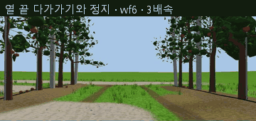
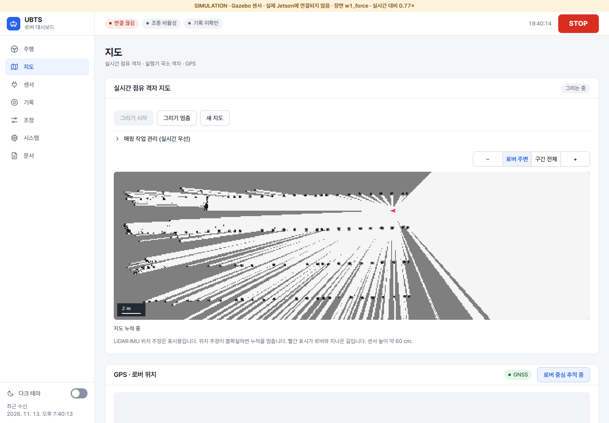

# 최종 이미지 G-SIM 확인 결과 (steer_follow_gsim_final_v1)

- 사전등록: `PREREG_STEER_FOLLOW_GSIM_FINAL_KO.md` / `.json`(측정 전 커밋 `c139fda`). 개정 1 `8dedccf`(첫 세션들 뒤, 다시 돌리기 전),
  개정 2 `d1e0eee`(E 의 W1 기록을 다시 판정하기 전).
- 이미지: `ubts-steer-sim:wf5`(id `0a2c00c6202b`), 깨끗한 작업 트리 `982a99f`에서 빌드. 매니페스트 663 파일이 커밋 blob 과 모두 같다.
  펌웨어 빌드 `04353B49`. 대시보드 사본은 대시보드 저장소 `ui-20261112`의 `90094fd`(빌드 때의 끝). 그 뒤의 끝 `a92cfec`(조용한 PC
  측정 반영, mimetypes 수정 `a1331b6`)는 wf5 에 들어 있지 않다.
- 기계가 읽는 결과: `STEER_FOLLOW_GSIM_FINAL.json`(run·항목별 값, 판정, 유효성, 기록 파일의 SHA-256). 3단계는 그 안의 `stage3`,
  4단계는 `stage4`, 5단계는 `stage5`, 6단계는 `stage6`, 7단계는 `stage7`, 하지 않은 8단계의 확인 기록은 `stage8`, 8b단계는 `stage8b`.
- **3단계(이미지 wf6, SIM 시계, 등록 `steer_follow_gsim_final3_v1`)는 12절, 4단계(이미지 wf7, SIM 시계, 등록
  `steer_follow_gsim_final4_v1`)는 13절, 5단계(이미지 wf8, SIM 시계, 등록 `steer_follow_gsim_final5_v1`)는 14절, 6단계(이미지
  wf9, SIM 시계, 등록 `steer_follow_gsim_final6_v1`)는 15절, 7단계(이미지 wf10, SIM 시계, 등록 `steer_follow_gsim_final7_v1`)는
  16절이다.** 1~11절은 2단계(wf5) 기록 그대로 둔다. 8단계(전원 구성 '최고 성능'으로 7단계 등록을 다시 재기)는 이 PC 에 그 구성이
  없어 **하지 않았다**(18절). 8b단계(측정 동안 WSL VM 을 P 코어 쪽으로, 이미지 wf11, 7단계 등록 그대로)는 19절이다: A·B·F 모두 합격했지만
  호스트가 7단계보다 한가했다.
- 실차 시계 모드(`wall`), 세션마다 새 스택, healthy 뒤 120 s 기다림. 모든 수치는 **자리값 기반 SIM 결과**다. 실차 성능이 아니다.

## 1. 상태

| 부분 | 무엇 | 판정 | 요약 |
|---|---|---|---|
| A | 한 번 눌러 시작으로 열 끝까지(W1, 4 run) | **불합격** | 4 run 모두 유효. 통과 3, 실패 1(`nominal_1`이 18.9 m 에서 `speed_cap_below_min`으로 끝남) |
| B | SIM 대시보드 화면(Chrome) | **판정 못 함** | 두 시도 모두 등록 RTF 규칙으로 무효(5 s 창 최소 0.863, 0.89974). 항목별 관찰은 4절 |
| C | A17(G) 실행기 대본(one_press) | **판정 못 함** | W0 에 통로가 없어 25 대본 모두 go 거절(`corridor_not_acquired`). 등록 오류(개정 1) |
| D | A25(에뮬레이터 경로, 개정 43 브리지) | **합격** | 관절 − 모델 p99 5.7e-11°, 관절 속도 튐 0.449 rad/s(한도 0.785), 조향 7.47° 움직임, drive 거절 0 |
| E | PW-08 Gazebo 쪽(W1, 개정 1) | 기록대로 **불합격**, 개정 2 로 **합격** | 실행기 표 속도 비 1.1000. 실패 1 항목은 평가가 상태를 너무 일찍 읽은 결함 |

전체로는 최종 이미지 확인이 **통과가 아니다**. 열 추종은 4 run 중 3 run 이 열 끝까지 갔고, 1 run 이 실행기 쪽 LiDAR 신선도 상한
때문에 중간에 끝났다. 화면 확인(B)은 호스트 RTF 때문에 판정하지 못했다.

호스트: 세션 전 부하 확인에서 앞 여섯 세션은 '가용 메모리'(기준 6000 MB) 하나만 못 미쳐 300 s 기다린 뒤 시작했다. 나머지 두 세션(E W1,
B 시도 2)은 '조용함'이었다. 멈춤 탐침은 켜지 않았다.

## 2. A: 열 추종 4 run

검사 `steering.exec_checks follow`(Start, Arm, 하트비트 100 ms, go 한 번). 장면 `w1_force`, 제어기 `row_follow` 기본값. 값은 참값(평가 쪽).
한도는 `steer_follow_gsim_v1` 그대로(횡 RMSE 0.20 m, p95 0.35 m, 최대 0.50 m, 방향 RMSE 5°, 최대 15°, 참 속도 최대 0.50 m/s, e ±1.0 m,
최소 여유 > 0, 끝 속도 ≤ 0.02 m/s). `lateral_p040`의 RMSE·p95 는 6.0 m 뒤부터.

| run | RTF 최소 | 끝난 이유 | 횡 RMSE [m] | 횡 p95 [m] | 횡 최대 [m] | 방향 RMSE [°] | 방향 최대 [°] | 속도 평균·최대 [m/s] | e [m] | 최소 여유 [m] | 거리 [m] | 판정 |
|---|---|---|---|---|---|---|---|---|---|---|---|---|
| `nominal_1` | 0.965 | `speed_cap_below_min` | 0.015 | 0.033 | 0.036 | 0.46 | 1.48 | 0.35 · 0.43 | −14.14 | 1.43 | 18.9 | 실패(열 끝, e) |
| `nominal_2` | 0.984 | `row_end` | 0.026 | 0.050 | 0.060 | 0.64 | 1.78 | 0.32 · 0.44 | +0.461 | 1.42 | 33.5 | 통과 |
| `nominal_3` | 0.960 | `row_end` | 0.022 | 0.050 | 0.054 | 0.53 | 1.58 | 0.34 · 0.45 | +0.429 | 1.41 | 33.5 | 통과 |
| `lateral_p040` | 0.982 | `row_end` | 0.030 | 0.058 | 0.402 | 0.93 | 10.96 | 0.32 · 0.44 | +0.458 | 1.42 | 32.9 | 통과 |

네 run 모두 접촉 없음, guard 위반 종결 없음, 끝난 뒤 3 s 명령 조향 이동 없음, 끝 속도 0.000~0.0001 m/s.

`nominal_1`이 끝난 과정(실행기 기록):

1. 18.2 m 무렵부터 실행기가 받는 스캔 나이(`lidar_age`)가 0.30~0.47 s 로 올랐다. 같은 구간 실행기 루프 한 바퀴가 최대 133 ms 걸렸다.
2. 속도 조절기가 신선도 상한(`fresh`)으로 목표 속도를 0.20 m/s 로 묶었고, 최저 속도 아래가 되자 정지(`speed_cap_below_min`)를 요청했다.
3. 정지가 끝나기 전에 스캔 신선도 일시정지 요청이 겹쳐, 실행기 규칙(끝내는 결정이 걸려 있으면 일시정지가 아니라 끝, 설계 S1/F1)으로
   run 이 끝났다(`end_note terminal_stop_pending_at_stale_lidar`). 설계상 `speed_cap_below_min` 단독은 일시정지(새 go 로 계속)다.

실행기 루프의 최대 133~151 ms 는 네 run 모두에 있었다(p99 41~88 ms). 그 순간이 열 안에서 신선도 상한과 겹친 run 만 끝났다. RTF 는
0.965 로 유효 범위다. 원인(호스트의 다른 일, WSL 스케줄링)은 가르지 않았다.

## 3. 그림과 영상 (A, `nominal_3`)

[영상: 최종 이미지 wf5 로 열 끝까지, 10배속, 0.49 MB](../assets/video/row_follow_wf5_camera_10x.mp4)

[SIM · 자리값] 차량 카메라(640×360 Gazebo 렌더)를 480 폭 저화질 H.264 로 줄인 것. 약 104 s 를 10배속.


[SIM · 자리값] 마지막 약 29 s 를 3배속(360 폭). 마지막 줄기를 지나 열 끝에서 섰다(e +0.429 m).

## 4. B: SIM 대시보드 화면

스택 다섯 서비스(sim, steer, recorder, dashboard, executor), 장면 w1_force. 화면은 운영자처럼 Chrome 으로 눌렀다(저장소 밖 대본).

| 항목 | 시도 1 (`s2b_ui`) | 시도 2 (`s2b_ui2`) |
|---|---|---|
| 유효성(검사 노드 5 s 창 RTF 최소) | 0.863 → 무효 | 0.89974 → 무효 |
| 준비(준비 → 자율 주행 시작) | 통과(두 번 누를 일 없음) | 통과 |
| 한 번 눌러 주행 | 통과(에뮬레이터 속도 0.12~0.30 m/s) | 통과(0.09~0.22 m/s) |
| 하트비트(마지막 20 간격 최대 < 0.35 s) | 0.296 s 통과 | 0.350 s 실패 |
| 탭 숨김 → OPERATOR_LINK_LOST, 4 s 에 정지, 다시 보이면 '다시 출발' | 통과 | 통과 |
| 주행 중 화면 STOP | 새 run 이 출발 못 함(go 거절 `vehicle_moving`). STOP 자체는 `operator_stop`으로 받음 | 같음 |
| 실시간 지도 `scan_count > 0` | 대본이 지도 단계에서 멈춤(지도는 `/map` 화면) | 0. 지도 상태 `waiting_for_geometry`, 이유 `orientation_unavailable` |

두 시도 모두 무효라 B 는 **판정 못 함**이다. 판정과 별개로 본 것:

- **STOP 단계의 새 run 이 출발하지 못한 이유**: 앞 run 을 STOP 한 뒤 차가 W1 바닥에서 뒤로 0.02~0.07 m/s 로 밀렸다(구동 0, 실행기 틱과
  에뮬레이터 참값 모두). 실행기의 출발 검사(정지 속도 0.03 m/s)가 `vehicle_moving`으로 go 를 거절했다. 화면의 시작 단추는 상태가 잠깐
  `go_ready`일 때 켜져 있었다. 처음 출발(스택을 올린 자리)에서는 이 일이 없었다.
- **실시간 지도**: SIM LiDAR 브리지는 이제 `profile=mapping`에 원본 스캔을 보낸다(`af7a1c3`). 그러나 대시보드 지도는 IMU 자세를 먼저
  요구하는데, SIM IMU 는 자세를 '없음'으로 보낸다(`live_mapping.attitude`가 `imu_orientation_unavailable`로 거절). 그래서 스캔이 지도에
  쌓이지 않았다. LiDAR 쪽 고침이 지도까지 이어지는지는 이 때문에 확인하지 못했다.
- 대시보드 `90094fd`는 주행 화면 카메라 보기에서 LiDAR 소켓을, `/sensors` 밖에서 IMU 소켓을 열지 않는다(설계). 참고 단계(시도 2)에서
  주행 화면 LiDAR 보기(720/1543 점, 그림 그려짐)와 `/sensors`의 IMU 칸 갱신을 확인했다.


[SIM · 자리값] 시도 2 의 주행 화면 LiDAR 보기. 앞쪽 두 나무 열이 점으로 보인다.


[SIM · 자리값] 같은 세션, 자율 칸에서 한 번 누른 뒤 '주행 중'.

## 5. C: A17(G) 실행기 대본 — 판정 못 함

등록은 장면 w0_force 였다. 한 번 눌러 시작 실행기는 row 종류 run 의 go 를 통로를 잡기 전에는 거절한다(`executor_main._go_blockers`).
Gazebo W0 는 나무 열이 없는 평지라 25 대본이 모두 go 에서 끝났다(검사 노드 RTF 최소 0.980, 유효한 세션). 대본의 안전 동작은 하나도
재지 못했다. W1 에서 돌리려면 대본마다 출발점으로 되돌리는 검사 코드가 필요하고, 대본이 3~5° 로 수십 초 조향해 나무 열 쪽으로 가므로
이번에는 돌리지 않았다(개정 1). Gazebo 쪽 A17(G) one_press 는 남은 일이다. 빠른 SIM T1 의 71/71 은 그대로다.

## 6. D: A25

| 기준 | 값 | 한도 | 판정 |
|---|---|---|---|
| 관절 − 공유 모델(가장 좋은 지연 0 단계) p99 | 5.7e-11° | ≤ 0.2° | 통과 |
| 관절 속도 튐 | 0.449 rad/s | ≤ 0.785 | 통과 |
| 조향이 움직임 | 7.47° | ≥ 4.30° | 통과 |
| drive 거절 | 없음 | 없음 | 통과 |

유효성: RTF 1.009, 에뮬레이터 `/clock` 벽시계 틈 100 ms 넘는 것 없음(검사 노드 5 s 창 최소 0.99987).

## 7. E: PW-08 Gazebo 쪽

W0 시도(`s2cde_w0`)는 첫 주행의 go 가 거절돼(`lease_lost`, `arm_first`, `corridor_not_acquired`) 판정 못 함. 개정 1 대로 W1 에서 새 스택으로
돌았다(`s2e_w1`, 두 주행 모두 유효, RTF 1.001·1.005).

| 기준 | 값 | 판정 |
|---|---|---|
| `POST /api/params {"speed_scale": 1.10}` 정지 중 | 200 | 통과 |
| 상태의 값 | 1.10 | 통과 |
| revision 0 → 1, 새 digest | 예 | 통과 |
| 다음 run 의 start 사건 digest = 새 digest | 예(`4051e4bb…`) | 통과 |
| 50 % 실행기 표 속도 비(0.4526 → 0.4979 m/s) | 1.1000 | 통과 |
| 끝에 기본 프리셋으로 되돌림(기록대로) | 상태 `default*`, 처음 digest 아님 | 실패 |
| 같은 항목, 개정 2(실행기 끝 상태) | preset `default`, 처음 digest `5dfb070e…` | 통과 |
| (보고) Gazebo 플랜트 정상 속도 비 | 0.35679 → 0.40492 m/s, 1.1349 | 판정 안 함 |

- 되돌림 실패는 평가가 `POST` 바로 뒤에 바뀌기 전 상태를 읽은 결함이다. 실행기의 `tuning_change`(load_preset) 사건과 끝 상태는 기본
  프리셋과 처음 digest 를 보였다. `exec_checks`는 이제 최대 3 s 기다린다(wf5 안의 검사는 옛 코드).
- 플랜트 비 1.1349 는 조정 파일 때문이 아니다. 두 주행 모두 실행기가 duty 50 % 를 보냈고(틱의 L/R), 실행기 추정 속도 중앙값도
  0.373 / 0.377 m/s 로 거의 같다. 두 번째 주행은 첫 주행이 선 곳(열 안쪽)에서 시작해 바닥 조건이 다르다. Gazebo 구동은 프로필의
  물리 모형이며 조정 파일을 읽지 않는다.

## 8. 사용자 스택(wf5)과 창에서 자율주행

측정을 끝낸 뒤 사용자 스택(`ubts-steer`, 다섯 서비스)을 wf5 로 다시 올렸다(`sim_stack.py`의 기본 이미지를 wf5 로 바꿈). 150 s 뒤
`sim_auto.py start`(한 번 눌러 시작, 대시보드 실행기 중계)를 세 번 돌렸다. **열 끝까지 간 회차는 없다.**

| 회차 | 끝 | 거리 | 이유 |
|---|---|---|---|
| 1 | latched `CONTROL_AUTHORITY` | 0.9 m | `steering_feedback_stale`: 실행기 루프 148 ms 멈춘 뒤 조향 상태 나이 0.302 s(한도 0.3 s) |
| 2 | paused `OPERATOR_LINK_LOST` | 0.0 m | go 뒤 0.86 s 에 운영자 연결 끊김(창 → 대시보드 중계 → 실행기 하트비트 틈 0.5 s 넘음) |
| 3 | paused `OPERATOR_LINK_LOST` | 11.4 m | 같은 이유, 37 s |

정지 상태에서 잰 대시보드 중계 `GET /api/executor/status` 지연(20 s, 155회): p50 18 ms, p95 124 ms, p99 276 ms, 최대 356 ms. 하트비트도
같은 중계를 지나므로 한 번 0.5 s 를 넘으면 차가 선다(그렇게 만든 안전 규칙). 끝에 run 을 멈추고 차를 출발점으로 되돌렸다. 스택은 켜 둔 채다.

## 9. 이 결과가 보이지 않는 것

- 실차 성능이 아니다. 조향·차량·속도 값은 자리값이고, 과수원은 생성기가 만든 모델이다.
- 호스트 부하와 실행기 타이밍의 관계(루프 멈춤 133~151 ms, 중계 지연)는 기록만 했고 원인을 가르지 않았다.
- B 의 항목은 두 시도 모두 무효라 판정하지 않았다. C 는 재지 못했다.

## 10. 남은 일

1. W1 에서 STOP 뒤 차가 뒤로 밀리는 것(구동 0 에서 0.02~0.07 m/s): 플랜트(바닥 기울기·제동) 확인. 이것이 화면 STOP 뒤 다시 출발을 막는다.
2. SIM IMU 자세: 대시보드 실시간 지도가 자세를 요구한다. SIM 쪽에 자세를 줄지(예: Gazebo IMU 자세), 대시보드가 자세 없는 IMU 를 받을지 결정.
3. Gazebo A17(G) one_press: W1 에서 대본마다 출발점으로 되돌리는 검사로 새로 등록.
4. 실행기 타이밍: 루프 멈춤과 신선도 상한(`speed_cap_below_min`이 일시정지가 아니라 끝이 되는 경로), 조향 상태 한도 0.3 s, 운영자
   연결 0.5 s 가 이 PC 의 부하에서 걸린다. 조용한 PC 에서 다시 재거나 한도·여유를 다룬다.
5. 대시보드 `a92cfec`로 사본을 맞춘 다음 이미지.

## 11. 다시 만드는 법

```
# 이미지(깨끗한 트리, S2_NODE_EXEC_KO.md 9.3)
docker build -f docker/Dockerfile.ubts-steer --build-arg ... --build-arg IMAGE_TAG_HINT=ubts-steer-sim:wf5 -t ubts-steer-sim:wf5 .
# A: run 하나(새 스택, healthy 뒤 120 s)
python -I tools/steer_sim/stack.py up --project <p> --profile executor sim steer recorder executor   # UBTS_STEER_SCENE=w1_force
python -I tools/steer_sim/stack.py run --project <p> -- python3 -B -m steering.exec_checks follow --run nominal_1 --out /runs/follow
python -B -m steering.gsim_final <follow 폴더>                       # sim/ubts 에서. GSIM_FINAL_FOLLOW.json
# D, E
... -- python3 -B -m steering.p6a_checks a25 --out /runs/a25          # w0_force
... -- python3 -B -m steering.exec_checks pw08 --out /runs/pw08       # w1_force (개정 1)
# 그림·영상
python -B tools/steer_sim/make_assets.py --runs-root <runs> --only row_follow_wf5_camera_10x row_end_stop_wf5_3x sim_dashboard_lidar_view sim_dashboard_autonomy_running
```

세션 대본·원 기록·콘솔은 저장소 밖 기록 폴더(`<runs>/gsim_final_20261113/`의 `scripts/`, `sessions/s2*`, `stage2/`)에 있다.

## 12. 3단계: 이미지 wf6, SIM 시계 (`steer_follow_gsim_final3_v1`)

- 사전등록 `PREREG_STEER_FOLLOW_GSIM_FINAL3_KO.md`(`bf1b9ca`, 등록 run 전), 개정 1(`06607ca`, B 다시 돌리기와 F 전).
- 바뀐 것(결정 R60~R63, 합격 기준 개정 60~62): 운영자 연결 기한 1.0 s, 출발 정지 문턱 0.08 m/s, SIM IMU 게임 회전 벡터, 대시보드
  사본 `a92cfec`, A17(G) 은 W1 에서 대본마다 출발점으로(차 정지 0.05 m/s), 판정은 SIM 시계 모드.
- 이미지 `ubts-steer-sim:wf6`(id `91bd62fa8d1a`), 깨끗한 작업 트리 `bf1b9ca`에서 빌드, 매니페스트 666 파일 = 커밋 blob. 그 뒤 고친
  검사 코드(`second_screen_and_cli` 기대값)는 이미지 밖이다(그 대본은 같은 기록을 개정 1 로 다시 판정).
- 개발 확인(판정 아님, `s3_smoke`): A13(G) 그래프 검사 SIM 시계에서 통과, `/imu/data_raw`에 자세(Gazebo 자세와 pitch 같음), 대시보드
  실시간 지도 scan_count 182·cell_count 90730.

### 12.1 상태

| 부분 | 판정 | 요약 |
|---|---|---|
| A 열 추종(SIM 시계) | **불합격** | 3/4. `nominal_1`이 27.0 m 에서 `stale_lidar` 일시정지(5 s 창 RTF 0.815) |
| W 벽시계 기록 | 판정 아님 | `nominal_1` 열 끝(e +0.460 m), `lateral_p040` 2.1 m 에서 `stale_lidar` |
| B 대시보드 화면 | **합격**(시도 2) | 준비, 한 번 눌러 주행, heartbeat 최대 틈 0.111 s, 탭 숨김 정지, 화면 STOP, STOP 뒤 다시 시작, 실시간 지도 모두 통과 |
| C A17(G) one_press W1 | **불합격** | 개정 1 뒤 24/25. `bridge_stall`이 주입 전 호스트 래치 `steering_ineffective`로 끝남 |
| E PW-08 | **합격** | 실행기 표 속도 비 1.1000, 기본 프리셋 되돌림 확인 |
| F 사용자 명령 3 run | **불합격** | 0/3. 세 번 모두 `steering_feedback_stale`(2.7, 18.7, 23.7 m) |

3단계도 최종 확인이 **통과가 아니다**. 화면 시작·정지와 실시간 지도, PW-08 은 됐다. 열 끝까지는 등록 검사로 3/4, 사용자 명령으로
0/3 이었다. 막은 것은 이 PC 의 실행기·조향 컨테이너 타이밍이다(12.6).

### 12.2 A: 열 추종 4 run (SIM 시계)

| run | 5 s 창 RTF 최소 | 끝난 이유 | 횡 RMSE [m] | 횡 p95 [m] | 횡 최대 [m] | 방향 RMSE [°] | 방향 최대 [°] | 속도 평균·최대 [m/s] | e [m] | 최소 여유 [m] | 거리 [m] | 판정 |
|---|---|---|---|---|---|---|---|---|---|---|---|---|
| `nominal_1` | 0.815 | 일시정지 `stale_lidar` | 0.025 | 0.049 | 0.050 | 0.51 | 1.35 | 0.37 · 0.44 | −5.96 | 1.41 | 27.0 | 실패 |
| `nominal_2` | 0.956 | `row_end` | 0.022 | 0.044 | 0.049 | 0.56 | 1.61 | 0.34 · 0.45 | +0.463 | 1.43 | 33.5 | 통과 |
| `nominal_3` | 0.876 | `row_end` | 0.026 | 0.050 | 0.054 | 0.78 | 1.69 | 0.31 · 0.44 | +0.433 | 1.40 | 33.5 | 통과 |
| `lateral_p040` | 0.917 | `row_end` | 0.032 | 0.059 | 0.402 | 1.03 | 10.95 | 0.34 · 0.44 | +0.456 | 1.40 | 32.9 | 통과 |

`nominal_1`: 27.0 m 에서 실행기 루프 한 바퀴가 222~258 ms 걸렸고, 그 사이 들어온 스캔의 SIM 시간 지연이 0.35 s 였다. 스캔 나이가
0.45 s 를 넘어 일시정지했다(검사는 다시 go 하지 않는다). SIM 시계에서도 실행기·LiDAR 경로가 실제 시간으로 밀리면 SIM 시간으로도
늦는다. 실행기 루프 최대는 네 run 모두 243~313 ms 였다.



[SIM · 자리값] `nominal_3`(SIM 시계)의 마지막 약 30 s, 3배속. 열 끝에서 섰다(e +0.433 m).

[영상: wf6, SIM 시계로 열 끝까지, 10배속, 0.54 MB](../assets/video/row_follow_wf6_camera_10x.mp4)

[SIM · 자리값] 같은 run 의 차량 카메라를 480 폭 저화질로 줄인 것.

### 12.3 B: SIM 대시보드 화면 (SIM 시계)

| 항목 | 시도 1 (`s3b_ui`, RTF 최소 0.778) | 시도 2 (`s3b_ui2`, RTF 최소 0.736) |
|---|---|---|
| 준비 | 통과 | 통과 |
| 한 번 눌러 주행 | 통과 | 통과(0.09~0.30 m/s) |
| heartbeat 최대 틈 < 0.5 s | 판정 못 함(1.926 s 는 대본 처리기의 시각, 개정 1) | 통과(브라우저 요청 시각 0.111 s, 처리기 시각 0.266 s) |
| 탭 숨김 → 2.0 s 에 OPERATOR_LINK_LOST, 4 s 에 정지, '다시 출발' | 통과 | 통과 |
| 주행 중 화면 STOP | 개정 1 로 다시 판정해 통과(속도 0.0) | 통과 |
| STOP 뒤 다시 시작 | 개정 1 로 다시 판정해 통과 | 통과(다시 0.15~0.33 m/s, STOP 이 다시 세움) |
| 실시간 지도 | 통과(scan 183, 격자 84,743) | 통과(scan 63, 격자 102,234) |

판정은 시도 2(개정 1): **합격**. 2단계에서 막혔던 것(STOP 뒤 다시 출발이 `vehicle_moving`으로 거절, 지도가 IMU 자세를 기다림)은
이번에 나오지 않았다. 대시보드 주행 화면 카메라 보기에서는 LiDAR·IMU 칸이 꺼져 있는 것이 설계다(`/sensors`, LiDAR 보기에서 켜짐).



[SIM · 자리값] 시도 2 의 지도 화면. 대시보드 자신의 실시간 격자에 나무 열이 쌓였다(SIM LiDAR 원본 스캔과 IMU 자세).

### 12.4 C: A17(G) one_press, W1 (SIM 시계)

- 25 대본(운영자 STOP 5 + 20), `deadman_release`는 one_press 에 없음. 검사 노드 RTF 최소 0.870.
- 기록대로 23 통과, 2 실패. 개정 1: `second_screen_and_cli`의 끝 이유 기대값이 합격 기준 개정 34(다른 클라이언트 STOP 도
  `operator_stop`)와 달랐다(검사 결함). 같은 기록으로 다시 판정해 통과 → 24/25.
- `bridge_stall`: 브리지 멈춤을 넣기 전, 4° 조향 40 % 로 달리는 동안 호스트가 `steering_ineffective`로 래치해 run 이 끝났다. 그래서
  TTL·watchdog 값을 재지 못했다. W1 출발점 둘레(풀밭, 기울기)에서 이 호스트 규칙이 걸린 것으로 보며, 원인은 가르지 않았다. **불합격.**
- `hold_lost`의 운영자 연결 끊김 시간 보고값은 개발 확인에서 −43.9 s 였다(앞 대본의 일시정지 틱을 집음). 고쳤지만 wf6 이미지 안의
  검사는 이 고침 전 것이다.

### 12.5 E: PW-08 (W1, SIM 시계)

요청 200, 상태 1.10, revision 0 → 1 과 새 digest, 다음 run 시작 digest 일치, 50 % 실행기 표 속도 비 1.1000, 기본 프리셋 되돌림
(상태가 바뀐 뒤 읽음) 모두 통과. **합격.** 보고: 플랜트 정상 속도 0.35708 → 0.40451 m/s(비 1.133, 2단계와 같은 꼴: duty 는 둘 다
50 %, 두 번째 주행이 열 안쪽에서 시작).

### 12.6 F: 사용자 명령으로 3 run

`sim_stack.py start --no-browser`(wf6, SIM 시계) 뒤 `sim_auto.py start`·`reset` 세 번. **0/3**, 세 번 모두 `steering_feedback_stale`
(2.7, 18.7, 23.7 m). 끝 직전 실행기 틱이 216~273 ms 늦게 돌아, 조향 상태 나이가 0.308~0.367 s 로 한도 0.3 s 를 넘었다.

| 본 것 | 값 |
|---|---|
| steer 컨테이너(에뮬레이터 + 브리지 wrapper, CPU 1.5) CFS 스로틀 | 5,091 주기 중 858 |
| 실행기 루프(주행 중) p50 / p99 / 최대 | 18.3 / 209 / 323 ms (등록 A 세션 p99 35~174 ms, 벽시계 W 세션 p50 8.5 ms) |
| 실행기 스캔 처리 p50 / p99 | 8.9 / 105.6 ms(느린 틱의 스캔 처리 100~210 ms) |
| 개발 확인(판정 아님): steer·실행기 CPU 3 | 스로틀 거의 멈춤, 실행기 루프 p99 32 ms. 그래도 152 ms 스캔 처리 한 번으로 조향 상태 나이 0.317 s, 18.7 m 에서 멈춤 |

SIM 시계 모드는 돈다(A13, A17 24/25, 화면, PW-08). 하지만 이 PC 에서 열 끝까지를 '확실히' 만들지는 못했다. Gazebo 가 느린 것(RTF)이
아니라 실행기 과정 안의 스캔 처리 지연과 steer 컨테이너 CPU 스로틀이 원인이었고, SIM 시계 모드의 2 ms 폴링이 CPU 를 더 쓴다
(실행기 루프 p50 8.5 → 17~18 ms, steer CPU p90 74 → 107~153 %).

### 12.7 3단계 남은 일(제안)

1. 실행기의 100~210 ms 스캔 처리 원인 찾기(프로파일. 의심: 쌓아 두는 스캔·IMU 버퍼 1,300·4,300 개와 파이썬 GC). 실차 코드다.
2. SIM 스택 CPU 한도: SIM 시계에서 steer·실행기 1.5 → 3(개발 확인으로 스로틀은 사라짐). compose 변경은 하지 않았다.
3. 조향 상태 나이 한도 0.3 s 는 상태 주기 0.1 s 에 루프 흔들림을 더하면 이 PC 에서 빠듯하다. 실차 값이므로 결정이 필요하다.
4. W1 에서 `bridge_stall`의 `steering_ineffective` 호스트 래치(주입 전): 호스트 규칙과 W1 지형의 관계 확인.
5. 사용자 스택은 wf6·SIM 시계로 켜 두었다. 열 끝까지 안 가면 `sim_auto.py reset` 뒤 다시 `start`.

## 13. 4단계: 이미지 wf7, SIM 시계 (`steer_follow_gsim_final4_v1`)

- 사전등록 `PREREG_STEER_FOLLOW_GSIM_FINAL4_KO.md`(`9b68f00`, 등록 run 전). 개정 없음.
- 바뀐 것: main `b00b666`의 실행기 처리 시간 작업(틱 전에 조향 상태를 한 번 새로 읽기, 루프 전 `gc.freeze()`, compose 의 steer·executor
  CPU 3, `EXECUTOR_PERF_KO.md`). 대시보드 사본 `a92cfec` 그대로.
- 이미지 `ubts-steer-sim:wf7`(id `5cce2ea4dfbe`), 깨끗한 작업 트리 `9b68f00`에서 빌드, 매니페스트 670 파일 = 커밋 blob.
- 세션: 2026-11-13 23:08~23:58 KST, A 네 run → C → B → F 차례, 모두 SIM 시계. 세션 전 부하 확인은 일곱 번 모두 '조용함'(호스트 CPU
  표본 11~29 %).
- 판정: `steering.gsim_final4`(A `judge_follow`, B `judge_browser`, F `judge_sim_auto`, C `start_yaw_offset`)와 기록 폴더의
  `scripts/s4_result.py`. 같은 compose 프로젝트의 세션들이 실행기 기록 볼륨을 같이 쓰므로, 각 부분은 그 세션 실행기의 기록 파일만
  읽었다(A 는 run 보고서에 적힌 파일).

### 13.1 상태

| 부분 | 판정 | 요약 |
|---|---|---|
| A 열 추종 4 run | **불합격** | 2/4. `nominal_1`·`lateral_p040`은 열 끝(e +0.443, +0.463 m). `nominal_2`·`nominal_3`은 출발 0.4·0.6 s 뒤 실행기 틱이 약 0.35 s 끊겨 `steering_feedback_stale`·`link_ttl_expired`로 끝남 |
| B 대시보드 화면(짧게) | **불합격** | 3/6. 첫 run 에서 실행기가 화면의 heartbeat 와 go 를 `session_conflict`(HTTP 409)로 거절. 화면 STOP, STOP 뒤 다시 시작은 통과 |
| C A17(G) `bridge_stall` | **합격** | 4/4(C0 자세 되돌림 없음, C1~C3 되돌림). 출발 yaw rate 0.005~0.069 °/s |
| F 사용자 명령 3 run | **합격** | 3/3 `row_end`(33.4, 33.3, 33.3 m) |

4단계도 최종 확인 전체는 **통과가 아니다**(A, B 불합격). 사용자가 쓰는 로컬 명령 그대로는 세 번 모두 열 끝까지 갔다(3단계 0/3 →
4단계 3/3). 등록 열 추종 검사의 두 실패는 둘 다 출발 직후 한 번 생긴 실행기 입력 끊김이다(13.2). 다시 돌린 run 은 없다.

### 13.2 A: 열 추종 4 run (SIM 시계)

| run | 5 s 창 RTF 최소(창 수) | 끝난 이유 | 횡 RMSE [m] | 횡 p95 [m] | 횡 최대 [m] | 방향 RMSE [°] | 방향 최대 [°] | 속도 평균·최대 [m/s] | e [m] | 최소 여유 [m] | 거리 [m] | 판정 |
|---|---|---|---|---|---|---|---|---|---|---|---|---|
| `nominal_1` | 0.774 (20) | `row_end` | 0.028 | 0.050 | 0.063 | 0.61 | 1.54 | 0.35 · 0.44 | +0.443 | 1.41 | 33.5 | 통과 |
| `nominal_2` | 1.035 (1) | `steering_feedback_stale` | - | - | - | - | - | - | - | - | 0.01 | 실패 |
| `nominal_3` | 1.016 (1) | `link_ttl_expired` | - | - | - | - | - | - | - | - | 0.03 | 실패 |
| `lateral_p040` | 0.982 (21) | `row_end` | 0.037 | 0.062 | 0.402 | 1.10 | 10.96 | 0.35 · 0.44 | +0.463 | 1.41 | 32.9 | 통과 |

실패한 두 run(실행기 기록에서 그 run 의 틱만 골라 본 것, 시각은 SIM 시간):

- `nominal_2`: go 139.61 s 에 주행 시작. 139.81 s 틱 다음 틱이 140.16 s 였다(0.35 s, 틱 5 개 건너뜀). 그 틱에서 조향 상태 나이가
  0.35 s 로 한도 0.3 s 를 넘어 `steering_feedback_stale`로 끝났다(STOP 확인 0.05 s).
- `nominal_3`: go 139.91 s. 140.36 s 틱 뒤 0.158 s, 0.233 s 두 번 끊겼다(watchdog_stall 루프 틈 0.375 s, 틱 9 개 건너뜀). 그 사이
  구동 명령이 오지 않아 MCU 명령 TTL 이 지나 브리지가 래치했고(`mcu_ttl_expired`), 다음 구동이 `drive_refused:control_not_owned`로
  거절되어 `link_ttl_expired`로 끝났다.
- 끊김 동안의 다른 기록:
  - 검사 노드의 5 s 창 RTF 1.035, 1.016. Gazebo `/clock`은 검사 노드에 끊김 없이 왔다(빠진 메시지 0, 벽시계 틈 최대 46, 38 ms).
  - 호스트 CPU 약 30 %. 실행기 루프 한 바퀴는 주행 중 최대 19.8, 24.1 ms 로 짧았다.
  - 검사의 heartbeat(앞 응답을 받은 뒤 100 ms 쉬고 보냄)는 끊김 앞뒤 2 s 동안 0.100~0.104 s 간격이었다. 실행기의 HTTP 스레드는
    제때 답했다. 실행기 프로세스 전체가 멈춘 것은 아니다.
  - 끊김 뒤 첫 스캔은 헤더보다 33 ms 늦게 받았고(평소 0), 그 다음 틱에서 IMU 10 개를 한꺼번에 받았다.
- 그래서 실행기 컨테이너의 ROS 수신(`/clock`, 스캔, IMU 를 같은 spin 스레드가 받는다)이 약 0.35 s 멈췄다가 몰려 들어온 것으로 본다.
  SIM 시계 모드의 실행기 시계는 이 `/clock` 수신이므로, 시계가 멈췄다가 뛰어 틱을 건너뛰었다. DDS 전달 쪽인지 rclpy spin 쪽인지는
  이 기록으로 가르지 못한다.
- 원인 갈래: 실행기 쪽(실행기 컨테이너의 입력 수신). SIM 자원·RTF 로 볼 근거는 없다(등록 1절의 RTF 0.5 미만 아님). 브리지와 MCU 는
  규칙대로 래치했다. 끝 이유는 실행기 run_end 그대로라 판정 도구 결함도 아니다.
- 다시 돌리기: 등록 6절은 SIM 쪽 고침을 개정으로 먼저 적어야 한 번 더 돌 수 있다. 고칠 SIM 쪽 대상을 특정하지 못해 다시 돌리지
  않았다. 판정은 2/4 그대로다.
- 통과한 두 run: 건너뛴 틱 1, 2 개, 주행 중 실행기 루프 p99 38.6, 22.3 ms(최대 176, 46 ms). 3단계(wf6)의 같은 자리 p99 는
  35~174 ms 였다.

### 13.3 B: SIM 대시보드 화면 (짧게, SIM 시계)

단계 auto, stop, restart. RTF 최소 0.998(48 창).

| 항목 | 결과 |
|---|---|
| 준비 | 통과 |
| 한 번 눌러 주행 | 실패. go 가 `session_conflict`(409)로 거절되어 '출발 대기'에 머묾, 차 속도 0 |
| heartbeat 최대 틈 < 0.5 s(브라우저 요청 시각) | 실패. 이 단계의 heartbeat 270 개가 모두 409 였고, 브라우저 요청 시각 기록이 0 개(화면 처리기 시각으로는 최대 틈 0.363 s) |
| 탭 숨김 → 2.0 s 에 OPERATOR_LINK_LOST, 4 s 에 정지, '다시 출발' | 실패. run 이 시작되지 않아 armed 그대로 |
| 주행 중 화면 STOP | 통과(0.10~0.29 m/s 에서 STOP, 3 s·6 s 뒤 −0.03 m/s) |
| STOP 뒤 다시 시작 | 통과(다시 0.09~0.33 m/s, STOP 이 다시 세움) |

- 실행기 규칙: 다른 세션이 묶여 있고 그 세션의 heartbeat 가 1.0 s 안에 오면 새 세션의 heartbeat·go 는 `session_conflict`다.
- 첫 단계(auto)에서 화면 세션의 heartbeat 270 개(벽시계 약 32 s)와 go 한 번이 이것으로 거절됐다. 그 동안 다른 세션이 묶여
  있었다는 뜻이다.
- 그 세션은 run 1 이 Esc STOP 으로 끝나자 없어졌다. 다음 두 단계에서는 같은 화면 세션이 정상으로 묶였다.
- 이 세션 스택에는 Chrome 화면 한 장과 RTF 검사만 있었다. 묶인 세션이 누구 것인지는 기록에 없다(실행기 연결 셈과 세션 digest 를
  세션 기록에 남기지 않았다).
- 원인 갈래: 화면·실행기 연결 쪽, 미상. SIM 자원·RTF 는 아니다. 판정 도구 결함으로 볼 근거는 없다. 브라우저 요청 시각이 0 개인 것은
  모든 heartbeat 가 409 로 끝난 이 단계에서만 나왔다. 그래도 이 항목은 거절된 heartbeat 라 내용으로도 통과가 아니다.
- 2단계 시도 2(`s2b_ui2`)에도 heartbeat 409 가 189 개 기록돼 있다(그때도 가르지 않았다).

### 13.4 C: A17(G) `bridge_stall` (3단계 실패 1 건 가르기)

| 단계 | 자세 되돌림 | 결과 | TTL 구동 0 틱 − 기대 | watchdog 틱 − 마지막 입력(한도 ≤ 501) | 끝 이유 | 출발 yaw rate [°/s] |
|---|---|---|---|---|---|---|
| C0 | 없음(장면 출발점, 스택의 첫 대본) | 통과 | 0 | 501 | `bridge_error` | 0.053 |
| C1 | 있음 | 통과 | 0 | 501 | `bridge_error` | 0.005 |
| C2 | 있음 | 통과 | 0 | 501 | `link_watchdog` | 0.010 |
| C3 | 있음 | 통과 | 0 | 501 | `bridge_error` | 0.069 |

- 검사 노드 RTF 최소 0.982~1.001, 호스트 래치 0, 자동 재출발 0. **합격.**
- 원인 규칙(등록 5절): 실패한 run 이 없고, 출발 yaw rate 가 2 °/s 이하인 run 은 모두 통과했다. 규칙대로 3단계 `bridge_stall` 실패는
  출발 때의 yaw rate 어긋남(센서·추정 쪽) 쪽으로 본다.
- 다만 이번 네 run 에서는 어긋남이 한 번도 나오지 않았다(3단계 25 run 중 3 run). 자세 되돌림 여부에 따른 차이도 보이지 않았다.
  어긋남이 왜 생기는지는 여전히 모른다.

### 13.5 F: 사용자 명령 그대로 3 run

저장소 밖 로컬 도구 폴더에서 `python -B sim_stack.py start --no-browser`(이미지 wf7, SIM 시계, steer·executor CPU 3), 150 s 뒤
`python -B sim_auto.py start`, 끝나면 `sim_auto.py reset`, 20 s 쉬고 다시. **3/3 합격**(실행기 run_end 가 모두 `row_end`).

| run | 끝 | 거리 [m] | 끝 화면 줄의 횡·방향(실행기 추정) | 주행 중 실행기 루프 p50 / p99 / 최대 [ms] | 틱 틈 > 0.12 s | 조향 상태 나이 최대 [s] |
|---|---|---|---|---|---|---|
| 1 | `row_end` | 33.4 | −3 cm, +0.2° | 17.6 / 22.3 / 35.7 | 0 | 0.142 |
| 2 | `row_end` | 33.3 | +3 cm, −0.3° | 17.9 / 24.2 / 30.9 | 0 | 0.142 |
| 3 | `row_end` | 33.3 | +1 cm, +0.6° | 17.7 / 21.7 / 32.4 | 0 | 0.142 |

- 3단계(wf6, CPU 1.5)의 같은 명령은 0/3 이었다(루프 p99 209 ms, 조향 상태 나이 0.308~0.367 s).
- 화면 줄의 횡·방향은 실행기 추정값이다. F 에는 참값 평가가 없다.
- 끝난 뒤 사용자 스택은 wf7·SIM 시계로 켜 두었다(차는 `reset`으로 출발점).


[SIM · 자리값] 사용자 로컬 명령 그대로(`sim_stack.py start`, `sim_auto.py start`), 이미지 wf7, SIM 시계. F run 3 의 차량 카메라를
출발 직전부터 열 끝 정지 뒤까지(약 99 s) 10배속으로 줄였다. README 첫 화면 그림이다.

[영상: 같은 run, 10배속, 0.49 MB](../assets/video/row_follow_wf7_user_camera_10x.mp4)

[SIM · 자리값] 같은 run 을 480 폭 저화질 H.264 로 줄인 것.

```
python -B tools/steer_sim/make_assets.py --runs-root <runs> --only row_follow_wf7_user_10x row_follow_wf7_user_camera_10x
```

### 13.6 4단계 남은 일(제안)

1. 실행기 컨테이너의 입력 끊김(약 0.35 s, 출발 직후 두 번). 실행기 기록에 ROS 콜백의 벽시계 수신 시각과 spin 스레드 상태를 남겨 DDS
   전달인지 spin 인지 가른다. 조향 상태 나이 0.3 s 와 MCU TTL 은 실차 값이라 그대로 둔다.
2. B 의 `session_conflict`. 화면 검사가 단계마다 실행기 연결 상태(묶인 세션 digest, 셈)를 남겨 누가 묶었는지 본다.
3. 등록 열 추종(A)과 화면(B)을 다시 판정하려면 1·2 를 먼저 하고 새로 등록한다.

## 14. 5단계: 이미지 wf8, SIM 시계 (`steer_follow_gsim_final5_v1`)

- 사전등록 `PREREG_STEER_FOLLOW_GSIM_FINAL5_KO.md`(`c2b4a94`, 등록 run 전). 개정 없음.
- 바뀐 것: 실행기 컨테이너 입력 진단(`ebc9128`), 열 추종 검사가 DDS 가 조용해진 뒤 Start(`d58649d`), 운영자 세션 규약 개정 5
  (`c29fc35`, `OPERATOR_API_KO.md` 3.1), README 문구(`d5ed282`), 기본 태그 wf8(`7fad51a`). 대시보드 사본 `a92cfec` 그대로.
- 이미지 `ubts-steer-sim:wf8`(id `c3d80848c896`), 깨끗한 작업 트리 `c2b4a94`에서 빌드, 매니페스트 672 파일 = 커밋 blob, 펌웨어 빌드
  `04353B49`.
- 세션: 2026-11-14 01:32~02:15 KST, A 네 run → B → F 차례, 모두 SIM 시계, 사용자 스택은 내리고 무거운 잠금을 잡음. 세션 전 부하 확인은
  여섯 번 모두 '가용 메모리'(기준 6000 MB)가 못 미쳤고, `nominal_1` 앞에는 다른 측정 프로세스, `nominal_2` 앞에는 WSL load 도 못
  미쳤다(각 60 s 기다린 뒤 시작). 판정: `steering.gsim_final5`와 기록 폴더의 `scripts/s5_result.py`.
- 출력 같음(실행기 코드가 바뀌어서, 잠금 아래, base `abf6d0b` 대 `d5ed282`): 차동 기준 에피소드 E1~E6·R1~R4 같음(트리 경로 칸만 다름),
  빠른 SIM `steer_follow_v1` 15 회 직렬 로그·trace 15/15 같음(둘 다 15/15 기대대로), T1 안전 대본 71 개 직렬·trace 71/71 같음(둘 다
  71/71 기대대로). 실행기 기록 digest 는 다르다(조정 파일 경로, 새 칸 `ph`·`ms`·`operator_link`).

### 14.1 상태

| 부분 | 판정 | 요약 |
|---|---|---|
| A 열 추종 4 run | **불합격** | 2/4. `nominal_1`·`nominal_2` 열 끝(e +0.475, +0.457 m). `nominal_3`(21.5 m `speed_cap_below_min`)·`lateral_p040`(2.1 m `stale_lidar`)은 호스트 부하가 튄 때 실행기 스캔 처리가 0.3~0.4 s 걸리거나 스캔이 0.55 s 오지 않아 일시정지, 검사가 15 s 뒤 끝냄 |
| B 대시보드 화면 | **합격** | 6/6. 다른 세션(화면 것 아님)이 run 마다 heartbeat 를 보냈지만 개정 5 로 출발이 막히지 않았다 |
| F 사용자 명령 3 run | **불합격** | 0/3. 4.5 m `steering_feedback_stale`, 23.9 m `speed_cap_below_min`, 25.2 m `stale_lidar`(뒤 둘은 일시정지라 sim_auto 가 STOP). 셋 다 실행기 스캔 처리가 175~307 ms 걸린 때. 4단계(wf7)는 3/3 |

5단계도 최종 확인 전체는 **통과가 아니다**(A, F 불합격). 4단계의 두 실패 원인은 둘 다 고쳤다: 출발 직후 입력 끊김은 이번 네 run 에
없었고(검사가 기다리는 동안 두 run 에서 그 정지가 나왔다, 14.2), 화면의 `session_conflict`는 같은 다른 세션이 있었는데도 나오지
않았다(14.4). A 의 새 두 실패와 F 의 세 실패는 모두 호스트가 바쁜 때 실행기 스캔 처리(통로 갱신)가 0.15~0.32 s 걸려 LiDAR 나이·조향 상태
나이 한도에 걸린 것이다(14.3, 14.5). 같은 명령이 4단계에서는 3/3 이었다. 다시 돌린 run 은 없다(등록 5절: SIM 쪽 고칠 대상이 아니다).

### 14.2 4단계 A 의 입력 끊김: 무엇이었나 (개발 확인 d1·d2, 판정 아님)

실행기 컨테이너에 진단을 넣고(입력 스레드 구독 콜백, 그 스레드 자신의 20 Hz 타이머, GIL 탐침 10 ms, 주 루프 폴링, 느린 걸음의
단계 시간) wf7 + 작업 트리 스냅샷으로 두 세션을 돌렸다(기록 폴더 `sessions/d1_follow`, `d2_probe`).

- 실행기 쪽이 아니다. 0.33~0.35 s 끊김 동안 입력 스레드 타이머가 6~8 번 돌았고, GIL 탐침 늦음 0.3~5 ms, 주 루프 폴링 틈 3~27 ms
  였다. 같은 단조 시각에 ESP 에뮬레이터(steer 컨테이너)도 /clock 정지를 기록했다(d1: 실행기 /clock 틈 >100 ms 13 번 중 9 번이
  ±30 ms 안). 4단계의 가설(주 스레드가 무거운 일로 GIL 을 잡아 spin 이 멈춤)은 맞지 않았다.
- 무엇이 일으켰나(d2, 행동 하나씩):

| 행동 | 횟수 | 1 s 안 /clock 틈 >100 ms | 비고 |
|---|---|---|---|
| 에뮬레이터 hook status / mark | 8 / 8 | 0 / 0 | 4단계 검사의 `step_start` |
| 브리지 status, 실행기 hook status | 8 / 8 | 0 / 0 | |
| Gazebo set_pose | 4 | 1(첫 번, 0.11~0.2 s) | SIM 시간도 같이 멈춤(해 없음) |
| 카메라 구독 새로 만들기 | 4 | 1(첫 번, 0.2 s) + 구독 중 잦은 0.06~0.17 s | SIM 시간도 같이 멈춤 |
| 짧게 떠는 ROS 참가자(blip) | 4 | 3(0.33~0.35 s, 노드 생성 1.0~2.5 s 뒤) | 그중 SIM 시간이 같이 뛴 것 1, 0.13 s 만 뛴 것 1, 같이 멈춘 것 1 |
| 새 검사 컨테이너(probe2) | 1 | 1(0.33 s, SIM 0.31 s 뜀) | |

- 0.33~0.35 s 벽시계 틈은 모두 새 DDS 참가자가 스택에 들어온 뒤 몇 초 안에 나왔다(스택 시작, 검사 컨테이너 시작 4~7 s 뒤, blip).
  그중 SIM 시간이 같이 뛴 것(Gazebo 는 도는데 /clock·IMU·스캔이 안 옴)이 해롭다: SIM 시계 모드의 실행기 시계가 멈췄다 뛰어 틱을
  건너뛰고, 조향 상태 나이(0.3 s)나 MCU 명령 TTL 에 걸린다. 4단계 A 는 검사 컨테이너가 뜬 뒤 5~6 s 에 go 를 눌렀고, 실패 두 run 은
  go 0.4~0.6 s 뒤였다. 사용자 명령(대시보드, sim_auto)은 DDS 참가자를 만들지 않는다(4단계 F 3/3). ros_gz_bridge 출력이 멈추는
  FastDDS 안쪽 까닭은 가르지 못했다.
- 고침(SIM 쪽, 검사): `exec_checks follow`가 자기 /clock 이 10 s 동안 0.1 s 넘는 틈 없이 올 때까지(최대 60 s) 기다린 뒤 Start 한다.
  실행기의 안전 한도는 바꾸지 않았다. 5단계 A 에서 이 기다림이 `nominal_3`(1.3 s 에 0.327 s 틈)과 `lateral_p040`(1.9 s 에 0.333 s
  틈)에서 그 정지를 잡고 각각 11.8 s, 12.3 s 뒤에 Start 했다. 네 run 모두 주행 중 0.25 s 넘는 /clock 틈은 없었다.
- 따로 본 것: d1 의 한 run 은 20.6 m 에서 `steering_feedback_stale`(에뮬레이터 /clock 150 ms 정지 + 그 세션 실행기 루프 p99 124 ms,
  호스트가 느렸던 때)로 끝났다.

### 14.3 A: 열 추종 4 run (SIM 시계)

| run | 5 s 창 RTF 최소(창 수) | 기다림 [s] (틈) | 끝난 이유 | 횡 RMSE [m] | 횡 p95 [m] | 횡 최대 [m] | 방향 RMSE [°] | 방향 최대 [°] | 속도 평균·최대 [m/s] | e [m] | 최소 여유 [m] | 거리 [m] | 판정 |
|---|---|---|---|---|---|---|---|---|---|---|---|---|---|
| `nominal_1` | 0.945 (22) | 10.07 | `row_end` | 0.029 | 0.061 | 0.064 | 0.77 | 1.87 | 0.35 · 0.44 | +0.475 | 1.40 | 33.5 | 통과 |
| `nominal_2` | 0.921 (22) | 10.25 | `row_end` | 0.018 | 0.041 | 0.045 | 0.57 | 1.60 | 0.35 · 0.44 | +0.457 | 1.41 | 33.5 | 통과 |
| `nominal_3` | 0.888 (19) | 11.82 (0.327 s) | 일시정지 `speed_cap_below_min` → 검사 end | 0.024 | 0.054 | 0.058 | 0.67 | 1.66 | 0.35 · 0.43 | −11.51 | 1.42 | 21.5 | 실패 |
| `lateral_p040` | 0.878 (9) | 12.33 (0.333 s) | 일시정지 `stale_lidar` → 검사 end | - | - | 0.402 | - | 10.92 | 0.20 · 0.36 | −30.38 | 1.45 | 2.1 | 실패 |

- 실행기 루프(주행 중) p50 / p99 / 최대: 17.4 / 46.3 / 187, 17.3 / 28.5 / 112, 18.1 / 79.8 / 349, 18.0 / 135.5 / 408 ms.
- `nominal_3`: SIM 223.9~226 s(21 m 무렵) 실행기 스캔 처리가 150~298 ms 걸렸고 LiDAR 나이가 0.33~0.42 s 가 되어 속도 조절기의 신선도
  상한(`fresh`)이 최저 속도 아래로 묶어 일시정지했다. 같은 때 호스트 CPU 가 87.8 %까지 튀었다(우리 컨테이너 합 약 6.4 코어, 나머지는
  호스트의 다른 일, 미상). 실행기 입력 틈 196·178 ms 를 에뮬레이터도 113·143 ms 로 봤다. 검사는 다시 go 하지 않고 15 s 뒤 끝냈다.
- `lateral_p040`: 2.1 m 에서 스캔이 0.55 s 동안 실행기에 오지 않아(/clock·IMU 는 왔다) `stale_lidar`로 일시정지했다. 직전 스캔 처리
  316 ms. 같은 때 호스트 감시(Windows 쪽) 표본이 2.2 s 끊기고 0 % 한 줄이 찍혔다: 호스트 전체가 멈칫했다.
- 원인 규칙(등록 2절): 두 실패 모두 끝 1 s 안 앞에 0.25 s 넘는 /clock 정지가 없어 '실행기·제어기 쪽'이다. 실제로 본 것은 호스트 부하가
  튄 때의 실행기 스캔 처리 지연과 스캔 전달 끊김이다. 이 PC 의 세션 동안 호스트 CPU 평균은 36~44 %였다(4단계 세션 전 표본 11~29 %).
  등록 6절대로 SIM 쪽 고칠 대상이 아니어서 다시 돌리지 않았다.

### 14.4 B: SIM 대시보드 화면 (6 항목, SIM 시계)

단계 auto, stop, restart. RTF 최소 0.810.

| 항목 | 결과 |
|---|---|
| 준비 | 통과 |
| 한 번 눌러 주행 | 통과(0.11~0.31 m/s) |
| heartbeat 최대 틈 < 0.5 s(브라우저 요청 시각) | 통과(75 개, 최대 0.106 s; 처리기 시각 0.341 s) |
| 탭 숨김 → 2.0 s 에 OPERATOR_LINK_LOST, 4 s 에 정지, '다시 출발' | 통과(2 s 뒤 0.004 m/s, 4 s 뒤 0.0) |
| 주행 중 화면 STOP | 통과(0.13~0.34 m/s 에서 STOP, 3 s 뒤 −0.01 m/s, 6 s 뒤 0.0) |
| STOP 뒤 다시 시작 | 통과(다시 0.12~0.35 m/s, STOP 이 다시 세움) |

- 판정: **합격**(6/6). 등록 항목이 아닌 '페이지·콘솔 오류 없음'은 heartbeat 409 두 번으로 실패했다(아래).
- 실행기 `operator_link` 기록: 화면 세션 `ad5da173`(대본이 요청 본문에서 읽은 것, 256 번)과 다른 세션 `46d7fb12`. 다른 세션은 run 마다
  armed·주행 동안 heartbeat 를 보냈다. 이 스택의 클라이언트는 대본의 Chrome 화면 한 장과 RTF 검사(heartbeat 없음)뿐이다. 같은
  digest 가 F 의 사용자 스택에도 붙었다: 호스트에 18090 을 연 채 둔 브라우저 탭으로 보인다(확정 못 함, 사용자 브라우저는 건드리지
  않았다).
  - run 1: 화면이 먼저 묶임 → 다른 세션 conflict → 화면 탭 숨김 → `link_expired`로 풀림 → 다른 세션이 묶임(일시정지 중, go 없음) →
    화면 다시 보임, heartbeat 409 두 번 → Esc STOP → run 끝으로 풀림 → 화면이 다시 묶임.
  - run 2·3: 화면이 먼저 묶고 go, 다른 세션은 conflict. run 끝마다 풀림.
- 4단계에서는 같은 꼴의 다른 세션이 먼저 묶여 화면의 go 가 32 s 거절됐다. 개정 5 에서는 heartbeat 만 보낸 세션이 go 를 막지 않고,
  run 이 끝나면 세션이 풀린다.

### 14.5 F: 사용자 명령 그대로 3 run (회귀)

저장소 밖 로컬 도구 폴더에서 `python -B sim_stack.py start --no-browser`(이미지 wf8, SIM 시계), 150 s 뒤 `python -B sim_auto.py start`,
끝나면 `sim_auto.py reset`, 20 s 쉬고 다시. **0/3, 불합격.**

| run | 끝 | 거리 [m] | 끝난 과정 | 주행 중 실행기 루프 p50 / p99 / 최대 [ms] | 틱 틈 > 0.12 s |
|---|---|---|---|---|---|
| 1 | `steering_feedback_stale`(래치) | 4.5 | 한 걸음의 스캔 처리 297 ms(그 걸음 310 ms) 뒤 조향 상태 나이 0.44 s | 18.8 / 211 / 355 | 19 |
| 2 | 일시정지 `speed_cap_below_min` → sim_auto STOP | 23.9 | 스캔 처리 63~218 ms 가 이어져 LiDAR 나이 0.25~0.28 s, `fresh` 상한이 최저 속도 아래 | 18.0 / 79 / 312 | 10 |
| 3 | 일시정지 `stale_lidar` → sim_auto STOP | 25.2 | 스캔 처리 307 ms 한 번에 LiDAR 나이 0.451 s | 18.1 / 48 / 258 | 6 |

- 세 run 모두 /clock 정지와 겹치지 않았다(실행기 입력 틈은 일시정지 순간에 없음). 실행기 CPU 평균 50.5 %, 호스트 CPU 평균 49.3 %
  (4단계 F: 30.8 %, 36.7 %, 루프 p99 22~24 ms, 3/3).
- 진단이 실행기를 늦췄는지 따로 쟀다(개발, wf8 이미지 컨테이너 CPU 3, 사용자 스택 내림): 통로 관측 `observe_scan_corridor`를 캡처
  707 스캔으로, 진단 스레드(GIL 탐침 + 입력 스레드 흉내 250 Hz·타이머 20 Hz) 끔/켬을 번갈아 600 회씩: 벽시계 평균 2.46 / 2.46 ms, p99
  6.84 / 4.59 ms, CPU 평균 2.44 / 2.42 ms. 쉬는 실행기 CPU 중앙값은 22.6 % → 25.1 %(약 +2.5 %p). 진단이 스캔 처리를 늦춘 근거는
  없다. 다만 바쁜 호스트에서의 끔/켬 비교는 하지 않았다.
- 같은 다른 세션 `46d7fb12`가 이 사용자 스택에도 armed 동안 heartbeat 를 보냈다(go 전에 conflict 로 기록). 개정 5 로 sim_auto 의 go
  는 막히지 않았다.
- 끝난 뒤 사용자 스택은 wf8·SIM 시계로 다시 올려 두었다.

### 14.6 5단계 남은 일(제안)

1. 호스트가 바쁠 때 실행기 스캔 처리가 0.15~0.32 s 걸린다(통로 갱신, A 실패 2·F 실패 3 모두 이것, 4단계 F 에서는 없었음). `EXECUTOR_PERF_KO.md` 5절의 통로 탐색 범위 줄이기 등은 출력이
   바뀌어 결정이 필요하다. 등록 A 를 다시 판정하려면 조용한 호스트(이 작업 창 같은 다른 일도 없이)에서 돌리거나 이 처리를 줄인다.
2. 새 ROS 참가자가 들어오면 ros_gz_bridge 출력이 약 0.35 s 멈추는 까닭(FastDDS 공유 메모리 전송, 참가자 발견)을 가르기.
   지금은 운전하는 검사가 기다린다(`STACK_OPERATIONS_KO.md` 9절). 다른 G-SIM 검사(safety, pw08)에도 같은 기다림을 넣을지.
3. 호스트에 18090 대시보드 탭이 열려 있으면 측정 스택에도 붙는다(B 의 `46d7fb12`). 측정 전에 닫거나 측정 스택 포트를 달리하기.

## 15. 6단계: 이미지 wf9, SIM 시계 (`steer_follow_gsim_final6_v1`)

- 사전등록 `PREREG_STEER_FOLLOW_GSIM_FINAL6_KO.md`(`56a8224`, 등록 run 전). 개정 없음.
- 바뀐 것: 실행기 컨테이너가 바쁜 호스트에서 덜 흔들리게(`a4f60c1`: 입력 진단 기본 끔, SIM 시계 루프를 /clock 표본이 깨움, 실행기
  ROS 노드에 파라미터 서비스·/rosout 없음, executor 서비스 `cpu_shares` 8192), 시험·표 머리 고침(`62fc095`), 기본 태그 wf9(`c63835a`).
  안전 한도(조향 상태 0.3 s, MCU 명령 TTL, fresh·blind 상한, 속도 조절기 최저 속도, 운영자 기한 1.0 s)는 그대로다. 대시보드 사본
  `a92cfec` 그대로.
- 등록에 더한 것: 모든 세션 동안 Windows 프로세스별 표본기(1 s), 판정 run 바로 전 호스트 조용함 확인(30 s 평균 45 % 미만, 최대 15 분),
  넓힌 호스트 고장 규칙(실패 사건 전 5 s 안에 전체 CPU 70 % 이상이거나 1.0 s 이상 늦은 표본이면 무효, 무효 자리는 최대 두 번 더),
  A·B 측정 스택의 대시보드 포트 18091.
- 이미지 `ubts-steer-sim:wf9`(id `3d3da7ccde2a`), 깨끗한 작업 트리 `56a8224`에서 빌드, 매니페스트 674 파일 = 커밋 blob, 펌웨어 빌드
  `04353B49`.
- 세션: 2026-11-14 03:14~04:04 KST, A 네 자리 → B → F 차례, 모두 SIM 시계, 사용자 스택은 내리고(F 전) 무거운 잠금을 잡음. 판정:
  `steering.gsim_final6`와 기록 폴더의 `scripts/s6_lib.py`·`scripts/s6_result.py`.
- 출력 같음(잠금 아래, base `90b4bb3` 대 `62fc095`): 차동 기준 에피소드 같음(트리 경로 칸만 다름), 빠른 SIM `steer_follow_v1` 15 회 직렬
  로그·trace 15/15 같음(둘 다 15/15 기대대로), T1 안전 대본 71 개 직렬·trace 71/71 같음(둘 다 71/71 통과). 실행기 기록 digest 는
  다르지만 시간 칸(`loop_ms`, `ph`, `ms`, `proc_ms`, `wall`)과 트리 이름을 빼면 같다.

### 15.1 상태

| 부분 | 판정 | 요약 |
|---|---|---|
| A 열 추종 4 run | **합격** | 4/4, 네 자리 모두 첫 시도에 열 끝(e +0.439~+0.476 m) |
| B 대시보드 화면 | **불합격** | 시도 1, 호스트 고장 아님. 준비·화면 STOP·다시 시작 통과, 한 번 눌러 주행·heartbeat·탭 숨김 실패: run 1 이 go 2.4 s 뒤 `steering_feedback_stale`(브리지 `control_not_owned`) |
| F 사용자 명령 3 run | **불합격** | 1/3. 자리 1: 시도 1 호스트 고장(무효) 뒤 시도 2 실패(7.6 m `speed_cap_below_min`), 자리 2 실패(13.0 m), 자리 3 열 끝(33.4 m) |

6단계도 최종 확인 전체는 **통과가 아니다**(B, F 불합격). 대시보드가 없는 A 는 네 run 모두 열 끝까지 갔다. 대시보드와 브라우저가 붙는
B·F 에서는 실패한 순간마다 실행기의 스캔 처리·조향 상태 갱신·브리지 왕복이 함께 느려졌고(VM 전체), 그때 이 PC 의 E 코어(효율 등급 0)가
꽉 차 있었고 P 코어는 반쯤 비어 있었다(15.6). Windows 전체 CPU 는 70 % 아래였다(68.7 %, 69.9 %, 58.8 %). 등록한 호스트 고장 규칙의
70 % 문턱은 이 꼴을 잡지 못했다.

### 15.2 1단계: 호스트에서 무엇이 쓰나 (개발 확인, 판정 아님)

Windows 프로세스별 표본기(1 s, 기록 폴더 `scripts/host_proc_sampler.py`: `GetSystemTimes`, `NtQuerySystemInformation`, 논리 CPU 별
사용률)를 wf8 로 A 꼴 1 run 과 사용자 명령 1 run 동안 돌렸다.

| 구간 | 전체 CPU 평균 / p90 / 최대 [%] | 큰 몫(호스트 몫 %, 평균) |
|---|---|---|
| 스택 없음 | 16.0 / 20.0 / 24.6 | dwm 4.1, 원격 화면 프로그램 2.9, svchost 1.9, System 1.6, VS Code 0.8 |
| 우리 스택 쉼(A 꼴) | 37.2 / 51.1 / 61.1 | vmmemWSL 14.0(약 3.1 코어), dwm 4.2, 원격 화면 3.8, svchost 2.8 |
| A 꼴 run(통과) | 40.4 / 55.6 / 70.9 | vmmemWSL 16.6, dwm 4.1, svchost 3.1, 원격 화면 3.7 |
| 사용자 명령 쉼 | 47.4 / 62.0 / 73.9 | vmmemWSL 17.3, VS Code 6.0, dwm 4.2, 원격 화면 4.2 |
| 사용자 명령 실패 직전 5 s | 54.4 / 71.5 / 71.5 | vmmemWSL 19.9, VS Code 5.4, svchost 4.4, 보안 프로그램 2.3 |

- 사용자 명령 run 은 2.6 m 에서 `stale_lidar`로 일시정지했다(sim_auto 가 STOP). 그 전 1.5 s 동안 실행기 스캔 처리 55 → 276 ms, 조향 상태
  갱신 4~17 ms, 브리지 출력 12~37 ms 로 모든 단계가 함께 느려졌다. sim_auto 의 1 s 줄도 2.8 s 비었다(Windows 쪽 프로세스도 늦음).
- 쉬는 실행기(py-spy, `/proc` 스레드 CPU): run 전 22.0 %(ROS 입력 스레드 13.9, 주 스레드 5.2, DDS 1.9, GIL 탐침 0.4), run 이 끝난 뒤 58.1 %
  (ENDED 에서도 추정기가 스캔을 처리한다: 정지 관측, 실차 코드의 뜻이라 그대로).
- 바꾼 실행기(wf8 + 작업 트리 스냅숏): 15.9 %(ROS 입력 11.1, 주 2.6) / 35.7 %. 컨테이너 안 `cpu.weight` 532(다른 서비스 100). 그 세션의
  열 추종 1 run 은 go 0.6 s 뒤 `stall_guard`로 일시정지했다(565 ms 걸음 하나: 러너 틱 단계 395 ms, 브리지 출력 71 ms; 호스트 43~55 %,
  에뮬레이터 /clock 정지 없음). 까닭은 가르지 못했다. 등록 전에 출력 같음 회귀로 결정이 바뀌지 않음을 확인했다.
- 가를 수 없던 것: 1단계 때는 P/E 코어별로 보지 않았다(15.6 에서 등록 run 의 등급별 사용률을 본다). dwm·원격 화면·svchost·보안 프로그램
  안의 까닭은 모른다.

### 15.3 A: 열 추종 4 run (SIM 시계, 포트 18091)

| run | 5 s 창 RTF 최소(창 수) | DDS 기다림 [s] (틈) | 사전 확인 [%] (기다림 s) | 끝난 이유 | 횡 RMSE / p95 / 최대 [m] | 방향 RMSE / 최대 [°] | 속도 평균·최대 [m/s] | e [m] | 최소 여유 [m] | 거리 [m] | 판정 |
|---|---|---|---|---|---|---|---|---|---|---|---|
| `nominal_1` | 0.952 (23) | 10.06 | 43.4 (35.2) | `row_end` | 0.014 / 0.029 / 0.034 | 0.53 / 1.33 | 0.33 · 0.44 | +0.450 | 1.41 | 33.5 | 통과 |
| `nominal_2` | 0.924 (25) | 10.27 (0.219 s) | 33.0 (0) | `row_end` | 0.024 / 0.042 / 0.049 | 0.61 / 1.96 | 0.31 · 0.43 | +0.449 | 1.42 | 33.5 | 통과 |
| `nominal_3` | 0.953 (24) | 10.56 (0.331 s) | 33.2 (0) | `row_end` | 0.025 / 0.047 / 0.055 | 0.67 / 1.72 | 0.32 · 0.44 | +0.476 | 1.42 | 33.5 | 통과 |
| `lateral_p040` | 0.934 (24) | 10.12 | 30.4 (0) | `row_end` | 0.034 / 0.066 / 0.402 | 0.99 / 10.93 | 0.33 · 0.44 | +0.439 | 1.40 | 32.9 | 통과 |

- 주행 중 실행기 스캔 처리 p50 / p99 / 최대: 9.6 / 103.6 / 165, 9.6 / 135.2 / 161, 8.7 / 105.6 / 168, 6.7 / 95.7 / 241 ms. 루프 p99: 116, 150,
  120, 104 ms. 건너뛴 틱 80, 92, 53, 42. 꼬리는 있었지만 한도에 걸린 run 은 없었다.
- run 동안 Windows 전체 CPU 평균 / 최대: 45.5 / 67.2, 40.9 / 63.0, 40.7 / 63.9, 38.9 / 61.0 %. E 등급 39~49 %, P 등급 38~43 %. VS Code 0.2~0.3
  코어.
- DDS 기다림이 nominal_2·3 에서 0.22·0.33 s 틈을 잡고 기다렸다(5단계와 같은 꼴).

### 15.4 B: SIM 대시보드 화면 (6 항목, SIM 시계, 포트 18091)

단계 auto, stop, restart. RTF 최소 0.814. 사전 확인 31.2 %(기다림 0 s).

| 항목 | 결과 |
|---|---|
| 준비 | 통과 |
| 한 번 눌러 주행 | **실패**: '주행 중'은 떴지만 차가 움직이지 않음(−0.021 m/s). run 1 이 go 2.4 s(SIM) 뒤 `steering_feedback_stale`로 끝남 |
| heartbeat 최대 틈 < 0.5 s(브라우저 요청 시각) | **실패**: 13 개, 최대 1.21 s(처리기 시각 2.825 s) |
| 탭 숨김 → OPERATOR_LINK_LOST, 정지, '다시 출발' | **실패**: run 이 이미 latched(`CONTROL_AUTHORITY`)였음. 숨긴 뒤 heartbeat 없음·차 정지 검사는 통과 |
| 주행 중 화면 STOP | 통과(0.10~0.30 m/s 에서 STOP, 3 s 뒤 −0.03 m/s) |
| STOP 뒤 다시 시작 | 통과(다시 0.08~0.34 m/s, STOP 이 다시 세움) |

- 판정: **불합격**. 호스트 고장 시험: 실패 사건(첫 실패 검사 시각) 전 5 s 의 최대 58.8 %, 늦음 0.027 s → 무효 아님.
- run 1 에 있었던 일: go 뒤 실행기 스캔 처리 114~220 ms, 브리지 출력 단계(유닉스 소켓 왕복) 최대 202 ms 가 이어졌고, 속도 조절기의 fresh
  상한이 최저 속도 아래로 묶어 서는 중에 브리지가 `drive_refused:control_not_owned`를 돌려줬다(run 끝 `steering_feedback_stale`). 같은 때
  에뮬레이터도 /clock 정지 164·140 ms 를 기록했다. 호스트는 E 등급 약 80 %, P 등급 17~50 %, 전체 45~59 %, 대본의 Chrome 0.5~1.6 코어.
- 등록 규칙의 약점: B 의 실패 사건은 '처음 실패한 검사의 시각'이라 run 이 끝난 때보다 5.0 s 늦다. 5 s 창이 실제로 멈춘 때를 덮지
  못했다(그때의 표본도 최대 54.3 % 라 무효는 아니다).
- 다른 세션: 없음(포트 18091). 화면 세션 `f82e41b9` 하나, heartbeat 409 0, go 409 0. 5단계에서 붙던 `46d7fb12`는 A·B 스택에 붙지 않았다.

### 15.5 F: 사용자 명령 그대로 (회귀, 18090)

저장소 밖 로컬 도구 폴더에서 `python -B sim_stack.py start --no-browser`(이미지 wf9, SIM 시계; compose 는 `main`의 것이라 이 가지의
`cpu_shares`와 진단 환경 변수는 없음), 150 s 뒤 자리마다 사전 확인 → `sim_auto.py start` → `reset` → 20 s. **1/3, 불합격.**

| 자리·시도 | 사전 확인 [%] (s) | 끝 | 거리 [m] | 실패 사건 | 사건 전 5 s 최대 [%] | 판정 | 스캔 처리 p50 / p99 / 최대 [ms] |
|---|---|---|---|---|---|---|---|
| 1·1 | 44.3 (58.1) | 일시정지 → sim_auto STOP(그 사이 `control_not_owned`) | 14.3 | `stall_guard` | 79.6 | 무효(호스트 고장) | 5.8 / 136 / 202 |
| 1·2 | 40.1 (10.3) | 일시정지 → STOP | 7.6 | `speed_cap_below_min` | 68.7 | 실패 | 9.7 / 193 / 284 |
| 2·1 | 39.4 (10.3) | 일시정지 → STOP(`control_not_owned`) | 13.0 | `speed_cap_below_min` | 69.9 | 실패 | 18.5 / 207 / 267 |
| 3·1 | 39.4 (10.3) | `row_end` | 33.4 | - | - | 통과 | 12.5 / 175 / 216 |

- 실패 직전 5 s 의 호스트: E 등급 79~80 %, P 등급 43~48 %. 실패 두 run 의 5 s 최대는 68.7 %, 69.9 % 로 등록 문턱 70 % 바로 아래였다.
  등록대로 실패로 센다.
- F 세션 동안(18:52~19:05 UTC) VS Code(`Code.exe`)가 1.2~1.4 코어를 썼다(A·B 동안 0.2~0.3 코어). 18090 에 대시보드가 있는 스택이 떠
  있을 때만 그랬다(1단계 사용자 명령 때도 같은 꼴). 다른 세션 `46d7fb12`가 F 스택에 붙었다(충돌 5, 묶임 3, 풀림 3). 그 클라이언트가
  VS Code 안의 창인지 Chrome 탭인지는 가르지 못했다(사용자 프로그램은 건드리지 않았다).
- F 의 스캔 처리 꼬리(p99 175~207 ms)는 A(96~135 ms)보다 길다. F 스택에는 대시보드와 카메라를 받는 클라이언트가 있다.
- 끝난 뒤 사용자 스택은 wf9·SIM 시계로 떠 있다(5 컨테이너).

### 15.6 무엇을 알았나

- 효율 등급별 사용률(이 PC: P 코어 12 = CPU 0, 1, 10~19, E 코어 10 = 2~9, 20, 21): 실패로 센 셋(B, F 1·2, F 2·1)은 모두 E 등급이 80 %
  안팎(E 코어 8 개가 다 차고 저전력 E 2 개는 노는 꼴)일 때였고 P 등급은 반쯤 비어 있었다(무효인 F 1·1 은 E 67 %, 전체 79.6 %). 전원 구성 '균형 조정'. WSL VM 의 스레드가 E 코어에 놓여 E 코어가
  차면 VM 전체(실행기, 브리지, Gazebo)가 느려지는 꼴로 보인다(미확인: Windows 의 스레드 배치를 직접 보지 않았다).
- 그래서 Windows 전체 CPU(논리 CPU 22 개 평균)는 VM 이 느려지는 때를 잘 가리키지 않는다. 실패로 센 셋은 모두 등록한 70 % 문턱 아래
  였고(58.8, 68.7, 69.9 %), 문턱이 잡은 것은 F 1·1 하나였다.
- 실행기 안의 일(스레드 CPU, 폴링, 진단)을 줄였고 A 는 4/4 였지만 B·F 의 실패를 막지 못했다. 실패는 모두 안전 한도(fresh 상한, 조향
  상태 나이, 브리지 입력 기한)에 걸린 안전한 정지였다. 등록 5절의 고쳐서 다시 돌기는 하지 않았다: 안전 한도를 느슨하게 하지 않고
  고칠 SIM·실행기 쪽 결함을 찾지 못했다.

### 15.7 6단계 남은 일(제안)

1. 호스트 쪽(사용자 결정이 필요): 측정 동안 18090 대시보드를 보는 창 닫기, 전원 구성(고성능)이나 WSL VM(vmmemWSL) 스레드 배치를 바꿔
   E 코어 포화를 피하기. 바꾸기 전후를 같은 등록으로 다시 잰다.
2. 등록 규칙: 호스트 고장 시험에 E 등급 포화(예: E 등급 평균 78 % 이상)를 넣을지, B 의 실패 사건을 run 의 상태 변화 시각으로 할지(다음
   등록에서 측정 전에 정한다).
3. VM 안 일 줄이기: 브리지 래퍼(steer 컨테이너)의 SIM 시계 2 ms 폴링(steer CPU p90 107~153 %, `STACK_OPERATIONS_KO.md` 8절)을 실행기처럼
   /clock 에 깨우기, 실행기 ROS 입력 스레드에 rclpy `EventsExecutor`(Jazzy 실험 기능) 시험. 둘 다 출력 같음 회귀가 먼저다.

## 16. 7단계: 이미지 wf10, SIM 시계 (`steer_follow_gsim_final7_v1`)

- 사전등록 `PREREG_STEER_FOLLOW_GSIM_FINAL7_KO.md`(`86d285e`, 등록 run 전). 개정 없음.
- 바뀐 것: steer 컨테이너를 가볍게(`f235395`: 브리지 래퍼의 SIM 시계 루프를 2 ms 폴링 대신 /clock·제어 요청이 깨움, SIM 시계의 브리지
  노드·에뮬레이터 노드·센서 계약 노드에 파라미터 서비스·/rosout 없음, `STACK_OPERATIONS_KO.md` 11절), 기본 태그 wf10(`835bd82`). 안전
  한도(조향 상태 틈 150 ms, 실행기 조향 상태 0.3 s, MCU 명령 TTL, fresh·blind 상한, 속도 조절기 최저 속도, 운영자 기한 1.0 s)와 자율주행
  센서(LiDAR, IMU, 조향 에뮬레이터)의 충실도·주기·지연, 카메라 해상도·fps 는 그대로다. 대시보드 사본 `a92cfec` 그대로.
- 등록에 더한 것(6단계 위): 사전 확인에 E 등급(Windows 효율 등급 0, 논리 CPU 2~9, 20, 21) 30 s 평균 50 % 미만, 호스트 고장 규칙에 실패 사건
  전 5 s E 등급 평균 75 % 이상, B 의 실패 사건 = 실행기 기록의 실제 멈춘 시각(대본이 일으킨 멈춤 제외). 무효 자리는 최대 두 번 더.
- 이미지 `ubts-steer-sim:wf10`(id `70322303199f`), 깨끗한 작업 트리 `86d285e`에서 빌드, 매니페스트 676 파일 = 커밋 blob, 펌웨어 빌드
  `04353B49`.
- 세션: 2026-11-14 05:05~06:05 KST, A 네 자리 → B → F 차례, 모두 SIM 시계, A·B 동안 사용자 스택은 내리고 무거운 잠금을 잡음. 판정:
  `steering.gsim_final7`와 기록 폴더의 `scripts/s7_lib.py`·`scripts/s7_result.py`.
- 출력 같음(잠금 아래, base `51efae3` 대 `835bd82`): 차동 기준 에피소드 같음(트리 경로 칸만 다름), 빠른 SIM `steer_follow_v1` 15 회 직렬
  로그·trace 15/15 같음(둘 다 15/15 기대대로), 실행기 기록은 시간 칸과 트리 이름을 빼면 15/15 같음, T1 안전 대본 71 개 직렬·trace 71/71
  같음(둘 다 71/71 통과).

### 16.1 상태

| 부분 | 판정 | 요약 |
|---|---|---|
| A 열 추종 4 run | **불합격** | 3/4. nominal_1 이 첫 시도에 22.3 m 에서 `speed_cap_below_min`(호스트 고장 아님: 5 s E 평균 62.2 %), 나머지 셋은 첫 시도에 열 끝(e +0.445~+0.454 m) |
| B 대시보드 화면 | **합격** | 시도 1 은 호스트 고장(무효: heartbeat 틈 0.644 s, 5 s E 평균 79.8 %), 시도 2 가 6/6 통과 |
| F 사용자 명령 3 run | **불합격** | 0/3. 자리 1: 무효(17.9 m `stall_guard`, E 79.5 %) 뒤 실패(5.1 m `OPERATOR_LINK_LOST`), 자리 2 실패(13.3 m `speed_cap_below_min`), 자리 3 실패(2.7 m `OPERATOR_LINK_LOST`) |

7단계도 최종 확인 전체는 **통과가 아니다**(A, F 불합격). 처음으로 B 가 새 규칙 아래 합격했지만, 6단계에서 4/4 였던 A 가 3/4 로
내려왔고 F 는 0/3 이다. 실패는 모두 안전 한도(fresh 상한, 정지 감시, 운영자 연결 기한)에 걸린 안전한 정지였다. 실패 사건마다 바로 앞
0~2 s 에 E 등급이 79~80 % 로 뛰고 P 등급이 15~29 % 로 떨어졌다(16.7). 등록한 5 s 평균 문턱 75 % 는 그 짧은 포화를 여섯 실패 사건 중 두 번만
잡았다(B 시도 1, F 자리 1 시도 1).

### 16.2 6단계 B 실패 원인 (기록으로 가름)

기록: 6단계 B 세션과, 그 스택 볼륨에 남아 있던 브리지 사건 기록·에뮬레이터 기록(읽기 전용으로 복사, 기록 폴더 `b_analysis/`).

- **lease TTL 만료가 아니다.** 브리지 상태 기록은 SIM 185.150 s 에 `fault`, 이유 `steering_status_stale`(상태 줄 틈 래치)이다. 브리지는
  그때 제어를 멈추며 lease 를 거뒀고, 실행기의 다음 drive(185.217 s)가 `control_not_owned`로 거절됐다. 실행기는 run 을
  `steering_feedback_stale`로 끝냈다(안전하게 섬).
- 래치 기준은 `host_faults.status_gap_ms` 150 ms(MCU 상태 줄 20 Hz 의 세 주기). 브리지는 SIM 시계 모드라 이 틈을 **자기 /clock 구독의
  SIM 시간**으로 잰다.
- 에뮬레이터(모의 MCU)는 SIM 시간으로 50 ms 마다 빠짐없이 상태 줄을 냈다. 그런데 SIM 184.8947 -> 184.9447 s 한 걸음에 벽시계 0.340 s 가
  걸렸다(앞뒤 걸음 0.03~0.10 s): 에뮬레이터 프로세스가 0.34 s 동안 /clock 을 처리하지 못했다. 같은 컨테이너의 브리지는 그동안 쌓인
  /clock 을 받아 92 ms(벽) 동안 SIM 시간을 192 ms 나아갔다. 두 프로세스의 단조·벽시계 차이(브리지가 보낸 STOP 과 에뮬레이터가 받은 STOP)
  로 맞추면, 에뮬레이터가 SIM 184.9447 줄을 낸 때 브리지의 SIM 시간은 약 185.0, 184.9947 줄 때는 약 185.125 였다. 모의 MCU 의 SIM 시간이
  브리지보다 0.1~0.25 s 뒤처졌고, 브리지는 기준대로 래치했다.
- 갈래 정리: (1) lease TTL 만료 아님, (2) 상태 줄 틈 래치 맞음, (3) 시계 영역은 둘 다 SIM 시계지만 **각 프로세스가 /clock 을 따로 받아
  한 프로세스만 멈추면 두 SIM 시계가 갈라진다**(실차의 MCU 는 따로 돌아 이런 갈라짐이 없다), (4) 브리지·에뮬레이터·래치의 결함은 찾지
  못했다. 그때 Windows 효율 등급 0(E 코어) 5 s 평균 79.7 %(포화), 등급 1(P 코어) 25.9 %, 전체 최대 58.8 %.
- 한도·TTL 은 그대로 두었다. 고친 것은 steer 컨테이너가 CPU 를 덜 쓰게 한 것뿐이다(16.3). 모의 MCU 를 Gazebo 와 같은 걸음으로 묶는 것
  (Gazebo 가 에뮬레이터의 걸음을 기다림)은 큰 재설계라 하지 않았다(16.8 제안).

### 16.3 스택 CPU 줄이기 (개발 확인, 판정 아님)

컨테이너별 /proc 표본(한 코어 = 100 %, 기록 폴더 `measure/CPU_DEV.json`). 측정 스택(대시보드 클라이언트 없음), wf9 위에 바뀐 세 파일을
붙인 세션과 wf9 그대로인 세션, 열 추종 1 run 씩.

- 쉬는 wf9 스택(186.8 %)의 큰 몫: Gazebo 서버 42.6, 브리지 래퍼 22.6, 센서 계약 21.9, 에뮬레이터 21.4, 실행기 17.0, ros_gz_bridge 15.5,
  카메라 WebSocket 브리지 13.2, 녹화기 10.7, cpu_lidar 6.3. run 중(275.2 %): Gazebo 49.9, 실행기 33.0, 에뮬레이터 31.5, 검사 27.6,
  브리지 27.3, 센서 계약 26.3, ros_gz_bridge 25.7.
- VM 안의 CPU 시간은 vCPU 가 Windows 의 E 코어에 놓이면 커진다: 같은 판의 쉬는 스택이 186.8 % 와 273.5 % 였고 그때 Windows E 등급 평균이
  26.4 % 와 46.7 % 였다. 그래서 바뀌지 않은 프로세스(Gazebo 서버, ros_gz_bridge, 카메라 브리지, cpu_lidar, 녹화기) 합에 대한 몫으로 견줬다.
- 브리지 래퍼(SIM 시계 루프를 /clock·요청이 깨움, 드레인 한 번): 몫 쉼 0.256 -> 0.144, run 중 0.247 -> 0.167, run 뒤 0.265 -> 0.162
  (약 33~44 % 줄음). 루프 걸음(20 ms SIM)당 폴링 6.6 -> 2.5. run 중 바뀌지 않은 몫이 비슷한 두 세션(110.7, 108.7)의 스택 합 275.2 % ->
  253.6 %(브리지 27.3 -> 18.1).
- 에뮬레이터·센서 계약(노드 옵션): 몫 0.24~0.29 -> 0.22~0.26, 가를 만큼 줄지 않았다. py-spy 로 보면 에뮬레이터 시간의 절반은 /clock
  콜백(펌웨어 걸음, /sim/act·truth 발행)이고 이것은 SIM 충실도라 그대로 두었다.
- 열 추종: wf9 세션 통과, 세 파일 첫 판(d7a)은 10.0 m 에서 `stall_guard`(실행기 루프 0.4 s 멈춤)였는데 그때 내가 같은 steer 컨테이너에
  프로파일러(py-spy, 100 Hz)를 붙이고 있었다(벽시계로 겹침, E 등급 80 %). 내 측정이 끼어든 실패라 근거로 쓰지 않았고, 드레인을 고친
  다음 판(d7b, 커밋 `f235395`과 같은 파일)은 통과했다.
- 못 한 것: 카메라 경로(ros_gz_bridge 원 영상, 카메라 WebSocket 브리지)와 녹화기는 고정 파일이라 이 단계에서 보지 않았다. 실행기
  rclpy `EventsExecutor` 시험도 하지 않았다(16.8).

### 16.4 A: 열 추종 4 run (SIM 시계, 포트 18091)

| 자리 | 시도 | 판정 | 끝 | 거리 [m] | e [m] | RTF 최소 | 스캔 처리 p50 / p99 / 최대 [ms] | run 동안 호스트 평균 / 최대, E·P 등급 평균 [%] | 사전 확인 기다림 [s], 전체 / E [%] |
|---|---|---|---|---|---|---|---|---|---|
| nominal_1 | 1 | **실패** | 22.3 m 에서 `speed_cap_below_min` 일시정지 -> 검사의 `operator_end` | 22.32 | -10.833 | 0.943 | 4.5 / 77.1 / 195.3 | 34.3 / 60.4, 31.8 · 36.5 | 40.4, 37.1 / 41.8 |
| nominal_2 | 1 | 통과 | `row_end` | 33.47 | +0.445 | 0.925 | 8.9 / 116.1 / 180.2 | 40.1 / 63.4, 42.9 · 37.8 | 0.0, 33.7 / 30.8 |
| nominal_3 | 1 | 통과 | `row_end` | 33.48 | +0.454 | 0.968 | 10.0 / 113.7 / 232.9 | 39.5 / 63.1, 42.3 · 37.1 | 30.6, 39.8 / 47.5 |
| lateral_p040 | 1 | 통과 | `row_end` | 32.90 | +0.449 | 0.950 | 5.9 / 88.8 / 217.1 | 37.4 / 58.3, 38.0 · 37.0 | 0.1, 30.3 / 26.0 |

- 판정: 판정된 네 자리 중 셋 통과, nominal_1 실패 -> **A 불합격**.
- nominal_1: 일시정지 직전 1.5 s 동안 실행기 스캔 처리가 145~195 ms(루프 188~256 ms)로 길어져 LiDAR 신선도 상한(fresh cap)이 최저
  속도 아래로 내려갔다(안전 정지). 실패 사건 전 5 s 표본: 전체 최대 60.4 %, 늦음 최대 0.074 s, **E 등급 평균 62.2 %** -> 등록 규칙의 어느
  문턱에도 걸리지 않아 실패로 센다. 원인 규칙(에뮬레이터 0.25 s 넘는 /clock 정지 없음): 실행기·제어기 쪽. 같은 run 의 스캔 처리 틱 629 개
  중 120 ms 넘은 3 개의 가장 가까운 1 s 표본은 E 77.9 %·P 24.9 %, 나머지 626 개는 E 30.7 %·P 36.6 % 였다: 느린 스캔은 1~2 s 짧은 E 포화와
  겹쳤고, 5 s 평균이 이를 묽혔다. run 전체로는 네 run 중 호스트가 가장 한가했다(평균 34.3 %, 스캔 p99 77 ms).
- 통과 셋의 e 는 +0.445~+0.454 m(6단계 +0.439~+0.476), 측면 RMSE 0.026~0.035 m.

### 16.5 B: SIM 대시보드 화면 (6 항목, SIM 시계, 포트 18091)

| 시도 | 판정 | 항목 | 실패 사건, 호스트 고장 시험 | RTF 최소 | 사전 확인 기다림 [s], 전체 / E [%] |
|---|---|---|---|---|---|
| 1 | 무효(호스트 고장) | 준비·한 번 눌러 주행·탭 숨김·화면 STOP·다시 시작 통과, **heartbeat 실패**(브라우저 요청 시작 시각 최대 틈 0.644 s > 0.5 s, 43 개) | 실행기 쪽 대본 아닌 멈춤 없음 -> 첫 실패 검사의 벽시계. 그 전 5 s: E 평균 **79.8 %** >= 75 %, 전체 최대 56.6 % | 0.808 | 0.1, 28.8 / 24.6 |
| 2 | **통과** | 6/6 | - | 0.911 | 0.1, 30.2 / 26.9 |

- 판정: 첫 판정 시도(2)가 통과 -> **B 합격**. 시도 1 은 등록 1절 (나)의 새 E 등급 규칙으로 무효다(전체 CPU 문턱 70 % 에는 걸리지 않았다).
  6단계 규칙이었다면 시도 1 은 실패였다.
- 시도 2 동안 호스트 평균 50.1 %, 최대 71.5 %, E 평균 57.9 %, P 43.6 %.

### 16.6 F: 사용자 명령 그대로 (회귀, 18090)

| 자리 | 시도 | 판정 | 끝 | 거리 [m] | 실패 사건 | 5 s 창 E 평균 / 전체 최대 [%] | 스캔 처리 p50 / p99 / 최대 [ms] | run 동안 호스트 평균, E·P [%] |
|---|---|---|---|---|---|---|---|---|
| 1 | 1 | 무효(호스트 고장) | `operator_stop`(브리지 `control_not_owned`) | 17.9 | `stall_guard` | **79.5** / 64.4 | 16.5 / 201.0 / 354.0 | 51.2, 61.7 · 42.5 |
| 1 | 2 | **실패** | `operator_stop`(브리지 `stop_barrier`) | 5.1 | `operator_link_lost` | 60.1 / 65.1 | 6.0 / 133.3 / 161.2 | 46.3, 45.4 · 47.0 |
| 2 | 1 | **실패** | `operator_stop` | 13.3 | `speed_cap_below_min` | 72.4 / 68.9 | 5.3 / 145.3 / 274.9 | 47.2, 47.2 · 47.2 |
| 3 | 1 | **실패** | `operator_stop`(브리지 `control_not_owned`) | 2.7 | `operator_link_lost` | 55.6 / 56.3 | 4.1 / 126.5 / 267.8 | 50.2, 50.2 · 50.1 |

- `sim_stack.py start --no-browser`(기본 이미지 wf10, SIM 시계, `main` `51efae3`의 compose), 사전 확인 기다림 5~50 s. 판정: 0/3, **F 불합격**.
- `OPERATOR_LINK_LOST`(새로 나온 꼴, 6단계 F 에는 없었다): `sim_auto.py` 세션의 heartbeat(100 ms 마다)가 실행기에 1.0 s 넘게 닿지 않아
  실행기가 섰다(`link_expired`). 자리 3 에서는 끊긴 뒤 0.5 s(SIM) 만에 같은 세션이 다시 묶였다: heartbeat 는 늦었지 멈추지 않았다. 그
  앞 1.5 s 동안 실행기 루프가 100~323 ms 걸렸다(스캔 처리 최대 268 ms). Windows 쪽 `sim_auto.py`와 실행기의 운영자 HTTP 스레드 중 어느
  쪽이 늦었는지는 기록으로 가르지 못했다(실행기 입력 진단은 기본 끔). 운영자 기한 1.0 s 는 그대로 두었다.
- 다른 세션 `46d7fb12`(사용자가 열어 둔 18090 탭)가 run 마다 `conflict` 로 남았다(4 번, 개정 5 대로 go 를 막지 않음). 건드리지 않았다.

### 16.7 무엇을 알았나

- 6단계 B 의 실패는 lease 만료가 아니라 상태 줄 틈 래치였고, 모의 MCU(에뮬레이터) 프로세스만 0.34 s 멈춘 데서 나왔다(16.2). 각 프로세스가
  /clock 을 따로 받는 SIM 의 구조라, VM 이 느려지는 순간 SIM 안의 '하드웨어' 사이 시간이 갈라질 수 있다. 실차에는 없는 꼴이다.
- 실패 사건(6 개: A 1, B 시도 1, F 4)마다 바로 앞 0~2 s 의 1 s 표본에서 E 등급이 79~80 % 로 뛰고 P 등급이 15~29 % 로 떨어졌다(기록 폴더
  `sessions/s7_sampler.jsonl`). 실패 뒤에 본 분석(등록 규칙 아님, `measure/ECLS_BURST_STAGE7.json`): '실패 사건 전 3 s 안에 E 등급 78 % 이상
  표본 둘 연달아'는 실패 사건 6 개 중 4 개에 있었고, 통과 run(A 셋)의 1 s 표본 321 개 중에는 6 개(1.9 %)에만 있었다. 이 숫자는 이번
  결과를 보고 고른 문턱이라 판정에 쓰지 않는다.
- VM 의 일을 줄인 것(브리지 몫 약 33~44 % 줄음, 쉬는 스택 전체로 약 10 % 코어)은 E 포화를 막지 못했다. 이 PC 에서 우리 스택은 쉴 때도
  VM 으로 2~3 코어를 쓰고, Windows 가 VM 스레드를 E 코어로 옮기는 순간 실행기·브리지·에뮬레이터가 함께 느려진다(미확인: Windows 의
  스레드 배치를 직접 보지 않았다).
- A 의 실패 run 은 네 run 중 호스트가 가장 한가했다(평균 34.3 %, 스캔 p99 77 ms). run 전체의 부하보다 실패 순간의 1~2 s 포화가 결정한다.

### 16.8 7단계 남은 일(제안)

1. 호스트(사용자 결정, 이 작업에서 바꾸지 않음): 측정 동안 전원 구성을 '고성능'으로, 또는 WSL VM 이 E 코어에 몰리지 않게(프로세스 우선
   순위·효율 모드·코어 지정) 하고, 18090 탭을 닫는다. 바꾸기 전후를 같은 등록으로 다시 잰다.
2. 등록 규칙(다음 등록, 측정 전에 정함): 호스트 고장 시험의 E 등급 창을 5 s 평균 대신 짧은 연속 포화(예: 실패 사건 전 3 s 안에 E 78 % 이상
   1 s 표본 둘 연달아)로 할지. 이번 통과 run 의 기준 비율 1.9 % 와 새 측정의 기준 비율을 함께 적는다.
3. SIM 구조(큰 재설계, 하지 않음): 모의 MCU 를 Gazebo 와 같은 걸음으로 묶기(Gazebo 가 에뮬레이터의 걸음을 기다리게), 브리지가 에뮬레이터의
   SIM 시간을 쓰게 하는 길 등. SIM 의 시간 충실도는 오르지만 RTF 가 내려간다.
4. 실행기: 스캔 처리(통로 갱신) 꼬리 줄이기, 운영자 HTTP 처리를 주 루프와 떼어 GIL 경쟁에서 빼기, rclpy `EventsExecutor` 시험. 모두 출력
   같음 회귀가 먼저다.
5. 카메라 경로(ros_gz_bridge 의 원 영상, 카메라 WebSocket 브리지)와 녹화기는 고정 파일이라 보지 않았다. 바꾸려면 고정 목록 개정이 먼저다.

## 17. 매체: wf10 주행·복귀·열 끝 정지, GNSS 끊김 (DOC-15, 판정 아님)

16.4 절의 등록 run `nominal_3`·`lateral_p040`의 참값 기록으로 위에서 본 영상(정상 주행, 옆 0.40 m 에서 출발해 복귀, 열 끝 정지)과
횡오차·조향각 그래프를 만들었다. GNSS 끊김은 G-SIM 에 끊는 hook 이 없어 빠른 SIM 으로 만들었다. 목록·조건·다시 만드는 명령은
[`GSIM_MEDIA_KO.md`](GSIM_MEDIA_KO.md). 새 판정이 아니고 16절의 판정(불합격)은 그대로다. 2026-11-14 사용자 승인 뒤 사용자 스택
(`ubts-steer`, wf10, SIM 시계)에서 사용자 로컬 명령 그대로 한 열을 달린 매체용 run 하나로 wf10 차량 카메라 영상도 만들었다(`ROW_END`
33.5 m, 판정 아님, `GSIM_MEDIA_KO.md` 7절).

## 18. 8단계: 전원 구성 '최고 성능'으로 다시 재기 — 하지 않음

- 계획(2026-11-14 16시 사용자 승인): 16.8 절 제안 1 의 첫 갈래. Windows 전원 구성을 `powercfg /setactive SCHEME_MIN`(최고 성능)으로
  바꾼 채 7단계 등록(`steer_follow_gsim_final7_v1`)의 기준·run 구성·무효 규칙·호스트 고장 규칙을 그대로 써서 다시 재고, 끝나면 원래
  구성으로 되돌린다. 바꾸는 것은 전원 구성 하나뿐이다.
- 측정 전 확인(2026-11-14 16:08 KST, 읽기만):
  - `powercfg /getactivescheme`: `381b4222-f694-41f0-9685-ff5bb260df2e`(균형 조정).
  - `powercfg /list`: 균형 조정 하나뿐. 최고 성능(`SCHEME_MIN` = `8c5e7fda-e8bf-4a96-9a85-a6e23a8c635c`)이 목록에 없다.
  - `powercfg /a`: 이 PC 는 대기 모드 S0 저 전원 유휴(Modern Standby)를 쓴다. 이런 PC 에서 Windows 는 전원 구성으로 균형 조정만 보인다.
  - Windows 11 전원 모드(전원 구성 위에 얹는 덮어쓰기, 16:15 KST, 읽기만): `powrprof.dll` 의 `PowerGetEffectiveOverlayScheme` 와
    `PowerGetActualOverlayScheme` 가 모두 `ded574b5-45a0-4f42-8737-46345c09c238`(최고 성능)을 돌려줬다. 전원 연결(AC) 상태. 곧 전원
    모드는 **이미 최고 성능**이라 올릴 전원 설정이 남아 있지 않다. 7단계 측정 때(05:05~06:05 KST)의 전원 모드는 읽지 않아 기록이 없다.
- 그래서 하지 않았다. 전원 구성을 새로 만들거나(숨은 구성 복제) 가져오지 않았고 `powercfg /setactive` 도 부르지 않았다. 전원 구성은
  균형 조정 그대로다(`powercfg /getactivescheme` 를 16:08, 16:11 KST 에 읽음, 기록 폴더
  `runs/gsim_stage8_20261114/logs/powercfg_check.txt`).
  잴 것이 없어 사전등록 8 은 만들지 않았다. 등록 run 은 0 번이고, **7단계 판정(16.1, 불합격)은 그대로다.**
- 남은 길: 전원 쪽은 더 올릴 것이 없다(전원 모드가 이미 최고 성능). 호스트 쪽은 WSL VM 스레드가 E 코어에 몰리지 않게 하는 것(16.8 절
  1, 사용자 결정, 이번 승인 밖), SIM 쪽은 모의 MCU 를 Gazebo 걸음에 묶는 재설계(16.8 절 3, 제안만)다. 어느 쪽이든 측정 전에 '7단계 등록
  그대로, 바꾼 것은 이것 하나'라는 사전등록을 먼저 커밋한다. 이 확인 뒤에도 어떤 전원 설정도 바꾸지 않았다.

## 19. 8b단계: WSL VM 을 P 코어 쪽으로, 이미지 wf11, SIM 시계 (`steer_follow_gsim_final8b_v1`)

- 사전등록 `PREREG_STEER_FOLLOW_GSIM_FINAL8B_KO.md`(`f54d3bd`, 등록 run 전). 개정 없음. 7단계 등록의 기준·run 구성·사전 확인(전체 45 %,
  E 등급 50 %)·호스트 고장 규칙(5 s 창 전체 70 %, 늦음 1.0 s, E 등급 75 %)·무효 다시 돌기·RTF 규칙·안전 한도를 그대로 쓰고(판정 함수도
  `steering.gsim_final7`과 같은 것), 바꾼 것은 둘이다: 측정 동안의 호스트 CPU 배치(2026-11-14 17:40 KST 사용자 결정, 임시), 이미지
  `ubts-steer-sim:wf11`(id `6975e1c2d786`, sim main `0f07467`의 깨끗한 작업 트리에서 빌드, 매니페스트 680 파일 = 커밋 blob, 펌웨어 빌드
  `04353B49`, 대시보드 사본 `e2a9785`).
- 논리 CPU 지도(`GetLogicalProcessorInformationEx`, Intel Core Ultra 7 155H, 논리 22개): 효율 등급 1(P) = 0, 1, 10~19, 등급 0(E) = 2~9, 20,
  21. 7단계 메모의 지도와 같다.

### 19.1 상태

| 부분 | 판정 | 요약 |
|---|---|---|
| A 열 추종 4 run | **합격** | 4/4, 모두 첫 시도에 열 끝. e +0.437~+0.456 m, 횡 RMSE 0.020~0.033 m, 스캔 처리 p99 11.0~19.0 ms(최대 69.1 ms), RTF 최소 0.921~1.000 |
| B 대시보드 화면 | **합격** | 첫 시도 6/6, RTF 최소 0.9998, 다른 세션 0, heartbeat·go 409 0 |
| F 사용자 명령 3 run | **합격** | 3/3, 모두 첫 시도에 `row_end`(33.475, 33.521, 33.491 m), 조향 상태 나이 최대 0.142 s(한도 0.3 s), 실행기 루프 p99 20.5~21.4 ms |

최종 G-SIM 확인에서 세 부분이 모두 합격한 것은 이 단계가 처음이다. 무효·호스트 고장·다시 돌기는 0 번이었고 판정 run 전 조용함 확인은
모두 바로 통과했다(기다림 0~0.1 s). 다만 **이 합격이 CPU 배치 덕분이라고는 보이지 못했다**(19.4). 7단계 불합격 기록은 그대로다.

### 19.2 호스트 배치(임시, 되돌림)

- 첫째 방법(WSL VM 프로세스 `vmmemWSL`의 affinity 를 P 마스크 `0xFFC03` 로): **거절**됐다(`Access is denied`; 이 세션은 관리자가 아니다.
  원래 affinity 도 읽히지 않았다). 바뀐 것 없음.
- 대신 방법(등록 순서대로): 활성 전원 구성(균형 조정, `381b4222…`)의 AC 값 '다른 유형의 스레드 예약 정책'(`SCHEDPOLICY`)과 '짧은 실행
  스레드 예약 정책'(`SHORTSCHEDPOLICY`)을 5 '자동'에서 2 '성능 기준에 맞는 프로세서 선호'로 바꾸고 `powercfg /setactive SCHEME_CURRENT`.
  다시 읽어 2/2. DC 값(5/5)은 바꾸지 않았다. 전원 구성을 만들거나 가져오거나 지우지 않았고 `.wslconfig`·WSL·재부팅은 건드리지 않았다.
- 되돌림: 2차 시도가 끝난 뒤 job 의 finally 가 AC 5/5 로 되돌리고 다시 읽었다(2026-11-15 01:06:52, DC 5/5). 01:07:05 에 따로 다시 읽어도
  AC 5/5, DC 5/5, 구성 균형 조정. 1차 시도의 되돌림은 아래 19.3.

### 19.3 1차 시도: PC 가 멈춰 끊김 (판정하지 않음, 세지 않음)

- 2026-11-14 17:54 에 같은 배치로 시작해 A `nominal_1`·`nominal_2`·`nominal_3`이 첫 시도에 통과했고, `lateral_p040`의 열 추종 검사가 시작되고
  43 s 뒤 PC 가 멈췄다. 이 기록은 판정하지 않고 2차 시도를 처음부터 다시 돌렸다(1차 기록은 기록 폴더에 그대로).
- Windows System 이벤트 기록(읽기만): 18:20:28 전원 어댑터 빠짐(Kernel-Power 105 `AcOnline=false`)과 덮개 닫힘으로 Modern Standby 에
  들어감(506), 마지막 사건 18:29:23, 다음 부팅 11/15 00:15 의 Kernel-Power 41 은 대기 중 bugcheck `0x154`(`ConnectedStandbyInProgress=true`).
  측정 부하 때문에 꺼졌다는 근거는 없다.
- 1차 시도의 finally 는 돌지 못했다. 11/15 00:19 에 손으로 AC 5/5 로 되돌리고 다시 읽었다(DC 5/5). 남은 측정 스택(컨테이너 4 개, 멈춤)은 기록을
  복사한 뒤 스택 도구로 내렸다(볼륨 남김).

### 19.4 배치가 E·P 부하를 옮겼나 (판정 기준 아님)

판정 run 동안의 Windows 표본기(1 s) 효율 등급 평균. E 몫 = E 등급 부하 × 10 ÷ (E × 10 + P × 12):

| 묶음 | 표본 | 전체 평균 | E 평균 | P 평균 | E 몫 | E 78 % 이상 표본 |
|---|---|---|---|---|---|---|
| 7단계 판정 run(A·B·F 모든 시도) | 694 | 42.8 % | 46.6 % | 39.6 % | 0.42~0.55 | 102 (14.7 / 100) |
| 8b 1차(A 셋, 11/14 저녁, 판정 안 함) | 325 | 31.0 % | 30.6 % | 31.3 % | 0.41~0.52 | 0 |
| 8b 2차(A·B·F, 11/15 0~1시) | 779 | 24.0 % | 16.8 % | 30.1 % | 0.04~0.50(전체 0.29) | 0 |

- 두 시도 모두 판정 run 에서 E 등급이 78 % 이상으로 찬 표본은 0 이었다(7단계 판정 run 은 102). 실행기 스캔 처리 p99 도 A 에서 7단계 77~116 ms →
  2차 11.0~19.0 ms(1차 12.9~80.8 ms)로 줄었다.
- 그러나 배치가 E 에서 P 로 부하를 옮겼다는 것은 엇갈린다: 저녁의 1차 시도는 E 몫이 7단계와 비슷했고(0.41~0.52 대 0.42~0.49), E 몫이 크게
  준 2차 시도는 호스트 전체 부하도 7단계의 약 절반(24.0 % 대 42.8 %)이었다. 표본기는 VM 안의 CPU 시간을 `vmmemWSL` 프로세스로 보지 못해
  (그 프로세스 값이 1~5 %) VM 의 일과 다른 프로세스의 일을 가를 수 없다. 그래서 **이 합격의 원인을 배치로도, 한가한 호스트로도 가르지
  못했다.** 같은 호스트 부하에서 배치를 켜고 끈 비교는 하지 않았다.
- 7단계의 실패 꼴(E 포화 1~2 s 동안 실행기·브리지·에뮬레이터가 함께 느려져 안전 한도에 걸림)은 이번 run 들에 나타나지 않았다.

### 19.5 남은 일(제안)

1. 배치의 효과를 가르려면 같은 시간대·같은 부하에서 배치 켬/끔을 번갈아 재는 등록이 필요하다(사용자 결정, 이번 승인 밖). 관리자 권한이
   있으면 첫째 방법(affinity)을 시험할 수 있다.
2. 호스트가 바쁠 때의 실패 꼴을 SIM 쪽에서 줄이는 길(모의 MCU 를 Gazebo 걸음에 묶기, 16.8 절 3)은 여전히 제안이다.
3. 측정 중 노트북 전원 어댑터와 덮개를 그대로 두어야 한다(1차 시도가 대기 진입으로 끊겼다).
