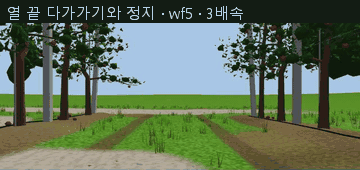
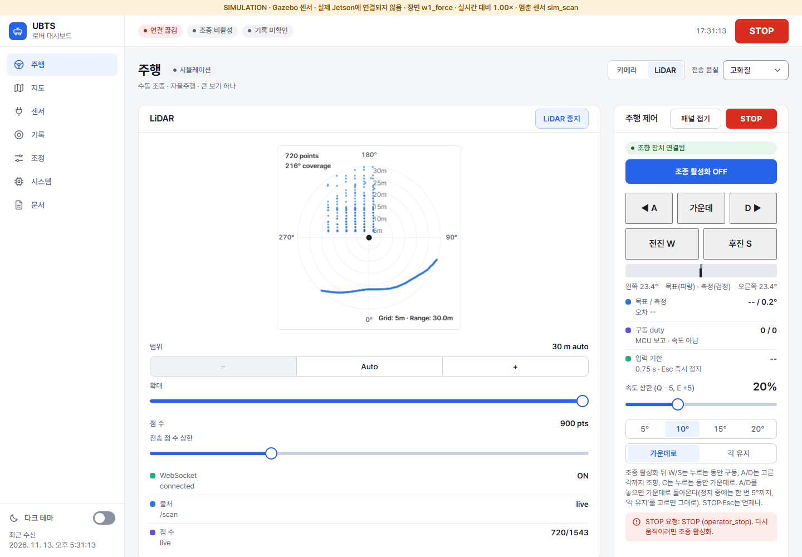
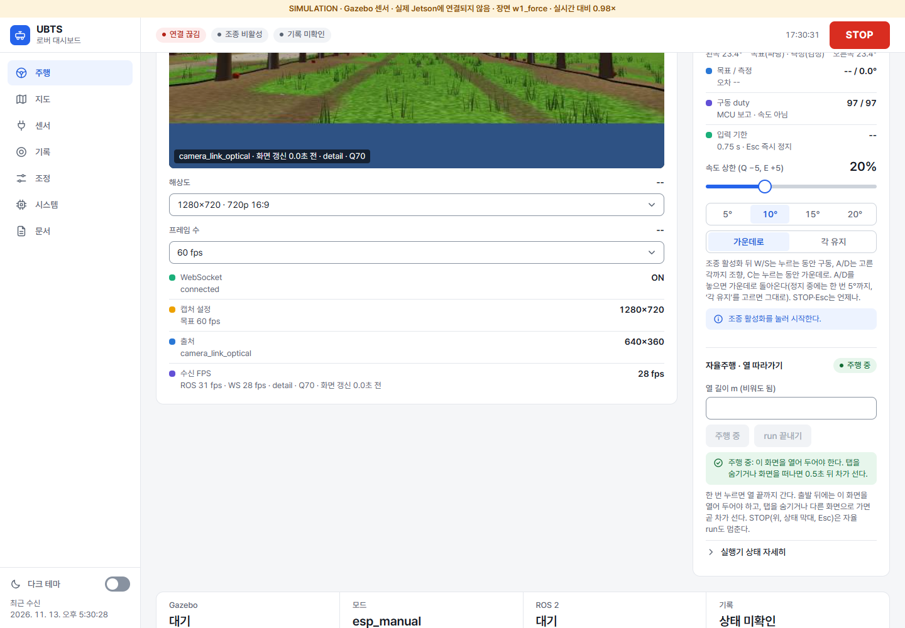

# 최종 이미지 G-SIM 확인 결과 (steer_follow_gsim_final_v1)

- 사전등록: `PREREG_STEER_FOLLOW_GSIM_FINAL_KO.md` / `.json`(측정 전 커밋 `c139fda`). 개정 1 `8dedccf`(첫 세션들 뒤, 다시 돌리기 전),
  개정 2 `d1e0eee`(E 의 W1 기록을 다시 판정하기 전).
- 이미지: `ubts-steer-sim:wf5`(id `0a2c00c6202b`), 깨끗한 작업 트리 `982a99f`에서 빌드. 매니페스트 663 파일이 커밋 blob 과 모두 같다.
  펌웨어 빌드 `04353B49`. 대시보드 사본은 대시보드 저장소 `ui-20261112`의 `90094fd`(빌드 때의 끝). 그 뒤의 끝 `a92cfec`(조용한 PC
  측정 반영, mimetypes 수정 `a1331b6`)는 wf5 에 들어 있지 않다.
- 기계가 읽는 결과: `STEER_FOLLOW_GSIM_FINAL.json`(run·항목별 값, 판정, 유효성, 기록 파일의 SHA-256). 3단계는 그 안의 `stage3`.
- **3단계(이미지 wf6, SIM 시계, 등록 `steer_follow_gsim_final3_v1`)는 12절이다.** 1~11절은 2단계(wf5) 기록 그대로 둔다.
- 실차 시계 모드(`wall`), 세션마다 새 스택, healthy 뒤 120 s 기다림. 모든 수치는 **자리값 기반 SIM 결과**다. 실차 성능이 아니다.

## 1. 상태

| 부분 | 무엇 | 판정 | 요약 |
|---|---|---|---|
| A | 한 번 눌러 시작으로 열 끝까지(W1, 4 run) | **불합격** | 4 run 모두 유효. 통과 3, 실패 1(`nominal_1`이 18.9 m 에서 `speed_cap_below_min`으로 끝남) |
| B | SIM 대시보드 화면(Chrome) | **판정 못 함** | 두 시도 모두 등록 RTF 규칙으로 무효(5 s 창 최소 0.863, 0.89974). 항목별 관찰은 4절 |
| C | A17(G) 실행기 대본(one_press) | **판정 못 함** | W0 에 통로가 없어 25 대본 모두 go 거절(`corridor_not_acquired`). 등록 오류(개정 1) |
| D | A25(에뮬레이터 경로, 개정 43 브리지) | **합격** | 관절 − 모델 p99 5.7e-11°, 관절 속도 튐 0.449 rad/s(한도 0.785), 조향 7.47° 움직임, drive 거절 0 |
| E | PW-08 Gazebo 쪽(W1, 개정 1) | 기록대로 **불합격**, 개정 2 로 **합격** | 실행기 표 속도 비 1.1000. 실패 1 항목은 평가가 상태를 너무 일찍 읽은 결함 |

전체로는 최종 이미지 확인이 **통과가 아니다**. 열 추종은 4 run 중 3 run 이 열 끝까지 갔고, 1 run 이 실행기 쪽 LiDAR 신선도 상한
때문에 중간에 끝났다. 화면 확인(B)은 호스트 RTF 때문에 판정하지 못했다.

호스트: 세션 전 부하 확인에서 앞 여섯 세션은 '가용 메모리'(기준 6000 MB) 하나만 못 미쳐 300 s 기다린 뒤 시작했다. 나머지 두 세션(E W1,
B 시도 2)은 '조용함'이었다. 멈춤 탐침은 켜지 않았다.

## 2. A: 열 추종 4 run

검사 `steering.exec_checks follow`(Start, Arm, 하트비트 100 ms, go 한 번). 장면 `w1_force`, 제어기 `row_follow` 기본값. 값은 참값(평가 쪽).
한도는 `steer_follow_gsim_v1` 그대로(횡 RMSE 0.20 m, p95 0.35 m, 최대 0.50 m, 방향 RMSE 5°, 최대 15°, 참 속도 최대 0.50 m/s, e ±1.0 m,
최소 여유 > 0, 끝 속도 ≤ 0.02 m/s). `lateral_p040`의 RMSE·p95 는 6.0 m 뒤부터.

| run | RTF 최소 | 끝난 이유 | 횡 RMSE [m] | 횡 p95 [m] | 횡 최대 [m] | 방향 RMSE [°] | 방향 최대 [°] | 속도 평균·최대 [m/s] | e [m] | 최소 여유 [m] | 거리 [m] | 판정 |
|---|---|---|---|---|---|---|---|---|---|---|---|---|
| `nominal_1` | 0.965 | `speed_cap_below_min` | 0.015 | 0.033 | 0.036 | 0.46 | 1.48 | 0.35 · 0.43 | −14.14 | 1.43 | 18.9 | 실패(열 끝, e) |
| `nominal_2` | 0.984 | `row_end` | 0.026 | 0.050 | 0.060 | 0.64 | 1.78 | 0.32 · 0.44 | +0.461 | 1.42 | 33.5 | 통과 |
| `nominal_3` | 0.960 | `row_end` | 0.022 | 0.050 | 0.054 | 0.53 | 1.58 | 0.34 · 0.45 | +0.429 | 1.41 | 33.5 | 통과 |
| `lateral_p040` | 0.982 | `row_end` | 0.030 | 0.058 | 0.402 | 0.93 | 10.96 | 0.32 · 0.44 | +0.458 | 1.42 | 32.9 | 통과 |

네 run 모두 접촉 없음, guard 위반 종결 없음, 끝난 뒤 3 s 명령 조향 이동 없음, 끝 속도 0.000~0.0001 m/s.

`nominal_1`이 끝난 과정(실행기 기록):

1. 18.2 m 무렵부터 실행기가 받는 스캔 나이(`lidar_age`)가 0.30~0.47 s 로 올랐다. 같은 구간 실행기 루프 한 바퀴가 최대 133 ms 걸렸다.
2. 속도 조절기가 신선도 상한(`fresh`)으로 목표 속도를 0.20 m/s 로 묶었고, 최저 속도 아래가 되자 정지(`speed_cap_below_min`)를 요청했다.
3. 정지가 끝나기 전에 스캔 신선도 일시정지 요청이 겹쳐, 실행기 규칙(끝내는 결정이 걸려 있으면 일시정지가 아니라 끝, 설계 S1/F1)으로
   run 이 끝났다(`end_note terminal_stop_pending_at_stale_lidar`). 설계상 `speed_cap_below_min` 단독은 일시정지(새 go 로 계속)다.

실행기 루프의 최대 133~151 ms 는 네 run 모두에 있었다(p99 41~88 ms). 그 순간이 열 안에서 신선도 상한과 겹친 run 만 끝났다. RTF 는
0.965 로 유효 범위다. 원인(호스트의 다른 일, WSL 스케줄링)은 가르지 않았다.

## 3. 그림과 영상 (A, `nominal_3`)

[영상: 최종 이미지 wf5 로 열 끝까지, 10배속, 0.49 MB](../assets/video/row_follow_wf5_camera_10x.mp4)

[SIM · 자리값] 차량 카메라(640×360 Gazebo 렌더)를 480 폭 저화질 H.264 로 줄인 것. 약 104 s 를 10배속.



[SIM · 자리값] 마지막 약 29 s 를 3배속(360 폭). 마지막 줄기를 지나 열 끝에서 섰다(e +0.429 m).

## 4. B: SIM 대시보드 화면

스택 다섯 서비스(sim, steer, recorder, dashboard, executor), 장면 w1_force. 화면은 운영자처럼 Chrome 으로 눌렀다(저장소 밖 대본).

| 항목 | 시도 1 (`s2b_ui`) | 시도 2 (`s2b_ui2`) |
|---|---|---|
| 유효성(검사 노드 5 s 창 RTF 최소) | 0.863 → 무효 | 0.89974 → 무효 |
| 준비(준비 → 자율 주행 시작) | 통과(두 번 누를 일 없음) | 통과 |
| 한 번 눌러 주행 | 통과(에뮬레이터 속도 0.12~0.30 m/s) | 통과(0.09~0.22 m/s) |
| 하트비트(마지막 20 간격 최대 < 0.35 s) | 0.296 s 통과 | 0.350 s 실패 |
| 탭 숨김 → OPERATOR_LINK_LOST, 4 s 에 정지, 다시 보이면 '다시 출발' | 통과 | 통과 |
| 주행 중 화면 STOP | 새 run 이 출발 못 함(go 거절 `vehicle_moving`). STOP 자체는 `operator_stop`으로 받음 | 같음 |
| 실시간 지도 `scan_count > 0` | 대본이 지도 단계에서 멈춤(지도는 `/map` 화면) | 0. 지도 상태 `waiting_for_geometry`, 이유 `orientation_unavailable` |

두 시도 모두 무효라 B 는 **판정 못 함**이다. 판정과 별개로 본 것:

- **STOP 단계의 새 run 이 출발하지 못한 이유**: 앞 run 을 STOP 한 뒤 차가 W1 바닥에서 뒤로 0.02~0.07 m/s 로 밀렸다(구동 0, 실행기 틱과
  에뮬레이터 참값 모두). 실행기의 출발 검사(정지 속도 0.03 m/s)가 `vehicle_moving`으로 go 를 거절했다. 화면의 시작 단추는 상태가 잠깐
  `go_ready`일 때 켜져 있었다. 처음 출발(스택을 올린 자리)에서는 이 일이 없었다.
- **실시간 지도**: SIM LiDAR 브리지는 이제 `profile=mapping`에 원본 스캔을 보낸다(`af7a1c3`). 그러나 대시보드 지도는 IMU 자세를 먼저
  요구하는데, SIM IMU 는 자세를 '없음'으로 보낸다(`live_mapping.attitude`가 `imu_orientation_unavailable`로 거절). 그래서 스캔이 지도에
  쌓이지 않았다. LiDAR 쪽 고침이 지도까지 이어지는지는 이 때문에 확인하지 못했다.
- 대시보드 `90094fd`는 주행 화면 카메라 보기에서 LiDAR 소켓을, `/sensors` 밖에서 IMU 소켓을 열지 않는다(설계). 참고 단계(시도 2)에서
  주행 화면 LiDAR 보기(720/1543 점, 그림 그려짐)와 `/sensors`의 IMU 칸 갱신을 확인했다.



[SIM · 자리값] 시도 2 의 주행 화면 LiDAR 보기. 앞쪽 두 나무 열이 점으로 보인다.



[SIM · 자리값] 같은 세션, 자율 칸에서 한 번 누른 뒤 '주행 중'.

## 5. C: A17(G) 실행기 대본 — 판정 못 함

등록은 장면 w0_force 였다. 한 번 눌러 시작 실행기는 row 종류 run 의 go 를 통로를 잡기 전에는 거절한다(`executor_main._go_blockers`).
Gazebo W0 는 나무 열이 없는 평지라 25 대본이 모두 go 에서 끝났다(검사 노드 RTF 최소 0.980, 유효한 세션). 대본의 안전 동작은 하나도
재지 못했다. W1 에서 돌리려면 대본마다 출발점으로 되돌리는 검사 코드가 필요하고, 대본이 3~5° 로 수십 초 조향해 나무 열 쪽으로 가므로
이번에는 돌리지 않았다(개정 1). Gazebo 쪽 A17(G) one_press 는 남은 일이다. 빠른 SIM T1 의 71/71 은 그대로다.

## 6. D: A25

| 기준 | 값 | 한도 | 판정 |
|---|---|---|---|
| 관절 − 공유 모델(가장 좋은 지연 0 단계) p99 | 5.7e-11° | ≤ 0.2° | 통과 |
| 관절 속도 튐 | 0.449 rad/s | ≤ 0.785 | 통과 |
| 조향이 움직임 | 7.47° | ≥ 4.30° | 통과 |
| drive 거절 | 없음 | 없음 | 통과 |

유효성: RTF 1.009, 에뮬레이터 `/clock` 벽시계 틈 100 ms 넘는 것 없음(검사 노드 5 s 창 최소 0.99987).

## 7. E: PW-08 Gazebo 쪽

W0 시도(`s2cde_w0`)는 첫 주행의 go 가 거절돼(`lease_lost`, `arm_first`, `corridor_not_acquired`) 판정 못 함. 개정 1 대로 W1 에서 새 스택으로
돌았다(`s2e_w1`, 두 주행 모두 유효, RTF 1.001·1.005).

| 기준 | 값 | 판정 |
|---|---|---|
| `POST /api/params {"speed_scale": 1.10}` 정지 중 | 200 | 통과 |
| 상태의 값 | 1.10 | 통과 |
| revision 0 → 1, 새 digest | 예 | 통과 |
| 다음 run 의 start 사건 digest = 새 digest | 예(`4051e4bb…`) | 통과 |
| 50 % 실행기 표 속도 비(0.4526 → 0.4979 m/s) | 1.1000 | 통과 |
| 끝에 기본 프리셋으로 되돌림(기록대로) | 상태 `default*`, 처음 digest 아님 | 실패 |
| 같은 항목, 개정 2(실행기 끝 상태) | preset `default`, 처음 digest `5dfb070e…` | 통과 |
| (보고) Gazebo 플랜트 정상 속도 비 | 0.35679 → 0.40492 m/s, 1.1349 | 판정 안 함 |

- 되돌림 실패는 평가가 `POST` 바로 뒤에 바뀌기 전 상태를 읽은 결함이다. 실행기의 `tuning_change`(load_preset) 사건과 끝 상태는 기본
  프리셋과 처음 digest 를 보였다. `exec_checks`는 이제 최대 3 s 기다린다(wf5 안의 검사는 옛 코드).
- 플랜트 비 1.1349 는 조정 파일 때문이 아니다. 두 주행 모두 실행기가 duty 50 % 를 보냈고(틱의 L/R), 실행기 추정 속도 중앙값도
  0.373 / 0.377 m/s 로 거의 같다. 두 번째 주행은 첫 주행이 선 곳(열 안쪽)에서 시작해 바닥 조건이 다르다. Gazebo 구동은 프로필의
  물리 모형이며 조정 파일을 읽지 않는다.

## 8. 사용자 스택(wf5)과 창에서 자율주행

측정을 끝낸 뒤 사용자 스택(`ubts-steer`, 다섯 서비스)을 wf5 로 다시 올렸다(`sim_stack.py`의 기본 이미지를 wf5 로 바꿈). 150 s 뒤
`sim_auto.py start`(한 번 눌러 시작, 대시보드 실행기 중계)를 세 번 돌렸다. **열 끝까지 간 회차는 없다.**

| 회차 | 끝 | 거리 | 이유 |
|---|---|---|---|
| 1 | latched `CONTROL_AUTHORITY` | 0.9 m | `steering_feedback_stale`: 실행기 루프 148 ms 멈춘 뒤 조향 상태 나이 0.302 s(한도 0.3 s) |
| 2 | paused `OPERATOR_LINK_LOST` | 0.0 m | go 뒤 0.86 s 에 운영자 연결 끊김(창 → 대시보드 중계 → 실행기 하트비트 틈 0.5 s 넘음) |
| 3 | paused `OPERATOR_LINK_LOST` | 11.4 m | 같은 이유, 37 s |

정지 상태에서 잰 대시보드 중계 `GET /api/executor/status` 지연(20 s, 155회): p50 18 ms, p95 124 ms, p99 276 ms, 최대 356 ms. 하트비트도
같은 중계를 지나므로 한 번 0.5 s 를 넘으면 차가 선다(그렇게 만든 안전 규칙). 끝에 run 을 멈추고 차를 출발점으로 되돌렸다. 스택은 켜 둔 채다.

## 9. 이 결과가 보이지 않는 것

- 실차 성능이 아니다. 조향·차량·속도 값은 자리값이고, 과수원은 생성기가 만든 모델이다.
- 호스트 부하와 실행기 타이밍의 관계(루프 멈춤 133~151 ms, 중계 지연)는 기록만 했고 원인을 가르지 않았다.
- B 의 항목은 두 시도 모두 무효라 판정하지 않았다. C 는 재지 못했다.

## 10. 남은 일

1. W1 에서 STOP 뒤 차가 뒤로 밀리는 것(구동 0 에서 0.02~0.07 m/s): 플랜트(바닥 기울기·제동) 확인. 이것이 화면 STOP 뒤 다시 출발을 막는다.
2. SIM IMU 자세: 대시보드 실시간 지도가 자세를 요구한다. SIM 쪽에 자세를 줄지(예: Gazebo IMU 자세), 대시보드가 자세 없는 IMU 를 받을지 결정.
3. Gazebo A17(G) one_press: W1 에서 대본마다 출발점으로 되돌리는 검사로 새로 등록.
4. 실행기 타이밍: 루프 멈춤과 신선도 상한(`speed_cap_below_min`이 일시정지가 아니라 끝이 되는 경로), 조향 상태 한도 0.3 s, 운영자
   연결 0.5 s 가 이 PC 의 부하에서 걸린다. 조용한 PC 에서 다시 재거나 한도·여유를 다룬다.
5. 대시보드 `a92cfec`로 사본을 맞춘 다음 이미지.

## 11. 다시 만드는 법

```
# 이미지(깨끗한 트리, S2_NODE_EXEC_KO.md 9.3)
docker build -f docker/Dockerfile.ubts-steer --build-arg ... --build-arg IMAGE_TAG_HINT=ubts-steer-sim:wf5 -t ubts-steer-sim:wf5 .
# A: run 하나(새 스택, healthy 뒤 120 s)
python -I tools/steer_sim/stack.py up --project <p> --profile executor sim steer recorder executor   # UBTS_STEER_SCENE=w1_force
python -I tools/steer_sim/stack.py run --project <p> -- python3 -B -m steering.exec_checks follow --run nominal_1 --out /runs/follow
python -B -m steering.gsim_final <follow 폴더>                       # sim/ubts 에서. GSIM_FINAL_FOLLOW.json
# D, E
... -- python3 -B -m steering.p6a_checks a25 --out /runs/a25          # w0_force
... -- python3 -B -m steering.exec_checks pw08 --out /runs/pw08       # w1_force (개정 1)
# 그림·영상
python -B tools/steer_sim/make_assets.py --runs-root <runs> --only row_follow_wf5_camera_10x row_end_stop_wf5_3x sim_dashboard_lidar_view sim_dashboard_autonomy_running
```

세션 대본·원 기록·콘솔은 저장소 밖 기록 폴더(`<runs>/gsim_final_20261113/`의 `scripts/`, `sessions/s2*`, `stage2/`)에 있다.

## 12. 3단계: 이미지 wf6, SIM 시계 (`steer_follow_gsim_final3_v1`)

- 사전등록 `PREREG_STEER_FOLLOW_GSIM_FINAL3_KO.md`(`bf1b9ca`, 등록 run 전), 개정 1(`06607ca`, B 다시 돌리기와 F 전).
- 바뀐 것(결정 R60~R63, 합격 기준 개정 60~62): 운영자 연결 기한 1.0 s, 출발 정지 문턱 0.08 m/s, SIM IMU 게임 회전 벡터, 대시보드
  사본 `a92cfec`, A17(G) 은 W1 에서 대본마다 출발점으로(차 정지 0.05 m/s), 판정은 SIM 시계 모드.
- 이미지 `ubts-steer-sim:wf6`(id `91bd62fa8d1a`), 깨끗한 작업 트리 `bf1b9ca`에서 빌드, 매니페스트 666 파일 = 커밋 blob. 그 뒤 고친
  검사 코드(`second_screen_and_cli` 기대값)는 이미지 밖이다(그 대본은 같은 기록을 개정 1 로 다시 판정).
- 개발 확인(판정 아님, `s3_smoke`): A13(G) 그래프 검사 SIM 시계에서 통과, `/imu/data_raw`에 자세(Gazebo 자세와 pitch 같음), 대시보드
  실시간 지도 scan_count 182·cell_count 90730.

### 12.1 상태

| 부분 | 판정 | 요약 |
|---|---|---|
| A 열 추종(SIM 시계) | **불합격** | 3/4. `nominal_1`이 27.0 m 에서 `stale_lidar` 일시정지(5 s 창 RTF 0.815) |
| W 벽시계 기록 | 판정 아님 | `nominal_1` 열 끝(e +0.460 m), `lateral_p040` 2.1 m 에서 `stale_lidar` |
| B 대시보드 화면 | **합격**(시도 2) | 준비, 한 번 눌러 주행, heartbeat 최대 틈 0.111 s, 탭 숨김 정지, 화면 STOP, STOP 뒤 다시 시작, 실시간 지도 모두 통과 |
| C A17(G) one_press W1 | **불합격** | 개정 1 뒤 24/25. `bridge_stall`이 주입 전 호스트 래치 `steering_ineffective`로 끝남 |
| E PW-08 | **합격** | 실행기 표 속도 비 1.1000, 기본 프리셋 되돌림 확인 |
| F 사용자 명령 3 run | **불합격** | 0/3. 세 번 모두 `steering_feedback_stale`(2.7, 18.7, 23.7 m) |

3단계도 최종 확인이 **통과가 아니다**. 화면 시작·정지와 실시간 지도, PW-08 은 됐다. 열 끝까지는 등록 검사로 3/4, 사용자 명령으로
0/3 이었다. 막은 것은 이 PC 의 실행기·조향 컨테이너 타이밍이다(12.6).

### 12.2 A: 열 추종 4 run (SIM 시계)

| run | 5 s 창 RTF 최소 | 끝난 이유 | 횡 RMSE [m] | 횡 p95 [m] | 횡 최대 [m] | 방향 RMSE [°] | 방향 최대 [°] | 속도 평균·최대 [m/s] | e [m] | 최소 여유 [m] | 거리 [m] | 판정 |
|---|---|---|---|---|---|---|---|---|---|---|---|---|
| `nominal_1` | 0.815 | 일시정지 `stale_lidar` | 0.025 | 0.049 | 0.050 | 0.51 | 1.35 | 0.37 · 0.44 | −5.96 | 1.41 | 27.0 | 실패 |
| `nominal_2` | 0.956 | `row_end` | 0.022 | 0.044 | 0.049 | 0.56 | 1.61 | 0.34 · 0.45 | +0.463 | 1.43 | 33.5 | 통과 |
| `nominal_3` | 0.876 | `row_end` | 0.026 | 0.050 | 0.054 | 0.78 | 1.69 | 0.31 · 0.44 | +0.433 | 1.40 | 33.5 | 통과 |
| `lateral_p040` | 0.917 | `row_end` | 0.032 | 0.059 | 0.402 | 1.03 | 10.95 | 0.34 · 0.44 | +0.456 | 1.40 | 32.9 | 통과 |

`nominal_1`: 27.0 m 에서 실행기 루프 한 바퀴가 222~258 ms 걸렸고, 그 사이 들어온 스캔의 SIM 시간 지연이 0.35 s 였다. 스캔 나이가
0.45 s 를 넘어 일시정지했다(검사는 다시 go 하지 않는다). SIM 시계에서도 실행기·LiDAR 경로가 실제 시간으로 밀리면 SIM 시간으로도
늦는다. 실행기 루프 최대는 네 run 모두 243~313 ms 였다.


[SIM · 자리값] `nominal_3`(SIM 시계)의 마지막 약 30 s, 3배속. 열 끝에서 섰다(e +0.433 m).

[영상: wf6, SIM 시계로 열 끝까지, 10배속, 0.54 MB](../assets/video/row_follow_wf6_camera_10x.mp4)

[SIM · 자리값] 같은 run 의 차량 카메라를 480 폭 저화질로 줄인 것.

### 12.3 B: SIM 대시보드 화면 (SIM 시계)

| 항목 | 시도 1 (`s3b_ui`, RTF 최소 0.778) | 시도 2 (`s3b_ui2`, RTF 최소 0.736) |
|---|---|---|
| 준비 | 통과 | 통과 |
| 한 번 눌러 주행 | 통과 | 통과(0.09~0.30 m/s) |
| heartbeat 최대 틈 < 0.5 s | 판정 못 함(1.926 s 는 대본 처리기의 시각, 개정 1) | 통과(브라우저 요청 시각 0.111 s, 처리기 시각 0.266 s) |
| 탭 숨김 → 2.0 s 에 OPERATOR_LINK_LOST, 4 s 에 정지, '다시 출발' | 통과 | 통과 |
| 주행 중 화면 STOP | 개정 1 로 다시 판정해 통과(속도 0.0) | 통과 |
| STOP 뒤 다시 시작 | 개정 1 로 다시 판정해 통과 | 통과(다시 0.15~0.33 m/s, STOP 이 다시 세움) |
| 실시간 지도 | 통과(scan 183, 격자 84,743) | 통과(scan 63, 격자 102,234) |

판정은 시도 2(개정 1): **합격**. 2단계에서 막혔던 것(STOP 뒤 다시 출발이 `vehicle_moving`으로 거절, 지도가 IMU 자세를 기다림)은
이번에 나오지 않았다. 대시보드 주행 화면 카메라 보기에서는 LiDAR·IMU 칸이 꺼져 있는 것이 설계다(`/sensors`, LiDAR 보기에서 켜짐).


[SIM · 자리값] 시도 2 의 지도 화면. 대시보드 자신의 실시간 격자에 나무 열이 쌓였다(SIM LiDAR 원본 스캔과 IMU 자세).

### 12.4 C: A17(G) one_press, W1 (SIM 시계)

- 25 대본(운영자 STOP 5 + 20), `deadman_release`는 one_press 에 없음. 검사 노드 RTF 최소 0.870.
- 기록대로 23 통과, 2 실패. 개정 1: `second_screen_and_cli`의 끝 이유 기대값이 합격 기준 개정 34(다른 클라이언트 STOP 도
  `operator_stop`)와 달랐다(검사 결함). 같은 기록으로 다시 판정해 통과 → 24/25.
- `bridge_stall`: 브리지 멈춤을 넣기 전, 4° 조향 40 % 로 달리는 동안 호스트가 `steering_ineffective`로 래치해 run 이 끝났다. 그래서
  TTL·watchdog 값을 재지 못했다. W1 출발점 둘레(풀밭, 기울기)에서 이 호스트 규칙이 걸린 것으로 보며, 원인은 가르지 않았다. **불합격.**
- `hold_lost`의 운영자 연결 끊김 시간 보고값은 개발 확인에서 −43.9 s 였다(앞 대본의 일시정지 틱을 집음). 고쳤지만 wf6 이미지 안의
  검사는 이 고침 전 것이다.

### 12.5 E: PW-08 (W1, SIM 시계)

요청 200, 상태 1.10, revision 0 → 1 과 새 digest, 다음 run 시작 digest 일치, 50 % 실행기 표 속도 비 1.1000, 기본 프리셋 되돌림
(상태가 바뀐 뒤 읽음) 모두 통과. **합격.** 보고: 플랜트 정상 속도 0.35708 → 0.40451 m/s(비 1.133, 2단계와 같은 꼴: duty 는 둘 다
50 %, 두 번째 주행이 열 안쪽에서 시작).

### 12.6 F: 사용자 명령으로 3 run

`sim_stack.py start --no-browser`(wf6, SIM 시계) 뒤 `sim_auto.py start`·`reset` 세 번. **0/3**, 세 번 모두 `steering_feedback_stale`
(2.7, 18.7, 23.7 m). 끝 직전 실행기 틱이 216~273 ms 늦게 돌아, 조향 상태 나이가 0.308~0.367 s 로 한도 0.3 s 를 넘었다.

| 본 것 | 값 |
|---|---|
| steer 컨테이너(에뮬레이터 + 브리지 wrapper, CPU 1.5) CFS 스로틀 | 5,091 주기 중 858 |
| 실행기 루프(주행 중) p50 / p99 / 최대 | 18.3 / 209 / 323 ms (등록 A 세션 p99 35~174 ms, 벽시계 W 세션 p50 8.5 ms) |
| 실행기 스캔 처리 p50 / p99 | 8.9 / 105.6 ms(느린 틱의 스캔 처리 100~210 ms) |
| 개발 확인(판정 아님): steer·실행기 CPU 3 | 스로틀 거의 멈춤, 실행기 루프 p99 32 ms. 그래도 152 ms 스캔 처리 한 번으로 조향 상태 나이 0.317 s, 18.7 m 에서 멈춤 |

SIM 시계 모드는 돈다(A13, A17 24/25, 화면, PW-08). 하지만 이 PC 에서 열 끝까지를 '확실히' 만들지는 못했다. Gazebo 가 느린 것(RTF)이
아니라 실행기 과정 안의 스캔 처리 지연과 steer 컨테이너 CPU 스로틀이 원인이었고, SIM 시계 모드의 2 ms 폴링이 CPU 를 더 쓴다
(실행기 루프 p50 8.5 → 17~18 ms, steer CPU p90 74 → 107~153 %).

### 12.7 3단계 남은 일(제안)

1. 실행기의 100~210 ms 스캔 처리 원인 찾기(프로파일. 의심: 쌓아 두는 스캔·IMU 버퍼 1,300·4,300 개와 파이썬 GC). 실차 코드다.
2. SIM 스택 CPU 한도: SIM 시계에서 steer·실행기 1.5 → 3(개발 확인으로 스로틀은 사라짐). compose 변경은 하지 않았다.
3. 조향 상태 나이 한도 0.3 s 는 상태 주기 0.1 s 에 루프 흔들림을 더하면 이 PC 에서 빠듯하다. 실차 값이므로 결정이 필요하다.
4. W1 에서 `bridge_stall`의 `steering_ineffective` 호스트 래치(주입 전): 호스트 규칙과 W1 지형의 관계 확인.
5. 사용자 스택은 wf6·SIM 시계로 켜 두었다. 열 끝까지 안 가면 `sim_auto.py reset` 뒤 다시 `start`.
