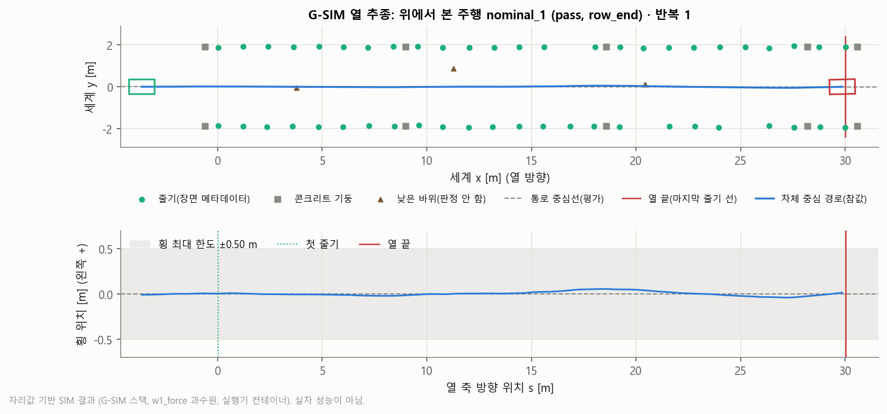
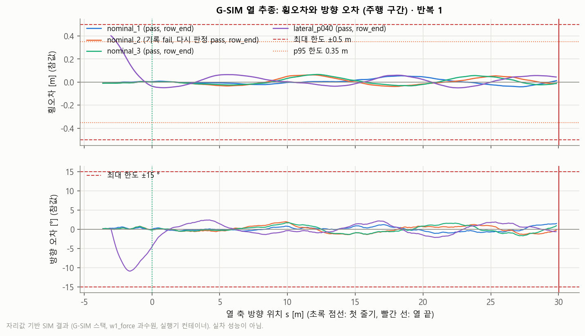
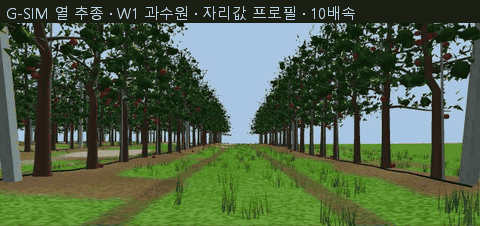
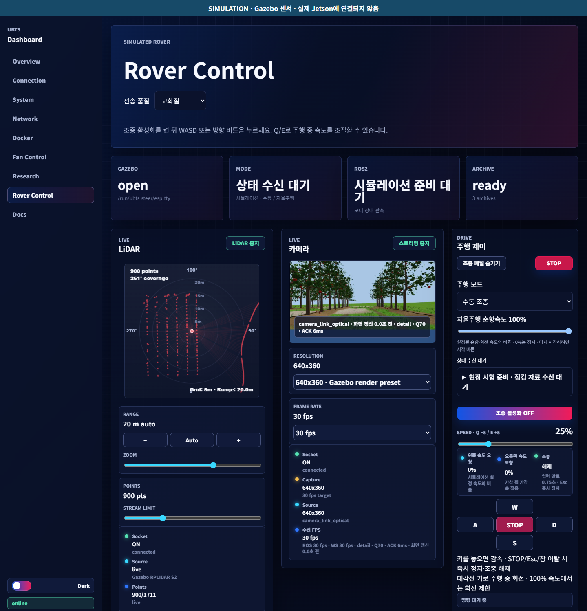

# 단일 열 추종 G-SIM 확인 결과 (steer_follow_gsim_v1)

- 사전등록: `PREREG_STEER_FOLLOW_GSIM_KO.md`, `PREREG_STEER_FOLLOW_GSIM.json`(스택에서 제어기를 돌리기 전에 커밋 `e9cab05`로 따로 올렸다). 수정 1은 커밋 `ccd1dad`.
- 대상: 열 추종 제어기 `sim/ubts/closed_loop/steer_control.py`(`{"kind": "row_follow"}`, 기본값)를 Docker 스택(Gazebo, 장면 `w1_force`)의 실행기 컨테이너에서 돌린 것. 이미지 `ubts-steer-sim:wf4c`.
- 기계가 읽는 결과: `STEER_FOLLOW_GSIM_RESULT.json`(run마다 잰 값, 기준별 판정, 유효성, 틱 통계, 기록 파일의 SHA-256).
- 모든 수치는 **자리값 기반 SIM 결과**다. 실차 성능이 아니다. 과수원은 생성기가 만든 모델이고 차량·조향·속도 값은 자리값이다.
- 앞 결과: `STEER_FOLLOW_RESULT_KO.md`(빠른 SIM, 평지의 기둥 두 줄, 15회).

## 1. 상태

반복 1(2026-11-12): 4회 모두 유효했다(호스트 멈춤 없음). 4회 모두 열 끝에서 `row_end`로 끝났고 참값에서 재는 기준은 4회 모두 한도 안이다.

- 기록된 판정: 통과 3, 실패 1. 실패는 `nominal_2`의 '주행 시작 뒤 일시정지 0회' 한 항목이다.
- 그 실패는 평가 코드의 결함이었다(앞 세션의 실행기 틱이 섞임, 등록 7절 수정 1). 수정 1을 먼저 적고 커밋한 뒤 같은 기록에서 다시 판정했다: 통과 4, 실패 0.
- 제어기와 추정기는 등록 때 그대로다. 설정을 바꾸거나 고친 것이 없다. 기준·실행 목록의 수정은 0건이다.

전체 판정은 두 가지를 다 적는다: 기록된 대로는 통과가 아니고(3 / 4), 수정 1 뒤에는 통과다(4 / 4).

## 2. 결과 표 (반복 1)

횡·방향·속도·e·여유는 참값이다(평가 쪽). `lateral_p040`의 RMSE·p95는 주행 6.0 m 뒤부터, 최댓값은 처음부터 잰 값이다. 한도: 횡 RMSE 0.20 m, p95 0.35 m, 최대 0.50 m, 방향 RMSE 5°, 최대 15°, 참 속도 최대 0.50 m/s, e ±1.0 m, 최소 여유 > 0 m, 끝 속도 0.02 m/s 이하.

| run | 끝난 이유 | 횡 RMSE [m] | 횡 p95 [m] | 횡 최대 [m] | 방향 RMSE [°] | 방향 최대 [°] | 속도 평균 · 최대 [m/s] | e [m] | 최소 여유 [m] | 끝 속도 [m/s] | 기록된 판정 | 수정 1 뒤 |
|---|---|---|---|---|---|---|---|---|---|---|---|---|
| `nominal_1` | `row_end` | 0.021 | 0.049 | 0.055 | 0.59 | 1.47 | 0.36 · 0.44 | +0.452 | 1.41 | 0.000 | 통과 | 통과 |
| `nominal_2` | `row_end` | 0.028 | 0.057 | 0.062 | 0.80 | 1.96 | 0.36 · 0.45 | +0.459 | 1.41 | 0.000 | 실패(일시정지 항목) | 통과 |
| `nominal_3` | `row_end` | 0.028 | 0.056 | 0.066 | 0.80 | 1.72 | 0.35 · 0.45 | +0.456 | 1.41 | 0.000 | 통과 | 통과 |
| `lateral_p040` | `row_end` | 0.039 | 0.061 | 0.402 | 1.18 | 10.92 | 0.35 · 0.45 | +0.446 | 1.41 | 0.000 | 통과 | 통과 |

4회 공통 기준도 모두 통과했다: 접촉 없음, guard 위반 종결 없음, 종결 뒤 3 s 동안 MCU가 받은 `C` 줄 0개(종결 뒤 명령 조향 이동 없음).

판정하지 않고 적는 값:

| run | 통로가 유효한 ACTIVE 틱 | 주행 뒤 일시정지 | 거리 · 시간 | 빠뜨린 틱 · 버린 스캔 | 루프 시간 중앙 / 최대 | 스캔 나이 최대 | 출발 (열 축, 횡) | Arm 요청 | `/clock` 벽시계 틈 >20 ms · >100 ms |
|---|---|---|---|---|---|---|---|---|---|
| `nominal_1` | 1885 / 1885 (100 %) | 0 | 33.47 m · 93.2 s | 0 · 6 | 3.6 / 40.6 ms | 0.19 s | (−3.62, −0.01) m | 2번(첫 번 409) | 0 · 0 |
| `nominal_2` | 1872 / 1872 (100 %) | 0 | 33.48 m · 94.1 s | 28 · 6 | (섞임) / 177.0 ms | 0.26 s | (−3.62, −0.01) m | 2번(첫 번 409) | 4 · 0 |
| `nominal_3` | 1892 / 1892 (100 %) | 0 | 33.48 m · 94.5 s | 23 · 6 | 6.6 / 207.5 ms | 0.34 s | (−3.62, −0.01) m | 1번 | 9 · 0 |
| `lateral_p040` | 1923 / 1923 (100 %) | 0 | 32.91 m · 92.6 s | 0 · 3 | 4.2 / 32.0 ms | 0.19 s | (−3.00, +0.40) m | 2번(첫 번 409) | 0 · 0 |

- `nominal_2`의 틱 값은 다시 판정한 값이다(이 run의 틱 1976개). 루프 시간 중앙값은 섞인 기록에서만 계산돼 적지 않는다. 최대 177.0 ms는 섞인 목록의 최댓값이고 앞 run의 최대가 40.6 ms이므로 이 run의 값이다.
- 4회 모두 스택을 올리기 전 호스트 부하 확인이 '조용함'이었고 run 동안 RTF는 0.999~1.000, 100 ms를 넘는 `/clock` 틈과 SIM이 만든 호스트 래치는 0이었다.
- `nominal_3`에서는 카메라 프레임을 받는 프로세스가 같이 돌았다(4절 영상). 나머지 셋은 검사만 돌았다.
- 장면 기하(4회 같다): 통로 0, 나무 열 0·1, 줄기 49개(결주 3), 열 축 −0.04°, 반폭 1.898 m, 첫 줄기 s = 0.03 m, 열 끝 s_E = 30.02 m, 통로의 낮은 바위 3개.

## 3. 본 것

1. 통로 유효성은 이 장면에서 추종을 막지 않았다. 4회 모두 ACTIVE 틱의 100 %에서 통로가 유효했다(1872~1923틱). ST-05에서 적은 '2241틱 가운데 626틱'은 run 밖의 틱(대기, 종결 뒤)까지 센 수였다. 그 run은 29.5 s(약 590틱)였다.
2. 열 끝 정지 위치 e는 +0.45~+0.46 m다(앞범퍼가 마지막 줄기 선을 0.45 m 지난 곳, 한도 ±1.0 m). 빠른 SIM은 +0.04~+0.09 m였다. 이 과수원은 마지막 줄기 0.6 m 뒤에 끝 기둥이 있다. 원인을 따로 가르지는 않았다.
3. 횡 RMSE는 0.021~0.028 m(빠른 SIM 0.033~0.047 m), 방향 RMSE 0.6~0.8°다. +0.40 m에서 출발하면 중심선으로 돌아오는 동안 방향 오차가 10.9°까지 간다(한도 15°, 빠른 SIM 9.9~11.8°). 6 m 뒤의 횡 RMSE는 0.039 m다.
4. 참 속도 최대는 0.443~0.446 m/s(한도 0.50), 주행 구간 평균 0.354~0.359 m/s다.
5. `nominal_2`, `nominal_3`에서는 실행기가 틱을 28개, 23개 빠뜨렸고 루프 최대가 177 ms, 208 ms였다. 그 run에서 제어기 사유 `follow_blind`(잰 루프 지연으로 속도를 묶음)가 577틱, 470틱 나왔다. `nominal_1`, `lateral_p040`에서는 빠뜨린 틱 0, 루프 최대 41 ms, 32 ms이고 `follow_blind`가 없다. 네 run 모두 A10 규칙으로는 유효하다(100 ms를 넘는 `/clock` 틈 0). 호스트의 짧은 지연으로 보이지만 원인을 가르지 않았다. 추종 값은 네 run이 비슷하다.
6. 새로 올린 스택에서 차는 출발점보다 0.62 m 뒤(s = −3.62 m)에 멈춰 있었다(구동이 꺼진 동안 경사에서 밀림). 끝에서는 4회 모두 끝 속도 0.000 m/s였다.
7. 첫 Arm 요청이 `steering_status_stale`로 거절되고 0.65 s 뒤 둘째 요청이 받아들여진 것이 4회 가운데 3회다(ST-05에서 본 것과 같다). 한 번 눌러 시작을 만들 때 볼 것이다.
8. 평가 코드 결함(수정 1): control 볼륨에 남은 앞 세션의 실행기 기록이 섞였다. 고쳤고(커밋 `9586bfd`) 시험을 더했다. 이미지 `wf4c` 안의 검사 코드에는 결함이 그대로 있다. 스택이 돌리는 프로세스와는 무관하다.

## 4. 그림과 영상

모두 반복 1의 실제 run 기록에서 만들었다. 자리값 기반 SIM 결과다. 사용자 이름, 주소, 좌표가 없는 것을 눈으로 확인했다.



그림 1. `nominal_1`을 위에서 본 모습(자리값 기반 SIM 결과). 위: 두 나무 열의 줄기와 콘크리트 기둥(장면 메타데이터), 통로 중심선, 차체 중심의 참값 경로, 출발(초록)과 정지(빨강) 때의 차체, 열 끝 선(마지막 줄기 선). 아래: 같은 경로의 횡 위치를 세로로 확대한 것. 회색 띠는 최대 한도 ±0.50 m다.



그림 2. 4회의 횡오차와 방향 오차를 열 축 방향 위치에 대해 그린 것(자리값 기반 SIM 결과, 참값, 주행 구간). 빨간 점선은 최대 한도, 주황 점선은 p95 한도다. 보라 선이 +0.40 m에서 출발한 run이다.

```
python -B tools/steer_sim/gsim_follow_figures.py --runs <기록>/it1_nominal_1/follow <기록>/it1_nominal_2/follow \
    <기록>/it1_nominal_3/follow <기록>/it1_lateral_p040/follow --top <기록>/it1_nominal_1/follow --tag "반복 1"
```

영상 1. [figures/steer_follow_gsim/gsim_follow_camera_w1.mp4](figures/steer_follow_gsim/gsim_follow_camera_w1.mp4)(H.264, 640×360, 20.7 s, 2.3 MB). 자리값 기반 SIM 결과. `nominal_3`의 출발부터 20 s를 차량 카메라로 본 것이다(열 추종 제어기가 통로로 들어가는 구간).

```
# 검사와 같이 시작해 125 s 동안 프레임을 받는다(3744장, 29.9 fps)
python -I tools/steer_sim/capture_media.py camera --project ubts-steer-<작업> --seconds 125 --out <기록>/media/cam_follow
python -I tools/steer_sim/capture_media.py clip --frames <기록>/media/cam_follow \
    --out docs/steering/figures/steer_follow_gsim/gsim_follow_camera_w1.mp4 --first 280 --last 900 --every 2 --max-mb 5
```



[SIM · 자리값] 같은 `nominal_3`을 출발부터 열 끝 정지까지(약 99 s) 10배속으로 줄인 차량 카메라(480 폭). 2026-11-14 까지 README
첫 화면 그림이었다.



그림 3. 열 추종 run 중의 SIM 대시보드 rover-control 화면(자리값 기반 SIM 결과). 5절의 로컬 보기 스택(프로젝트 `ubts-steer`, 실행기 포함)에서 `exec_run start`로 시작한 run의 55 s쯤이다. 왼쪽 LiDAR 패널에 양쪽 나무 열이, 가운데에 차량 카메라가 보인다. 이 화면은 실행기 상태를 보여 주지 않는다(조향 화면 연결은 아직 없다).

```
python -I tools/steer_sim/capture_media.py page --out <기록>/dashboard_follow.png --wait-s 10
```

## 5. 로컬에서 보기 (사용자 스택)

사용자의 보기 스택(프로젝트 `ubts-steer`, `sim_stack.py start --executor`가 올리는 것과 같다: `UBTS_STEER_SCENE=w1_force`, `UBTS_STEER_IMAGE=ubts-steer-sim:wf4c`, `docker compose -p ubts-steer -f compose.ubts-steer.yaml --profile executor up -d`)에서, 호스트 터미널로 돌린다. 컨테이너를 더 만들지 않는다(모두 `docker exec`).

```
# 스택 올리기
python -B D:/Develop/UBTS/steering-sim-20261108/tools/local_env/sim_stack.py start --executor --scene w1_force --image ubts-steer-sim:wf4c

# (a) 자율 열 추종 run 하나. 열 끝에서 스스로 끝난다. 1 s마다 상태 한 줄
docker exec -it ubts-steer-executor-1 python3 -B -m steering.exec_run start

# (b) 즉시 정지(다른 터미널에서). 운영자 STOP이다
docker exec ubts-steer-executor-1 python3 -B -m steering.exec_run stop

# 상태 한 줄
docker exec ubts-steer-executor-1 python3 -B -m steering.exec_run status

# (c) 차를 출발점으로 되돌리기(run이 끝나고 차가 선 뒤). 그 다음 (a)를 다시 한다
docker exec ubts-steer-sim-1 /ros_entrypoint.sh python3 -B -m steering.exec_run reset

# 스택 내리기
python -B D:/Develop/UBTS/steering-sim-20261108/tools/local_env/sim_stack.py stop
```

- (a)가 하는 일: 제어기 자리를 `{"kind": "row_follow"}`로 바꾸고, 운영자 페이지에 Start와 Arm을 보내고, 한 번 누른 뒤 누름 박동(약 0.1 s마다)을 run이 끝날 때까지 스스로 보낸다. 줄마다 실행기 상태, 제어기 사유, 통로 유효 여부, 실행기가 추정한 횡 위치·방향·거리·속도, 구동·조향 명령, 스캔 나이를 찍는다(실행기의 추정값이고 참값이 아니다). 끝나면 종결 이유를 찍는다. 종료 코드 0은 `row_end`, 3은 다른 종결, 4는 시작하지 못함이다.
- 한 번 눌러 시작(설계 v2 R32)은 아직 없다. 운영자 페이지는 누르고 있는 동안만 달리는 방식 그대로이고, 이 명령이 누름 박동을 대신 보낸다. 그래서 (a)를 돌리는 터미널을 닫아도 컨테이너 안의 명령은 계속 박동을 보낼 수 있다. 멈출 때는 (b)를 쓴다. `-it`로 돌렸을 때 Ctrl-C는 운영자 STOP을 보내도록 만들었지만 스택에서 눌러 보지는 않았다.
- 다른 제어기나 값: `... exec_run start --controller '{"kind": "row_follow", "cruise_speed_m_s": 0.30}'`(PowerShell에서는 안쪽 큰따옴표를 `\"`로 쓴다). 벽시계 한도는 `--limit-s`(기본 600 s).
- (c)는 Gazebo `set_pose`로 차를 장면의 출발점에 놓는다(sim 컨테이너에서만 된다: 장면 파일을 읽는다). `--lateral 0.4`를 주면 왼쪽 0.40 m에 놓는다. 놓은 뒤 차는 경사에서 조금 뒤로 밀려 멈춘다(SIM 모델의 성질). 스택을 다시 올리지 않아도 된다.
- 대시보드의 '주행 제어'(수동 조종)와 같이 쓰지 않는다. 실행기가 조종권을 쥐고 있는 동안에는 한쪽만 쓴다.

직접 돌려 본 것(2026-11-12, 프로젝트 `ubts-steer`, 이미지 wf4c, 서비스 5개 6.0 GiB):

| 한 것 | 결과 |
|---|---|
| (a) run 1 | 97 s 뒤 `ended: row_end`, 종료 코드 0. 실행기 추정 거리 33.52 m |
| (c) 되돌리기 | `set_pose … accepted` |
| (a) run 2, 25 s 뒤 (b) | `operator stop: HTTP 200`(브리지가 STOP 확인), (a)는 `ended: operator_stop`, 종료 코드 3. 7.8 m 간 곳에서 섬 |
| (c) 뒤 (a) run 3 | 래치를 확인(ack)하고 다시 출발함. 15 s 뒤 (b)로 정지 |
| 내리기 | 컨테이너 0, 네트워크 0, 예산 해제 |

- 이 run들은 평가하지 않았다(검사 컨테이너가 없어 참값 판정이 없다). 화면 갈무리(그림 3)는 run 1 중에 했다.

## 6. 반복 기록

| 반복 | 날짜 | 측정 때 저장소 커밋 | 이미지 | 제어기 | 바꾼 것 | 결과 |
|---|---|---|---|---|---|---|
| 1 | 2026-11-12 | `e9cab05`(`nominal_1`~`nominal_3`), `9586bfd`(`lateral_p040`. 문서와 평가 코드만 다르다) | wf4c(소스 커밋 `becf605`) | `row_follow` 기본값 그대로 | 없음 | 기록된 판정 3 / 4, 수정 1 뒤 4 / 4 |

- 수정 사항(등록 7절): 수정 1(평가 코드가 이 run의 틱만 쓰게 함). 기준과 정의는 그대로다. 수정 1을 적어 커밋한 때(08:55 UTC)는 `nominal_2`의 판정(08:53 UTC)을 본 뒤이고, `nominal_3`(run 시작 08:56)과 `lateral_p040`(08:59)의 run이 시작되기 전이다. 그 둘도 이미지 안의 검사 코드(결함 있음)로 돌았고 기록에서는 섞임이 없었다(틱 1993개, 2025개, 틈 없음). 넷 다 고친 코드로 기록에서 다시 판정했다.
- 무효 run과 다시 돈 run: 없음. 제어기·추정기 설정 변경: 없음.

## 7. 이 결과가 보이지 않는 것

등록 8절과 같다. 실차 성능, 다른 seed의 과수원, 10/10 통로(W2), 굽은 열, 열 끝 너머의 벽, 사람·장애물, 출발 방향 어긋남, 센서·조작 신호 끊김, SIM 시계 모드는 여기에 없다. run은 4회, seed는 하나다. 5절의 로컬 run은 평가하지 않았다.

## 8. 다시 만드는 법

```
# 스택(프로젝트 이름은 작업마다), run 하나, 내리기
export UBTS_STEER_SCENE=w1_force UBTS_STEER_CLOCK=wall UBTS_STEER_IMAGE=ubts-steer-sim:wf4c UBTS_STEER_RUNS_DIR=<기록 폴더>
python -I tools/steer_sim/stack.py up --project ubts-steer-<작업> --profile executor sim steer recorder executor
python -I tools/steer_sim/stack.py run --project ubts-steer-<작업> -- python3 -B -m steering.exec_checks follow --run nominal_1 --out /runs/follow
python -I tools/steer_sim/stack.py down --project ubts-steer-<작업> --receipt <영수증.json>
# 기록에서 다시 판정(수정 1)
cd sim/ubts && python -B -m steering.gsim_follow <기록 폴더>/follow
```

- run마다 스택을 새로 올린다(등록 2절). `lateral_p040`은 `--run lateral_p040`이다(검사가 `set_pose`를 부른다).
- 이미지 `wf4c` 안의 검사 코드로 돌리면 앞 세션 기록이 섞일 수 있다(수정 1). 고친 검사 코드를 검사 컨테이너에만 붙이거나(`stack.py up --override`), 위의 다시 판정 명령을 쓴다.
