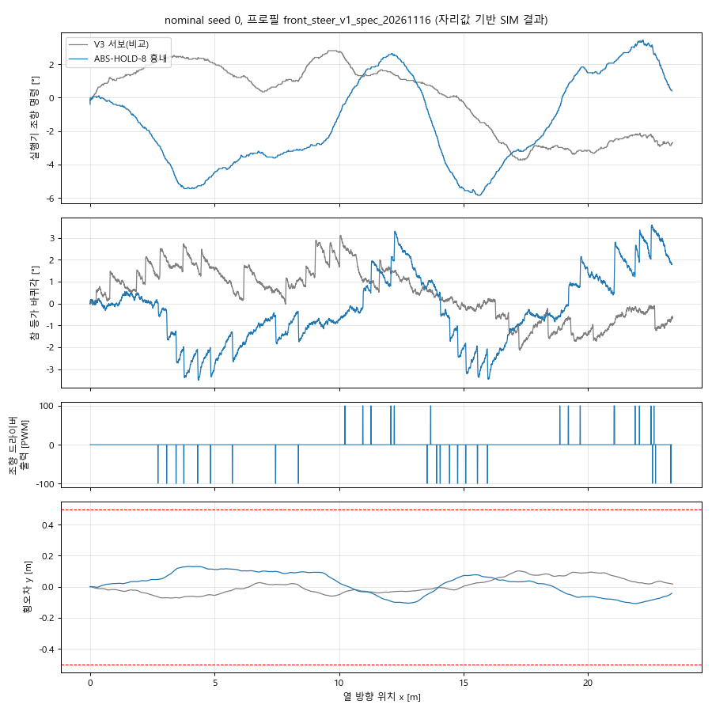

# 실제 치수·실기 조향 펌웨어로 열 추종 다시 재기 결과 (steer_follow_realdims_v1)

- 사전등록: [`PREREG_STEER_FOLLOW_REALDIMS_KO.md`](PREREG_STEER_FOLLOW_REALDIMS_KO.md), JSON 사본(측정 전 커밋 `d0b941c`).
- 측정: 2026-11-16 02:01~02:12, 커밋 `d0b941c` 그대로(작업 트리 깨끗), 무거운 측정 잠금 안, 프로세스 4개, 91 run, 643 s.
- 기계가 읽는 결과: `STEER_FOLLOW_REALDIMS_RESULT.json`(run마다 잰 값, 실패 항목, trace·직렬·실행기 기록의 SHA-256, 등록 밖 진단).
- 프로필 `front_steer_v1_spec_20261116`(실제 치수 2026-11-16 측정 + 펌웨어 ABS-HOLD-8 흉내, [`ABS_HOLD8_SIM_KO.md`](ABS_HOLD8_SIM_KO.md)). SPEC_PENDING 자리값이 34칸 남아 모든 수치는 **자리값 기반 SIM 결과**다. 현장 성능이 아니다.

## 1. 판정

| 부분 | run | 결과 | 값 |
|---|---|---|---|
| `gate_as_is`(판정 안 함) | 1 | 기대대로 | 실행기 설정이 거부됐다: "measured steering rate 5.09 deg/s below 8.0 deg/s (steering GO rule…)". 실행기가 서지 않는다 |
| `matrix`(`steer_follow_v1` 15회, GO 문턱 4.0) | 15 | **합격** | 15/15. 정상 5 seed 횡 RMSE 0.036~0.074 m, 횡 최대 0.079~0.137 m, 방향 최대 3.04~5.09°, e +0.019~+0.082 m |
| `wide`(`steer_follow_wide_v2` 20조건 × 3 seed) | 60 | **불합격** | 51/60. 17조건 3/3, 실패 9: `dist_step_p2p5` 0/3, `dist_terrain` 0/3(조향 외란), `operator_link_lost` 0/3(등록 기준이 R60보다 옛것, 4절) |
| `geometry_only`(비교, 판정 안 함) | 15 | 15/15 | 새 치수 + V3 서보 |

반복(등록 3절)은 하지 않았다. 까닭은 5절.

## 2. 15회 (matrix)

횡·방향 값은 주행 구간의 참값이다(출발 어긋남 네 조건의 RMSE·p95는 6.0 m 뒤부터). 한도: 횡 RMSE 0.20 m, p95 0.35 m, 최대 0.50 m, 방향 RMSE 5°, 최대 15°, 참 속도 최대 0.50 m/s, e ±1.0 m, 여유 > 0 m.

| 조건 | seed | 끝난 이유 | 횡 RMSE | p95 | 최대 | 방향 RMSE | 최대 | 속도 평균·최대 | e | 여유 | 판정 |
|---|---|---|---|---|---|---|---|---|---|---|---|
| `nominal` | 0 | row_end | 0.074 | 0.116 | 0.131 | 2.24 | 5.09 | 0.36 · 0.45 | +0.044 | 1.14 | 통과 |
| `nominal` | 1 | row_end | 0.036 | 0.071 | 0.079 | 1.31 | 3.04 | 0.35 · 0.42 | +0.053 | 1.19 | 통과 |
| `nominal` | 2 | row_end | 0.062 | 0.111 | 0.137 | 2.24 | 4.50 | 0.32 · 0.39 | +0.082 | 1.15 | 통과 |
| `nominal` | 3 | row_end | 0.048 | 0.082 | 0.090 | 1.77 | 3.16 | 0.34 · 0.43 | +0.019 | 1.18 | 통과 |
| `nominal` | 4 | row_end | 0.060 | 0.105 | 0.118 | 2.09 | 3.49 | 0.35 · 0.44 | +0.054 | 1.16 | 통과 |
| `lateral_p040` | 0 | row_end | 0.067 | 0.135 | 0.400 | 2.30 | 11.37 | 0.32 · 0.42 | +0.046 | 0.87 | 통과 |
| `lateral_n040` | 0 | row_end | 0.053 | 0.087 | 0.400 | 2.03 | 11.49 | 0.35 · 0.45 | +0.077 | 0.87 | 통과 |
| `heading_p8` | 0 | row_end | 0.060 | 0.107 | 0.121 | 1.98 | 8.00 | 0.32 · 0.39 | +0.077 | 1.15 | 통과 |
| `heading_n8` | 0 | row_end | 0.038 | 0.071 | 0.168 | 1.63 | 8.00 | 0.36 · 0.46 | +0.036 | 1.10 | 통과 |
| `steer_zero_p2` | 0 | row_end | 0.054 | 0.109 | 0.116 | 1.99 | 4.30 | 0.36 · 0.43 | +0.071 | 1.15 | 통과 |
| `steer_zero_n2` | 0 | row_end | 0.049 | 0.093 | 0.113 | 1.90 | 4.35 | 0.35 · 0.44 | +0.069 | 1.16 | 통과 |
| `side_pull` | 0 | row_end | 0.054 | 0.107 | 0.123 | 1.68 | 4.06 | 0.36 · 0.45 | +0.056 | 1.15 | 통과 |
| `lidar_dropout_0p2` | 0 | row_end | 0.043 | 0.069 | 0.083 | 1.48 | 2.79 | 0.34 · 0.41 | +0.057 | 1.19 | 통과 |
| `lidar_stale_1p0` | 0 | 일시정지 `stale_lidar` | 0.046 | 0.075 | 0.079 | 0.41 | 0.84 | 0.37 · 0.44 | (판정 안 함) | 1.20 | 통과 |
| `obstacle` | 0 | `obstacle_ahead` | 0.053 | 0.086 | 0.089 | 1.48 | 2.80 | 0.35 · 0.41 | (판정 안 함) | 0.44 | 통과 |

MCU 조향 결함 줄은 15회 모두 없다. 정상 5회에서 펄스는 run마다 18~34번(초당 0.27~0.52번), 조향 드라이버가 켜진 시간은 주행 시간의 1.3~2.6 %다. 참 바퀴각과 실행기 명령의 차이 p95는 2.1~3.1°(run별 0점 오차, 유격, 펌웨어 허용 10 count, 느린 조향이 함께 든 값)다.

### 2.1 전과 후 (같은 15회)

세 열은 v0.1 프로필 + V3 서보(main `cb89bf3`, 이 작업의 V3 동일성 확인 run), 새 치수 + V3 서보(`geometry_only`), 새 치수 + ABS-HOLD-8(`matrix`)이다. 모두 15/15 통과.

| 조건 | 횡 RMSE [m] | 횡 최대 [m] | 방향 최대 [°] | e [m] |
|---|---|---|---|---|
| `nominal` s0 | 0.041 / 0.047 / 0.074 | 0.085 / 0.102 / 0.131 | 2.07 / 2.23 / 5.09 | +0.077 / +0.087 / +0.044 |
| `nominal` s1 | 0.048 / 0.036 / 0.036 | 0.114 / 0.090 / 0.079 | 1.72 / 1.78 / 3.04 | +0.060 / +0.046 / +0.053 |
| `nominal` s2 | 0.047 / 0.042 / 0.062 | 0.102 / 0.096 / 0.137 | 2.32 / 3.15 / 4.50 | +0.049 / +0.043 / +0.082 |
| `nominal` s3 | 0.039 / 0.045 / 0.048 | 0.083 / 0.097 / 0.090 | 1.60 / 2.81 / 3.16 | +0.069 / +0.067 / +0.019 |
| `nominal` s4 | 0.040 / 0.050 / 0.060 | 0.094 / 0.102 / 0.118 | 2.41 / 3.41 / 3.49 | +0.075 / +0.098 / +0.054 |
| `lateral_p040` | 0.043 / 0.044 / 0.067 | 0.400 / 0.400 / 0.400 | 9.90 / 10.77 / 11.37 | +0.083 / +0.057 / +0.046 |
| `lateral_n040` | 0.054 / 0.036 / 0.053 | 0.400 / 0.400 / 0.400 | 11.83 / 10.95 / 11.49 | +0.059 / +0.062 / +0.077 |
| `heading_p8` | 0.044 / 0.043 / 0.060 | 0.110 / 0.112 / 0.121 | 8.00 / 8.00 / 8.00 | +0.064 / +0.089 / +0.077 |
| `heading_n8` | 0.046 / 0.037 / 0.038 | 0.166 / 0.122 / 0.168 | 8.00 / 8.00 / 8.00 | +0.066 / +0.057 / +0.036 |
| `steer_zero_p2` | 0.039 / 0.027 / 0.054 | 0.103 / 0.087 / 0.116 | 1.91 / 1.82 / 4.30 | +0.054 / +0.085 / +0.071 |
| `steer_zero_n2` | 0.038 / 0.047 / 0.049 | 0.083 / 0.112 / 0.113 | 2.58 / 1.35 / 4.35 | +0.062 / +0.068 / +0.069 |
| `side_pull` | 0.045 / 0.040 / 0.054 | 0.103 / 0.079 / 0.123 | 1.99 / 2.76 / 4.06 | +0.066 / +0.043 / +0.056 |
| `lidar_dropout_0p2` | 0.040 / 0.043 / 0.043 | 0.096 / 0.107 / 0.083 | 2.71 / 3.49 / 2.79 | +0.073 / +0.075 / +0.057 |
| `lidar_stale_1p0` | 0.029 / 0.035 / 0.046 | 0.051 / 0.077 / 0.079 | 1.63 / 2.06 / 0.84 | (판정 안 함) |
| `obstacle` | 0.033 / 0.044 / 0.053 | 0.074 / 0.090 / 0.089 | 2.01 / 2.75 / 2.80 | (판정 안 함) |

본 것: 새 치수만으로는 거의 같다(정상 횡 RMSE 0.039~0.048 → 0.036~0.050 m). 펄스 조향으로 바꾸면 정상 횡 RMSE 최대가 0.050 → 0.074 m, 방향 최대가 3.41 → 5.09°로 커진다. 한도까지는 여유가 크다(횡 RMSE 한도 0.20 m, 방향 최대 15°).



그림 1. `nominal` seed 0을 열 방향 위치에 대해 그린 것. 위에서부터 실행기 조향 명령, 참 등가 바퀴각, 조향 드라이버 출력(ABS-HOLD-8 흉내만: PWM ±100 펄스), 횡오차. 회색은 같은 프로필의 V3 서보(비교), 파랑은 ABS-HOLD-8 흉내. 펄스 사이에는 드라이버가 꺼져 바퀴가 직진 쪽으로 풀린다(자리값 복원 모형 `steer_release_restoring`). [SIM · 자리값] 평지 기둥 두 줄(W0), 과수원 모델이 아니다.

## 3. 넓은 조건 (wide, 20조건 × seed 4000~4002)

| 조건 | 통과 | 끝난 이유 | 횡 RMSE 최대 [m] | 횡 최대 [m] | 방향 최대 [°] | e [m] |
|---|---|---|---|---|---|---|
| `curve_l30` | 3/3 | row_end | 0.106 | 0.212 | 7.51 | +0.182 ~ +0.244 |
| `curve_r30` | 3/3 | row_end | 0.115 | 0.253 | 7.39 | −0.223 ~ +0.226 |
| `gap3_both` | 3/3 | row_end | 0.070 | 0.156 | 5.97 | +0.062 ~ +0.069 |
| `endpost_2p0` | 3/3 | row_end | 0.059 | 0.122 | 4.26 | +0.026 ~ +0.036 |
| `width_3p0` | 3/3 | row_end | 0.062 | 0.120 | 4.85 | +0.042 ~ +0.073 |
| `w2_042301_c03` | 3/3 | row_end | 0.080 | 0.400 | 4.71 | +0.045 ~ +0.067 |
| `w2_040927_c06` | 3/3 | row_end | 0.062 | 0.147 | 5.42 | +0.042 ~ +0.069 |
| `heading_p10` | 3/3 | row_end | 0.050 | 0.148 | 10.00 | +0.043 ~ +0.063 |
| `heading_n10` | 3/3 | row_end | 0.063 | 0.170 | 10.00 | +0.060 ~ +0.079 |
| `pull_left` | 3/3 | row_end | 0.066 | 0.131 | 5.38 | +0.051 ~ +0.076 |
| `pull_right` | 3/3 | row_end | 0.073 | 0.137 | 4.95 | +0.057 ~ +0.065 |
| `speed_0p2` | 3/3 | row_end | 0.046 | 0.112 | 4.72 | +0.044 ~ +0.046 |
| `speed_0p5` | 3/3 | row_end | 0.054 | 0.122 | 5.17 | +0.050 ~ +0.070 |
| `table_x070` | 3/3 | row_end | 0.064 | 0.125 | 4.58 | +0.049 ~ +0.073 |
| `table_x130` | 3/3 | row_end | 0.060 | 0.141 | 3.79 | +0.047 ~ +0.063 |
| `imu_stale_1p0` | 3/3 | 일시정지 `stale_imu` | 0.053 | 0.106 | 2.17 | (판정 안 함) |
| `gnss_nominal` | 3/3 | row_end | 0.056 | 0.122 | 3.95 | +0.020 ~ +0.054 |
| `dist_step_p2p5` | **0/3** | `steering_feedback_invalid` | 0.040 | 0.076 | 3.40 | (열 끝 전 정지) |
| `dist_terrain` | **0/3** | `steering_not_following` | 0.133 | 0.205 | 7.58 | (열 끝 전 정지) |
| `operator_link_lost` | **0/3** | 일시정지 `operator_link_lost` | 0.055 | 0.104 | 2.86 | (판정 안 함) |

W2 `w2_042301_c03`의 횡 최대 0.400 m는 출발 자세(카탈로그 중심선)와 참 통로 가운데의 차이다(앞 등록과 같은 규칙, 한도 안).

## 4. 실패 9회의 원인

| 조건 | 무엇이 걸렸나 | 원인 |
|---|---|---|
| `dist_step_p2p5` s4000·4001·4002 | 6.0 s에 +2.5 N·m가 들어오고 0.05~0.13 s 뒤 MCU `POT_NOISE` → MCU 무장 풀림(6.08~6.18 s) → 호스트 래치 `steering_feedback_invalid`, 열 끝 전 정지. 실패 항목: 열 끝, e, MCU 결함 줄, 호스트 래치 | 펄스 사이 드라이버가 꺼져 있어(실기 펌웨어와 같다) 외력이 조향을 51 ms에 6.5°까지 민다. 빠른 움직임에 V3의 가변저항 잡음 감시(실기 펌웨어에는 없다)가 걸렸다 |
| `dist_terrain` s4000·4001·4002 | 지면 밀기·충격 과정 아래 조향이 기계 끝(등가 ±18.83°)까지 밀려 있는 동안 명령은 반대쪽 2.4~2.9°. MCU `TRACK`(6.2~13.1 s) → `steering_not_following`, 열 끝 전 정지 | PWM 100(자리값 정지 토크 5 N·m의 39 %)의 펄스로는 외력을 되돌리지 못한다. 펄스 사이에는 되밀린다(되밀림 배율 3, 자리값) |
| `operator_link_lost` s4000·4001·4002 | 마지막 heartbeat 뒤 구동 0까지 1.05 s, 등록 한도 0.55 s | 등록 기준(`steer_follow_wide_v2`의 `link_drive_zero_s` 0.55 s)이 결정 R60(2026-11-13, 운영자 기한 0.5 → 1.0 s)보다 옛것이다. 이 등록에서 그 조건을 옛 기준 그대로 넣은 것은 등록 실수다. 1.05 s = 1.0 s + 1틱으로 A17 개정 60("≤ operator_timeout_s + 1틱")은 만족한다. 조향과 상관없다 |

등록 밖 진단(판정 뒤, 판정 아님, `STEER_FOLLOW_REALDIMS_RESULT.json`의 `post_hoc_not_registered`):

- 같은 프로필을 `steer_fw_mode v3_servo`(제동 유지, 출력 최대 100 %)로 바꿔 두 외란 조건을 seed 4000~4002로 돌리면 6/6 통과(열 끝, 결함 없음, 횡 최대 0.084~0.138 m). 실패는 치수가 아니라 ABS-HOLD-8 법칙(펄스 사이 놓음, PWM 100 고정)과 자리값 외란·되밀림 모형의 조합에서 나온다.
- main `cb89bf3`의 `follow_wide --seed 4000 --only operator_link_lost`(v0.1.2, V3)도 같은 항목으로 실패한다(1/1 실패). 이 작업 전부터 있던 기준 어긋남이다.

## 5. 반복하지 않은 까닭과 다음 할 일

등록이 허락한 고칠 수 있는 것은 현장 조정 값과 제어기 바꿈이다. 외란 실패는 조향 구동기가 외력을 이기지 못하는 것이라 제어기 쪽으로는 고칠 수 없고, 운영자 기한 실패는 기준 문제라 고칠 것이 없다. 그래서 반복 run은 돌리지 않았다. 다음에 할 수 있는 것:

1. 실차에서 재기: 조향을 손으로 되미는 데 드는 토크와 끈 상태의 되밀림(B8), 조향 모터 정지 토크(Q11), 바퀴가 밀릴 때 펄스가 되돌리는지(벤치). 이 값이 오면 외란 결과가 바뀐다(지금은 모두 자리값).
2. 펌웨어 쪽 선택지(실기 펌웨어는 바꾸지 않았다, 개발자 몫): 펄스 사이에 드라이버를 끄는 대신 제동(EN 켬, 양쪽 PWM 0)으로 붙잡기, 밀려난 크기가 크면 더 센 PWM, 유지 취소를 호스트에 알리는 줄. SIM은 이 선택지를 아직 흉내 내지 않는다.
3. 다음 사전등록에서 넓은 조건의 `link_drive_zero_s`를 R60에 맞춘다(1.0 s + 1틱).
4. 실행기 GO 규칙 `steer_rate_min_deg_s` 8 °/s(자리값)는 보드의 5.09 °/s를 거부한다. 실차 B5를 재고 문턱을 정해야 실행기가 선다(지금은 4.0으로 문서화한 등록 설정).

## 6. V3 동일성 (걸이를 더한 뒤)

펌웨어 V3에 빈 법칙 걸이를 더해 펌웨어 build id가 바뀌었다(`04353B49` → `878B5F56`). 기본 프로필(v0.1, V3)로 main `cb89bf3`와 이 작업 트리(측정 전 커밋과 같은 내용)를 같은 잠금 안에서 견줬다(2026-11-16 01:50~02:00):

| 묶음 | main | 작업 트리 | 같음 |
|---|---|---|---|
| 열 추종 15회(`follow_matrix`) | 15/15 통과 | 15/15 통과 | trace 15/15, 잰 값 15/15. 직렬 기록은 배너 두 줄(build id, 소스 해시)만 다름 |
| T1 안전 대본(safety·fault·mandatory·host·normal) | 71/71 기대대로, A17·A22 합격 | 71/71 기대대로, A17·A22 합격 | trace 71/71. 직렬은 배너, 실행기 기록은 경로와 요청 처리 시간(벽시계) 칸 때문에 다름 |

## 7. 이 결과가 보이지 않는 것

현장 성능, 실기 브리지(새 보드용 Jetson 브리지는 아직 없고 SIM 호스트 ANGLE 정책은 제안이다), 주행 중 조향 속도(서 있을 때 값만 있다), 가운데로 미는 토크, 실기 펌웨어에 없는 V3 감시의 차이, 구동 쪽 watchdog(실기 펌웨어에는 없다), Gazebo(이 작업에서 돌리지 않았다). 넓은 조건은 55조건 중 20조건, seed 3개만이다.

## 8. 다시 만드는 법

`sim/ubts`에서(네이티브 빌드 폴더 `UBTS_STEER_BUILD_DIR`, W2 조건은 `UBTS_STEER_PATHS`가 필요하다, `PATHS_KO.md`):

```
python -B -m steering.safety_scripts.follow_realdims --out <저장소 밖 폴더> --workers 4
python -B -m steering.safety_scripts.follow_realdims --out <폴더> --parts matrix --only nominal
```
