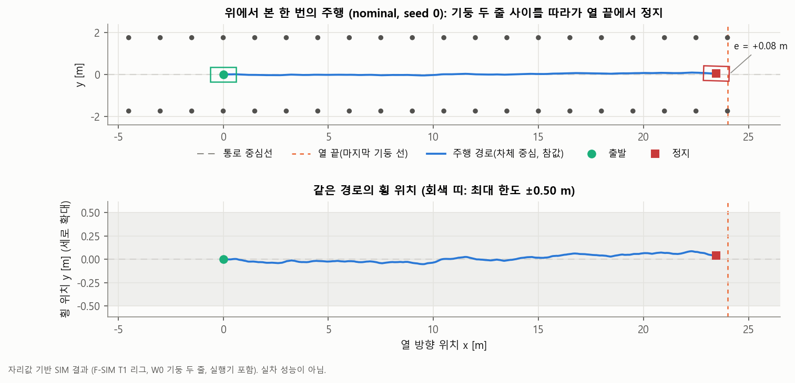
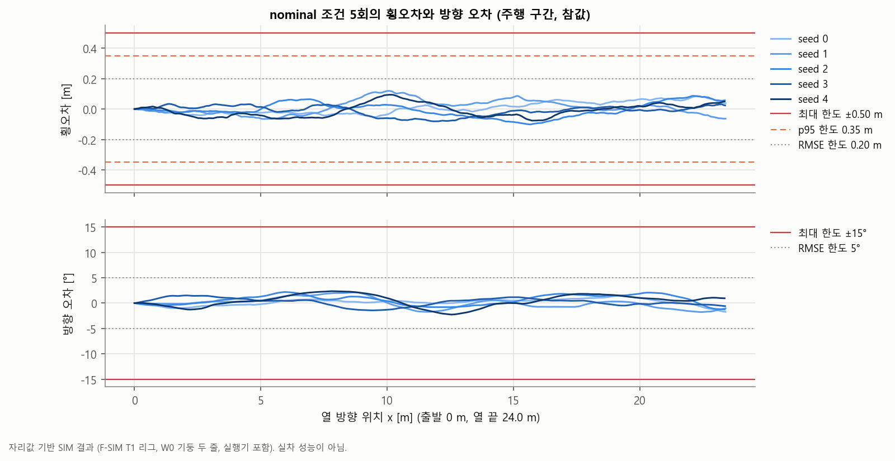
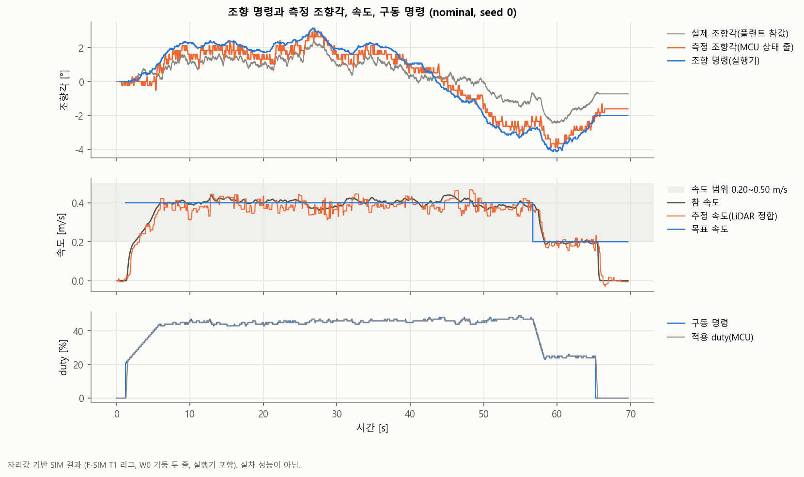
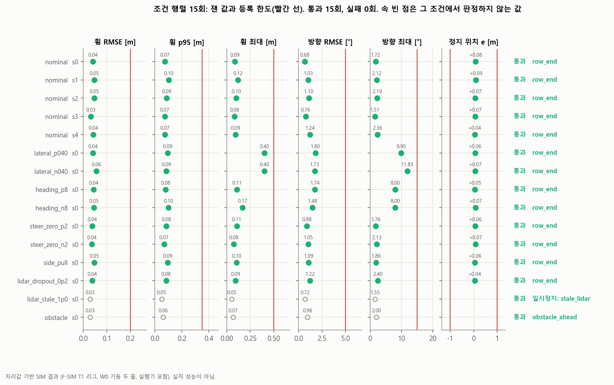
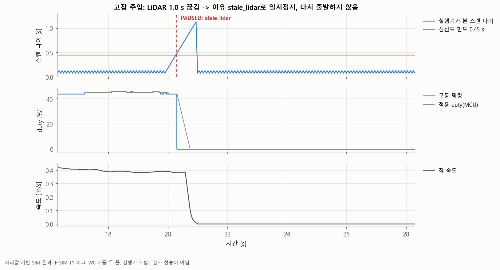
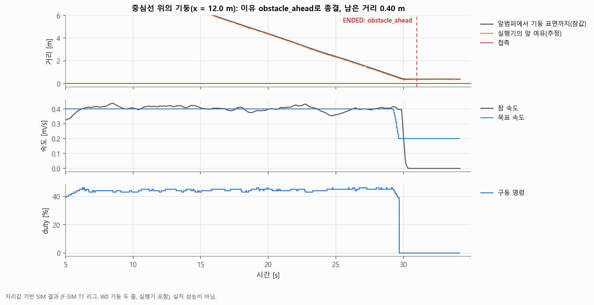
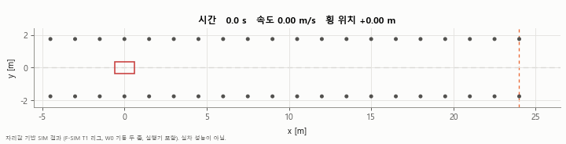

# 단일 열 추종 결과 (steer_follow_v1)

- 사전등록: `PREREG_STEER_FOLLOW_KO.md`, `PREREG_STEER_FOLLOW.json`(측정 전에 커밋 `1c0e538`로 따로 올렸다).
- 대상: 열 추종 제어기 `sim/ubts/closed_loop/steer_control.py`(`{"kind": "row_follow"}`, 기본값), F-SIM T1 리그, 실행기 포함.
- 기계가 읽는 결과: `STEER_FOLLOW_RESULT.json`(`follow_matrix.py`가 쓴 `FOLLOW_MATRIX.json` 그대로. run마다 잰 값, 기준별 판정, trace·직렬·실행기 기록의 SHA-256).
- 모든 수치는 **자리값 기반 SIM 결과**다. 실차 성능이 아니다. 세계는 평지의 기둥 두 줄이고(W0) 과수원 모델이 아니다.

## 1. 상태

반복 1(2026-11-12): 15회 가운데 15회 통과. 실패 0. 기준·조건의 수정 0건. 제어기는 등록 때의 것(`0ba4221`) 그대로이고 고치지 않았다.

## 2. 결과 표 (반복 1)

횡·방향 값은 주행 구간의 참값이다. `lateral_*`, `heading_*` 네 조건의 RMSE·p95는 주행 6.0 m 뒤부터 잰 값이고 최댓값은 처음부터 잰 값이다(등록 3절). 한도: 횡 RMSE 0.20 m, p95 0.35 m, 최대 0.50 m, 방향 RMSE 5°, 최대 15°, 참 속도 최대 0.50 m/s, e ±1.0 m, 최소 여유 > 0 m.

| 조건 | seed | 끝난 이유 | 횡 RMSE [m] | 횡 p95 [m] | 횡 최대 [m] | 방향 RMSE [°] | 방향 최대 [°] | 속도 평균 · 최대 [m/s] | e [m] | 최소 여유 [m] | 판정 |
|---|---|---|---|---|---|---|---|---|---|---|---|
| `nominal` | 0 | `row_end` | 0.041 | 0.074 | 0.086 | 0.68 | 1.72 | 0.37 · 0.44 | +0.080 | 1.20 | 통과 |
| `nominal` | 1 | `row_end` | 0.047 | 0.103 | 0.119 | 1.03 | 2.12 | 0.36 · 0.43 | +0.091 | 1.16 | 통과 |
| `nominal` | 2 | `row_end` | 0.047 | 0.086 | 0.101 | 1.10 | 2.19 | 0.35 · 0.43 | +0.068 | 1.17 | 통과 |
| `nominal` | 3 | `row_end` | 0.033 | 0.073 | 0.081 | 0.76 | 1.51 | 0.37 · 0.45 | +0.071 | 1.20 | 통과 |
| `nominal` | 4 | `row_end` | 0.042 | 0.074 | 0.094 | 1.24 | 2.36 | 0.36 · 0.45 | +0.045 | 1.18 | 통과 |
| `lateral_p040` | 0 | `row_end` | 0.042 | 0.095 | 0.400 | 1.80 | 9.90 | 0.35 · 0.46 | +0.058 | 0.88 | 통과 |
| `lateral_n040` | 0 | `row_end` | 0.055 | 0.085 | 0.400 | 1.73 | 11.83 | 0.36 · 0.44 | +0.066 | 0.88 | 통과 |
| `heading_p8` | 0 | `row_end` | 0.045 | 0.079 | 0.110 | 1.74 | 8.00 | 0.34 · 0.41 | +0.048 | 1.16 | 통과 |
| `heading_n8` | 0 | `row_end` | 0.046 | 0.099 | 0.166 | 1.48 | 8.00 | 0.35 · 0.44 | +0.074 | 1.12 | 통과 |
| `steer_zero_p2` | 0 | `row_end` | 0.039 | 0.085 | 0.107 | 0.88 | 1.76 | 0.35 · 0.43 | +0.062 | 1.18 | 통과 |
| `steer_zero_n2` | 0 | `row_end` | 0.037 | 0.067 | 0.076 | 1.05 | 2.13 | 0.36 · 0.44 | +0.074 | 1.20 | 통과 |
| `side_pull` | 0 | `row_end` | 0.047 | 0.094 | 0.105 | 1.09 | 1.86 | 0.37 · 0.45 | +0.057 | 1.18 | 통과 |
| `lidar_dropout_0p2` | 0 | `row_end` | 0.038 | 0.083 | 0.095 | 1.22 | 2.40 | 0.37 · 0.44 | +0.043 | 1.19 | 통과 |
| `lidar_stale_1p0` | 0 | 일시정지 `stale_lidar` | 0.029 | 0.049 | 0.052 | 0.72 | 1.55 | 0.36 · 0.43 | (판정 안 함) | 1.22 | 통과 |
| `obstacle` | 0 | `obstacle_ahead` | 0.030 | 0.061 | 0.070 | 0.96 | 2.00 | 0.38 · 0.44 | (판정 안 함) | 0.40 | 통과 |

모든 run 공통 기준(접촉 없음, 끝에 정지, guard 위반 종결 없음, 종결 뒤 명령 조향 이동 없음 = A22 규칙)도 15회 모두 통과했다. 종결 뒤 3 s 동안 실행기 조향 명령의 변화는 15회 모두 0°다.

고장 조건:

- `lidar_stale_1p0`: 20.0 s에 끊김 시작, 20.3 s 틱에 스캔 나이가 0.45 s를 넘었고 같은 틱에 구동 명령이 0이 됐다(0.0 s, 한도 0.1 s). 이유 `stale_lidar`로 일시정지했다. 21.0 s쯤 스캔이 돌아왔지만 끝(150 s)까지 구동 명령은 0이었다. x = 7.08 m에서 섰다.
- `obstacle`: 기둥 표면 0.40 m 앞에서 섰다(제어기의 앞 여유 0.35 m). 종결 이유 `obstacle_ahead`.
- `lidar_dropout_0p2`: 일시정지 없이 열 끝까지 갔다.

## 3. 그림

모두 반복 1의 실제 run 기록(`TRACE.npz`, `EXECUTOR.jsonl`)에서 그렸다. 자리값 기반 SIM 결과다.



그림 1. `nominal` seed 0을 위에서 본 모습(자리값 기반 SIM 결과). 위: 기둥 두 줄, 통로 중심선, 차체 중심의 경로, 출발(초록)과 정지(빨강) 때의 차체, 열 끝 선. 아래: 같은 경로의 횡 위치를 세로로 확대한 것. 회색 띠는 최대 한도 ±0.50 m다.



그림 2. `nominal` 5회의 횡오차와 방향 오차를 열 방향 위치에 대해 그린 것(자리값 기반 SIM 결과). 선은 등록 한도다.



그림 3. `nominal` seed 0의 조향 명령·측정 조향각·실제 조향각, 속도(참값·추정·목표), 구동 명령(자리값 기반 SIM 결과). 56 s쯤부터 열 끝 접근 속도 0.20 m/s로 줄이고 65 s에 선다.



그림 4. 조건 행렬 15회의 잰 값과 등록 한도(자리값 기반 SIM 결과). 초록 점은 통과, 빨간 X는 실패(이번에는 없다), 속 빈 점은 그 조건에서 판정하지 않는 값이다. 고장 두 조건의 e는 판정하지 않으며 축 밖이다.



그림 5. `lidar_stale_1p0`: 스캔 나이가 0.45 s를 넘는 순간 이유 `stale_lidar`로 일시정지하고, 스캔이 돌아와도 다시 출발하지 않는다(자리값 기반 SIM 결과).



그림 6. `obstacle`: 중심선 위의 기둥 앞에서 이유 `obstacle_ahead`로 종결한다(자리값 기반 SIM 결과).



그림 7. `nominal` seed 0의 주행을 위에서 본 애니메이션(SIM 시간 1 s마다 한 장, 약 10배속. 자리값 기반 SIM 결과).

## 4. 본 것

1. 속도: 목표 0.40 m/s에 주행 구간 평균 0.34~0.38 m/s(출발 기울기와 열 끝 접근 0.20 m/s 포함), 참 속도 최대 0.41~0.46 m/s. 한도 0.50 m/s까지 0.04 m/s 남는다.
2. 한도에 가장 가까운 값은 횡 출발 어긋남의 방향 최대다: −0.40 m 출발에서 11.8°(한도 15°). 중심선으로 돌아오는 동안의 값이다.
3. 열 끝 정지 위치 e는 +0.04~+0.09 m다(앞범퍼가 마지막 기둥 선을 조금 지난 곳. 띠 ±1.0 m).
4. 조향 영점 ±2°와 쏠림 +0.6 °/m는 `nominal`과 구별되지 않는다(횡 RMSE 0.037~0.047 m).
5. 그림 3에서 측정 조향각과 실제 조향각이 1°쯤 어긋난다(run별 조향 영점 오차). 열 끝 가까이에서는 조향 명령이 −4°까지 커지고 횡 위치가 +0.09 m까지 간다. 한도 안이지만 열 끝 접근 구간의 통로 추정을 따로 볼 만하다.
6. `lidar_stale_1p0`에서 스캔 나이는 끊김이 시작되고 0.3 s 뒤에 0.45 s를 넘었다. 그러니 0.3 s 끊김은 한도에 걸친다. 등록한 0.2 s 끊김만 '멈추지 않는다'를 확인했다.
7. `nominal` seed 0을 한 번 더 돌린 결과는 trace·직렬·실행기 기록의 SHA-256과 잰 값이 반복 1과 같았다.

## 5. 이 결과가 보이지 않는 것

등록 7절과 같다. 실차 성능, G-SIM의 W1, 10/10 통로(W2), 굽은 열·경사·빠진 나무·열 끝 너머의 벽, 구동기 사전값·국소 격자·GNSS 층, IMU 끊김과 조작 신호 끊김은 여기에 없다. seed는 `nominal`만 5개이고 나머지 조건은 1개다.

## 6. 반복 기록

| 반복 | 날짜 | 측정 커밋 | 제어기 | 바꾼 것 | 결과 |
|---|---|---|---|---|---|
| 1 | 2026-11-12 | `1c0e538` | `0ba4221` 그대로 | 없음 | 15 / 15 통과 |

수정 사항(등록 6절): 없음. 반복 1은 프로세스 4개로 55 s 걸렸다(Windows, Python 3.13. 같은 PC에서 다른 작업이 돌고 있었을 수 있어 참고값이다).

## 7. 다시 만드는 법

`sim/ubts`에서(리그의 네이티브 프로그램을 빌드할 수 있어야 한다. `T1_RIG_KO.md`):

```
python -B -m steering.safety_scripts.follow_matrix --out <저장소 밖 폴더> --workers 4
python -B -m steering.safety_scripts.follow_figures --runs <같은 폴더> --animation
```

두 번째 명령이 `docs/steering/figures/steer_follow/`의 그림을 다시 쓴다. `nominal` 한 번만 돌리고 기록을 남기려면:

```
python -B -m steering.safety_scripts.follow_matrix --out <저장소 밖 폴더> --only nominal --seeds 0
```

`<폴더>/follow_nominal_s0/`에 `TRACE.npz`(참값과 명령의 시계열), `EXECUTOR.jsonl`(실행기 틱), `SERIAL.jsonl`, `RESULT.json`이 생긴다.

## 8. 실행기에서 이 제어기를 고르는 법

- 모듈과 팩토리: `sim/ubts/closed_loop/steer_control.py`의 `make_factory(spec, executor_cfg)`. 실행기 쪽 입구는 `steering.scripted_control.make_factory(spec, executor_cfg)`이고 `spec["kind"] == "row_follow"`이면 위 팩토리로 넘긴다. 돌려준 팩토리를 `Runner(cfg, controller_factory=...)`에 준다.
- F-SIM(T1): 에피소드 spec의 `"controller": {"kind": "row_follow"}`.
- Docker 스택의 실행기 컨테이너(`steering.exec_container_main`): 환경 변수 `UBTS_STEER_EXEC_CONTROLLER='{"kind": "row_follow"}'`(`compose.ubts-steer.yaml`이 넘긴다) 또는 인자 `--controller '{"kind": "row_follow"}'`. run 사이에는 SIM 걸이 `controller {"kind": "row_follow"}`로 바꿀 수 있다. 이미지는 `sim/ubts` 전체를 복사하므로 다시 빌드하면 들어간다. 컨테이너에서는 돌려 보지 않았다(이 작업에서는 Docker를 쓰지 않았다).
- 제어기 값은 spec에 `SteerFollowConfig`의 필드 이름으로 넣어 바꾼다(예: `{"kind": "row_follow", "cruise_speed_m_s": 0.35}`). 모르는 이름은 거부한다. 조향 속도·소프트 한계·신선도 한도·duty 상한은 실행기 설정에서 가져온다. 이 결과는 기본값이다.
