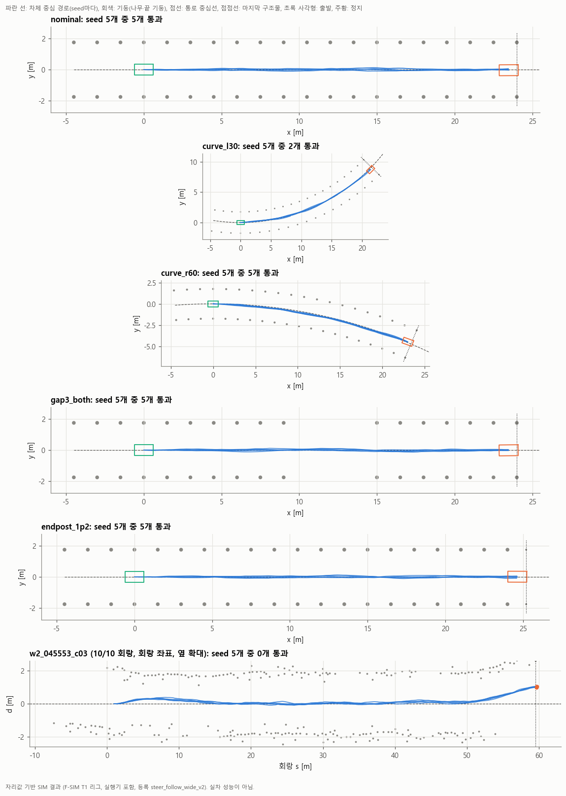
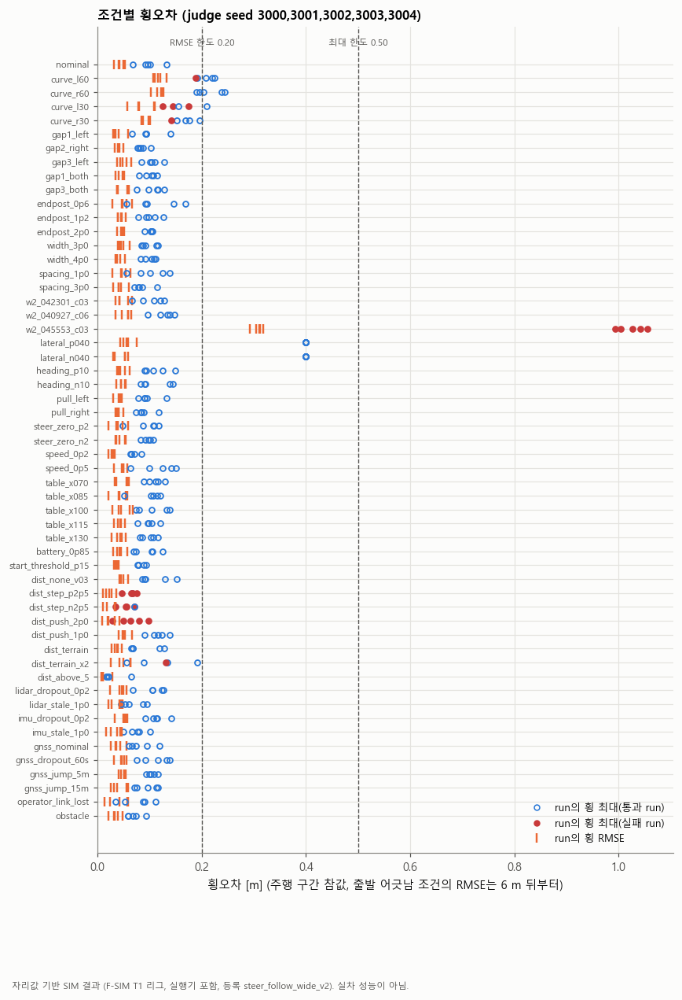
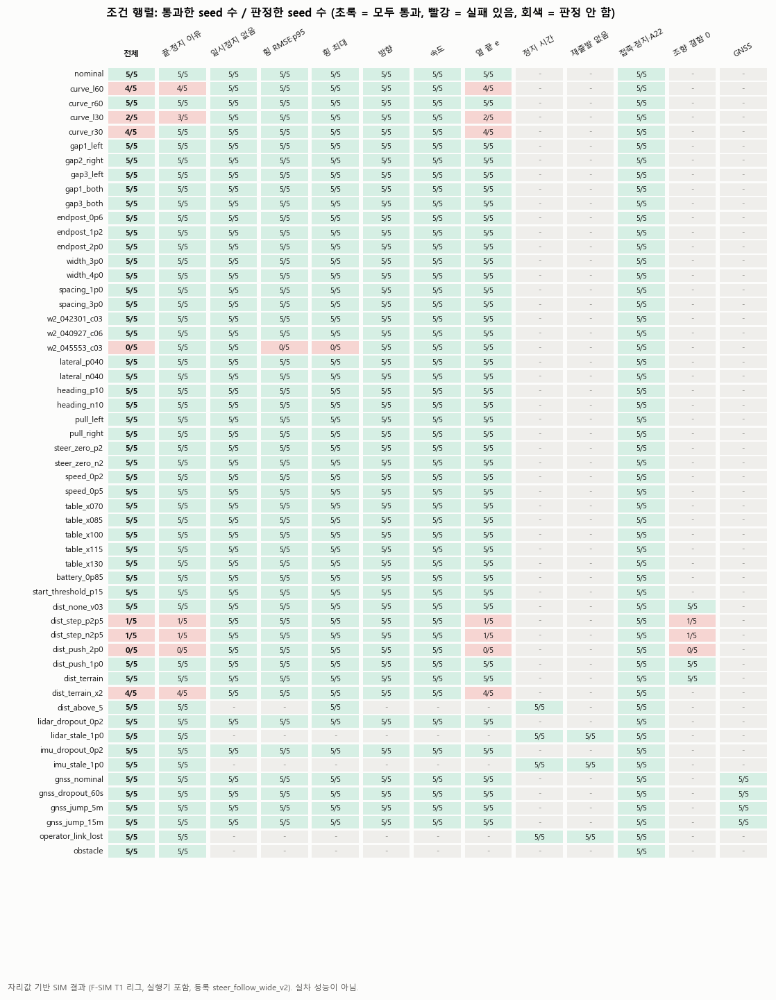
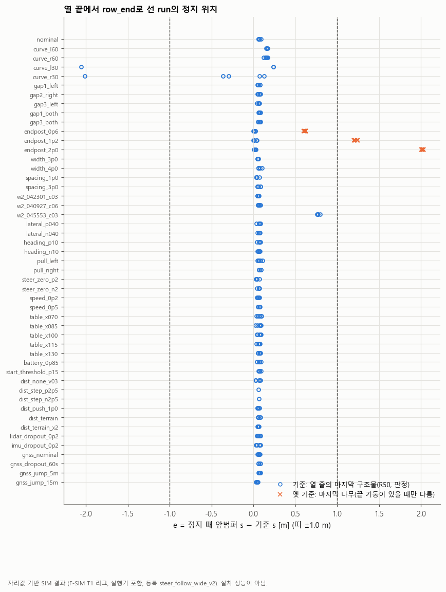
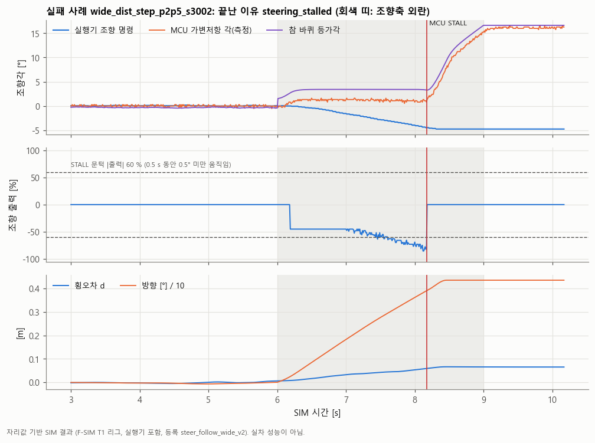
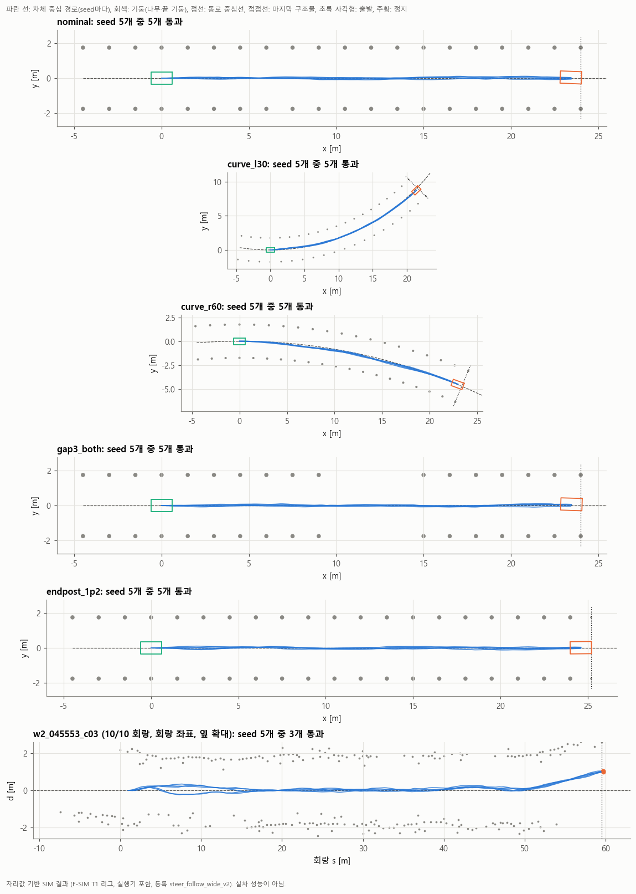
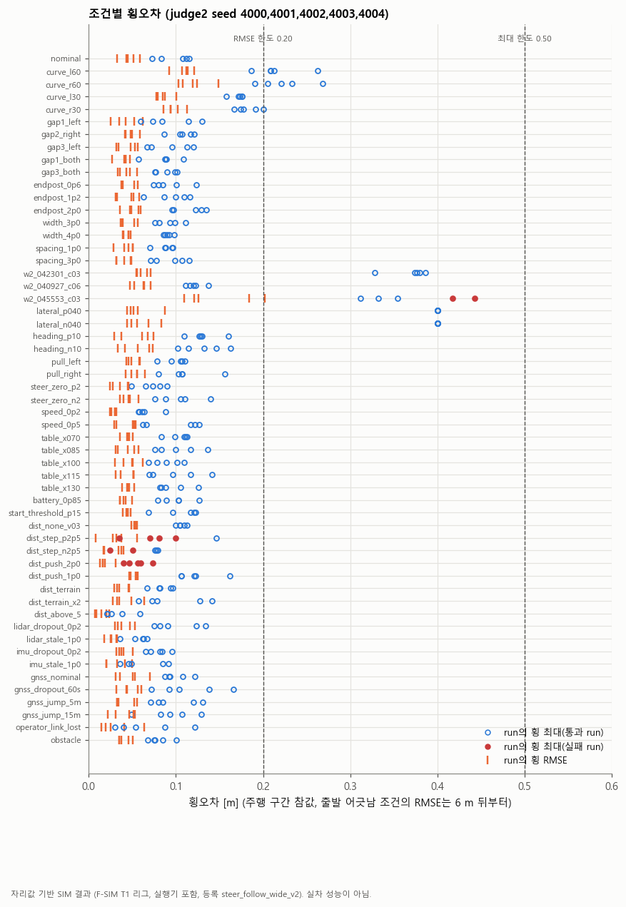
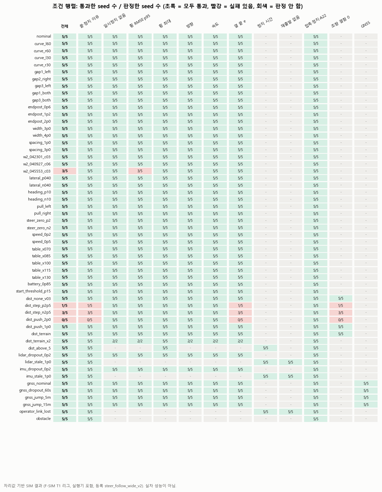
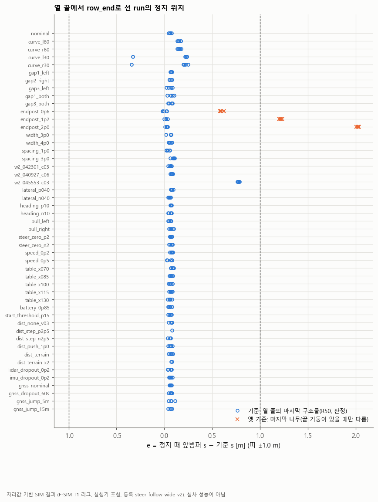
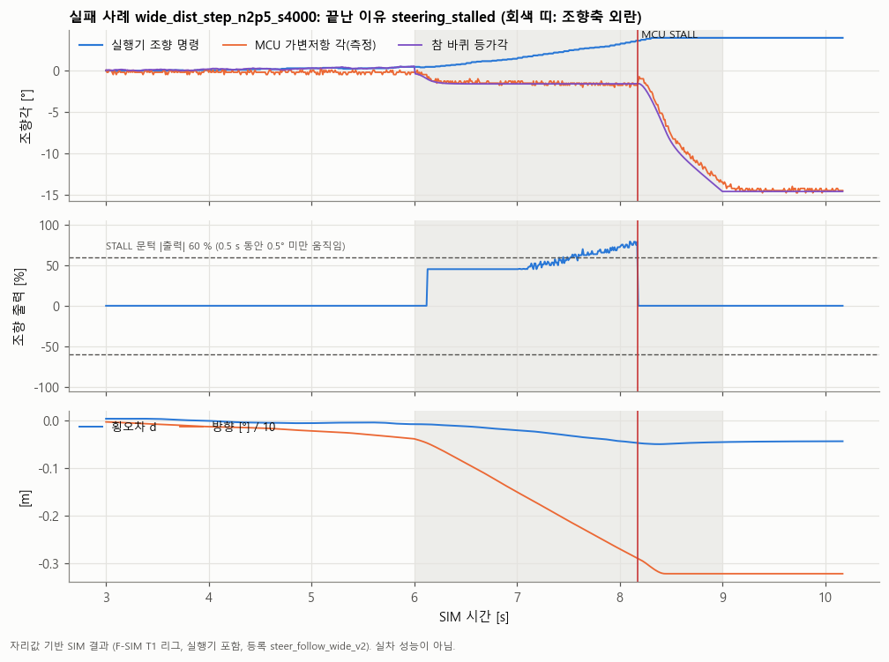

# 단일 열 추종 넓은 확인 결과 (steer_follow_wide_v2)

- 사전등록: `PREREG_STEER_FOLLOW_V2_KO.md`, `PREREG_STEER_FOLLOW_V2.json`(측정 전 커밋 `71b9651`). 합격 기준 개정 50, 열 끝 기준 결정 R50, 고친 것 결정 R51·R52.
- 대상: 열 추종 제어기(`closed_loop/steer_control.py`)와 실행기(`tools/row_executor`), F-SIM T1 리그(실행기 포함). 묶음 S1c, 2026-11-13.
- 기계가 읽는 결과: `STEER_FOLLOW_WIDE_RESULT.json`(반복마다 조건별 통과 수와 실패 기준, 마지막 개발 반복과 판정 실행의 run별 주요 값·실패 기준·SHA-256). 2차는 키 `round2`(프로필 확인, 개발 반복 요약, 판정 run별 값).
- 모든 수치는 **자리값 기반 SIM 결과**다. 실차 성능이 아니다. 세계는 평지의 기둥 두 줄(W0)과 10/10 개발 회랑의 래스터(W2)다.
- **2차**(판정 seed 4000~4004, 코드 `fe7576c`, 등록 문서 11절, 개정 51·52·53, 결정 R53·R54)는 11절이다. 2차도 판정 불합격(262/275)이다. 1~10절은 1차 기록 그대로 둔다.

## 1. 상태

**판정 불합격.** 판정 seed 3000~3004(코드 `402a689`, 개발 반복 3의 코드)에서 275 run 중 251 통과, 24 실패. 등록 규칙(판정 seed 묶음의 모든 run 통과, 등록 6절)에 못 미친다. 조건 55개 중 47개는 5/5 통과다. 기준은 결과를 본 뒤 바꾸지 않았고, 개발 반복은 등록 한도(3번)를 다 썼다.

| 실패 원인 | 판정 실패 run | 넘기는 곳 |
|---|---|---|
| 크기 안 조향축 외란(2.0·2.5 N·m)에서 MCU STALL 13, 2배 지형 외란에서 호스트 따라오지 않음 래치 1 | 14 | 조향 장치 사양·외란 크기·펌웨어 결함 문턱(7절 2) |
| W2 `045553_c03` 끝의 한쪽 열 구간: 카탈로그 중심선 대비 횡오차(차는 남은 열을 따라 e 띠 안에서 섬) | 5 | 다음 등록의 W2 횡오차 정의(7절 3) |
| 굽은 열에서 MCU DRV_STUCK 오검출 | 3 | 펌웨어 규칙 또는 v0.1 문턱(7절 1) |
| 반지름 30 m 굽은 열의 열 끝 약 3 m 앞, 추정기 한 갱신의 거짓 열 끝(e −2.06, −2.01 m) | 2 | 이 묶음의 추정기·열 끝 판정 결함으로 남음(7절 4). 고치려면 개정과 새 판정 seed 4000~4004(등록 6절 규칙 7) |

통과한 것: 곧은 열, 빠진 나무 1~3그루(한쪽·양쪽), 끝 기둥 +0.6·+1.2·+2.0 m(R50 기준 e −0.00 ~ +0.04 m), 열 폭 3.0·4.0 m, 나무 간격 1.0·3.0 m, W2 두 회랑, 출발 옆 ±0.4 m·방향 ±10°, 한쪽 쏠림 ±0.6 °/m, 조향 영점 오차 ±2°, 목표 속도 0.2·0.5 m/s, 구동 표 ×0.70~×1.30·배터리·출발 문턱, 1.0 N·m 미는 힘과 지형 외란, 크기 밖 외란의 결함 정지, LiDAR·IMU 끊김과 낡음, GNSS 정상·60 s 끊김·5·15 m 튐, 운영자 링크 끊김, 앞 장애물. 굽은 열은 반지름 60 m 오른쪽만 5/5다.

## 2. 조건 주입기 (PC-11) 확인

| 완료 기준 | 결과 |
|---|---|
| 조건마다 주입이 기록에 보임 | 등록 문서 2절 표의 '보이는 곳'. 열 모양·W2는 리그 신원의 `world`, 구동 표는 리그 신원 `drive_table`(파일 SHA-256 포함)과 trace `truth_v_m_s`, 외란은 MCU F 줄·trace 참값 조향각, 센서 끊김은 실행기 틱 `lidar_age`·`imu_age`, GNSS는 틱 `gnss` 블록과 수신기 보고, 운영자는 상태 전이 |
| 같은 seed 두 번의 trace 해시가 같음 | 등록 밖 seed 9000으로 6조건(`curve_l30`, `table_x070`, `gnss_jump_5m`, `dist_step_p2p5`, `imu_stale_1p0`, `w2_040927_c06`)을 두 번: trace·직렬·실행기 기록의 SHA-256이 모두 같음 |
| 조건을 끄면 기존 결과와 같음 | `nominal`을 `follow_matrix` run 이름으로 만들면 주입기 전 코드(main `89af3be`)의 `follow_matrix` nominal seed 0과 세 SHA-256이 같음. 플랜트 구동 표는 기본 꺼짐이고 꺼지면 예전 구동 곡선 그대로 |
| 참값이 실행기 입력으로 새지 않음(A13) | 정적 검사 PASS(판정 코드 트리 243 파일, 오류 0). 차동 실행기 기준 에피소드 10개(E1~E6, R1~R4)는 판정 코드(`402a689`)에서도 row·trace·하네스·기록(vendor_commit 뺌)이 이 묶음 전 기준(`8d17f94`)과 같음(반복 2 첫 코드 `e9f0e2f`에서도 같았음) |
| 경사 | 빠른 SIM에 모형이 없어 **주입하지 않음**(모형 없음) |

## 3. 판정 결과 (판정 seed 3000~3004, 코드 `402a689`)

275 run 중 251 통과, 4282 s(작업자 3, 처음 55분은 개발 반복 3과 겹쳐 돎, 참고값). 표의 값은 seed 다섯 개의 범위다. 횡오차는 주행 구간 참값(출발 어긋남 조건의 RMSE는 6 m 뒤부터), e는 정지 때 앞범퍼 s − 열 줄의 마지막 구조물 s(R50), 최소 여유는 차체 테두리와 가장 가까운 구조물 사이다. 한도: 횡 RMSE 0.20, p95 0.35, 최대 0.50 m, 방향 RMSE 5°, 최대 15°, 속도 최대 0.50 m/s(`speed_0p5`만 0.55), e ±1.0 m, 여유 0 m 초과, 정지 뒤 속도 0.02 m/s 미만(등록 5절).

| 묶음 | 조건 | 통과 | 끝난 이유(seed 수) | 횡 RMSE [m] | 횡 최대 [m] | 방향 최대 [°] | 속도 최대 [m/s] | e [m] | 최소 여유 [m] | 실패 기준(run 수) |
|---|---|---|---|---|---|---|---|---|---|---|
| 열 모양 | `nominal` | 5/5 | row_end(5) | 0.031 ~ 0.052 | 0.068 ~ 0.133 | 2.9 ~ 4.4 | 0.43 ~ 0.44 | +0.06 ~ +0.09 | 1.15 ~ 1.21 | - |
| 열 모양 | `curve_l60` | 4/5 | row_end(4), steering_driver_fault(1) | 0.107 ~ 0.132 | 0.188 ~ 0.224 | 1.9 ~ 4.5 | 0.42 ~ 0.45 | +0.15 ~ +0.17 | 1.06 ~ 1.09 | e(1), 끝 이유(1) |
| 열 모양 | `curve_r60` | 5/5 | row_end(5) | 0.102 ~ 0.127 | 0.190 ~ 0.244 | 3.4 ~ 6.0 | 0.43 ~ 0.44 | +0.12 ~ +0.17 | 1.04 ~ 1.09 | - |
| 열 모양 | `curve_l30` | 2/5 | row_end(3), steering_driver_fault(2) | 0.056 ~ 0.109 | 0.126 ~ 0.210 | 3.5 ~ 6.9 | 0.40 ~ 0.44 | -2.06 ~ +0.24 | 1.07 ~ 1.15 | e(3), 끝 이유(2) |
| 열 모양 | `curve_r30` | 4/5 | row_end(5) | 0.085 ~ 0.101 | 0.142 ~ 0.195 | 2.8 ~ 5.5 | 0.39 ~ 0.45 | -2.01 ~ +0.13 | 1.05 ~ 1.14 | e(1) |
| 열 모양 | `gap1_left` | 5/5 | row_end(5) | 0.031 ~ 0.058 | 0.066 ~ 0.140 | 1.7 ~ 4.2 | 0.43 ~ 0.45 | +0.05 ~ +0.08 | 1.14 ~ 1.21 | - |
| 열 모양 | `gap2_right` | 5/5 | row_end(5) | 0.033 ~ 0.049 | 0.076 ~ 0.103 | 1.3 ~ 3.4 | 0.38 ~ 0.45 | +0.05 ~ +0.08 | 1.18 ~ 1.20 | - |
| 열 모양 | `gap3_left` | 5/5 | row_end(5) | 0.038 ~ 0.065 | 0.085 ~ 0.127 | 2.2 ~ 3.7 | 0.43 ~ 0.45 | +0.04 ~ +0.07 | 1.15 ~ 1.20 | - |
| 열 모양 | `gap1_both` | 5/5 | row_end(5) | 0.035 ~ 0.051 | 0.079 ~ 0.114 | 2.0 ~ 3.9 | 0.43 ~ 0.46 | +0.06 ~ +0.08 | 1.16 ~ 1.19 | - |
| 열 모양 | `gap3_both` | 5/5 | row_end(5) | 0.037 ~ 0.060 | 0.076 ~ 0.128 | 2.0 ~ 3.4 | 0.43 ~ 0.46 | +0.05 ~ +0.08 | 1.15 ~ 1.21 | - |
| 열 모양 | `endpost_0p6` | 5/5 | row_end(5) | 0.028 ~ 0.066 | 0.056 ~ 0.169 | 1.8 ~ 4.1 | 0.43 ~ 0.44 | -0.00 ~ +0.02 | 1.09 ~ 1.22 | - |
| 열 모양 | `endpost_1p2` | 5/5 | row_end(5) | 0.038 ~ 0.053 | 0.077 ~ 0.126 | 2.0 ~ 3.3 | 0.44 ~ 0.46 | -0.00 ~ +0.04 | 1.15 ~ 1.19 | - |
| 열 모양 | `endpost_2p0` | 5/5 | row_end(5) | 0.037 ~ 0.051 | 0.090 ~ 0.105 | 2.0 ~ 3.4 | 0.44 ~ 0.46 | +0.01 ~ +0.03 | 1.17 ~ 1.19 | - |
| 열 모양 | `width_3p0` | 5/5 | row_end(5) | 0.038 ~ 0.061 | 0.084 ~ 0.115 | 2.5 ~ 3.8 | 0.43 ~ 0.46 | +0.05 ~ +0.06 | 0.91 ~ 0.94 | - |
| 열 모양 | `width_4p0` | 5/5 | row_end(5) | 0.034 ~ 0.052 | 0.083 ~ 0.111 | 2.0 ~ 3.4 | 0.34 ~ 0.47 | +0.06 ~ +0.10 | 1.41 ~ 1.45 | - |
| 열 모양 | `spacing_1p0` | 5/5 | row_end(5) | 0.028 ~ 0.063 | 0.055 ~ 0.139 | 1.5 ~ 2.9 | 0.43 ~ 0.45 | +0.03 ~ +0.07 | 1.13 ~ 1.22 | - |
| 열 모양 | `spacing_3p0` | 5/5 | row_end(5) | 0.029 ~ 0.060 | 0.071 ~ 0.115 | 1.5 ~ 3.6 | 0.43 ~ 0.44 | +0.05 ~ +0.09 | 1.17 ~ 1.23 | - |
| W2 | `w2_042301_c03` | 5/5 | row_end(5) | 0.034 ~ 0.065 | 0.066 ~ 0.127 | 2.3 ~ 5.4 | 0.44 ~ 0.47 | +0.04 ~ +0.07 | 0.59 ~ 0.72 | - |
| W2 | `w2_040927_c06` | 5/5 | row_end(5) | 0.035 ~ 0.065 | 0.097 ~ 0.148 | 2.2 ~ 4.8 | 0.43 ~ 0.45 | +0.05 ~ +0.08 | 1.32 ~ 1.43 | - |
| W2 | `w2_045553_c03` | 0/5 | row_end(5) | 0.293 ~ 0.319 | 0.994 ~ 1.056 | 6.6 ~ 10.3 | 0.44 ~ 0.45 | +0.76 ~ +0.80 | 0.40 ~ 0.45 | 횡 RMSE(5), 횡 p95(5), 횡 최대(5) |
| 출발 | `lateral_p040` | 5/5 | row_end(5) | 0.044 ~ 0.076 | 0.400 | 9.2 ~ 11.3 | 0.44 ~ 0.46 | +0.04 ~ +0.09 | 0.86 ~ 0.88 | - |
| 출발 | `lateral_n040` | 5/5 | row_end(5) | 0.030 ~ 0.059 | 0.400 | 9.1 ~ 10.4 | 0.42 ~ 0.45 | +0.05 ~ +0.08 | 0.88 | - |
| 출발 | `heading_p10` | 5/5 | row_end(5) | 0.037 ~ 0.062 | 0.089 ~ 0.148 | 10.0 | 0.43 ~ 0.46 | +0.04 ~ +0.08 | 1.13 ~ 1.19 | - |
| 출발 | `heading_n10` | 5/5 | row_end(5) | 0.036 ~ 0.053 | 0.083 ~ 0.144 | 10.0 | 0.42 ~ 0.46 | +0.05 ~ +0.08 | 1.11 ~ 1.20 | - |
| 차 | `pull_left` | 5/5 | row_end(5) | 0.030 ~ 0.046 | 0.078 ~ 0.132 | 1.4 ~ 2.7 | 0.44 ~ 0.45 | +0.05 ~ +0.11 | 1.15 ~ 1.20 | - |
| 차 | `pull_right` | 5/5 | row_end(5) | 0.035 ~ 0.049 | 0.073 ~ 0.118 | 1.9 ~ 3.5 | 0.43 ~ 0.44 | +0.07 ~ +0.09 | 1.16 ~ 1.20 | - |
| 차 | `steer_zero_p2` | 5/5 | row_end(5) | 0.021 ~ 0.059 | 0.048 ~ 0.118 | 0.9 ~ 3.7 | 0.43 ~ 0.45 | +0.03 ~ +0.07 | 1.16 ~ 1.23 | - |
| 차 | `steer_zero_n2` | 5/5 | row_end(5) | 0.034 ~ 0.054 | 0.083 ~ 0.107 | 1.6 ~ 3.0 | 0.30 ~ 0.45 | +0.04 ~ +0.07 | 1.17 ~ 1.19 | - |
| 속도 | `speed_0p2` | 5/5 | row_end(5) | 0.021 ~ 0.033 | 0.063 ~ 0.084 | 2.1 ~ 2.6 | 0.23 ~ 0.23 | +0.04 ~ +0.07 | 1.19 ~ 1.22 | - |
| 속도 | `speed_0p5` | 5/5 | row_end(5) | 0.032 ~ 0.056 | 0.064 ~ 0.150 | 2.3 ~ 3.5 | 0.47 ~ 0.50 | +0.05 ~ +0.08 | 1.13 ~ 1.21 | - |
| 구동 표 | `table_x070` | 5/5 | row_end(5) | 0.033 ~ 0.060 | 0.088 ~ 0.130 | 1.8 ~ 3.6 | 0.39 ~ 0.42 | +0.04 ~ +0.10 | 1.15 ~ 1.18 | - |
| 구동 표 | `table_x085` | 5/5 | row_end(5) | 0.020 ~ 0.057 | 0.051 ~ 0.120 | 1.4 ~ 2.9 | 0.42 ~ 0.45 | +0.03 ~ +0.09 | 1.16 ~ 1.23 | - |
| 구동 표 | `table_x100` | 5/5 | row_end(5) | 0.029 ~ 0.068 | 0.074 ~ 0.139 | 1.5 ~ 4.1 | 0.44 ~ 0.46 | +0.04 ~ +0.09 | 1.15 ~ 1.20 | - |
| 구동 표 | `table_x115` | 5/5 | row_end(5) | 0.031 ~ 0.053 | 0.077 ~ 0.120 | 2.2 ~ 3.2 | 0.45 ~ 0.47 | +0.04 ~ +0.08 | 1.16 ~ 1.20 | - |
| 구동 표 | `table_x130` | 5/5 | row_end(5) | 0.028 ~ 0.054 | 0.081 ~ 0.115 | 1.3 ~ 3.5 | 0.46 ~ 0.49 | +0.05 ~ +0.09 | 1.16 ~ 1.20 | - |
| 구동 표 | `battery_0p85` | 5/5 | row_end(5) | 0.030 ~ 0.058 | 0.069 ~ 0.126 | 2.1 ~ 2.7 | 0.43 ~ 0.45 | +0.04 ~ +0.09 | 1.15 ~ 1.21 | - |
| 구동 표 | `start_threshold_p15` | 5/5 | row_end(5) | 0.032 ~ 0.040 | 0.076 ~ 0.093 | 1.6 ~ 4.0 | 0.42 ~ 0.44 | +0.06 ~ +0.09 | 1.18 ~ 1.20 | - |
| 조향 외란 | `dist_none_v03` | 5/5 | row_end(5) | 0.042 ~ 0.059 | 0.086 ~ 0.152 | 1.0 ~ 3.6 | 0.44 ~ 0.45 | +0.02 ~ +0.09 | 1.13 ~ 1.19 | - |
| 조향 외란 | `dist_step_p2p5` | 1/5 | row_end(1), steering_stalled(4) | 0.011 ~ 0.035 | 0.046 ~ 0.075 | 3.5 ~ 5.4 | 0.40 ~ 0.42 | +0.06 | 1.16 ~ 1.21 | MCU 조향 결함(4), e(4), 끝 이유(4), 호스트 래치(4) |
| 조향 외란 | `dist_step_n2p5` | 1/5 | row_end(1), steering_stalled(4) | 0.010 ~ 0.035 | 0.035 ~ 0.070 | 2.5 ~ 3.1 | 0.35 ~ 0.39 | +0.07 | 1.18 ~ 1.25 | MCU 조향 결함(4), e(4), 끝 이유(4), 호스트 래치(4) |
| 조향 외란 | `dist_push_2p0` | 0/5 | steering_stalled(5) | 0.009 ~ 0.041 | 0.029 ~ 0.097 | 2.7 ~ 4.5 | 0.36 ~ 0.42 | - | 1.16 ~ 1.21 | MCU 조향 결함(5), e(5), 끝 이유(5), 호스트 래치(5) |
| 조향 외란 | `dist_push_1p0` | 5/5 | row_end(5) | 0.040 ~ 0.066 | 0.090 ~ 0.138 | 3.0 ~ 4.4 | 0.43 ~ 0.45 | +0.05 ~ +0.07 | 1.13 ~ 1.17 | - |
| 조향 외란 | `dist_terrain` | 5/5 | row_end(5) | 0.028 ~ 0.046 | 0.065 ~ 0.128 | 1.9 ~ 4.5 | 0.40 ~ 0.45 | +0.05 ~ +0.08 | 1.15 ~ 1.21 | - |
| 조향 외란 | `dist_terrain_x2` | 4/5 | row_end(4), steering_not_following(1) | 0.026 ~ 0.064 | 0.055 ~ 0.191 | 2.1 ~ 4.7 | 0.42 ~ 0.44 | +0.05 ~ +0.07 | 1.08 ~ 1.21 | (열 끝 갈래) 열 끝에서 섬(1), (열 끝 갈래) e(1) |
| 조향 외란 | `dist_above_5` | 5/5 | steering_driver_fault(3), steering_polarity_fault(2) | 0.007 ~ 0.028 | 0.017 ~ 0.064 | 0.5 ~ 2.1 | 0.29 ~ 0.41 | - | 1.20 ~ 1.26 | - |
| 센서 | `lidar_dropout_0p2` | 5/5 | row_end(5) | 0.024 ~ 0.055 | 0.068 ~ 0.126 | 2.0 ~ 3.0 | 0.43 ~ 0.46 | +0.04 ~ +0.09 | 1.15 ~ 1.21 | - |
| 센서 | `lidar_stale_1p0` | 5/5 | 일시정지 stale_lidar(5) | 0.020 ~ 0.048 | 0.044 ~ 0.095 | 0.6 ~ 3.6 | 0.41 ~ 0.43 | - | 1.18 ~ 1.23 | - |
| 센서 | `imu_dropout_0p2` | 5/5 | row_end(5) | 0.033 ~ 0.056 | 0.091 ~ 0.142 | 2.9 ~ 3.5 | 0.44 ~ 0.45 | +0.03 ~ +0.08 | 1.14 ~ 1.19 | - |
| 센서 | `imu_stale_1p0` | 5/5 | 일시정지 stale_imu(5) | 0.016 ~ 0.047 | 0.049 ~ 0.101 | 0.8 ~ 2.7 | 0.41 ~ 0.43 | - | 1.16 ~ 1.21 | - |
| GNSS | `gnss_nominal` | 5/5 | row_end(5) | 0.025 ~ 0.056 | 0.060 ~ 0.119 | 0.7 ~ 3.2 | 0.44 ~ 0.45 | +0.04 ~ +0.08 | 1.16 ~ 1.22 | - |
| GNSS | `gnss_dropout_60s` | 5/5 | row_end(5) | 0.031 ~ 0.055 | 0.074 ~ 0.138 | 2.3 ~ 3.9 | 0.42 ~ 0.45 | +0.06 ~ +0.09 | 1.14 ~ 1.20 | - |
| GNSS | `gnss_jump_5m` | 5/5 | row_end(5) | 0.041 ~ 0.054 | 0.093 ~ 0.116 | 1.6 ~ 3.8 | 0.44 ~ 0.46 | +0.06 ~ +0.09 | 1.17 ~ 1.18 | - |
| GNSS | `gnss_jump_15m` | 5/5 | row_end(5) | 0.025 ~ 0.059 | 0.070 ~ 0.115 | 1.6 ~ 2.8 | 0.43 ~ 0.46 | +0.03 ~ +0.06 | 1.16 ~ 1.20 | - |
| 운영자 | `operator_link_lost` | 5/5 | 일시정지 operator_link_lost(5) | 0.013 ~ 0.059 | 0.034 ~ 0.112 | 0.3 ~ 2.8 | 0.41 ~ 0.43 | - | 1.16 ~ 1.24 | - |
| 장애물 | `obstacle` | 5/5 | obstacle_ahead(5) | 0.021 ~ 0.047 | 0.059 ~ 0.093 | 0.6 ~ 3.1 | 0.39 ~ 0.45 | - | 0.39 ~ 0.45 | - |

멈춤 시간(같은 판정 run):

| 조건 | 잰 것 | 값(5 run) | 한도 |
|---|---|---|---|
| `lidar_stale_1p0` | LiDAR 나이가 0.45 s를 넘은 뒤 구동 0까지 | 0.00 s | 0.10 s |
| `imu_stale_1p0` | IMU 나이가 0.40 s를 넘은 뒤 구동 0까지 | 0.00 s | 0.10 s |
| `operator_link_lost` | 마지막 하트비트 뒤 실행기 구동 0까지(trace 0까지 0.56 s) | 0.55 s | 0.55 s |
| `dist_above_5` | 외란 시작 뒤 MCU 조향 결함 F 줄까지(DRV_STUCK 3, POLARITY 2) | 0.20 ~ 0.27 s | 3 s |
| `obstacle` | 앞 장애물 정지 뒤 최소 여유 | 0.39 ~ 0.45 m | 0 m 초과 |
| `gnss_jump_5m`·`gnss_jump_15m` | 실행기 GNSS 층(`geofence`)의 튐 기각 수, 펜스 | 기각 3(튄 fix 3), 펜스 안 걸림 | 기각 수 = 튄 fix 수, 펜스 안 걸림 |

판정 실패 24 run:

| 원인 | 조건과 run | 기록에 보인 것 |
|---|---|---|
| MCU STALL(크기 안 외란) | `dist_step_p2p5` s3000·s3002·s3003·s3004, `dist_step_n2p5` s3000·s3002·s3003·s3004, `dist_push_2p0` 5 run | 외란 시작(6 s) 뒤 2.2~4.0 s에 STALL F 줄, 호스트 래치 `MCU fault STALL`, 그 자리에서 정지(e −20.6 ~ −21.7 m). 실행기 바깥 루프가 방향을 되돌리려 조향 명령을 반대쪽으로 키우고, 서보 출력이 60 %를 넘은 채 0.5 s 동안 0.5° 못 움직임(그림 5) |
| 호스트 따라오지 않음 래치 | `dist_terrain_x2` s3004 | 요청 115 / 측정 49 mrad, MCU F 줄 없음 → 열 끝 갈래 판정에서 실패(e −17.66 m) |
| 한쪽 열 구간의 횡오차 | `w2_045553_c03` 5 run | 횡 RMSE 0.29~0.32, 최대 0.99~1.06 m(카탈로그 중심선 대비). e +0.76 ~ +0.80 m, 최소 여유 0.40~0.45 m |
| MCU DRV_STUCK 오검출 | `curve_l60` s3001(29.5 s), `curve_l30` s3001(25.3 s)·s3002(59.7 s) | 굽은 열 추종 중 F 줄 DRV_STUCK, 래치 `MCU fault DRV_STUCK` |
| 거짓 열 끝 | `curve_l30` s3004(e −2.06 m), `curve_r30` s3001(e −2.01 m) | 열 끝 약 3.1 m 앞에서 실행기의 열 끝 거리가 한 번에 0.41·0.46 m로 떨어지고(방향 추정도 2.5° 튐) 0.3 s 뒤 2.7 m로 돌아왔다. 열 끝 정지는 그 한 번에 래치됐다. 개발 반복 3의 `curve_r30` s100과 같은 모양(6절 반복 3의 진단) |

## 4. 그림

그림은 판정 실행(`measure/judge_head_402a689`)에서 만들었다. 모두 자리값 기반 SIM 결과다.



그림 1. 위에서 본 궤적(seed 다섯 개를 겹침). 곧은 열, 반지름 30 m 왼쪽·60 m 오른쪽 굽은 열, 가운데 세 그루가 양쪽 다 빠진 열, 끝 기둥 +1.2 m, W2 `045553_c03`(회랑 좌표, 옆 방향 확대). 점선은 통로 중심선, 점점선은 열 줄의 마지막 구조물이다. `curve_l30`은 거짓 열 끝 1과 DRV_STUCK 2로 2/5다. W2 `045553_c03`은 오른쪽 열이 끝난 뒤 왼쪽 열을 따라 바깥으로 나간다(카탈로그 중심선 대비 횡오차 실패).



그림 2. 조건별 횡오차: run마다 최대(동그라미, 실패 run은 채움)와 RMSE(막대). 점선은 RMSE 한도 0.20 m와 최대 한도 0.50 m. 굽은 열이 곧은 열보다 크고(최대 0.13~0.24 m), W2 `045553_c03`만 한도를 넘는다. `lateral_p040`·`lateral_n040`의 최대 0.40 m는 출발 어긋남 그 자체다.



그림 3. 조건 행렬: 기준마다 통과한 seed 수 / 판정한 seed 수. 회색은 그 조건에서 판정하지 않는 기준이다.



그림 4. row_end로 선 run의 e. 동그라미는 판정 기준(열 줄의 마지막 구조물, R50), × 표시는 옛 기준(마지막 나무)으로 잰 값이다(끝 기둥 조건에서만 다름: +0.6·+1.2·+2.0 m 끝 기둥이 있으면 옛 기준으로는 +0.6·+1.2·+2.0 m 뒤에 선 것이 된다). 왼쪽 끝 두 점이 거짓 열 끝(−2.06, −2.01 m)이다.



그림 5. 실패 사례 `dist_step_p2p5` s3002. 6 s에 바퀴를 미는 2.5 N·m가 들어오자 참 바퀴각이 3.4°로 밀리고, 실행기는 방향 오차를 되돌리려 조향 명령을 −4.6°까지 키운다. ESP 서보 출력이 −45 %에서 −60 %를 넘고 0.5 s 동안 가변저항 각이 0.5° 넘게 움직이지 않아 8.18 s에 MCU STALL. 출력이 끊긴 뒤 외란이 바퀴를 16°까지 민다(차는 이미 멈춤, 횡오차 0.07 m).

## 5. PW-08 시험

### 5.1 표 한 칸 ±1 %

코드 `9fd4191`(등록 문서 10절 2: 첫 실행 `71b9651`은 빈 바닥에서 출발하지 못해 값이 없었다). 패키지 현장 조정 파일(SHA-256 `f60e2650…`)과 첫 칸(25 % duty, 0.239 m/s)을 ×1.10으로 바꾼 사본(`f401e9a4…`). seed 3100, 두 파일 같은 난수 흐름.

| duty | 파일 표의 비 | 빠른 SIM 플랜트 정상 속도(원래 → 바꾼 파일) | 비 | 실행기 표 속도 | 비 | 판정 |
|---|---|---|---|---|---|---|
| 25 % | 1.1000 | 0.25086 → 0.27588 m/s | 1.09974 | 0.239 → 0.2629 m/s | 1.1000 | 통과 |
| 50 % | 1.02879 | 0.47604 → 0.48975 m/s | 1.02880 | 0.45264 → 0.46567 m/s | 1.02879 | 통과 |

- 바꾼 파일 run에서 실행기 기록의 파일 SHA-256(`tuning.file_sha256`)과 리그 기록의 `drive_table` 출처 SHA-256이 같다(`f401e9a4…`).
- 세 곳 중 Gazebo는 **돌리지 않았다**(Docker 스택은 묶음 S2·S5 몫). 그래서 PW-08의 '세 곳' 기준은 두 곳만 확인했다.
- 보고: 플랜트 정상 속도의 절대값은 표보다 약 5 % 높았다(0.2509/0.239, 0.4760/0.4526). 플랜트의 속도 흔들림(OU, sd 0.05, 2 s)이 그 10 s 창에서 평균 +5 %였다. 비는 같은 난수 흐름이라 흔들림이 지워진다.

### 5.2 어긋남 5단계(판정 seed)

등록 7.2절. 실행기는 현장 조정 파일의 표를 믿고(온라인 배율 없음) 빠른 SIM의 차만 표 × 0.70 ~ 1.30, 배터리 처짐 ×0.85, 출발 문턱 +15 %로 바꿨다. 판정 seed 3000~3004의 결과:

| 조건 | 완주 | 횡 RMSE 평균·최대 [m] | 순항 속도 오차 평균 [m/s] | 순항 \|오차\| p95 [m/s] | 평균 속도 [m/s] | 정지 거리 평균 [m] |
|---|---|---|---|---|---|---|
| `table_x070` | 5/5 | 0.049 · 0.060 | -0.054 | 0.188 | 0.331 | 0.087 |
| `table_x085` | 5/5 | 0.043 · 0.057 | -0.026 | 0.141 | 0.358 | 0.084 |
| `table_x100` | 5/5 | 0.049 · 0.068 | -0.005 | 0.108 | 0.370 | 0.076 |
| `table_x115` | 5/5 | 0.042 · 0.053 | +0.005 | 0.064 | 0.371 | 0.066 |
| `table_x130` | 5/5 | 0.042 · 0.054 | +0.010 | 0.102 | 0.369 | 0.065 |
| `battery_0p85` | 5/5 | 0.042 · 0.058 | -0.023 | 0.156 | 0.360 | 0.084 |
| `start_threshold_p15` | 5/5 | 0.036 · 0.040 | -0.046 | 0.220 | 0.334 | 0.075 |
| `nominal` | 5/5 | 0.043 · 0.052 | -0.014 | 0.141 | 0.358 | 0.073 |

- 일곱 조건 모두 5/5 열 끝에서 섰다. 차가 표보다 30 % 빠른 `table_x130`의 참 속도 최대는 0.46~0.49 m/s(한도 0.50, 반복 1의 0.48~0.54에서 고침 ③으로 내려옴).
- 순항 속도 오차는 차가 느릴수록 음수로 커진다(×0.70: 평균 −0.054 m/s). 실행기의 속도 되먹임이 표의 어긋남을 다 메우지는 못한다는 뜻이다. 정지 거리는 0.07~0.09 m(플랜트 자리값).

## 6. 반복 기록

개발 반복은 개발 seed 100~104(조건 55개 × 5 = 275 run)로 돌렸다. 등록 6절 규칙대로 결과를 본 뒤 기준은 바꾸지 않았고, 고친 것은 제어기·추정기·실행기 설정이다(결정 R51, R52).

| 반복 | 코드 | 바꾼 것 | 통과 | DRV_STUCK | 조향 외란(STALL·따라오지 않음·창) | 거짓·늦은 열 끝 | 속도 초과 | W2 `045553_c03` |
|---|---|---|---|---|---|---|---|---|
| 1 | `71b9651` | 없음(등록 커밋) | 250/275 | 2 | 14 | 2 | 2 | 5 |
| 2 | `5ee262f` | R51 ① 열 끝 곡선 맞춤, ② 조향 명령 창, ③ 속도 규칙 | 245/275 | 8 | 13 | 4 | 0 | 5 |
| 3 | `402a689` | R52: ② 뺌, ① 곡선 자라기에 가장자리·빈칸 조건 | 250/275 | 5 | 14 | 1 | 0 | 5 |
| 판정(seed 3000~3004) | `402a689` | 없음 | 251/275 | 3 | 14 | 2 | 0 | 5 |

판정 코드는 반복 3의 `402a689`다(개발 반복은 3번까지).

### 반복 1 (코드 `71b9651` = 등록 커밋, 개발 seed 100~104)

275 run 중 250 통과, 실패 25. 3140 s(작업자 3, 다른 작업의 부하가 큰 호스트, 참고값).

| 조건 | 실패 run | 실패 기준 | 원인 | 분류(등록 6절 규칙 2) | 처리 |
|---|---|---|---|---|---|
| `curve_l30` | s102, s103 | e(−14.16, −9.14 m), 끝 이유는 row_end | 추정기의 열 끝 규칙이 곧은 band 선에서 옆 거리를 재어, 반지름 30 m 열의 두 선이 4~8 m 앞에서 끝난 것으로 보였다(물러나는 거짓 열 끝). 가까워진 한 갱신에서 섰다 | (가) 추정기 | 고침 ①(R51) |
| `curve_l30` | s101 | 끝 이유(`steering_driver_fault`), e | MCU DRV_STUCK(54.2 s). 아래 DRV_STUCK 항목 | 펌웨어 규칙 | 고치지 않음(P9) |
| `pull_left` | s101 | 끝 이유(`steering_driver_fault`), e | MCU DRV_STUCK(32.8 s) | 펌웨어 규칙 | 고치지 않음(P9) |
| `w2_045553_c03` | 5/5 | 횡 RMSE(0.28~0.31), p95(0.77~0.91), 최대(0.99~1.07 m) | 오른쪽 열이 s 53.9 m에서 끝나고 왼쪽 열만 59.5 m까지 이어지며 바깥으로 벌어진다(d 1.9 → 2.6 m). 차는 남은 왼쪽 열을 따라가 마지막 구조물 뒤 0.76 m에서 섰다(e 통과). 한쪽 열 구간의 카탈로그 중심선은 두 열이 없는 곳의 연장선이라 그 대비 횡오차가 1 m까지 커졌다. 접촉 없음(최소 여유 0.43 m) | (라) 기준·기대 | 이 등록에서는 바꾸지 않음. 다음 등록 제안: W2 횡오차는 두 열이 다 있는 구간에서 잰다 |
| `table_x130` | s101, s103 | 참 속도 최대 0.542, 0.504 m/s | 차가 표보다 1.3배 빠른데 시작 램프가 LiDAR 속도가 0.40 m/s를 넘은 뒤에도 duty를 표 앞먹임 쪽으로 올렸다(그동안 적분도 멈춤) | (가) 제어기 | 고침 ③(R51) |
| `dist_step_p2p5` | 4/5 | 끝 이유(`steering_stalled`), e, MCU 결함, 호스트 래치 | 외란이 바퀴를 밀고 ESP가 최소 출력 45 %로 붙잡는 동안 바깥 루프가 명령을 반대쪽으로 계속 키워 서보 오차가 4°, 출력이 60 %를 넘었고 0.5 s 동안 0.5° 못 움직여 STALL | (가) 제어기 | 고침 ②(R51) |
| `dist_step_n2p5` | 4/5 | 같음 | 같음 | (가) 제어기 | 고침 ② |
| `dist_push_2p0` | 5/5 | 같음 | 같음(2.0 N·m 10 s). 바퀴를 되돌리기 시작한 출력이 약 76 %였다 | (가) 제어기 + 조향 장치 한계 | 고침 ②는 STALL을 막지만 10 s 밀림은 남는 한계(R51) |
| `dist_terrain_x2` | s100 | 열 끝 갈래의 끝 이유·e | 호스트 따라오지 않음 래치(요청 −128, 측정 −64 mrad). MCU F 줄이 없어 결함 갈래가 아닌 열 끝 갈래로 판정 | (가) 제어기(같은 되감김) | 고침 ② |

DRV_STUCK 오검출(펌웨어 `firmware/ubts_steer_v3/fw_monitor.cpp` `stuck_run_step`): BRAKE 중 가변저항 각이 데드밴드보다 크게 흔들려 Drift 단계로 들어간 뒤, 서보의 밀기가 위치를 데드밴드보다 크게 옮기고 바로 출력 0으로 돌아오면 u = 0 갈래가 run을 새로 시작하지 않고 이어서 센다. 그래서 서보 자신의 밀기를 'PWM 0인데 움직임'으로 센다(`pull_left` s101: 0.3 s 전 −0.53°, 판정 때 +1.61°, v0.1 문턱 2°/0.3 s). 프로필 v0.1의 문턱 2°는 이미 '주행 중 오판'으로 기록돼 v0.2부터 3°다(R18 결정 3). 기본 프로필은 v0.1이다(v0.3 자격 불합격, `STEER_PROFILE_V03_KO.md`). 펌웨어 규칙은 실차 MCU와 같은 코드라 이 묶음에서 고치지 않았다(P9 후보).

### 반복 2 (코드 `5ee262f`: R51 ①②③, 개발 seed 100~104)

275 run 중 245 통과, 실패 30. 3119 s(작업자 4, 참고값). 반복 1보다 나빠졌다.

| 실패 원인 | run | 조건 | 처리 |
|---|---|---|---|
| 조향 명령 창(R51 ②)이 1.0 N·m 미는 힘에서 서보를 최소 출력 45 %에 묶음: 45 − 20(1 N·m의 등가 duty) = 25 %가 조향 모터 출발 문턱(25 %)을 못 넘어 바퀴가 움직이지 않고, 창이 5 s 넘게 묶여 `steering_not_following`으로 섬 | 5 | `dist_push_1p0`(반복 1은 5/5 통과) | 창을 뺌(R52) |
| 같은 창의 5 s 규칙으로 섬(예상한 남는 한계) | 5 | `dist_push_2p0` | 창을 뺌. 실패는 남음 |
| 같은 창의 5 s 규칙으로 섬. MCU 결함이 아니라 결함 갈래가 아닌 열 끝 갈래로 판정 | 3 | `dist_terrain_x2` | 창을 뺌 |
| 열 끝 곡선 맞춤(R51 ①)이 열 끝 가까이에서 포물선을 열 끝 너머 구조물까지 키워 열 끝 근거가 사라짐 → 0.7~1.7 m 늦게 섬 | 4 | `w2_042301_c03`(e +1.006 ~ +1.708, 1회 +0.70은 통과) | 곡선 자라기에 가장자리·빈칸 조건(R52 덧붙임) |
| MCU DRV_STUCK 오검출(펌웨어 규칙, 반복 1과 같은 성질) | 8 | `curve_l30` 3, `curve_l60` 2, `gap1_left` 1, `dist_step_n2p5` 2(외란이 끝나 붙잡힌 바퀴가 돌아올 때) | 고치지 않음(P9) |
| 한쪽 열 구간의 카탈로그 중심선 대비 횡오차(반복 1과 같음) | 5 | `w2_045553_c03` | 바꾸지 않음 |

고쳐진 것: `curve_l30`의 거짓 열 끝 0(반복 1은 2), `table_x130`의 참 속도 최대 0.478~0.492 m/s(반복 1 0.483~0.542), `dist_step_p2p5` 5/5 통과(반복 1 1/5), `dist_step_n2p5` 3/5(반복 1 1/5).

DRV_STUCK이 반복 1(2회)보다 많아진 것이 고침 때문인지 보려고 등록 밖 seed 9000~9005로 굽은 열 두 조건(12 run)을 속도 규칙이 없는 코드(`e9f0e2f`)와 있는 코드(`5ee262f`)로 돌렸다: 각각 5/12, 0/12. 개발 seed에서는 반대였다(1/10, 5/10). 굽은 열에서는 run의 약 4분의 1이 고침과 상관없이 DRV_STUCK으로 서는 우연한 오검출로 본다. 반복 1의 DRV_STUCK 두 run을 v0.1 DRV_STUCK 문턱만 3°(v0.2·v0.3 값)로 바꿔 다시 돌리면 둘 다 열 끝에서 섰다(F 줄 0).

반복 2는 처음에 `e9f0e2f`(R51 ①②만)로 시작했다가 반복 1의 `table_x130` 원인을 보고 5분 만에 멈췄다(26 run, 판정 아님, 기록 폴더 `measure/dev_iter2_STOPPED_head_e9f0e2f`). 속도 고침을 더해 처음부터 다시 돌렸다.

### 반복 3 (코드 `402a689`: R52 창 뺌 + 곡선 자라기 조건, 개발 seed 100~104) — 마지막 개발 반복

275 run 중 250 통과, 실패 25. 3570 s(작업자 4, 판정 실행과 겹쳐 돎, 참고값). 등록 6절 규칙 4로 개발 반복은 여기까지다. 판정 코드는 이 코드다.

| 실패 원인 | run | 조건 | 분류 | 처리 |
|---|---|---|---|---|
| MCU DRV_STUCK 오검출(반복 1·2와 같은 성질) | 5 | `curve_l60` s103·s104, `curve_l30` s100·s102, `gap1_left` s101 | 펌웨어 규칙 | 고치지 않음(P9) |
| 크기 안 조향축 외란에서 MCU STALL(래치 `MCU fault STALL`, 외란 시작(6 s) 뒤 2.0~4.0 s) | 12 | `dist_step_p2p5` 3, `dist_step_n2p5` 4, `dist_push_2p0` 5 | 조향 장치 자리값과 결함 문턱 | 남는 한계(7절 2) |
| 호스트 따라오지 않음 래치(요청 −126 / 측정 −64 mrad, 요청 83 / 측정 18 mrad). MCU F 줄이 없어 결함 갈래가 아닌 열 끝 갈래로 판정 | 2 | `dist_terrain_x2` s100·s102 | 같은 조향 장치 한계(외란 2배) | 남는 한계 |
| 스캔 한 번의 거짓 열 끝: 열 끝 2.6 m 앞에서 한 갱신만 회랑 축이 0.14 rad(앞뒤 30번 호출은 −0.03~0.05 rad), 두 선의 옆 거리가 0.3 m 틀어졌다. 첫 곡선 단계가 한쪽 선을 못 찾아 곡선 0(곧은 규칙)이 되고, 틀어진 축으로는 두 선이 레이저 뒤에서 끝난 것으로 보여 그 갱신에서 열 끝 정지가 걸렸다. 다음 갱신은 다시 2.2 m였지만 정지는 래치된다 | 1 | `curve_r30` s100(e −1.69 m) | (가) 추정기·열 끝 판정(한 갱신으로 정지) | 고치지 않음(반복 끝). 다음 등록 후보: 열 끝 정지에 연속 갱신 확인, 또는 축이 추적값에서 크게 튄 갱신은 열 끝 근거에서 뺌 |
| 한쪽 열 구간의 카탈로그 중심선 대비 횡오차 | 5 | `w2_045553_c03` | (라) 기준·기대 | 바꾸지 않음 |

반복 1과 비교: 굽은 열의 물러나는 거짓 열 끝(2 → 0), `table_x130` 속도(2 → 0, 참 속도 최대 0.48~0.49 m/s), `dist_step_p2p5`(4 → 3)는 나아졌다. `dist_terrain_x2`(1 → 2), DRV_STUCK(2 → 5, 우연한 오검출로 봄, 반복 2 항목), 새 거짓 열 끝 1은 나빠졌다. 통과 수는 같다(250).

거짓 열 끝 진단: 같은 run을 같은 코드로 다시 돌리며 추정기의 측면 끝 계산을 매 호출 기록했다(판정 아님, 기록 폴더 `measure/diag_false_end_402a689`). 다시 돌린 run도 같은 시각(62.0 s)에 열 끝으로 섰다. 정지가 걸린 호출만 축 0.140 rad, 왼쪽·오른쪽 선 1.87 / −1.45 m, 곡선 0, 끝 −0.34 / −0.89 m였다(앞뒤 30번 호출: 축 −0.031~0.048 rad, 왼쪽 1.51~1.62 m, 오른쪽 −1.85~−1.72 m, 끝 1.9~4.3 m).

반복 3은 처음에 `9d16301`(창만 뺌)으로 시작했다가 반복 2의 `w2_042301_c03` 늦은 열 끝 원인을 보고 7분 만에 멈췄다(32 run, 판정 아님, 기록 폴더 `measure/dev_iter3_STOPPED_head_9d16301`). 곡선 자라기 조건을 더해 처음부터 다시 돌렸다.

## 7. 남은 실패의 원인과 넘기는 곳

1. **MCU DRV_STUCK 오검출(펌웨어 규칙, P9).** `firmware/ubts_steer_v3/fw_monitor.cpp`의 `stuck_run_step`은 BRAKE 중 위치가 데드밴드보다 크게 흔들려 Drift 단계로 들어간 뒤, 서보의 밀기가 위치를 데드밴드 넘게 옮기고 바로 출력 0으로 돌아오면 u = 0 갈래가 run을 새로 시작하지 않고 이어서 센다. 그래서 서보 자신의 움직임을 'PWM 0인데 움직임'으로 센다. 가변저항 양자화(약 0.27°)의 흔들림이 Drift 단계를 자주 만들고, 기본 프로필 v0.1의 문턱 2°/0.3 s(v0.2부터 3°)에 걸린다. 조향을 많이 쓰는 굽은 열에서 run의 약 4분의 1이 이것으로 섰다. 반복 1의 두 run을 v0.1 문턱만 3°로 바꿔 돌리면 둘 다 열 끝에서 섰다. 고칠 곳: 펌웨어 규칙(밀기가 데드밴드 넘게 옮긴 뒤의 u = 0은 새 BRAKE run), 또는 문턱(v0.2·v0.3의 3°). 펌웨어는 실차 MCU와 같은 코드라 이 묶음에서 바꾸지 않았다.
2. **크기 안 조향축 외란에서 MCU STALL(조향 장치 자리값과 결함 문턱).** 설계 외란 2.5 N·m(등가 duty 50 %)와 2.0 N·m(40 %)는, 실행기 바깥 루프가 방향을 되돌리려 할 때 이 자리값 장치(정지 토크 5 N·m, 서보 최소 출력 45 %, 조향 모터 출발 문턱 25 %, STALL = 출력 60 % 이상 0.5 s 동안 0.5° 미만)로는 래치 없이 되돌릴 수 없다. 출력 60 % 미만은 출발 문턱을 못 넘고, 60 % 이상이 0.5 s면 STALL이다. 명령 창으로 STALL을 막는 시도(반복 2)는 1.0 N·m(20 %)에서 바퀴를 못 움직이게 만들어 뺐다(R52). ST-11(ESP만, 목표 고정)의 '크기 안' 판정은 바깥 루프가 있을 때 맞지 않는다. 고칠 곳: 조향 장치 사양(정지 토크·전류, Q11)과 `steer_disturbance_design_nm`, 펌웨어 STALL·TRACK 규칙(P9).
3. **W2 `045553_c03` 끝의 한쪽 열 구간.** 오른쪽 열이 s 53.9 m에서 끝나고 왼쪽 열만 59.5 m까지 바깥으로 벌어진다. 차는 남은 왼쪽 열을 따라 마지막 구조물 뒤 0.76 m에서 섰고(e 띠 안, 접촉 없음), 등록한 횡오차의 기준선(카탈로그 중심선)은 두 열이 없는 곳의 연장선이라 횡오차가 1 m까지 커졌다. 이 등록에서는 기준을 바꾸지 않는다. 다음 등록 제안: W2 횡오차는 두 열이 다 있는 구간에서 재고, 한쪽 열 구간은 그 열까지의 거리로 따로 본다.

4. **굽은 열 열 끝 앞의 한 갱신 거짓 열 끝(추정기·열 끝 판정, 이 묶음의 결함).** 판정 2 run(`curve_l30` s3004, `curve_r30` s3001)과 개발 1 run(`curve_r30` s100). 반지름 30 m 열의 끝 약 2.6~3.1 m 앞에서 회랑 축 추정이 한 갱신만 튀고(개발 run 진단: 0.14 rad, 두 선 옆 거리 0.3 m), 첫 곡선 단계가 실패해 곧은 규칙으로 돌아가며, 틀어진 축에서는 두 선이 레이저 근처나 뒤에서 끝난 것으로 보인다. 열 끝 정지는 그 한 갱신으로 래치된다. 반복 1의 곧은 규칙에서 생긴 '물러나는 거짓 열 끝'(R51 ①로 고침)과는 다르다. 고칠 후보: 열 끝 정지에 연속 갱신 두 번 확인(0.20 m/s 접근에서 0.1 s = 2 cm 늦어짐), 또는 축이 추적값에서 크게 튄 갱신을 열 끝 근거에서 뺌. 개발 반복을 다 써서 이 등록에서는 고치지 않았다. 고치면 개정에 까닭을 적고 새 판정 seed 4000~4004로 모든 조건을 다시 돈다(등록 6절 규칙 7).

## 8. 이 결과가 보이지 않는 것

- 실차 성능. 조향 장치 치수, 속도 표, 지연, 외란 크기, 결함 문턱이 모두 자리값이다.
- 경사(빠른 SIM에 모형 없음), 열 끝 너머의 벽, 사람, 낮은 마찰, G-SIM(Gazebo). Gazebo 확인(PC-16)은 다른 묶음이다.
- 계산 지연: 빠른 SIM은 실행기 틱을 SIM 시계로 돌린다. Jetson 실시간성, 느린 계산, 빠뜨린 틱은 여기 없다.
- W2 봉인 회랑. 판정의 W2 세 회랑은 개발 회랑이라 처음 보는 열이 아니다(추정기 단일열 개발 라운드에 쓰임).
- PW-08의 Gazebo 쪽. 표 한 칸 시험은 실행기와 빠른 SIM 두 곳만 쟀다.
- 기본 프로필은 v0.1이다. 조향 외란 조건만 v0.3(외란 모형이 있는 판, 자격 불합격 상태)이다.

## 9. 다시 만드는 법

`sim/ubts`에서(리그의 네이티브 프로그램을 빌드할 수 있어야 한다, `T1_RIG_KO.md`. W2 조건은 `UBTS_STEER_PATHS`가 10/10 지도와 카탈로그를 가리켜야 한다, `PATHS_KO.md`):

```
python -B -m steering.safety_scripts.follow_wide --out <저장소 밖 폴더> --seeds dev --workers 4 --iteration 3
python -B -m steering.safety_scripts.follow_wide --out <저장소 밖 폴더> --seeds judge --workers 4
python -B -m steering.safety_scripts.follow_wide --out <저장소 밖 폴더> --pw08-cell
python -B -m steering.safety_scripts.follow_wide_figures --runs <판정 폴더> --failure wide_dist_step_p2p5_s3002 --gif <저장소 밖>/follow_curve.gif --gif-run wide_curve_l60_s3000
```

- 판정 run마다 `<폴더>/runs/wide_<조건>_s<seed>/`에 `TRACE.npz`, `SERIAL.jsonl`, `EXECUTOR.jsonl`, `RESULT.json`, 표는 `<폴더>/FOLLOW_WIDE.json`.
- 같은 seed는 같은 결과다(같은 플랫폼·빌드에서 trace·직렬·실행기 기록 SHA-256이 같음, 2절). 결과 JSON의 run별 SHA-256으로 확인한다.
- 기록 폴더(이 PC, 저장소 밖): `runs/autonomy_eval_20261113/`(`measure/dev_iter1_head_71b9651`, `measure/dev_iter2_head_5ee262f`, `measure/dev_iter3_head_402a689`, 판정 `measure/judge_head_402a689`, `measure/pw08_cell_head_9fd4191`, 진단 `measure/diag_drv_stuck_3deg.json`·`measure/diag_false_end_402a689`, 멈춘 시작분 두 개, `NOTES_KO.txt`). README 후보 GIF는 `media/follow_curve_l60_s3000.gif`(640×396, 312 KB, 판정 run `curve_l60` s3000, 레포에 넣지 않음).
- 결과 JSON 만들기: 기록 폴더의 `scripts/build_result_json.py <sim/ubts> <출력> <PW-08 JSON> iter1:71b9651:<폴더> iter2:5ee262f:<폴더> iter3:402a689:<폴더> --judge 402a689:<판정 폴더>`.

## 10. 현장 전 미측정 목록

SIM 합격을 현장 준비 완료로 읽지 않는다. 현장에 가기 전에 재야 하는 것:

- 조향 장치 사양(설계 v1 9절, `VEHICLE_SPEC_REQUEST_KO.md` Q1·Q2·Q10·Q11): 벨트 비, 유격, 조향 속도, 정지 토크·전류, 최소 출력과 출발 문턱, 리밋 스위치 유무. 이 값이 정해져야 외란 크기와 STALL·TRACK·DRV_STUCK 문턱을 다시 정할 수 있다.
- 저듀티 속도: 조향 장치를 단 차의 duty → 속도 표(25~60 % 측정이 거의 없음). 현장 조정 파일의 표 한 칸을 바꾸면 세 곳이 같이 바뀌는 것은 SIM 두 곳만 확인했다(5.1절).
- 정지 거리: 열 끝 접근 0.20 m/s에서의 실제 정지 거리(SIM 0.07~0.09 m는 플랜트 자리값).
- Jetson 실시간: 실행기 한 걸음과 국소 격자 층의 ARM 시간, 실제 스캔 나이. 빠른 SIM은 계산 지연을 보지 않는다.
- 펌웨어 DRV_STUCK 규칙 고침(또는 문턱 3°)과 그 적합성 검사(A20) 다시.

## 11. 2차 (2026-11-13, 판정 seed 4000~4004, 코드 `fe7576c`)

1차 판정(3절, 251/275 불합격)을 그대로 두고, 조정 결정에 따라 새로 등록한 2차를 돌렸다. 등록은 `PREREG_STEER_FOLLOW_V2_KO.md` 11절, 합격 기준 개정 51·52·53, 결정 R53·R54다. 모든 수치는 자리값 기반 SIM 결과다.

### 11.1 바꾼 것

| 항목 | 무엇 | 종류 | 커밋 |
|---|---|---|---|
| 거짓 열 끝 | 추정기 선택 설정 `row_end_agree_m`(실행기 front_steer `steer_row_end_agree_m` 1.0 m): 두 연속 전체 갱신이 알린 끝의 자리가 1.0 m 안에서 맞아야 열 끝. 끄면 비트 동일 | 고친 것(R53) | `4ce6bb8`, vendor `cce15c5` |
| W2 횡오차 | 카탈로그 중심선 대신 참 통로 중심(래스터 반사 칸, 앞뒤 2 m, 각 쪽 가까운 경계의 가운데)에서 잼. RMSE·p95는 6 m 뒤부터. 카탈로그 값은 보고 | 기준 변경(개정 51) | `4ce6bb8` |
| DRV_STUCK 문턱 | 자기 프로필이 없는 조건을 v0.1.2(`driver_stuck_fault` 3°, `polarity_fault` 2° / 0.2 s, v0.2 값 쌍)로. 처음 등록한 v0.1.1(DRV_STUCK만)은 확인에서 불합격 | 자리값 변경(개정 52·53, R54) | `4ce6bb8`, `fe7576c` |
| 판정 seed·반복 | 판정 4000~4004, 개발 반복 최대 2번 | 등록(개정 51) | `4ce6bb8` |
| 조향 외란 STALL·2배 지형 래치 | 바꾸지 않음. 조향 장치 자리값의 한계로 적음 | — | — |

### 11.2 W2 `045553_c03`과 한쪽 열 구간

- 끝 구간(s 50~60 m)의 래스터: 오른쪽 열의 마지막 나무는 카탈로그 오른쪽 선보다 약 0.4 m 안쪽(d −1.37 ~ −1.47 m, s 52~54), 오른쪽 선이 끝난 뒤(s 53.9) s 56~60에 다른 구조물이 d −0.5 ~ −0.9 m에 있다. 왼쪽 열은 d 1.8 → 2.6 m로 벌어진다.
- 실행기 기록: 추정기는 이 구간에서도 두 쪽을 다 보며(`tracked_full`), 회랑 횡오차는 0.0~0.1 m였다. 차는 구조물 사이 통로의 가운데를 따랐다. 카탈로그 중심선을 따르면 오른쪽 구조물에 0.2~0.5 m까지 다가간다.
- 폭 기억: 추정기는 이미 한쪽 선만 맞는 갱신에서 두 쪽 갱신으로 배운 폭의 반을 그 선에서 띄워 중심을 놓는다(`tracked_one_side`). 만료 거리는 없다. 이 구간은 한쪽 갱신이 아니었으므로 폭 기억·만료 거리로는 결과가 바뀌지 않는다. 그래서 넣지 않았고 다음 후보로 남겼다(R53).
- 그래서 기준선을 참 통로 중심으로 바꿨다(개정 51). 1차 판정 run 15개로 구현을 먼저 확인했다(판정 아님): 처음에 `042301_c03`의 최대가 출발 직후(s 2.4~2.8 m, 통로 중심 +0.40 m)에 나와 W2에도 출발 어긋남 규칙(6 m 뒤)을 넣었다. 한도는 바꾸지 않았다.

### 11.3 프로필 확인 (개정 52·53)

| 확인 | v0.1.1(개정 52, seed 1600~1609, 1700~1702) | v0.1.2(개정 53, seed 1800~1809, 1900~1902) |
|---|---|---|
| 적합성 대본 | 92/92 native, 92/92 backend(펌웨어 그대로) | 개정 52 ① 결과를 씀 |
| 정상 대본 N1~N6 60회의 DRV_STUCK | 0 | 0 |
| 정상 대본의 POLARITY | 0(보고) | 0(판정) |
| 정상 대본의 다른 줄(보고) | N5 10/10 THERMAL(v0.1 열 예산 5 s / 30 s), 호스트 래치 0 | 같음 |
| G1 극성 반대 | POLARITY 3/3, 틱 차 0 | POLARITY 3/3, 틱 차 0 |
| G2 주행 중 드라이버 고착 | **첫 결함 POLARITY 3/3**(0.27~0.30 s, 틱 차 0) → 불합격 | DRV_STUCK 3/3(주입 뒤 0.30~0.39 s), 틱 차 0 |
| G3 구동기 걸림 | STALL 3/3, 틱 차 0 | STALL 3/3, 틱 차 0 |
| 판정 | **불합격**(2차에 쓰지 않음) | **합격**(2차에 씀) |

DRV_STUCK 문턱만 3°로 올리면, v0.1의 POLARITY 문턱(1° / 0.1 s)이 주행 중 드라이버 고착을 먼저 잡아 결함 이름이 바뀌었다. 결함 정지는 됐다. POLARITY도 v0.2 값(2° / 0.2 s, R18 결정 2의 정지 중 오탐 때문에 이미 바꾼 값)으로 올린 v0.1.2는 G1·G2·G3을 등록한 이름으로 잡았다. 펌웨어 run 규칙(서보 밀기 뒤 u = 0을 이어 세기)은 바꾸지 않았다(P9 후보).

### 11.4 개발 반복 1 (코드 `fe7576c`, 개발 seed 100~104)

275 run 중 261 통과, 실패 14. 3097 s(작업자 4, 참고값).

| 실패 원인 | run | 조건 |
|---|---|---|
| 크기 안 조향축 외란에서 MCU STALL | 12 | `dist_step_p2p5` 3, `dist_step_n2p5` 4, `dist_push_2p0` 5 |
| 호스트 따라오지 않음 래치(MCU F 줄 없음 → 열 끝 갈래로 판정) | 2 | `dist_terrain_x2` s100·s102 |

- 14 run 모두 1차 반복 3과 같은 run·시각·e다. 외란 조건은 v0.3이고 이번에 바꾼 것과 상관이 없다.
- 고쳐진 것: DRV_STUCK 0(1차 반복 3: 5), 거짓 열 끝 0(1차 반복 3: 1, `curve_r30` s100은 e −0.41 m로 통과), `curve_l60`·`curve_l30` 5/5, W2 `045553_c03` 5/5(통로 중심 RMSE 0.11~0.13, p95 0.19~0.24, 최대 0.30~0.37 m. 카탈로그 중심선 대비 최대는 0.99~1.10 m로 보고).
- 남은 실패가 조향 장치 자리값의 한계(바꾸지 않기로 한 것)뿐이어서 개발 반복 2는 돌지 않고 판정으로 갔다(등록: 최대 2번).

### 11.5 판정 결과 (판정 seed 4000~4004, 코드 `fe7576c`)

**판정 불합격.** 275 run 중 262 통과, 13 실패. 조건 55개 중 51개는 5/5다. 3077 s(작업자 4, 참고값).

| 실패 원인 | 판정 실패 run | 넘기는 곳 |
|---|---|---|
| 크기 안 조향축 외란(2.0·2.5 N·m)에서 MCU STALL. 외란 시작(6 s) 뒤 2.2~3.6 s, 그 자리에서 정지(e −20.8 ~ −21.6 m) | 11(`dist_step_p2p5` s4000·s4001·s4003·s4004, `dist_step_n2p5` s4000·s4004, `dist_push_2p0` 5) | 조향 장치 사양·외란 크기·펌웨어 STALL·TRACK 규칙(7절 2). 바꾸지 않음 |
| W2 `045553_c03` 통로 중심 대비 횡오차: s4000 RMSE 0.202·p95 0.366 m, s4003 p95 0.373 m(최대 0.44·0.42, 한도 안) | 2 | 아래 |

- `045553_c03`의 두 run은 처음 6~16 m에서 차가 카탈로그 중심선보다 0.1~0.2 m 오른쪽을 달렸다. 그 구간의 오른쪽 나무는 d −1.16 ~ −1.36 m(가깝게 선 나무)와 −1.9 ~ −2.2 m(빈자리)가 섞여 있어 통로 중심(가까운 경계의 가운데)은 +0.16 ~ +0.19 m다. 그래서 통로 중심 대비 0.26~0.37 m 벗어났다. 끝 구간(s 50~60 m)은 0.2 m 안이었다. 최소 여유 0.56 m, 접촉 없음, e +0.77 / +0.78 m. 통과한 다른 세 seed의 p95는 0.19~0.24 m, 개발 반복 1의 다섯 seed도 0.19~0.24 m였다. 처음 구간에서 차가 오른쪽으로 치우친 원인(추정기 band의 처음 획득 구간)은 이번에 확정하지 않았다(다음 후보). 기준은 바꾸지 않는다.
- 1차 판정과 비교: DRV_STUCK 3 → 0, 거짓 열 끝 2 → 0, 2배 지형 외란 래치 1 → 0(이번 seed에서는 결함 갈래 또는 열 끝 갈래로 모두 통과), W2 `045553_c03` 5 → 2(기준선을 바꾼 결과이기도 하다), STALL 13 → 11.

판정 표(seed 다섯 개의 범위. W2 횡오차는 통로 중심 대비, RMSE·p95는 6 m 뒤부터):

| 묶음 | 조건 | 통과 | 끝난 이유(seed 수) | 횡 RMSE [m] | 횡 최대 [m] | 방향 최대 [°] | 속도 최대 [m/s] | e [m] | 최소 여유 [m] | 실패 기준(run 수) |
|---|---|---|---|---|---|---|---|---|---|---|
| 열 모양 | `nominal` | 5/5 | row_end(5) | 0.032 ~ 0.059 | 0.073 ~ 0.115 | 1.8 ~ 3.2 | 0.43 ~ 0.45 | +0.05 ~ +0.08 | 1.16 ~ 1.20 | - |
| 열 모양 | `curve_l60` | 5/5 | row_end(5) | 0.093 ~ 0.121 | 0.186 ~ 0.263 | 2.9 ~ 5.6 | 0.43 ~ 0.45 | +0.14 ~ +0.17 | 1.01 ~ 1.09 | - |
| 열 모양 | `curve_r60` | 5/5 | row_end(5) | 0.103 ~ 0.149 | 0.190 ~ 0.269 | 3.0 ~ 6.1 | 0.43 ~ 0.47 | +0.13 ~ +0.18 | 0.99 ~ 1.09 | - |
| 열 모양 | `curve_l30` | 5/5 | row_end(5) | 0.077 ~ 0.100 | 0.158 ~ 0.176 | 3.4 ~ 6.4 | 0.43 ~ 0.46 | -0.33 ~ +0.24 | 1.07 ~ 1.12 | - |
| 열 모양 | `curve_r30` | 5/5 | row_end(5) | 0.086 ~ 0.112 | 0.167 ~ 0.201 | 4.7 ~ 5.2 | 0.42 ~ 0.45 | -0.34 ~ +0.25 | 1.06 ~ 1.10 | - |
| 열 모양 | `gap1_left` | 5/5 | row_end(5) | 0.025 ~ 0.062 | 0.059 ~ 0.130 | 1.5 ~ 3.2 | 0.43 ~ 0.44 | +0.06 ~ +0.08 | 1.14 ~ 1.22 | - |
| 열 모양 | `gap2_right` | 5/5 | row_end(5) | 0.042 ~ 0.059 | 0.087 ~ 0.121 | 2.3 ~ 3.6 | 0.39 ~ 0.45 | +0.05 ~ +0.08 | 1.15 ~ 1.18 | - |
| 열 모양 | `gap3_left` | 5/5 | row_end(5) | 0.032 ~ 0.057 | 0.067 ~ 0.120 | 1.5 ~ 3.5 | 0.35 ~ 0.46 | +0.02 ~ +0.09 | 1.17 ~ 1.22 | - |
| 열 모양 | `gap1_both` | 5/5 | row_end(5) | 0.027 ~ 0.047 | 0.057 ~ 0.109 | 1.8 ~ 3.4 | 0.42 ~ 0.45 | +0.03 ~ +0.10 | 1.17 ~ 1.22 | - |
| 열 모양 | `gap3_both` | 5/5 | row_end(5) | 0.033 ~ 0.055 | 0.076 ~ 0.101 | 2.0 ~ 3.0 | 0.42 ~ 0.44 | +0.04 ~ +0.09 | 1.17 ~ 1.21 | - |
| 열 모양 | `endpost_0p6` | 5/5 | row_end(5) | 0.038 ~ 0.057 | 0.074 ~ 0.123 | 1.6 ~ 2.9 | 0.42 ~ 0.45 | -0.02 ~ +0.03 | 1.15 ~ 1.20 | - |
| 열 모양 | `endpost_1p2` | 5/5 | row_end(5) | 0.031 ~ 0.058 | 0.063 ~ 0.116 | 1.7 ~ 3.4 | 0.44 ~ 0.46 | -0.00 ~ +0.03 | 1.16 ~ 1.21 | - |
| 열 모양 | `endpost_2p0` | 5/5 | row_end(5) | 0.036 ~ 0.059 | 0.096 ~ 0.135 | 1.8 ~ 3.6 | 0.42 ~ 0.46 | +0.01 ~ +0.03 | 1.14 ~ 1.19 | - |
| 열 모양 | `width_3p0` | 5/5 | row_end(5) | 0.036 ~ 0.056 | 0.076 ~ 0.111 | 2.0 ~ 3.2 | 0.36 ~ 0.45 | +0.02 ~ +0.07 | 0.91 ~ 0.95 | - |
| 열 모양 | `width_4p0` | 5/5 | row_end(5) | 0.039 ~ 0.048 | 0.086 ~ 0.098 | 1.5 ~ 3.6 | 0.37 ~ 0.45 | +0.04 ~ +0.08 | 1.42 ~ 1.44 | - |
| 열 모양 | `spacing_1p0` | 5/5 | row_end(5) | 0.029 ~ 0.051 | 0.070 ~ 0.097 | 1.2 ~ 3.5 | 0.44 ~ 0.45 | +0.02 ~ +0.06 | 1.17 ~ 1.21 | - |
| 열 모양 | `spacing_3p0` | 5/5 | row_end(5) | 0.031 ~ 0.049 | 0.071 ~ 0.115 | 1.3 ~ 3.5 | 0.37 ~ 0.44 | +0.06 ~ +0.11 | 1.16 ~ 1.20 | - |
| W2 | `w2_042301_c03` | 5/5 | row_end(5) | 0.054 ~ 0.071 | 0.328 ~ 0.386 | 2.4 ~ 3.7 | 0.44 ~ 0.47 | +0.04 ~ +0.08 | 0.67 ~ 0.73 | - |
| W2 | `w2_040927_c06` | 5/5 | row_end(5) | 0.047 ~ 0.071 | 0.111 ~ 0.138 | 3.4 ~ 4.1 | 0.42 ~ 0.45 | +0.06 ~ +0.09 | 1.32 ~ 1.41 | - |
| W2 | `w2_045553_c03` | 3/5 | row_end(5) | 0.110 ~ 0.202 | 0.312 ~ 0.443 | 7.0 ~ 8.9 | 0.43 ~ 0.45 | +0.76 ~ +0.79 | 0.46 ~ 0.56 | 횡 RMSE(1), 횡 p95(2) |
| 출발 | `lateral_p040` | 5/5 | row_end(5) | 0.044 ~ 0.087 | 0.400 | 8.1 ~ 10.1 | 0.44 ~ 0.45 | +0.07 ~ +0.09 | 0.88 ~ 0.88 | - |
| 출발 | `lateral_n040` | 5/5 | row_end(5) | 0.044 ~ 0.083 | 0.400 | 9.0 ~ 10.8 | 0.42 ~ 0.45 | +0.04 ~ +0.07 | 0.88 ~ 0.88 | - |
| 출발 | `heading_p10` | 5/5 | row_end(5) | 0.029 ~ 0.074 | 0.110 ~ 0.161 | 10.0 | 0.43 ~ 0.47 | +0.06 ~ +0.07 | 1.12 ~ 1.17 | - |
| 출발 | `heading_n10` | 5/5 | row_end(5) | 0.034 ~ 0.073 | 0.102 ~ 0.163 | 10.0 | 0.43 ~ 0.47 | +0.04 ~ +0.07 | 1.11 ~ 1.17 | - |
| 차 | `pull_left` | 5/5 | row_end(5) | 0.043 ~ 0.059 | 0.079 ~ 0.111 | 1.8 ~ 3.6 | 0.43 ~ 0.45 | +0.04 ~ +0.07 | 1.17 ~ 1.20 | - |
| 차 | `pull_right` | 5/5 | row_end(5) | 0.042 ~ 0.064 | 0.080 ~ 0.156 | 2.2 ~ 3.8 | 0.43 ~ 0.45 | +0.05 ~ +0.10 | 1.12 ~ 1.19 | - |
| 차 | `steer_zero_p2` | 5/5 | row_end(5) | 0.025 ~ 0.046 | 0.049 ~ 0.089 | 1.5 ~ 3.2 | 0.44 ~ 0.45 | +0.06 ~ +0.08 | 1.18 ~ 1.23 | - |
| 차 | `steer_zero_n2` | 5/5 | row_end(5) | 0.036 ~ 0.057 | 0.076 ~ 0.140 | 1.4 ~ 3.4 | 0.42 ~ 0.45 | +0.05 ~ +0.09 | 1.14 ~ 1.21 | - |
| 속도 | `speed_0p2` | 5/5 | row_end(5) | 0.024 ~ 0.032 | 0.058 ~ 0.088 | 1.5 ~ 2.9 | 0.22 ~ 0.23 | +0.06 ~ +0.09 | 1.19 ~ 1.22 | - |
| 속도 | `speed_0p5` | 5/5 | row_end(5) | 0.030 ~ 0.054 | 0.062 ~ 0.127 | 1.5 ~ 3.0 | 0.41 ~ 0.51 | +0.03 ~ +0.08 | 1.15 ~ 1.22 | - |
| 구동 표 | `table_x070` | 5/5 | row_end(5) | 0.036 ~ 0.051 | 0.084 ~ 0.113 | 1.3 ~ 3.2 | 0.40 ~ 0.42 | +0.07 ~ +0.10 | 1.16 ~ 1.19 | - |
| 구동 표 | `table_x085` | 5/5 | row_end(5) | 0.031 ~ 0.057 | 0.076 ~ 0.137 | 2.1 ~ 3.2 | 0.43 ~ 0.46 | +0.06 ~ +0.09 | 1.14 ~ 1.20 | - |
| 구동 표 | `table_x100` | 5/5 | row_end(5) | 0.030 ~ 0.062 | 0.069 ~ 0.109 | 2.3 ~ 2.8 | 0.44 ~ 0.44 | +0.04 ~ +0.09 | 1.16 ~ 1.21 | - |
| 구동 표 | `table_x115` | 5/5 | row_end(5) | 0.031 ~ 0.052 | 0.070 ~ 0.142 | 2.2 ~ 3.3 | 0.45 ~ 0.47 | +0.05 ~ +0.09 | 1.14 ~ 1.21 | - |
| 구동 표 | `table_x130` | 5/5 | row_end(5) | 0.038 ~ 0.052 | 0.082 ~ 0.126 | 1.6 ~ 4.0 | 0.47 ~ 0.48 | +0.03 ~ +0.08 | 1.16 ~ 1.20 | - |
| 구동 표 | `battery_0p85` | 5/5 | row_end(5) | 0.036 ~ 0.049 | 0.079 ~ 0.127 | 1.8 ~ 4.1 | 0.43 ~ 0.44 | +0.04 ~ +0.08 | 1.15 ~ 1.19 | - |
| 구동 표 | `start_threshold_p15` | 5/5 | row_end(5) | 0.039 ~ 0.048 | 0.069 ~ 0.123 | 1.5 ~ 3.1 | 0.42 ~ 0.45 | +0.04 ~ +0.08 | 1.15 ~ 1.20 | - |
| 조향 외란 | `dist_none_v03` | 5/5 | row_end(5) | 0.049 ~ 0.055 | 0.100 ~ 0.113 | 1.9 ~ 3.7 | 0.43 ~ 0.46 | +0.04 ~ +0.08 | 1.16 ~ 1.18 | - |
| 조향 외란 | `dist_step_p2p5` | 1/5 | row_end(1), steering_stalled(4) | 0.008 ~ 0.056 | 0.035 ~ 0.147 | 3.4 ~ 4.7 | 0.38 ~ 0.44 | +0.08 | 1.12 ~ 1.20 | MCU 조향 결함(4), e(4), 끝 이유(4), 호스트 래치(4) |
| 조향 외란 | `dist_step_n2p5` | 3/5 | row_end(3), steering_stalled(2) | 0.017 ~ 0.040 | 0.025 ~ 0.079 | 2.6 ~ 3.6 | 0.36 ~ 0.45 | +0.04 ~ +0.07 | 1.20 ~ 1.24 | MCU 조향 결함(2), e(2), 끝 이유(2), 호스트 래치(2) |
| 조향 외란 | `dist_push_2p0` | 0/5 | steering_stalled(5) | 0.013 ~ 0.031 | 0.040 ~ 0.074 | 2.9 ~ 3.9 | 0.36 ~ 0.42 | - | 1.18 ~ 1.25 | MCU 조향 결함(5), e(5), 끝 이유(5), 호스트 래치(5) |
| 조향 외란 | `dist_push_1p0` | 5/5 | row_end(5) | 0.046 ~ 0.056 | 0.106 ~ 0.162 | 2.4 ~ 3.9 | 0.42 ~ 0.45 | +0.04 ~ +0.09 | 1.12 ~ 1.17 | - |
| 조향 외란 | `dist_terrain` | 5/5 | row_end(5) | 0.030 ~ 0.046 | 0.067 ~ 0.096 | 2.0 ~ 3.2 | 0.40 ~ 0.45 | +0.05 ~ +0.09 | 1.18 ~ 1.21 | - |
| 조향 외란 | `dist_terrain_x2` | 5/5 | row_end(2), steering_driver_fault(1), steering_stalled(2) | 0.027 ~ 0.063 | 0.058 ~ 0.141 | 2.8 ~ 5.9 | 0.43 ~ 0.44 | +0.07 ~ +0.08 | 1.12 ~ 1.22 | - |
| 조향 외란 | `dist_above_5` | 5/5 | steering_driver_fault(4), steering_polarity_fault(1) | 0.007 ~ 0.024 | 0.021 ~ 0.059 | 0.6 ~ 3.3 | 0.35 ~ 0.41 | - | 1.20 ~ 1.25 | - |
| 센서 | `lidar_dropout_0p2` | 5/5 | row_end(5) | 0.030 ~ 0.053 | 0.075 ~ 0.134 | 1.4 ~ 3.7 | 0.41 ~ 0.45 | +0.04 ~ +0.08 | 1.15 ~ 1.20 | - |
| 센서 | `lidar_stale_1p0` | 5/5 | 일시정지 stale_lidar(5) | 0.018 ~ 0.033 | 0.035 ~ 0.067 | 0.7 ~ 1.8 | 0.42 ~ 0.43 | - | 1.21 ~ 1.25 | - |
| 센서 | `imu_dropout_0p2` | 5/5 | row_end(5) | 0.032 ~ 0.051 | 0.066 ~ 0.096 | 1.5 ~ 3.3 | 0.36 ~ 0.46 | +0.05 ~ +0.09 | 1.18 ~ 1.21 | - |
| 센서 | `imu_stale_1p0` | 5/5 | 일시정지 stale_imu(5) | 0.020 ~ 0.050 | 0.035 ~ 0.092 | 1.0 ~ 2.1 | 0.37 ~ 0.45 | - | 1.18 ~ 1.23 | - |
| GNSS | `gnss_nominal` | 5/5 | row_end(5) | 0.031 ~ 0.070 | 0.088 ~ 0.121 | 1.9 ~ 3.7 | 0.45 ~ 0.45 | +0.06 ~ +0.08 | 1.15 ~ 1.19 | - |
| GNSS | `gnss_dropout_60s` | 5/5 | row_end(5) | 0.032 ~ 0.060 | 0.072 ~ 0.166 | 1.8 ~ 3.8 | 0.43 ~ 0.45 | +0.04 ~ +0.08 | 1.11 ~ 1.20 | - |
| GNSS | `gnss_jump_5m` | 5/5 | row_end(5) | 0.033 ~ 0.055 | 0.071 ~ 0.131 | 1.6 ~ 3.7 | 0.43 ~ 0.45 | +0.04 ~ +0.11 | 1.15 ~ 1.21 | - |
| GNSS | `gnss_jump_15m` | 5/5 | row_end(5) | 0.022 ~ 0.053 | 0.049 ~ 0.129 | 1.9 ~ 2.7 | 0.43 ~ 0.46 | +0.04 ~ +0.08 | 1.15 ~ 1.22 | - |
| 운영자 | `operator_link_lost` | 5/5 | 일시정지 operator_link_lost(5) | 0.015 ~ 0.064 | 0.030 ~ 0.121 | 0.6 ~ 3.4 | 0.35 ~ 0.44 | - | 1.16 ~ 1.24 | - |
| 장애물 | `obstacle` | 5/5 | obstacle_ahead(5) | 0.035 ~ 0.051 | 0.068 ~ 0.100 | 0.7 ~ 2.8 | 0.38 ~ 0.44 | - | 0.42 ~ 0.43 | - |

W2 횡오차(통로 중심 대비는 판정, 카탈로그 중심선 대비는 보고):

| 조건 | 통과 | 통로 중심 RMSE [m] | p95 [m] | 최대 [m] | 통로 중심 있는 비율 | 카탈로그 RMSE [m] | p95 [m] | 최대 [m] | e [m] | 최소 여유 [m] |
|---|---|---|---|---|---|---|---|---|---|---|
| `w2_040927_c06` | 5/5 | 0.047 ~ 0.071 | 0.084 ~ 0.118 | 0.111 ~ 0.138 | 0.91 ~ 0.91 | 0.046 ~ 0.066 | 0.091 ~ 0.124 | 0.104 ~ 0.136 | +0.06 ~ +0.09 | 1.32 ~ 1.41 |
| `w2_042301_c03` | 5/5 | 0.054 ~ 0.071 | 0.102 ~ 0.147 | 0.328 ~ 0.386 | 0.92 ~ 0.92 | 0.039 ~ 0.054 | 0.068 ~ 0.120 | 0.102 ~ 0.138 | +0.04 ~ +0.08 | 0.67 ~ 0.73 |
| `w2_045553_c03` | 3/5 | 0.110 ~ 0.202 | 0.190 ~ 0.373 | 0.312 ~ 0.443 | 0.99 ~ 0.99 | 0.288 ~ 0.336 | 0.752 ~ 0.981 | 0.989 ~ 1.059 | +0.76 ~ +0.79 | 0.46 ~ 0.56 |

멈춤 시간과 결함(같은 판정 run): `lidar_stale_1p0`·`imu_stale_1p0` 나이 한도를 넘은 뒤 구동 0까지 0.00 s(한도 0.10 s), `operator_link_lost` 마지막 하트비트 뒤 실행기 구동 0까지 0.55 s(한도 0.55 s, trace 0까지 0.56 s), `dist_above_5` 외란 시작 뒤 첫 조향 결함 0.21~0.28 s(DRV_STUCK 4, POLARITY 1, 한도 3 s), `obstacle` 정지 뒤 최소 여유 0.42~0.43 m, `gnss_jump_5m`·`gnss_jump_15m` 튐 기각 3(= 튄 fix 3), 펜스 안 걸림. 끝 기둥 조건 e −0.02 ~ +0.03 m.

구동 표 어긋남 5단계(등록 7.2절, 판정 seed 4000~4004):

| 조건 | 완주 | 횡 RMSE 평균·최대 [m] | 순항 속도 오차 평균 [m/s] | 순항 \|오차\| p95 [m/s] | 평균 속도 [m/s] | 정지 거리 평균 [m] |
|---|---|---|---|---|---|---|
| `table_x070` | 5/5 | 0.044 · 0.051 | -0.055 | 0.186 | 0.333 | 0.085 |
| `table_x085` | 5/5 | 0.044 · 0.057 | -0.025 | 0.146 | 0.358 | 0.084 |
| `table_x100` | 5/5 | 0.047 · 0.062 | -0.007 | 0.112 | 0.367 | 0.075 |
| `table_x115` | 5/5 | 0.044 · 0.052 | +0.003 | 0.073 | 0.369 | 0.070 |
| `table_x130` | 5/5 | 0.045 · 0.052 | +0.013 | 0.080 | 0.378 | 0.074 |
| `battery_0p85` | 5/5 | 0.041 · 0.049 | -0.025 | 0.157 | 0.358 | 0.080 |
| `start_threshold_p15` | 5/5 | 0.044 · 0.048 | -0.044 | 0.230 | 0.335 | 0.070 |
| `nominal` | 5/5 | 0.046 · 0.059 | -0.020 | 0.163 | 0.355 | 0.073 |

### 11.6 그림 (2차 판정 실행에서, 1차 그림은 위 4절 그대로)



그림 6. 위에서 본 궤적(2차 판정, seed 다섯 개). W2 `045553_c03`은 카탈로그 회랑 좌표다(옆 방향 확대). 끝 구간에서 차가 왼쪽으로 가는 것은 구조물 사이 통로를 따른 것이다(11.2).



그림 7. 조건별 횡오차(2차 판정). W2는 통로 중심 대비다. `042301_c03`의 최대 0.33~0.39 m는 출발 직후(출발 자리가 통로 중심에서 떨어져 있음)다.



그림 8. 조건 행렬(2차 판정): 기준마다 통과한 seed 수 / 판정한 seed 수.



그림 9. row_end로 선 run의 e(2차 판정). 1차 그림 4의 거짓 열 끝(−2.06, −2.01 m)이 없다. 반지름 30 m 열의 가장 이른 정지는 −0.33, −0.34 m다.



그림 10. 실패 사례 `dist_step_n2p5` s4000. 6 s에 −2.5 N·m가 바퀴를 −1.6°로 밀고, 실행기가 조향 명령을 +4°까지 키운다. 서보 출력이 45 %에서 60 %를 넘어 0.5 s 동안 0.5° 넘게 움직이지 않아 8.18 s에 MCU STALL. 출력이 끊긴 뒤 외란이 바퀴를 −14.5°까지 민다(차는 이미 멈춤).

### 11.7 남은 것

1. **조향축 외란 STALL(11 run)과 2배 지형 외란 래치**: 자리값 조향 장치의 한계로 남긴다(바꾸지 않음, 7절 2). 조향 장치 사양(정지 토크·전류·최소 출력·출발 문턱, Q11)이 오면 외란 크기와 STALL·TRACK 규칙을 다시 정한다.
2. **펌웨어 DRV_STUCK run 규칙**: 문턱을 v0.2 값으로 올린 프로필 v0.1.2로 2차에서는 오검출이 없었다. 규칙(서보 밀기 뒤 u = 0을 이어 세기) 자체는 P9 후보 그대로다. 기본 프로필(v0.1)은 바꾸지 않았다(R54).
3. **W2 `045553_c03` 처음 6~16 m의 통로 중심 대비 0.26~0.37 m**: 판정 2 run 실패. 추정기 band의 처음 구간 오프셋을 진단할 후보로 남긴다.
4. **폭 기억·만료 거리**: 이번 실패 형상과는 무관해 넣지 않았다(R53). 한쪽 열만 끝까지 이어지는 열 끝과 함께 정할 후보다.
5. 8절(보이지 않는 것)과 10절(현장 전 미측정 목록)은 2차에도 그대로다.

### 11.8 다시 만드는 법

`sim/ubts`에서(코드 `fe7576c`):

```
python -B -m steering.safety_scripts.follow_wide --out <저장소 밖 폴더> --seeds dev --workers 4 --iteration 1
python -B -m steering.safety_scripts.follow_wide --out <저장소 밖 폴더> --seeds judge2 --workers 4
python -B -m steering.steer_hold_checks run --set normal --profile steering/profiles/front_steer_v0_1_2_placeholder.yaml --seeds 1800,1801,1802,1803,1804,1805,1806,1807,1808,1809 --out <저장소 밖 폴더>
python -B -m steering.steer_hold_checks run --set faults --profile steering/profiles/front_steer_v0_1_2_placeholder.yaml --seeds 1900,1901,1902 --out <저장소 밖 폴더>
python -B -m steering.safety_scripts.follow_wide_figures --runs <2차 판정 폴더> --out ../../docs/steering/figures/steer_follow_wide_r2 --failure wide_dist_step_n2p5_s4000 --gif <저장소 밖>/follow_curve.gif --gif-run wide_curve_l60_s4000
```

- 기록 폴더(이 PC, 저장소 밖): `runs/autonomy_eval_20261113/`의 `measure/r2_profile_v011`, `measure/r2_profile_v012`, `measure/r2_dev_iter1_head_fe7576c`, `measure/r2_judge2_iterJ_head_fe7576c`, 진단 `measure/diag_w2_onesided`, `smoke2/agree1`, `NOTES_KO.txt`. README 후보 GIF는 `media/follow_curve_l60_s4000_r2.gif`(640×396, 74장, 313 KB, 2차 판정 run `curve_l60` s4000, 레포에 넣지 않음).
- 차동 실행기 기준 에피소드 10개(E1~E6, R1~R4)는 `fe7576c`에서 row·trace·하네스가 `8d17f94` 기준과 같다. 실행기 기록은 에피소드마다 한 줄만 다르다: main의 실행기 변경(`6138cf6`, 운영자 STOP·lease)이 요청 결과에 더한 칸 `rearm_after_lease_lost`(false). 1차 판정 코드 `402a689`의 기록과 비교하면 그 칸 말고 다른 곳은 없다.
