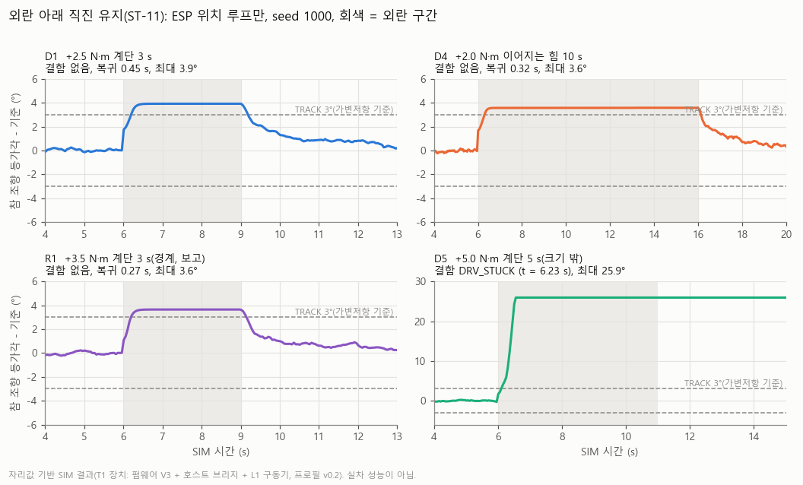
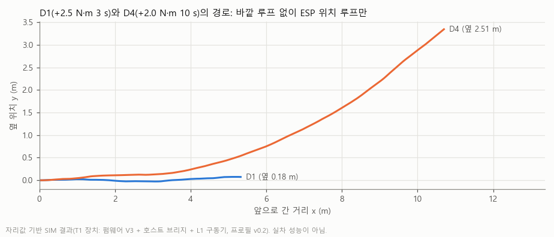

# 외란 아래 직진 유지 결과 (ST-11)

- 작성: 2026-11-13 (묶음 S3)
- 사전등록: `SIM_ACCEPTANCE_KO.md` 개정 41(커밋 ed4a41c, 실행 전), 개정 42(커밋 67ace95, 개발 seed 확인 뒤·판정 seed 전)
- 도구: `steering.steer_hold_checks --set disturbance`(T1 장치: 펌웨어 V3 + 호스트 브리지 + L1 구동기·가변저항 + 플랜트), 프로필 v0.2, 모형 `STEER_EXT_MODEL_KO.md`
- 실행: 커밋 05dfc0e(+ 시험 파일 한 곳 수정, 도구 영향 없음), 판정 seed 1000~1004, 대본 10개 × 5 = 50회, 55 s. 기록은 저장소 밖 `runs/steer_profile_20261113/judge/disturbance_v02/`.
- 모든 수치는 자리값 기반 SIM 결과다. 토크 값과 모형이 가정이라 민감도로만 읽는다. 현장 성능이 아니다.

## 1. 판정

| 묶음 | 기준 | 결과 |
|---|---|---|
| 크기 안 D1~D4 | F 줄 0, 호스트 래치 0, 복귀 ≤ 2.0 s | **20/20 합격** |
| 크기 밖 D5 | 첫 조향 결함 ∈ {STALL, TRACK, DRV_STUCK}(개정 42), 규칙 재계산 ±1틱 | 5/5 합격(DRV_STUCK, 틱 차 0) |
| 크기 밖 D6 | 같음 | **4/5**: seed 1004의 첫 결함이 POLARITY(틱 차 0) |
| 개정 41 원래 기준(D5·D6이 STALL·TRACK) | 보고 | 0/10(모두 DRV_STUCK 또는 POLARITY) |

**개정 41·42 판정은 불합격이다**(판정 항목 40개 중 39개 합격). 크기 밖 외란 10회는 모두 래치 결함으로 섰고, 결함 틱은 10회 모두 규칙 재계산과 같았다(틱 차 0). 다만 seed 1004의 −5 N·m에서 첫 결함이 등록한 집합 밖의 POLARITY였다: 외력이 서보 출력을 이겨 위치가 명령에서 멀어지는 쪽으로 움직였고, 이것은 POLARITY 규칙(출력 ≥ 최소인데 명령에서 멀어짐) 그대로다. 결과를 본 뒤 집합을 넓히지 않았다. 다음 사전등록(실측 사양이 온 뒤)에서 "크기 밖 = 래치되는 조향 결함 아무것이나 + 틱 일치"로 정할지 정한다.

## 2. 대본별 측정값 (판정 seed 5개의 최소~최대)

| 대본 | 외란 | 최대 조향 벗어남(°) | 복귀(s) | 옆 벗어남(m) | 결함·래치 | 열 예산 |
|---|---|---|---|---|---|---|
| D1 | +2.5 N·m 계단 3 s | 2.66~3.92 | 0.13~0.59 | 0.07~0.45 | 없음 | 0 |
| D2 | −2.5 N·m 계단 3 s | 1.06~2.57 | 0~0.12 | 0.02~0.21 | 없음 | 0 |
| D3 | +2.5 N·m 충격 0.1 s | 0.86~1.50 | 0 | 0.02~0.08 | 없음 | 0 |
| D4 | +2.0 N·m 이어지는 힘 10 s | 2.10~3.58 | 0~0.32 | **0.91~2.51** | 없음 | 0 |
| D5 | +5.0 N·m 계단 5 s | 25.9~26.4(끝 멈춤) | — | 0.004~0.024 | DRV_STUCK(t0 + 0.23~0.25 s), `mcu_disarmed` | 0 |
| D6 | −5.0 N·m 계단 5 s | 25.7~26.4(끝 멈춤) | — | 0.01~0.04 | DRV_STUCK 4(t0 + 0.17~0.20 s), POLARITY 1(t0 + 0.27 s) | 0 |
| R1 | +3.5 N·m 계단 3 s(경계, 보고) | 2.74~4.30 | 0.14~0.36 | 0.16~0.45 | 없음 | 0 |
| R2 | 지면 충격 + 미는 토크 15 s(보고) | 1.53~2.27 | 0 | 0.14~1.37 | 없음 | 0 |
| R3 | +2.5 N·m + 벨트 이 하나 건너뜀(보고) | 26.0~26.4(끝 멈춤) | — | 0.01~0.08 | POT_NOISE(건너뜀 틱 7000), 그 뒤 정지 | 0 |
| R4 | 조향 모터 전원 끊김 + 2.5 N·m(보고) | 25.9~26.3(끝 멈춤) | — | 0.01~0.03 | DRV_STUCK(t0 + 0.17~0.19 s) | 0 |

- 최대 조향 벗어남은 참 등가각과 외란 전 1 s 평균의 차다(링크 백래시 1°와 측정 쪽 유격 포함). 복귀 허용폭은 2.15°(백래시/2 + 데드밴드 + 벨트 유격/2 + 0.5°).
- 속도: throttle 60 %에서 run별 0.34~0.59 m/s(프로필의 run별 속도 배율).
- 크기 밖 외란으로 결함이 나면 펌웨어가 조향 출력을 끄고 구동을 제동한다. 외력이 남아 바퀴는 끝 멈춤(약 26°)까지 밀리지만 차가 서서 옆 벗어남은 4 cm 아래다.

## 3. 읽은 것

1. **ESP 위치 루프만으로는 이어지는 힘을 이기지 못한다.** 2.5 N·m 아래에서는 래치 결함이 없지만, 밀린 각이 외란이 끝날 때까지 남는다. 자리값 모형에서 정지 마찰(주행 중 시작 duty 0.25) 때문에 서보가 버티는 데는 출력 0.25면 되지만, 되돌리려면 0.75(오차 5°)가 필요하다. 데드밴드 안 제동 유지(0.2 s) 동안 밀린 만큼(약 2°)이 그대로 남는다. 그래서 D4(2 N·m 10 s)는 직진 명령인데도 외란 10 s 동안과 복귀 뒤 2 s까지 옆으로 0.9~2.5 m 벗어났다. 직진 유지는 실행기의 바깥 루프(열 추종 제어기와 trim)가 맡아야 한다(설계 v2 V2-6.6). 이번 시험은 바깥 루프 없이 ESP 위치 루프만 쟀다.

2. **v0.2의 문턱 정리가 외란 아래 오검출을 없앴다.** 같은 대본·seed를 v0.1로 돌리면(보고, `disturbance_v01_report`) 크기 안 외란 20회 중 6회가 래치로 섰다: D1 DRV_STUCK 1·POLARITY 1, D2 DRV_STUCK 2, D4 DRV_STUCK 2(D3은 0). v0.1의 DRV_STUCK 문턱 2°는 제동 유지 동안의 밀림(약 2°)과 겹친다. v0.2는 20회 모두 래치 0이다. 크기 밖 D5·D6은 v0.1도 10/10 DRV_STUCK이다.
3. **벨트 이 하나 건너뜀(18°)은 가변저항 급변으로 바로 잡힌다.** R3는 5회 모두 건너뜀 틱(7000)에 POT_NOISE가 먼저 켜지고 정지했다. 0점이 18° 옮겨 간 채로 달리는 일은 없었다. 미끄럼이 문턱(POT_JUMP 8 count / 2 ms, POT_NOISE sd 5 count / 50 ms)보다 천천히 일어나면(마찰 벨트의 누적 미끄럼) 이 감시로는 잡히지 않는다. 호스트의 '0점 이동' 감시(설계 v2 V2-6.4)는 아직 구현되지 않았다.
4. **모터 전원이 끊긴 채 외력이 오면** 관성 되밀림(전기 제동 없음, 배율 3)으로 0.2 s 안에 DRV_STUCK으로 선다(R4).
5. 열 예산은 모든 대본에서 0이었다(|PWM| ≥ 80 %인 틱이 없었다).

## 4. 시험하지 않은 것

- 바깥 루프(실행기 열 추종 제어기)가 있는 상태의 외란. 그것은 실행기 쪽 SIM 행렬(묶음 S1c)의 조건으로 넣을 수 있다: 프로필 덮어쓰기 `steer_terrain_impacts`, `steer_terrain_push` 또는 주입 `steer_torque`.
- 정지 중 외란, 자기 잠금 감속기(`steer_self_locking: true`)의 외란. 모형은 있다(`test_steering_profile_v3.py`).
- G-SIM(Gazebo): ESP 에뮬레이터가 같은 네이티브 모형을 쓰므로 같은 주입을 넣을 수 있지만 이번에는 돌리지 않았다.
