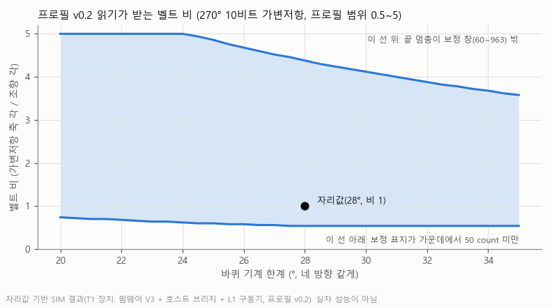

# 조향 프로필 v0.2 (ST-10): 자리값 일관성, 벨트 가변저항, 외란 모형

- 작성: 2026-11-13 (묶음 S3)
- 파일: `sim/ubts/steering/profiles/front_steer_v0_2_placeholder.yaml` (스키마 `ubts.vehicle_profile.v3`)
- 근거: 결정 R18 결정 2·3(자리값끼리 맞지 않는 곳), 설계 v2 V2-6(벨트로 이은 가변저항, 일반 DC 모터, 리밋 스위치 없음, 직진 유지), 결정 R36
- 사전등록: `SIM_ACCEPTANCE_KO.md` 개정 40(v0.2 자격), 41(외란 아래 직진 유지)
- 모든 값은 자리값이다. 이 프로필로 낸 결과는 자리값 기반 SIM 결과이며 현장 검증이 아니다. v0, v0.1 파일과 그 결과는 그대로 둔다.

## 1. 바꾼 값 (v0.1 → v0.2)

v2 매개변수 가운데 아래 다섯 칸만 바꿨다(시험 `test_v02_consistency_changes_against_v01`이 지킨다). 펌웨어 소스는 그대로이고 값은 프로필 → CFG(`fw_eeprom.params_from_profile`)로 들어간다.

| 칸 | v0.1 | v0.2 | 이유 (R18) | 펌웨어 CFG |
|---|---|---|---|---|
| `servo_min_pwm_pct` | 40 % | 45 % | 정지 중 조향 시작 PWM 35 %와의 간격 5 %p → 10 %p(결정 2: B4 시작 + 5 %p 이상, 여유). 정지 중 서보 최소 출력의 조향 속도 1.15 → 2.3 °/s | `minp` 102 → 115 |
| `polarity_fault` | 1° / 0.1 s | 2° / 0.2 s | 정지 중 기어감과 거른 값 ±2 count 흔들림으로 오탐(결정 2, A19(F) 불합격 1/40) | `polp` 40 → 80‰, `polt` 100 → 200 ms |
| `driver_stuck_fault` | 2° / 0.3 s | 3° / 0.3 s | 주행 중 비자기잠금 바퀴가 가운데로 돌아올 때 오판(결정 3) | `dsm` 80 → 120‰ |
| `thermal_proxy` 누적 | 5 s / 30 s | 10 s / 30 s | 정지 중 전폭 쓸기를 두 번만 허용(결정 3) | `tha` 5000 → 10000 |
| `host_track_mismatch` | 3° / 1.5 s | 3° / 3.0 s | 정지 중 느린 조향과 반전 때 백래시 통과에 걸림(결정 3) | 호스트 프로필 |

범위(스윕 폭)도 위 칸은 넓혔다. `pot_to_steer_ratio`(벨트 비)의 범위는 1~5 → 0.5~5다(값 1 그대로).

## 2. 새 칸 (스키마 v3)

I 묶음(벨트·리밋·급전)과 J 묶음(외란)은 `STEER_EXT_MODEL_KO.md`에 모형과 식이 있다. 사양 요청서의 질문 번호를 `identify`에 적었다(Q22~Q26). 계산값은 `belt_tooth_step_deg`(18°), `pot_travel_deg`(54.2°), `pot_cal_half_width_counts`(95.2)다.

## 3. 프로필 읽기 검사 (스키마 v3)

- 벨트 비가 범위 안이어도 끝 멈춤이 보정 창(60~963) 밖이면 `pot_range_exceeded`, 보정 표지가 가운데에서 50 count 안쪽이면 `pot_cal_half_width_small`로 거부한다. 자리값에서 받는 비는 약 0.53~4.2다(0.5는 47.6 count로 거부).
- 리밋 스위치 `both`는 `not_modelled`로 거부한다.
- 이 건너뜀은 `belt_type` timing에서만.
- 스윕용 덮어쓰기는 `allow_out_of_range=True`면 위 가변저항 검사를 경고로 낮춘다.

## 4. 결과 (개정 40, 2026-11-13)

모든 수치는 자리값 기반 SIM 결과다(Windows, MinGW 6.3 빌드 `5a6add29ad45…`, 펌웨어 build `04353B49`, 프로필 SHA `0fd7835d43d5…`). 기록: 저장소 밖 `runs/steer_profile_20261113/judge/`.

### 4.1 ① A2, A3(F), A8 — 등록한 그대로는 불합격

커밋 05dfc0e에서 `UBTS_STEER_TEST_PROFILE=<v0.2>`로 `test_steering_native.py` 91개를 돌렸다: 87 통과, 4 실패.

| 묶음 | 판정 시험 | 결과 |
|---|---|---|
| A2 | 속도 한계·지연(2), 최소 PWM·정지 마찰(2), 백래시(1), 끝 멈춤(4) | 모두 통과 |
| A3(F) | 양자화·LSB | **실패** |
| A3(F) | 잡음 sd(2), 고장 open·short·stuck(1), 고장 noise·jump·slip·drift·reversed(1) | 통과 |
| A8 | 같은 seed 같은 바이트, RESET 뒤 같은 흐름 | 통과 |

- 실패 4개(판정 밖 셋 포함: 가변저항 위치, 직선성·이득, 잘림 표시)는 모두 같은 까닭이다. 시험의 기준식 `expected_raw`(규약 7절)에 v0.2의 측정 쪽 벨트 유격(0.3°)이 없다. 가변저항 축이 유격의 반(0.15° ≈ 0.6 count)만큼 늦어 raw가 1 count 다르다. 모형 결함이 아니라 시험 기준식이 새 항을 모른다.
- 고친 것: 시험의 `variant(clean=True)`가 스키마 v3 프로필이면 벨트 유격도 0으로 둔다(벨트 항은 `test_steering_profile_v3.py`가 따로 본다). 고친 뒤 다시 돌린 결과 91/91 통과, v0.1로도 91/91 통과. 이것은 판정을 바꾸지 않는다: 개정 40 ①은 등록한 그대로 **불합격**으로 남는다. 고친 뒤 결과는 보고다.

### 4.2 ② 정상 대본 오검출 — MCU 결함은 0, 호스트 래치 때문에 불합격

T1 장치, 판정 seed 1100~1109, 대본 6개 × 10 = 60회(`normal_v02`, 65 s).

| 대본 | v0.2 MCU F 줄 | v0.2 호스트 래치 | v0.2 열 예산 사용(최대) | v0.1(보고) |
|---|---|---|---|---|
| N1 직진 20 s | 0 | 0 | 0 | 0 / 0 |
| N2 지그재그 ±6° | 0 | 0 | 0.10 | 0 / 0 |
| N3 S자 10° | 0 | 0 | 0.05 | 0 / 0 |
| N4 정지 ±5° 계단 | 0 | 0 | 0 | 0 / 0 |
| N5 정지 전폭 쓸기 ±20° | 0 | **`steering_not_following` 10/10** | 0.35 | POLARITY 1/10, `steering_not_following` 10/10 |
| N6 주행 15° 유지 뒤 0° | 0 | 0 | 0.07 | 0 / 0 |

- POLARITY·DRV_STUCK·THERMAL·TRACK은 60회 모두 0이다(todo ST-10 완료 기준의 네 결함). v0.1은 N5에서 POLARITY 1회가 났다.
- 등록한 기준에는 호스트 래치 `steering_not_following` 0도 넣었다. N5가 10/10으로 걸려 ② 판정은 **불합격**이다. 까닭: 정지 중 40° 쓸기는 펌웨어 목표 램프(정지 0.8 × 15 = 12 °/s)만으로 3.3 s가 걸리고, 호스트 규칙(요청각과 측정각 차 3° 초과 3.0 s)이 그 전에 래치한다. v0.1(1.5 s)도 같다.
- 열 예산: v0.2 N5 최대 3.5 s / 10 s. v0.1 N5는 1.0 s / 5 s였다. v0.1은 호스트 규칙이 1.5 s라 더 일찍 래치해 덜 쓴 것으로 보지만 래치 시각은 따로 재지 않았다[추정].
- 고칠 길(다음 판의 후보, 이번에 바꾸지 않았다): 호스트 규칙이 요청각 대신 MCU가 보고하는 램프 목표(상태 줄 `tgt`/`cmd`)와 측정각을 비교하게 하거나(브리지 쪽 변경, 호스트 담당), 자리값 지속 시간을 (2 × 소프트 한계) / (0.8 × 정지 조향 속도) + 반전 여유 ≈ 5 s로 둔다. 실행기는 정지 중 5° 이하 계단만 쓴다(R18 결정 3).

### 4.3 ③ 고장 검출 유지 — 합격

판정 seed 1200~1202, 9회 모두 기대 코드가 주입 뒤 3 s 안에 F 줄로 나오고 규칙 재계산과 틱 차 0.

| 대본 | 첫 결함 | 주입(계단) 뒤 시간 |
|---|---|---|
| G1 극성 반대, 정지 5° 계단 | POLARITY | 0.45~0.48 s |
| G2 주행 중 드라이버 고착(0.6) | DRV_STUCK | 0.30~0.32 s |
| G3 구동기 걸림, 정지 5° 계단 | STALL | 0.80~0.83 s |

### 4.4 ④ 프로필 읽기 — 합격

`test_steering_profile_v3.py` 30개 통과(벨트 비 0.55·1·2·4 받음, 0.3·5.5·0.5·4.5·5.0 거부, 리밋 스위치 both 거부 포함). 받는 벨트 비 범위는 그림 `figures/steering_model/st10_belt_window.png`.

### 4.5 요약

| 등록 항목 | 판정 |
|---|---|
| ① A2·A3(F)·A8 | 불합격(A3 양자화 시험 1개: 시험 기준식에 벨트 유격이 없음). 기준식을 고친 뒤 91/91(보고) |
| ② 정상 대본 오검출 | 불합격(N5 호스트 래치 10/10). MCU 네 결함은 60회 0 |
| ③ 고장 검출 유지 | 합격 9/9 |
| ④ 프로필 읽기 | 합격 |

ST-11 결과(같은 프로필, 개정 41·42)는 `STEER_HOLD_RESULT_KO.md`. 외란 아래 v0.1과 v0.2의 차이(v0.1은 크기 안 외란 20회 중 6회 래치)도 거기 있다.
