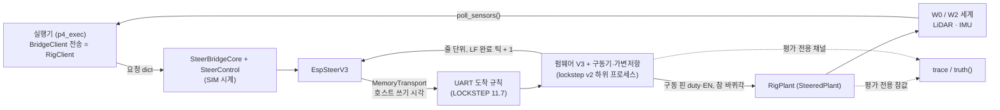

# T1 장치 (`sim/ubts/steering/t1_rig.py`, 설계 8.3 P4)

- 작성: 2026-11-09 (3단계 WF-3a p4_rig)
- 근거: 설계 `DESIGN_v1_KO.md` 2.3.1, 2.5(T1), 4.1, 4.2, 7.2.1, 8.3 P4. `DECISIONS_KO.md` R13-2·R13-3, R15. `SIM_ACCEPTANCE_KO.md` A8, A17(개정 7), A19. 규약 `ESP_PROTOCOL_V3_DRAFT_KO.md`, `LOCKSTEP_PROTOCOL_KO.md` 11절, `HOST_BRIDGE_V3_KO.md`.
- 상태: 소스와 시험이 있다. 실행기(`sim_in_loop_steer`)는 다음 단계(p4_exec)가 이 장치 위에 만든다. 식별 도구(p4_ident)도 이 장치를 쓴다.
- 모든 수치는 자리값이다. 이 장치로 낸 결과는 자리값 기반 SIM 결과이고 현장 검증이 아니다.

## 1. 무엇을 하나

T1은 실행기 아래의 모든 층을 실제 코드로 한 프로세스에서 돌리는 장치다. 시계는 SIM 시계 하나다. 같은 seed면 같은 결과가 나온다.

| 층 | 코드 | T1에서 |
|---|---|---|
| 조종 API | `dashboard/scripts/steer_control_core.py`(`SteerControl`) | 그대로 |
| 브리지 코어 | `dashboard/scripts/steer_bridge_core.py`(`SteerBridgeCore`) | 그대로. 시계 주입 |
| V3 해석·상태 | `dashboard/scripts/esp_motor_v3.py`(`EspSteerV3`) | 그대로. 전송은 `MemoryTransport` |
| MCU | `firmware/ubts_steer_v3`(펌웨어 소스) | 네이티브 lockstep v2 firmware 모드(FW_STEP)의 하위 프로세스 |
| 조향 구동기·가변저항 | `sim/ubts/steering/native/`(C++ L1 모형) | MCU와 같은 하위 프로세스 |
| 차체·구동 | `steered_plant.SteeredPlant` | 하위 클래스 `RigPlant`. 구동 duty는 MCU 핀에서 온다 |
| 세계·센서 | W0 `flat_world.py`, W2 `closed_loop/raster_corridor.py`, `cpu_lidar.ScanSynthesizer` | LiDAR는 플랜트의 LiDAR 자세에서, IMU는 플랜트에서 |



## 2. 시계와 순서

- 시간 단위는 1 ms다. MCU 틱 하나가 1 ms다. `T1Rig.ms`는 RESET 뒤 돈 틱 수(SIM ms)다. `clock()`은 `ms / 1000`(초)이고 호스트와 실행기가 이 시계를 쓴다.
- 벽시계 `wall_clock()`은 스냅샷 `updated_at`에만 쓴다: 고정 기점 + SIM 시간 + `wall_clock_jump` 고장. 기한은 모두 SIM 시계다.
- 플랜트 스텝은 10 ms다. 브리지 스텝은 20 ms 격자다(`bridge_phase_ms` + k × `bridge_period_ms`, 기본 0과 20).

플랜트 스텝 k는 틱 [t, t + 10)을 덮는다(t = 10 k). 한 스텝 안의 순서:

| 단계 | 하는 일 |
|---|---|
| 1 | t 이전에 예정된 콜백과 고장을 처리한다(`at()`, `fault()`) |
| 2 | t가 브리지 격자면 브리지 스텝 하나. 호스트 시계는 t/1000이다. 코어가 t까지 배달된 MCU 줄을 읽고, 대기 요청 하나에 답하고, STOP·C·PING을 쓴다. t에 쓴 호스트 바이트는 UART 규칙으로 MCU에 닿는다 |
| 3 | MCU: 10틱짜리 FW_STEP 하나. 차속·정지 여부는 t의 플랜트 값, 가변저항 급전 배율은 t의 구동 duty로 만든다. 사건과 수신 바이트는 제 틱에 들어간다 |
| 4 | MCU → 호스트: 줄 단위로 배달한다. LF의 완료 틱이 d면 시각 d + 1부터 호스트가 읽을 수 있다 |
| 5 | 플랜트: `SteeredPlant.step(0.01)`. 구동 duty는 스텝 마지막 틱의 MCU 핀 값(좌우 평균, % = duty/255 × 100), 구동 EN은 D1, 핀 변화로 제동·관성 사건을 만든다(5절). 참 조향각은 같은 하위 프로세스의 구동기 모형에서 온다 |
| 6 | 센서(t + 10): LiDAR 격자(프로필 `lidar_hz` 10 Hz)면 스캔, IMU 예정 시각을 지났으면 IMU 표본 하나(프로필 `imu_rate_hz` 33 Hz는 10 ms 격자에서 30·30·40 ms 간격). 패킷은 스탬프 + 지연(`lidar_latency_s` 기본 0, `imu_latency_s` 기본 0.02, 하네스 기본값과 같다)부터 읽힌다 |
| 7 | trace 행(`trace_every` 스텝마다) |

시간 규칙(115200 baud, 20 ms 브리지, 자리값):

| 경로 | 시간 |
|---|---|
| 요청 → 답 | 제출 시각 이후 첫 브리지 스텝(0~20 ms). `status`, `stop`, `motion`은 큐를 거치지 않아 바로 답한다 |
| STOP 요청 → STOP 바이트 | 다음 브리지 스텝의 첫 줄(≤ 20 ms). 5 B라 모두 t + 1틱에 도착 |
| MCU STOP 파싱 → 구동 0 | 같은 틱(4단계 파싱, 11단계 핀) |
| 호스트 C 줄(약 32 B) | 첫 바이트 t + 1, LF t + 3(ceil((576 t + 50 n) / 576)) |
| MCU 상태 줄(최대 85 B) | 틱 n에 큐, LF 완료 약 n + 7, 호스트는 n + 8 뒤 첫 브리지 스텝에서 읽는다 |
| 배너·보정 줄 | 부팅 지연(기본 70틱, 규격 자리값) 뒤 `setup()`에서 큐. 호스트 준비(세션 STOP 확인)는 보통 약 0.15 s |

`RigClient`의 요청은 막는다(블로킹). 답이 올 때까지 장치를 앞으로 돌린다. 실제 소켓 클라이언트가 브리지 루프를 기다리는 것과 같다. 기다리는 동안에도 플랜트·센서·MCU가 돈다. 0.4 s 안에 답이 없으면(브리지 멈춤 고장) 미래를 취소하고 비상 정지를 걸고 `control_busy_stopped`를 돌려준다(`SteerBridgeCore.request`와 같다).

## 3. API

```python
from steering import t1_rig as tr
from steering.scene_spec import WorldSpec

config = tr.RigConfig(seed=3, world=WorldSpec.from_dict({'kind': 'W0', 'markers': [[6., 4., .1]]}),
                      start_pose=(0., 0., 0.), start_steer_rad=0.,
                      faults=(tr.RigFault('pot_open', at_s=5.),))
with tr.T1Rig(config, native_executable=None, build_dir=None) as rig:   # build_dir 또는 UBTS_STEER_BUILD_DIR
    client = rig.client('executor')          # 조종 API 손잡이
    rig.run_until_true(lambda: rig.core.steering_host()['stop_state'] == 'confirmed', 3.)
    client.arm_precheck()                    # None 또는 첫 문제
    client.arm(); client.wait_armed()
    client.drive(40, 120)                    # throttle %, steer_mrad
    rig.step(0.1)                            # 10 ms 배수
    packets = rig.poll_sensors()             # 실행기 입력
    client.observe_motion(gyro_z, speed)     # steering_ineffective 공급원(op motion)
    client.stop('brake')                     # 또는 'release'
    rig.write_trace(path); rig.write_serial_log(path)
```

### 3.1 `RigConfig` (frozen)

| 칸 | 기본 | 뜻 |
|---|---|---|
| `seed`, `stream_key` | 0, `'t1_rig'` | 모든 난수 흐름의 원천(4절) |
| `world` | None(W0, 기둥 없음) | `scene_spec.WorldSpec`. W0 기둥 또는 W2 기록·회랑·방향·변형. 봉인 회랑은 거부한다 |
| `start_pose` | (0, 0, 0) | 기준점(발자국 중심) x, y, yaw(rad). W0는 세계 좌표, W2는 회랑 좌표(s, d, 방향 오차) |
| `start_steer_rad` | 0 | 시작 참 바퀴 쪽 등가각 |
| `profile`, `curve`, `gyro_noise_scale` | 기본 프로필(v0.1), `main`, 1 | `steer_actuator_level`은 L1이어야 한다(firmware 모드의 구동기). L0는 거부 |
| `cal_id`, `host_cal_id` | 1, `'same'` | EEPROM 보정 묶음 id와 호스트 프로필 id. 다르게 주면 `calibration_mismatch` |
| `mdir`, `pol_ok`, `eeprom_blank` | 1, 1, False | 보정 레코드(LOCKSTEP 11.11). `eeprom_blank`이면 NOCAL |
| `record_overrides` | () | EEPROM 레코드의 CFG 값(`fw_eeprom` 키). `wd`, `ttlmax`, `sthz`는 `host_overrides`가 `link`를 주지 않으면 호스트 프로필에 따라 적는다 |
| `host_overrides` | () | `{절: {키: 값}}`, `host_profile_export.build()` 위에 |
| `host_hw_profile` | None | 호스트 프로필이 기대하는 하드웨어 프로필 이름(None = 내보낸 값). 배너와 다르면 `hardware_profile_mismatch`(A19, 검토 P4R-15) |
| `host_simulated` | True | 호스트 링크가 SIM 장치(배너 sim=1)를 기대하는지. False면 실차 링크가 SIM MCU를 만나 `sim_identity_mismatch`(A14·A19) |
| `boot_delay_ticks` | 70 | 리셋 → `setup()`(규격 1절 자리값 약 70 ms). MCU 리셋 동안 핀이 떠 관성 주행(coast)이 된다 |
| `boot_garbage_hex`, `port_open_reset` | '', False | 부트 쓰레기, 포트 열 때 리셋 |
| `bridge_period_ms`, `bridge_phase_ms` | 20, 0 | 브리지 격자 |
| `lidar_latency_s`, `imu_latency_s` | 0, 0.02 | 센서 배달 지연 |
| `imu_rate_hz`, `lidar_hz` | None(프로필) | 센서 주기 |
| `faults` | () | `RigFault(kind, at_s, params)` 목록(6절) |
| `trace_every`, `serial_log`, `report_servo` | 1, True, True | trace 간격, 직렬 기록, MCU 서보 채널(평가용) |

`rig_config_from_scene(scene, seed, **changes)`는 장면 명세(`scene_spec.SceneSpec`)의 세계·출발·프로필 보기(파일, SHA 고정, 덮어쓰기)·곡선·자이로 잡음 배율·stream key·trace 간격으로 `RigConfig`를 만든다. 장면의 기동·제어기는 쓰지 않는다. 봉인 회랑, `geometry_check`, backend L0는 거부한다.

### 3.2 `T1Rig`

| 이름 | 뜻 |
|---|---|
| `ms`, `now`, `clock()`, `wall_clock()` | SIM 시간(2절) |
| `step(dt_s)`, `run_until(t_s)`, `run_until_true(pred, limit_s)`, `run_while(pred, limit_s)` | 앞으로 돌리기(10 ms 단위) |
| `client(owner, expect_cal_id=None)` | `RigClient` |
| `submit(request)` | 코어 큐에 넣고 Future를 돌려준다(막지 않는다) |
| `request(request, timeout_s=0.4)` | 답이 올 때까지 돌린다 |
| `observe_motion(yaw, speed)` | 코어에 움직임 표본을 바로 넣는다(시험용. 실행기는 op motion) |
| `poll_sensors()` | 읽을 수 있게 된 센서 패킷(한 번씩). 스캔: `kind 'scan'`, `seq`, `stamp_s`, `arrival_s`, `ranges`(float32, SIM 3200빔, inf = 반사 없음), `angle_min`, `angle_increment`, `range_max`. IMU: `kind 'imu'`, `stamp_s`, `arrival_s`, `gyro_z_rad_s`, `accel_m_s2`(센서 축) |
| `fault(kind, at_s=None, **params)`, `at(t_s, fn)` | 실행 중 고장, 콜백(그 시각 뒤 첫 플랜트 스텝 시작, 브리지 스텝 전) |
| `trace_arrays()`, `trace_sha256()`, `write_trace(path)`, `add_trace_extras(names, fn)`, `set_phase(name)` | trace(7절) |
| `serial_log()`, `serial_log_bytes()`, `serial_log_sha256()`, `write_serial_log(path)`, `host_writes(since_ms, head)` | 직렬 기록(8절) |
| `truth()`, `mcu_channel(name)`, `mcu_channel_at(name, tick)`, `mcu_lines(kinds, since_tick)` | 평가 전용 |
| `permille_to_rad(p)` | MCU 천분율 → 등가각(호스트 보정표, 반올림 없음) |
| `identity()` | 프로필 id·SHA, 펌웨어 build, 네이티브 build id, 호스트 프로필 SHA, 세계, 시작, 주기, 주입 |
| `close()` | 하위 프로세스를 끝낸다(두 번 불러도 된다). 컨텍스트 관리자 |
| `plant`, `core`, `link`, `fw`, `hp`, `cal` | 내부 객체. `plant`와 `fw`의 채널은 평가 전용이다 |
| `bridge_down()`, `bridge_processes`, `bridge_events` | `bridge_restart` 고장: 브리지 프로세스가 없는 동안 참, 만든 브리지 프로세스 수, (`exit`·`start`, ms) 목록 |

- 오류: `RigError`(장치를 만들 수 없거나 잘못 씀). 그 하위 `RigDependencyError`는 세계에 필요한 외부 자료나 선택 라이브러리가 없거나 깨진 경우다(W2: `UBTS_STEER_PATHS`의 회랑 목록·지도, 래스터 LiDAR의 라이브러리). 시험은 이 오류일 때만 건너뛴다.
- 생성자가 네이티브 프로세스를 띄운 뒤 실패하면(예: 10 ms 격자에 맞지 않는 `lidar_hz`) 그 프로세스를 끝내고 예외를 다시 던진다.

### 3.3 `RigClient`

실행기 BridgeClient가 쓸 조작만 있다. `__call__(request)`가 BridgeClient의 전송 규약(요청 dict → 답 dict)이다.

- 장치는 비공개(`_rig`)다. 실행기가 이 클라이언트를 전송으로 받아도 장치의 평가 채널(MCU 채널, 직렬 기록, trace)에 닿을 길이 없다(A13, 검토 RS-05). `truth_isolation`도 결정 코드의 `rig` 이름·`.fw`·장치 채널 메서드·시작 참값을 잡는다.
- 브리지 프로세스가 없을 때(`bridge_restart`) 요청은 바로 `BridgeUnavailable`(`OSError`)이다. 소켓에 연결할 수 없는 것과 같다. 실행기 하네스(`sim_in_loop_steer.RigSocket`)는 이것을 소켓 전송의 `TransportError('socket_error:…')`로 바꾼다.

| 이름 | 요청 | 비고 |
|---|---|---|
| `status()`, `steering()` | `status` | 스냅샷, 조향 블록(설계 4.2) |
| `arm_precheck(status=None, allow_sim=True)` | `status` | 설계 8.3 P4의 점검: 펌웨어 V3·protocol 3, `vehicle_profile`, `sim` 표시, `calibrated`, `cal_id` 일치, POLARITY·DRV_STUCK 없음, 래치·결함 없음(BOOT·TTL·SOFTLIMIT 빼고), 조향 상태 신선함, STOP 확인, 다른 클라이언트의 무장 없음, 움직임 없음 |
| `arm(precheck=True)` | `arm` + `vehicle_profile` | 점검이 막으면 `arm_precheck:<문제>` |
| `wait_armed(limit_s=0.3)` | — | MCU의 ARM 확인(첫 `st` = 2 상태 줄)까지 돌린다 |
| `drive(throttle, steer_mrad)` | `drive` | lease·ticket·seq + 1·`deadman: true` |
| `keepalive()`, `release()` | `keepalive`, `release` | |
| `stop(mode='brake')` | `stop` | MCU STOP: 구동 brake, 조향 hold_measured. lease를 거둔다 |
| `stop(mode='release')` | `release` | throttle 0(MCU 램프), 조향 목표 유지 |
| `observe_motion(yaw, speed)` | `motion` | lease 보유자만. 센서에서 나온 값만(참값 금지) |
| `late_drive_after_stop(throttle, steer)`, `submit_late_drive_after_stop(...)` | `stop` + 늦은 `drive` | 09-19 필수 장애 시험 |

## 4. 결정성과 난수

- 플랜트 seed는 하네스·fast_sim과 같은 규칙이다: (seed, CRC-32(stream key), 1). 플랜트의 회당 뽑기 seed가 네이티브 시작 줄의 seed가 된다(0점 오차·가변저항 잡음이 플랜트와 같은 뽑기).
- LiDAR 잡음: SeedSequence([seed, CRC-32(key), 2]) (하네스 `lidar_noise`). MCU `boot_seed`: 목적 201, `chip_id`: 목적 202.
- 벽시계·스레드·집합 순회가 결과에 들어가지 않는다. lease·ticket 문자열은 무작위지만 직렬 바이트와 trace에 들어가지 않는다.
- A8(장치): 같은 장면·seed를 두 번 돌리면 직렬 기록 바이트와 trace SHA-256이 같다. 다른 프로세스(`PYTHONHASHSEED=12345`)에서 돌려도 같다. 다른 seed면 둘 다 다르다. 같은 플랫폼·같은 빌드에서만 요구한다(R1).

결과(Windows 3.13, MinGW 6.3 빌드, 시험 `DeterminismTest`의 대본: 무장, 조향 세 번 바꾸며 주행, CRC 오류 하나, STOP):

| seed | 직렬 기록 SHA-256 | trace SHA-256 |
|---|---|---|
| 61 (1회) | `9ace332bf617…` | `f9aed4b75176…` |
| 61 (2회) | `9ace332bf617…` | `f9aed4b75176…` |
| 62 | `82dbdfedbc95…` | `51f71dc58c4f…` |

WSL 3.10(g++ 11.4 빌드)에서는 seed 61 두 번이 직렬 `c75bc6e4864d…`·trace `c07608efefc7…`로 같고, seed 62는 `3cb5302769de…`·`d7888611ca84…`로 다르다. 플랫폼 사이: 직렬 기록에서 머리 줄(장치 신원, 네이티브 실행 파일 SHA가 들어 있다)을 빼면 Windows와 WSL의 레코드 바이트가 같다(레코드 126개, `0af6498ec029…`). trace 값은 플랫폼마다 부동소수 끝자리가 달라 SHA가 다르다. R1은 같은 플랫폼만 요구한다. 기록: `runs/wf3a/p4_rig/logs/determinism_and_timing_{win,wsl}_final.json`, `cross_platform_{win,wsl}.json`.

처리 시간(보고만, A11): W0 기둥 8개, 준비·무장 뒤 40 % 주행 SIM 60 s를 Windows에서 벽시계 2.05 s(앞선 측정 2.73 s, 다른 작업과 PC를 나눠 씀), WSL에서 6.41 s에 돌렸다. 행 6,020개(준비·무장 부분 포함), 직렬 기록 3,008개, 이동 거리 21.21 m(두 플랫폼 같음).

## 5. 구동 핀 → 플랜트

- duty: 스텝 마지막 틱의 (D8 − D5)와 (D3 − D0)의 평균을 255로 나눠 %로 쓴다. 좌우가 다르면(BENCH 등) 평균을 쓰고 `unequal_duty_steps`를 센다.
- 램프는 펌웨어가 한다(255/s, 10 ms 격자). 플랜트의 자체 램프는 쓰지 않는다(`_PinDrive`).
- brake: 한 틱에 duty가 램프 한 걸음(최대 13)보다 크게 떨어져 0이 되면 brake 사건이다(D1 HIGH). 플랜트는 brake 정지 사건(시작 0.10 s, 2.0 m/s² 자리값)을 시작한다.
- release: duty가 램프로 줄면 플랜트의 감속 감지가 release 사건을 시작한다(플랜트 자체 방식과 같다).
- coast: D1이 LOW가 되면(MCU 리셋·전원 끊김, 핀이 뜬다) 관성 주행 사건이다. D1이 다시 HIGH가 되면 구동 EN을 켠다.
- trace `truth_drive_event`: 0 없음, 1 램프 감속, 2 brake, 3 coast, 4 EN 켬.
- `RigPlant`는 `command_actuation`, `command_drive`, `stop`, `steer_status`를 거부한다. 실행기가 읽는 조향 상태는 상태 줄이다(A13).

## 6. 고장 주입

### 6.1 모형 고장(`RigConfig.faults`, 시작 줄의 v1 주입, LOCKSTEP 9절)

| 이름 | 실제 주입 | 시험에서 본 결과 |
|---|---|---|
| `pot_open`, `pot_short` | 같은 이름 | `F POT_OPEN` / `F POT_SHORT`, 호스트 `mcu_disarmed`, 구동 0 |
| `pot_jump` | `pot_jump`(`counts`, `duration_s`) | `F POT_JUMP` |
| `pot_noise` | `pot_noise_x10`(`scale` 10) | `F POT_NOISE` |
| `pot_stuck`, `pot_slip`, `pot_drift`, `pot_reversed` | 같은 이름 | (시험하지 않음) |
| `polarity_reversed` | 같은 이름 | 큰 조향 계단에서 `F POLARITY` |
| `driver_stuck_on` | 같은 이름(`pwm`) | `F DRV_STUCK` 또는 `F POLARITY`(둘 다 `CAL POL`이 필요한 하드웨어 래치, 규격 12.1-71) |
| `driver_dead` | 같은 이름 | (시험하지 않음) |
| `stall` | `jam` | 큰 조향 계단에서 `F STALL` 또는 `F TRACK` |
| `thermal` | `slow`(`rate_scale` 0.3) | 느린(과부하) 구동기. 서보 출력이 THERMAL 문턱 위에 머문다. 0.3배면 STALL·TRACK 문턱보다 빨리 움직여 THERMAL이 판정한다. 자리값 호스트 프로필에서는 호스트 `steering_not_following`(3°, 1.5 s)이 먼저 선다. 시험은 그 규칙을 늦춰 `F THERMAL`을 본다 |

### 6.2 실행 중 고장(`fault(kind, at_s, **params)` 또는 `RigConfig.faults`)

| 이름 | params | 방법 | 시험에서 본 결과 |
|---|---|---|---|
| `mcu_reset` | `reason` 1..6(기본 4) | lockstep 사건 | 리셋 틱에 D1 LOW(coast), 새 boot_id, 호스트 `mcu_reset_detected`, lease 없음 |
| `power_cut` | `off_s`(기본 0.5) | `power_cycle` | 같음(전원 켬 리셋) |
| `port_open_reset` | — | 사건 | (기본 설정 `port_open_reset`으로 시험) |
| `motor_power_off`, `motor_power_on` | — | `motor_power` | 조향 모터 급전 끊김: `F STALL` 또는 `F TRACK` |
| `mcu_stall` | `duration_s` | 사건(`loop()` 멈춤) | STOP 확인 실패, 재전송 격자, `stop_unconfirmed` 래치 t0 + 400 ms |
| `adc_set`, `adc_model` | `raw` | 사건(ADC 대본값) | (시험하지 않음. 실행 중 단선 0 / 단락 1023을 흉내 낼 수 있다) |
| `link_loss` | `duration_s`, `direction` both / to_mcu / to_host | 그 시간 동안 바이트를 버림 | MCU `W`, 호스트 `mcu_disarmed`. 4단계부터: C TTL(300 ms)이 watchdog(500 ms)보다 먼저면 호스트가 `F TTL` 줄에서 `mcu_ttl_expired`로 먼저 멈추고 lease를 버린다(그 뒤 watchdog DISARMED는 `mcu_disarmed`가 아니다) |
| `usb_unplug` | `duration_s` | `MemoryDevice.unplug/replug` | `hardware_fault` 래치, 1 s마다 다시 열기, INFO, 배너, 준비. `RigConfig.port_open_reset`이면 다시 열 때 MCU가 리셋된다(새 boot id, 핀이 뜸; 대본 `usb_unplug_replug_reset`, 검토 RS-13) |
| `half_frame` | `text`(기본 `C 1 300 0 0 0`) | 앞 절반만 LF 없이 씀 | 다음 줄과 붙어 MCU가 거절(`N 1 nocrc` 등). q가 있는 거절이라 호스트는 `c_rejected` 래치와 정지(보수적 규칙) |
| `crc_error` | `count` | 다음 브리지 줄의 내용 한 바이트를 바꿈(CRC 유지). CRC 없는 줄(PING)에는 틀린 CRC를 붙임. STOP은 바꾸지 않음 | 하나: `N - crc`, 정지 없음. 5개 연속: MCU `F CRC`, 호스트 `mcu_disarmed` |
| `range_error` | `count` | 다음 C 줄의 S를 2000으로(CRC는 맞게) | MCU `N <q> range`, 호스트 `c_rejected` |
| `status_loss` | `duration_s` | 그 시간 동안 MCU 상태 줄을 호스트에 배달하지 않음 | `steering_status_stale` 래치 |
| `bridge_stall` | `duration_s` | 그 시간 동안 `core.step()`을 부르지 않음(같은 코어가 lease·래치·세션을 가진 채 다시 돈다) | MCU TTL(마지막 C 도착 + ttl), watchdog(마지막 입력 + wd + 1), 돌아온 브리지는 입력 기한 0.75 s가 지나 `input_expired`로 정지, 조향 블록에 MCU WATCHDOG, 자동 재출발 없음 |
| `bridge_restart` | `down_s`(기본 2), `port_open_reset`(기본 `RigConfig.port_open_reset`) | 브리지 프로세스를 죽인다: 포트가 닫히고(아무것도 쓰지 않음) 제어 소켓이 답하지 않는다(`BridgeUnavailable`), 큐·lease·래치가 사라진다. `down_s` 뒤 새 프로세스(새 transport·link·core)가 포트를 연다. `port_open_reset`이면 그 열기가 MCU를 리셋한다(규격 10.7) | 실행기 요청이 소켓 오류로 실패해 run이 끝난다(`bridge_error`). MCU TTL·watchdog으로 정지. 새 프로세스는 배너·세션 STOP, lease 없음, C 줄 없음. 리셋 경우 새 boot. 자동 재출발 없음(검토 P4R-05·RS-04) |
| `host_defect` | — | 다음 브리지 스텝에서 코어 루프 안 예외를 한 번 낸다(일부러 넣은 SIM 결함) | 호스트 `internal_error` 래치, STOP, 실행기 `bridge_internal_error`(A19, 검토 P4R-15) |
| `late_drive_after_stop` | `throttle`, `steer_mrad`, `client` | STOP과 같은 브리지 스텝의 늦은 drive | 늦은 drive는 `stop_barrier` |
| `wall_clock_jump` | `jump_s` | 벽시계만 옮김 | `updated_at`이 바뀌고 기한·C 20 Hz는 그대로 |
| `foreign_write` | `text` 또는 `data`, `crc`, `lf` | 다른 쓰는 쪽(CLI 등)이 선에 씀 | ARM이면 MCU ARMED, 호스트 `mcu_state_mismatch` 래치와 STOP(7.2절) |
| `sensor_blackout` | `duration_s`, `which` lidar / imu / both | 그 시간 센서 패킷 없음 | 그 시간의 스캔 없음 |
| `executor_stall` [4단계] | `duration_s`, `after` None / `f_ttl`, `delay_s` | 장치는 창만 기록한다. 실행기 루프(`sim_in_loop_steer`)가 `rig.executor_stalled()`가 참인 동안 틱을 건너뛴다. `after='f_ttl'`이면 `at_s` 뒤 처음 큐에 들어간 `F TTL` 줄을 호스트가 읽을 수 있게 된 때 + `delay_s`부터다 | R18 결정 1의 틈: 실행기가 TTL 직후 늦어도 브리지가 `mcu_ttl_expired`로 먼저 멈춘다. 재출발 없음(대본 `c_line_loss_ttl_executor_stall*`) |

## 7. trace 형식

`trace_arrays()`(npz는 `write_trace`). fast_sim trace의 이름을 그대로 쓰는 칸과 MCU·호스트 칸이 있다. 바이트는 fast_sim `write_npz`와 같은 규칙(고정 시각, 이름순)이고 `content_sha256`도 같다(시험으로 확인).

| 칸 | 뜻 |
|---|---|
| `t_s` | 행 끝 SIM 시간 |
| `cmd_throttle_pct`, `cmd_steer_target_mrad` | 브리지가 가진 요청(lease가 없으면 0, NaN) |
| `cmd_stop_mode` | 호스트 정지 모드(0 없음, 1 release, 2 brake, 3 coast) |
| `steer_target_rad` | MCU 서보 목표 clamp(tgt, soft_r, soft_l). 서보가 ACTIVE·HOLD일 때 그 값, OFF일 때 마지막 값을 유지 |
| `drive_request_pct`, `drive_applied_pct` | 요청 throttle %, MCU 적용 duty % |
| `drive_en`, `steer_en` | MCU 핀 D1, D2 |
| `pot_raw`, `fault_bits`, `steer_measured_rad` | 다음 ADC 값, 호스트가 마지막으로 읽은 상태 줄의 `fl`, 그 줄의 `pos`(rad) |
| `host_*` | 호스트 보기: 상태 코드, ARM·STOP 상태, lease, 래치 비트(`LATCH_NAMES` 순서), 마지막 상태 줄의 n·st·tgt·pos, 상태 줄 나이 ms, 마지막 C q, 보낸 C 수. 브리지 프로세스가 없는 동안(`bridge_restart`)은 lease 0, 상태 코드 −1 |
| `truth_*`(평가 전용) | 플랜트 참값(fast_sim과 같은 이름) + `truth_mcu_pos_rad` + `truth_hold_position_rad` + MCU RAM 채널(`truth_mcu_state`, `truth_steer_mode`, `truth_mcu_fault_bits`, `truth_mcu_steer_pwm`, `truth_mcu_drive_l/r`, `truth_mcu_cmd_rad`, `truth_mcu_tgt_rad`) + `truth_drive_event` |
| `phase`, `phase_names`, `meta_json` | `set_phase()` 이름, 메타(스키마, 장치 신원, 단위, 참값 칸 목록, `steer_target_note`, `hold_position_note`, `bridge_events`) |

- `truth_mcu_pos_rad`: MCU가 거른 가변저항 위치 P[n](`servo_pos` 채널)을 호스트 보정표로 rad로 바꾼 값이다. 실기에서는 상태 줄로만 보이는 MCU 내부 값이라 평가 전용이다.
- 유지 위치 칸 `truth_hold_position_rad`(R13-3): 장치가 직접 쓴다. 값은 `truth_mcu_pos_rad`와 같다. hold_measured 정지가 잡는 바로 그 값이라 평가기 `STEER_AFTER_TERMINAL` 규칙 (b)의 기준이다.
- 예전에는 이 값을 fast_sim의 `truth_servo_view_rad`(참 서보 보기, 다른 양)와 같은 이름으로 썼다. 같은 이름에 두 뜻이 있어 평가기 출처 표기가 틀렸다(검토 P4R-16). 이름을 바꿨다. trace 내용 SHA가 예전 run과 다르다.
- `add_trace_extras(names, fn)`로 실행기 값(`ctrl_*`)을 더한다. 첫 행 전에만 더할 수 있다.

## 8. 직렬 기록

`serial_log()`는 두 방향을 시간순으로 준다. 레코드: `dir`(`h2m`/`m2h`), `t_ms`, `first_tick`, `last_tick`, `data`(16진), `text`, `note`.

- `h2m`: `t_ms`는 호스트가 쓴 시각, 틱은 첫·마지막 바이트의 MCU 도착 틱(버렸으면 None). `note`: `bridge`, `foreign`, `half_frame`, `bridge:crc_error`, `bridge:range_error`, `…:lost`.
- `m2h`: `t_ms`는 호스트가 읽을 수 있는 시각(LF 완료 틱 + 1), 틱은 첫 바이트의 큐 틱과 LF 완료 틱. `note`: '', `garbage+line`, `lost`, `status_lost`, `port_closed`.
- `serial_log_bytes()`는 스키마 머리 줄(장치 신원) + 레코드마다 JSON 한 줄(정렬 키)이다. A8은 이 바이트의 SHA-256을 비교한다.

## 9. hold_measured 정지 목표 (R13-2, WF-2b 지적 R9)

- 펌웨어: 규격 6.5대로 `tgt = cmd = P[t0]`(STOP 틱의 거른 위치)이다. 고칠 것이 없었다. 새 평가 채널(`report_servo`)로 STOP 틱에 `servo_tgt = servo_cmd = servo_pos`임을 확인했다(`test_steering_firmware.py::test_report_servo_channels`, `test_steering_t1_rig.py::HoldMeasuredTest`). 펌웨어 build id `04353B49`는 그대로다.
- `SteeredPlant.stop()`(test_servo, L0·L1): 예전에는 목표가 `servo_view_rad()`(참 모터 쪽 각에서 만든 값)였다. 이제 `measured_hold_rad()`다: 플랜트가 가진 ADC 표본(스텝마다 하나)의 마지막 `pot_filter.median_of`(5)개의 중앙값을 명목 해석으로 바꾼 값. MCU는 1 ms마다 표본을 받으므로 F-SIM은 스텝 주기로 흉내 낸다. 시작 전 표본이 모자라면 첫 표본으로 채운다(MCU의 부팅 채우기와 같다). 시작 직후 첫 명령 전의 유지 목표는 아직 servo view다.
- 고치기 전에 실패하고 고친 뒤 통과하는 시험 3개: `test_hold_measured_target_is_the_mcu_filtered_measurement_not_the_servo_view[L0, L1]`, `test_measured_hold_median_and_start_refill`(고치기 전 동작을 흉내 내 돌린 기록: `runs/wf3a/p4_rig/logs/plant_hold_tests_before_fix.log`). `test_stop_steering_policies`는 새 뜻에 맞게 고쳤다(L0 유지 각은 ADC 1 LSB의 절반 안).
- WF-2b `STEER_AFTER_TERMINAL` 비교를 다시 돌렸다(brake 정지, 정지 뒤 명령 불변, seed 100~107, 지금 평가기). 기록: `runs/wf3a/p4_rig/logs/hold_measured_compare.json`.

| 장면 | 고치기 전 | 고친 뒤, servo view 기준(fast_sim `truth_servo_view_rad`) | 고친 뒤, 측정 기준(R13-3, 지금 평가기) |
|---|---|---|---|
| L1 hold_measured +6°, 100 % | 표시 0/8, 간격 0 | 표시 3/8(모두 자동 중앙 표시), 간격 중앙값 0.90°·최대 1.02° | 표시 0/8 |
| L1 hold_measured −8°, 100 % | 0/8 | 0/8, 간격 최대 0.93° | 0/8 |
| L1 hold_measured ±, 30 % | 0/16 | 0/16, 간격 최대 0.50° | 0/16 |
| L0 hold_measured(4가지) | 0/32 | 0/32, 간격 0.06~0.09°(ADC 양자화) | 0/32 |
| hold_target, center | 바뀌지 않음 | 바뀌지 않음(center 8/8 표시 그대로) | — |
| L1 +6°, 100 %의 참 바퀴 표류(정지 뒤) | 중앙값 0.53°, 최대 0.55° | 중앙값 0.51°, 최대 0.86° | (같음) |

- 해석: 100 % duty에서는 가변저항 급전 처짐(자리값 0.005/PWM)이 측정을 약 0.7° 중앙 쪽으로 옮긴다. 목표가 이제 이 측정이라, 참 기준과 비교하면 1°(허용치)를 넘는 경우가 생긴다. test_servo의 서보 되먹임은 참 view라 정지 뒤 바퀴가 그 차이만큼 움직인다. 실제 MCU도 정지 뒤 급전이 돌아오면 같은 위치가 다르게 읽혀 비슷하게 움직인다.
- 그래서 평가기 기준도 측정이어야 한다(R13-3). 이 장치 trace는 그렇게 만든다(`truth_hold_position_rad`).
- 검토 P4R-03·RS-06 처리(fix_wf3a): 평가기(`evaluate_steer.hold_reference`)가 fast_sim trace(플랜트 스텝마다 한 행, `trace_every` 1)에서 `SteeredPlant.measured_hold_rad()`를 `pot_raw` 행으로 다시 계산해 기준으로 쓴다(출처 `measured_hold_recomputed`). fast_sim 파일은 바꾸지 않았다. 그 뒤 `test_l1_brake_stops_without_a_steering_move_are_not_events`가 통과한다(hold_measured 창 0/16 표시). 위 표의 "측정 기준" 열과 같다. 다시 계산이 플랜트 값과 같은지는 `test_recomputed_hold_reference_is_the_plant_hold_measured_target`가 본다.
- 남은 모형 차이(검토 RS-12, 결정 필요): F-SIM의 시험용 서보는 참 서보 보기로 되먹인다. 그래서 가변저항 이득·직선성·떠돎 오차가 있으면 hold_measured 정지 뒤 바퀴가 그만큼 움직인다. 펌웨어는 목표와 되먹임이 둘 다 P[n]이라 이 오차로는 움직이지 않는다. 기본 프로필은 이 오차가 0이다. P8 스윕 전에 정할 일로 넘겼다.

## 10. 3단계로 넘어온 P3 항목 (R15)

| 항목 | 처리 | 시험 |
|---|---|---|
| 1 `mcu_state_mismatch`를 일으키는 저장소 시험이 없음 | 둘 다 만들었다: 가짜 MCU(ARMED·BENCH)와 T1 장치(`foreign_write`로 다른 쓰는 쪽이 ARM). 래치, STOP, MCU DISARMED, `fault` 상태, 재무장 확인 때 풀림 | `test_steer_bridge_core.py::test_mcu_armed_or_bench_without_a_host_lease_latches_and_stops`, `test_mcu_state_mismatch_not_raised_while_the_host_expects_the_state`, `test_steering_t1_rig.py::McuStateMismatchTest` |
| 2 RF-03 남은 경로 | 장치에서 쟀다(아래). 펌웨어 결함이 아니라 규격대로다. 규격 결정 제안과 규칙을 고정하는 적합성 대본 `servo_rate_creep_duty` | `CONFORMANCE_KO.md`, 기록 `runs/wf3a/p4_rig/logs/rf03_standstill_sweeps.json` |
| 3 같은 단계가 쓴 대본 5개 | 기대값을 바꾸지 않았다(review_safety 몫) | — |
| 4 `steering_ineffective`의 운동 근거 | 브리지 코어에 op `motion`을 더했다(lease 보유자, 바로 답, 범위 검사). T1에서는 `RigClient.observe_motion`. 래퍼(T2·T3)는 요청을 그대로 넘기므로 따로 할 일이 없다. G-SIM 쪽 공급원은 P6a | `test_steer_bridge_core.py::test_motion_op_of_the_lease_holder`, `test_steering_ineffective_through_the_motion_op`, `test_steering_t1_rig.py::MotionSourceTest` |
| 5 RF-08(저장 안 한 CFG로 ARM) | 그대로 둔다 | 기존 시험 |
| 6 모형 단순화 | 그대로 쓰고 적었다(11절) | — |
| 7 STOP 재전송 간격 | 개정 7대로 확인: 재전송 t0 + 100, 160, 200, 260, 300 ms, 래치 t0 + 400 ms | `StopTimingTest::test_stop_unconfirmed_resend_grid_and_latch` |
| 8 고정 `motor_pwm.py`의 V3 표시 | P6b. 바꾸지 않았다 | — |
| 9 hold_measured 정지 목표 | 9절 | 9절 |

RF-03 측정(정지, 전폭 ±409 mrad 스윕 3번을 7.5 s에, 호스트 `steering_not_following`을 늦춰 MCU 규칙만 보게 함, seed 0~9):

| 경우 | MCU 속도 상한 | THERMAL | 출력 ≥ 80 % 틱 비율(중앙값) | 가장 큰 \|cmd − pos\|(중앙값) |
|---|---|---|---|---|
| duty 4 %(10/255, 구동 데드밴드 안, 차가 안 움직임) | rmov(움직이는 중으로 셈) | 10/10, 중앙값 7.18 s | 66 % | 546 ‰(약 13.7°) |
| duty 0 | rstd | 0/10(7.5 s 안) | 36 % | 252 ‰ |
| duty 40 %(실제로 움직임) | rmov | 9/10, 중앙값 7.50 s | 63 % | 265 ‰ |

- 규격 7.5는 "적용 duty가 0이 아니면 움직이는 중"이다. MCU는 차속을 모른다. 그래서 데드밴드 안 duty에서는 정지인데도 rmov를 쓰고, 정지 중 구동기가 못 따라와 뒤처짐이 두 배가 되고 출력이 포화한다. THERMAL은 그 결과(규격의 대리 판정)다.
- 실제로 움직이는 40 %에서도 같은 스윕이 THERMAL을 낸다. 자리값 THERMAL 예산(30 s에 80 % 이상 5 s)으로는 전폭 연속 스윕 두 번쯤이 한계다.
- 자리값 호스트 프로필에서는 세 경우 모두 호스트 `steering_not_following`(3°, 1.5 s)이 먼저 선다.

## 11. 단순화와 한계

- P3에서 정한 단순화를 그대로 쓴다: lockstep 송신은 16384 B 단순화(코어 3.1.2 송신 FIFO 모형은 C++ 단위 시험 선택), 하드웨어 RX FIFO는 흉내 내지 않음, EEPROM 부분 실패(지움 성공·쓰기 실패)는 흉내 내지 않음.
- MCU → 호스트는 줄 단위로 배달한다(LF 완료 틱 + 1). 호스트는 줄만 처리하므로 결과가 같다. 끊긴 줄의 바이트는 다음 줄과 함께 간다(실제처럼 붙는다).
- 한 스텝의 가변저항 급전 배율은 스텝 시작의 구동 duty로 만든다(10 ms 늦음).
- 플랜트는 스텝 끝 duty 하나를 쓴다. 스텝 안 핀 변화의 시각은 brake·coast 사건 판정에만 쓴다(사건 시작은 그 스텝, 플랜트 규칙과 같다).
- IMU 표본 시각은 10 ms 격자에 놓인다(33 Hz면 30·30·40 ms).
- W2(래스터 LiDAR)는 기존 `closed_loop/raster_corridor.py`가 쓰는 라이브러리(scipy)가 필요하다. 이 장치 코드는 scipy를 직접 가져오지 않는다. WSL 3.10에서는 그 라이브러리가 깨져 `RigDependencyError`가 나고 W2 시험을 건너뛴다(R10).
- 실행기, S2 형식 변환(`s2_format.py`, p4_import), 추정기는 이 장치에 없다. 센서는 SIM 3200빔 스캔이다.
- A13(F) 정적 검사(`steering/truth_isolation.py`): 이 장치는 참값을 가진 플랜트 쪽 모듈이다. 역할 표에 `ROLE_PLANT`로 있고 `TRUTH_MODULES`에 `steering.t1_rig`가 있다(p4_exec). 실행기 코드는 이 모듈을 가져오지 않고 `RigClient`를 전송으로 받기만 한다. 검토 RS-05 뒤에는 엄격 역할 코드가 장치 채널 메서드(`RIG_CHANNEL_METHODS`)나 `fw` 손잡이를 부르거나 장치 설정을 읽으면 오류다(`EVALUATE_STEER_KO.md` 5.2절). 최종 검사(fix_wf3a): 178개 파일, 오류 0, 면제 12개 모두 쓰임.
- 시험하지 않은 것: `pot_stuck`, `pot_slip`, `pot_drift`, `pot_reversed`, `driver_dead`, `adc_set`·`adc_model` 실행 중 고장, `port_open_reset` 실행 중 고장, 긴 열(100 m) 주행, 다른 프로필, 실기·벤치.
- MCU → 호스트 지연은 UART 줄 시간(115200 baud)뿐이다. USB 지연 타이머, 커널 버퍼, 호스트 부하로 줄이 늦게 읽히는 것은 모형에 없다. 그래서 호스트 TTL 래치 `mcu_ttl_expired`의 50 ms 여유(`TTL_INPUT_LAG_S`)를 넘는 지연은 T1 대본이 만들지 않는다. 그 경우의 동작(정지 TTL 뒤 다시 누를 때 안전 쪽으로 잘못 래치)은 브리지 단위 시험의 가짜 MCU(`MemoryTransport(latency_s=…)`)로 따로 쟀다(`DECISIONS_KO.md` R80). T1에 장치 → 호스트 지연 고장을 더하는 것은 다음 일이다.

## 12. 시험

`sim/ubts/test_steering_t1_rig.py`(unittest 형식, 33개. 검토 처리로 4개 더함: 브리지 프로세스 재시작, 다시 꽂을 때 리셋, 호스트 링크 설정과 `host_defect`, `RigClient`가 장치를 드러내지 않음(`_rig`, RS-05)): 준비·배너·신원, 포트 열기 리셋과 부트 쓰레기, 장면에서 설정 만들기, L0 프로필과 봉인 회랑 거부, 브리지 격자·UART 도착·줄 배달, 요청 답 시각, 브리지 위상, 무장·주행·조향·센서·trace, trace 파일 형식(fast_sim과 바이트 같음), arm 점검과 거절, A17(STOP 송신·파싱·확인·유지·재출발 없음, 재전송 격자와 래치, TTL·watchdog), hold_measured(펌웨어 모드), 모형 고장 7종, THERMAL, 링크 끊김, 반쪽 줄·CRC·범위 오류, 상태 줄 유실, MCU 리셋·전원 끊김, 늦은 drive·벽시계 변경, USB 분리·모터 급전·센서 끊김, 고장 이름 검사, `mcu_state_mismatch`, op motion, 결정성(같은 프로세스·다른 프로세스·다른 seed), close, 실패한 생성자의 프로세스 정리, W2 개발 회랑.

```text
cd sim/ubts
python -B -m pytest -q -p no:cacheprovider --basetemp=<저장소 밖> test_steering_t1_rig.py     # 3.12, 3.13
python3 -B -m unittest test_steering_t1_rig                                                    # 3.10 (WSL)
```

환경 변수: `UBTS_STEER_BUILD_DIR`(저장소 밖), `UBTS_STEER_CXX`(Windows `C:/MinGW/bin/g++.exe`), `UBTS_STEER_PATHS`(W2), `UBTS_STEER_REQUIRE_FIRMWARE=1`(펌웨어를 추적하는 작업 트리).

돌린 결과(2026-11-09, `UBTS_STEER_REQUIRE_FIRMWARE=1`). 함께 돌린 파일: `test_steering_t1_rig.py`(29), `test_steering_firmware.py`(55), `test_steering_host_firmware.py`(13), `test_steering_conformance.py`(36), `test_steering_host_profile_export.py`(8), `test_steering_plant.py`(72).

| 환경 | 여섯 파일 | 적합성 CLI(두 전송) | 호스트 시험 `dashboard/scripts/test_steer_*.py` |
|---|---|---|---|
| Windows, Python 3.13, MinGW 6.3 | 213 통과(하위 시험 67) | 91/91, 91/91 | 116, 건너뜀 10(Linux 전용) |
| 기반 이미지 `6209168a3507`, Python 3.12.3, g++ 13.3, numpy 1.26.4, scipy 1.11.4 | 213 통과 | 91/91, 91/91 | 116 통과 |
| WSL Ubuntu-22.04, Python 3.10.12, g++ 11.4, numpy 2.2.6 | unittest로 다섯 파일 141 통과, 건너뜀 1(W2: `RigDependencyError`, scipy가 numpy 2와 맞지 않음). pytest 형식인 `test_steering_plant.py`는 저장소 밖 pytest 대역(1단계 `runs/wf1/fix_phase1/run_tests_shim.py`)으로 70 통과, 건너뜀 2(`closed_loop.harness`가 scipy 필요) | 91/91, 91/91 | 116 통과 |

Windows 전체 조향 시험(`test_steering_*.py`, 같은 환경 변수): 779 통과, 2 실패, 2 건너뜀(W1 조립 환경 변수, 측량 probe 경로). 실패 둘은 이 단계의 변경에서 나왔고 고칠 파일이 다른 작업 몫이다: `test_steering_evaluate.py::FastSimIntegrationTest::test_l1_brake_stops_without_a_steering_move_are_not_events`(9절, fast_sim의 유지 기준 칸), `test_steering_truth_isolation.py::TreeTest::test_the_current_tree_passes`(11절, 역할 표). 기록: `runs/wf3a/p4_rig/logs/tests_win_all_steering_2.log`.

검토 처리(fix_wf3a) 뒤 다시 돌린 결과(2026-11-09, Windows Python 3.13.2, MinGW 6.3, `UBTS_STEER_REQUIRE_FIRMWARE=1`, 기록 runs 폴더 `fix_wf3a/logs/`):

| 시험 | 결과 |
|---|---|
| `sim/ubts/test_steering_*.py` 27개 파일, 한 pytest 프로세스 | 910 통과, 3 건너뜀(모두 WF-3b 몫 파일), 하위 시험 75, 396 s. 위의 실패 둘은 이제 통과한다(평가기 붙잡기 기준 다시 계산, 역할 표) |
| 적합성 CLI | backend 91/91, native 91/91 |
| 호스트 시험 `dashboard/scripts/test_steer_*.py` | 111 통과, 10 건너뜀(Linux 전용) |
| `tools/row_executor/tests` 전체, 한 프로세스 | 438 통과, 13 건너뜀, 하위 시험 254 |
| `tools/field_calib/tests` | 21 통과 |
| WSL Ubuntu-22.04, Python 3.10.12, unittest | `test_steering_ident`, `test_steering_truth_isolation`, `test_steering_safety_scripts` 58 통과, 2 건너뜀 |

- 첫 전체 실행은 pytest 임시 폴더의 부모 폴더가 없어 118개가 준비 단계 오류였다. 또 `test_steering_ident.py`의 기록 작성기 엄격 시험 1개가 RS-05의 새 장치 손잡이 규칙에 걸려 실패했다(`bench.py`는 벤치 장치를 직렬 포트로 쥔다). 시험을 고치고(`IDENT_KO.md` 11절) 폴더를 만든 뒤 다시 돌린 결과가 위 표다.

ST-03 다시 확인(2026-11-14, Windows Python 3.13.2, 작업자 2, `cb2f85f`, 기록 저장소 밖 `runs/st03_20261114/measure/`): 실행기를 넣은 P4 점검 대본 72/72 기대대로(09-19 필수 15개 포함), A5·A8·A13·A17·A22 합격, A19 불합격(정상 오검출 POLARITY 1/40). TTL 틈 위상 훑기 320조합 TTL 뒤 구동 증가 0. 고장 `usb_unplug`의 두 대본(`usb_unplug_replug`, `usb_unplug_replug_reset`)도 통과다. 자세한 표는 `EXECUTOR_STEER_KO.md` 16절. 모든 수치는 자리값 기반 SIM 결과다.
