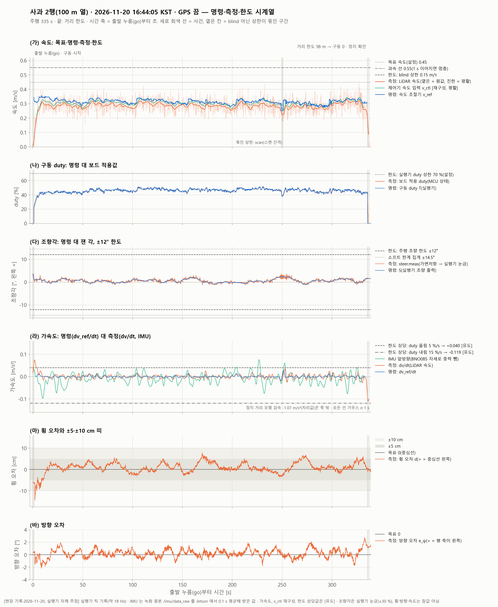
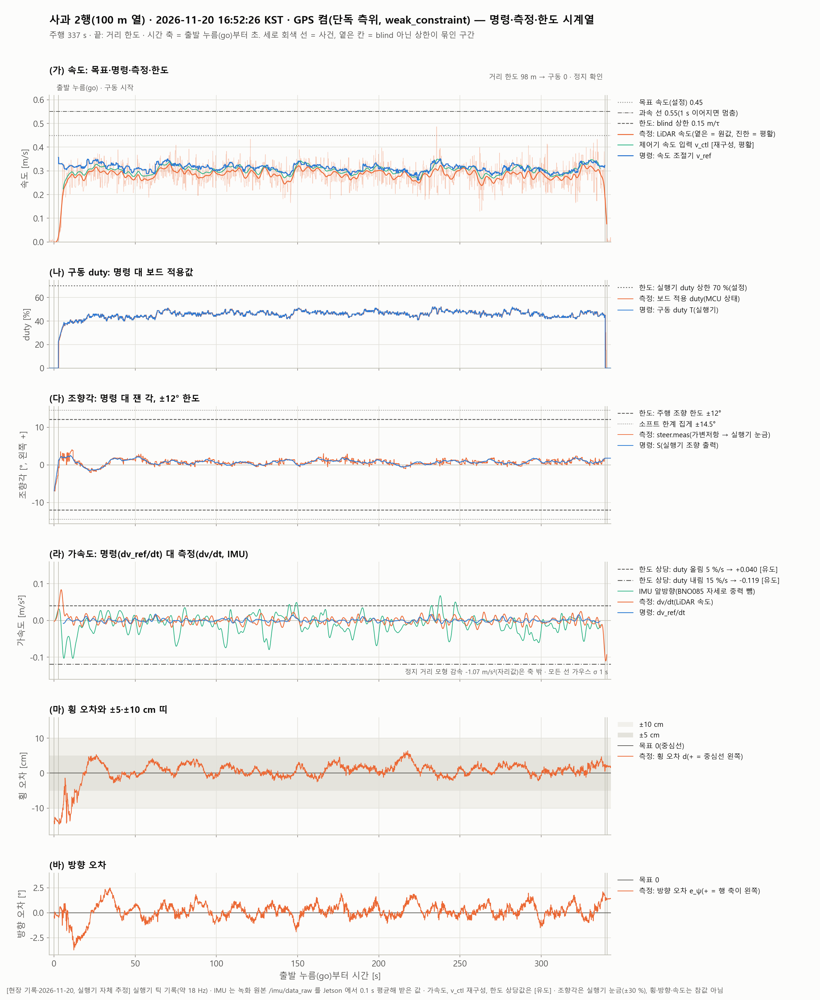
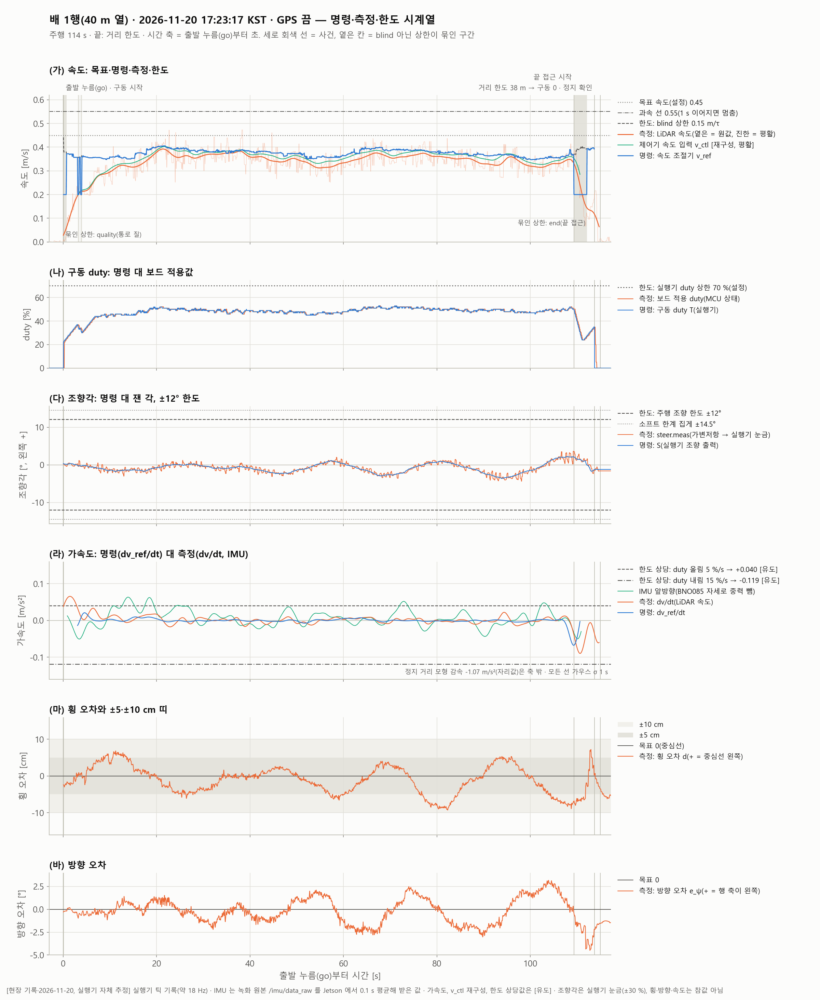
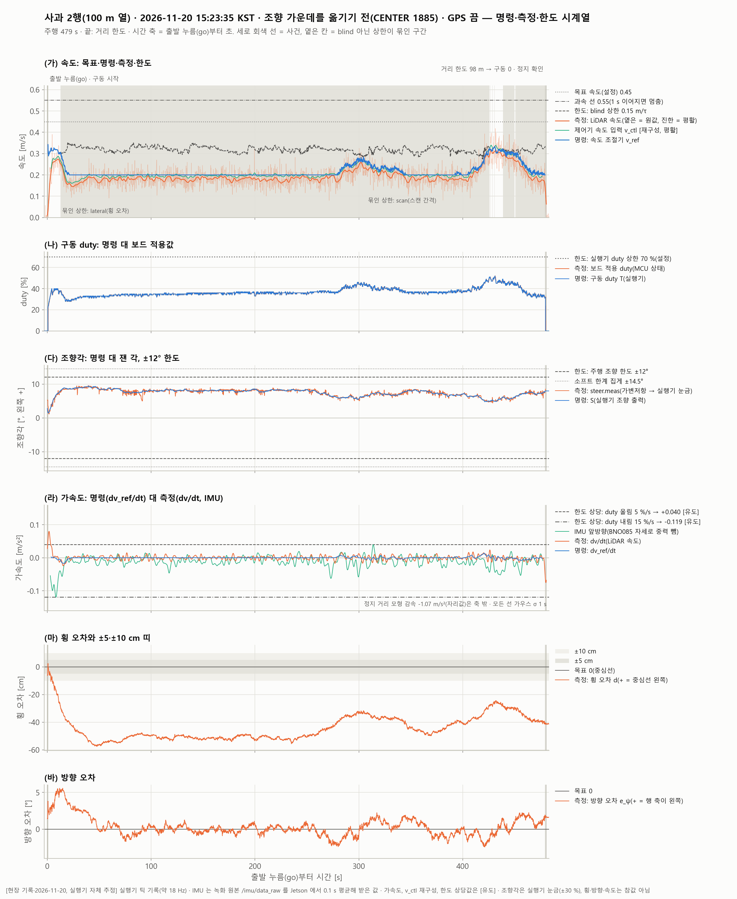
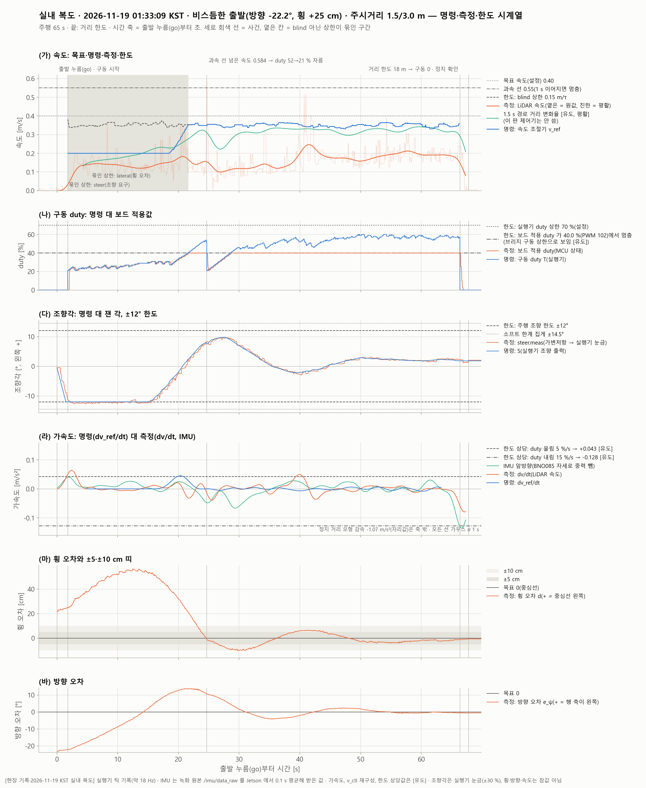
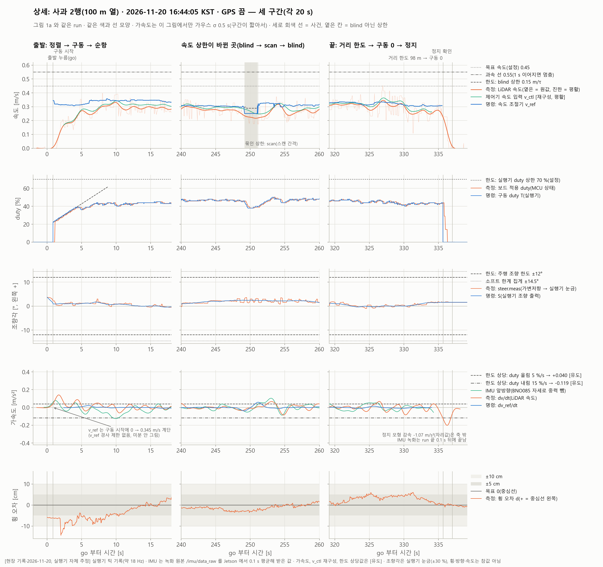
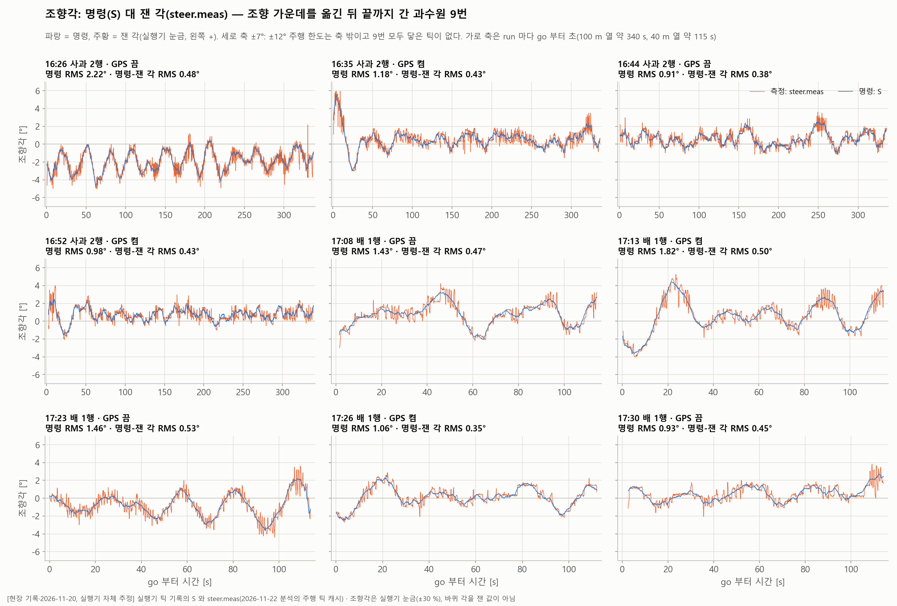
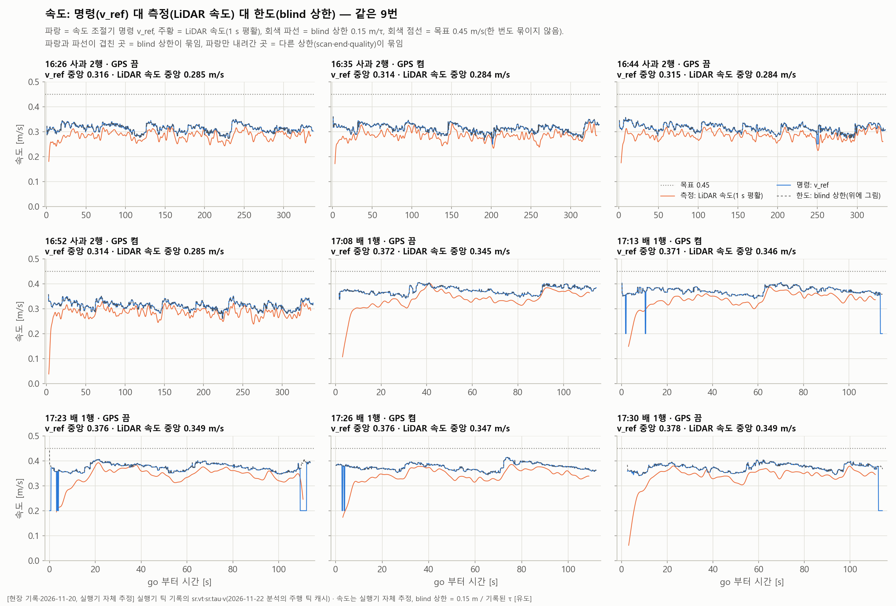

# 명령·측정·한도 시계열 그림 (앞바퀴 조향 차 자율주행 run)

- 작성: 2026-11-23. 실차 시험은 더 하지 않으므로(사용자 결정 2026-11-22) 이미 있는 기록으로만 만들었다.
- 까닭: 다른 과제의 PlotJuggler 그림(같은 시간 축에 실제 가속도, 명령 가속도, 최대 가속도 한도 세 줄)과 같은 꼴의 그림이 노션·GitHub 에 없었다. 지금까지의 그림은 run 별 요약이나 분포였다([`AUTONOMY_RUNS_ANALYSIS_KO.md`](AUTONOMY_RUNS_ANALYSIS_KO.md) 8절).
- 그림 8장은 이 저장소의 `figures/timeseries/`에 있다(원본 PNG 와 같은 크기, 256색 팔레트로 줄인 사본). 그림마다 그린 값의 CSV 와 수치 `summary.json`(`out/`), 다시 내는 코드(`scripts/`)는 저장소 밖 `<runs>/report_1122/timeseries/`에 있다(`<runs>`는 작업 폴더의 runs 폴더). 이 문서는 그 폴더의 문서를 2026-11-23에 옮긴 것이고, 경로 표기와 표 머리 기호 하나(표가 깨지지 않게)만 바꿨다.
- **참값이 아니다.** 속도, 거리, 횡 오차, 방향 오차는 실행기가 LiDAR 로 스스로 추정한 값이다. 조향각은 실행기 눈금(명령 20 = 26°, ±30 %)이고 바퀴 각을 각도계로 잰 값이 아니다. 줄자·측량 기준은 두 날 모두 없다.
- GNSS 좌표는 어디에도 없다. 틱 기록의 국소 위치(`rel_m`)와 GNSS 블록은 읽는 순간 지웠고(`extract_windows.py`), Jetson 에서는 IMU 주제만 열었다.

## 0. 값 표지

| 표지 | 뜻 |
|---|---|
| [과수원] | [현장 기록·2026-11-20]. 실행기 틱 기록에 그대로 있는 값: 시각, duty 명령·보드 적용 duty, 묶인 속도 상한 이름, v_ref, τ, 조향 명령 S, 가변저항 읽기 steer.meas |
| [과수원·추정] | [현장 기록·2026-11-20, 실행기 자체 추정]: LiDAR 속도, 거리, 횡·방향 오차 |
| [복도], [복도·추정] | [현장 기록·2026-11-19 KST 실내 복도], 같은 구분 |
| [설정] | 틱 기록의 `config`·`tuning_change` 사건이나 코드의 설정값 |
| [자리값] | 잰 적이 없는 설정값 |
| [유도] | 이 문서에서 계산한 값(가속도, 재구성한 v_ctl, 통계, 상관, 한도 상당값) |

## 1. 그림 목록

| 파일 | 한 줄 설명 | 그림 안 출처 표지 |
|---|---|---|
| [`fig1a_1644_apple2_gps_off.png`](figures/timeseries/fig1a_1644_apple2_gps_off.png) | 사과 2행(100 m 열) 16:44:05, GPS 끔: 속도·duty·조향·가속도·횡 오차·방향 오차를 한 시간 축에(명령 / 측정 / 한도) | [현장 기록·2026-11-20, 실행기 자체 추정] |
| [`fig1b_1652_apple2_gps_on.png`](figures/timeseries/fig1b_1652_apple2_gps_on.png) | 같은 열 16:52:26, GPS 켬(단독 측위, weak_constraint): 같은 여섯 칸 | 같음 |
| [`fig1c_1723_pear1.png`](figures/timeseries/fig1c_1723_pear1.png) | 배 1행(40 m 열) 17:23:17, GPS 끔: 끝 접근(end 상한 0.20 m/s)이 걸렸다가 풀린 뒤 거리 한도 38 m 에서 섬 | 같음 |
| [`fig1d_1523_before_centre_move.png`](figures/timeseries/fig1d_1523_before_centre_move.png) | 사과 2행 15:23:35, 조향 가운데를 옮기기 전: lateral 상한이 94 % 의 틱을 묶어 v_ref 0.20, 조향 명령 +7.5° 근처, 횡 −45 cm 근처 | 같음 |
| [`fig1e_corridor_0133_angled_start.png`](figures/timeseries/fig1e_corridor_0133_angled_start.png) | 실내 복도 01:33:09, 비스듬한 출발(−22°, +25 cm): 조향 명령이 −12° 한도에 13 s 붙음, 과속 선을 넘은 스캔 속도 한 번이 duty 를 52 → 21 % 로 자름, 보드 적용 duty 가 40 % 에 멈춤 | [현장 기록·2026-11-19 KST 실내 복도] |
| [`fig2_1644_detail.png`](figures/timeseries/fig2_1644_detail.png) | **상세**: 16:44 run 의 세 20 s 구간(출발, scan 상한으로 바뀐 곳, 거리 한도 뒤 정지). 가속도는 가우스 σ 0.5 s | [현장 기록·2026-11-20, 실행기 자체 추정] |
| [`fig3a_gallery_steer.png`](figures/timeseries/fig3a_gallery_steer.png) | 조향 가운데를 옮긴 뒤 끝까지 간 과수원 9번: 조향 명령 대 잰 각(한 칸에 한 run) | 같음 |
| [`fig3b_gallery_speed.png`](figures/timeseries/fig3b_gallery_speed.png) | 같은 9번: v_ref 대 LiDAR 속도 대 blind 상한, 목표 0.45 m/s | 같음 |

- 사과 2행 = 100 m 열, 배 1행 = 40 m 열. 행 이름과 길이는 현장 시험 담당자가 알려 준 것이고, 어느 run 이 어느 행인지는 기록에서 추정했다(앞선 문서와 같음).
- 대표 run 다섯은 요청대로 골랐다. 복도에서는 비스듬한 출발 9번 가운데 한도에 가장 오래 붙고 묶인 상한이 세 번 바뀐 01:33 을 골랐다(같은 꼴의 01:59 도 있다, [`AUTONOMY_RUNS_ANALYSIS_KO.md`](AUTONOMY_RUNS_ANALYSIS_KO.md) 7.4절).

### 그림 모양

- 한 그림 = 한 run. 가로 축은 모든 칸이 같고, 그 run 의 출발 누름(`go` 사건) 때를 0 s 로 둔 초다(실행기 단조 시계). 이 축에서 정렬 → 구동 시작 → 거리 한도 → 정지가 차례로 보인다.
- 색은 역할이다. 모든 그림에서 같다: **파랑 = 명령**, **주황 = 측정**, **청록 = 둘째 측정 또는 재구성 값**, **진한 회색 파선·쇄선 = 한도**, **회색 점선 = 설정 목표**. 범례에 역할(명령/측정/한도)을 적었다. 세 색은 색각 이상 모의에서도 서로 구분되는 범주 1~3번 색이다(검사 도구로 확인, 청록은 바탕과 대비가 낮아 범례 글과 CSV 로 보완).
- 세로 회색 선 = 사건(출발 누름, 구동 시작, 끝 접근 시작, 과속으로 duty 자름, 거리 한도 → 구동 0, 정지 확인). 속도 칸의 옅은 칸 = blind 가 아닌 상한이 묶인 구간이고 이름을 글로 적었다.
- 칸 순서: (가) 속도, (나) 구동 duty, (다) 조향각, (라) 가속도, (마) 횡 오차, (바) 방향 오차. 요청한 네 칸(속도·조향·가속도·횡 오차)에 duty 와 방향 오차를 따로 붙였다. 두 세로 축을 한 칸에 겹치지 않았다.

## 2. 신호와 정의

### 2.1 그린 신호

| 신호 | 틱 기록 필드 | 단위 | 정의 | 표지 |
|---|---|---|---|---|
| 목표 속도 | `tuning.target_speed_m_s` | m/s | 운영자 목표(cruise 상한, 0.20~0.50 로 자름). 과수원 오후 0.45, 복도 01:33 0.40 | [설정] |
| v_ref(명령) | `sr.vt` | m/s | 속도 조절기 목표 = 상한 11개의 최솟값([알고리즘 문서](../AUTONOMY_ALGORITHM_KO.md) 10.2절). 경사 제한이 없다 | [과수원]/[복도] |
| 묶인 상한 | `sr.cap` | 이름 | 그 틱에 최솟값이 된 상한(blind, scan, end, quality, lateral, steer) | [과수원]/[복도] |
| blind 상한(한도) | 0.15 m / `sr.tau` | m/s | "제어 지연 τ 동안 15 cm 넘게 가지 않기". 틱 기록에는 상한 값들이 따로 없어 기록된 τ 로 다시 냈다. 묶인 상한이 blind 인 틱에서 v_ref 와 2 mm/s 안에서 같다(16:44 의 99.4 %) | [유도] |
| LiDAR 속도(측정) | `v` | m/s | 추정기의 ICP 전진 속도, 최근 성공 스캔 5개의 중앙값(10 Hz) | [과수원·추정]/[복도·추정] |
| v_ctl(제어기 속도 입력) | 없음 → 재구성 | m/s | max(LiDAR 속도, 1.5 s 경로 거리 변화율). 과수원 판 실행기만 쓴다(`speed_window_s` 1.5). 틱의 `dist` 로 제어기 코드와 같은 창 규칙을 다시 돌렸다 | [유도] |
| 1.5 s 경로 거리 변화율 | `dist` | m/s | 위 둘째 항. 복도 판 제어기는 쓰지 않았지만 복도의 실제 속도에 가깝다([복도 문서](FIELD_CORRIDOR_20261119_KO.md): LiDAR 속도가 실제의 약 0.5배) | [유도] |
| duty 명령 T | `T` | % | 실행기 구동 duty(정수). 앞먹임 + PI, 올림 5 %/s·내림 15 %/s 경사 | [과수원]/[복도] |
| 보드 적용 duty | `prior.duty` | % | 조향 브리지 응답의 MCU 상태 줄의 적용 PWM ÷ 255(요청값이 아님) | [과수원]/[복도] |
| 조향 명령 S | `S` | ° | 실행기 조향 출력(mrad → °), 등가 자전거 바퀴각, 왼쪽 + | [과수원]/[복도] |
| 잰 조향각 | `steer.meas` | ° | 보드 가변저항 → 실행기 눈금 | [과수원]/[복도] |
| 횡 오차 d | `lat` | cm | + = 차 기준점이 중심선 왼쪽. 통로가 유효한 틱만 | [과수원·추정]/[복도·추정] |
| 방향 오차 e_ψ | `head` | ° | 행 축 − 차 방향, + = 행 축이 왼쪽 | [과수원·추정]/[복도·추정] |
| 명령 가속도 | d(v_ref)/dt | m/s² | 3절의 필터로 미분. 실행기 안에 "가속도 명령"은 없다. 비교용으로 만든 값 | [유도] |
| 측정 가속도 | d(LiDAR 속도)/dt | m/s² | 같은 필터. 경로 거리의 2차 미분도 CSV 에 있다(`a_path_m_s2`) | [유도] |
| IMU 앞방향 가속도 | 녹화 `/imu/data_raw` | m/s² | 4절. 그림에는 BNO085 자세로 중력을 뺀 값(`a_imu_att`), CSV 에는 센서 축 비력(`a_imu_rawaxis`)도 | [유도] |

### 2.2 한도 선

| 한도 | 값 | 어디서 | 표지 |
|---|---|---|---|
| 주행 조향 한도 | ±12°(209.4 mrad) | `steer_follow_limit_deg`, 두 날 같음 | [설정] |
| 소프트 한계 집게 | ±14.5°(0.9 × 281 mrad) | `limit_margin` × 소프트 한계. ±12° 보다 넓어 닿지 않는다 | [설정]·[유도] |
| blind 상한 | 0.15 m / τ | 위 2.1. τ 의 고정 몫 0.24 s 는 [자리값] | [유도] |
| 과속 선 | 0.55 m/s | v_ctl > 0.55 가 1 s 이어지면 멈춤, duty 자르기는 `overspeed_confirm_s` 뒤(과수원 0.3 s, 복도 01:33 판에는 키가 없어 0 = 첫 틱) | [설정] |
| 실행기 duty 상한 | 70 % | `duty_max_pct`(잠금 `duty_cap_pct` 75) | [설정] |
| 복도 보드 적용 duty 멈춤 | 40.0 %(PWM 102) | 01:33 run 에서 명령이 40 % 를 넘은 틱(주행 틱의 63.8 %)의 99.9 % 에서 적용 duty 가 정확히 40.0 % 였다. 브리지 구동 상한 102 로 보인다(2026-11-18 작업 결정 기록, 저장소 밖: 복도 도구를 쓸 때만 상한을 102 로 낮춤). 브리지 설정 자체는 기록에서 읽지 않았다 | [복도]·[유도] |
| duty 올림 경사 → 가속도 상당 | +0.040 m/s²(복도 +0.043) | 5 %/s × 구동 표 기울기 0.008545 m/s/%(25~80 % 구간) × 속도 배율 0.93(복도 1.0). duty 가 나타내는 표 속도가 바뀔 수 있는 빠르기이고 차의 가속 한계를 잰 값이 아니다. 구동 표는 조향 장치를 달기 전 값이고 과수원 땅에서는 표 속도의 76~85 % 만 나왔다 | [유도] |
| duty 내림 경사 → 가속도 상당 | −0.119 m/s²(복도 −0.128) | 15 %/s × 같은 기울기 | [유도] |
| 정지 거리 모형 감속 | 1.07 m/s² | 제어기 `stop_decel_m_s2` [자리값]. stop 상한과 열 끝 정지 거리에 쓰인다. 그림 축 밖이라 글로 적었다. 실행기 설정의 `controller_overrides.stop_decel_m_s2` 0.25 는 이 제어기에 닿지 않는다([알고리즘 문서](../AUTONOMY_ALGORITHM_KO.md) 부록 A 2번) | [자리값] |

## 3. 시간 축과 필터

- **시간**: 틱 기록의 `t`(실행기 단조 시계)에서 그 run 의 `go` 사건 시각을 뺐다. 틱은 20 Hz 를 목표로 하지만 고르지 않다(과수원 틱 간격 p50 53~57 ms, 100 m 열 p99 141 ms [과수원]).
- **고른 격자**: 미분하려고 0.05 s 격자에 선형 보간했다. 이웃 표본이 0.5 s 넘게 떨어진 곳은 비웠다.
- **필터**: 0 위상 가우스 평활과 가우스 미분(같은 커널의 도함수). 그림 1·3 은 σ = 1.0 s, 그림 2(상세)는 σ = 0.5 s. 커널은 ±3σ 이고, 커널이 비거나 끝에 닿는 곳은 그리지 않았다(그래서 명령 가속도 선은 구동 시작 3 s 뒤부터, IMU 선은 녹화 끝에서 끊긴다). σ = 1 s 가우스의 이득은 0.05 Hz 에서 0.95, 0.19 Hz 에서 0.5 다 [유도].
- **경로 거리 2차 미분**(`a_path`, CSV 만): σ 0.5 s 미분 다음 σ 0.866 s 미분(합쳐 σ 1 s).
- **평활한 속도선**: LiDAR 속도는 옅은 선이 원값, 진한 선이 같은 σ 의 평활값이다. v_ctl·경로 변화율 선도 그림에서는 평활값이다(원값은 CSV).
- CSV 의 가속도·평활값은 격자에서 각 틱 시각으로 보간한 값이다.

## 4. IMU 앞방향 가속도 (Jetson 에서 계산)

- 녹화 원본(rosbag2 MCAP, 압축 없음)은 Jetson 에 그대로 두었다. `<runs>/report_1122/timeseries/scripts/jetson_imu.py` 를 SSH 표준입력으로 보내 `nice 19`, 유휴 입출력 등급으로 돌렸다. 파일 끝의 요약 색인으로 `/imu/data_raw` 메시지만 찾아 읽었다(run 하나에 5~6 s, 다섯 run 30 s). 0.1 s 칸 평균(비력 3축, 자이로 3축, 센서 자세 사원수)만 받아 왔다(run 하나 68~424 KB, `<runs>/report_1122/timeseries/out/imu_raw/`). 다른 주제는 열지 않았다.
- IMU 받은 율 31.7~33.0 Hz, 가장 긴 틈 0.05~0.11 s [과수원]/[복도].
- **녹화 범위**: 과수원 녹화는 go 0.2~2.3 s 전에 시작해 run 끝 0.1~0.5 s 뒤에 끝났다. 그래서 과수원 정지 구간은 IMU 가 없다. 복도는 go 8 s 전부터 끝 4 s 뒤까지 있다.
- **시계 맞춤 확인** [유도]: 틱의 `yaw`(추정기의 IMU 요레이트, 0.25 s 저역)와 녹화 자이로를 같은 저역으로 거른 값의 상관이 −0.05~−0.075 s 에서 가장 컸다(0.951~0.995). 0.1 s 칸 하나보다 작아 따로 옮기지 않았다.
- **앞 축**: 장착 자세는 잰 적이 없다([`HARDWARE_KO.md`](../HARDWARE_KO.md) IMU 장착: "기울기·높이는 미측정"). 다섯 run 모두 출발 펄스가 센서 +y 축 쪽에 있고 x 축 쪽은 거의 0 이어서(구동 시작 뒤 2 s 의 중력 수직 비력 평균 +y 0.068~0.154, x −0.021~+0.010 m/s²) +y 를 앞으로 두었다 [유도].
- **두 가지 값**:
  - 센서 축 비력(`a_imu_rawaxis`): 출발 전 정지 구간의 평균 중력 방향에 수직인 면에 센서 +y 를 투영한 비력, 정지 평균을 뺌. 땅의 기울기가 바뀌면 g·sin(기울기)가 그대로 들어간다(1° 에 0.17 m/s²).
  - 자세 보정(`a_imu_att`, 그림의 청록 선): BNO085 자체 자세 사원수로 비력을 세계 좌표로 돌리고 정지 평균(= g)을 뺀 뒤, 센서 +y 의 수평 방향으로 투영. 기울기를 센서 융합이 맞게 잡는 만큼 지운다. 정지 때 돌린 비력이 (0.00, 0.01, 9.59) m/s² 로 위쪽이어서 사원수 방향(센서 → 세계)을 확인했다.
- 15:23 run 은 출발 전 정지 표본이 0.7 s 뿐이라 정지 기준이 약하다.

## 5. 그림별로 읽을 것

### 5.1 그림 1a — 사과 2행 16:44:05, GPS 끔



- (가) 속도: 목표 0.45 m/s 는 한 번도 묶이지 않았고 v_ref 는 주행 틱의 99.4 % 에서 blind 상한과 같았다 [과수원]·[유도]. 열 안쪽(구동 시작 15 s 뒤~끝 5 s 전) 중앙: v_ref 0.315, v_ctl 0.302, LiDAR 속도 0.284 m/s [과수원]·[과수원·추정]·[유도]. 249.2~251.1 s 에 scan 상한(0.251 m/s)이 묶였다(31틱, 0.6 %).
- (나) duty: 명령과 보드 적용값이 겹친다(중앙 47 % 대 47.1 %) [과수원]. 출발 duty 22 % 에서 3.87 s 에 38 % 까지 올라(기울기 5.3 %/s, 출발 duty 22.5 % 를 정수로 자른 몫이 섞임) 올림 경사 5 %/s 에 묶였다 [과수원]·[유도]. 70 % 상한에는 닿지 않았다.
- (다) 조향: 명령 RMS 0.91°, 최대 2.52°, ±12° 한도에 닿은 틱 0. 명령 − 잰 각 RMS 0.38°, 잰 각이 명령을 0.55 s 늦게 따라감(상관 0.91) [과수원]·[유도].
- (라) 가속도: 출발 직후 dv/dt 최대 0.075 m/s²(σ 1 s)로 duty 올림 상당 +0.040 을 넘었다. 출발 duty 는 경사 없이 0 → 22 % 로 바로 서기 때문이다. 순항 중 dv/dt 는 표준편차 0.008, |값| 95 % 0.015 m/s² 이고 dv_ref/dt 는 0.004 / 0.008 m/s² [유도]. 둘 다 한도 상당 ±0.04~0.12 보다 작다. IMU(자세 보정) 선은 0.023 / 0.048 m/s² 로 더 흔들리고 dv/dt 와 같이 움직이지 않는다(5.8절).
- (마)(바) 횡 RMS 2.61 cm. 출발 −6.0 cm 에서 2.0 s 에 −14.4 cm 까지 벌어졌다가 12 s 뒤로는 30 s 까지 ±3.8 cm 안이었다 [과수원·추정]·[유도].
- 끝: 335.68 s 에 거리 한도 98 m → duty 명령 0, 337.01 s 정지 확인 [과수원].

### 5.2 그림 1b — 사과 2행 16:52:26, GPS 켬



- 16:44 와 거의 같은 그림이다. blind 100 %, v_ref 0.314 / v_ctl 0.301 / LiDAR 0.285 m/s, duty 46 % 대 45.9 %, 조향 명령 RMS 0.98°(최대 2.46°), 명령 − 잰 각 0.43°(늦음 0.55 s), 횡 RMS 2.68 cm [과수원]·[과수원·추정]·[유도].
- GPS 켬은 위성 단독 측위 + weak_constraint 였고 RTK 는 한 번도 걸리지 않았다. 시계열에서도 GPS 끔 run 과 갈리는 곳이 보이지 않는다(비교는 [`GPS_COMPARE_KO.md`](GPS_COMPARE_KO.md)).

### 5.3 그림 1c — 배 1행 17:23:17, GPS 끔



- 첫 0.7 s 와 3.1~4.0 s 에 quality 상한(0.20 m/s)이 짧게 묶였다(통로 질). 두 번째 때 duty 명령이 37 → 30 % 로 내려갔다가 다시 올랐다 [과수원]. 순항 duty 도 더 높아(49 %) 속도가 순항의 90 % 에 닿는 데 11.4 s 걸렸다(사과 2행 5.1~5.4 s) [유도].
- 순항: v_ref 0.376 / v_ctl 0.363 / LiDAR 0.349 m/s, duty 49 % [과수원]·[과수원·추정]·[유도]. 배 1행의 τ 가 짧아(0.40 대 0.48 s) blind 상한이 높다(앞선 분석 7.1절).
- 끝 접근: 109.36 s 에 end 상한(0.20 m/s)이 묶였고(남은 거리 `sr.rem` 1.88 m), duty 가 내림 경사로 49 → 24 % 까지 내려갔다. 112.17 s 에 남은 거리 값이 비자 blind 로 돌아가 duty 가 다시 올랐고, 113.77 s 에 거리 한도 38 m 에서 섰다 [과수원].
- 조향 명령 RMS 1.46°(최대 3.61°), 명령 − 잰 각 0.53°(늦음 0.50 s), 횡 RMS 3.88 cm [과수원]·[유도].

### 5.4 그림 1d — 사과 2행 15:23:35, 조향 가운데를 옮기기 전



- 12.8 s 부터 끝까지 lateral 상한이 대부분 묶였다(주행 틱의 94.3 %, 426.7~438.2 s 만 blind). 횡 오차가 0.40 m 를 넘으면 lateral 상한이 최저 0.20 m/s 가 되므로 v_ref 중앙 0.200, blind 상한은 그 위 0.318 m/s 에 떠 있다 [과수원]·[유도]. 횡 오차가 줄어든 곳에서 v_ref 가 올라갔다: 300~305 s 횡 −33.1 cm 에 v_ref 0.269, 425~430 s 횡 −27.5 cm 에 0.320 m/s(blind 와 lateral 이 번갈아 묶임) [과수원·추정]·[유도].
- 조향 명령은 처음부터 끝까지 +7~+9° 에 있었고(RMS 7.52°, 최대 9.45°) ±12° 한도에는 닿지 않았다. 잰 각은 명령을 0.35° RMS 안에서 따라갔다 [과수원]·[유도]. 앞선 분석의 해석(포화한 것은 조향 명령이 아니라 trim ±3°)과 맞는 그림이다([`AUTONOMY_RUNS_ANALYSIS_KO.md`](AUTONOMY_RUNS_ANALYSIS_KO.md) 7.3절).
- 횡 RMS 45.0 cm [과수원·추정].

### 5.5 그림 1e — 실내 복도 01:33:09, 비스듬한 출발



- (다) 조향: 출발 각 −22.2° 에서 명령이 1.8 s 부터 14.9 s 까지 −12° 한도에 붙었다(13.2 s, 주행 틱의 20.0 %). 잰 각도 한도 근처를 따라갔고 명령 − 잰 각 RMS 0.46° [복도]·[유도]. 소프트 한계 집게 ±14.5° 에는 닿지 않았다.
- (가) 속도: 묶인 상한이 steer(1.8~5.5 s) → lateral(5.5~21.7 s) → blind 로 바뀌었다. 앞 둘에서 v_ref 는 0.20 m/s 였다 [복도].
- 복도의 LiDAR 속도는 실제보다 낮다. 30~64 s 중앙 LiDAR 0.166, 1.5 s 경로 거리 변화율 0.327 m/s(비 0.51), v_ref 0.350 [복도·추정]·[유도]. 이 판 제어기는 LiDAR 속도만 썼으므로 PI 가 duty 명령을 52~60 % 까지 올렸다.
- (나) duty: 그러나 보드 적용 duty 는 40.0 % 에서 멈췄다(2.2절). 실제로 차를 민 것은 40 % 였고, 경로 변화율로 본 속도는 v_ref 보다 약 7 % 낮았다 [복도]·[유도].
- **과속 선**: 24.67 s 에 LiDAR 속도가 두 틱 0.584 m/s 로 튀어(과속 선 0.55 위) duty 명령이 52 → 21 % 로 바로 잘렸다(이때 판에는 `overspeed_confirm_s` 가 없어 첫 틱에 자름). 그 뒤 duty 는 5 %/s 로 다시 올랐고 경로 변화율은 0.32 → 0.22 m/s(평활값)까지 내려갔다 [복도]·[유도]. [알고리즘 문서](../AUTONOMY_ALGORITHM_KO.md) 10.5절이 0.3 s 확인 시간을 넣은 까닭으로 든 "한 스캔의 속도 튐이 duty 를 자른" 경우가 이 run 에도 있다.
- (마)(바) 횡 오차는 +56 cm 까지 벌어졌다가 25 s 쯤 0 을 지나 −10 cm 넘침 뒤 수렴, 방향 오차는 −22° → +14° → 0 [복도·추정].

### 5.6 그림 2 — 16:44 상세(세 20 s 구간)



- 가속도는 이 그림에서만 σ 0.5 s 로 걸렀다. 다른 그림과 같은 색·선 모양이다.
- **출발(−2~18 s)**: 정렬 0.86 s 뒤 구동 시작. v_ref 는 구동 시작 틱에 0.345 m/s 로 바로 선다(v_ref 경사 제한 없음, 그래서 그 계단의 미분은 그리지 않았다). duty 명령은 22 % 에서 올림 경사 5 %/s 선을 따라 38 % 까지 오르고, 보드 적용 duty 가 약 0.25 s 늦게(상관이 가장 큰 늦음, 0.998) 같은 계단을 밟는다 [과수원]·[유도]. dv/dt 최대 0.141 m/s²(σ 0.5 s; σ 1 s 로는 0.075), 속도가 순항의 90 % 에 닿는 데 3.8 s(σ 0.5 s 평활 기준) [유도]. IMU(자세 보정) 출발 4 s 평균은 0.016 m/s² 로 dv/dt 평균 0.065 보다 작다(5.8절).
- **상한이 바뀐 곳(240~260 s)**: 249.17 s 에 scan 상한(0.05 m / 스캔 간격 P90 → 0.251 m/s)이 v_ref 를 0.298 → 0.251 m/s 로 내렸다. 스캔 간격 P90 이 0.2 s 가 된 것, 곧 스캔이 빠진 것이다. duty 명령은 0.5 s 동안 45 → 38 % 로 내림 경사(15 %/s)에 붙어 내려갔고, LiDAR 속도(평활)는 250.8 s 에 0.217 m/s 까지 내려갔다. 251.10 s 에 blind 로 돌아가 v_ref 가 0.322 로 올랐다(τ 0.519 → 0.466 s) [과수원]·[유도]. 이 구간 dv/dt 는 −0.086~+0.066 m/s²(σ 0.5 s) [유도].
- **끝(319~339 s)**: 335.68 s 거리 한도 → duty 명령 0. 보드 적용 duty 는 상태 보고로 43.9 → 29.0(+0.17 s) → 14.1(+0.34 s) → 0(+0.63 s) % 로 내려갔고, 실행기 거리는 +0.44 s 에 9.4 cm 더 가서 멈췄다. LiDAR 속도(5 스캔 중앙값)는 +0.58 s 까지 0.227 에 남았다가 떨어져 정지보다 늦다 [과수원]·[과수원·추정]. dv/dt 최저 −0.20 m/s²(σ 0.5 s), σ 1 s 로는 −0.11 [유도]. 정지 거리 모형 감속 1.07 m/s² 와의 비교는 5.8절.

### 5.7 그림 3 — 갤러리(옮긴 뒤 끝까지 간 과수원 9번)





| run [과수원] | 조향 명령 RMS ° | \|명령\| 95 % ° | 명령 최대 ° | 명령 − 잰 각 RMS ° | 늦음 s (상관) | 명령 자기상관 첫 봉우리 s (높이) | v_ref 중앙 m/s | LiDAR 속도 중앙 m/s | v_ref = blind % |
|---|---|---|---|---|---|---|---|---|---|
| 16:26 사과 2행 GPS 끔 | 2.22 | 3.78 | 4.64 | 0.48 | 0.55 (0.93) | 28.4 (0.51) | 0.316 | 0.285 | 100.0 |
| 16:35 사과 2행 GPS 켬 | 1.18 | 2.41 | 5.56 | 0.43 | 0.50 (0.92) | 42.2 (0.21) | 0.314 | 0.284 | 99.8 |
| 16:44 사과 2행 GPS 끔 | 0.91 | 1.95 | 2.52 | 0.38 | 0.55 (0.91) | 91.0 (0.27) | 0.315 | 0.284 | 99.4 |
| 16:52 사과 2행 GPS 켬 | 0.98 | 1.72 | 2.46 | 0.43 | 0.55 (0.87) | 128.8 (0.21) | 0.314 | 0.285 | 100.0 |
| 17:08 배 1행 GPS 끔 | 1.43 | 2.75 | 3.27 | 0.47 | 0.45 (0.94) | 43.0 (0.29) | 0.372 | 0.345 | 100.0 |
| 17:13 배 1행 GPS 켬 | 1.82 | 3.50 | 4.41 | 0.50 | 0.35 (0.96) | 65.5 (0.35) | 0.371 | 0.346 | 98.6 |
| 17:23 배 1행 GPS 끔 | 1.46 | 2.81 | 3.61 | 0.53 | 0.50 (0.93) | 25.5 (0.47) | 0.376 | 0.349 | 96.3 |
| 17:26 배 1행 GPS 켬 | 1.06 | 2.12 | 2.46 | 0.35 | 0.40 (0.95) | 62.4 (0.29) | 0.376 | 0.347 | 99.4 |
| 17:30 배 1행 GPS 끔 | 0.93 | 2.12 | 2.69 | 0.45 | 0.45 (0.87) | 27.9 (0.39) | 0.378 | 0.349 | 97.6 |

- 표의 계산은 모두 [유도]이고, 바탕 값(S, steer.meas, sr.vt, sr.tau)은 [과수원], LiDAR 속도는 [과수원·추정]이다. 중앙값은 구동 시작 15 s 뒤~끝 5 s 전. 늦음 = 잰 각을 0~1.5 s 당겨 상관이 가장 큰 값.
- 조향: 9번 모두 명령이 ±6° 안이고 ±12° 한도에 닿은 틱은 0 이다. 잰 각은 명령을 0.35~0.55 s 늦게, RMS 0.35~0.53° 차이로 따라갔다. 앞선 분석의 0.35~0.75 s, 0.33~0.69° 와 같은 크기다([`AUTONOMY_RUNS_ANALYSIS_KO.md`](AUTONOMY_RUNS_ANALYSIS_KO.md) 7.6절).
- 16:26(조향 가운데를 옮긴 뒤 첫 run)은 명령 평균 −1.93° 를 중심으로 약 28 s 주기(0.285 m/s 에서 약 8 m)로 −4.6~+0.4° 사이를 고르게 흔들렸다. 명령 자기상관 첫 봉우리 0.51 로 9번 가운데 가장 뚜렷하다(나머지 0.21~0.47) [유도]. 그래도 횡 RMS 는 3.4 cm 였다(앞선 분석 표). 왜 이 run 만 이렇게 흔들렸는지는 이 기록으로 가르지 않았다.
- 속도: 목표 0.45 는 9번 모두 한 번도 묶이지 않았다. v_ref 는 주행 틱의 96.3~100 % 에서 blind 상한과 같았고, 남은 틱은 scan·quality·end 상한이다. LiDAR 속도 중앙은 v_ref 중앙보다 사과 2행 0.029~0.031, 배 1행 0.025~0.029 m/s 낮았다 [유도].

### 5.8 이 속도에서 가속도는 뜻이 있나

- **순항 중 가속도는 작다.** 대표 과수원 run 넷의 순항 구간(σ 1 s)에서 dv/dt 표준편차 0.006~0.009, |값| 95 % 0.012~0.017 m/s², 경로 거리 2차 미분 0.005~0.007 / 0.010~0.015 m/s², dv_ref/dt 0.003~0.005 / 0.006~0.008 m/s² [유도]. 속도가 0.28~0.38 m/s 에서 거의 일정했고, 이 크기의 흔들림은 대부분 속도 추정의 흔들림이다(LiDAR 속도 미분과 경로 거리 2차 미분의 상관 0.54~0.69). 그림의 가속도 칸은 "가속도가 한도 상당값 ±0.04~0.12 m/s² 안에 머물렀다"는 것까지만 보여 준다.
- **뜻이 있는 곳은 출발과 정지 둘뿐이다.**
  - 출발: duty 가 0 → 22 % 로 바로 선 뒤 5 %/s 로 오른다. dv/dt 최대 0.066~0.084 m/s²(σ 1 s), 순항 속도 90 % 까지 5.1~5.4 s(사과 2행), 11.4 s(배 1행 17:23: 순항 duty 가 높고 출발 직후 quality 상한이 duty 를 한 번 내림), 2.0 s(15:23, 순항이 0.19 m/s) [유도]. 출발을 늦추는 것은 v_ref 가 아니라 duty 올림 경사다.
  - 정지: duty 명령 0 뒤 실행기 거리가 더 간 거리와 걸린 시간 [과수원·추정]/[복도·추정], 평균 감속 = 직전 1.5 s 경로 변화율 ÷ 시간 [유도]:

| run | 직전 속도 LiDAR / 경로 m/s | 더 간 거리 cm | 멈출 때까지 s | 평균 감속 m/s² | 모형의 시작 지연 + 감속 몫 v·0.25 + v²/(2·1.07), 경로 속도로 cm |
|---|---|---|---|---|---|
| 16:44 | 0.276 / 0.250 | 9.4 | 0.44 | 0.57 | 9.2 |
| 16:52 | 0.304 / 0.291 | 7.9 | 0.44 | 0.67 | 11.2 |
| 17:23 | 0.123 / 0.130 | 6.4 | 0.39 | 0.34 | 4.0 |
| 15:23 | 0.193 / 0.177 | 2.9 | 0.30 | 0.59 | 5.9 |
| 복도 01:33 | 0.185 / 0.323 | 13.5 | 0.59 | 0.55 | 12.9 |

  - 평균 감속 0.34~0.67 m/s² 는 모형의 1.07 m/s² [자리값]보다 작지만, 이 시간에는 브리지 내림 경사(320 PWM/s, 47 % 에서 약 0.38 s)와 보드 상태 지연이 함께 들어 있어 차의 제동 능력을 잰 값이 아니다. 모형의 시작 지연 0.25 s + 감속 몫과 더 간 거리는 같은 크기(3~14 cm 대 4~13 cm)다 [유도]. 17:23 은 정지 직전 duty 가 다시 오르던 중이라 직전 속도가 낮게 잡혔다.
- **IMU 는 이 크기의 가속도를 재지 못했다.**
  - 센서 축 비력: 과수원 순항 표준편차 0.10~0.19, |값| 95 % 0.23~0.93 m/s². dv/dt 보다 10~60배 크다. 주행 중 센서 기울기(세로축과의 각)가 과수원 3.5~6.8°(5~95 %), 복도 2.1~2.6° 였다 [유도]. 땅의 기울기 변화가 g·sin 으로 들어간 것이다(1° = 0.17 m/s²). 복도에서는 0.034 / 0.116 m/s² 로 작다.
  - 자세 보정 값(그림의 청록 선): 과수원 0.014~0.024 / 0.037~0.055 m/s² 로 줄었지만, 경로 거리 2차 미분과의 상관이 0.10~0.34 다. 출발 4 s 평균도 −0.076~+0.007 m/s²(σ 1 s)로 dv/dt 평균 0.046~0.054 를 따라가지 못했다. 센서 융합이 느린 가속을 기울기로 받아들이는 것으로 보인다 [유도].
  - 그래서 그림의 IMU 선은 "IMU 로는 0.05 m/s² 아래의 앞방향 가속을 가를 수 없었다"는 근거로 둔 것이고, 가속도의 참값으로 쓰지 않는다.

## 6. 한계

- 참값이 없다. 속도·거리·횡·방향은 실행기 자체 추정이고, 복도 LiDAR 속도는 실제의 약 절반이다.
- "명령 가속도"(dv_ref/dt)는 실행기에 없는 양이다. 속도 조절기는 v_ref 만 내고, 가속을 실제로 묶는 것은 duty 경사(5 %/s, 15 %/s)와 브리지 경사다. 한도 상당값(+0.040, −0.119 m/s²)은 조향 장치를 달기 전 구동 표로 바꾼 값이고, 과수원 땅에서는 표 속도의 76~85 % 만 나왔다.
- 상한 값들(`caps`)은 틱 기록에 없다. blind 상한은 기록된 τ 로 다시 냈고, 다른 상한은 묶였을 때 v_ref 로만 보인다. v_ctl 도 기록에 없어 다시 냈다.
- 정지 거리 모형 1.07 m/s² 는 자리값이다. 설정의 0.25 는 이 제어기에 닿지 않는다.
- 복도 01:33 의 40 % duty 멈춤은 보드 적용 duty 에서 읽은 것이고 브리지 설정을 기록에서 확인하지 않았다.
- IMU: 장착 자세 미측정(앞 축은 출발 펄스로 정함), 과수원 녹화가 run 끝 0.1~0.5 s 뒤에 끝나 정지 구간이 없음, 15:23 은 정지 기준 0.7 s. 0.1 s 칸 평균이라 그보다 빠른 진동은 지워졌다.
- 조향각은 실행기 눈금(±30 %), 잰 각은 가변저항 읽기다. 바퀴 각·벨트 유격은 잰 적이 없다.
- run 수: 대표 다섯과 갤러리 아홉(대표와 셋이 겹침). 과수원 하루, 두 열, 복도 하룻밤이다.
- 필터 폭(σ 1 s, 0.5 s)은 고른 값이다. σ 를 바꾸면 최대·최저 가속도가 바뀐다(16:44 출발 dv/dt 최대 σ 1 s 0.075, σ 0.5 s 0.141 m/s²).

## 7. 다시 내는 법

스크립트는 저장소에 넣지 않았다. 입력이 저장소 밖 현장 기록(실행기 틱 기록)과 Jetson 에 둔 녹화 원본이기 때문이다.

```
cd <runs>/report_1122/timeseries/scripts
python -I -B extract_windows.py   # 틱 기록 → out/windows/<run>.npz, events.json (대표 다섯, go−3 s ~ 끝+4 s, GNSS 지움)
python -I -B fetch_imu.py         # Jetson 에서 jetson_imu.py 실행 → out/imu_raw/<run>.json (SSH, 원본은 Jetson 에 둠)
python -I -B make_figures.py      # → figs/*.png, out/*.csv, out/summary.json (Malgun Gothic 필요)
```

- 갤러리는 2026-11-22 분석의 주행 틱 캐시(`<runs>/report_1122/analysis/out/runs/*.npz`, `runs_index.json`)를 그대로 쓴다.
- `peek_tick.py` 는 틱 한 줄의 구조를 GNSS 를 지운 채 보는 보조 도구다.
- 입력은 읽기만 했다. 파일은 UTF-8, 줄 끝 LF.

### 파일

| 경로 | 내용 |
|---|---|
| `figures/timeseries/fig1a~fig1e_*.png`(이 저장소) | 대표 run 다섯의 여섯 칸 시계열 |
| `figures/timeseries/fig2_1644_detail.png`(이 저장소) | 16:44 상세 세 구간 |
| `figures/timeseries/fig3a_gallery_steer.png`, `fig3b_gallery_speed.png`(이 저장소) | 9번 갤러리 |
| `<runs>/report_1122/timeseries/figs/` | 위 그림의 원본 PNG(RGBA, 같은 크기) |
| `<runs>/report_1122/timeseries/out/fig1*.csv`, `out/fig2_1644_detail.csv` | 그 그림의 틱마다 값 22칸(머리 줄 `#` 에 출처·필터) |
| `<runs>/report_1122/timeseries/out/fig3_gallery.csv` | 9번의 주행 틱: 조향 명령·잰 각, v_ref, LiDAR 속도(원값·평활), blind 상한, 목표, 묶인 상한 |
| `<runs>/report_1122/timeseries/out/summary.json` | 이 문서의 수치(run 별 통계, 출발·정지, IMU 정보와 시계 확인, 갤러리 표, 상수) |
| `<runs>/report_1122/timeseries/out/windows/`, `out/imu_raw/` | 중간 자료(틱 창, Jetson 에서 받은 IMU 0.1 s 평균) |
| `<runs>/report_1122/timeseries/scripts/` | `extract_windows.py`, `fetch_imu.py`, `jetson_imu.py`, `ts_common.py`, `make_figures.py`, `peek_tick.py` |
